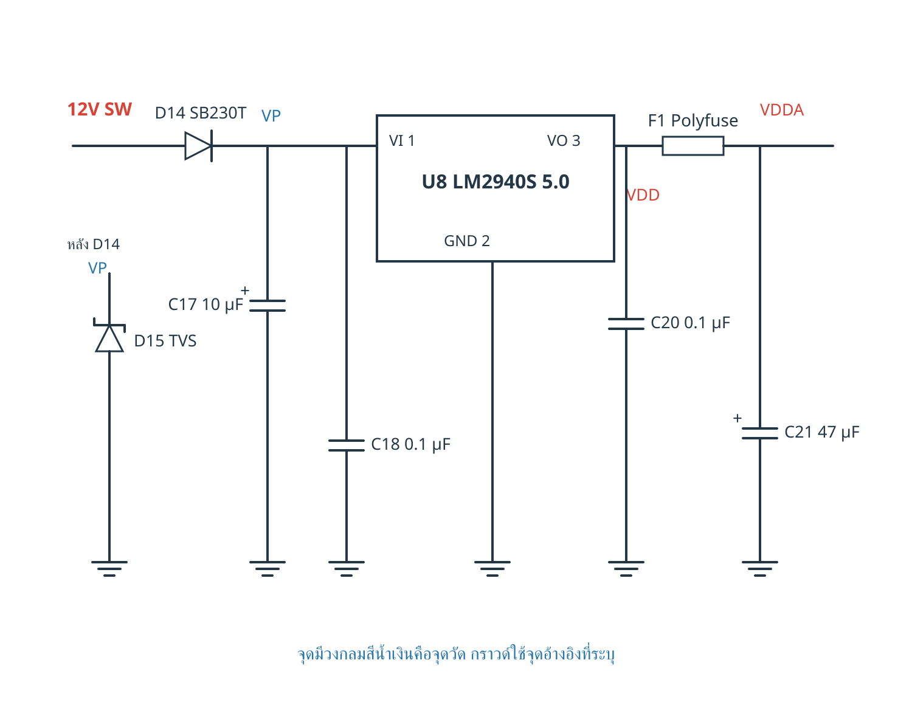

# หนังสือสอนวงจรและซ่อม ECU

แหล่งรวมหนังสือภาษาไทยสำหรับเรียนรู้ ECU เครื่องยนต์สันดาป ตั้งแต่พื้นฐานไฟฟ้า การอ่านวงจรและวิเคราะห์อาการ ไปจนถึงการอ่านข้อมูล ย้ายชิป IC และประเมินงานโคลนกล่อง เน้นวงจร ภาพจริง จุดวัด และคำอธิบายสั้นที่อ่านตามได้

โครงการนี้มี **ต้นฉบับเต็ม 145 หน้า** และ **คู่มือผู้เข้าเรียนคอร์ส 40 หน้า** จัดทำจากงานเขียนและการตรวจแก้ในโครงการเดียวกัน

## เปิดอ่านและดาวน์โหลด

| ฉบับ | ใช้สำหรับ | PDF สำหรับอ่านและพิมพ์ | Word แก้ไขได้ | อ่านเนื้อหาบน GitHub |
| --- | --- | --- | --- | --- |
| ฉบับเต็ม 145 หน้า | เรียนละเอียดและใช้ค้นคว้าระหว่างซ่อม | [เปิด PDF](books/ECU_Complete_Circuit_Book.pdf) | [ดาวน์โหลด Word](books/ECU_Complete_Circuit_Book.docx) | [ต้นฉบับ Markdown](manuscripts/full.md) |
| ฉบับคอร์ส 40 หน้า | ใช้ประกอบการสอนและจดผลฝึกปฏิบัติ | [เปิด PDF](books/ECU_Course_Handbook.pdf) | [ดาวน์โหลด Word](books/ECU_Course_Handbook.docx) | [ต้นฉบับ Markdown](manuscripts/course.md) |

PDF มีภาพจำนวนมาก หาก GitHub ไม่แสดงตัวอย่าง ให้กด **Download raw file** ที่หน้าของไฟล์ PDF แล้วเปิดบนเครื่อง ใช้ PDF เป็นฉบับอ้างอิงการจัดหน้า ส่วน Word อาจแบ่งหน้าต่างกันตามโปรแกรมและฟอนต์

## สิ่งที่อยู่ในหนังสือ

**ฉบับเต็ม** รวมเนื้อหาซ่อม ECU และย้ายชิปไว้เล่มเดียว พร้อมวงจรไฟฟ้า 30 แผ่น ภาพถ่ายจริง 19 ภาพ และข้อมูลเบอร์ชิป มีภาพประกอบแสดงรวม 118 จุด

- ภาคจ่ายไฟ ฟิวส์ ไดโอด TVS ตัวกรอง LDO และ Buck
- MCU ไฟเลี้ยง Reset Clock และกราวด์
- อินพุตเซนเซอร์ NTC TPS Hall และ VR
- ภาคขับรีเลย์ หัวฉีด คอยล์จุดระเบิด และ H bridge
- การสื่อสาร CAN และ K line พร้อมตัวอย่างขา IC ที่ระบุเบอร์ชัดเจน
- EEPROM แบบ SPI I2C และ Microwire การสำรองข้อมูล อ่านกลับ และตรวจ Verify
- การย้ายชิป การประเมินความเข้ากันได้ และข้อจำกัดของการโคลน
- แบบบันทึกผลวัด เอกสารอ้างอิง และเครดิตภาพ

**ฉบับคอร์ส** คัดเนื้อหาให้กระชับ มีหน้าวงจร 18 หน้า ภาพถ่ายและแผนภาพสรุป พร้อมใบงาน 4 หน้า เลือกไฮไลต์เฉพาะหน้า **7 10 13 17 27 และ 32** รวม 6 หน้า เพื่อเน้นจุดตรวจและหลักตัดสินใจ ไม่ไฮไลต์ทุกหน้า

## เปิดดูวงจร

[สารบัญวงจร SVG ทั้ง 30 แผ่น](circuits/README.md) — ขยายภาพและแก้ไขได้ พร้อม [คำอธิบายวงจรและจุดวัด](circuits/circuits.json)

วงจร 01–26 ใช้สอนหลักการ วงจร 27–30 วาดใหม่จากบางส่วนของ **Speeduino v0.4.3d Rev 4d** โดยระบุแหล่งต้นทางไว้ ภาพเหล่านี้ไม่ใช่ผังภายใน ECU OEM ทุกยี่ห้อ ต้องใช้เอกสารตรงรุ่นเมื่อทำงานกับกล่องจริง

### ตัวอย่างวงจรภาคจ่ายไฟ



วาดใหม่จาก Speeduino v0.4.3d Rev 4d • [ที่มาและการแก้ไข](circuits/NOTICE.txt) • [CERN-OHL-S-2.0](circuits/LICENSE-CERN-OHL-S-2.0.txt)

## ข้อมูลการแต่งหนังสือ

- [โจทย์และขอบเขตหนังสือ](docs/PROJECT_BRIEF.md)
- [กองบรรณาธิการและขั้นตอนตรวจต้นฉบับ](docs/EDITORIAL.md)
- [โครงสร้างเนื้อหา](docs/CONTENTS.md)
- [เอกสารอ้างอิงและเครดิตภาพ](docs/REFERENCES.md)
- [สิทธิ์และเงื่อนไขการใช้เนื้อหา](RIGHTS.md)
- [ประวัติฉบับเผยแพร่](CHANGELOG.md)

กองบรรณาธิการใช้เอเจนต์ AI แยกหน้าที่ตรวจวงจร เนื้อหา และรูปเล่ม งานตรวจนี้เป็นการตรวจต้นฉบับและเทียบเอกสาร ไม่ใช่การรับรองจากผู้เชี่ยวชาญมนุษย์หรือผลทดสอบฮาร์ดแวร์จริง

## โครงสร้างไฟล์

```text
books/             หนังสือ PDF และ Word ฉบับเต็มกับฉบับคอร์ส
manuscripts/       เนื้อหาที่แปลงเป็น Markdown สำหรับค้นหาและแก้ไข
assets/images/     ภาพที่ดึงจากต้นฉบับ Word โดยคงเครดิตในเนื้อหา
circuits/          วงจร SVG แหล่งอ้างอิง และใบอนุญาตของวงจร
  svg/             วงจร 01 ถึง 30
  reference/       แบบ Speeduino ที่ใช้เป็นกรณีศึกษา
docs/              โจทย์ โครงสร้างงาน บรรณาธิการ และแหล่งอ้างอิง
data/              ข้อมูลบทเรียน แผนหน้าคอร์ส เครดิต และค่าตรวจไฟล์
tools/             เครื่องมือตรวจความครบถ้วนของไฟล์ใน repository
```

Markdown ใช้สำหรับอ่านและแก้เนื้อหา ไม่รักษาการจัดหน้า 145 หรือ 40 หน้า และไม่ได้ปรับ Word/PDF ให้อัตโนมัติ เมื่อแก้ไขควรปรับต้นฉบับที่เกี่ยวข้องแล้วตรวจรูปเล่มใหม่ก่อนเผยแพร่

## ตรวจไฟล์และเสนอแก้ไข

ใช้ Python 3 รัน `python tools/verify_repository.py` เพื่อตรวจไฟล์หนังสือกับค่า SHA256 ความครบของวงจร และลิงก์ไฟล์ภายใน

หากพบจุดผิด เปิด Issue พร้อมชื่อฉบับ เลขหน้า เบอร์ชิปหรือรหัสวงจร และเอกสารผู้ผลิตที่ใช้เทียบ การปรับเนื้อหาทางเทคนิคควรผ่านการตรวจวงจรและรูปเล่มก่อนรวมเข้าฉบับเผยแพร่

จัดเก็บบน GitHub วันที่ 17 ตุลาคม 2569 หนังสือฉบับปัจจุบันจัดทำวันที่ 16 ตุลาคม 2569
