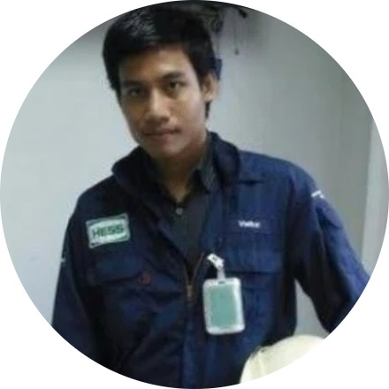
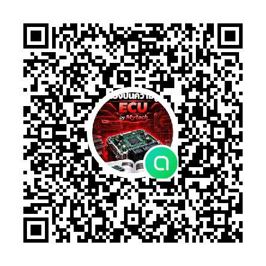

# เกี่ยวกับหนังสือและผู้เขียน

หน้านี้แนะนำที่มาของหนังสือ ผู้เขียน ผู้ที่ช่วยให้หนังสือเกิดขึ้น และข้อตกลงในการใช้งาน ควรอ่านให้จบก่อนเริ่มบทที่ 1

---

## เกี่ยวกับหนังสือเล่มนี้

**ECU HANDBOOK แจกฟรี เล่ม 1 – คู่มือซ่อม ECU รถยนต์ จากพื้นฐานสู่ขั้นสูง** เป็นหนังสือแจกฟรีสำหรับช่างและผู้สนใจงานซ่อมกล่อง ECU รถยนต์

เนื้อหาเรียงจากง่ายไปยาก แบ่งเป็น 3 ระดับ

| ระดับ | บท | เนื้อหา |
|---|---|---|
| **พื้นฐาน (Basic)** | 1–3 | ไฟฟ้าและอิเล็กทรอนิกส์ หลักการทำงานของ ECU เครื่องมือและความปลอดภัย |
| **กลาง (Intermediate)** | 4–6 | เซ็นเซอร์และสายไฟ การอ่านวงจรไฟฟ้า การเปิดอ่านแผงวงจร ECU |
| **สูง (Advanced)** | 7–9 | ระบุไอซี หาตำแหน่งวงจรขาออกบนแผงจริง วิเคราะห์อาการและซ่อมแผงอย่างเป็นระบบ |

หนังสือเขียนจาก**ภาพงานจริง**เป็นหลัก ส่วนใหญ่มาจากงานของผู้เขียนและทีม บางภาพมาจากแหล่งอ้างอิงที่ให้เครดิตไว้ และบางภาพปรับแต่งด้วย AI ซึ่งระบุไว้ในคำบรรยายใต้ภาพ ไม่ได้เรียบเรียงจากทฤษฎีอย่างเดียว ผู้อ่านจะได้เห็นแผงวงจร ชิ้นส่วน และขั้นตอนตามที่พบในงานซ่อมจริง

**เงื่อนไขการเผยแพร่**

- หนังสือเล่มนี้แจกฟรี **ห้ามจำหน่าย** ทั้งฉบับเต็มและบางส่วน
- แบ่งปันต่อได้อย่างอิสระ โดยให้เครดิต **Mytech** ทุกครั้ง

> ⚠️ ภาพที่ระบุในคำบรรยายว่า **"ปรับแต่งด้วย AI"** อาจมีตัวอักษรบนชิป รหัสไอซี หรือรายละเอียดบางส่วนที่ไม่ตรงกับของจริง ให้ใช้ภาพเหล่านี้เพื่อดูวิธีการเท่านั้น ก่อนทำงานจริงต้องอ่านรหัสจากชิ้นส่วนบนแผงและตรวจกับดาต้าชีตทุกครั้ง

---

## เกี่ยวกับผู้เขียน

*ภาพผู้เขียนจากงานในอดีต*

**Supunya Pharaphong** ผู้เขียนในนาม **Mytech** เคยศึกษาที่มหาวิทยาลัยขอนแก่น ปัจจุบันอยู่ในพื้นที่อุดรธานีและจังหวัดใกล้เคียง ใช้คำแนะนำตัวว่า "Service Lamborghini"

**ติดต่อผู้เขียน:** โทร 083-027-3860

**เข้ากลุ่มรับข้อมูลและหนังสือฟรี:** สแกน QR นี้เพื่อเข้ากลุ่มแจกข้อมูลและหนังสือฟรีของ Mytech

ประสบการณ์ของผู้เขียนอยู่ในสองสายหลักที่มาบรรจบกันในงาน ECU คือ**งานซ่อมรถยนต์**ที่ลงมือเองและบริหารอู่ และ**งานอิเล็กทรอนิกส์**ทั้งการทดสอบแผงวงจร เครื่องโปรแกรมชิป ระบบอัตโนมัติ และเครื่องมือวัด รายละเอียดแต่ละด้านมีดังนี้

### งานซ่อมรถและธุรกิจบริการ

ปัจจุบันผู้เขียนเป็น **General Manager ของ Authority car service** (เต็มเวลา ตั้งแต่ เม.ย. 2026) ดูแลรายได้และประสิทธิภาพการทำงาน วางกลยุทธ์ธุรกิจ นำทีมหัวหน้าแผนก คุมงบประมาณ KPI สต็อกอะไหล่และต้นทุน และเป็นตัวแทนธุรกิจในการติดต่อลูกค้า คู่ค้า และตัวแทนผู้ผลิต

อู่ที่ผู้เขียนบริหารรับงานดังนี้

- ซ่อมรถญี่ปุ่นและรถยุโรป
- เครื่องยนต์เบนซิน เบรก คลัตช์ ช่วงล่าง เกียร์ ไดนาโม เปลี่ยนน้ำมันเครื่อง
- ระบบไฟฟ้ารถยนต์ **ECU** **SENSOR** และระบบคอมพิวเตอร์รถรุ่นใหม่
- บริการ 24 ชั่วโมง และบริการนอกสถานที่โดยวิศวกร

ก่อนหน้านี้ผู้เขียนเป็น **MD ของ P.U.K CAR Service** (แบรนด์ "PUKCAR – Innovative smart vehicle by Engineer") ที่ขอนแก่น และเป็นเจ้าของกิจการ **ucdenterprise** ที่ขอนแก่น ซึ่งลงมือทำงานเครื่องยนต์เอง งานเหล่านี้คือที่มาของภาพงานจริงและกรณีศึกษาในหนังสือ

### งานทดสอบอิเล็กทรอนิกส์และเครื่องโปรแกรมชิป

ในตำแหน่ง **Robotics Specialist** (ฟรีแลนซ์) ที่ชลบุรี ผู้เขียนทำงานเป็นผู้รับเหมาประจำผ่าน General Test Co. สนับสนุน Harman International Thailand ในฐานะ **Test Engineer** ของสายการผลิตอิเล็กทรอนิกส์เครื่องเสียง ดูแลการทดสอบอุปกรณ์และระบบอัตโนมัติ และบำรุงรักษาเชิงป้องกันเครื่อง **HAFT Station** และ **Flash In-line**

งานนี้ใกล้เคียงกับงาน ECU โดยตรง เพราะ ECU ก็เป็นแผงอิเล็กทรอนิกส์ที่ต้องทดสอบการทำงาน และต้องเขียนโปรแกรมลงหน่วยความจำ (Flash) เหมือนกัน

### ระบบอัตโนมัติ เครื่องมือวัด และ LabVIEW

- ที่ **Idenki Thailand** (สาขาของ Idenki Japan) ผู้เขียนดูแลโครงการขายระบบอัตโนมัติและไลน์อัตโนมัติให้ลูกค้ากลุ่มชิ้นส่วนยานยนต์
- ที่ **Radicon Transmission UK Limited** และ **Matco Asia Pte Ltd** ผู้เขียนใช้ **LabVIEW** ซึ่งเป็นซอฟต์แวร์สำหรับงานวัดและควบคุมด้วยคอมพิวเตอร์ หลักการอ่านสัญญาณและควบคุมด้วยโปรแกรมแบบนี้ คือพื้นฐานเดียวกับที่ ECU ใช้อ่านเซ็นเซอร์และสั่งงานอุปกรณ์
- ที่ Matco Asia ผู้เขียนเคยเป็น sizing engineer ด้านเครื่องมือวัด (Instruments) ทำให้คุ้นกับการอ่านสเปกและเลือกอุปกรณ์วัดให้ตรงงาน

### วิศวกรรมยานยนต์และเครื่องกล

งานที่ P.U.K CAR Service เกี่ยวกับ Automotive Design และ Automotive Regulations ส่วนงานที่ Radicon เป็นงานในโรงงานผลิตเกียร์ ใช้ความรู้ Fluid Mechanics ประสบการณ์ด้านเครื่องกลช่วยให้มองอาการรถได้ทั้งระบบ ไม่ได้ดูแค่กล่อง ECU อย่างเดียว

### สรุปประวัติการทำงานด้านรถยนต์และอิเล็กทรอนิกส์

| ช่วงเวลา | ตำแหน่ง | บริษัท | ความเกี่ยวข้องกับงาน ECU |
|---|---|---|---|
| เม.ย. 2026 – ปัจจุบัน | General Manager | Authority car service | บริหารอู่ที่รับงานไฟฟ้ารถยนต์ ECU และเซ็นเซอร์ |
| ม.ค. 2025 – พ.ค. 2026 | Robotics Specialist (ฟรีแลนซ์) | General Test Co. (สนับสนุน Harman International Thailand) ชลบุรี | ทดสอบแผงอิเล็กทรอนิกส์ ดูแลเครื่อง HAFT Station และ Flash In-line |
| ม.ค. 2024 – เม.ย. 2026 | MD | P.U.K CAR Service ขอนแก่น | ธุรกิจบริการรถยนต์ Automotive Design และ Automotive Regulations |
| ก.ค. 2023 – ม.ค. 2024 | Service Engineer | Radicon Transmission UK Limited ชลบุรี | งานผลิตเกียร์ Fluid Mechanics และ LabVIEW |
| ม.ค. 2017 – ธ.ค. 2018 | Sales Project Manager | Idenki Thailand ปทุมธานี | ระบบอัตโนมัติและไลน์อัตโนมัติสำหรับลูกค้าชิ้นส่วนยานยนต์ |
| ม.ค. 2016 – ธ.ค. 2022 | Company Owner | ucdenterprise ขอนแก่น | เจ้าของกิจการที่ลงมือทำงานเครื่องยนต์เอง |
| มิ.ย. 2009 – ส.ค. 2012 | Sales and Service Engineer | Matco Asia Pte Ltd (ไทย และสิงคโปร์) | เครื่องมือวัด งานโครงการหยุดซ่อมบำรุงโรงกลั่น Thaioil และ LabVIEW |

---

## กิตติกรรมประกาศ

หนังสือเล่มนี้สำเร็จได้ด้วยความช่วยเหลือของหลายคน ผู้เขียนขอขอบคุณ

- **คุณอัครเดช อ่อนประทุม** ที่ช่วยถ่ายรูปและตัดต่อภาพ ภาพงานจริงในหนังสือส่วนใหญ่มาจากความตั้งใจของท่าน
- **คุณธเนศ เพชรสด** ที่ให้การสนับสนุน เป็นเจ้าของสถานที่ และเป็นนายทุนของหนังสือเล่มนี้

---

## แหล่งข้อมูลอ้างอิง

- **เพจ Facebook "Auto Repairing ECU"** เป็นแหล่งข้อมูลและภาพอ้างอิงส่วนหนึ่งของหนังสือ ผู้เขียนขอขอบคุณมา ณ ที่นี้
- **ดาต้าชีตของผู้ผลิตชิ้นส่วน** ในหัวข้อที่อ้างถึงดาต้าชีต ข้อมูลมาจากเอกสารของผู้ผลิตชิ้นส่วนนั้น
- **แหล่งข้อมูลในบทที่ 7** บทที่ 7 ระบุแหล่งข้อมูลของไอซีแต่ละตัวไว้ในเนื้อหา และอธิบายวิธีตรวจข้อมูลไอซีจากอินเทอร์เน็ตก่อนนำไปใช้

> 💡 ข้อมูลจากอินเทอร์เน็ตอาจผิดได้ ควรยืนยันกับดาต้าชีตและการวัดจริงบนแผงทุกครั้ง

---

## ข้อตกลงการใช้งาน

- หนังสือเล่มนี้แจกฟรี **ห้ามนำไปจำหน่าย**
- ใช้เพื่อการศึกษา และแบ่งปันต่อได้โดยให้เครดิต Mytech
- ก่อนซ่อมจริง ต้องตรวจสอบกับคู่มือซ่อมและวงจรไฟฟ้าของรถรุ่นนั้นทุกครั้ง
- งานกับระบบไฟแรงสูง (HV) ของรถไฮบริด ต้องทำโดยผู้ที่ผ่านการอบรมเท่านั้น

> ⚠️ ผู้เขียนและผู้สนับสนุนได้ตรวจเนื้อหาอย่างตั้งใจแล้ว แต่ไม่สามารถรับผิดชอบความเสียหายที่เกิดจากการนำข้อมูลไปใช้ไม่ถูกวิธี ขอให้ผู้อ่านทำงานอย่างระมัดระวังและปลอดภัย
