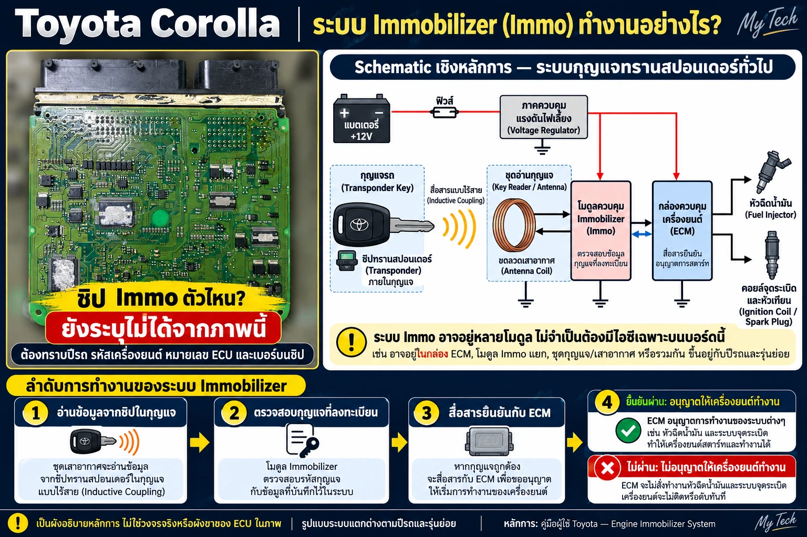
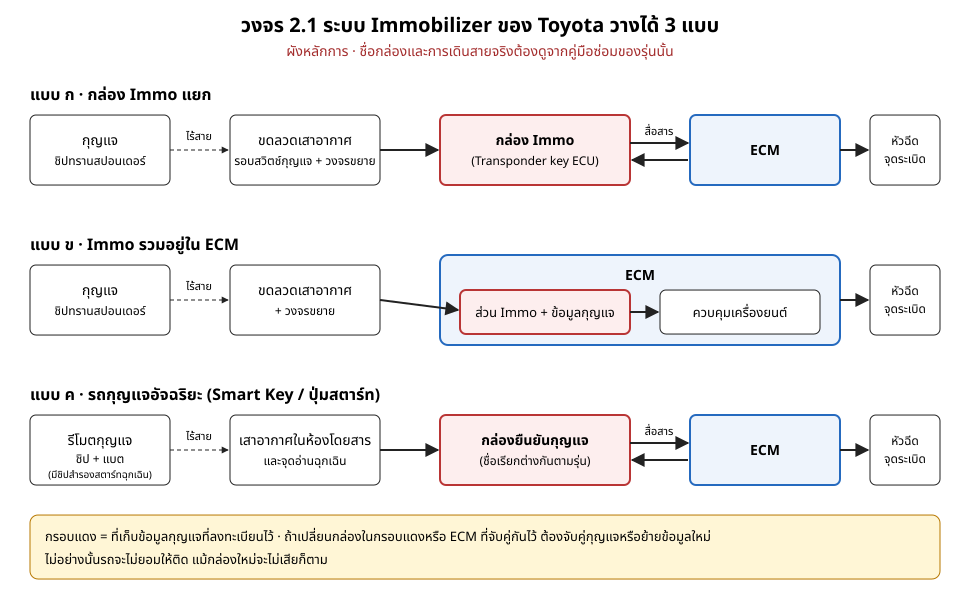

# บทที่ 2 หลักการทำงานของ ECU

> ระดับพื้นฐาน (Basic) · หัวข้ออื่นของบทนี้จะเพิ่มตามมา

---

## 2.1 ระบบ Immobilizer ECU ตัดสินว่าจะยอมให้สตาร์ทหรือไม่

### Immobilizer คืออะไร

Immobilizer (Immo) คือระบบกันขโมยที่ทำให้รถติดได้เฉพาะกุญแจที่ลงทะเบียนไว้กับรถคันนั้น ถ้าใช้กุญแจที่ไม่ได้ลงทะเบียน หรือระบบอ่านกุญแจไม่ได้ ECM จะไม่ยอมให้เครื่องติด (ตัดการสั่งหัวฉีดและการจุดระเบิด รายละเอียดต่างกันตามรุ่น) อาการที่พบได้คือ สตาร์ทเตอร์หมุนแต่เครื่องไม่ติด หรือติดแวบแล้วดับทันที ส่วนรถกุญแจอัจฉริยะอาจไม่ยอมให้สตาร์ทเตอร์หมุนเลย

ช่างซ่อม ECU ต้องรู้เรื่องนี้ เพราะอาการ "สตาร์ทไม่ติด" จาก Immo ดูเหมือนกล่องเสีย และงานเปลี่ยนหรือย้ายกล่อง ECU จะไม่จบถ้าไม่ได้จัดการข้อมูลกุญแจด้วย

### ภาพรวมของระบบ

*ภาพ 2.1 ระบบ Immobilizer ของ Toyota Corolla ตามหลักการทั่วไป ภาพแผงด้านซ้ายไม่ได้ระบุว่าชิปตัวไหนทำหน้าที่ Immo และผังด้านขวาไม่ใช่วงจรจริงของกล่องนี้ ผังวาด Immo เป็นกล่องแยกซึ่งเป็นเพียงแบบหนึ่ง ดูแบบอื่นในวงจร 2.1 กล่อง "Voltage Regulator" ในผังเป็นการวาดย่อ ในรถจริงแต่ละกล่องรับไฟ +B หรือ IG ผ่านฟิวส์และรีเลย์ แล้วมีภาคจ่ายไฟของตัวเองอยู่ในกล่อง ไม่มีกล่องควบคุมแรงดันกลางแยกต่างหาก ข้อความ "หลักการ: คู่มือผู้ใช้ Toyota" ในภาพหมายถึงคำอธิบายการทำงานของระบบเท่านั้น ผังกล่องและทางไฟผู้เขียนวาดขึ้นเอง ไม่ได้มาจากเอกสาร Toyota **(ปรับแต่งด้วย AI – ตัวอักษรบนชิปในภาพอาจไม่ใช่รหัสจริง)***

ระบบมี 4 ส่วน

| ส่วน | อยู่ที่ไหน | หน้าที่ |
|---|---|---|
| ชิปทรานสปอนเดอร์ | ในตัวกุญแจ | เก็บรหัสประจำกุญแจ ตัวชิปไม่ต้องใช้แบตเตอรี่ (รับพลังงานจากเสาอากาศ) แบตในหัวกุญแจหรือรีโมตใช้กับรีโมตหรือระบบไร้กุญแจเท่านั้น |
| ขดลวดเสาอากาศ | รอบสวิตช์กุญแจ | ส่งพลังงานให้ชิปและอ่านรหัสแบบไร้สาย (Inductive Coupling) |
| ส่วนตรวจรหัส (Immo) | กล่องแยก หรือรวมใน ECM แล้วแต่รุ่น | เทียบรหัสกุญแจกับข้อมูลที่ลงทะเบียนไว้ |
| ECM | กล่องควบคุมเครื่องยนต์ | ได้รับการยืนยันแล้วจึงยอมสั่งหัวฉีดและจุดระเบิด |

### ลำดับการทำงาน

1. เสียบกุญแจและบิดไป ON ขดลวดเสาอากาศส่งพลังงานไปที่ชิปในกุญแจ แล้วอ่านรหัสกลับมา
2. ส่วน Immo เทียบรหัสกับข้อมูลกุญแจที่ลงทะเบียนไว้
3. ถ้ารหัสถูก ส่วน Immo สื่อสารยืนยันกับ ECM (ถ้าเป็นกล่องแยก จะคุยกันทางสายสื่อสาร)
4. **ผ่าน**: ECM สั่งหัวฉีดและจุดระเบิดตามปกติ เครื่องติด
   **ไม่ผ่าน**: ECM ไม่ยอมให้เครื่องติด อาการเป็นแบบที่อธิบายไว้ข้างต้น ขึ้นกับรุ่น

### ระบบ Immo ของ Toyota วางได้หลายแบบ

*วงจร 2.1 ผังหลักการ 3 แบบ ชื่อกล่องและการเดินสายจริงต้องดูจากคู่มือซ่อมของรุ่นนั้น*

- **แบบ ก กล่อง Immo แยก** มีกล่องตรวจรหัสกุญแจแยกจาก ECM แล้วคุยกันทางสาย
- **แบบ ข Immo รวมใน ECM** ข้อมูลกุญแจเก็บอยู่ในกล่อง ECM เอง
- **แบบ ค รถกุญแจอัจฉริยะ (Smart Key)** ใช้กล่องยืนยันกุญแจแยก รับสัญญาณจากเสาอากาศในห้องโดยสาร

แม้จะเป็น Corolla เหมือนกัน แต่ต่างปีหรือต่างรุ่นย่อยอาจใช้คนละแบบ ก่อนเริ่มงาน ต้องรู้ปีรถ รหัสเครื่องยนต์ และหมายเลขกล่อง แล้วดูผังของรุ่นนั้น

### ชิป Immo บนแผง ECU อยู่ตรงไหน

ระบุจากภาพแผงอย่างเดียวไม่ได้ ในแบบ ข ส่วน Immo มักเป็นซอฟต์แวร์ใน MCU ไม่มีชิปชื่อ "Immo" แยกให้เห็น ข้อมูลกุญแจอาจอยู่ใน EEPROM ตัวเล็กแยกบนแผง หรือในหน่วยความจำภายใน MCU แล้วแต่รุ่นกล่อง ต้องยืนยันจากเบอร์ชิปและข้อมูลของรุ่นนั้น

ในแบบ ก และ ค รหัสกุญแจแต่ละดอกเก็บอยู่ในกล่อง Immo หรือกล่องยืนยันกุญแจ ไม่ได้อยู่ใน ECM แต่ ECM ยังเก็บรหัสจับคู่กับกล่องนั้นไว้ (Toyota เรียกขั้นตอนนี้ว่าการลงทะเบียน ECU communication ID)

ต้องรู้รุ่นกล่องและเบอร์ชิปบนแผงก่อน แล้วตรวจกับดาต้าชีตและข้อมูลของรุ่นนั้น (วิธีระบุไอซีจะอธิบายในบทที่ 7)

### เรื่องที่ช่างซ่อม ECU ต้องรู้

**1. รถสตาร์ทไม่ติด อย่าเพิ่งสรุปว่ากล่องเสีย**

สังเกตไฟเตือนรูปกุญแจหรือไฟ Security บนหน้าปัดก่อน หลายรุ่นออกแบบให้ไฟกะพริบตอนดับเครื่องและดึงกุญแจออก ซึ่งเป็นการทำงานปกติ สิ่งที่ต้องดูคือไฟตอนบิดกุญแจไป ON หรือตอนสตาร์ท ถ้าไฟแสดงว่าระบบไม่ยอมรับกุญแจ ให้ลองกุญแจอีกดอกที่ลงทะเบียนไว้ ตรวจว่ากุญแจไม่ได้เสียหายหรือถูกเปลี่ยนกรอบใหม่ (ชิปอาจหลุดหาย) และไม่ใช่กุญแจปั๊มที่ไม่มีชิปหรือยังไม่ได้ลงทะเบียน ความหมายของการกะพริบต่างกันตามรุ่น ให้ดูคู่มือของรุ่นนั้น

**2. เปลี่ยนหรือสลับกล่อง ECM หรือกล่อง Immo ต้องจัดการข้อมูลกุญแจหรือรหัสจับคู่**

- **แบบ ข** กล่อง ECM มือสองจำกุญแจของรถคันเดิม รถจะไม่ติดแม้กล่องไม่เสีย ต้องลงทะเบียนกุญแจใหม่ด้วยเครื่องมือวิเคราะห์ที่รองรับ หรือย้ายข้อมูลจากกล่องเดิม
- **แบบ ก และ ค** เปลี่ยน ECM หรือกล่อง Immo ตัวใดตัวหนึ่ง ต้องลงทะเบียนรหัสจับคู่ระหว่างกล่องใหม่ ส่วนจะต้องลงทะเบียนกุญแจใหม่ด้วยหรือไม่ ให้ทำตามคู่มือซ่อมของรุ่นนั้น

**3. งานซ่อมแผงต้องสำรองข้อมูลก่อนเสมอ**

ข้อมูลกุญแจหรือรหัสจับคู่อยู่ในหน่วยความจำของกล่อง (ECM ในแบบ ข และทั้ง ECM กับกล่อง Immo ในแบบ ก และ ค) งานบัดกรีหรือเปลี่ยนชิ้นส่วนใกล้หน่วยความจำ ต้องอ่านสำรองข้อมูลก่อน ถ้าข้อมูลเสีย กุญแจทุกดอกจะใช้ไม่ได้ (วิธีสำรองและย้ายข้อมูลอยู่ในภาคสามของหนังสือ "วงจรและการซ่อม ECU" ฉบับเต็ม)

> ⚠️ **ข้อตกลงการใช้งาน** ความรู้เรื่อง Immobilizer ในหนังสือนี้ใช้สำหรับซ่อมรถที่ตรวจสอบความเป็นเจ้าของได้เท่านั้น ก่อนลงทะเบียนกุญแจหรือย้ายข้อมูล ต้องตรวจคู่มือจดทะเบียนรถ (เล่มทะเบียน) กับบัตรประชาชนของผู้มาติดต่อให้ตรงกันทุกครั้ง และเก็บสำเนาไว้ หนังสือนี้ไม่สอนและไม่สนับสนุนการตัดหรือปิดระบบ Immobilizer เพราะทำให้รถถูกขโมยง่ายขึ้น และอาจผิดกฎหมายหรือมีผลต่อประกันภัย
