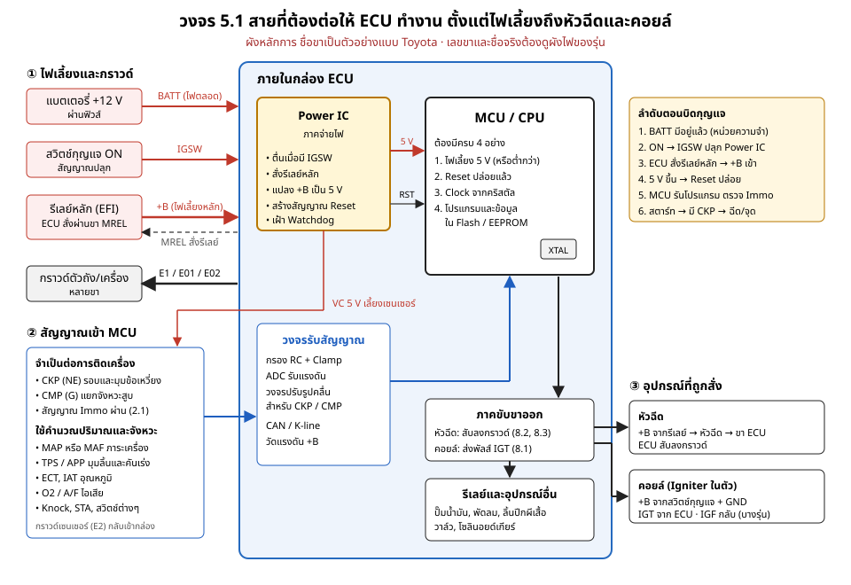
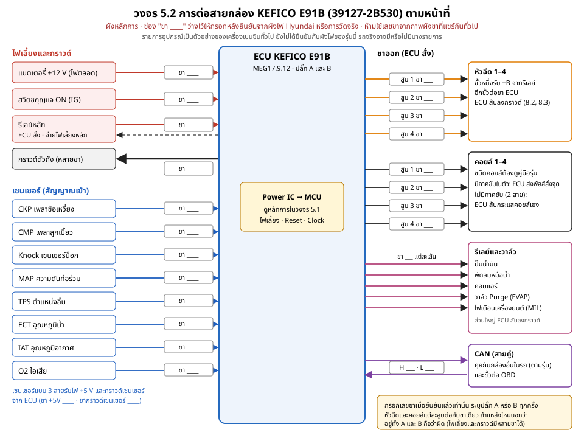
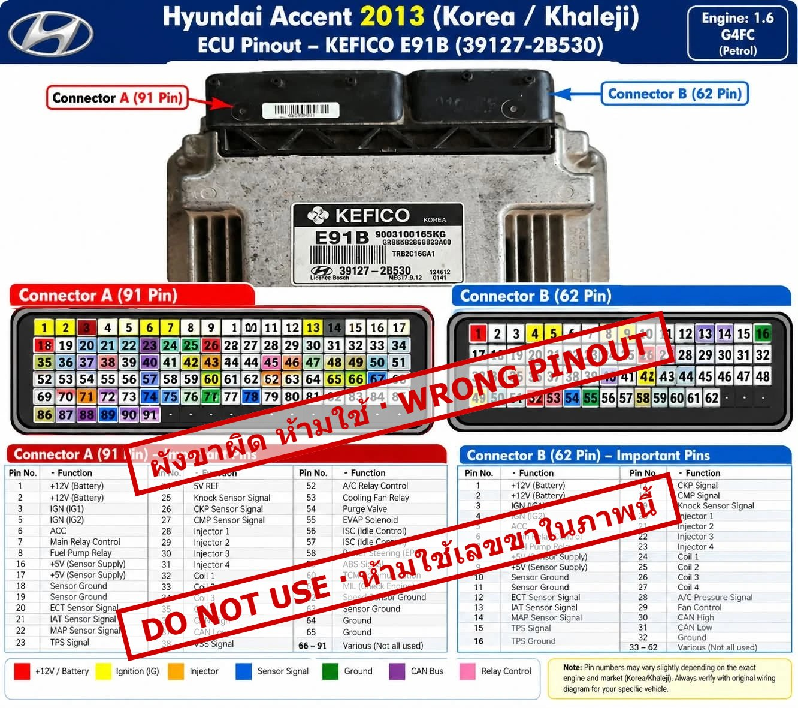

# บทที่ 5 การอ่านวงจรไฟฟ้า

> ระดับกลาง (Intermediate) · หัวข้ออื่นของบทนี้จะเพิ่มตามมา

---

## 5.1 สายที่ต้องต่อให้ ECU ทำงาน ตั้งแต่ไฟเลี้ยงถึงหัวฉีดและคอยล์

ก่อนอ่านผังไฟของรถคันไหน ให้รู้ก่อนว่า ECU ต้องการสายอะไรบ้างจึงจะทำงาน เมื่อรู้แล้ว เปิดผังไฟของรุ่นใดก็หาขาที่ต้องตรวจได้ทันที และเมื่อรถสตาร์ทไม่ติด ก็ไล่ได้ว่าขาดสายไหน

*วงจร 5.1 ผังหลักการ ชื่อขาเป็นตัวอย่างแบบ Toyota (BATT, IGSW, +B, MREL, E1) ยี่ห้ออื่นเรียกต่างกัน เลขขาและชื่อจริงต้องดูผังไฟของรุ่นนั้น*

### ① สายที่ทำให้ Power IC ทำงาน

Power IC คือภาคจ่ายไฟในกล่อง ทำหน้าที่ปลุกกล่อง แปลงไฟ 12 V เป็นไฟเลี้ยงที่ MCU และเซนเซอร์ใช้ และคุมจังหวะเริ่มทำงาน (ดูโซนภาคจ่ายไฟในหัวข้อ 6.1)

| สาย | ชื่อตัวอย่าง (Toyota) | หน้าที่ | ถ้าขาด |
|---|---|---|---|
| ไฟแบตเตอรี่ตรง | BATT | มีไฟตลอดแม้ดับเครื่อง เลี้ยงหน่วยความจำค่าที่เรียนรู้และรหัสปัญหา บางรุ่นใช้เลี้ยงวงจรสั่งรีเลย์หลักด้วย | ค่าที่เรียนรู้และรหัสปัญหาหายทุกครั้งที่ดับเครื่อง บางรุ่นสั่งรีเลย์หลักไม่ได้ จึงไม่มี +B |
| สัญญาณสวิตช์กุญแจ | IGSW | บอกกล่องว่าบิดกุญแจ ON แล้ว ให้ Power IC ตื่น | กล่องไม่ตื่น ไม่มีไฟ 5 V ไม่สื่อสาร |
| สั่งรีเลย์หลัก | MREL | กล่องสั่งให้รีเลย์หลักต่อ (บางรุ่นรีเลย์ต่อจากสวิตช์กุญแจโดยตรง ไม่มีขานี้) | รีเลย์ไม่ต่อ ไม่มี +B |
| ไฟเลี้ยงหลัก | +B | ไฟจากรีเลย์หลัก เลี้ยงภาคจ่ายไฟและภาคขับในกล่อง | กล่องทำงานไม่ครบหรือไม่ทำงาน |
| กราวด์ | E1, E01, E02 (ต่อลงตัวถังหรือเครื่อง) และ E2 (กราวด์เซนเซอร์ วิ่งกลับเข้ากล่อง ไม่ได้ลงตัวถัง) | E1 เป็นกราวด์หลักของกล่อง E01/E02 เป็นกราวด์กำลังของภาคขับ E2 เป็นกราวด์อ้างอิงของเซนเซอร์ | ค่าเซนเซอร์เพี้ยน ภาคขับทำงานผิด หรือกล่องไม่ทำงาน |

ลำดับตอนบิดกุญแจ:

1. BATT มีไฟอยู่แล้วตลอดเวลา
2. บิดกุญแจ ON → IGSW ปลุก Power IC
3. กล่องสั่งรีเลย์หลักผ่าน MREL → ไฟ +B เข้ากล่อง
4. Power IC สร้างไฟ 5 V และปล่อยสัญญาณ Reset ให้ MCU
5. MCU เริ่มรันโปรแกรม ตรวจระบบ Immobilizer (หัวข้อ 2.1)

ถ้ากล่องไม่ตื่น ให้วัดตามลำดับนี้: BATT → IGSW → +B → กราวด์ทุกขา ก่อนสงสัยวงจรในกล่อง (ดูข้อควรระวังเรื่องการวัดท้ายหัวข้อ)

### ② สิ่งที่ MCU ต้องมีจึงจะทำงาน และสัญญาณที่ MCU รับ

**MCU ต้องมีครบ 4 อย่าง**

1. **ไฟเลี้ยง** จาก Power IC (มักเป็น 5 V บาง MCU ใช้ไฟต่ำกว่านั้นสำหรับแกนประมวลผล)
2. **Reset ปล่อยแล้ว** Power IC หรือวงจร Supervisor ปล่อย Reset เมื่อไฟเลี้ยงนิ่ง และมี Watchdog คอยรีเซ็ตเมื่อโปรแกรมค้าง
3. **Clock** จากคริสตัลข้าง MCU
4. **โปรแกรมและข้อมูล** ใน Flash และ EEPROM ถ้าข้อมูลเสีย MCU อาจไม่ทำงานหรือทำงานผิด

ขาดไฟเลี้ยง Reset หรือ Clock MCU จะไม่ทำงาน แม้ไฟเข้ากล่องครบ ส่วนถ้าโปรแกรมหรือข้อมูลเสีย MCU อาจไม่ทำงาน หรือทำงานแต่ผิด เช่น ระบบ Immobilizer ไม่ผ่าน

**สัญญาณที่ MCU รับเข้ามา**

| กลุ่ม | สัญญาณ | ใช้ทำอะไร |
|---|---|---|
| จำเป็นต่อการติดเครื่อง | CKP (Toyota เรียก NE) | รอบเครื่องและมุมข้อเหวี่ยง ไม่มีสัญญาณนี้ กล่องไม่ฉีดและไม่จุด |
| | CMP (Toyota เรียก G) | แยกว่าลูกสูบสูบไหนอยู่จังหวะอัด ใช้ฉีดและจุดตามลำดับสูบ |
| | สัญญาณ Immobilizer | กุญแจผ่านแล้วจึงยอมให้ติด (หัวข้อ 2.1) |
| คำนวณปริมาณน้ำมันและจังหวะจุด | MAP หรือ MAF | ภาระเครื่อง (ปริมาณอากาศ) |
| | TPS และ APP | มุมลิ้นปีกผีเสื้อและคันเร่ง (หัวข้อ 8.4) |
| | ECT, IAT | อุณหภูมิน้ำหล่อเย็นและอากาศ |
| | O2 หรือ A/F | ส่วนผสมในไอเสีย ใช้ปรับแก้ปริมาณฉีด |
| | Knock | การน็อก ใช้ถอยจังหวะจุด |
| | แรงดัน +B | ใช้ชดเชยเวลาเปิดหัวฉีดและเวลาชาร์จคอยล์ |
| | STA, สวิตช์อื่น | กำลังสตาร์ท เกียร์ว่าง แอร์ ฯลฯ |
| สื่อสาร | CAN, K-line | คุยกับกล่องอื่นและเครื่องมือวิเคราะห์ |

สัญญาณแอนะล็อกผ่านวงจรกรองและ Clamp ก่อนเข้า ADC ของ MCU ส่วน CKP และ CMP ผ่านวงจรปรับรูปคลื่นก่อน (ดูโซนวงจรรับสัญญาณเซนเซอร์ในหัวข้อ 6.1)

### ③ สายที่ทำให้หัวฉีดทำงาน และปริมาณฉีดแปรผันกับอะไร

**ต้องต่ออะไรบ้าง**

- **ไฟ +B** ที่ขั้วหัวฉีด มาผ่านฟิวส์และรีเลย์ตามผังไฟของรุ่น
- **ขาสั่งจาก ECU** อีกขั้วของหัวฉีดต่อไปที่ขา ECU ซึ่งสับลงกราวด์เมื่อต้องการฉีด (หัวข้อ 8.2, 8.3)
- **กราวด์กำลังของ ECU** ภาคขับหัวฉีดสับกระแสลงกราวด์ผ่านขากราวด์ของกล่อง
- **เงื่อนไขในกล่อง** ต้องมีสัญญาณ CKP และกุญแจผ่าน Immobilizer ส่วน CMP ใช้แยกลำดับสูบ ถ้าไม่มี บางระบบยังติดได้โดยฉีดแบบสำรองและตั้งรหัสปัญหา บางระบบติดยากหรือติดไม่ได้
- **ปั๊มน้ำมันทำงาน** ECU สั่งรีเลย์ปั๊ม หัวฉีดเปิดได้แต่ถ้าไม่มีแรงดันน้ำมัน เครื่องก็ไม่ติด

**ปริมาณฉีดแปรผันกับอะไร**

ECU คุมปริมาณน้ำมันด้วย "เวลาที่เปิดหัวฉีด" (ความกว้างพัลส์)

| ปัจจัย | ผลต่อเวลาฉีด |
|---|---|
| ภาระเครื่อง (MAP/MAF) | อากาศเข้ามาก ฉีดนาน |
| รอบเครื่อง (CKP) | ใช้คู่กับภาระเพื่อคำนวณปริมาณต่อรอบ |
| อุณหภูมิน้ำ (ECT) | เครื่องเย็น ฉีดนานขึ้น |
| อุณหภูมิอากาศ (IAT) | ใช้ปรับแก้ตามความหนาแน่นของอากาศ |
| การเปลี่ยนมุมลิ้น (TPS) | เหยียบเร็ว เพิ่มน้ำมันชั่วคราว ถอนคันเร่ง อาจตัดน้ำมัน |
| เซนเซอร์ไอเสีย (O2 หรือ A/F) | เครื่องอุ่นแล้ว ปรับเพิ่มหรือลดให้ส่วนผสมตรงเป้า |
| แรงดัน +B | ไฟต่ำ หัวฉีดเปิดช้า ECU เพิ่มเวลาชดเชย |

### ④ สายที่ทำให้คอยล์ทำงาน และจังหวะจุดแปรผันกับอะไร

**ต้องต่ออะไรบ้าง** (คอยล์ที่มีภาคขับในตัว Toyota เรียก Igniter, Nissan เรียก power transistor หัวข้อ 8.1 และ 8.5)

- **ไฟ +B** ที่คอยล์ มาผ่านสวิตช์กุญแจ ฟิวส์ และรีเลย์ตามผังไฟของรุ่น
- **กราวด์คอยล์** สำหรับ Igniter ในตัวคอยล์
- **สัญญาณสั่งจุดจาก ECU** (Toyota เรียก IGT) ระบบคอยล์ COP มีคอยล์ละหนึ่งเส้น ระบบจานจ่ายหรือระบบที่จุดสองสูบพร้อมกันมีจำนวนเส้นต่างไป
- **สัญญาณยืนยันกลับ** (Toyota เรียก IGF) มีในบางรุ่น ถ้า ECU ไม่ได้รับ อาจตัดหัวฉีด
- **เงื่อนไขในกล่อง** ต้องมีสัญญาณ CKP ส่วน CMP ใช้แยกลำดับสูบ (ผลเมื่อไม่มี CMP ต่างกันตามระบบ)

**จังหวะจุดและเวลาชาร์จคอยล์แปรผันกับอะไร**

| ค่า | ปัจจัย | ผล |
|---|---|---|
| องศาจุดระเบิด | รอบเครื่อง | โดยทั่วไป รอบสูงขึ้น จุดเร็วขึ้น (ล่วงหน้ามากขึ้น) แล้วคงที่ที่รอบสูง |
| | ภาระเครื่อง | ภาระสูง จุดช้าลงเพื่อกันน็อก |
| | การน็อก (Knock) | ตรวจพบน็อก ECU ถอยองศาจุด |
| | อุณหภูมิน้ำและอากาศ | ใช้ปรับแก้ตามสภาพเครื่อง |
| เวลาชาร์จคอยล์ (Dwell) | แรงดัน +B | ไฟต่ำ ชาร์จนานขึ้นให้ได้พลังงานพอ |
| | รอบเครื่อง | ECU พยายามคงเวลาชาร์จเป็นมิลลิวินาทีไว้ เมื่อรอบสูง เวลาชาร์จจึงกินองศาข้อเหวี่ยงมากขึ้น และที่รอบสูงมากอาจถูกจำกัดเพราะเวลาระหว่างการจุดสั้นลง |

ทิศทางในตารางเป็นหลักการทั่วไป ค่าจริงและตารางที่ ECU ใช้ (แผนที่ข้อมูลในโปรแกรม) ต่างกันตามรุ่นและการตั้งค่าของผู้ผลิต ให้ดูค่ามาตรฐานจากคู่มือซ่อมหรือเครื่องมือวิเคราะห์ของรุ่นนั้น ในคอยล์ที่มี Igniter ในตัว บางระบบ ECU กำหนดเวลาชาร์จผ่านความกว้างพัลส์ IGT บางระบบ Igniter คุมเองบางส่วน

### อ่านผังไฟของรุ่นจริงอย่างไร

1. หาหน้าผังไฟของระบบควบคุมเครื่องยนต์ (EFI/ECM) ของรุ่น ปี และเครื่องยนต์ตรงกับรถ
2. หาขาตามกลุ่มในหัวข้อนี้ทีละกลุ่ม: ไฟเลี้ยงและกราวด์ → สัญญาณเข้า → ขาออกหัวฉีดและคอยล์
3. ดูว่าผังมองขั้วต่อจากด้านไหน (ด้านกล่องหรือด้านสายไฟ) ก่อนนับเลขขา
4. ยืนยันขาด้วยการวัดก่อนใช้ทุกครั้ง ผังขาที่แชร์กันทางอินเทอร์เน็ตผิดได้ บางภาพมีหน้าที่ซ้ำกันทั้งสองขั้วต่อ ซึ่งกล่องเดียวเป็นแบบนั้นไม่ได้
5. บันทึกผังขาที่ยืนยันแล้วไว้คู่กับหมายเลขกล่อง

> ⚠️ **การวัดและทดสอบ**
> - วัดไฟเลี้ยงและสัญญาณแบบแทงหลังขั้วต่อ (Back-probe) ขณะเสียบขั้วต่อ ห้ามเจาะฉนวนสาย
> - วัดความต่อเนื่องหรือความต้านทานเมื่อปิดกุญแจและถอดขั้วต่อแล้วเท่านั้น
> - ห้ามจ่ายไฟ จั๊มขา หรือต่อเครื่องมือเข้าขาใดตามผังที่ยังไม่ได้ยืนยัน การจ่าย +12V ผิดขาหรือช็อตขาสัญญาณลงกราวด์ทำให้กล่องเสียได้ทันที
> - ถ้าจ่ายไฟให้กล่องบนโต๊ะ ใช้แหล่งจ่ายที่จำกัดกระแส ต่อกราวด์ทุกขาก่อนจ่ายไฟ และดูว่ากล่องไม่กินกระแสสูงผิดปกติ

---

## 5.2 ตัวอย่าง: การต่อสายกล่อง ECM Hyundai Accent (KEFICO E91B) และการยืนยันเลขขา

หัวข้อ 5.1 อธิบายหลักการ หัวข้อนี้ใช้กล่องจริงหนึ่งใบเป็นตัวอย่าง คือ KEFICO E91B เลขอะไหล่ Hyundai 39127-2B530 (MEG17.9.12) หน้าผู้ขายหลายแห่งระบุว่าใช้กับ Hyundai Accent ปี 2010–2014 เครื่อง Gamma 1.4 และ 1.6 MPI

*วงจร 5.2 เลขขาจากตาราง ECM Terminal ในคู่มือซ่อม Hyundai/Kia ของเครื่อง Gamma MPI (ขั้วต่อ EGG-K 94 ขา) ขาในกรอบเขียวขีดเส้นใต้ตรงกับเอกสารเครื่องมือของกล่อง MEG17.9.12 ขาอื่นต้องวัดยืนยันกับกล่องจริงก่อนใช้*

### เลขขามาจากไหน และเชื่อได้แค่ไหน

| แหล่ง | คืออะไร | ใช้ได้แค่ไหน |
|---|---|---|
| คู่มือซ่อม Hyundai Accent RB 2012 เครื่อง G 1.6 MPI (สำเนาบน pdfcoffee.com) | ตาราง ECM Terminal Function และค่าสัญญาณ | แหล่งหลัก |
| คู่มือ Hyundai Solaris ฉบับแปลรัสเซีย (automn.ru) | ตารางขาเดียวกัน | ผู้ค้นรายงานว่าตรงกับแหล่งหลัก ผู้ตรวจเปิดหน้าไม่ได้ ยังไม่ได้เทียบ |
| คู่มือ Kia Rio QB 1.4 Gamma (สำเนาบน pdfcoffee.com) | ตารางขาของรุ่นพี่น้อง | ผู้ตรวจเทียบแล้ว ตรงกับแหล่งหลักทุกขาที่ใช้ในวงจร |
| เอกสารเครื่องมือ Dimsport สำหรับ KEFICO MEG17.9.12 | รูปขั้วต่อของกล่องรุ่นนี้จริง | ตามรายงานของผู้ค้น ยืนยัน 6 ขา (3, 5, 18, 30, 57, 79) และปลั๊ก 2 ตัว (ผู้ตรวจอ่านไฟล์ซ้ำไม่ได้) |

ข้อจำกัดที่ต้องรู้

- **สามแหล่งแรกมาจากคู่มือต้นฉบับเดียวกัน** ไม่ใช่การวัดแยกกันสามครั้ง
- **ตารางในคู่มือเป็นขั้วต่อเดียว 94 ขา (EGG-K)** มีขาเดียวที่ระบุว่าใช้เฉพาะเกียร์ธรรมดา (ขา 33 สวิตช์คลัตช์) ส่วนกล่อง E91B ในภาพมีปลั๊กสองตัว เอกสารเครื่องมือของ MEG17.9.12 ยืนยันขาของปลั๊กตัวใหญ่ได้ 6 ขาที่ตรงกับ EGG-K **ปลั๊กตัวที่สองไม่มีข้อมูลเลย** อาจเกี่ยวกับเกียร์อัตโนมัติหรือระบบอื่น ยังยืนยันไม่ได้
- **กราวด์เซนเซอร์:** คู่มือให้ขา 63, 65, 70, 78, 83, 85, 86 เป็นกราวด์เซนเซอร์ แต่ไม่ได้ระบุว่าเป็นของเซนเซอร์ตัวไหน (ยกเว้นขา 26 ของ CMP และขา 64 ของ ECT) วงจร 5.2 จึงไม่จับคู่ขากราวด์ให้เซนเซอร์อื่น ต้องวัดเอง คู่มือ Kia Rio ระบุขา 42 ว่าเป็นไฟเลี้ยง 5 V ของ CKP ด้วย แต่คู่มือ Accent ไม่ได้ระบุ
- **APS 2 ขา 69 และ Knock ขาที่สอง:** ข้อความในคู่มือ Accent ช่วงขา 68–72 อ่านไม่ชัด APS 2 ขา 69 ยืนยันจากคู่มือ Kia ส่วน Knock มีขาสัญญาณ 91 ขาที่สองยังไม่ยืนยัน
- **ไม่พบในตาราง:** ไฟแบตเตอรี่ตรงและขาสั่งรีเลย์หลัก ต้องวัดหาเอง
- **O2 ตัวล่าง:** ตารางให้ขา 66 และ 71 เป็นฮีตเตอร์ทั้งคู่ และไม่มีขาสัญญาณ น่าจะผิดในต้นฉบับ ห้ามใช้จนกว่าจะวัดยืนยัน
- **ไฟเลี้ยง TPS และ APS:** คู่มือระบุ 3.3 V แต่มีโพสต์ช่างระบุว่ากล่องบางรุ่นย่อยจ่าย 5 V ให้วัดจริงก่อน
- **ระวังคู่มือ Accent ตลาดอเมริกาเครื่อง 1.6 GDI** เลขขาต่างจากชุดนี้ทั้งหมด ห้ามนำมาปนกัน

### คอยล์ของเครื่องนี้ไม่มีภาคขับในตัว

ตารางในคู่มือระบุว่าขาคอยล์ที่ ECM (27, 28, 49, 50) มีแรงดันย้อน 300–400 V ตอนตัดกระแส แปลว่า **ECM สับขดปฐมภูมิของคอยล์เอง** ด้วยภาคขับกำลังในกล่อง คอยล์ไม่มีภาคขับในตัว ต่างจาก Toyota ในหัวข้อ 8.1 (ข้อนี้อนุมานจากค่าในคู่มือ คู่มือไม่ได้เขียนประโยคนี้ไว้ตรงๆ)

### ภาพผังขาที่แชร์กันทางอินเทอร์เน็ตผิด

> ⛔ **ภาพด้านล่างเป็นตัวอย่างผังขาที่ผิด ห้ามใช้เลขขาในภาพนี้วัด จั๊ม หรือต่อเครื่องมือ**

*ภาพ 5.2 ⛔ **ตัวอย่างผังขาที่ผิด ห้ามนำเลขขาใดในภาพนี้ไปใช้** ภาพผังขากล่อง KEFICO E91B (39127-2B530) ที่แชร์กันทางอินเทอร์เน็ต ตราสีแดงในภาพประทับโดยผู้เขียนเพื่อกันการนำไปใช้ ตาราง "Important Pins" ของปลั๊ก A และ B ระบุหน้าที่ซ้ำกันเกือบทั้งชุด สีในช่องขาไม่ตรงกับตาราง และเลขขาบางช่องซ้ำหรือเพี้ยน หัวภาพระบุเครื่อง G4FC แต่ผู้ขายระบุว่ากล่องเลขนี้ใช้ได้ทั้งเครื่อง 1.4 และ 1.6 ภาพนี้อาจสร้างหรือปรับแต่งด้วย AI ใช้เป็นตัวอย่างการตรวจผังขาเท่านั้น*

เทียบกับคู่มือซ่อมแล้วผิดชัดเจน เช่น ภาพบอกว่าหัวฉีดสูบ 1–4 อยู่ที่ขา 28–31 ของปลั๊ก A และขา 20–23 ของปลั๊ก B แต่คู่มือระบุว่าอยู่ที่ขา 9, 8, 51, 74 และขา 28 ในคู่มือคือคอยล์สูบ 1 ส่วนจำนวนขา "91 + 62" ในภาพก็ไม่ตรงกับแหล่งใดที่พบ ถ้าช่างใช้ภาพนี้ต่อไฟ ขาที่คิดว่าเป็นหัวฉีดอาจเป็นขาคอยล์ที่มีแรงดันหลายร้อยโวลต์

### ยืนยันเลขขากับกล่องของคุณ

ก่อนใช้เลขขาในวงจร 5.2 ให้ยืนยันอย่างน้อยขาที่จะวัดหรือต่อเครื่องมือ

1. **ดูรูปขั้วต่อในคู่มือ** ว่ามองจากด้านไหน (ด้านกล่องหรือด้านสายไฟ) ก่อนนับขา
2. **ปิดกุญแจและถอดปลั๊ก ECU** แล้ววัดความต่อเนื่อง
   - **หัวฉีด:** จากขั้วหัวฉีดแต่ละสูบ (ขั้วที่ไม่ใช่ไฟ +B) ไปหาขาที่ปลั๊ก ต้องตรงกับขา 9, 8, 51, 74
   - **คอยล์:** จากสายของคอยล์แต่ละตัวไปหาขาที่ปลั๊ก ต้องตรงกับขา 28, 49, 27, 50
   - **กราวด์:** จากขา 3, 4, 77 ไปที่ตัวถัง
   - **เซนเซอร์:** จากขั้วสัญญาณของเซนเซอร์ไปหาขาตามวงจร 5.2
3. **เสียบปลั๊กกลับ** แล้ววัดแรงดันแบบแทงหลังขั้วต่อเทียบกราวด์ ผลวัดแรงดันเป็นแค่เบาะแส ต้องยืนยันด้วยความต่อเนื่องในขั้นที่ 2 หรือผังไฟเสมอ
   - ขาที่มี 12 V ตลอดแม้ปิดกุญแจ **อาจ**เป็นไฟแบตเตอรี่ตรง หรือเป็นขาสั่งรีเลย์ที่ขดลวดรับไฟแบตเตอรี่ตรง
   - ขาที่มี 12 V เฉพาะตอนบิดกุญแจ ON **อาจ**เป็นสัญญาณกุญแจ (ขา 18) ไฟจากรีเลย์หลัก (ขา 5, 6, 30) หรือ**ขาออกที่สับโหลดลงกราวด์** (หัวฉีด รีเลย์ วาล์ว) ซึ่งเห็นไฟ +B ผ่านโหลดมา (หัวข้อ 8.2)
   - ขาที่มี 5 V หรือ 3.3 V ตอนบิดกุญแจ ON **อาจ**เป็นไฟเลี้ยงเซนเซอร์ (ขา 20, 21, 19, 43, 42) หรือขาสัญญาณที่มีตัวต้านทานดึงขึ้น
4. **บันทึกผล** โดยเฉพาะขาที่คู่มือไม่มีและปลั๊กตัวที่สอง

| หน้าที่ | ปลั๊ก | ขา | ยืนยันด้วย |
|---|---|---|---|
| ไฟแบตเตอรี่ตรง | | | |
| ขาสั่งรีเลย์หลัก | | | |
| O2 ตัวล่าง สัญญาณ / ฮีตเตอร์ | | | |
| ขาของปลั๊กตัวที่สอง (ฝั่งเกียร์) | | | |

ถ้าผู้อ่านวัดได้ครบ ส่งมาที่กลุ่มของ Mytech ได้ พร้อมเลขอะไหล่กล่อง รุ่น ปี เครื่องยนต์ และวิธีที่ใช้ยืนยันแต่ละขา ผู้เขียนจะตรวจเทียบหลายแหล่งก่อนนำไปใส่ในเล่มต่อไป

> ⚠️ **ขาคอยล์ (27, 28, 49, 50) มีแรงดันย้อน 300–400 V ตอนตัดกระแส** ห้ามแตะขาขณะเครื่องทำงาน ห้ามจ่ายสัญญาณ 5 V ทดสอบแบบคอยล์ที่มีภาคขับในตัว และห้ามต่อสโคปโดยไม่ใช้โพรบที่รองรับแรงดันสูง
>
> ⚠️ ห้ามจ่ายไฟ จั๊มขา หรือต่อเครื่องมือโปรแกรมตามเลขขาที่ยังไม่ได้ยืนยัน วัดความต่อเนื่องเมื่อปิดกุญแจและถอดปลั๊กแล้วเท่านั้น และวัดแรงดันแบบแทงหลังขั้วต่อ ห้ามเจาะฉนวนสาย
