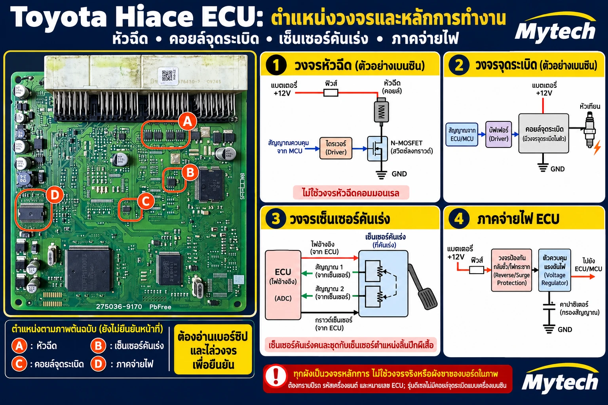
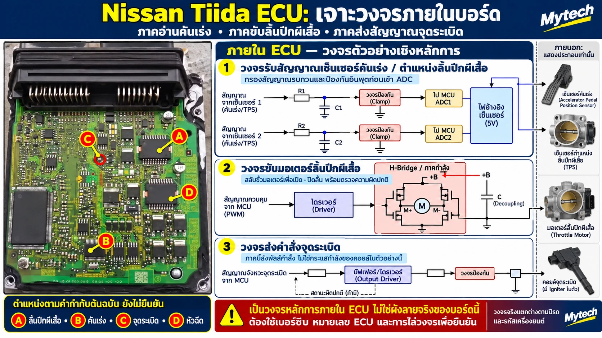

# บทที่ 6 การเปิดอ่านแผงวงจร ECU

> ระดับกลาง (Intermediate) · หัวข้ออื่นของบทนี้ (เช่น วิธีเปิดกล่องและถอดแผง) จะเพิ่มตามมา

---

## 6.1 อ่านแผงทั้งแผง แบ่งโซนวงจรบนแผง ECU

ก่อนจะเจาะชิปตัวใดตัวหนึ่ง ให้มองแผงทั้งแผงแล้วแบ่งเป็นโซนก่อน ช่างที่แบ่งโซนเป็นจะรู้ว่าควรเริ่มหาจากตรงไหน และไม่หลงไปวัดชิปที่ไม่เกี่ยวกับอาการ

### ภาพตัวอย่าง

*ภาพ 6.1 แผง ECU ที่พิมพ์เลข 275036-9170 (เลขฮาร์ดแวร์แผงแบบ Denso แหล่งชุมชนผูกเลขนี้ไว้กับรถเบนซิน 2.7 ลิตรหลายรุ่น ภาพระบุว่ามาจาก Toyota Hiace แต่ยังไม่ได้ระบุปี รหัสเครื่อง และเลขอะไหล่ Toyota บนฉลากกล่อง (ส่วนมากขึ้นต้นด้วย 89661-)) ป้าย A–D คือตำแหน่งที่ผู้เขียนคาดไว้ **ยังไม่ได้ยืนยันหน้าที่ทุกจุด** ผังทั้ง 4 ช่องเป็นหลักการ ไม่ใช่วงจรจริงของบอร์ดนี้ **(ปรับแต่งด้วย AI – ตัวอักษรบนชิปในภาพอาจไม่ใช่รหัสจริง)***

### โซนบนแผง ECU ทั่วไป

แผง ECU เครื่องยนต์ส่วนใหญ่แบ่งได้เป็นโซนตามหน้าที่ ตำแหน่งจริงต่างกันตามรุ่น ลักษณะในตารางเป็น**เบาะแส**ให้เริ่มมอง ไม่ใช่กฎ

| โซน | ลักษณะที่สังเกตได้ | อ่านต่อ |
|---|---|---|
| ขั้วต่อ | แถวขาโลหะที่ขอบแผง สัญญาณเข้าออกเกือบทั้งหมดผ่านที่นี่ (บางกล่องมีเซนเซอร์อยู่บนแผงเอง) จุดเริ่มต้นของการไล่วงจรทุกครั้ง | บทที่ 8 |
| ภาคจ่ายไฟ | มักอยู่ใกล้ขาไฟเข้าของขั้วต่อ มีตัวเก็บประจุใหญ่ ชิปกำลังที่มีแผ่นระบายความร้อน และอาจมีขดลวดถ้าเป็นแบบสวิตชิ่ง | หัวข้อ 7.2 |
| ภาคขับขาออก | ชิปกำลังหรือทรานซิสเตอร์หลายตัวเรียงกัน มักอยู่ใกล้ขั้วต่อ | หัวข้อ 8.1–8.5 |
| MCU | มักเป็นชิปขาสี่ด้านขนาดใหญ่ที่มีคริสตัลอยู่ใกล้ แต่บางแผงมีชิปใหญ่หลายตัว หรือ MCU เป็นตัวถังที่มองไม่เห็นขา ต้องยืนยันจากเบอร์ชิป | บทที่ 7 |
| หน่วยความจำ (EEPROM) | ชิปเล็ก 8 ขา มักอยู่ใกล้ MCU เก็บข้อมูลกุญแจและค่าที่เรียนรู้ ต้องอ่านสำรองก่อนบัดกรีใกล้ๆ | หัวข้อ 2.1 |
| สื่อสาร (CAN / K-line) | ชิปเล็กใกล้ขั้วต่อ ต่อกับขาสื่อสารของขั้วต่อ | – |
| วงจรรับสัญญาณเซนเซอร์ | ตัวต้านทานและตัวเก็บประจุเล็กๆ จำนวนมากระหว่างขั้วต่อกับ MCU | หัวข้อ 8.4 (ตัวอย่าง TPS) |

ตำแหน่งที่สังเกตได้เป็นแค่จุดเริ่มต้น ต้องยืนยันด้วยการอ่านเบอร์ชิป (บทที่ 7) และไล่ลายจากขาขั้วต่อ (บทที่ 8) ทุกครั้ง

### อ่านบริเวณ A–D ในภาพ 6.1

| ป้าย | ที่ภาพระบุ | สิ่งที่บอกได้จากภาพ | อ่านต่อ |
|---|---|---|---|
| A | หัวฉีด | ชิป 8 ขาสี่ตัวเรียงใกล้ขั้วต่อ เข้ากับเครื่อง 4 สูบ และหน้าตาคล้ายกรณี C5664 แต่อ่านรหัสบนชิปไม่ได้ | 8.2, 8.3 |
| B | เซนเซอร์คันเร่ง | ยังไม่รู้ว่าชิปนี้ทำอะไร วงจรรับสัญญาณเซนเซอร์ส่วนใหญ่เป็นแค่วงจรกรองก่อนเข้า MCU ไม่ต้องมีชิปเฉพาะ ชิปนี้อาจเป็นวงจรจ่ายไฟ 5 V ให้เซนเซอร์หรือวงจรอื่น | 8.4 |
| C | คอยล์จุดระเบิด | ชิปเล็กหนึ่งตัว อาจเป็นวงจรส่งสัญญาณ IGT | 8.1 |
| D | ภาคจ่ายไฟ | ชิปตัวถังใหญ่แบบมีแผ่นระบายความร้อน หน้าตาคล้าย SE655 แต่อ่านรหัสในภาพไม่ได้ จึงยืนยันไม่ได้ว่าเป็นตัวเดียวกัน | 7.2 |

### ผังหลักการ 4 ช่องในภาพ

**ผัง 1 วงจรหัวฉีด** เป็นหลักการสวิตช์ฝั่งกราวด์แบบเดียวกับวงจร 8.2 ตัวสวิตช์จริงอาจเป็น MOSFET หรือทรานซิสเตอร์ NPN ก็ได้ (กล่อง Corolla ในหัวข้อ 8.3 ใช้ 2SC5664 ซึ่งเป็น NPN มีซีเนอร์ C-B ในตัว) ผังนี้ละวงจรป้องกันแรงดันย้อนไว้ ตอนตัดกระแส หัวฉีดจะดันแรงดันขึ้นสูง ภาคขับจริงจึงต้องมีวงจร Clamp ในชิป ห้ามเพิ่มไดโอดคร่อมหัวฉีดเอง ไฟ "+12V แบตเตอรี่" ในผังเป็นการวาดย่อ ในรถจริงมาผ่านฟิวส์และรีเลย์ตามผังไฟของรุ่น

**ผัง 2 วงจรจุดระเบิด** คือหลักการเดียวกับวงจร 8.1 ECU ส่งพัลส์ **IGT** กระแสต่ำผ่านวงจรส่งสัญญาณ (บัฟเฟอร์) ไปที่ Igniter ในตัวคอยล์ ซึ่งเป็นตัวสับกระแสขดปฐมภูมิจริง ผังนี้ไม่ได้วาดสัญญาณ **IGF** ที่ Igniter ส่งกลับมายืนยันการจุดระเบิดใน Toyota หลายรุ่น ไฟเลี้ยงคอยล์ (+B) ในรถจริงมาผ่านสวิตช์กุญแจ ฟิวส์ และรีเลย์ตามผังไฟของรุ่น ไม่ได้มาจากแบตเตอรี่ตรง

**ผัง 3 เซนเซอร์คันเร่ง** วาดไฟอ้างอิงและกราวด์ร่วมกันเพื่อความกระชับ แต่ Toyota (ตัวอย่างเครื่อง 1NZ-FE) แยกเซนเซอร์คันเร่งเป็นสองชุด ชุดหลัก VCPA–VPA–EPA และชุดตรวจสอบ VCP2–VPA2–EPA2 แต่ละชุดมีไฟเลี้ยงประมาณ 5 V และกราวด์ของตัวเอง ECU ใช้ VPA ควบคุมเครื่อง และใช้ VPA2 ตรวจว่า VPA ถูกต้อง เวลาวัดต้องวัดไฟเลี้ยงและกราวด์ให้ครบทั้งสองชุด ชื่อขาและค่าแรงดันต้องดูจากคู่มือของรุ่นนั้น เซนเซอร์คันเร่งเป็นคนละชุดกับเซนเซอร์ตำแหน่งลิ้นปีกผีเสื้อ (หัวข้อ 8.4)

**ผัง 4 ภาคจ่ายไฟ** แสดงทางไฟภายในกล่องแบบย่อ ECU Toyota รับไฟจากภายนอกหลายเส้น โดยทั่วไปมีไฟแบตเตอรี่ตรงสำหรับหน่วยความจำ (BATT) ไฟเลี้ยงหลักผ่านรีเลย์ EFI (+B) และสัญญาณสวิตช์กุญแจ (IGSW) บางรุ่นมีขาที่ ECU ใช้สั่งรีเลย์หลัก (MREL) ด้วย ชื่อและจำนวนขาต้องดูจากคู่มือของรุ่นนั้น ถ้ากล่องไม่ทำงาน ให้วัดไฟเข้าทุกเส้นและกราวด์ทุกขาก่อนสงสัยวงจรในกล่อง

### เครื่องเบนซินกับดีเซลไม่เหมือนกัน

Hiace มีทั้งรุ่นเบนซินและดีเซล ผัง 1 และ 2 เป็นตัวอย่างของเครื่องเบนซิน เครื่องดีเซลคอมมอนเรล (เช่น 1KD/2KD) ไม่มีคอยล์จุดระเบิด และหัวฉีดขับด้วยวงจรเฉพาะ บางรุ่นผ่านกล่องขับหัวฉีดแยก (EDU) ซึ่งไม่ใช่สวิตช์ฝั่งกราวด์แบบผัง 1 ห้ามใช้ผัง 1 วัดหรือซ่อมวงจรหัวฉีดดีเซล และห้ามต่อสายกราวด์สโคปที่ขาขับหัวฉีดหรือ EDU โดยเดา ให้ดูคู่มือของรุ่นนั้น

### ขั้นตอนอ่านแผงใหม่ที่ไม่เคยเห็น

1. จดเลขทุกชุดบนฉลากกล่องและบนแผง: เลขอะไหล่ Toyota (กล่องควบคุมเครื่องยนต์ส่วนมากขึ้นต้นด้วย 89661- ทั้งเบนซินและดีเซล) เลขของผู้ผลิตกล่อง (เช่น Denso 275036-xxxx ซึ่งอาจใช้ร่วมกันหลายรุ่นรถ) รุ่นรถ ปี และรหัสเครื่อง ใช้เลขอะไหล่ Toyota เป็นหลักเมื่อหาคู่มือหรือกล่องทดแทน
2. ถ่ายรูปแผงทั้งสองด้านก่อนแตะอะไร
3. แบ่งโซนตามตารางข้างบน แล้ววงไว้บนรูป
4. อ่านเบอร์ชิปในโซนที่เกี่ยวกับอาการ (บทที่ 7)
5. ไล่ลายจากขาขั้วต่อของวงจรที่สงสัยไปหาชิป (บทที่ 8)
6. บันทึกผลไว้คู่กับรูป ใช้ครั้งต่อไปกับกล่องหมายเลขเดียวกัน

> ⚠️ ถ่ายรูปและอ่านแผงตอนแผงไม่มีไฟเลี้ยงเท่านั้น ใส่สายรัดข้อมือกันไฟฟ้าสถิต (ESD) ขณะจับแผง อย่าขูดสารเคลือบแผงออกถ้าไม่จำเป็น และถ้าแผงติดกับฝากล่องด้วยกาวหรือแผ่นระบายความร้อน อย่างัดแผงออกจนกว่าจะอ่านวิธีถอดแผง (จะอธิบายในบทนี้ต่อไป) เพราะแผงอาจร้าวได้

### ตัวอย่างที่ 2: Nissan Tiida

*ภาพ 6.2 แผง ECM Nissan Tiida (ยังไม่ได้ระบุรุ่นย่อย ปี รหัสเครื่อง เช่น HR16DE หรือ MR18DE และหมายเลขกล่อง) ป้าย A–D คือคำกำกับของผู้เขียน **ยังไม่ได้ยืนยันหน้าที่** ที่ความละเอียดของภาพนี้อ่านรหัสบนชิปไม่ได้ A และ D เป็นชิปกำลังหน้าตาใกล้กันที่อาจเป็นภาคขับมอเตอร์ลิ้นและภาคขับหัวฉีด ถ้าไม่อ่านเบอร์ชิปจะแยกไม่ได้ว่าตัวไหนทำอะไร / B ยังไม่รู้ว่าทำอะไร วงจรรับสัญญาณเซนเซอร์ส่วนใหญ่ไม่ต้องมีชิปเฉพาะ (ดูตาราง A–D ของภาพ 6.1) / วง C ครอบจุดกลมเล็กบนแผงซึ่งดูเป็นรูเวียหรือจุดทดสอบมากกว่าไอซี ให้ยืนยันทุกจุดด้วยการอ่านเบอร์ชิปและไล่ลายจากขาขั้วต่อ (บทที่ 7 และ 8) ผังด้านขวาเป็นหลักการ ไม่ใช่ผังลายจริงของบอร์ดนี้ ภาพอุปกรณ์ภายนอกเป็นภาพประกอบเท่านั้น **(ปรับแต่งด้วย AI)***

แผง Nissan ก็ใช้เบาะแสเรื่องโซนแบบเดียวกับแผง Toyota ในภาพ 6.1 ได้ ในภาพนี้ชิปกำลังที่คาดว่าเป็นภาคขับ (A และ D) อยู่ค่อนมาทางกลางแผงใต้ขั้วต่อ ส่วนชิปขาสี่ด้านตัวใหญ่ที่น่าจะเป็น MCU อยู่ด้านซ้าย ตำแหน่งเหล่านี้เป็นแค่เบาะแส ต้องยืนยันด้วยเบอร์ชิป

ชื่อเรียกในคู่มือ Nissan เทียบกับคำในเล่มนี้

| คู่มือ Nissan | ในเล่มนี้ |
|---|---|
| APP sensor 1/2 | เซนเซอร์คันเร่ง |
| TP sensor 1/2 | เซนเซอร์ตำแหน่งลิ้นปีกผีเสื้อ (TPS) |
| electric throttle control actuator | ชุดลิ้นปีกผีเสื้อไฟฟ้าทั้งชุด มีมอเตอร์และ TP sensor อยู่ข้างใน ส่วนมอเตอร์ในชุดนี้ ECM ขับด้วยวงจร H-Bridge ในกล่อง (หัวข้อ 8.4) |
| power transistor ในคอยล์ | ทำหน้าที่เหมือน Igniter ของ Toyota (หัวข้อ 8.1 และ 8.5) |

**ผัง 1 วงจรรับสัญญาณเซนเซอร์** ส่วนกรองสัญญาณ (R กับ C) และวงจร Clamp ก่อนเข้า ADC ถูกตามหลักการ เส้นไฟ 5 V ที่ออกไปเลี้ยงเซนเซอร์ชี้ถูกทิศแล้ว แต่เส้นด้านบนของบล็อก "ไฟอ้างอิงเซ็นเซอร์ (5V)" ยังมีหัวลูกศรชี้กลับเข้าบล็อก ให้อ่านว่าไฟ 5 V ออกจากวงจรจ่ายไฟใน ECU ไปเลี้ยงเซนเซอร์ (และอาจใช้เป็นแรงดันอ้างอิงของ ADC) ไม่ได้รับไฟเข้าจากที่ใด ผังยังวาดไฟอ้างอิงชุดเดียวเลี้ยงเซนเซอร์ทุกตัว และเขียน "คันเร่ง/TPS" รวมกันเพื่อความกระชับ ในรถจริง เซนเซอร์คันเร่งและเซนเซอร์ตำแหน่งลิ้นปีกผีเสื้อเป็นคนละตัว แต่ละตัวมีสัญญาณสองเส้น รวมเป็น 4 สัญญาณ และมักแยกไฟเลี้ยงกับกราวด์เป็นหลายชุด (ดูตัวอย่าง Toyota ในผัง 3 ของภาพ 6.1) ส่วนของ Nissan Tiida ว่าเซนเซอร์ใดใช้ไฟเลี้ยงร่วมกัน ต้องดูผังไฟในคู่มือ EC ของรุ่นนั้น เวลาวัด ให้วัดไฟเลี้ยงและกราวด์ของเซนเซอร์ทุกชุด

**ผัง 2 วงจรขับมอเตอร์ลิ้นปีกผีเสื้อ** เป็นหลักการ H-Bridge เดียวกับวงจร 8.4 ECU กลับขั้วไฟที่ M+ และ M- เพื่อเปิดหรือปิดลิ้น และคุมแรงด้วย PWM ไฟ "+B" ในผังวาดย่อไว้ ใน Nissan Tiida ไฟเลี้ยงมอเตอร์มาผ่าน throttle control motor relay (อยู่ใน IPDM E/R และมีฟิวส์ของตัวเอง) ที่ ECM สั่งให้ทำงานเมื่อบิดกุญแจ ON ถ้ารีเลย์ไม่ทำงาน จะไม่มีไฟเลี้ยงมอเตอร์ ลิ้นจะไม่ถูกขับ (น่าจะค้างที่ตำแหน่งตามสปริงแบบเดียวกับระบบในหัวข้อ 8.4 ยังไม่ได้ยืนยันกับคู่มือ Nissan) และจะมีรหัสปัญหาเกี่ยวกับรีเลย์ (คู่มือ MR18DE ระบุ P1124/P1126) ให้ตรวจฟิวส์ รีเลย์ และไฟที่ขาไฟเลี้ยงมอเตอร์ของ ECM ก่อนสงสัยกล่อง ผังวาดสวิตช์ 4 ตัว มอเตอร์อยู่ระหว่างสองขา และตัวเก็บประจุกรองไฟต่อระหว่าง +B กับกราวด์ ซึ่งถูกตามหลักการ แต่ผังวาดมอเตอร์ไว้ในกรอบ H-Bridge เพื่อความกระชับ มอเตอร์จริงอยู่ในชุดลิ้นปีกผีเสื้อนอกกล่อง และต่อกับ ECU ผ่านขา M+ และ M- ของขั้วต่อ เส้นที่ลากไปรูปมอเตอร์ด้านขวาออกจากจุดใกล้กราวด์ อย่าอ่านว่ามอเตอร์ต่อลงกราวด์ ขา M+ และ M- ไม่มีขาไหนเป็นกราวด์ตายตัว (หัวข้อ 8.4)

**ผัง 3 วงจรส่งคำสั่งจุดระเบิด** เป็นหลักการเดียวกับหัวข้อ 8.5 ECM ส่งพัลส์สั่งงาน (Nissan เรียกว่า ignition signal) ผ่านวงจรส่งสัญญาณไปที่คอยล์ ตัวที่สับกระแสขดปฐมภูมิคือ power transistor ในชุดคอยล์ (คำว่า "Igniter" ใต้รูปคอยล์ในภาพเป็นคำของ Toyota) เส้นประ "สถานะผิดปกติ (ถ้ามี)" ในผังออกจากภาคขับภายใน ECM ไม่ได้มาจากคอยล์ จึงหมายถึงการตรวจความผิดปกติของวงจรขาออกภายในกล่อง (ถ้ารุ่นนั้นมี) ไม่ใช่สัญญาณยืนยันการจุดระเบิดแบบ IGF ของ Toyota ซึ่งคู่มือ Nissan ที่ตรวจในหัวข้อ 8.5 ไม่มี

ตัวอย่างแผง ECM เครื่อง V8 ที่มีภาคขับโซลินอยด์เกียร์ ดูภาพ 8.6 ในหัวข้อ 8.6
