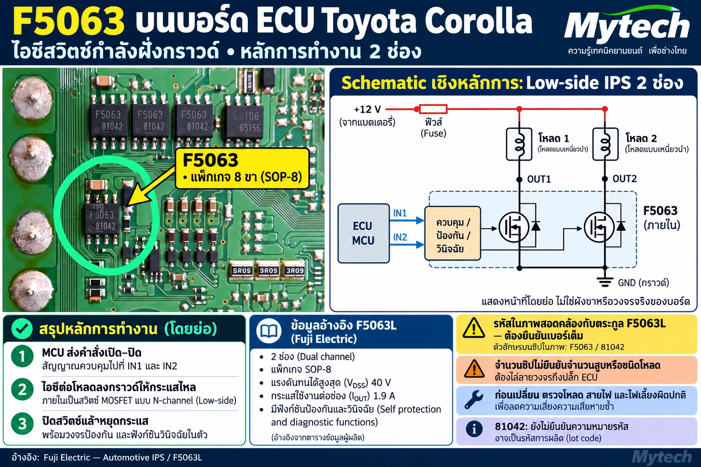
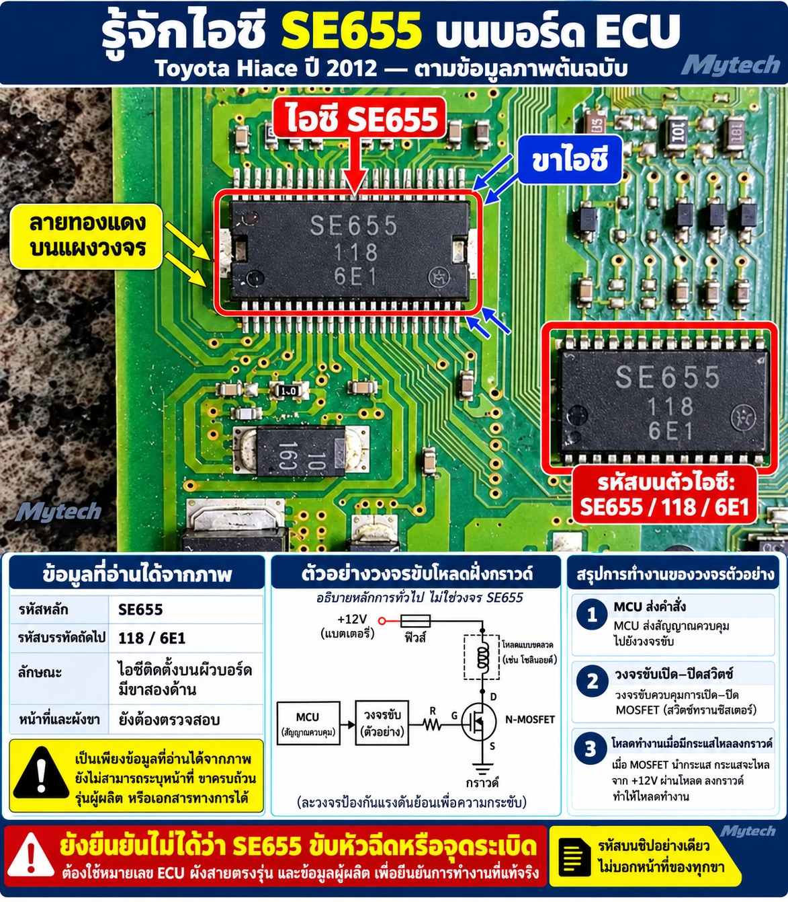
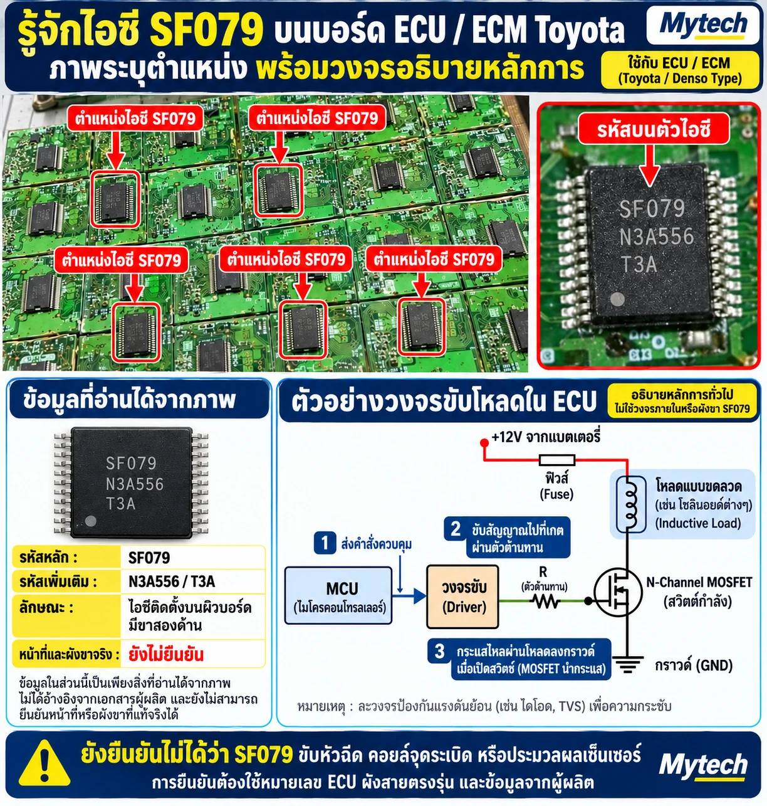

# บทที่ 7 ระบุไอซี

> ระดับสูง (Advanced) · หัวข้ออื่นของบทนี้จะเพิ่มตามมา

ก่อนจะวัด เปลี่ยน หรือสรุปว่าชิปตัวไหนเสีย ต้องรู้ก่อนว่าชิปตัวนั้นคืออะไร บทนี้สอนวิธีไปจากตัวอักษรบนตัวชิปถึงดาต้าชีต และวิธีแยกว่าข้อมูลส่วนไหนยืนยันแล้ว ส่วนไหนยังเป็นแค่การคาดเดา

---

## 7.1 จากรหัสบนชิปสู่ดาต้าชีต ตัวอย่าง F5063 บนแผง Toyota Corolla

### ภาพตัวอย่าง

*ภาพ 7.1 แผง ECU Toyota Corolla (ยังไม่ได้ระบุปี รหัสเครื่อง และหมายเลขกล่อง) ตำแหน่งและจำนวนชิปเป็นของกล่องนี้เท่านั้น กล่องรุ่นอื่นอาจต่างไป ชิป F5063 คือตัว SOP-8 ในวงเขียว ไม่ใช่ชิ้นส่วนเล็กที่ปลายลูกศรชี้ ชิปตัวขวาสุดในแถวบนพิมพ์รหัสต่างออกไป (อ่านได้คล้าย 65106 / 65156) ไม่ใช่ F5063 และยังไม่ได้ระบุหน้าที่ ผังด้านขวาเป็นหน้าที่โดยย่อ ไม่ใช่ผังขาหรือวงจรจริงของบอร์ดนี้ **(ปรับแต่งด้วย AI – ตัวอักษรบนชิ้นส่วนบางตัวอาจไม่ใช่รหัสจริง)***

### ขั้นที่ 1 อ่านรหัสบนตัวชิปให้ครบทุกบรรทัด

บนชิปในภาพมีสองบรรทัด คือ **F5063** และ **81042** จดทั้งสองบรรทัดก่อน แล้วค่อยแยกว่าบรรทัดไหนคือเบอร์ชิ้นส่วน บรรทัดไหนคือรหัสการผลิต

- **F5063** น่าจะเป็นเบอร์ชิ้นส่วน เพราะตรงกับชื่อตระกูลของผู้ผลิต
- **81042** ยังไม่ยืนยันความหมาย อาจเป็นรหัสการผลิต (Lot code) หรือรหัสวันผลิต ห้ามเอาไปค้นเป็นเบอร์ชิป และห้ามใช้ตัดสินว่าชิปแท้หรือปลอม จนกว่าจะเทียบกับรูปแบบรหัสในดาต้าชีต ถ้าเปลี่ยนชิป ให้จดบรรทัดนี้ไว้ในบันทึกงาน ใช้เทียบกับชิปตัวอื่นบนแผงเดียวกันได้ แต่ห้ามแปลความหมายเอง

ชิปขนาดเล็กมักพิมพ์เบอร์ไม่ครบ ตัวอักษรท้ายเบอร์หรือรหัสผู้ผลิตอาจถูกตัดออก รหัสบนตัวชิปจึงเป็นแค่จุดเริ่ม ไม่ใช่คำตอบสุดท้าย

### ขั้นที่ 2 หาตระกูลชิปและผู้ผลิต

ค้น "F5063" กับคำว่า IPS หรือ datasheet จะพบ **Fuji Electric F5063L** ซึ่งหน้าผลิตภัณฑ์ระบุว่าเป็น Low-side จากตัวอย่างที่พบ ชิ้นส่วนตระกูลนี้มักมีอักษรท้ายต่อเบอร์ แต่ผู้ผลิตไม่ได้ประกาศความหมายของอักษรท้ายเป็นกฎ

| อักษรท้าย | ที่พบ | ตัวอย่าง |
|---|---|---|
| L | สวิตช์ฝั่งกราวด์ (Low-side) ยืนยันจากหน้าผู้ผลิต | F5063L |
| H | พบในชิ้นส่วนที่เป็น High-side (ยังไม่ได้ยืนยันจากหน้าผู้ผลิต) | F5044H, F5062H |
| อักษรอื่น เช่น P | มีใช้ด้วย ความหมายต้องดูดาต้าชีต | F5045P |

รหัส "F5063" ที่ไม่มีอักษรท้ายจึง**สอดคล้องกับ** F5063L แต่ยังไม่ใช่การยืนยัน ต้องเทียบรูปแบบรหัสที่พิมพ์บนตัวชิป แพ็กเกจ และจำนวนขากับดาต้าชีตฉบับเต็มก่อน อย่าใช้อักษรท้ายเดาชนิดของชิปเบอร์อื่น ให้เปิดหน้าผลิตภัณฑ์หรือดาต้าชีตของเบอร์นั้นทุกครั้ง

### ขั้นที่ 3 อ่านค่าจากแหล่งของผู้ผลิต

ข้อมูลจากหน้าผลิตภัณฑ์ของ Fuji Electric (products.fujielectric.com) มีดังนี้

| รายการ | ค่า |
|---|---|
| ชนิด | Automotive low-side 2ch IPS (สวิตช์กำลังอัจฉริยะฝั่งกราวด์ 2 ช่อง สำหรับยานยนต์) |
| แพ็กเกจ | SOP-8 |
| พิกัดแรงดัน | 40 V |
| กระแส | 1.9 A |
| ความต้านทานขณะนำ (R_DS(on)) | ประมาณ 0.095 Ω (สูงสุด 0.14 Ω) |
| กำลังสูญเสียสูงสุด | 1.75 W |
| สถานะ | Available (ตามหน้าผลิตภัณฑ์ เมื่อ ต.ค. 2026) |

ค่าที่ภาพ 7.1 เขียนไว้ คือ 2 ช่อง, SOP-8, 40 V และ 1.9 A **ตรงกับหน้าผลิตภัณฑ์** แต่มีสามเรื่องที่ยังต้องตรวจจากดาต้าชีตฉบับเต็ม

- **ชื่อพารามิเตอร์** ภาพเขียน VDSS แต่หน้าผลิตภัณฑ์ใช้ชื่ออื่น ตัวเลขตรงกัน แต่ความหมายของพิกัดต้องดูในดาต้าชีต
- **1.9 A เป็นต่อช่องหรือไม่** หน้าผลิตภัณฑ์ไม่ได้บอก
- **ฟังก์ชันป้องกันและวินิจฉัย** IPS ฝั่งกราวด์รุ่นเก่าของ Fuji เช่น F5002L (Fuji Electric Journal, 1992) มีป้องกันความร้อนเกิน กระแสเกิน แรงดันเกิน ตรวจโหลดขาด และวงจร Clamp แต่ฟังก์ชันของ F5063L เอง ขาสถานะ (ถ้ามี) และผังขา ยังไม่ได้ยืนยันจากดาต้าชีต

> 💡 แยกให้ชัดว่าข้อมูลมาจากไหน ค่าจากหน้าผลิตภัณฑ์หรือดาต้าชีตของผู้ผลิตคือหลักฐาน ค่าจากตารางในเว็บขายชิ้นส่วนหรือจากการเดาตามตระกูลเป็นแค่เบาะแส ห้ามใช้ตัดสินใจเปลี่ยนชิปหรือเลือกตัวแทน

### ขั้นที่ 4 เข้าใจว่าชิปทำงานอย่างไร

F5063L เป็นสวิตช์ฝั่งกราวด์ (Low-side) โหลดรับไฟบวกอยู่แล้ว ชิปทำหน้าที่ต่อปลายอีกด้านของโหลดลงกราวด์

1. MCU ส่งคำสั่งเปิด-ปิดเข้าขา IN ของแต่ละช่อง
2. เมื่อเปิด สวิตช์ในชิปต่อขา OUT ลงกราวด์ กระแสไหลผ่านโหลด
3. เมื่อปิด กระแสหยุด

ไดโอดที่วาดขนานกับ MOSFET ในผังของภาพ 7.1 คือไดโอดในตัวของ MOSFET **ไม่ได้ทำหน้าที่ดูดแรงดันย้อนกลับจากโหลดเหนี่ยวนำ** ตอนตัดกระแส แรงดันที่ขา OUT จะพุ่งสูงกว่า 12 V แล้วถูกจำกัดด้วยวงจร Clamp ภายในชิป (ถ้ารุ่นนั้นมี ต้องตรวจในดาต้าชีต) หรือด้วยไดโอดที่ผู้ออกแบบต่อคร่อมโหลดไว้ ดูวงจร 8.2 ในบทที่ 8

ไฟ +12 V ของโหลดในผังของภาพเป็นการวาดย่อ ในรถจริงอาจมาผ่านฟิวส์และรีเลย์ เช่น EFI หรือ IG ตามผังไฟของรุ่น ให้วัดไฟที่ขั้วโหลดตอนบิดกุญแจ ON

### ขั้นที่ 5 อย่าสรุปเกินหลักฐาน

- **จำนวนชิปไม่ได้บอกจำนวนสูบหรือชนิดโหลด** บนแผงในภาพมี F5063 หลายตัว ตัวละ 2 ช่อง แต่ละช่องจะขับอะไร ต้องไล่ลายวงจรจากขา OUT ไปที่ขาขั้วต่อ แล้วเทียบกับผังไฟของรุ่นนั้น (วิธีในบทที่ 8 หัวข้อ 8.2)
- **ชิปหน้าตาเหมือนกันอาจไม่ใช่เบอร์เดียวกัน** ชิปตัวขวาสุดในแถวบนของภาพเป็นตัวอย่าง อ่านรหัสทุกตัว อย่าเหมาทั้งแถว
- **ยังไม่มีดาต้าชีตฉบับเต็ม อย่าจ่ายไฟหรือจั๊มขาเพื่อทดลอง** ถ้ายังไม่รู้ว่าขาไหนเป็น IN, OUT, GND ให้วัดได้แค่ความต่อเนื่องหรือโหมดไดโอดตอนแผงไม่มีไฟเลี้ยง เพื่อไล่ลายวงจรเท่านั้น

### ⚠️ ก่อนเปลี่ยน F5063

> - วัดความต้านทานของโหลดและสายไฟของช่องนั้นก่อน สาเหตุที่ชิปเสียบ่อยคือโหลดหรือสายช็อต ถ้ายังไม่แก้ เปลี่ยนแล้วชิปตัวใหม่ก็เสียซ้ำ
> - ห้ามต่อ +12 V เข้าขา OUT โดยตรงโดยไม่ผ่านโหลด
> - อย่าเพิ่มหรือถอดไดโอดคร่อมโหลดเอง ถ้ากล่องเดิมไม่มี แปลว่าผู้ออกแบบให้วงจร Clamp ในชิปรับพลังงานของโหลด ถ้ากล่องเดิมมี ก็ต้องคงไว้ การเปลี่ยนไปจากเดิมทำให้จังหวะการปล่อยของโซลินอยด์หรือรีเลย์เปลี่ยน หรือทำให้ชิปรับพลังงานเกินพิกัด
> - ใช้ลมร้อนและใส่สายรัดข้อมือกันไฟฟ้าสถิต (ESD) ตรวจทิศขา 1 ของ SOP-8 ก่อนวางชิปใหม่ และใช้ชิปเบอร์เต็มเดียวกันจากแหล่งที่เชื่อถือได้

ไม่ใช่ทุกรหัสบนชิปที่จะพาไปถึงดาต้าชีตได้แบบ F5063 ดูตัวอย่างที่หาไม่เจอและวิธีรับมือในหัวข้อ 7.2

---

## 7.2 เมื่อรหัสบนชิปยังพาไปไม่ถึงดาต้าชีต ตัวอย่าง SE655 บนแผง Toyota Hiace 2012

### ภาพตัวอย่าง

*ภาพ 7.2 ชิป SE655 บนแผง ECU Toyota Hiace ปี 2012 (ยังไม่ได้ระบุรหัสเครื่องและหมายเลขกล่อง) ตำแหน่งชิปเป็นของกล่องนี้เท่านั้น ภาพขยายมุมขวาไม่ตรงกับชิปจริง (ไม่มีแผ่นโลหะที่ปลายตัวชิป และระยะขาดูต่างจากภาพหลัก) ให้นับขาและดูรายละเอียดจากชิปบนแผงเท่านั้น ลูกศรเหลืองที่เขียนว่า "ลายทองแดงบนแผงวงจร" ชี้ไปที่แผ่นโลหะปลายตัวชิป ซึ่งน่าจะเป็นแผ่นระบายความร้อนของแพ็กเกจ ไม่ใช่ลายสัญญาณ ผังขับโหลดด้านล่างเป็นตัวอย่างหลักการ ไม่ใช่วงจรของ SE655 ชิ้นส่วนอื่นในภาพ (เช่น ตัวใหญ่ที่พิมพ์คล้าย 16J / 10 และชิ้นส่วนเล็ก 6 ขาที่มุมขวาบน) ยังไม่ได้ระบุหน้าที่ **(ปรับแต่งด้วย AI – ภาพขยายอาจเป็นภาพที่วาดใหม่ ตัวอักษรบนชิ้นส่วนบางตัวอาจไม่ใช่รหัสจริง)***

### อ่านรหัสได้ แต่ยังไม่รู้ว่าเป็นอะไร

| รายการ | สิ่งที่รู้ |
|---|---|
| รหัสหลัก | **SE655** |
| บรรทัดถัดไป | **118** และ **6E1** ยังไม่ทราบความหมาย ห้ามใช้ค้นเบอร์หรือตัดสินว่าแท้หรือปลอม (หลักเดียวกับหัวข้อ 7.1) |
| แพ็กเกจ | ขาสองด้าน มีแผ่นระบายความร้อนโผล่ที่ปลาย (ลักษณะแบบ HSOP / PowerSO) แหล่งชุมชนรายหนึ่งระบุ PowerSO-44 แต่แหล่งอื่นระบุต่างกัน ให้นับขาจากชิปจริงก่อนสั่งซื้อ |
| ผู้ผลิต | ผู้ขายชิ้นส่วนและบทความช่างระบุว่าเป็น Denso ยังไม่มีเอกสารผู้ผลิตยืนยัน |
| หน้าที่และผังขา | **ยังไม่รู้** |

SE655 ไม่มีดาต้าชีตเผยแพร่ น่าจะเป็นชิปเฉพาะของผู้ผลิตกล่อง แหล่งข้อมูลจากชุมชนช่างยังบอกไม่ตรงกัน ผู้ขายชิ้นส่วนบางรายเรียกว่า "ไอซีขับ (driver IC)" แต่บทความช่างซ่อมรายหนึ่งวัดแรงดันขาแล้วสรุปว่าเป็นวงจรแปลงไฟ DC-DC ที่จ่าย 5 V ให้ไมโครคอนโทรลเลอร์และเซนเซอร์ ทั้งสองแหล่งไม่ใช่เอกสารผู้ผลิต

ผลต่างกันมาก ถ้าเป็นวงจรจ่ายไฟ 5 V แล้วช่างเข้าใจว่าเป็นชิปขับโหลด จะวินิจฉัยผิดทั้งหมด เช่น เปลี่ยนชิปเพราะคิดว่าหัวฉีดไม่ทำงาน ทั้งที่ปัญหาจริงคือไฟเลี้ยง 5 V หาย ผังขับโหลดด้านล่างของภาพ 7.2 จึงเป็นแค่หลักการเดียวกับวงจร 8.2 **ห้ามสรุปว่า SE655 เป็นชิปขับโหลด** ไฟ "+12V (แบตเตอรี่)" ในผังของภาพเป็นการวาดย่อ ในรถจริงมาผ่านฟิวส์และรีเลย์ตามผังไฟของรุ่น ส่วนวงจรป้องกันแรงดันย้อนที่ภาพละไว้ ดูหัวข้อ 8.2

### เมื่อหาดาต้าชีตไม่เจอ ทำอย่างไร

1. **จดทุกอย่างที่อ่านได้** รหัสทุกบรรทัด จำนวนขาที่นับจากชิปจริง รุ่นรถ รหัสเครื่อง และหมายเลขกล่อง
2. **แยกแหล่งข้อมูลตามน้ำหนัก** เอกสารผู้ผลิตคือหลักฐาน หน้าผู้ขายและบทความช่างเป็นแค่เบาะแส ถ้าเบาะแสขัดกันเอง ให้ถือว่ายังไม่รู้
3. **หาเบาะแสหน้าที่จากวงจรรอบชิป** ไล่ลายวงจรว่าขาไหนต่อไปที่ขั้วต่อ ECU, MCU หรือเซนเซอร์ (วิธีไล่ลายในบทที่ 8) ใช้เบาะแสต่อไปนี้ประกอบกัน ห้ามใช้ข้อใดข้อเดียวตัดสิน
   - ขาที่ต่อขดลวดกำลัง มักเป็นส่วนของวงจรจ่ายไฟแบบสวิตชิ่ง
   - ตัวเก็บประจุใหญ่ มักอยู่ที่ขารับไฟเข้าหรือขาไฟออก จึงยังไม่บอกชนิดของชิป
   - ขาที่ไปขั้วต่อตรงๆ อาจเป็นขาออกไปโหลด ขาไฟเข้า ขากราวด์ ขารับเซนเซอร์ หรือสายสื่อสาร ต้องเทียบกับผังไฟของรุ่นว่าขาขั้วต่อนั้นคืออะไร
4. **วัดเทียบกับกล่องปกติรุ่นเดียวกัน (หมายเลขกล่องเดียวกัน)**
   - เริ่มจากวัดแบบไม่จ่ายไฟก่อน วัดค่าโหมดไดโอดหรือความต้านทานของแต่ละขาเทียบกราวด์ ทั้งกล่องที่เสียและกล่องที่ปกติ ขาที่ค่าต่างกันชัดเจน หรือช็อตลงกราวด์ คือจุดเริ่มวินิจฉัย
   - ถ้าต้องวัดขณะจ่ายไฟ ให้ใช้แหล่งจ่ายตั้งโต๊ะที่จำกัดกระแส เริ่มที่กระแสต่ำ และดูว่ากล่องไม่กินกระแสสูงผิดปกติก่อนวัด ถ้ากระแสสูงผิดปกติให้หยุด แล้วหาจุดช็อตแบบไม่จ่ายไฟ
   - จ่ายไฟทั้งสองกล่องด้วยขาไฟเลี้ยงชุดเดียวกัน (+B, BATT, IG ตามผังของรุ่น) ในสภาพเดียวกัน วัดเทียบกับขากราวด์ของกล่อง ค่าที่วัดได้ใช้เทียบได้เฉพาะกล่องที่จ่ายไฟแบบเดียวกันเท่านั้น
5. **บันทึกผลไว้ใช้ครั้งต่อไป** จดหมายเลขกล่อง วิธีจ่ายไฟ และค่าที่วัดได้ทีละขา (ทั้งตอนไม่จ่ายไฟและตอนจ่ายไฟ) เมื่อไม่มีดาต้าชีต ข้อมูลนี้คือสิ่งที่มีค่าที่สุดสำหรับกล่องรุ่นเดียวกัน

### ⚠️ ความปลอดภัยและการเปลี่ยนชิป

> - ขาของชิปนี้อยู่ชิดกันมาก ถ้าวัดขณะจ่ายไฟ ให้ใช้ปลายโพรบแหลมหรือคลิปที่จับได้แน่น ห้ามให้ปลายโพรบลื่นไปแตะขาข้างเคียง และห้ามจ่ายไฟเข้าขาใดเพื่อทดลอง
> - SE655 ไม่มีดาต้าชีตทางการ ชิ้นส่วนที่ขายในตลาดจึงตรวจความแท้ไม่ได้ ก่อนเปลี่ยน ให้วัดเทียบกับกล่องปกติรุ่นเดียวกันจนแน่ใจว่าชิปเสีย และตรวจโหลดหรือสายที่ช็อตก่อน ถ้าชิปนี้จ่ายไฟให้เซนเซอร์จริง เซนเซอร์หรือสายที่ช็อตกราวด์จะทำให้ชิปตัวใหม่เสียซ้ำ
> - ถ้าต้องถอดชิป ให้อุ่นใต้แผงด้วยฮีตเตอร์ก่อน เพราะแผ่นระบายความร้อนที่บัดกรีลงแผ่นทองแดงใหญ่ดูดความร้อนไปมาก ใช้ลมร้อนและใส่สายรัดข้อมือกันไฟฟ้าสถิต (ESD)

### ตัวอย่างที่ 2: SF079

*ภาพ 7.3 ภาพประกอบชิปที่พิมพ์ว่า SF079 ภาพหลักด้านซ้ายบน**ดูเป็น**แผงชิ้นงานที่มีโมดูลขนาดเล็กหน้าตาเหมือนกันเรียงกันหลายชิ้น หรือเป็นภาพที่ทำซ้ำขึ้น ไม่ใช่แผงวงจรของกล่อง ECU/ECM ป้าย "ตำแหน่งไอซี SF079" ในภาพจึงไม่ได้บอกตำแหน่งของชิปในกล่อง ECU และใช้หาตำแหน่งบนแผงจริงไม่ได้ ภาพนี้ยังไม่ได้ระบุรุ่นรถ รหัสเครื่อง หรือหมายเลขกล่อง **(ปรับแต่งด้วย AI – ภาพหลักและภาพชิปด้านล่างซ้ายอาจเป็นภาพที่สร้างขึ้น ตัวอักษรและจำนวนขาอาจไม่ตรงของจริง)***

SF079 เป็นอีกตัวอย่างของชิปที่อ่านรหัสได้แต่หาดาต้าชีตไม่เจอ เหมือน SE655 ข้างบน

- **ไม่มีดาต้าชีตเผยแพร่** น่าจะเป็นชิปเฉพาะของผู้ผลิตกล่อง ข้อมูลทั้งหมดที่หาได้มาจากหน้าผู้ขายชิ้นส่วน ซึ่งบอกไม่ตรงกัน รายหนึ่งเรียกว่า "ไอซีขับของ ECU" แพ็กเกจ HSSOP64 อีกรายการหนึ่งที่พบในผลค้นหาระบุ SOP20 และบอกว่าใช้กับกล่อง Denso ของ Toyota, Honda และ Nissan (ยังตรวจย้อนหน้าต้นทางไม่ได้) ไม่มีแหล่งใดเป็นเอกสารของผู้ผลิต และไม่มีแหล่งใดบอกหน้าที่จริงหรือผังขา ป้าย "Toyota / Denso Type" ในภาพจึงยังไม่ได้รับการยืนยัน
- **ห้ามนับขาจากภาพนี้** ภาพชิปในกล่อง "ข้อมูลที่อ่านได้จากภาพ" เป็นภาพประกอบสไตล์ภาพสินค้า จำนวนขา**ดูไม่ตรง**กับภาพขยายด้านขวาบน และไม่ตรงกับแพ็กเกจที่ผู้ขายระบุ ให้นับขาและวัดขนาดจากชิปจริงบนแผงก่อนสั่งซื้อทุกครั้ง
- **รหัสบรรทัดอื่น** **N3A556** และ **T3A** ยังไม่ทราบความหมาย ห้ามใช้ค้นเบอร์หรือตัดสินว่าแท้หรือปลอม และเนื่องจากภาพนี้อาจผ่านการปรับแต่ง ให้อ่านรหัสจากชิปจริงบนแผงเสมอ
- **ผังขับโหลดในภาพ** เป็นตัวอย่างหลักการเดียวกับวงจร 8.2 ไม่ใช่วงจรภายในหรือผังขาของ SF079 และไม่ได้แปลว่า SF079 เป็นชิปขับโหลด ไฟ "+12V จากแบตเตอรี่" ในผังเป็นการวาดย่อ ในรถจริงมาผ่านฟิวส์และรีเลย์ตามผังไฟของรุ่น ส่วนวงจรป้องกันแรงดันย้อนที่ภาพละไว้ ดูหัวข้อ 8.2

**ห้ามสรุปหน้าที่ของ SF079 จากภาพนี้** ให้ใช้วิธี 5 ขั้นในหัวข้อ "เมื่อหาดาต้าชีตไม่เจอ ทำอย่างไร" ข้างบน
