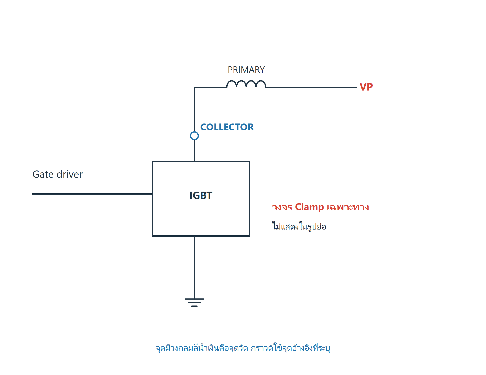
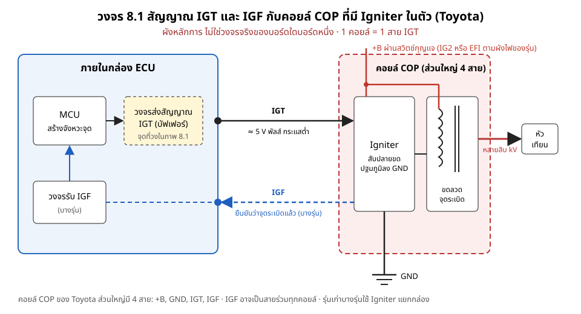
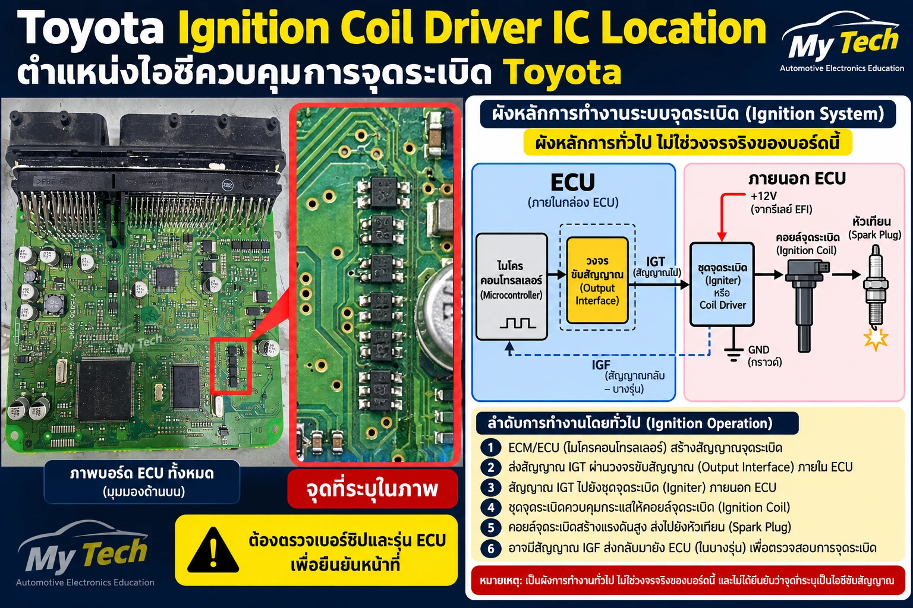
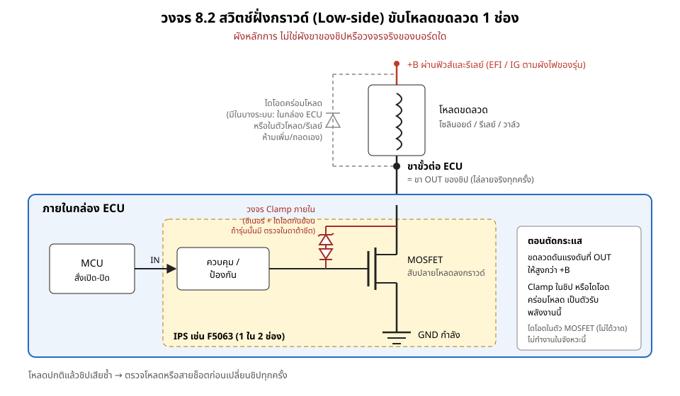
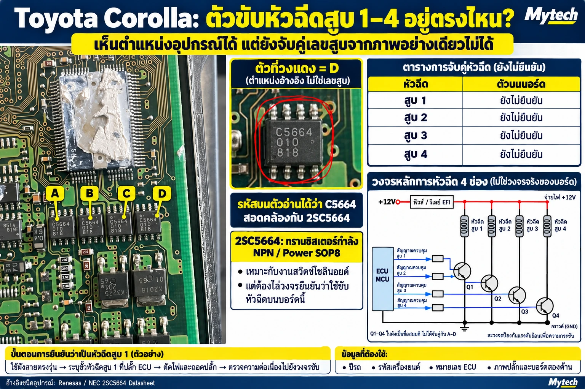
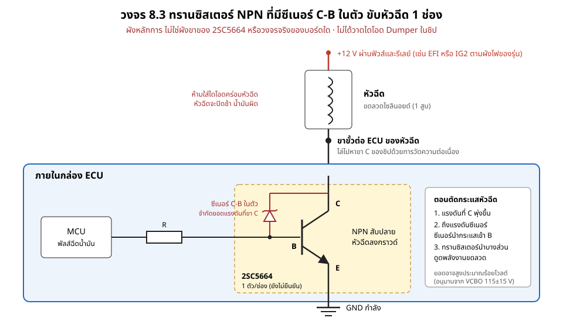
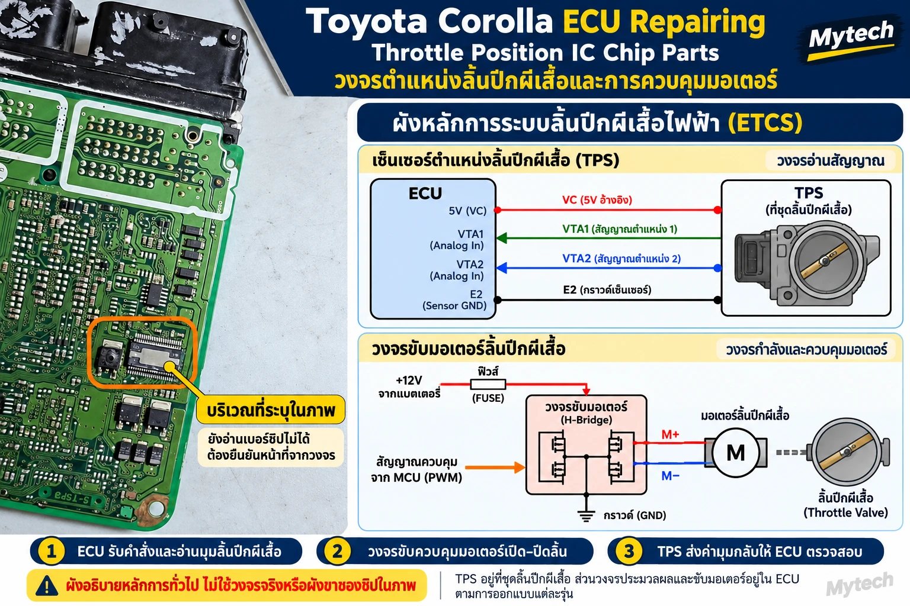
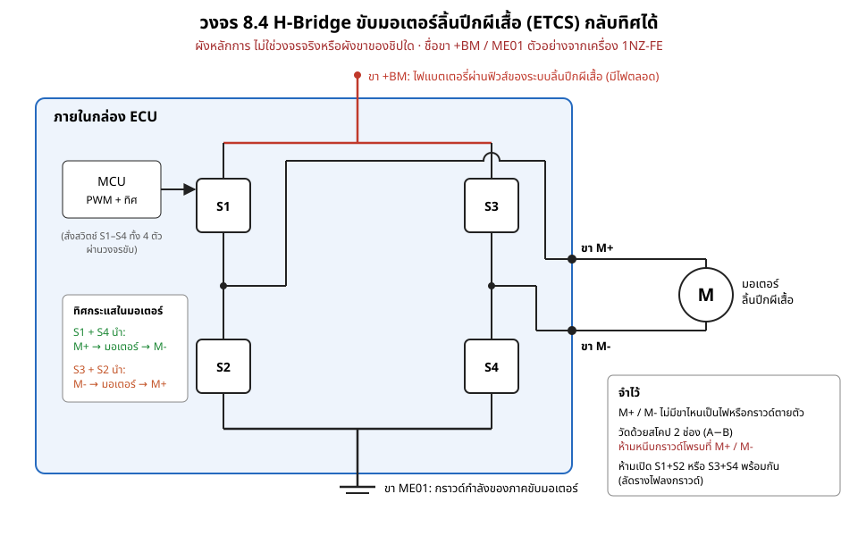
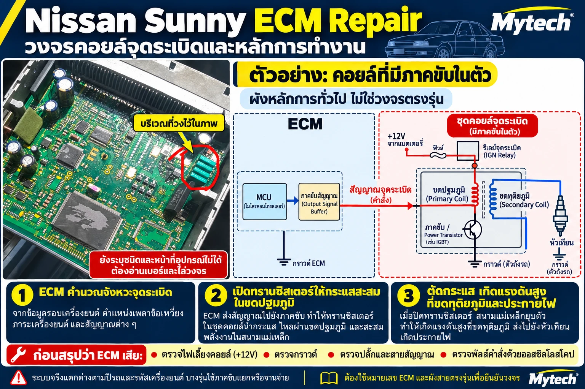
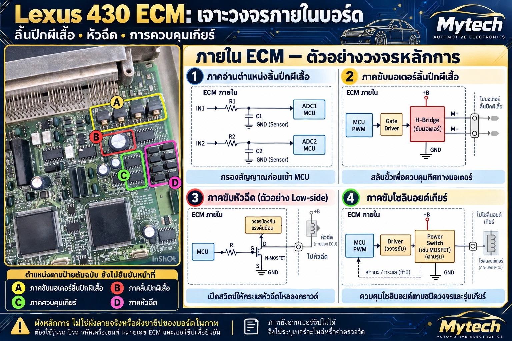

# บทที่ 8 หาตำแหน่งวงจรขาออกบนแผงจริง

> ระดับสูง (Advanced) · อ่านบทที่ 2 (หลักการทำงานของ ECU) และบทที่ 7 (ระบุไอซี) ก่อนเริ่มบทนี้

บทนี้สอนวิธีไล่หาวงจรขาออกบนแผง ECU จริง โดยเริ่มจากขาที่ขั้วต่อ ตามลายวงจรเข้าไปหาชิ้นส่วนที่ส่งสัญญาณออก แล้วยืนยันด้วยเบอร์ชิปและการวัด หัวข้อในบทนี้จะเพิ่มขึ้นเรื่อยๆ ตามภาพงานจริงจากอู่ของผู้เขียน

---

## 8.1 วงจรส่งสัญญาณจุดระเบิด (IGT) บนแผง Toyota

### ECU ของ Toyota ไม่ได้ขับคอยล์เอง

ช่างจำนวนมากเรียกชิ้นส่วนกลุ่มนี้ว่า "ไอซีขับคอยล์" แต่ในระบบจุดระเบิดของ Toyota ที่ใช้คอยล์แบบ COP (คอยล์อยู่บนหัวเทียนแต่ละสูบ) งานแบ่งเป็นสองส่วน

| ส่วน | อยู่ที่ไหน | ทำอะไร |
|---|---|---|
| วงจรส่งสัญญาณ IGT | ในกล่อง ECU | ส่งพัลส์ลอจิกประมาณ 5 V กระแสต่ำ บอกจังหวะจุดระเบิดของแต่ละสูบ |
| Igniter | ในตัวคอยล์ COP (รุ่นเก่าบางรุ่นแยกเป็นกล่อง) | รับ IGT แล้วสับกระแสขดปฐมภูมิของคอยล์ ตัวนี้คือตัวขับคอยล์จริง |

ดังนั้นชิ้นส่วนบนแผง ECU ที่ต่อกับขา IGT เป็นแค่วงจรส่งสัญญาณ (บัฟเฟอร์) ไม่ได้รับกระแสคอยล์ ถ้าคอยล์ไม่ทำงาน อย่าเพิ่งสรุปว่าชิปบนแผงเสีย ต้องตรวจคอยล์ ไฟ +B และสายไฟก่อน

ภาคขับคอยล์จริงคือทรานซิสเตอร์กำลัง (มักเป็น IGBT) ที่สับขดปฐมภูมิลงกราวด์ ดูวงจร 18 ในหนังสือ "วงจรและการซ่อม ECU" ฉบับเต็ม ใน Toyota ที่ใช้คอยล์ COP ภาคนี้อยู่ใน Igniter ในตัวคอยล์ แต่ ECU บางยี่ห้อวางภาคนี้ไว้ในกล่อง ECU เอง งานซ่อมจึงต่างกัน ต้องดูผังของรุ่นก่อนว่ากล่องที่ซ่อมเป็นแบบไหน

*เทียบ: ภาคขับคอยล์ด้วย IGBT (วงจร 18 จากหนังสือฉบับเต็ม) ใน Toyota COP วงจรแบบนี้อยู่ใน Igniter ในตัวคอยล์ ส่วน ECU บางยี่ห้อวางไว้ในกล่อง ECU ถ้าเป็นแบบหลัง ขาออกของกล่องจะต่อกับขดปฐมภูมิโดยตรง และมีแรงดันสูงหลายร้อยโวลต์ขณะตัดกระแส*

### วงจรหลักการ

*วงจร 8.1 ผังหลักการ ไม่ใช่วงจรจริงของบอร์ดใดบอร์ดหนึ่ง*

คอยล์ COP ของ Toyota ส่วนใหญ่มี 4 สาย (รุ่นที่ไม่มี IGF จะมี 3 สาย)

1. **+B** ไฟ 12 V ผ่านสวิตช์กุญแจ ที่มาของไฟต่างกันตามรุ่น บางรุ่นมาจากฟิวส์หรือรีเลย์ IG2 บางรุ่นมาจาก EFI ต้องดูผังไฟของรุ่นที่ซ่อม
2. **GND** กราวด์ของ Igniter
3. **IGT** สัญญาณสั่งจุดจาก ECU คอยล์แต่ละตัวมีสาย IGT ของตัวเอง (1 คอยล์ = 1 สาย IGT)
4. **IGF** สัญญาณกลับจาก Igniter บอก ECU ว่าจุดระเบิดแล้ว มีในบางรุ่น หลายรุ่นใช้สาย IGF เส้นเดียวร่วมกันทุกคอยล์ ต้องดูผังไฟของรุ่นที่ซ่อม

ขดปฐมภูมิของคอยล์รับไฟ +B ที่ปลายหนึ่ง ส่วน Igniter สับอีกปลายลงกราวด์ Igniter ไม่ได้จ่ายไฟให้คอยล์

### ลำดับการทำงาน

1. MCU ในกล่อง ECU คำนวณจังหวะจุดระเบิด
2. MCU ส่งคำสั่งผ่านวงจรส่งสัญญาณ IGT ในกล่อง ออกที่ขา IGT ของขั้วต่อ
3. สัญญาณ IGT วิ่งไปที่ Igniter ในตัวคอยล์ของสูบนั้น
4. Igniter สับกระแสขดปฐมภูมิของคอยล์
5. คอยล์สร้างแรงดันสูงหลายสิบกิโลโวลต์ส่งไปหัวเทียน
6. ในรุ่นที่มี IGF Igniter ส่ง IGF กลับมาที่ ECU เพื่อยืนยันการจุดระเบิด ถ้า ECU ไม่ได้รับ IGF อาจตัดหัวฉีดของสูบนั้นหรือทุกสูบ (ขึ้นกับรุ่นและปี) อาการที่เห็นจึงอาจดูเหมือนปัญหาหัวฉีดทั้งที่ต้นเหตุอยู่ที่ระบบจุดระเบิด

### ตำแหน่งบนแผงจริง

*ภาพ 8.1 ตำแหน่งอ้างอิงวงจรส่งสัญญาณ IGT บนแผง ECU Toyota (ยังไม่ยืนยัน) กรอบแดงใกล้ขั้วต่อคือจุดที่ผู้เขียนสงสัยว่าเป็นวงจรส่งสัญญาณ IGT ผังด้านขวาเป็นหลักการทั่วไป ไม่ใช่วงจรจริงของบอร์ดนี้ **(ภาพปรับแต่งด้วย AI – ภาพขยายเป็นภาพสร้าง ตัวอักษรบนชิปทั้งภาพอาจไม่ใช่รหัสจริง)***

อ่านภาพนี้โดยรู้ข้อจำกัดต่อไปนี้

- **หัวภาพเขียนว่า "Ignition Coil Driver IC"** ตามคำที่ช่างใช้กันทั่วไป แต่ตามที่อธิบายข้างบน ชิ้นส่วนในกรอบแดงทำหน้าที่ส่งสัญญาณ IGT ไม่ได้ขับคอยล์ และยังไม่ได้ยืนยันด้วยเบอร์ชิป
- **ภาพขยายด้านขวาปรับแต่งด้วย AI** แสดงชิป 6 ตัว แต่ในกรอบแดงบนแผงจริงมีประมาณ 4 ตัว ตัวอักษรบนชิปในภาพขยายก็ไม่ใช่รหัสจริง ให้ใช้ภาพขยายดูแค่ลักษณะโดยรวม อย่านับตำแหน่งชิ้นจากภาพขยาย ให้นับจากแผงจริงเสมอ
- **ภาพนี้เป็นบอร์ดเพียงแผ่นเดียว** บนแผงเห็นเลขคล้าย 275036-2290 แต่ยังไม่ได้ยืนยันรุ่นรถและเครื่องยนต์ ECU Toyota รุ่นอื่นวางวงจรนี้ไว้คนละตำแหน่ง
- **ข้อความ "+12V จากรีเลย์ EFI" ในผังของภาพ** ไม่ตรงกับทุกรุ่น ให้ใช้ข้อมูลในหัวข้อวงจรหลักการด้านบนแทน

### วิธีหาวงจรนี้บนแผงของคุณเอง

1. หาขา IGT ของแต่ละสูบจากผังไฟของรุ่นที่ซ่อม แล้วจดตำแหน่งขาบนขั้วต่อ ECU
2. ถอดแผงออกจากกล่อง (วิธีถอดจะอธิบายในบทที่ 6) แล้วหาขาเดียวกันบนแผง
3. ไล่ลายวงจรจากขานั้นเข้าไป มักผ่านตัวต้านทานหรือตัวกรองก่อนถึงชิปส่งสัญญาณ ถ้าลายหายเข้าชั้นใน ให้วัดความต่อเนื่อง (Continuity) จากขาขั้วต่อไปที่ขาชิปแทน
4. อ่านเบอร์ชิปที่ปลายทาง แล้วตรวจกับดาต้าชีต (วิธีอ่านดาต้าชีตจะอธิบายในบทที่ 7) จึงสรุปได้ว่าเป็นวงจรส่ง IGT จริง
5. รถ 4 สูบมีช่อง IGT 4 ช่อง อาจเป็นวงจรแยก 4 ชุดที่หน้าตาเหมือนกัน หรือรวมอยู่ในชิปตัวเดียวหลายช่อง ถ้าเป็นชุดแยก ใช้ชุดที่ปกติเทียบกับชุดที่สงสัย ถ้าเป็นชิปรวม ให้เทียบสัญญาณที่ขาแต่ละช่องแทน

### ⚠️ ความปลอดภัย

> - IGT เป็นสัญญาณลอจิกประมาณ 5 V ควรดูด้วยออสซิลโลสโคปแบบแทงหลังขั้วต่อ (Back-probe) มัลติมิเตอร์อิมพีแดนซ์สูงใช้ได้แค่เช็กว่ามีแรงดันเฉลี่ยขณะหมุนเครื่อง จะไม่เห็นรูปพัลส์ และอาจอ่านได้ค่าต่ำจนเข้าใจผิดว่าไม่มีสัญญาณ
> - วัดความต่อเนื่องบนแผงเมื่อแผงไม่มีไฟเลี้ยงและถอดขั้วต่อออกแล้วเท่านั้น ใส่สายรัดข้อมือกันไฟฟ้าสถิต (ESD) ขณะจับแผง
> - **ห้ามจ่ายไฟ 12 V เข้าสาย IGT ห้ามช็อตลงกราวด์ และห้ามใช้หลอดไฟเทสต์** วงจรส่งสัญญาณในกล่อง ECU เสียได้ทันที
> - ด้านทุติยภูมิของคอยล์มีแรงดันหลายสิบกิโลโวลต์ ห้ามแตะ และห้ามต่อสโคปหรือมิเตอร์ทั่วไปเข้าด้านนี้
> - ถอดคอยล์หรือปลดขั้วต่อขณะติดเครื่องไม่ได้ เสี่ยงทั้งไฟดูดและทำให้ ECU ตัดหัวฉีด จนอ่านอาการผิด

รถยี่ห้ออื่นใช้หลักการเดียวกันแต่เรียกชื่อต่างกัน ดูตัวอย่าง Nissan ในหัวข้อ 8.5

---

## 8.2 วงจรขาออกแบบสวิตช์ฝั่งกราวด์ (Low-side)

ขาออกของ ECU จำนวนมากเป็นแบบ Low-side โหลดรับไฟบวกจากฟิวส์หรือรีเลย์อยู่แล้ว ECU ทำหน้าที่ต่อปลายอีกด้านของโหลดลงกราวด์เมื่อต้องการให้ทำงาน ชิปที่ใช้ทำงานนี้มีตั้งแต่ทรานซิสเตอร์ธรรมดาไปจนถึง IPS (Intelligent Power Switch) ที่มีวงจรป้องกันในตัว ตัวอย่างการระบุ IPS จากรหัสบนชิปอยู่ในบทที่ 7 หัวข้อ 7.1 (F5063)

### วงจรหลักการ

*วงจร 8.2 ผังหลักการ ไม่ใช่ผังขาของชิปหรือวงจรจริงของบอร์ดใด วงจร Clamp วาดเป็นซีเนอร์กับไดโอดกันย้อนเพื่ออธิบายหลักการ โครงสร้างจริงในชิปแต่ละรุ่นต่างกัน*

จุดที่ต้องเข้าใจ

- **ขาขั้วต่อ ECU คือขา OUT ของชิป** (อาจผ่านตัวต้านทานหรือตัวกรองเล็กน้อย) วัดแบบ Back-probe ขณะเสียบขั้วต่อและบิดกุญแจ ON ตอนชิปปิดจะเห็นไฟ +B ที่มาผ่านโหลด ตอนชิปเปิดจะเห็นเกือบ 0 V ถ้าไม่เห็น +B ตอนชิปปิด ให้ตรวจฟิวส์ รีเลย์ โหลด และสายไฟก่อน
- **ตอนตัดกระแส** ขดลวดดันแรงดันที่ OUT ให้สูงกว่า +B วงจร Clamp ในชิป หรือไดโอดคร่อมโหลด (ถ้าผู้ออกแบบใส่ไว้) เป็นตัวรับพลังงานนี้ ไดโอดในตัว MOSFET ไม่ได้ทำงานในจังหวะนี้ ดูด้วยสโคปที่ขา OUT ตอนตัดกระแสจะแยกได้ ถ้ามีไดโอดคร่อมโหลด ยอดแรงดันจะสูงกว่า +B ไม่ถึง 1 V ถ้าใช้ Clamp ในชิป ยอดจะสูงหลายสิบโวลต์ตามค่าในดาต้าชีต ทั้งสองแบบปกติทั้งคู่ ยอดที่ต่างจากเดิมหรือต่างจากช่องข้างเคียงจึงเป็นเบาะแส
- **กราวด์ของชิป** ต่อกับกราวด์กำลังของกล่อง ถ้ากราวด์กล่องหลวม โหลดทุกตัวที่ใช้กราวด์นั้นจะทำงานผิดพร้อมกัน

### วิธีหาว่าแต่ละช่องขับโหลดอะไร

ช่องสวิตช์แบบนี้ใช้ขับโหลดกระแสไม่เกินพิกัดของชิป จะเป็นโหลดอะไร ห้ามเดาจากตำแหน่งหรือจำนวนชิป ให้ทำดังนี้

1. ระบุชิปและผังขาจากดาต้าชีต (บทที่ 7) จนรู้ว่าขาไหนเป็น OUT ของแต่ละช่อง
2. ปิดไฟและถอดขั้วต่อ แล้ววัดความต่อเนื่องจากขา OUT ไปที่ขาขั้วต่อ ECU ทีละขา
3. จดเลขขาขั้วต่อที่ได้ แล้วเปิดผังไฟของรุ่นนั้นว่าขานั้นต่อไปที่โหลดอะไร
4. บันทึกผลเป็นตาราง ชิป / ช่อง / ขาขั้วต่อ / โหลด ไว้ใช้ครั้งต่อไปกับกล่องรุ่นเดียวกัน

> ⚠️ วัดความต่อเนื่องบนแผงเมื่อแผงไม่มีไฟเลี้ยงและถอดขั้วต่อออกแล้วเท่านั้น และใส่สายรัดข้อมือกันไฟฟ้าสถิต (ESD) ขณะจับแผง

---

## 8.3 ตัวขับหัวฉีดสูบ 1–4 บนแผง Toyota Corolla และวิธีจับคู่เลขสูบ

หัวฉีดก็เป็นโหลดขดลวดที่ ECU สับลงกราวด์ (หลักการเดียวกับ 8.2) หัวข้อนี้ใช้แผงจริงเป็นตัวอย่างว่า เห็นตำแหน่งอุปกรณ์แล้วยังไม่พอ ต้องวัดยืนยันว่าตัวไหนขับสูบไหน

### ภาพตัวอย่าง

*ภาพ 8.3 แผง ECU Toyota Corolla (ยังไม่ได้ระบุปี รหัสเครื่อง และหมายเลขกล่อง) ชิป A–D พิมพ์ "C5664" ตรงกับทรานซิสเตอร์ 2SC5664 ที่ดาต้าชีตระบุว่าใช้ขับโซลินอยด์ในรถยนต์ จำนวน 4 ตัวเข้ากับเครื่อง 4 สูบ แต่ยังไม่ได้ไล่ลายวงจรยืนยันว่าเป็นภาคขับหัวฉีด และยังไม่รู้ว่าตัวไหนเป็นสูบใด กล่องรุ่นอื่นอาจใช้ IC ขับหัวฉีดหลายช่องแทนทรานซิสเตอร์แยก ผังด้านขวาเป็นหลักการ ไม่ใช่วงจรจริงของบอร์ดนี้ ชื่อ Q1–Q4 ในผังเป็นชื่อสมมติ ไม่ได้จับคู่กับชิป A–D ชิ้นส่วนอื่นในภาพ (เช่น ตัวที่พิมพ์คล้าย 8514 และตัวถังใหญ่ที่พิมพ์คล้าย K3225 / K2018) ยังไม่ได้ระบุหน้าที่ **(ปรับแต่งด้วย AI – ตัวอักษรบนชิ้นส่วนบางตัวอาจไม่ใช่รหัสจริง)***

### ระบุชิปด้วยวิธีในหัวข้อ 7.1

| ขั้น | ผล |
|---|---|
| อ่านรหัสทุกบรรทัด | **C5664**, **010**, **818** เหมือนกันทั้ง 4 ตัว |
| หาเบอร์เต็ม | ชิ้นส่วนญี่ปุ่นมักตัด "2S" ข้างหน้าออกตอนพิมพ์ "C5664" จึงสอดคล้องกับ **2SC5664** (NEC / Renesas) ยังไม่ได้เทียบกับรูปแบบรหัสในดาต้าชีต |
| บรรทัดอื่น | **010** และ **818** ยังไม่ทราบความหมาย อาจเป็นรหัสการผลิต ห้ามใช้ค้นเบอร์ และห้ามใช้ตัดสินว่าแท้หรือปลอม |

ข้อมูลจากผู้ผลิต (หน้าผลิตภัณฑ์ Renesas และดาต้าชีต NEC D17731EJ1V0DS00)

| รายการ | ค่า |
|---|---|
| ชนิด | ทรานซิสเตอร์ NPN สำหรับสวิตช์ความเร็วสูง ใช้ขับโซลินอยด์ในรถยนต์ |
| แพ็กเกจ | Power SOP8 |
| ในตัวชิป | ซีเนอร์ไดโอดระหว่างขา C กับ B และไดโอด Dumper |
| VCBO | 115 ± 15 V ตามดาต้าชีต (หน้าผลิตภัณฑ์ Renesas แสดง 130 V ซึ่งน่าจะเป็นขอบบนของช่วงนี้) ค่านี้ใกล้กับแรงดันที่ซีเนอร์ C-B เริ่มนำ |
| IC | 3 A ต่อเนื่อง, 6 A แบบพัลส์ (กว้างไม่เกิน 300 µs, Duty ไม่เกิน 10%) |
| VCE(sat) | ไม่เกิน 0.15 V ที่ IC 1.2 A, IB 10 mA |
| สถานะ | **Obsolete (เลิกผลิตแล้ว)** ตามหน้าผลิตภัณฑ์ Renesas เมื่อ ต.ค. 2026 |

ผังขา (ขาไหนเป็น C, B, E) และผังวงจรภายในยังไม่ได้ตรวจจากดาต้าชีตฉบับเต็ม ต้องเปิดดาต้าชีตก่อนวัดหรือเปลี่ยน

### วงจรหลักการ

*วงจร 8.3 ผังหลักการ ไม่ใช่ผังขาของ 2SC5664 หรือวงจรจริงของบอร์ดใด*

- หัวฉีดรับไฟ +12 V ผ่านฟิวส์และรีเลย์ (เช่น EFI หรือ IG2 ตามผังไฟของรุ่น) แล้วต่อที่ขา C ของทรานซิสเตอร์ ขา E ลงกราวด์ และสัญญาณจาก MCU ผ่านตัวต้านทานเข้าขา B
- ผังในภาพ 8.3 ละวงจรป้องกันแรงดันย้อนไว้ ใน 2SC5664 วงจรนี้อยู่ในตัวชิป ตอนตัดกระแสหัวฉีด แรงดันที่ขา C จะพุ่งขึ้นจนซีเนอร์ C-B นำกระแส ทรานซิสเตอร์จะนำบางส่วนแล้วดูดพลังงานของขดลวดไว้ ยอดแรงดันจึงถูกจำกัดใกล้แรงดันซีเนอร์ ซึ่งอาจสูงประมาณร้อยโวลต์ (อนุมานจาก VCBO 115 ± 15 V ยังไม่ได้วัดจริง) ส่วนไดโอด Dumper ในชิปไม่ใช่ตัวจำกัดยอดแรงดันตอนตัดกระแส ตำแหน่งที่ต่อและหน้าที่ของมันต้องดูจากผังวงจรภายในในดาต้าชีต วงจร 8.3 จึงไม่ได้วาดไว้
- **ไม่ต้องเพิ่มไดโอดคร่อมหัวฉีด และห้ามใส่เพิ่ม** เพราะจะทำให้หัวฉีดปิดช้าลง ปริมาณน้ำมันผิดไป

### ยืนยันว่าชิปตัวไหนขับหัวฉีดสูบไหน

1. เปิดผังไฟของรุ่นที่ซ่อม หาขาขั้วต่อ ECU ของหัวฉีดสูบ 1 (ชื่อขาตามผังของรุ่น เช่น #10 หรือ #1)
2. ตัดไฟ ถอดขั้วต่อ และถอดแผงออกจากกล่อง (วิธีถอดจะอธิบายในบทที่ 6) แผงต้องไม่มีไฟเลี้ยง
3. หาขา C ของ 2SC5664 จากผังขาในดาต้าชีตก่อน แล้ววัดความต่อเนื่องจากขาขั้วต่อของสูบ 1 ไปที่ขา C ของชิป A–D
4. ทำซ้ำทีละสูบ แล้วบันทึกเป็นตาราง

| สูบ | ขาขั้วต่อ ECU | ชิปบนแผง |
|---|---|---|
| 1 | | |
| 2 | | |
| 3 | | |
| 4 | | |

ตำแหน่ง A–D บนแผงไม่จำเป็นต้องเรียงตามเลขสูบ อย่าเดาจากลำดับที่วางบนแผง

### ⚠️ ความปลอดภัยและการเปลี่ยนชิป

> - **ห้ามจั๊มขาหัวฉีดลงกราวด์ขณะบิดกุญแจ ON เพื่อทดลอง** หัวฉีดจะฉีดน้ำมันค้างเข้ากระบอกสูบ เสี่ยงไฟไหม้และเครื่องเสียหาย
> - ถ้าใช้สโคปวัดขา C ขณะเครื่องทำงาน ยอดแรงดันตอนตัดกระแสอาจสูงถึงร้อยกว่าโวลต์ ให้ตั้งสโคปและใช้โพรบที่รองรับอย่างน้อย 200 V และห้ามแตะขาขณะเครื่องทำงาน
> - **2SC5664 เลิกผลิตแล้ว** ถ้าต้องเปลี่ยน ให้ใช้เบอร์เดียวกันจากแหล่งที่เชื่อถือได้ หรือถอดจากกล่องรุ่นเดียวกัน ชิ้นส่วนในตลาดเสี่ยงเป็นของถอดหรือของปลอม
> - **ห้ามใช้ทรานซิสเตอร์ NPN เบอร์อื่นที่ไม่มีซีเนอร์ C-B ในตัว** เพราะจะพังจากแรงดันย้อนของหัวฉีด
> - ก่อนเปลี่ยน ให้วัดความต้านทานหัวฉีดกับสายไฟของสูบนั้นก่อน ถ้าหัวฉีดหรือสายช็อต ตัวใหม่ก็จะเสียซ้ำ

---

## 8.4 วงจรขับมอเตอร์ลิ้นปีกผีเสื้อแบบ H-Bridge (ETCS) บนแผง Toyota Corolla

สวิตช์ฝั่งกราวด์ในหัวข้อ 8.2 และ 8.3 ขับโหลดได้ทิศเดียว แต่มอเตอร์ลิ้นปีกผีเสื้อไฟฟ้าต้องหมุนได้ทั้งทิศเปิดและทิศปิด ECU จึงใช้วงจร H-Bridge ที่กลับขั้วไฟให้มอเตอร์ได้ ระบบนี้ Toyota เรียกว่า ETCS-i (Electronic Throttle Control System-intelligent)

### ภาพตัวอย่าง

*ภาพ 8.4 แผง ECU Toyota Corolla (ยังไม่ได้ระบุปี รหัสเครื่อง และหมายเลขกล่อง) วงส้มคือบริเวณที่ผู้เขียนสงสัยว่าเกี่ยวกับระบบลิ้นปีกผีเสื้อไฟฟ้า ชิปในวงมีตัวถังแบบมีแผ่นระบายความร้อน จึงอาจเป็นภาคขับมอเตอร์ แต่ยังอ่านเบอร์ชิปไม่ได้ จึงยังไม่ได้ยืนยันว่าเป็นวงจรอ่าน TPS หรือภาคขับมอเตอร์ หัวภาพ "Throttle Position IC" เป็นชื่อเรียกตามความเข้าใจของผู้เขียน ไม่ใช่ผลการระบุชิป ตัวอักษรบนแผงมุมล่างซ้ายดูกลับด้าน ภาพอาจถูกพลิกซ้ายขวา ตำแหน่งบนแผงจริงจึงอาจอยู่คนละข้าง ชิ้นส่วนอื่นในภาพ (ชิปขาสองด้านเหนือวง ชิ้นส่วนตัวถังใหญ่ใต้วง และขั้วต่อด้านบน) ยังไม่ได้ระบุหน้าที่ ผังด้านขวาเป็นหลักการทั่วไป ไม่ใช่วงจรจริงหรือผังขาของชิปในภาพ **(ปรับแต่งด้วย AI)***

### ระบบมีสองส่วน

**1. เซนเซอร์ตำแหน่งลิ้นปีกผีเสื้อ (TPS) อยู่ที่ชุดลิ้นปีกผีเสื้อ**

| ขา | หน้าที่ |
|---|---|
| VC | ไฟ 5 V จาก ECU เลี้ยงเซนเซอร์ (คู่มือรุ่นหนึ่งกำหนด VC–E2 ที่ 4.5–5.5 V) |
| VTA1 | สัญญาณมุมลิ้น ECU ใช้ค่านี้ควบคุม |
| VTA2 | สัญญาณมุมลิ้นเส้นที่สอง ECU ใช้ตรวจว่า VTA1 ถูกต้อง |
| E2 | กราวด์เซนเซอร์ |

รุ่นที่มีข้อมูลในคู่มือเป็นเซนเซอร์แบบไม่สัมผัส (Hall element) VTA1 และ VTA2 เพิ่มขึ้นเมื่อลิ้นเปิดทั้งคู่ แต่**ตั้งใจให้มีค่าเริ่มต้นและความชันต่างกัน** ตัวอย่างจากคู่มือรุ่นหนึ่ง: ตอนปล่อยคันเร่ง VTA1 ประมาณ 0.5–1.1 V และ VTA2 ประมาณ 2.1–3.1 V การที่สองค่าไม่เท่ากันจึงเป็นเรื่องปกติ ไม่ใช่เซนเซอร์เสีย ค่าของแต่ละรุ่นต้องดูจากคู่มือของรุ่นนั้น

**2. ภาคขับมอเตอร์ อยู่ในกล่อง ECU**

*วงจร 8.4 ผังหลักการ ไม่ใช่วงจรจริงหรือผังขาของชิปใด*

- **ไฟเลี้ยง** ภาคขับมอเตอร์รับไฟผ่านขาที่ Toyota เรียกว่า **+BM** (ตัวอย่างเครื่อง 1NZ-FE: มีไฟ 11–14 V ตลอดเวลา ไม่ขึ้นกับตำแหน่งกุญแจ) ไฟเส้นนี้มาจากแบตเตอรี่ผ่านฟิวส์ของระบบลิ้นปีกผีเสื้อ (หลายรุ่นเรียกว่าฟิวส์ ETCS) ถ้าลิ้นปีกผีเสื้อไม่ทำงานทั้งระบบ ให้ตรวจฟิวส์นี้และไฟที่ขา +BM ก่อนสงสัยกล่อง ชื่อฟิวส์และเลขขาต้องดูผังของรุ่นนั้น
- **กลับทิศได้** H-Bridge มีสวิตช์ 4 ตัว เปิด S1 กับ S4 กระแสไหลทิศหนึ่ง เปิด S3 กับ S2 กระแสไหลทิศกลับ ECU คุมแรงด้วย PWM (Duty ratio) ขา M+ และ M- จึง**ไม่มีขาไหนเป็นไฟหรือกราวด์ตายตัว** ให้ใช้สโคปสองช่อง วัด M+ และ M- เทียบกราวด์กล่องทีละช่อง แล้วดูผลต่าง (A−B) หรือใช้โพรบดิฟเฟอเรนเชียล **ห้ามหนีบสายกราวด์ของโพรบที่ขา M+ หรือ M-** เพราะขาที่ถูกขับขึ้นไฟจะลัดลงกราวด์ผ่านสโคป ถ้าวัดเทียบกราวด์ด้วยมัลติมิเตอร์จะเห็นค่าที่สับสน
- **กราวด์แยก** ภาคขับมอเตอร์มีกราวด์กำลังของตัวเอง (เช่น ME01 ในเครื่อง 1NZ-FE) ถ้ากราวด์นี้หลวม มอเตอร์จะทำงานผิดปกติ

### ลำดับการทำงาน

1. ECU รับคำสั่งจากเซนเซอร์ตำแหน่งคันเร่ง (Accelerator Pedal Position Sensor) ซึ่งเป็นเซนเซอร์คนละตัวกับ TPS และมีสัญญาณคู่ของตัวเอง ชื่อขาต้องดูจากผังของรุ่น
2. ECU คำนวณมุมลิ้นที่ต้องการ แล้วสั่ง H-Bridge ขับมอเตอร์เปิดหรือปิดลิ้น
3. TPS ส่ง VTA1 และ VTA2 กลับมา ECU เทียบกับมุมที่สั่งไว้ แล้วปรับต่อ

### ระบบป้องกันเมื่อสัญญาณผิดปกติ (Fail-safe)

ถ้า VTA1 กับ VTA2 ไม่สัมพันธ์กันตามที่ควร หรือมีค่าเกือบเท่ากันจนแสดงว่าสายช็อตถึงกัน หรือกระแสมอเตอร์ผิดปกติ ECU จะตัดไฟมอเตอร์ลิ้นปีกผีเสื้อ ให้สปริงดึงลิ้นไปค้างที่มุมคงที่ (ประมาณ 6–7° ตามรุ่น) แล้วจำกัดกำลังเครื่องด้วยการตัดน้ำมันเป็นช่วง รถยังวิ่งได้ช้าๆ ตามที่ผู้ผลิตออกแบบไว้ รหัสปัญหาบางตัวไม่ทำให้เข้าโหมดนี้ และ ECU จะออกจากโหมดนี้ก็ต่อเมื่อตรวจพบว่ากลับมาปกติและดับสวิตช์กุญแจแล้ว รายละเอียดดูจากคู่มือของรุ่นนั้น

อาการนี้จึงไม่ได้แปลว่ากล่องเสียเสมอไป ให้ตรวจเซนเซอร์ สายไฟ ขั้วต่อ ฟิวส์ และกราวด์ก่อน

### หลังซ่อม

หลังเปลี่ยนหรือล้างชุดลิ้นปีกผีเสื้อ หรือเปลี่ยนกล่อง ECU ให้ลบรหัสปัญหาและทำขั้นตอนตรวจหลังซ่อม (Inspection After Repair) รวมถึงการเรียนรู้ค่ารอบเดินเบา ถ้าคู่มือของรุ่นนั้นกำหนด ขั้นตอนต่างกันตามรุ่น ต้องดูจากคู่มือซ่อมของรุ่นที่ซ่อม

### ⚠️ ความปลอดภัย

> - **ห้ามสอดนิ้วหรือเครื่องมือเข้าคอลิ้นปีกผีเสื้อขณะบิดกุญแจ ON หรือขณะต่อขั้วต่ออยู่** ลิ้นขยับเองได้และหนีบนิ้วได้ ให้บิดกุญแจ OFF และถอดขั้วต่อก่อนทำความสะอาดหรือตรวจลิ้น
> - ห้ามจ่ายไฟ 12 V ตรงเข้าขั้วมอเตอร์ลิ้นปีกผีเสื้อเพื่อทดลอง และห้ามฝืนงัดลิ้นด้วยมือ เฟืองและเซนเซอร์ในชุดลิ้นเสียหายได้
> - วัด VC, VTA1, VTA2 และ E2 แบบแทงหลังขั้วต่อ (Back-probe) ห้ามเจาะฉนวนสาย และห้ามช็อต VC ลงกราวด์ เพราะไฟ 5 V เส้นนี้อาจเลี้ยงเซนเซอร์ตัวอื่นด้วย

---

## 8.5 สัญญาณจุดระเบิดของ Nissan Sunny ECM ส่งคำสั่งไปคอยล์ที่มีภาคขับในตัว

หัวข้อนี้เป็นคู่เทียบกับหัวข้อ 8.1 ให้เห็นว่าหลักการเดียวกันใช้ได้ข้ามยี่ห้อ

### ภาพตัวอย่าง

*ภาพ 8.5 แผง ECM Nissan Sunny (ยังไม่ได้ระบุรุ่น ปี รหัสเครื่อง และหมายเลขกล่อง) วงแดงคือบริเวณที่ผู้เขียนสนใจ ยังไม่ได้ระบุชนิดและหน้าที่ของชิ้นส่วนสีเขียวอมฟ้าในวง และยังไม่ได้ยืนยันว่าเกี่ยวกับวงจรจุดระเบิด ต้องไล่ลายจากขาสัญญาณจุดระเบิดที่ขั้วต่อ ECM ตามวิธีในบทนี้ก่อน ผังด้านขวาเป็นหลักการของคอยล์ที่มีภาคขับในตัว ไม่ใช่วงจรตรงรุ่น ในผัง ปลายอีกด้านของขดทุติยภูมิต่ออยู่ภายในชุดคอยล์ (แบบที่ต่อแตกต่างกันตามการออกแบบ) ภาคขับในชุดคอยล์ คู่มือ Nissan เรียกรวมว่า power transistor ภายในเป็นทรานซิสเตอร์ชนิดใดยังยืนยันไม่ได้ **(ปรับแต่งด้วย AI)***

### Sunny ต่างรุ่น ใช้ระบบจุดระเบิดต่างกัน

Nissan ใช้ระบบจุดระเบิดต่างกันตามเครื่องยนต์ เครื่องรุ่นเก่าบางรุ่น (เช่น GA16DE) ใช้จานจ่าย ซึ่งแหล่งข้อมูลจากช่างระบุว่ามีคอยล์และ power transistor อยู่ในชุดจานจ่าย (ยังไม่ได้ยืนยันกับคู่มือ Nissan) ส่วนเครื่องตระกูล QG ใช้คอยล์แยกทุกสูบที่มี power transistor ในตัว ผังในภาพ 8.5 คือแบบหลัง ก่อนเริ่มงานต้องรู้รุ่นรถ ปี และรหัสเครื่อง แล้วดูคู่มือของรุ่นที่ซ่อม (การจับคู่ Sunny ตลาดไทยแต่ละรุ่นกับแบบระบบยังไม่ได้ยืนยันกับคู่มือ)

### หลักการเหมือน Toyota แต่ชื่อต่างกัน

หลักการเหมือน Toyota ในหัวข้อ 8.1 ECM ส่งแค่พัลส์สั่งงานกระแสต่ำ (Nissan เรียกว่า ignition signal ส่วน Toyota เรียกว่า IGT) ตัวที่สับกระแสขดปฐมภูมิจริงคือ power transistor ในชุดคอยล์ ซึ่งทำหน้าที่เหมือน Igniter ของ Toyota ชิ้นส่วนใน ECM ที่ต่อกับขานี้จึงเป็นแค่วงจรส่งสัญญาณ ไม่ได้รับกระแสคอยล์

| | Toyota (8.1) | Nissan (8.5) |
|---|---|---|
| สัญญาณจาก ECU/ECM | IGT | ignition signal |
| ตัวสับกระแสขดปฐมภูมิ | Igniter ในคอยล์ COP (รุ่นเก่าบางรุ่นแยกกล่อง) | power transistor ในคอยล์ (รุ่นจานจ่ายอยู่ในชุดจานจ่าย) |
| สัญญาณยืนยันกลับเข้า ECU/ECM | IGF (บางรุ่น) | คู่มือ Nissan ที่ตรวจไม่มี ให้ตรวจกับผังของรุ่นนั้น |

ไฟ +12 V ของคอยล์ในผังเป็นการวาดย่อ ในรถจริงเป็นไฟที่มาเมื่อบิดกุญแจ ON ผ่านฟิวส์และรีเลย์ (บางรุ่นผ่านกล่อง IPDM E/R) รีเลย์อยู่นอกตัวคอยล์ ไม่ได้อยู่ในชุดคอยล์ตามที่ผังวาดไว้ และมักมีคอนเดนเซอร์กันสัญญาณรบกวนต่ออยู่ที่สายไฟเลี้ยงคอยล์ ชื่อฟิวส์และรีเลย์ต้องดูผังของรุ่นนั้น

### ก่อนสรุปว่า ECM เสีย

ไล่ตามลำดับนี้

1. ฟิวส์ของคอยล์
2. ไฟเลี้ยงที่ขั้วคอยล์ตอนบิดกุญแจ ON
3. กราวด์ของคอยล์
4. ความต่อเนื่องของสายสัญญาณจาก ECM ถึงคอยล์ และตรวจว่าไม่ช็อตลงกราวด์หรือช็อตกับไฟ (บิดกุญแจ OFF แล้วถอดขั้วต่อ ECM กับขั้วต่อคอยล์ก่อนวัด)
5. ตัวคอยล์ (วัดความต้านทานตามคู่มือ แล้วทดสอบประกายไฟอย่างปลอดภัย)
6. คอนเดนเซอร์และสายของมัน
7. สุดท้ายจึงใช้สโคปดูพัลส์สั่งงานที่ขั้วต่อ ECM ขณะสตาร์ทหรือติดเครื่อง

ถ้าทุกข้อปกติแต่ไม่มีพัลส์ จึงสงสัยวงจรส่งสัญญาณใน ECM

### ⚠️ ความปลอดภัย

> - ขดทุติยภูมิมีแรงดันได้ถึง 20 kV ขึ้นไป ห้ามจับหัวเทียนหรือคอยล์ด้วยมือเพื่อดูประกายไฟ ห้ามใช้วิธีจ่อหัวเทียนกับตัวเครื่อง
> - ทดสอบประกายไฟตามคู่มือ คือถอดฟิวส์ปั๊มน้ำมันเพื่อลดแรงดันน้ำมันก่อน ใช้เครื่องมือทดสอบที่มีช่องประกายไฟตามกำหนด (คู่มือ Nissan รุ่นหนึ่งกำหนด 13–17 mm) ทำในที่อากาศถ่ายเท ไม่มีน้ำมันหรือวัสดุติดไฟ และอยู่ห่างคอยล์กับหัวเทียนประมาณ 50 cm ขณะสตาร์ท ช่องที่กว้างเกินกำหนดทำให้คอยล์เสียได้ ช่องที่แคบเกินอาจเห็นประกายไฟทั้งที่คอยล์เสีย
> - วัดสัญญาณจุดระเบิดและไฟเลี้ยงคอยล์แบบแทงหลังขั้วต่อ (Back-probe) เท่านั้น ห้ามช็อตสายสัญญาณลงกราวด์หรือจ่ายไฟเข้าสายสัญญาณ เพราะวงจรส่งสัญญาณใน ECM เสียได้ทันที

---

## 8.6 วงจรขับโซลินอยด์เกียร์อัตโนมัติ ตัวอย่างแผง ECM Lexus ตระกูล 430

หัวข้อก่อนหน้าเป็นวงจรขาออกของเครื่องยนต์ทั้งหมด ECM บางรุ่นควบคุมเกียร์อัตโนมัติด้วย จึงมีภาคขับโซลินอยด์เกียร์อยู่บนแผงเดียวกัน ยังไม่ได้ยืนยันว่ากล่องในภาพ 8.6 ควบคุมเกียร์ด้วย ต้องดูจากผังไฟของรุ่นนั้นว่ามีขาโซลินอยด์เกียร์เข้า ECM หรือไม่

### ภาพตัวอย่าง

*ภาพ 8.6 แผง ECM ของ Lexus ตระกูล 430 (ยังไม่ได้ระบุรุ่น LS430 / GS430 / SC430 ปี รหัสเครื่อง และเลขอะไหล่กล่อง ซึ่ง Toyota/Lexus ส่วนมากขึ้นต้นด้วย 89661-) ป้าย A–D คือคำกำกับของผู้เขียน **ยังไม่ได้ยืนยันหน้าที่** และอ่านรหัสบนชิปในภาพไม่ได้ ผัง 4 ช่องเป็นหลักการ ไม่ใช่ผังลายจริงหรือผังขาชิปของบอร์ดนี้ กรอบ B ครอบตัวเก็บประจุอิเล็กโทรไลต์เป็นหลัก ไม่ใช่ไอซี ตัวเก็บประจุนี้อาจเป็นตัวกรองไฟของภาคใดภาคหนึ่ง จะเกี่ยวกับลิ้นปีกผีเสื้อหรือไม่ ต้องไล่ลายวงจรก่อน ภาพแผงถ่ายโดยผู้เขียน (ลายน้ำ InShOt มาจากแอปตัดต่อที่ผู้เขียนใช้)*

### อ่านบริเวณ A–D

กรอบ A มีชิ้นส่วนกำลัง 4 ตัว จำนวนเข้ากับ H-Bridge ที่ใช้สวิตช์แยก 4 ตัว (หัวข้อ 8.4) กรอบ D มีประมาณ 8 ชิ้น จำนวนเข้ากับหัวฉีด 8 ตัวของเครื่อง V8 กรอบ C เป็นไอซีสองตัวที่ยังไม่มีเบาะแสว่าเกี่ยวกับเกียร์ จำนวนที่ตรงกันเป็นแค่เบาะแส ต้องยืนยันด้วยเบอร์ชิปและการไล่ลายจากขาขั้วต่อ (หลักการแบ่งโซนดูหัวข้อ 6.1)

### ผังหลักการในภาพ

**ผัง 1 ภาคอ่านตำแหน่งลิ้นปีกผีเสื้อ** แสดงเฉพาะการกรองสัญญาณ VTA1 และ VTA2 ด้วย R กับ C ก่อนเข้า ADC ไม่ได้วาดไฟเลี้ยงเซนเซอร์ 5 V (VC) ส่วน "GND (Sensor)" ในผังคือสายกราวด์เซนเซอร์ (E2) ที่กลับเข้า ECM แยกจากกราวด์ตัวถัง (หัวข้อ 8.4)

**ผัง 2 ภาคขับมอเตอร์ลิ้นปีกผีเสื้อ** เป็นหลักการ H-Bridge เดียวกับวงจร 8.4 ในตัวอย่างเครื่อง 1NZ-FE (หัวข้อ 8.4) ไฟเลี้ยงภาคนี้มาทางขา +BM ผ่านฟิวส์ของระบบลิ้นปีกผีเสื้อ ชื่อขาของรุ่นนี้ต้องดูจากคู่มือ ขา M+ และ M- ไม่มีขาไหนเป็นกราวด์ตายตัว

**ผัง 3 ภาคขับหัวฉีด** เป็นหลักการสวิตช์ฝั่งกราวด์เดียวกับวงจร 8.2 กล่อง "วงจรป้องกันแรงดันย้อน" คือวงจร Clamp ที่จำกัดแรงดันที่ขา drain ตอนตัดกระแสหัวฉีด ในวงจร 8.2 วาดเป็นซีเนอร์จาก drain ไป gate ส่วนในกล่อง Corolla (8.3) เป็นซีเนอร์ C-B ในทรานซิสเตอร์ NPN ตัวสวิตช์จริงในกล่องนี้จะเป็น MOSFET หรือ NPN ต้องดูจากเบอร์ชิป ห้ามเพิ่มไดโอดคร่อมหัวฉีดเอง ไฟ +B ของหัวฉีดในรถจริงมาผ่านฟิวส์และรีเลย์ตามผังไฟของรุ่น

**ผัง 4 ภาคขับโซลินอยด์เกียร์** วาดแบบย่อ ไม่ได้แสดงว่าปลายอีกด้านของโซลินอยด์ต่อที่ใด จึงบอกไม่ได้ว่าเป็นสวิตช์ฝั่งไฟบวกหรือฝั่งกราวด์

### โซลินอยด์เกียร์มีสองชนิด

เกียร์อัตโนมัติที่ ECM ควบคุมโดยทั่วไปมีโซลินอยด์สองชนิด

| ชนิด | ใช้ทำอะไร | ECM ขับอย่างไร |
|---|---|---|
| เปิด-ปิด | เปลี่ยนเกียร์ | สั่งเปิดหรือปิด หลักการเหมือนสวิตช์ในหัวข้อ 8.2 แต่อาจเป็นฝั่งไฟบวกหรือฝั่งกราวด์ก็ได้ และต้องมีวงจร Clamp เพราะเป็นโหลดขดลวด |
| ลิเนียร์ | คุมแรงดันน้ำมัน | คุมกระแสอย่างต่อเนื่องและวัดกระแสย้อนกลับ (ตรงกับเส้น "สถานะ / กระแส" ในผัง 4) |

ชนิด จำนวน ชื่อขา และการขับฝั่งไฟบวกหรือฝั่งกราวด์ของรุ่นนี้ ต้องดูจากคู่มือซ่อมของรุ่นนั้น (ข้อมูลเฉพาะของ Lexus ตระกูล 430 ยังไม่ได้ตรวจกับคู่มือ)

### หาภาคขับโซลินอยด์บนแผง

ใช้วิธีเดียวกับหัวข้อ 8.2 และ 8.3

1. เปิดผังไฟของรุ่นที่ซ่อม หาขาขั้วต่อ ECM ของโซลินอยด์เกียร์แต่ละตัว
2. ตัดไฟ ถอดขั้วต่อ และถอดแผงออกจากกล่อง แผงต้องไม่มีไฟเลี้ยง
3. วัดความต่อเนื่องจากขาขั้วต่อแต่ละขาไปหาชิปบนแผง (ภาคขับโซลินอยด์ลิเนียร์อาจมีตัวต้านทานค่าต่ำสำหรับวัดกระแสอยู่ในเส้นทาง ค่าที่วัดได้จึงอาจไม่เป็นศูนย์พอดี)
4. อ่านเบอร์ชิปที่ปลายทาง แล้วตรวจกับดาต้าชีต (บทที่ 7)
5. บันทึกเป็นตาราง โซลินอยด์ / ขาขั้วต่อ / ชิป

### ⚠️ ความปลอดภัย

> - ห้ามจ่ายไฟตรงเข้าโซลินอยด์เกียร์ และห้ามจั๊มขาโซลินอยด์ลงกราวด์เพื่อทดลอง ให้ดูจากผังไฟก่อนว่าขาไหนเป็นฝั่งไฟบวก ขาไหนเป็นฝั่งที่ ECM สับ
> - โซลินอยด์ลิเนียร์คุมด้วยกระแส ถ้าวัดด้วยมัลติมิเตอร์จะเห็นแค่ค่าเฉลี่ย ให้ดูด้วยสโคป และห้ามหนีบกราวด์โพรบที่ขาโซลินอยด์ (เหตุผลเดียวกับหัวข้อ 8.4)
> - ก่อนเปลี่ยนชิปภาคขับ ให้วัดความต้านทานของโซลินอยด์และสายไฟก่อน ถ้าโซลินอยด์หรือสายช็อต ชิปตัวใหม่ก็จะเสียซ้ำ
