<!-- ฉบับ Markdown สำหรับค้นหาและแก้เนื้อหา ให้ใช้ PDF เป็นฉบับอ้างอิงการจัดหน้า -->

## คู่มือเรียนวงจรและซ่อม ECU

# ตั้งแต่พื้นฐานจนถึงการอ่านข้อมูลและย้ายชิป

ฉบับพอสังเขปสำหรับผู้เข้าเรียนคอร์ส

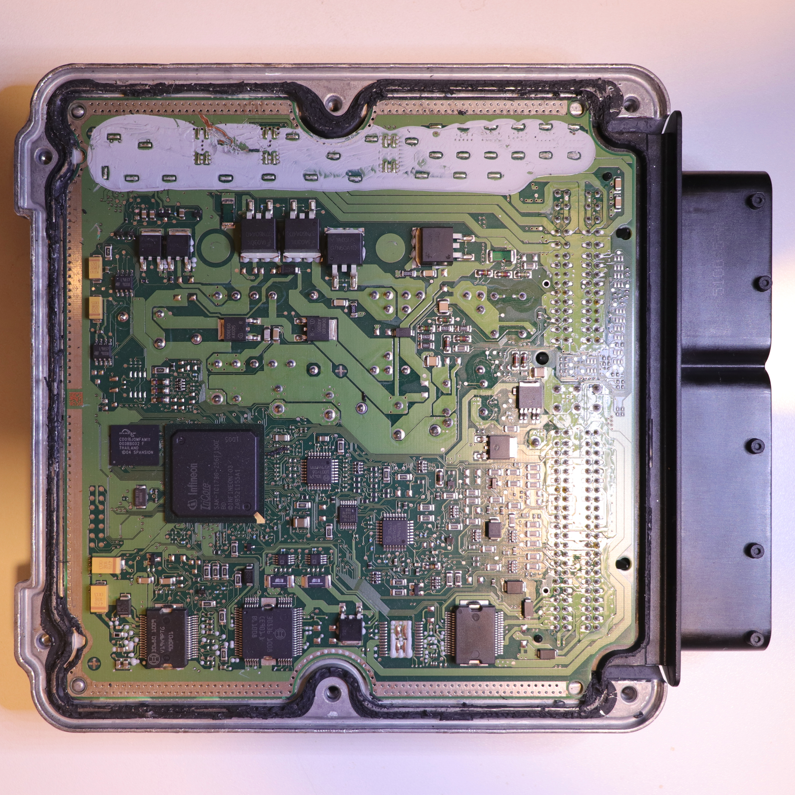

ภาพถ่ายจริง [P12] EDC17CP20.jpg

ผู้ถ่าย KaiBorgeest • CC BY-SA 3.0

ที่มา https://commons.wikimedia.org/wiki/File:EDC17CP20.jpg

สิทธิ์ https://creativecommons.org/licenses/by-sa/3.0 • ย่อขนาดภาพ ไม่แก้เนื้อหาภาพ

ใช้กับเครื่องยนต์สันดาป เรียนจากภาพวงจร จุดวัด และหลักฐานก่อนตัดสินใจซ่อม

40 หน้า • ผู้เรียบเรียง Codex • 16 ตุลาคม 2569

## วิธีเรียนและแผนเปิดอ่าน

พื้นฐาน หน้า 3 ถึง 6 รู้จักสัญลักษณ์ ชิ้นส่วน และเครื่องมือก่อนต่อไฟ

ไฟเลี้ยง หน้า 7 ถึง 12 ตามไฟเข้า ภาคปรับแรงดัน ไฟ MCU และ Reset

อินพุตและเอาต์พุต หน้า 13 ถึง 20 แยกเซนเซอร์ ภาคขับ สัญญาณกลับ และบัส CAN

หน่วยความจำ หน้า 21 ถึง 32 จำแนกชิป อ่านสำรอง ย้ายชิป และตรวจผล

ลงมือและบันทึก หน้า 33 ถึง 36 จดผลวัด ผลอ่านซ้ำ และผลหลังงานก่อนสรุป

เอกสารและเครดิต หน้า 37 ถึง 40 เปิด Datasheet ที่ตรงเบอร์และแพ็กเกจจริงทุกครั้ง

วงจรทั่วไปใช้เรียนหลักการ ไม่ใช่ผัง ECU เฉพาะรถ วงจร Speeduino เป็นภาพย่อยของรุ่นอ้างอิงที่ระบุ เอกสารนี้ใช้ควบคู่ต้นฉบับรวมเล่ม 145 หน้าและการฝึกที่มีผู้สอน

หน้าที่มีแถบเหลืองอ่อนมีเฉพาะจุดเน้น 6 หน้า ส่วนหน้าอื่นใช้จดและทบทวนตามปกติ

## อ่านสัญลักษณ์และจุดต่อสาย

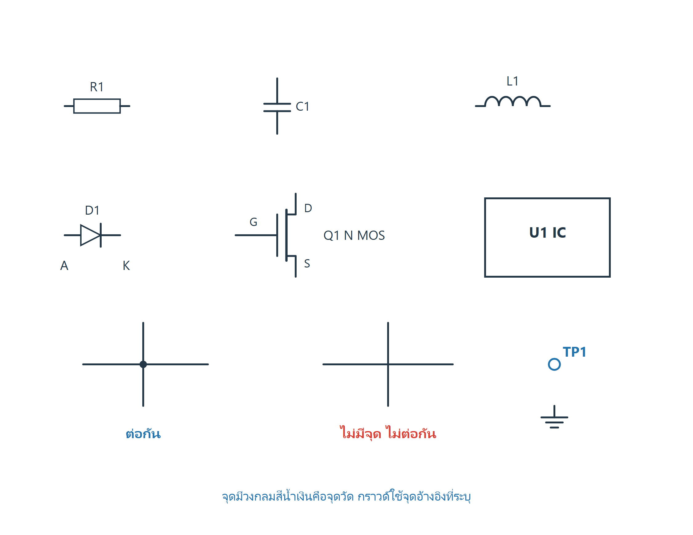

วงจรตัวอย่างสำหรับอธิบายหลักการ ไม่ใช่ผังขาของกล่องรถเฉพาะรุ่น

สัญลักษณ์ R คือความต้านทาน C คือคาปาซิเตอร์ L คือคอยล์ D คือไดโอด Q คือทรานซิสเตอร์ U คือ IC ส่วน TP คือจุดวัด ใช้ชื่ออุปกรณ์คู่กับเส้นวงจร

จุดตัด จุดดำแสดงการต่อกัน เส้นที่ตัดกันโดยไม่มีจุดไม่ถือว่าต่อกัน ป้ายชื่อเน็ตเดียวกันหมายถึงการเชื่อมทางไฟฟ้า แม้ไม่ได้ลากเส้นยาวถึงกัน

ขาอุปกรณ์ G D S และ A K เป็นชื่อขาทางไฟฟ้า ไม่ใช่หมายเลขขาบนแพ็กเกจ ต้องเปิด Datasheet ของเบอร์จริงก่อนแตะโพรบหรือบัดกรี

## มองแผง ECU ของจริง

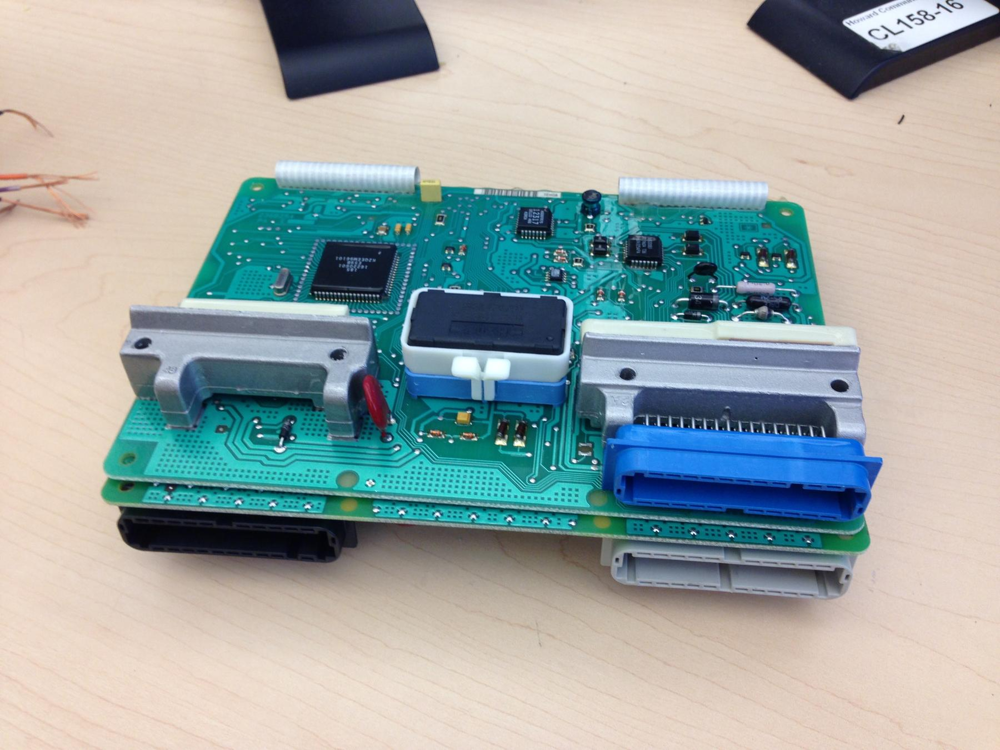

ภาพถ่ายจริง [P1] Inside ECU.JPG

ผู้ถ่าย Snewkirk7953 • CC BY-SA 3.0

ที่มา https://commons.wikimedia.org/wiki/File:Inside_ECU.JPG

สิทธิ์ https://creativecommons.org/licenses/by-sa/3.0/ • ย่อขนาดภาพ ไม่แก้เนื้อหาภาพ

ใช้ภาพดูรูปทรงชิป ภาคกำลัง และปลั๊ก ก่อนแยกหน้าที่ด้วยลายวงจรและข้อมูลจริง

ภาพนี้ไม่ใช่แผนที่ตำแหน่งขาสำหรับกล่องทุกยี่ห้อ บันทึกหมายเลขกล่องและเลขบอร์ดของงานก่อนเสมอ

## เห็นความสัมพันธ์ของ V I R และ P

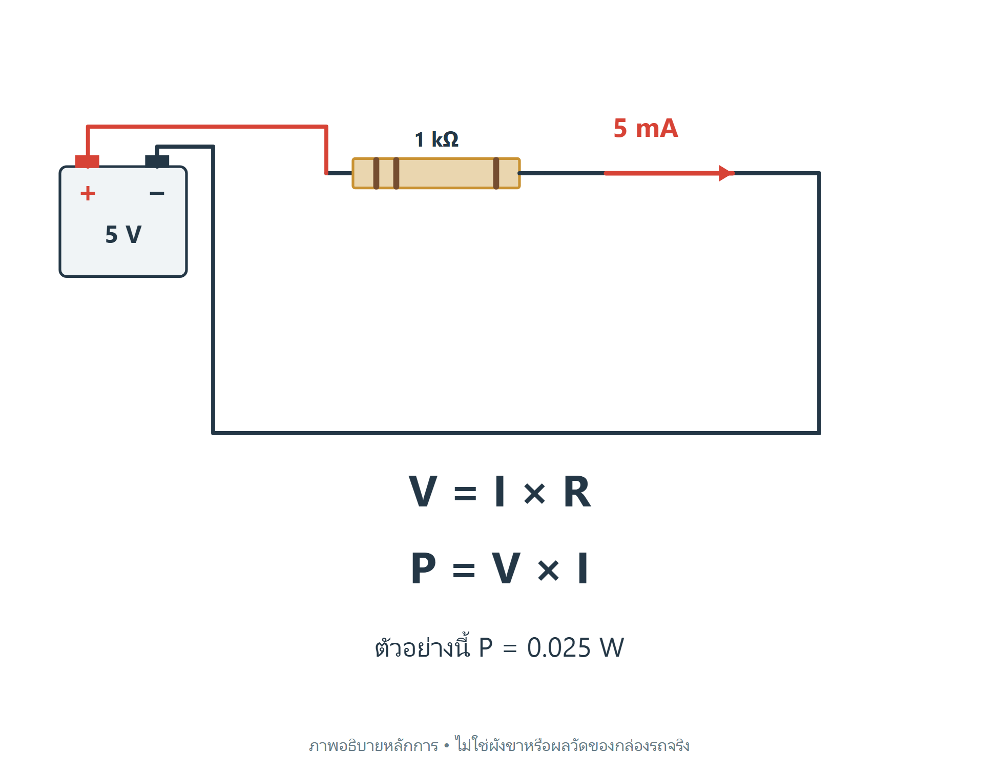

ภาพอธิบายจัดทำใหม่สำหรับการเรียนรู้ ใช้ควบคู่คู่มือรวมเล่ม

วงจรฝึก 5 V กับ 1 kΩ มีกระแสคำนวณ 5 mA

กำลังที่ตัวต้านทาน 0.025 W ใช้ตัว 0.25 W สำหรับวงจรนี้

## เครื่องมือวัดและแหล่งจ่ายจริง

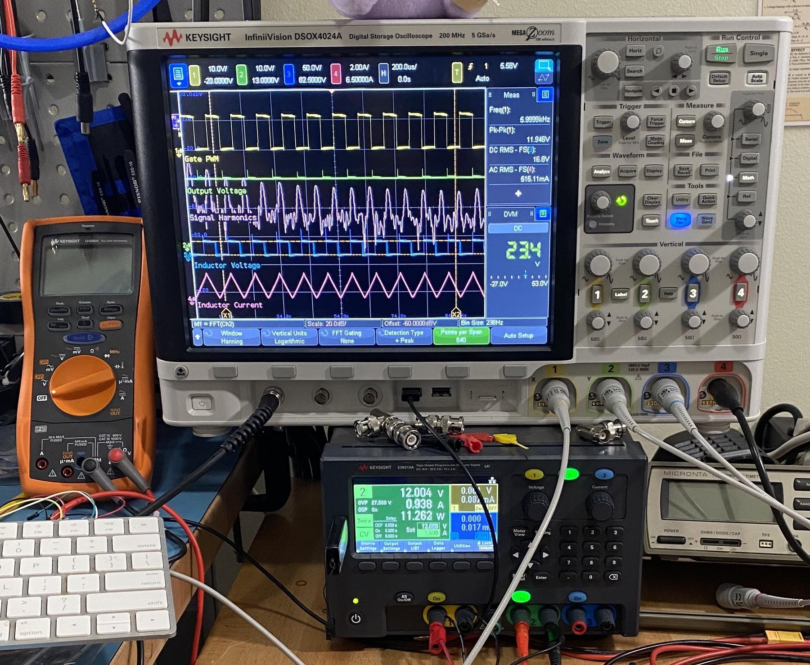

ภาพถ่ายจริง [P2] Keysight InfiniiVision DSOX 4024A and digital multimeter and power supply in laboratory use.jpg

ผู้ถ่าย Radarvector; ไฟล์ครอบตัดเผยแพร่โดย Pittigrilli • CC BY-SA 4.0

ที่มา https://commons.wikimedia.org/wiki/File:Keysight_InfiniiVision_DSOX_4024A_and_digital_multimeter_and_power_supply_in_laboratory_use.jpg

สิทธิ์ https://creativecommons.org/licenses/by-sa/4.0/ • ย่อขนาดภาพ ไม่แก้เนื้อหาภาพ

มัลติมิเตอร์ใช้วัดแรงดันและแรงดันตก สโคปใช้ดูเวลา รูปคลื่น และความสัมพันธ์ของสัญญาณ

ก่อนเปิดไฟตรวจขั้วและกราวด์ จำกัดกระแสตามคู่มือชุดฝึก และใช้โพรบที่รองรับจุดวัด

## ไฟเข้ากล่อง ฟิวส์ ไดโอด และ TVS

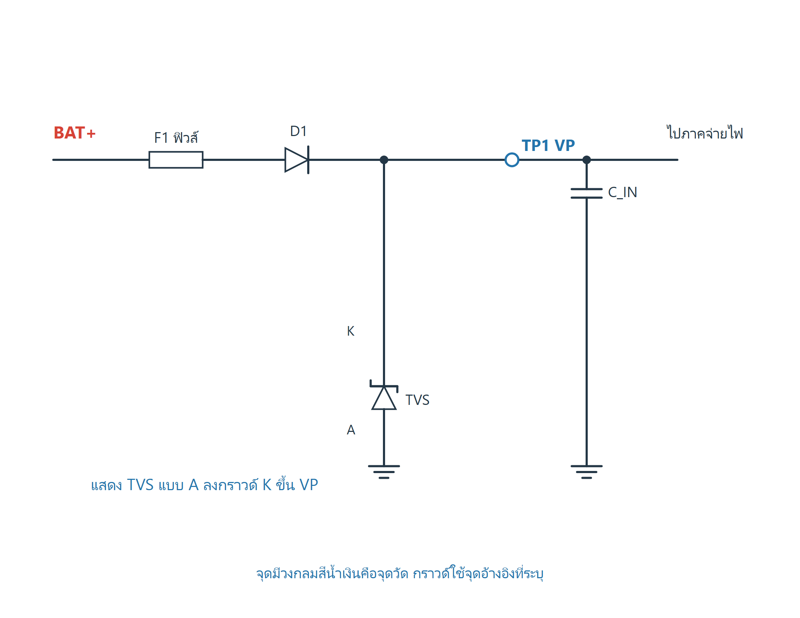

วงจรตัวอย่างสำหรับอธิบายหลักการ ไม่ใช่ผังขาของกล่องรถเฉพาะรุ่น

ทางเดินไฟ ไฟบวกผ่าน F1 และ D1 มายัง VP ส่วน TVS ต่อคร่อม VP กับกราวด์เพื่อจำกัดแรงดันกระชากตามพิกัดที่ออกแบบ คาปาซิเตอร์ช่วยกรองที่ราง

ตรวจอย่างไร เริ่มจากไฟก่อนฟิวส์ หลังฟิวส์ และ TP1 ภายใต้โหลดที่เหมาะสม หาก TP1 ต่ำให้แยกแรงดันตกด้านบวกและกราวด์

> จุดเน้นในคอร์ส 
> • วัดก่อนฟิวส์ หลังฟิวส์ และหลังไดโอด 
> • TVS ลัดได้ ต้องหาต้นเหตุก่อนเปลี่ยน

## LDO พร้อมคาปาซิเตอร์ขาเข้าและขาออก

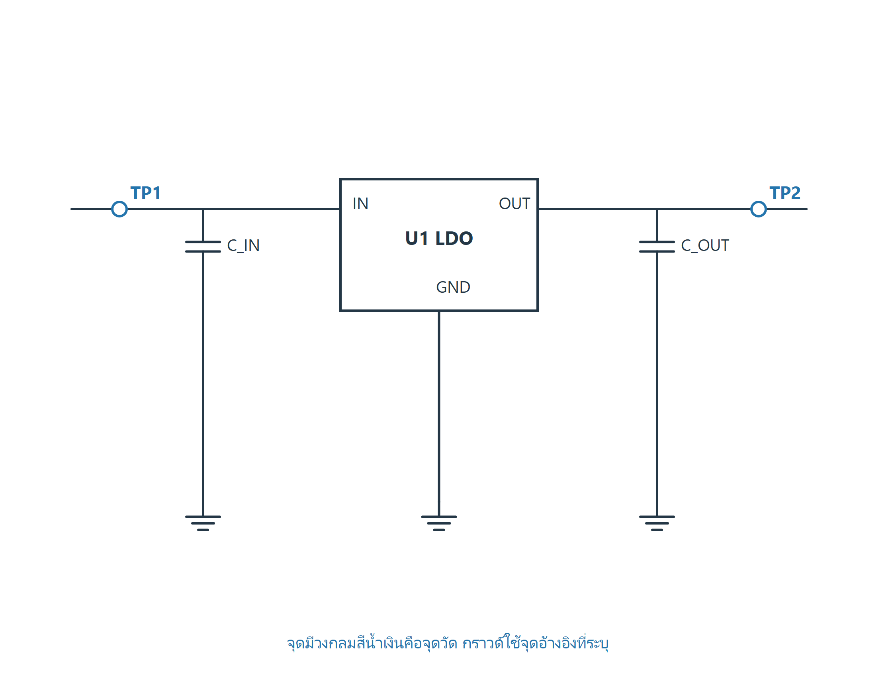

วงจรตัวอย่างสำหรับอธิบายหลักการ ไม่ใช่ผังขาของกล่องรถเฉพาะรุ่น

จุดวัด เทียบ TP1 VIN กับ TP2 VOUT โดยอ้างกราวด์ของ U1 แยกกรณีไฟเข้าหาย ไฟเข้าต่ำ และโหลดดึงเอาต์พุตลง

เงื่อนไข LDO ต้องมีแรงดันเผื่อ Dropout ตามกระแสและอุณหภูมิ ไฟเข้าเท่ากับเอาต์พุตที่ต้องการอาจทำให้รักษาแรงดันไม่ได้

C รอบชิป ค่าความจุ ESR และตำแหน่ง C_OUT ต้องตรง Datasheet บางรุ่นมีขา Enable Reset หรือ Sense เพิ่ม ภาพนี้แสดง LDO แบบ 3 ขาเชิงหน้าที่

## Buck converter และวงจรป้อนกลับ

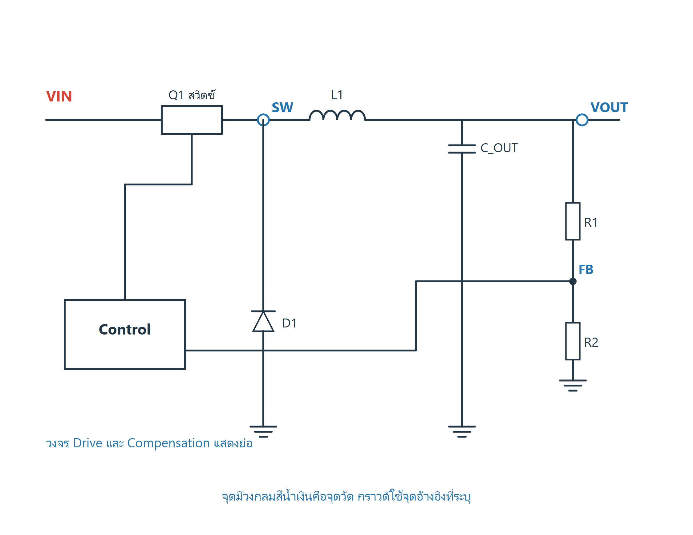

วงจรตัวอย่างสำหรับอธิบายหลักการ ไม่ใช่ผังขาของกล่องรถเฉพาะรุ่น

ทางกำลัง สวิตช์ Q1 สับไฟไปจุด SW ผ่าน L1 สู่ VOUT ส่วน D1 เป็นทางกระแสต่อเนื่องเมื่อสวิตช์ปิด นี่คือ Buck แบบไม่ซิงโครนัสเชิงหลักการ

ทางควบคุม R1 และ R2 แบ่งแรงดันกลับไป FB ตัวควบคุมเปรียบเทียบกับค่าอ้างอิงภายใน ต้องใช้วงจรตาม Datasheet ของเบอร์จริง

วัดให้ถูก SW เป็นพัลส์ ไม่ใช่ไฟ DC เรียบ ต้องตรวจพิกัดและวิธีต่อสโคป จุด FB ต่ำอาจมาจากตัวแบ่งหรือเอาต์พุตต่ำ ไม่สรุปว่าชิปเสียจากค่าเดียว

## กรณีจริง Speeduino ภาคจ่ายไฟ

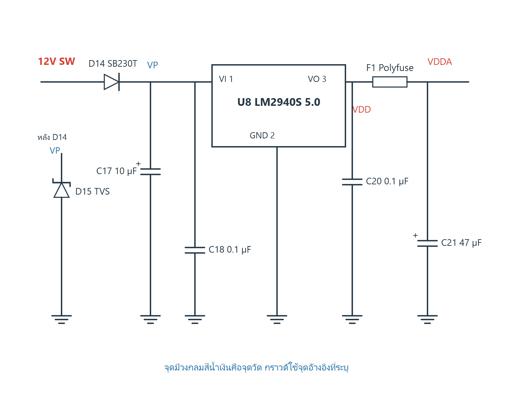

วาดใหม่และจัดวางใหม่จาก Speeduino v0.4.3d Rev 4d วันที่ 2021-03-27 [C10] • CERN-OHL-S-2.0

อุปกรณ์จริง ติดตาม D14 SB230T ไปยัง U8 LM2940S-5.0 และ F1 โดย C17 C18 อยู่ฝั่งเข้า C20 C21 อยู่ฝั่งออกตามแบบรุ่นนี้

ตรวจจากผัง ตรวจไฟหลัง D14 ที่ขา VI แล้วจึง VO และไฟหลัง F1 การไม่มีไฟ VDDA ไม่ได้ยืนยัน U8 เสียจนกว่าจะตรวจฟิวส์และโหลด โดย VDD อยู่ก่อน F1 และ VDDA อยู่หลัง F1

> จุดเน้นในคอร์ส 
> • VDD อยู่ก่อน F1 และ VDDA อยู่หลัง F1 
> • ใช้ผัง Speeduino เฉพาะรุ่นอ้างอิงนี้

## คาปาซิเตอร์ Decoupling รอบ MCU

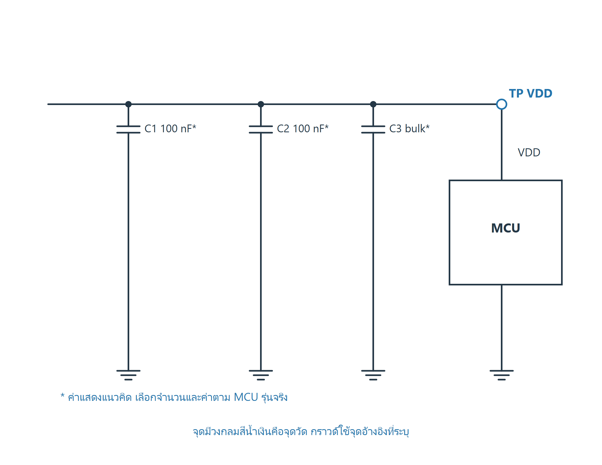

วงจรตัวอย่างสำหรับอธิบายหลักการ ไม่ใช่ผังขาของกล่องรถเฉพาะรุ่น

ต่ออย่างไร C แต่ละตัวต่อคร่อมราง VDD กับกราวด์ใกล้ขาที่จ่ายไฟ คาปาซิเตอร์ไม่ได้ต่ออนุกรมบนเส้นไฟเข้า MCU

แยกโดเมน MCU บางรุ่นมีไฟ Core IO ADC และ Flash ต่างกัน จึงต้องเก็บชื่อรางและค่าไฟแต่ละโดเมน [C2]

ตรวจความผิดปกติ วัดรางที่ขา MCU จริงและดู Ripple ด้วยวิธีวัดเหมาะสม ความต้านทานต่ำบนราง Core อาจเป็นลักษณะของโหลด ไม่ยืนยันการลัดจากเสียงบัซเซอร์

## Reset supervisor และขาควบคุม MCU

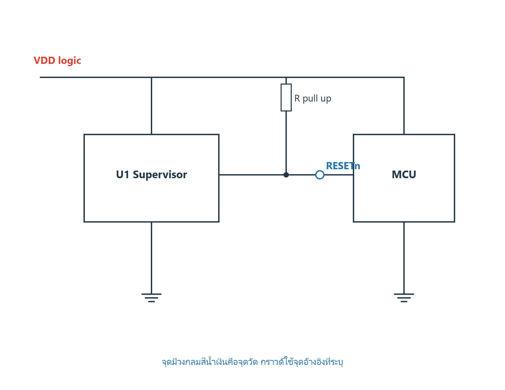

วงจรตัวอย่างสำหรับอธิบายหลักการ ไม่ใช่ผังขาของกล่องรถเฉพาะรุ่น

วงจรตัวอย่าง U1 เฝ้าระวังรางไฟ เอาต์พุต Reset แบบ Open drain ใช้ R pull up ไปยังรางลอจิกที่ตรงกับ MCU

จับเหตุการณ์ เก็บ VDD กับ RESETn บนฐานเวลาเดียวกัน ถ้า VDD ตกก่อน Reset อาจเป็นการตอบสนองปกติของวงจรเฝ้าระวัง

ข้อจำกัด Threshold Delay และชนิดเอาต์พุตขึ้นกับเบอร์จริง ห้ามเพิ่ม C หรือผูก Reset เข้ารางไฟเพื่อบังคับให้กล่องทำงาน

## NTC และตัวแบ่งแรงดันเข้าขา ADC

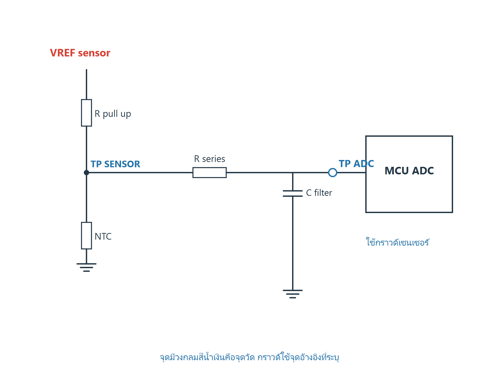

วงจรตัวอย่างสำหรับอธิบายหลักการ ไม่ใช่ผังขาของกล่องรถเฉพาะรุ่น

หลักการ R pull up กับ NTC แบ่งแรงดัน เมื่อ NTC เปลี่ยนค่า TP SENSOR เปลี่ยนตาม ส่วน R series C filter ลดสัญญาณรบกวนก่อน ADC

ตัวอย่างฝึก บนแหล่ง 5 V ใช้ R pull up 10 kΩ และตัวจำลอง 10 kΩ จะได้ 2.5 V เมื่อเปลี่ยนตัวจำลองเป็น 2.2 kΩ ได้ประมาณ 0.90 V

> จุดเน้นในคอร์ส 
> • ตรวจ VREF และกราวด์ก่อนสรุปว่าเซนเซอร์เสีย 
> • เปรียบเทียบจุดเซนเซอร์กับ ADC

## TPS แบบโพเทนชิออมิเตอร์สามสาย

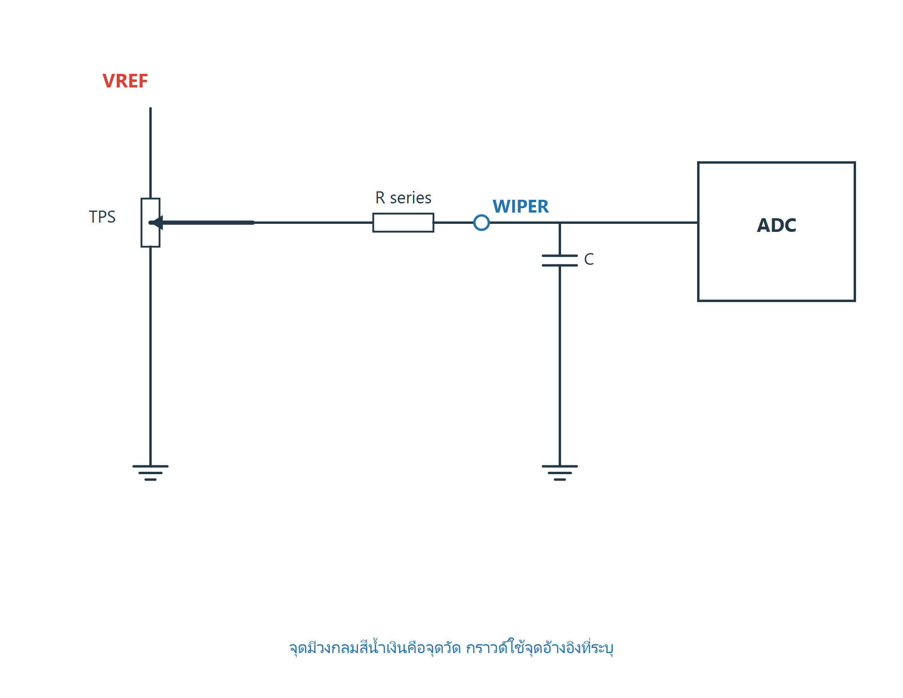

วงจรตัวอย่างสำหรับอธิบายหลักการ ไม่ใช่ผังขาของกล่องรถเฉพาะรุ่น

สามขั้ว ปลายบนต่อ VREF ปลายล่างต่อ Sensor ground และ Wiper เป็นสัญญาณที่เปลี่ยนตามตำแหน่ง

ก่อนสรุป วัด VREF และกราวด์ก่อนตรวจ Wiper แล้วเทียบที่ขา ADC เพื่อแยกเซนเซอร์ สาย และอินพุตใน ECU

ขอบเขต เป็น TPS แบบตัวต้านทานหนึ่งช่อง ไม่ใช่เซนเซอร์ Hall หรือคันเร่งสองช่องซึ่งต้องตรวจความสัมพันธ์ตามรุ่น

## Hall แบบ Open collector และตัวดึงขึ้น

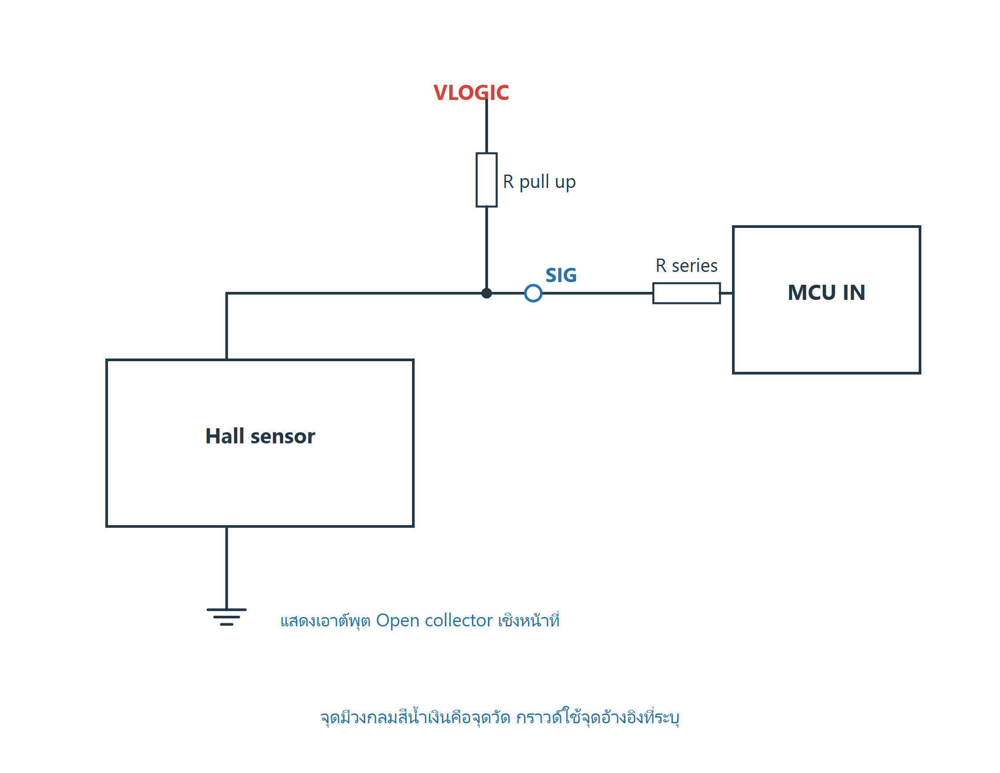

วงจรตัวอย่างสำหรับอธิบายหลักการ ไม่ใช่ผังขาของกล่องรถเฉพาะรุ่น

การดึงขึ้น ทรานซิสเตอร์ในเซนเซอร์ดึงสายสัญญาณลงกราวด์เมื่อทำงาน และ R pull up ทำให้กลับขึ้นสูงเมื่อปิด

ระดับไฟ VLOGIC ต้องตรงกับอินพุต ECU ไม่ใช่ยกไฟ 12 V ไปเข้าขา MCU โดยตรง เซนเซอร์ที่มี Pull up ในตัวอาจต้องใช้วงจรต่างจากภาพ

วัดเพื่อแยก วัดไฟเซนเซอร์ กราวด์ และพัลส์ก่อนตรวจอินพุต ECU ความถี่และรูปแบบฟันสัมพันธ์กับรอบและชนิดระบบ

## Low side ขับรีเลย์และไดโอดคร่อมโหลด

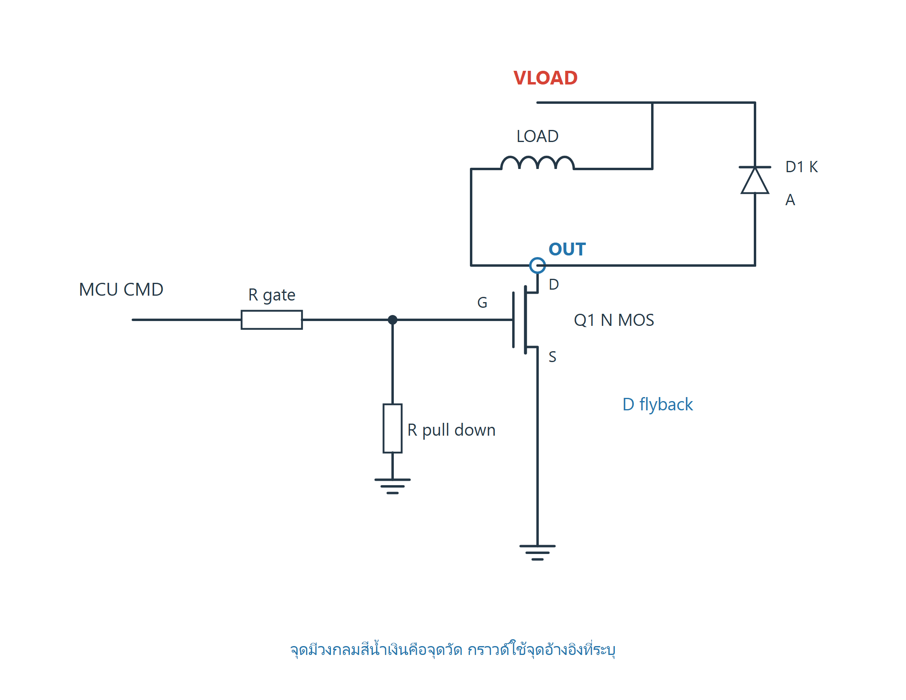

วงจรตัวอย่างสำหรับอธิบายหลักการ ไม่ใช่ผังขาของกล่องรถเฉพาะรุ่น

ตอนเปิด Q1 นำกระแสจากโหลดลงกราวด์ OUT จึงต่ำ กระแสไหลจาก VLOAD ผ่านขดลวดไปทาง Drain Source

ตอนปิด ไดโอดขนานโหลดมี A ที่ OUT และ K ที่ VLOAD เป็นทางให้กระแสขดลวดไหลต่อ ลดแรงดันย้อน แต่ทำให้กระแสลดช้ากว่าวงจร Clamp แรงดันสูง

ซ่อมจากหลักฐาน ตรวจโหลด กราวด์ ภาค Gate และอุปกรณ์รับแรงดันย้อนก่อนเปลี่ยน Q1 ภาพนี้ไม่ใช้แทนวงจรคอยล์จุดระเบิดหรือหัวฉีดทุกชนิด

## ภาคขับหัวฉีดและวงจร Clamp

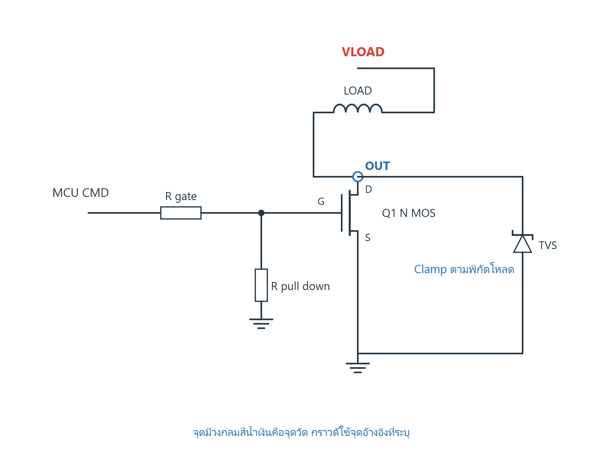

วงจรตัวอย่างสำหรับอธิบายหลักการ ไม่ใช่ผังขาของกล่องรถเฉพาะรุ่น

ความต่างกับรีเลย์ วงจรหัวฉีดต้องควบคุมการลดกระแสด้วย Clamp ที่ออกแบบ บางระบบใช้ Saturated บางระบบใช้ Peak and hold ห้ามสลับวิธีโดยดูเพียงรูปทรง MOSFET

TVS ในภาพ แสดงตำแหน่งป้องกันระหว่าง Drain กับ Source เชิงหลักการ เลือก Breakdown พลังงาน กระแส และ SOA ร่วมกัน ไม่ใช่เลือกค่าที่สูงที่สุด [C4]

> จุดเน้นในคอร์ส 
> • หัวฉีดใช้ Clamp ที่ตรงการออกแบบ 
> • ตรวจคำสั่ง กระแส และ OUT ร่วมกัน

## H bridge และการกลับทิศมอเตอร์

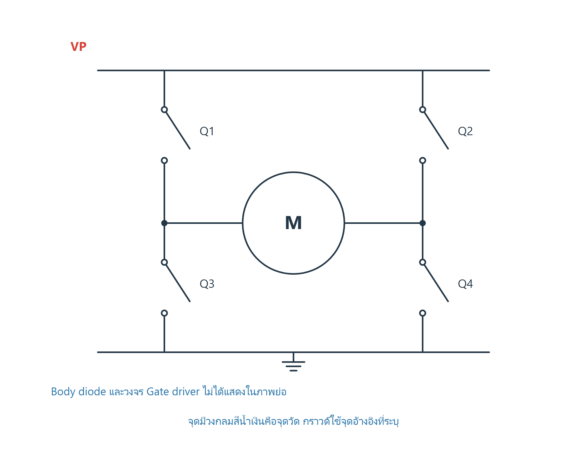

วงจรตัวอย่างสำหรับอธิบายหลักการ ไม่ใช่ผังขาของกล่องรถเฉพาะรุ่น

สี่สวิตช์ เปิด Q1 กับ Q4 ให้กระแสผ่านมอเตอร์ทิศหนึ่ง เปิด Q2 กับ Q3 ได้ทิศกลับกัน ภาพแสดงสวิตช์เชิงหลักการแทน MOSFET และ Gate driver

ห้ามเปิดคู่บนล่าง Q1 กับ Q3 หรือ Q2 กับ Q4 ในขาเดียวกันเปิดพร้อมกันจะลัดรางไฟ ต้องมี Dead time และการป้องกันตามไดรเวอร์

ใช้ในการวิเคราะห์ ดูไฟเลี้ยง คำสั่ง ทิศ กระแส และ Feedback ของระบบ ไม่ใช้ภาพนี้ทดลองขับลิ้นปีกผีเสื้อจริง ระบบต้องมีการตรวจความปลอดภัยครบ

## ตรวจวัดกระแสด้วย Shunt ด้านกราวด์

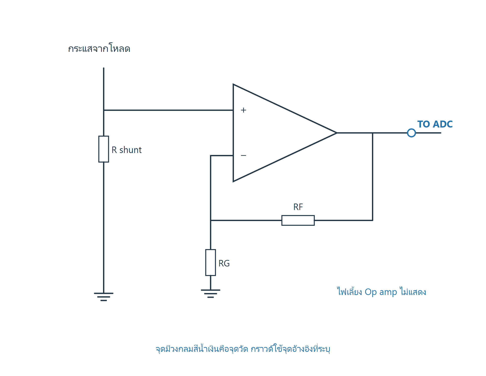

วงจรตัวอย่างสำหรับอธิบายหลักการ ไม่ใช่ผังขาของกล่องรถเฉพาะรุ่น

หลักการ แรงดันคร่อม R shunt เท่ากับ I × R ตัวอย่างกระแส 1 A ผ่าน 0.1 Ω ให้ 0.1 V ก่อนขยาย

ขยายแบบไม่กลับเฟส R feedback กับ R gain กำหนดอัตราขยาย 1 + RF/RG ของวงจรอุดมคติ แต่ช่วง Common mode และเอาต์พุตจริงขึ้นกับ Op amp

การต่อวัด สายวัด Sense ควรอ้างที่ปลายชันต์แบบ Kelvin แยกจากทางกระแสสูง กราวด์ที่ตกอาจทำให้ค่ากระแสและ ADC เพี้ยน

## CAN ด้วย NXP TJA1050T

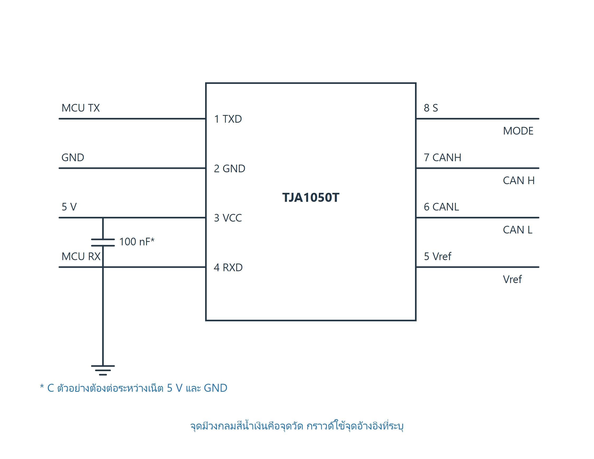

วาดใหม่จาก NXP TJA1050 Datasheet ขา SO8 [C5]

ขาที่ระบุ ใช้ผังขา TJA1050T แบบ SO8 ตาม Datasheet โดย VCC ใช้ 4.75 ถึง 5.25 V ขา S ควบคุมโหมด High speed หรือ Silent [C5]

อุปกรณ์รอบชิป C decoupling คร่อม VCC GND อยู่ใกล้ชิป ส่วนการป้องกันบัสและเทอร์มิเนชันต้องตรงเครือข่าย รูปนี้ไม่ใส่ 120 Ω ให้ทุกโหนด

ตรวจภาคควบคุม เทียบ TXD CANH CANL RXD ร่วมกับไฟและ S เอาต์พุต RXD ของชิปไฟ 5 V ต้องตรวจพิกัดอินพุต MCU 3.3 V ก่อนต่อ หากรับ 5 V ไม่ได้ต้องมีวงจรแปลงระดับ [C5]

## เห็นหน่วยความจำสามแบบ

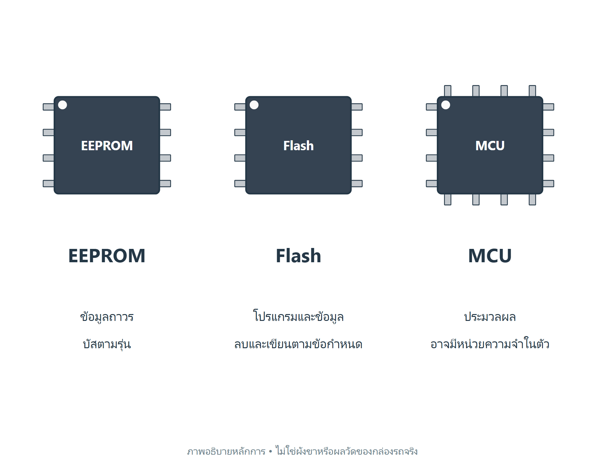

ภาพอธิบายจัดทำใหม่สำหรับการเรียนรู้ ใช้ควบคู่คู่มือรวมเล่ม

EEPROM และ Flash เก็บข้อมูลเมื่อปิดไฟ MCU อาจรวมหน่วยความจำในตัว

บัส แรงดัน และการจัดข้อมูลต้องตรงหมายเลขชิป

## อ่านชื่อบนชิป Atmel ก่อนเลือกโปรไฟล์

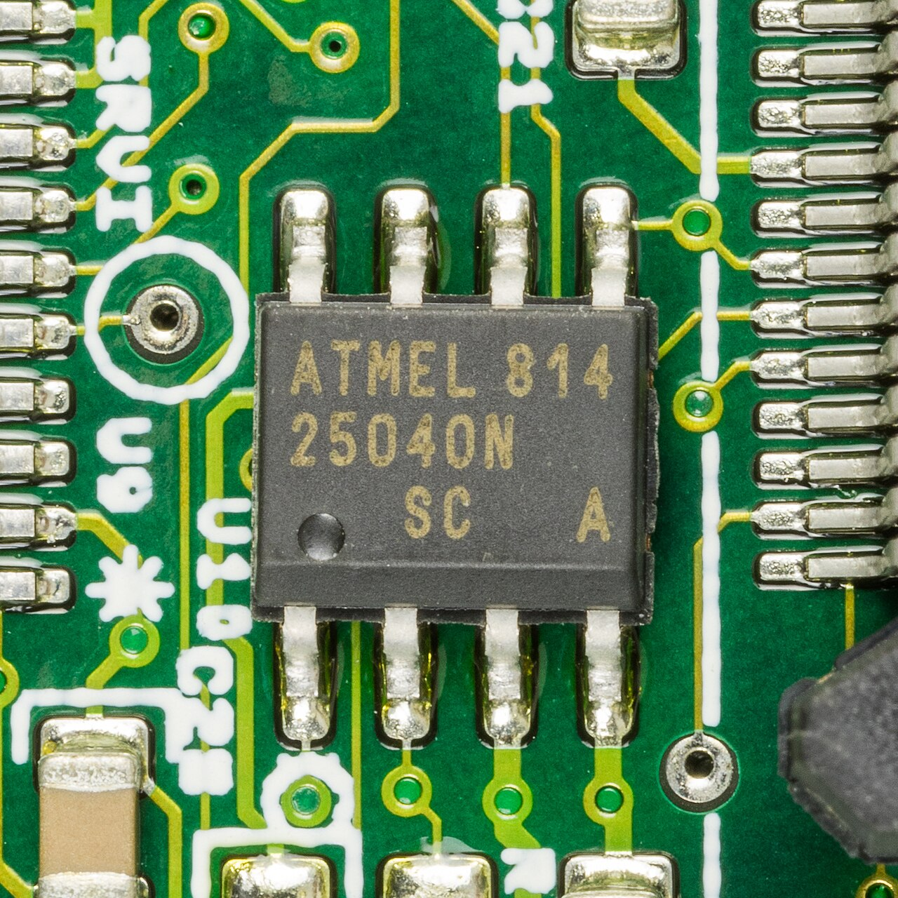

ภาพถ่ายจริง [P19] Iomega Jaz V2000Si JAZ 2 - board - Atmel 25040N-0558.jpg

© Raimond Spekking / CC BY-SA 4.0 (via Wikimedia Commons)

ที่มา https://commons.wikimedia.org/wiki/File:Iomega_Jaz_V2000Si_JAZ_2_-_board_-_Atmel_25040N-0558.jpg

สิทธิ์ https://creativecommons.org/licenses/by-sa/4.0/ • ย่อขนาดภาพ ไม่แก้เนื้อหาภาพ

อ่านข้อความบนตัวชิปให้ครบ แล้วตรวจผู้ผลิต รุ่นย่อย ความจุ แรงดัน และแพ็กเกจใน Datasheet

ชิป 8 ขาไม่ได้ใช้บัสหรือไฟเหมือนกันทั้งหมด ภาพจริงใช้ฝึกอ่านสกรีน ไม่ยืนยันว่าติดตั้งใน ECU ทุกชนิด

## SPI EEPROM พร้อม Pull up และ Decoupling

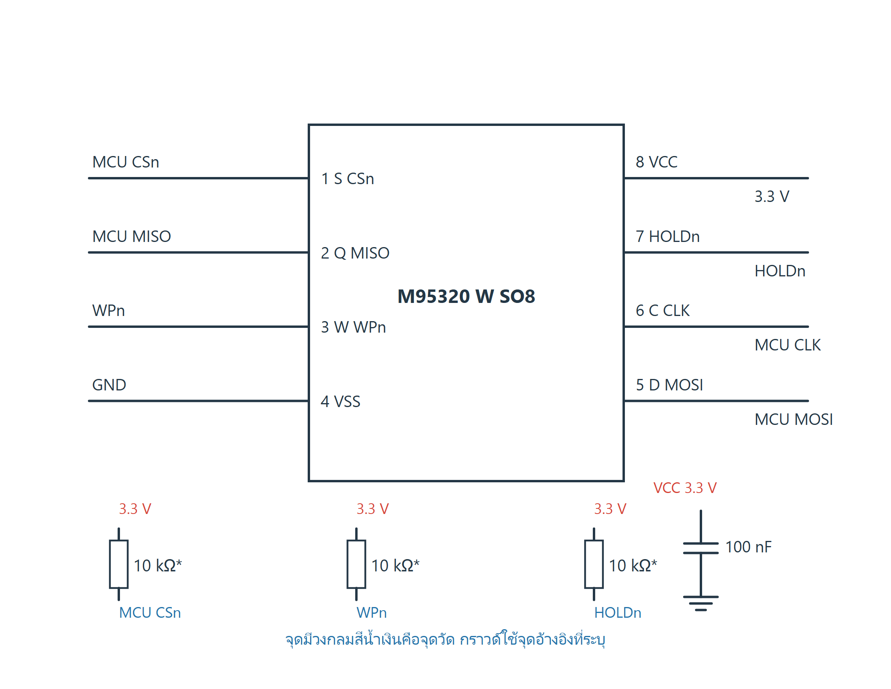

วงจรฝึกชิปแยก อ้างขา ST M95320-W SO8 [C7]

ตัวอย่างเบอร์ เลือก M95320-W ซึ่งใช้งานได้กับไฟ 3.3 V ในช่วงที่ Datasheet ระบุ C 100 nF คร่อม VCC VSS เป็นการต่อ Decoupling ตัวอย่าง [C7]

ขาควบคุม CSn WPn HOLDn ต้องอยู่ในสถานะที่ถูกต้อง ภาพแสดง R ดึงขึ้นทั้งสามเน็ต การต่อ WPn สูงเพียงอย่างเดียวไม่ยืนยันว่าเขียนได้ ต้องดูบิตป้องกันด้วย

สำรองก่อน ตรวจระดับสัญญาณเครื่องอ่าน อ่านซ้ำ เทียบข้อมูล และเก็บต้นฉบับก่อนเขียน การเลือกแพ็กเกจและทิศขาต้องตรง

## ดูชิป ST และจำแนกตระกูล 24

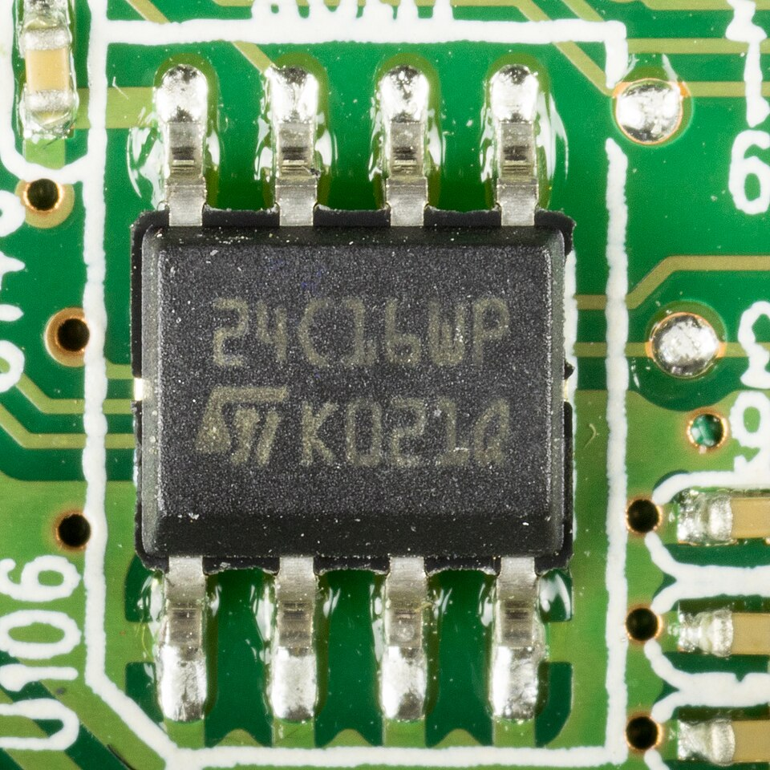

ภาพถ่ายจริง [P18] Dell E2210f - controller board - STMicroelectronics 24C16WP-4697.jpg

© Raimond Spekking / CC BY-SA 4.0 (via Wikimedia Commons)

ที่มา https://commons.wikimedia.org/wiki/File:Dell_E2210f_-_controller_board_-_STMicroelectronics_24C16WP-4697.jpg

สิทธิ์ https://creativecommons.org/licenses/by-sa/4.0/ • ย่อขนาดภาพ ไม่แก้เนื้อหาภาพ

ตระกูล 24 มักใช้ I2C แต่ต้องตรวจชื่อเต็ม ผังขา ความจุ และเงื่อนไขแรงดันของชิปจริงก่อนอ่าน

บันทึกทิศขา 1 ก่อนถอด และเลือกอะแดปเตอร์ให้ตรงแพ็กเกจ อย่าใช้ชื่อคล้ายกันแทนการยืนยันเบอร์

## I2C EEPROM พร้อมตัวดึงบัสขึ้น

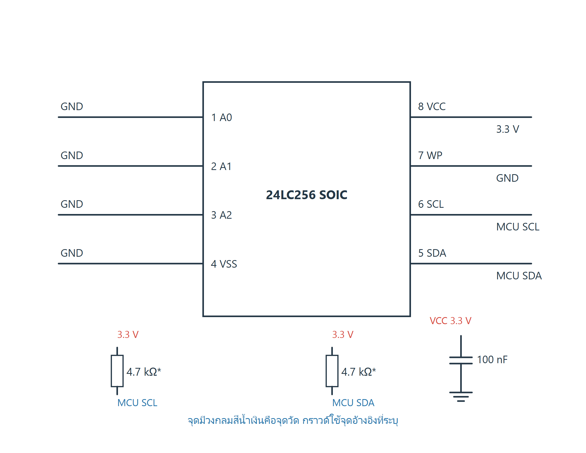

วงจรฝึกชิปแยก อ้าง Microchip 24LC256 แบบ SOIC 8 ขา [C8]

ที่อยู่ตัวอย่าง ผังนี้เลือก A0 A1 A2 ลงกราวด์ และ WP ลงกราวด์เพื่อใช้ในชุดฝึก ค่า Address และขาแพ็กเกจอื่นอาจต่างกัน [C8]

Pull up R ตัวอย่าง 4.7 kΩ ดึง SCL SDA ไป 3.3 V เป็นค่าฝึก ไม่ใช่กฎทุกความเร็ว ต้องดูความจุบัส Rise time และแรงดันลอจิก

การตรวจ SDA ค้างต่ำอาจมาจากชิปตัวอื่นหรือการอ่านค้าง ต้องตรวจทั้งบัส วัดไฟและอ่านซ้ำหลังเริ่มใหม่อย่างถูกขั้นตอน

## Microwire และขา ORG ที่กำหนดการจัดคำ

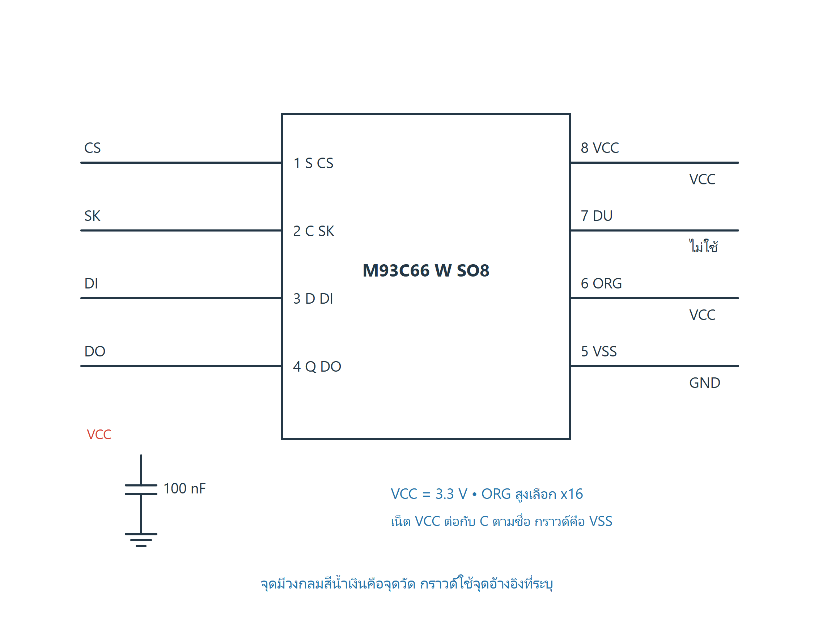

อ้างผังขา ST M93C66-W แบบ SO8 [C9]

โหมดตัวอย่าง M93C66 แบบใน Datasheet ใช้ ORG สูงเลือกจัดคำ x16 ส่วน ORG ต่ำเลือก x8 ต้องตรวจชื่อเต็มและผู้ผลิตก่อนใช้กฎนี้กับชิปอื่น [C9]

ขาควบคุม ภาพแสดงการต่อขาหลัก ไม่ใช่วงจรใช้งานครบ ขา S/CS ต้องไม่ลอยขณะเปิดไฟ ผู้ผลิตแนะนำตัวดึงลง ส่วน DU ให้ปฏิบัติตาม Datasheet ไม่ใช้แทน HOLD ของ SPI

บันทึกผลอ่าน เก็บโหมด x16 รูปแบบ Byte order และขนาดไฟล์ไว้กับงาน การสลับโหมดหรือเรียงไบต์อาจทำให้ผลดูต่างทั้งที่เป็นข้อมูลคนละการตีความ

## เทียบการอ่านซ้ำทุกไบต์

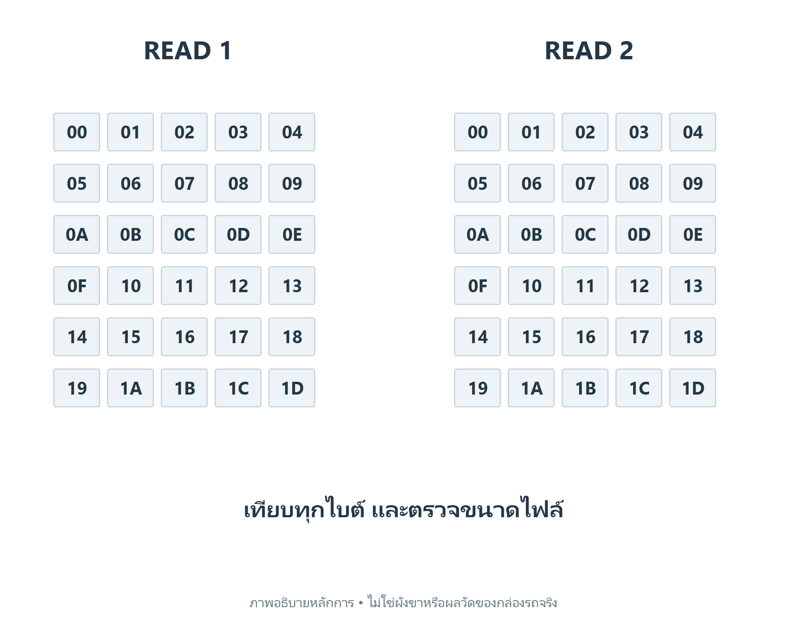

ภาพอธิบายจัดทำใหม่สำหรับการเรียนรู้ ใช้ควบคู่คู่มือรวมเล่ม

อ่านอย่างน้อยสองครั้งในเงื่อนไขเดียวกัน

เทียบเนื้อหา ขนาด และขอบเขตอ่าน ไม่ดูชื่อไฟล์อย่างเดียว

> จุดเน้นในคอร์ส 
> • อ่านซ้ำอย่างน้อยสองครั้งและเทียบทุกไบต์ 
> • เก็บต้นฉบับแยกก่อนเขียน

## คลิปยังต่อกับวงจรอื่น

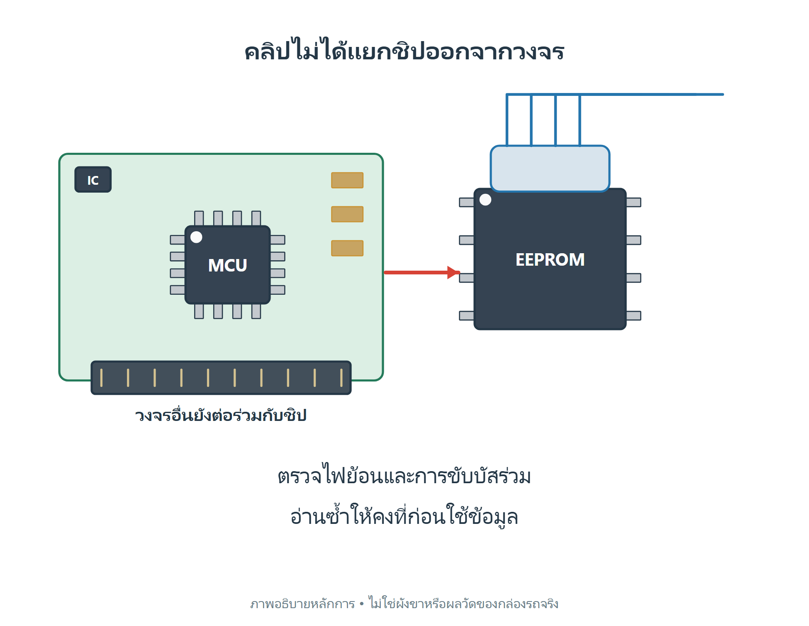

ภาพอธิบายจัดทำใหม่สำหรับการเรียนรู้ ใช้ควบคู่คู่มือรวมเล่ม

MCU และภาคจ่ายไฟยังมีภาระร่วมกับชิป

ต้องระวังไฟย้อนและการขับบัสพร้อมกัน

## แพ็กเกจ QFP และการตรวจขารอบตัว

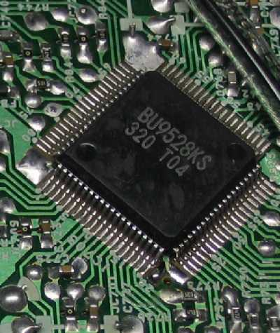

ภาพถ่ายจริง [P4] IC-package-QFP.jpg

ผู้ถ่าย Sphl at Japanese Wikipedia • CC BY-SA 3.0

ที่มา https://commons.wikimedia.org/wiki/File:IC-package-QFP.jpg

สิทธิ์ http://creativecommons.org/licenses/by-sa/3.0/ • ย่อขนาดภาพ ไม่แก้เนื้อหาภาพ

ตรวจทุกด้านของแพ็กเกจด้วยกำลังขยาย มองหารอยเชื่อมติด ขางอ และ Pad ที่เสียหาย

การย้าย MCU ต้องตรวจความเข้ากันได้และข้อมูลภายใน งานนี้ต่างจากย้าย EEPROM และอาจมีข้อมูลที่อ่านหรือย้ายไม่ได้

## ลำดับงานย้ายชิปที่รักษา Pad

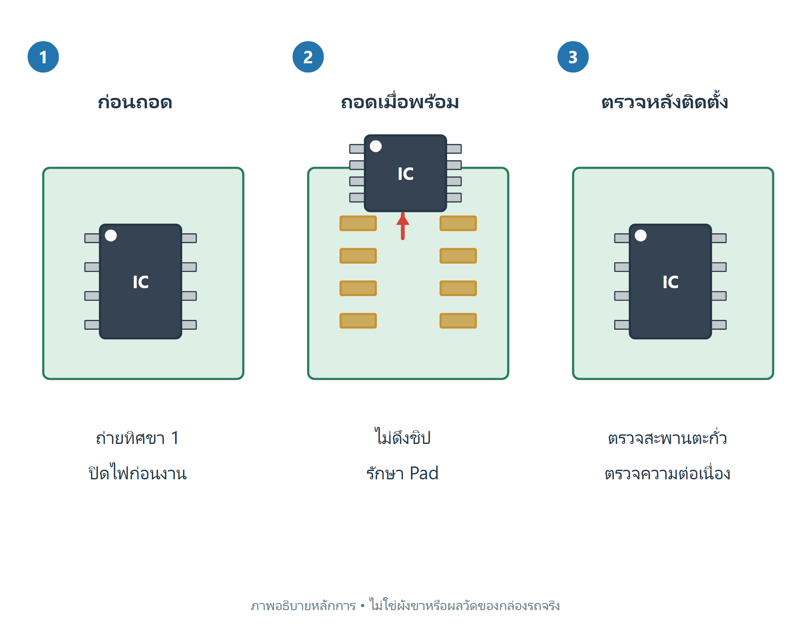

ภาพอธิบายจัดทำใหม่สำหรับการเรียนรู้ ใช้ควบคู่คู่มือรวมเล่ม

บันทึกทิศขา 1 และสำรองข้อมูลก่อนให้ความร้อน

ยกเมื่อรอยต่อพร้อม ไม่ใช้แรงดึงหรือบิด

## เครื่องมือและงานบัดกรีของจริง

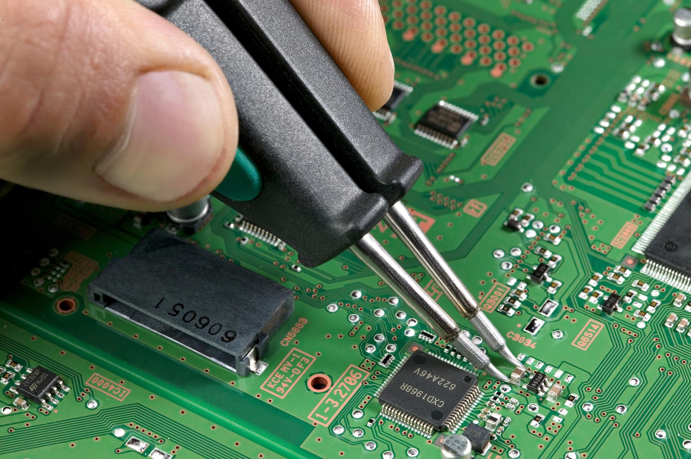

ภาพถ่ายจริง [P5] Soldering a 0805.jpg

ผู้ถ่าย Aisart • CC BY-SA 3.0

ที่มา https://commons.wikimedia.org/wiki/File:Soldering_a_0805.jpg

สิทธิ์ https://creativecommons.org/licenses/by-sa/3.0 • ย่อขนาดภาพ ไม่แก้เนื้อหาภาพ

ฝึกกับบอร์ดเสียก่อน ควบคุมความร้อนตามชิป บอร์ด และอุปกรณ์จริง ไม่ใช้ค่าอุณหภูมิเดียวกับทุกงาน

หลังติดตั้งตรวจทิศ ขาเชื่อมติด ความต่อเนื่อง และรอยลัดก่อนจ่ายไฟ เก็บภาพก่อนและหลังงานไว้

## ตรวจความถูกต้องเป็นสามชั้น

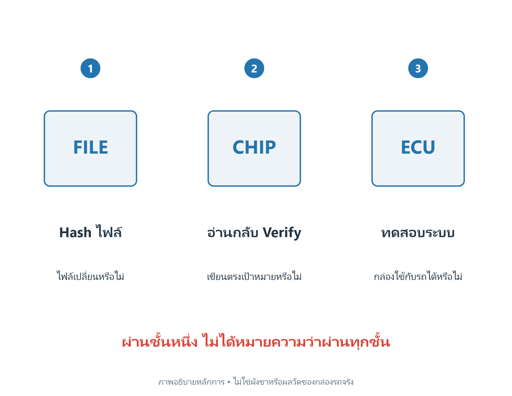

ภาพอธิบายจัดทำใหม่สำหรับการเรียนรู้ ใช้ควบคู่คู่มือรวมเล่ม

Hash ภายนอกไม่ใช่ Checksum ภายใน ECU

ECC และพื้นที่ป้องกันขึ้นกับตระกูลชิป ตรวจเอกสารของชิปจริง

> จุดเน้นในคอร์ส 
> • ไฟล์ตรง ไม่ได้ยืนยันว่ารถทำงานครบ 
> • ตรวจไฟล์ ชิป และระบบแยกเป็นขั้น

## ใบงานตรวจไฟเข้าและกราวด์

ชื่อ __________ วันที่ __________ รหัสชุดฝึก __________

อาการและเงื่อนไขที่ทำให้เกิดอาการ

________________________________________________________________

________________________________________________________________

ค่าแบตเตอรี่และไฟขาเข้ากล่องพร้อมเงื่อนไขโหลด

________________________________________________________________

________________________________________________________________

แรงดันตกด้านบวกและกราวด์ พร้อมจุดอ้างอิง

________________________________________________________________

________________________________________________________________

สิ่งที่ผลวัดยืนยันและสิ่งที่ต้องตรวจต่อ

________________________________________________________________

________________________________________________________________

## ใบงานเซนเซอร์และภาคขับ

วงจรที่ใช้ __________ เอกสารรุ่น __________

ไฟอ้างอิงและกราวด์เซนเซอร์

________________________________________________________________

________________________________________________________________

สัญญาณก่อนและหลังวงจรอินพุต

________________________________________________________________

________________________________________________________________

คำสั่งภาคขับและเอาต์พุต พร้อมชนิดโหลด

________________________________________________________________

________________________________________________________________

หลักฐานก่อนซ่อม ผลหลังซ่อม และข้อจำกัดการทดสอบ

________________________________________________________________

________________________________________________________________

## ใบงานอ่านสำรองและตรวจไฟล์

ทำงานกับชุดฝึกหรือกล่องที่ได้รับอนุญาต ชิป __________ แพ็กเกจ __________

ขา 1 แรงดัน โปรไฟล์เครื่องอ่าน และวิธีเชื่อมต่อ

________________________________________________________________

________________________________________________________________

ไฟล์ Read1 ขนาด และ SHA256

________________________________________________________________

________________________________________________________________

ไฟล์ Read2 ขนาด และผลเทียบทุกไบต์

________________________________________________________________

________________________________________________________________

จุดเก็บต้นฉบับ วิธีคืนสภาพ และผลอ่านกลับ

________________________________________________________________

________________________________________________________________

## ใบงานย้ายชิปและตรวจหลังงาน

กล่องต้นทาง __________ ปลายทาง __________ ผู้ตรวจ __________

หลักฐานความเข้ากันได้และข้อมูลปลายทางก่อนงาน

________________________________________________________________

________________________________________________________________

ภาพก่อนถอด ทิศชิป สภาพ Pad และผลตรวจรอยลัด

________________________________________________________________

________________________________________________________________

ผลตรวจข้อมูลและผลบนโต๊ะ พร้อมเงื่อนไขทดสอบ

________________________________________________________________

________________________________________________________________

ผลบนระบบที่ได้รับอนุญาต และส่วนที่ยังไม่ได้ตรวจ

________________________________________________________________

________________________________________________________________

## เอกสารอ้างอิงวงจร

[C1] TI TIDA 01167 การป้องกันไฟแบตเตอรี่

https://www.ti.com/tool/TIDA-01167

[C2] NXP MPC5604P คู่มือออกแบบฮาร์ดแวร์

https://www.nxp.com/docs/en/user-guide/MPC5604PQRUG.pdf

[C4] TI LM1949 วงจรขับหัวฉีดและ Clamp

https://www.ti.com/lit/ds/symlink/lm1949.pdf

[C5] NXP TJA1050 ผังขาและระดับไฟ

https://www.nxp.com/docs/en/data-sheet/TJA1050.pdf

อ่านพิกัดการทำงานและผังขาของเบอร์ แพ็กเกจ และรุ่นย่อยจริง ห้ามใช้ Absolute maximum เป็นค่าจ่ายไฟปกติ

## เอกสารอ้างอิงหน่วยความจำ

[C7] ST M95320 W SPI EEPROM

https://www.st.com/resource/en/datasheet/m95320-w.pdf

[C8] Microchip 24LC256 I2C EEPROM

https://ww1.microchip.com/downloads/en/DeviceDoc/21203R.pdf

[C9] ST M93C66 W Microwire EEPROM

https://www.st.com/resource/en/datasheet/m93c46-w.pdf

[C10] Speeduino v0.4.3d Rev 4d วันที่ 2021 03 27

https://github.com/speeduino/Hardware/blob/main/v0.4/THT/Latest/v0.4.3d.pdf

วงจร Speeduino ภาคจ่ายไฟในเล่มนี้วาดใหม่และคัดเฉพาะบางส่วนโดย Codex เมื่อ 16 ตุลาคม 2569 ใช้ CERN OHL S 2.0 ตามต้นทาง เอกสารนี้ไม่ใช่แบบผลิตหรือผลทดสอบ ECU จริง

ต้นทาง https://github.com/speeduino/Hardware

ใบอนุญาต https://opensource.org/license/CERN-OHL-S-2.0

ต้นฉบับ SVG และประกาศสิทธิ์อยู่ใน ECU_Circuit_Drawings.zip ที่ส่งพร้อมคู่มือรวมเล่ม

## เครดิตภาพถ่ายจริง

[P1] Inside ECU.JPG

ผู้ถ่าย Snewkirk7953

สิทธิ์ CC BY-SA 3.0

https://commons.wikimedia.org/wiki/File:Inside_ECU.JPG

https://creativecommons.org/licenses/by-sa/3.0/

ย่อขนาดและแปลงรูปแบบไฟล์เพื่อจัดพิมพ์ ไม่เปลี่ยนเนื้อหาภาพ

[P2] Keysight InfiniiVision DSOX 4024A and digital multimeter and power supply in laboratory use.jpg

ผู้ถ่าย Radarvector; ไฟล์ครอบตัดเผยแพร่โดย Pittigrilli

สิทธิ์ CC BY-SA 4.0

https://commons.wikimedia.org/wiki/File:Keysight_InfiniiVision_DSOX_4024A_and_digital_multimeter_and_power_supply_in_laboratory_use.jpg

https://creativecommons.org/licenses/by-sa/4.0/

ย่อขนาดและแปลงรูปแบบไฟล์เพื่อจัดพิมพ์ ไม่เปลี่ยนเนื้อหาภาพ

[P4] IC-package-QFP.jpg

ผู้ถ่าย Sphl at Japanese Wikipedia

สิทธิ์ CC BY-SA 3.0

https://commons.wikimedia.org/wiki/File:IC-package-QFP.jpg

http://creativecommons.org/licenses/by-sa/3.0/

ย่อขนาดและแปลงรูปแบบไฟล์เพื่อจัดพิมพ์ ไม่เปลี่ยนเนื้อหาภาพ

[P5] Soldering a 0805.jpg

ผู้ถ่าย Aisart

สิทธิ์ CC BY-SA 3.0

https://commons.wikimedia.org/wiki/File:Soldering_a_0805.jpg

https://creativecommons.org/licenses/by-sa/3.0

ย่อขนาดและแปลงรูปแบบไฟล์เพื่อจัดพิมพ์ ไม่เปลี่ยนเนื้อหาภาพ

## เครดิตภาพถ่ายจริงต่อ

[P12] EDC17CP20.jpg

ผู้ถ่าย KaiBorgeest

สิทธิ์ CC BY-SA 3.0

https://commons.wikimedia.org/wiki/File:EDC17CP20.jpg

https://creativecommons.org/licenses/by-sa/3.0

ย่อขนาดและแปลงรูปแบบไฟล์เพื่อจัดพิมพ์ ไม่เปลี่ยนเนื้อหาภาพ

[P18] Dell E2210f - controller board - STMicroelectronics 24C16WP-4697.jpg

ผู้ถ่าย Raimond Spekking

สิทธิ์ CC BY-SA 4.0

https://commons.wikimedia.org/wiki/File:Dell_E2210f_-_controller_board_-_STMicroelectronics_24C16WP-4697.jpg

https://creativecommons.org/licenses/by-sa/4.0/

ย่อขนาดและแปลงรูปแบบไฟล์เพื่อจัดพิมพ์ ไม่เปลี่ยนเนื้อหาภาพ

[P19] Iomega Jaz V2000Si JAZ 2 - board - Atmel 25040N-0558.jpg

ผู้ถ่าย Raimond Spekking

สิทธิ์ CC BY-SA 4.0

https://commons.wikimedia.org/wiki/File:Iomega_Jaz_V2000Si_JAZ_2_-_board_-_Atmel_25040N-0558.jpg

https://creativecommons.org/licenses/by-sa/4.0/

ย่อขนาดและแปลงรูปแบบไฟล์เพื่อจัดพิมพ์ ไม่เปลี่ยนเนื้อหาภาพ
