<!-- ฉบับ Markdown สำหรับค้นหาและแก้เนื้อหา ให้ใช้ PDF เป็นฉบับอ้างอิงการจัดหน้า -->

คู่มือภาพสำหรับเครื่องยนต์สันดาป

# วงจรและการซ่อม ECU 
การย้ายชิปและโคลนกล่อง

ฉบับรวมเล่ม พร้อมวงจรไฟฟ้า 30 แผ่น

ภาพถ่ายจริง [P12] EDC17CP20.jpg

ผู้ถ่าย KaiBorgeest • CC BY-SA 3.0

ที่มา https://commons.wikimedia.org/wiki/File:EDC17CP20.jpg

สิทธิ์ https://creativecommons.org/licenses/by-sa/3.0 • ย่อขนาดภาพ ไม่แก้เนื้อหาภาพ

ผู้เรียบเรียง Codex • ฉบับรวมที่ 4 • 16 ตุลาคม 2569

เรียนจากสัญลักษณ์ จุดวัด และวงจร ไปสู่การวิเคราะห์ภาคไฟ ภาคควบคุม และงานหน่วยความจำ

## สารบัญ

## วิธีใช้วงจรและขอบเขตของหนังสือ

สิ่งที่จะได้เรียน รวมเนื้อหาซ่อม ECU และย้ายชิปไว้เล่มเดียว เพิ่มวงจรไฟฟ้าใหม่ 30 แผ่น แบ่งเป็นไฟเลี้ยง ควบคุม อินพุตเซนเซอร์ ภาคขับ สื่อสาร และหน่วยความจำ

อ่านวงจรจากทางกำลัง เริ่มจากไฟเข้าและกราวด์ แล้วตามทางผ่าน R C D Q และ IC ตรวจแรงดันและสัญญาณตามหน้าที่ของแต่ละภาคก่อนตัดสินใจเปลี่ยนชิ้นส่วน

วงจรตัวอย่าง วงจรทั่วไปใช้สอนการทำงานและการเลือกจุดวัด ค่าและขาที่ไม่ได้ระบุเบอร์จริงไม่ใช่รายการสำหรับต่อรถหรือประกอบแทนกล่องเดิม

วงจรอ้างอิงจริง แผ่นที่ 27 ถึง 30 วาดใหม่จากบางส่วนของ Speeduino v0.4.3d Rev 4d มีรหัสอุปกรณ์และแหล่งต้นฉบับ ใช้เฉพาะกรณีศึกษารุ่นนั้น ไม่ใช่ผังภายในกล่อง OEM ทุกยี่ห้อ

หมายเลขขา แผ่น CAN K line และ EEPROM ที่ระบุเลขขาใช้เฉพาะเบอร์และแพ็กเกจที่เขียนกำกับ ขาแบบ G D S หรือชื่อหน้าที่ไม่ใช่หมายเลขขาที่ตำแหน่งเดียวกันทุกเบอร์

ข้อควรจำขณะวัด วัดโอห์มเมื่อปิดไฟและคายประจุแล้ว วัดสัญญาณแรงดันสูงด้วยโพรบที่รองรับ และตรวจกราวด์ของสโคปก่อนต่อเสมอ

ต้นฉบับวงจร ไฟล์ ECU_Circuit_Drawings.zip ที่แนบมี SVG สำหรับขยายภาพและแก้ไข พร้อมแหล่งอ้างอิงและใบอนุญาตของภาพวาด ไม่ใช่ชุดไฟล์ผลิตบอร์ด

## ภาคหนึ่ง วงจรไฟฟ้าภายใน ECU

### วงจร 1 อ่านสัญลักษณ์และจุดต่อสาย

วงจรตัวอย่างสำหรับอธิบายหลักการ ไม่ใช่ผังขาของกล่องรถเฉพาะรุ่น

สัญลักษณ์ R คือความต้านทาน C คือคาปาซิเตอร์ L คือคอยล์ D คือไดโอด Q คือทรานซิสเตอร์ U คือ IC ส่วน TP คือจุดวัด ใช้ชื่ออุปกรณ์คู่กับเส้นวงจร

จุดตัด จุดดำแสดงการต่อกัน เส้นที่ตัดกันโดยไม่มีจุดไม่ถือว่าต่อกัน ป้ายชื่อเน็ตเดียวกันหมายถึงการเชื่อมทางไฟฟ้า แม้ไม่ได้ลากเส้นยาวถึงกัน

ขาอุปกรณ์ G D S และ A K เป็นชื่อขาทางไฟฟ้า ไม่ใช่หมายเลขขาบนแพ็กเกจ ต้องเปิด Datasheet ของเบอร์จริงก่อนแตะโพรบหรือบัดกรี

### วงจร 2 ไฟเข้ากล่อง ฟิวส์ ไดโอด และ TVS

วงจรตัวอย่างสำหรับอธิบายหลักการ ไม่ใช่ผังขาของกล่องรถเฉพาะรุ่น

ทางเดินไฟ ไฟบวกผ่าน F1 และ D1 มายัง VP ส่วน TVS ต่อคร่อม VP กับกราวด์เพื่อจำกัดแรงดันกระชากตามพิกัดที่ออกแบบ คาปาซิเตอร์ช่วยกรองที่ราง

ตรวจอย่างไร เริ่มจากไฟก่อนฟิวส์ หลังฟิวส์ และ TP1 ภายใต้โหลดที่เหมาะสม หาก TP1 ต่ำให้แยกแรงดันตกด้านบวกและกราวด์

เมื่อพบลัด TVS หรือ C ที่ลัดอาจทำให้ฟิวส์ขาด ต้องหาต้นเหตุก่อนเปลี่ยนฟิวส์ ไม่เลือกค่า TVS จากแรงดันแบตเตอรี่อย่างเดียว [C1]

### วงจร 3 กรองรางไฟด้วยวงจร LC

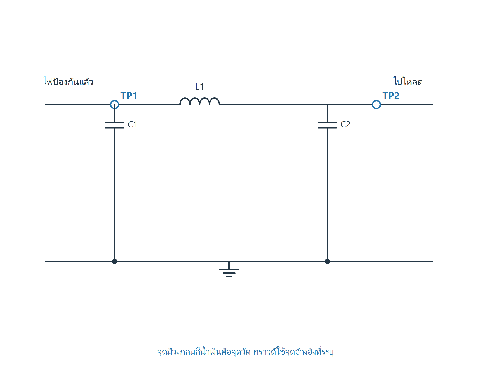

วงจรตัวอย่างสำหรับอธิบายหลักการ ไม่ใช่ผังขาของกล่องรถเฉพาะรุ่น

หน้าที่ C1 และ C2 ต่อขนานกับราง ส่วน L1 ต่ออนุกรมกับไฟ เส้นกราวด์ด้านล่างเป็นทางกลับของกระแส ไม่ใช่ส่วนที่ปล่อยลอย

แยกอาการ ก่อน L1 มีไฟแต่ TP2 ไม่มี ให้ตรวจความต่อเนื่องของ L1 และการลัดฝั่งโหลด เมื่อตัดไฟแล้วจึงวัดโอห์ม

การออกแบบ ค่าคอยล์ กระแสอิ่มตัว ESR และการแดมป์มีผลต่อการสั่นของราง ห้ามเติม LC ตามภาพแล้วถือว่าทนสัญญาณรบกวนรถได้ครบ

### วงจร 4 LDO พร้อมคาปาซิเตอร์ขาเข้าและขาออก

วงจรตัวอย่างสำหรับอธิบายหลักการ ไม่ใช่ผังขาของกล่องรถเฉพาะรุ่น

จุดวัด เทียบ TP1 VIN กับ TP2 VOUT โดยอ้างกราวด์ของ U1 แยกกรณีไฟเข้าหาย ไฟเข้าต่ำ และโหลดดึงเอาต์พุตลง

เงื่อนไข LDO ต้องมีแรงดันเผื่อ Dropout ตามกระแสและอุณหภูมิ ไฟเข้าเท่ากับเอาต์พุตที่ต้องการอาจทำให้รักษาแรงดันไม่ได้

C รอบชิป ค่าความจุ ESR และตำแหน่ง C_OUT ต้องตรง Datasheet บางรุ่นมีขา Enable Reset หรือ Sense เพิ่ม ภาพนี้แสดง LDO แบบ 3 ขาเชิงหน้าที่

### วงจร 5 Buck converter และวงจรป้อนกลับ

วงจรตัวอย่างสำหรับอธิบายหลักการ ไม่ใช่ผังขาของกล่องรถเฉพาะรุ่น

ทางกำลัง สวิตช์ Q1 สับไฟไปจุด SW ผ่าน L1 สู่ VOUT ส่วน D1 เป็นทางกระแสต่อเนื่องเมื่อสวิตช์ปิด นี่คือ Buck แบบไม่ซิงโครนัสเชิงหลักการ

ทางควบคุม R1 และ R2 แบ่งแรงดันกลับไป FB ตัวควบคุมเปรียบเทียบกับค่าอ้างอิงภายใน ต้องใช้วงจรตาม Datasheet ของเบอร์จริง

วัดให้ถูก SW เป็นพัลส์ ไม่ใช่ไฟ DC เรียบ ต้องตรวจพิกัดและวิธีต่อสโคป จุด FB ต่ำอาจมาจากตัวแบ่งหรือเอาต์พุตต่ำ ไม่สรุปว่าชิปเสียจากค่าเดียว

### วงจร 6 คาปาซิเตอร์ Decoupling รอบ MCU

วงจรตัวอย่างสำหรับอธิบายหลักการ ไม่ใช่ผังขาของกล่องรถเฉพาะรุ่น

ต่ออย่างไร C แต่ละตัวต่อคร่อมราง VDD กับกราวด์ใกล้ขาที่จ่ายไฟ คาปาซิเตอร์ไม่ได้ต่ออนุกรมบนเส้นไฟเข้า MCU

แยกโดเมน MCU บางรุ่นมีไฟ Core IO ADC และ Flash ต่างกัน จึงต้องเก็บชื่อรางและค่าไฟแต่ละโดเมน [C2]

ตรวจความผิดปกติ วัดรางที่ขา MCU จริงและดู Ripple ด้วยวิธีวัดเหมาะสม ความต้านทานต่ำบนราง Core อาจเป็นลักษณะของโหลด ไม่ยืนยันการลัดจากเสียงบัซเซอร์

### วงจร 7 Reset supervisor และขาควบคุม MCU

วงจรตัวอย่างสำหรับอธิบายหลักการ ไม่ใช่ผังขาของกล่องรถเฉพาะรุ่น

วงจรตัวอย่าง U1 เฝ้าระวังรางไฟ เอาต์พุต Reset แบบ Open drain ใช้ R pull up ไปยังรางลอจิกที่ตรงกับ MCU

จับเหตุการณ์ เก็บ VDD กับ RESETn บนฐานเวลาเดียวกัน ถ้า VDD ตกก่อน Reset อาจเป็นการตอบสนองปกติของวงจรเฝ้าระวัง

ข้อจำกัด Threshold Delay และชนิดเอาต์พุตขึ้นกับเบอร์จริง ห้ามเพิ่ม C หรือผูก Reset เข้ารางไฟเพื่อบังคับให้กล่องทำงาน

### วงจร 8 คริสตัลและคาปาซิเตอร์โหลด

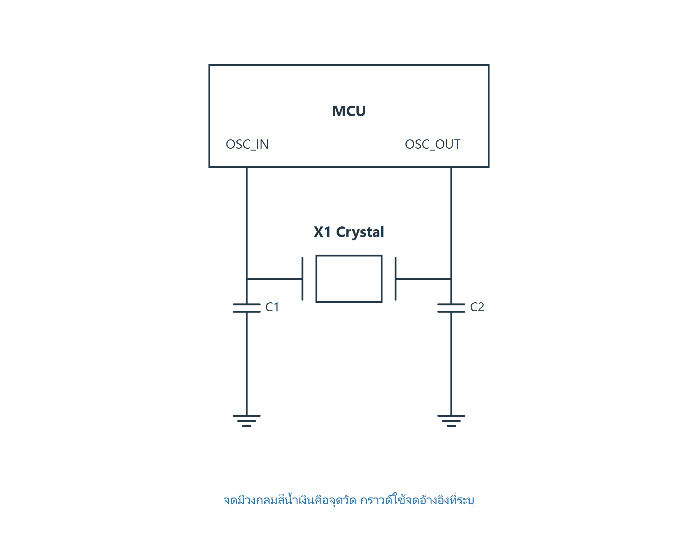

วงจรตัวอย่างสำหรับอธิบายหลักการ ไม่ใช่ผังขาของกล่องรถเฉพาะรุ่น

ทางสัญญาณ คริสตัล X1 อยู่ระหว่าง OSC_IN กับ OSC_OUT ของ MCU ส่วน C1 C2 ลงกราวด์ โดยค่าอิงความจุโหลดและความจุแฝง

สิ่งที่ไม่แสดง บาง MCU ต้องมี R feedback หรือ R series ตามวงจรแนะนำ บางรุ่นใช้ Oscillator ภายใน จึงไม่จำเป็นต้องพบคริสตัลเสมอ [C2]

ตรวจอย่างไร โพรบเพิ่มความจุให้วงจรจนหยุดแกว่งได้ ใช้จุดและโพรบตามคู่มือ ไม่สรุป MCU เสียเพราะวัดแล้วไม่มีสัญญาณเพียงครั้งเดียว

### วงจร 9 NTC และตัวแบ่งแรงดันเข้าขา ADC

วงจรตัวอย่างสำหรับอธิบายหลักการ ไม่ใช่ผังขาของกล่องรถเฉพาะรุ่น

หลักการ R pull up กับ NTC แบ่งแรงดัน เมื่อ NTC เปลี่ยนค่า TP SENSOR เปลี่ยนตาม ส่วน R series C filter ลดสัญญาณรบกวนก่อน ADC

ตัวอย่างฝึก บนแหล่ง 5 V ใช้ R pull up 10 kΩ และตัวจำลอง 10 kΩ จะได้ 2.5 V เมื่อเปลี่ยนตัวจำลองเป็น 2.2 kΩ ได้ประมาณ 0.90 V

แยกสายกับกล่อง ถ้าแรงดันที่ปลั๊กเซนเซอร์กับ ADC ต่างกัน ให้ตรวจ R series ลายวงจร และ C filter กรณีวงจรจริงอาจมีวงจร Clamp เพิ่ม

### วงจร 10 ตรวจแรงดันแบตเตอรี่ผ่านตัวแบ่ง

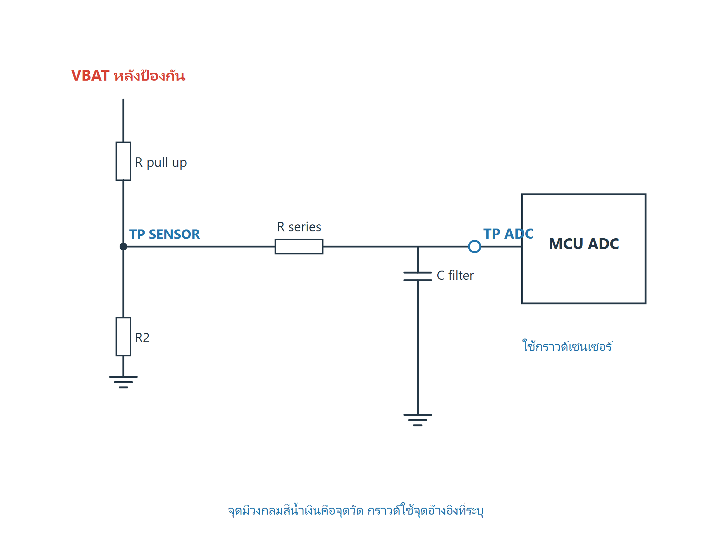

วงจรตัวอย่างสำหรับอธิบายหลักการ ไม่ใช่ผังขาของกล่องรถเฉพาะรุ่น

วงจรตัวอย่าง ตำแหน่ง R pull up ในภาพนี้ทำหน้าที่เป็น R1 ของตัวแบ่ง ไม่ใช่การดึงบัส ค่า R1 R2 ต้องทำให้แรงดัน ADC อยู่ในพิกัดตลอดเงื่อนไขที่ออกแบบ

คำนวณฝึก กำหนด R1 = 33 kΩ และ R2 = 10 kΩ ที่ VBAT 12 V จะได้ประมาณ 2.79 V ก่อนคิดโหลด ADC และวงจรป้องกัน

อย่าเหมาค่าพิกัด ตัวแบ่งเพียงสองตัวไม่ทำให้ทน Load dump หรือไฟกลับขั้ว ต้องมีการป้องกันและตรวจอัตราทนแรงดันของชิ้นส่วน

### วงจร 11 TPS แบบโพเทนชิออมิเตอร์สามสาย

วงจรตัวอย่างสำหรับอธิบายหลักการ ไม่ใช่ผังขาของกล่องรถเฉพาะรุ่น

สามขั้ว ปลายบนต่อ VREF ปลายล่างต่อ Sensor ground และ Wiper เป็นสัญญาณที่เปลี่ยนตามตำแหน่ง

ก่อนสรุป วัด VREF และกราวด์ก่อนตรวจ Wiper แล้วเทียบที่ขา ADC เพื่อแยกเซนเซอร์ สาย และอินพุตใน ECU

ขอบเขต เป็น TPS แบบตัวต้านทานหนึ่งช่อง ไม่ใช่เซนเซอร์ Hall หรือคันเร่งสองช่องซึ่งต้องตรวจความสัมพันธ์ตามรุ่น

### วงจร 12 Hall แบบ Open collector และตัวดึงขึ้น

วงจรตัวอย่างสำหรับอธิบายหลักการ ไม่ใช่ผังขาของกล่องรถเฉพาะรุ่น

การดึงขึ้น ทรานซิสเตอร์ในเซนเซอร์ดึงสายสัญญาณลงกราวด์เมื่อทำงาน และ R pull up ทำให้กลับขึ้นสูงเมื่อปิด

ระดับไฟ VLOGIC ต้องตรงกับอินพุต ECU ไม่ใช่ยกไฟ 12 V ไปเข้าขา MCU โดยตรง เซนเซอร์ที่มี Pull up ในตัวอาจต้องใช้วงจรต่างจากภาพ

วัดเพื่อแยก วัดไฟเซนเซอร์ กราวด์ และพัลส์ก่อนตรวจอินพุต ECU ความถี่และรูปแบบฟันสัมพันธ์กับรอบและชนิดระบบ

### วงจร 13 VR sensor และวงจรปรับสภาพสัญญาณ

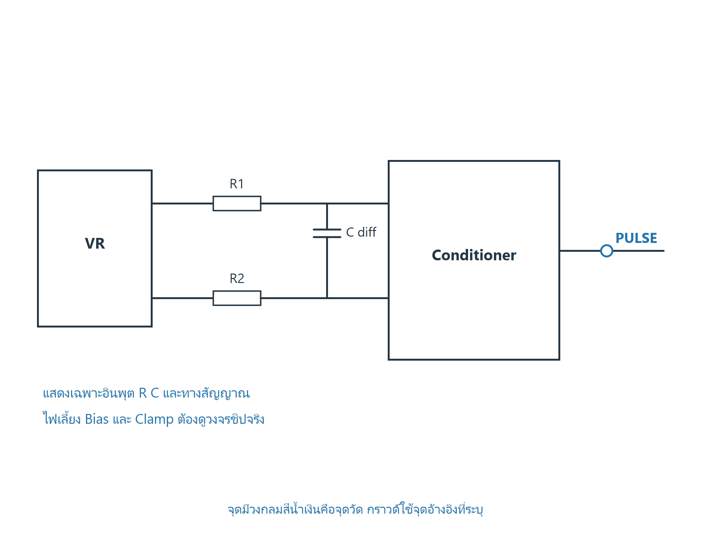

วงจรตัวอย่างสำหรับอธิบายหลักการ ไม่ใช่ผังขาของกล่องรถเฉพาะรุ่น

อินพุต VR VR สร้างแรงดันแปรผันตามการเคลื่อนที่ของฟัน สองเส้นเข้าวงจรรับต่างศักย์หรือวงจรที่ผู้ผลิตกำหนด ไม่ต่อแทน Hall โดยเปลี่ยนชื่อขา

วงจรรอบขา R จำกัดกระแสและ C กรองต้องอิงสัญญาณและชิป Conditioner ถ้าสลับขั้ว VR เวลาขอบที่ตรวจพบอาจเปลี่ยน

จุดตรวจ เปรียบเทียบสัญญาณก่อน Conditioner กับพัลส์ออก โดยใช้โพรบและกราวด์เหมาะกับอินพุตลอย ตัวอย่างชิปเฉพาะทางดู LM1815 [C3]

### วงจร 14 Low side ขับรีเลย์และไดโอดคร่อมโหลด

วงจรตัวอย่างสำหรับอธิบายหลักการ ไม่ใช่ผังขาของกล่องรถเฉพาะรุ่น

ตอนเปิด Q1 นำกระแสจากโหลดลงกราวด์ OUT จึงต่ำ กระแสไหลจาก VLOAD ผ่านขดลวดไปทาง Drain Source

ตอนปิด ไดโอดขนานโหลดมี A ที่ OUT และ K ที่ VLOAD เป็นทางให้กระแสขดลวดไหลต่อ ลดแรงดันย้อน แต่ทำให้กระแสลดช้ากว่าวงจร Clamp แรงดันสูง

ซ่อมจากหลักฐาน ตรวจโหลด กราวด์ ภาค Gate และอุปกรณ์รับแรงดันย้อนก่อนเปลี่ยน Q1 ภาพนี้ไม่ใช้แทนวงจรคอยล์จุดระเบิดหรือหัวฉีดทุกชนิด

### วงจร 15 ภาคขับหัวฉีดและวงจร Clamp

วงจรตัวอย่างสำหรับอธิบายหลักการ ไม่ใช่ผังขาของกล่องรถเฉพาะรุ่น

ความต่างกับรีเลย์ วงจรหัวฉีดต้องควบคุมการลดกระแสด้วย Clamp ที่ออกแบบ บางระบบใช้ Saturated บางระบบใช้ Peak and hold ห้ามสลับวิธีโดยดูเพียงรูปทรง MOSFET

TVS ในภาพ แสดงตำแหน่งป้องกันระหว่าง Drain กับ Source เชิงหลักการ เลือก Breakdown พลังงาน กระแส และ SOA ร่วมกัน ไม่ใช่เลือกค่าที่สูงที่สุด [C4]

จุดวัด ดูคำสั่ง Gate กระแสโหลด และรูปแรงดัน OUT พร้อมกัน ภาคขับที่ไม่ทำงานอาจถูก ECU ระงับเพราะเงื่อนไขระบบ

### วงจร 16 High side switch กับโหลดลงกราวด์

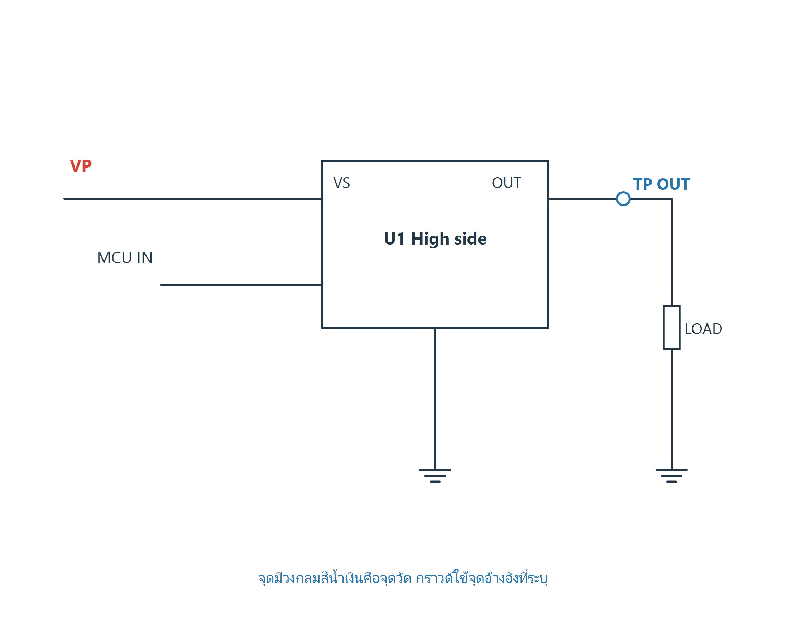

วงจรตัวอย่างสำหรับอธิบายหลักการ ไม่ใช่ผังขาของกล่องรถเฉพาะรุ่น

ทางกำลัง High side อยู่ระหว่างไฟบวกกับโหลด เอาต์พุตสูงขณะเปิด ต่างจาก Low side ที่สวิตช์อยู่ด้านกราวด์

ขาควบคุม IC แบบ Smart high side อาจใช้ IN Enable และขาวินิจฉัย ภาพใช้ชื่อขาตามหน้าที่ ไม่ใช่เลขขาเบอร์ใด

จุดตรวจ เทียบไฟที่ VS กับ OUT รวมทั้งกระแสโหลดและคำสั่ง IN ภาคป้องกันในชิปอาจตัดเมื่อร้อนหรือกระแสเกิน ต้องแยกต้นเหตุภายนอกก่อน

### วงจร 17 H bridge และการกลับทิศมอเตอร์

วงจรตัวอย่างสำหรับอธิบายหลักการ ไม่ใช่ผังขาของกล่องรถเฉพาะรุ่น

สี่สวิตช์ เปิด Q1 กับ Q4 ให้กระแสผ่านมอเตอร์ทิศหนึ่ง เปิด Q2 กับ Q3 ได้ทิศกลับกัน ภาพแสดงสวิตช์เชิงหลักการแทน MOSFET และ Gate driver

ห้ามเปิดคู่บนล่าง Q1 กับ Q3 หรือ Q2 กับ Q4 ในขาเดียวกันเปิดพร้อมกันจะลัดรางไฟ ต้องมี Dead time และการป้องกันตามไดรเวอร์

ใช้ในการวิเคราะห์ ดูไฟเลี้ยง คำสั่ง ทิศ กระแส และ Feedback ของระบบ ไม่ใช้ภาพนี้ทดลองขับลิ้นปีกผีเสื้อจริง ระบบต้องมีการตรวจความปลอดภัยครบ

### วงจร 18 คอยล์จุดระเบิดและภาคขับ IGBT

วงจรตัวอย่างสำหรับอธิบายหลักการ ไม่ใช่ผังขาของกล่องรถเฉพาะรุ่น

ทางพลังงาน ขดปฐมภูมิรับไฟบวกและถูก IGBT สับลงกราวด์ เมื่อปิดกระแส พลังงานเปลี่ยนเป็นแรงดันสูงที่ขดทุติยภูมิ

วงจรป้องกัน IGBT สำหรับจุดระเบิดและวงจร Clamp ต้องตรงการออกแบบ ห้ามใส่ไดโอดคร่อมคอยล์แบบรีเลย์เพราะเปลี่ยนกระบวนการเกิดประกายไฟ

การวัด ต้องใช้โพรบและอุปกรณ์เฉพาะที่รองรับแรงดัน การต่อสโคปทั่วไปตรงคอยล์หรือแตะด้านทุติยภูมิอาจทำให้เครื่องมือเสีย ภาพแสดงเฉพาะทางขดปฐมภูมิ

### วงจร 19 ตรวจวัดกระแสด้วย Shunt ด้านกราวด์

วงจรตัวอย่างสำหรับอธิบายหลักการ ไม่ใช่ผังขาของกล่องรถเฉพาะรุ่น

หลักการ แรงดันคร่อม R shunt เท่ากับ I × R ตัวอย่างกระแส 1 A ผ่าน 0.1 Ω ให้ 0.1 V ก่อนขยาย

ขยายแบบไม่กลับเฟส R feedback กับ R gain กำหนดอัตราขยาย 1 + RF/RG ของวงจรอุดมคติ แต่ช่วง Common mode และเอาต์พุตจริงขึ้นกับ Op amp

การต่อวัด สายวัด Sense ควรอ้างที่ปลายชันต์แบบ Kelvin แยกจากทางกระแสสูง กราวด์ที่ตกอาจทำให้ค่ากระแสและ ADC เพี้ยน

### วงจร 20 CAN ด้วย NXP TJA1050T

วาดใหม่จาก NXP TJA1050 Datasheet ขา SO8 [C5]

ขาที่ระบุ ใช้ผังขา TJA1050T แบบ SO8 ตาม Datasheet โดย VCC ใช้ 4.75 ถึง 5.25 V ขา S ควบคุมโหมด High speed หรือ Silent [C5]

อุปกรณ์รอบชิป C decoupling คร่อม VCC GND อยู่ใกล้ชิป ส่วนการป้องกันบัสและเทอร์มิเนชันต้องตรงเครือข่าย รูปนี้ไม่ใส่ 120 Ω ให้ทุกโหนด

ตรวจภาคควบคุม เทียบ TXD CANH CANL RXD ร่วมกับไฟและ S เอาต์พุต RXD ของชิปไฟ 5 V ต้องตรวจพิกัดอินพุต MCU 3.3 V ก่อนต่อ หากรับ 5 V ไม่ได้ต้องมีวงจรแปลงระดับ [C5]

### วงจร 21 K line ด้วย ST L9637D

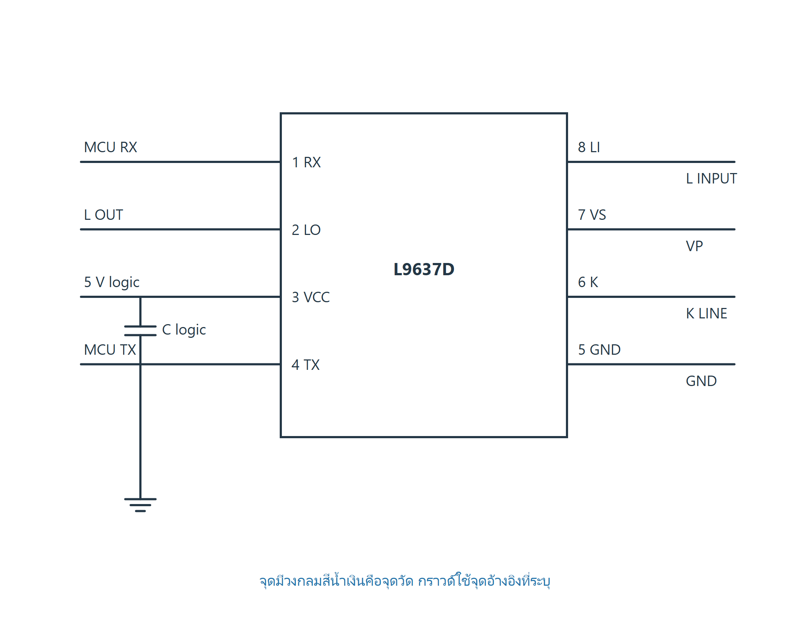

วาดใหม่จาก ST L9637 Datasheet ขา SO8 [C6]

แยกสองราง VS รับไฟภาคบัส ส่วน VCC เป็นไฟลอจิก ห้ามสับสนขา K กับขา MCU ภาพใช้เลขขา SO8 ตามผู้ผลิต [C6]

วงจรรอบชิป ต้องมี Decoupling และการป้องกันตาม Application circuit ส่วนวงจร L input และ LO ต้องกำหนดตามการใช้งานจริง

ไล่สัญญาณ เทียบคำสั่ง TX กับการเปลี่ยนของ K และผล RX ไม่ผูก K เข้าขา MCU โดยตรง เพราะระดับไฟต่างกัน

### วงจร 22 SPI EEPROM พร้อม Pull up และ Decoupling

วงจรฝึกชิปแยก อ้างขา ST M95320-W SO8 [C7]

ตัวอย่างเบอร์ เลือก M95320-W ซึ่งใช้งานได้กับไฟ 3.3 V ในช่วงที่ Datasheet ระบุ C 100 nF คร่อม VCC VSS เป็นการต่อ Decoupling ตัวอย่าง [C7]

ขาควบคุม CSn WPn HOLDn ต้องอยู่ในสถานะที่ถูกต้อง ภาพแสดง R ดึงขึ้นทั้งสามเน็ต การต่อ WPn สูงเพียงอย่างเดียวไม่ยืนยันว่าเขียนได้ ต้องดูบิตป้องกันด้วย

สำรองก่อน ตรวจระดับสัญญาณเครื่องอ่าน อ่านซ้ำ เทียบข้อมูล และเก็บต้นฉบับก่อนเขียน การเลือกแพ็กเกจและทิศขาต้องตรง

### วงจร 23 I2C EEPROM พร้อมตัวดึงบัสขึ้น

วงจรฝึกชิปแยก อ้าง Microchip 24LC256 แบบ SOIC 8 ขา [C8]

ที่อยู่ตัวอย่าง ผังนี้เลือก A0 A1 A2 ลงกราวด์ และ WP ลงกราวด์เพื่อใช้ในชุดฝึก ค่า Address และขาแพ็กเกจอื่นอาจต่างกัน [C8]

Pull up R ตัวอย่าง 4.7 kΩ ดึง SCL SDA ไป 3.3 V เป็นค่าฝึก ไม่ใช่กฎทุกความเร็ว ต้องดูความจุบัส Rise time และแรงดันลอจิก

การตรวจ SDA ค้างต่ำอาจมาจากชิปตัวอื่นหรือการอ่านค้าง ต้องตรวจทั้งบัส วัดไฟและอ่านซ้ำหลังเริ่มใหม่อย่างถูกขั้นตอน

### วงจร 24 Microwire และขา ORG ที่กำหนดการจัดคำ

อ้างผังขา ST M93C66-W แบบ SO8 [C9]

โหมดตัวอย่าง M93C66 แบบใน Datasheet ใช้ ORG สูงเลือกจัดคำ x16 ส่วน ORG ต่ำเลือก x8 ต้องตรวจชื่อเต็มและผู้ผลิตก่อนใช้กฎนี้กับชิปอื่น [C9]

ขาควบคุม ภาพแสดงการต่อขาหลัก ไม่ใช่วงจรใช้งานครบ ขา S/CS ต้องไม่ลอยขณะเปิดไฟ ผู้ผลิตแนะนำตัวดึงลง ส่วน DU ให้ปฏิบัติตาม Datasheet ไม่ใช้แทน HOLD ของ SPI

บันทึกผลอ่าน เก็บโหมด x16 รูปแบบ Byte order และขนาดไฟล์ไว้กับงาน การสลับโหมดหรือเรียงไบต์อาจทำให้ผลดูต่างทั้งที่เป็นข้อมูลคนละการตีความ

### วงจร 25 กราวด์กำลังและกราวด์สัญญาณ

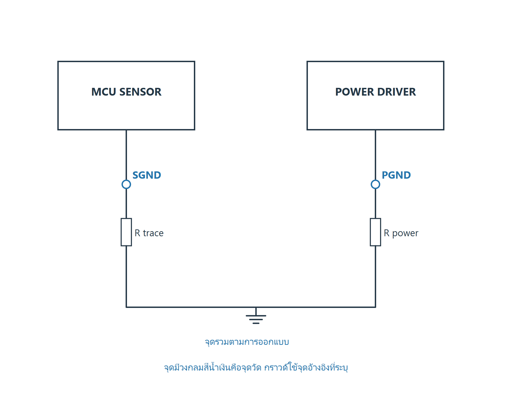

วงจรตัวอย่างสำหรับอธิบายหลักการ ไม่ใช่ผังขาของกล่องรถเฉพาะรุ่น

ทางกลับกระแส วงจรมีความต้านทานตามสายและลายทองแดง กระแสโหลดสูงทำให้เกิดแรงดันตกได้ แม้ทุกจุดเรียกกราวด์เหมือนกัน

จุดวัด วัด TP SGND เทียบขั้วลบแบตเตอรี่ขณะมีโหลด แล้วเปรียบเทียบกับกราวด์กำลัง ไม่ใช้การวัด Continuity แทนการวัดแรงดันตก

การซ่อม ตำแหน่งรวมกราวด์และการแบ่ง Analog Digital Power ต้องยึดบอร์ดจริง ไม่ตัดแยกหรือโยงข้ามกราวด์จากภาพตัวอย่าง

### วงจร 26 ไฟย้อนจากเครื่องอ่านเข้าสู่วงจรอื่น

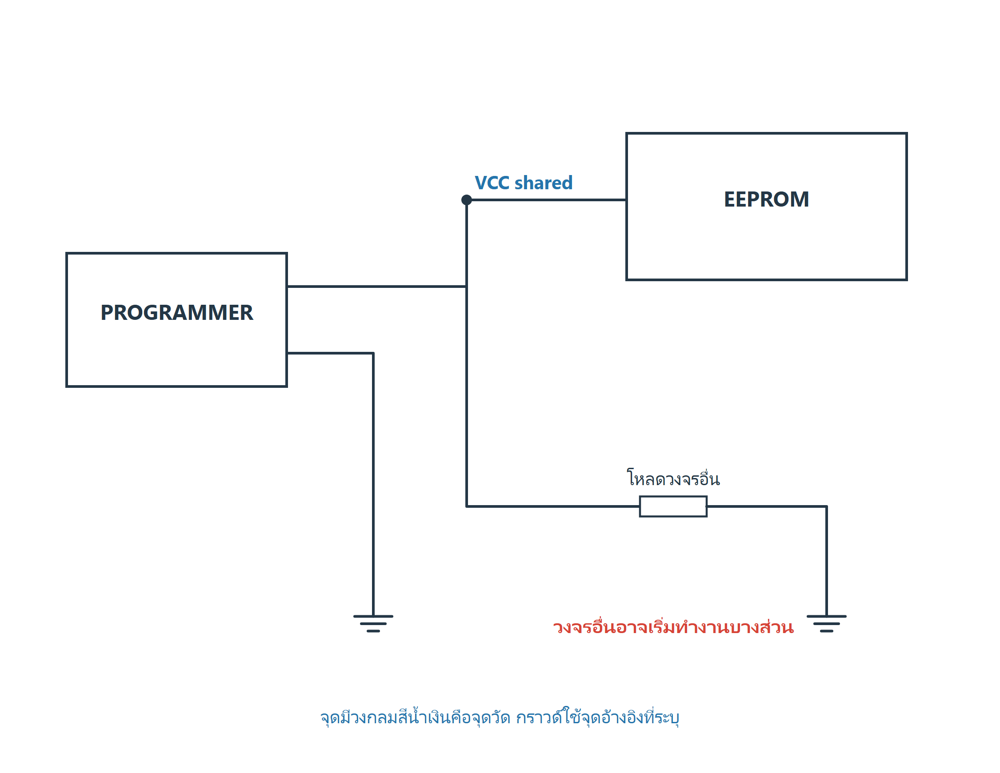

วงจรตัวอย่างสำหรับอธิบายหลักการ ไม่ใช่ผังขาของกล่องรถเฉพาะรุ่น

เหตุที่คลิปไม่แยกวงจร เมื่อเครื่องอ่านจ่าย VCC ให้ EEPROM เน็ตเดียวกันอาจจ่าย MCU และ IC อื่นผ่านรางหรือวงจรป้องกัน ทำให้โหลดเกินหรือสัญญาณชนกัน

ภาพแสดงอะไร ภาพเป็นส่วนขยายของรางร่วม ใช้ R แทนโหลดสมมูลของวงจรอื่น ไม่ใช่ค่าตัวต้านทานจริงบน ECU

วิธีตัดสินใจ ตรวจคู่มือเครื่องมือและผลอ่านซ้ำ เลือกวิธีอ่านที่ผู้ผลิตรองรับ ไม่จ่ายแหล่งจ่ายสองชุดพร้อมกันโดยเดา และไม่ใช้การยกขา 1 เป็นกฎทุกชิป

### วงจร 27 กรณีจริง Speeduino ภาคจ่ายไฟ

วาดใหม่และจัดวางใหม่จาก Speeduino v0.4.3d Rev 4d วันที่ 2021-03-27 [C10] • CERN-OHL-S-2.0

อุปกรณ์จริง ติดตาม D14 SB230T ไปยัง U8 LM2940S-5.0 และ F1 โดย C17 C18 อยู่ฝั่งเข้า C20 C21 อยู่ฝั่งออกตามแบบรุ่นนี้

ตรวจจากผัง ตรวจไฟหลัง D14 ที่ขา VI แล้วจึง VO และไฟหลัง F1 การไม่มีไฟ VDDA ไม่ได้ยืนยัน U8 เสียจนกว่าจะตรวจฟิวส์และโหลด โดย VDD อยู่ก่อน F1 และ VDDA อยู่หลัง F1

ขอบเขต วาดเฉพาะภาค Power regulator ใหม่โดยคงรหัสและค่าที่แสดงในแบบ ไม่รวมวงจร Reset ของแผ่นเดียวกัน ไม่ใช้ผังนี้กับ Bosch หรือ Denso

### วงจร 28 กรณีจริง Speeduino อินพุต TPS

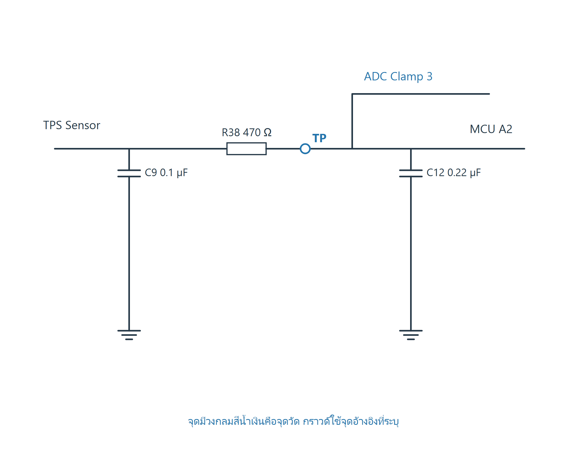

วาดใหม่และจัดวางใหม่จาก Speeduino v0.4.3d Rev 4d วันที่ 2021-03-27 [C10] • CERN-OHL-S-2.0

อ่านทางเดิน TPS Sensor ผ่าน R38 470 Ω ไปยัง MCU A2 โดย C9 อยู่ฝั่งเซนเซอร์และ C12 อยู่ฝั่ง ADC

วงจร Clamp เน็ต ADC Clamp 3 เชื่อมไปอุปกรณ์ SP721 ในแบบหลัก ไม่ใช่ปล่อยลอยตามชื่อเน็ต ควรเปิดต้นฉบับดูทั้งแผ่น

เปรียบเทียบการวัด ถ้าฝั่งเซนเซอร์เปลี่ยนแต่ A2 ไม่เปลี่ยน ให้ตรวจ R38 C12 Clamp และลายวงจรตามหลักฐาน วงจรนี้เป็นของรุ่นอ้างอิงเท่านั้น

### วงจร 29 กรณีจริง Speeduino อินพุตอุณหภูมิ

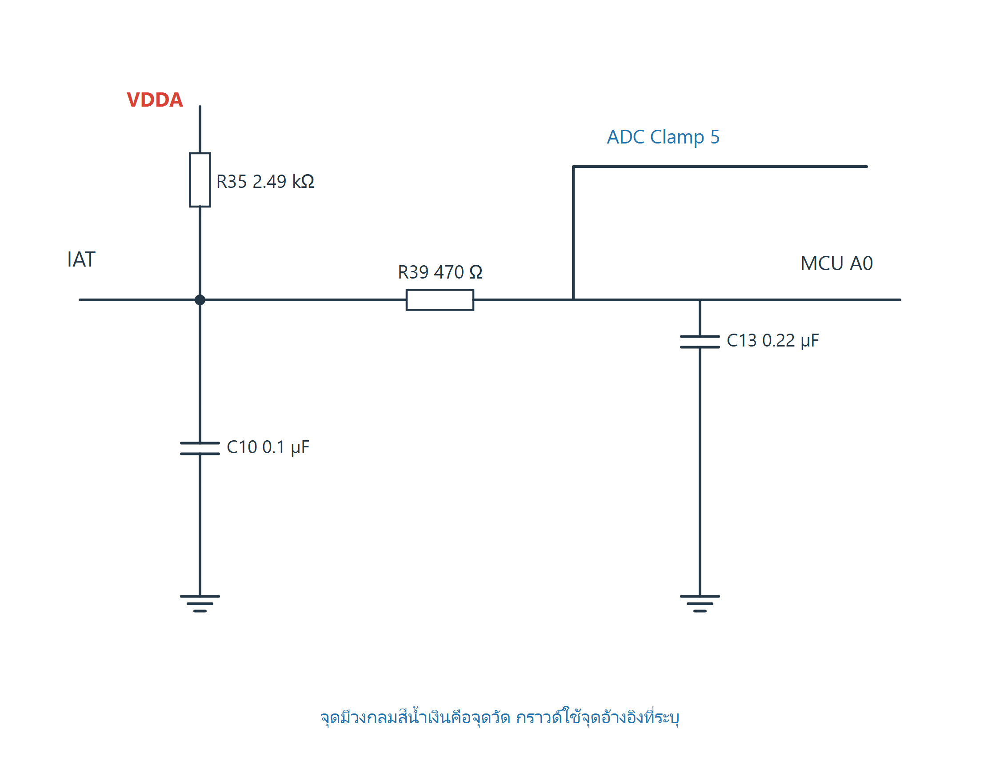

วาดใหม่และจัดวางใหม่จาก Speeduino v0.4.3d Rev 4d วันที่ 2021-03-27 [C10] • CERN-OHL-S-2.0

อ่านเบอร์ IAT ใช้ R35 2.49 kΩ ดึงขึ้น VDDA และ R39 470 Ω อนุกรมเข้า MCU A0 มี C10 และ C13 ลงกราวด์ตามภาพ

ถ้าอ่านสูงสุดหรือต่ำสุด ตรวจสายขาด ลัดกราวด์ ไฟ VDDA และภาค ADC โดยค่าที่อ่านจากซอฟต์แวร์ยังขึ้นกับตารางแปลงอุณหภูมิ

เทียบกับ CLT ในแผ่น Inputs มีวงจร CLT อีกช่อง แต่รหัสอุปกรณ์และขา ADC ต่างกัน อย่าย้ายจุดวัดจากภาพช่อง IAT ไปใช้โดยไม่ตรวจ

### วงจร 30 กรณีจริง Speeduino Gate ของหัวฉีดช่องหนึ่ง

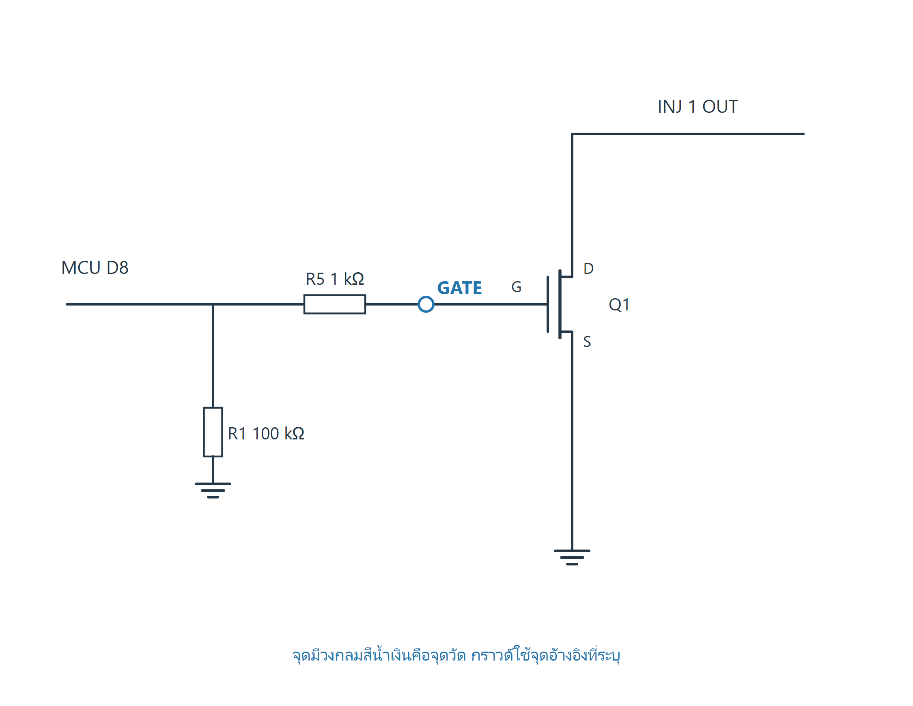

วาดใหม่และจัดวางใหม่จาก Speeduino v0.4.3d Rev 4d วันที่ 2021-03-27 [C10] • CERN-OHL-S-2.0

จุดที่วาด MCU D8 ผ่าน R5 1 kΩ ไป Gate Q1 โดย R1 100 kΩ ดึงลงกราวด์อยู่ก่อน R5 ตามแบบต้นฉบับ ไม่ใช่ตัวต้านทาน Gate Source ตำแหน่งเดียวกัน

เอาต์พุต Drain เป็นเน็ต INJ 1 OUT ส่วน Source ลง GND วงจรแสดงสถานะ LED และวงจรจัดการ Flyback ไม่รวมในภาพย่อยนี้ ต้องอ่านแบบเต็มและข้อกำหนด MOSFET

การทดสอบ ใช้ภาพเรียนโครงสร้าง ไม่ต่อหัวฉีดจริงตามภาพย่อย ต้องยืนยันเบอร์ Q1 ภาคป้องกัน โหลด และพิกัดก่อนเสมอ

## ภาคสอง การวิเคราะห์และซ่อม ECU

เริ่มจากตรวจไฟ กราวด์ และเงื่อนไขทำงาน แล้วแยกภาคด้วยผลวัด

### บท 1 รู้จัก ECU และเส้นทางการวิเคราะห์

#### ดูเส้นทางสัญญาณก่อนวิเคราะห์

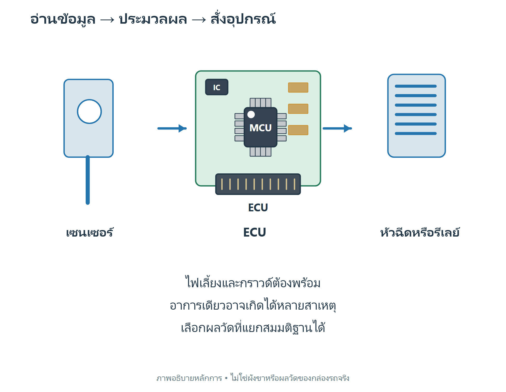

ภาพอธิบายหลักการ ใช้คู่กับวงจรในภาคหนึ่ง

1 เซนเซอร์ให้ข้อมูล ECU ประมวลผล แล้วภาคขับสั่งอุปกรณ์

2 ไฟ กราวด์ และเงื่อนไขเริ่มระบบต้องพร้อม

3 DTC เป็นหลักฐานประกอบ ยังไม่ยืนยันว่าอะไหล่ในชื่อรหัสเสีย

#### บอร์ด ECU ของจริง

ภาพถ่ายจริง [P1] Inside ECU.JPG

ผู้ถ่าย Snewkirk7953 • CC BY-SA 3.0

ที่มา https://commons.wikimedia.org/wiki/File:Inside_ECU.JPG

สิทธิ์ https://creativecommons.org/licenses/by-sa/3.0/ • ย่อขนาดภาพ ไม่แก้เนื้อหาภาพ

1 ดูภาพรวมคอนเนกเตอร์ แผงวงจร และอุปกรณ์ก่อนเปิดงาน

2 ถ่ายภาพและจดหมายเลขกล่องก่อนทำความสะอาด

3 ภาพนี้ไม่ใช้ยืนยันตำแหน่งขาหรือหน้าที่ชิปของรถรุ่นอื่น

ลองตอบ ไม่สื่อสาร แปลว่ากล่องเสียแล้วหรือไม่

แนวตอบ ยังไม่ได้ ต้องตรวจไฟ กราวด์ และบัสก่อน

### บท 2 ไฟฟ้าพื้นฐานที่ใช้ในการซ่อม

#### เห็นความสัมพันธ์ของ V I R และ P

ภาพอธิบายหลักการ ใช้คู่กับวงจรในภาคหนึ่ง

1 วงจรฝึก 5 V กับ 1 kΩ มีกระแสคำนวณ 5 mA

2 กำลังที่ตัวต้านทาน 0.025 W ใช้ตัว 0.25 W สำหรับวงจรนี้

3 ค่าตัวอย่างนี้ไม่ใช่กระแสใช้งานของ ECU

#### วัดกระแสให้เห็นทางเดินจริง

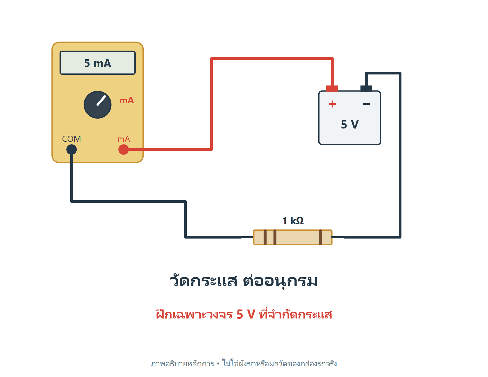

ภาพอธิบายหลักการ ใช้คู่กับวงจรในภาคหนึ่ง

1 ปิดไฟก่อนแทรกมิเตอร์อนุกรมในวงจรฝึก

2 ตรวจช่องเสียบ ช่วงวัด และฟิวส์ของมิเตอร์

3 หลังวัด ย้ายสายแดงคืนช่อง V ก่อนงานวัดแรงดัน

ลองตอบ คร่อมแหล่งจ่ายด้วยโหมดกระแสได้หรือไม่

แนวตอบ ไม่ได้ มิเตอร์กระแสต้องอยู่ในทางเดินอนุกรม

### บท 3 อ่านวงจรและรู้จักอุปกรณ์

#### แยกชิ้นส่วนจากรูปทรง

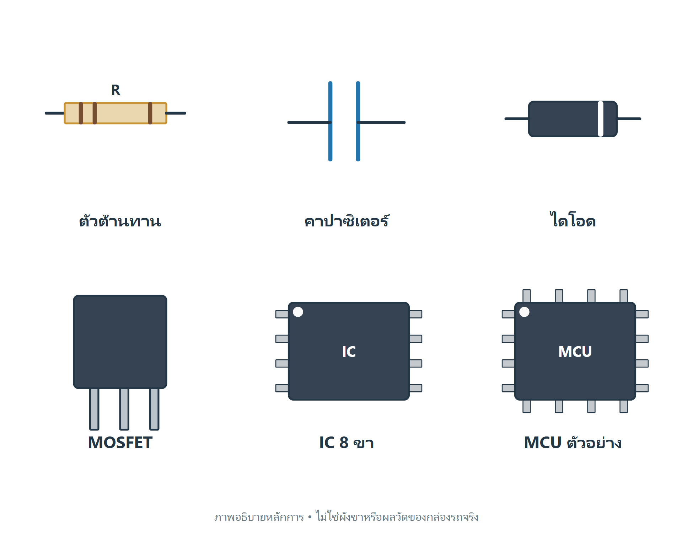

ภาพอธิบายหลักการ ใช้คู่กับวงจรในภาคหนึ่ง

1 รูปร่างช่วยแยกชนิดเบื้องต้น ต้องอ่านรหัสและ Datasheet

2 การวัดบนบอร์ดมีวงจรขนาน จึงอาจอ่านต่างจากชิ้นส่วนแยก

3 โอห์มต่ำไม่ยืนยันลัดวงจร ต้องดูการชาร์จและโหลดร่วม

#### ชิป EEPROM บนบอร์ดจริง

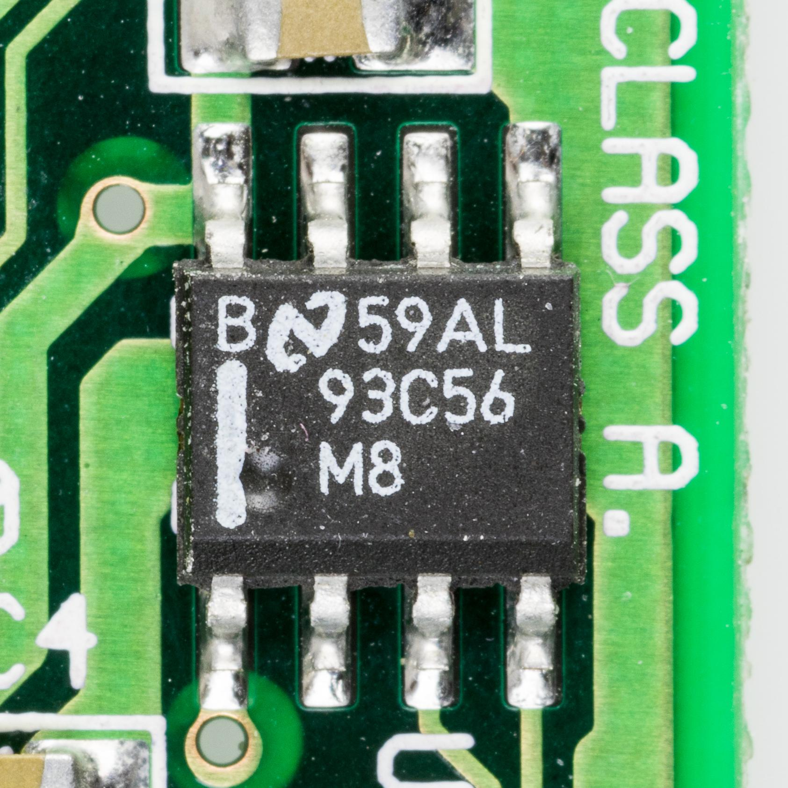

ภาพถ่ายจริง [P3] Surecom EP-427 - board - National Semiconductor 93C56-7948.jpg

© Raimond Spekking / CC BY-SA 4.0 (via Wikimedia Commons)

ที่มา https://commons.wikimedia.org/wiki/File:Surecom_EP-427_-_board_-_National_Semiconductor_93C56-7948.jpg

สิทธิ์ https://creativecommons.org/licenses/by-sa/4.0 • ย่อขนาดภาพ ไม่แก้เนื้อหาภาพ

1 ตัวอย่าง NM93C56 จากบอร์ดเครือข่าย ใช้เรียนรูปทรงชิป

2 ไม่ใช่ภาพ EEPROM ของ ECU ที่กำลังซ่อม

3 ชิป 8 ขาอาจมีหน้าที่หรือบัสต่างกัน

ลองตอบ เห็น 8 ขา เลือกเครื่องอ่านตามจำนวนขาได้เลยหรือไม่

แนวตอบ ไม่ได้ ต้องตรวจหมายเลขเต็ม แพ็กเกจ และแรงดัน

### บท 4 เครื่องมือและโต๊ะงาน

#### เห็นเครื่องมือจริงในชุดวัด

ภาพถ่ายจริง [P2] Keysight InfiniiVision DSOX 4024A and digital multimeter and power supply in laboratory use.jpg

ผู้ถ่าย Radarvector; ไฟล์ครอบตัดเผยแพร่โดย Pittigrilli • CC BY-SA 4.0

ที่มา https://commons.wikimedia.org/wiki/File:Keysight_InfiniiVision_DSOX_4024A_and_digital_multimeter_and_power_supply_in_laboratory_use.jpg

สิทธิ์ https://creativecommons.org/licenses/by-sa/4.0/ • ย่อขนาดภาพ ไม่แก้เนื้อหาภาพ

1 ออสซิลโลสโคปดูสัญญาณตามเวลา มัลติมิเตอร์อ่านค่าทางไฟฟ้า

2 แหล่งจ่ายต้องปรับแรงดันและจำกัดกระแสได้

3 อ่านคู่มือกราวด์และพิกัดโพรบของเครื่องที่ใช้

#### ต่อสายวัดแรงดันอย่างไร

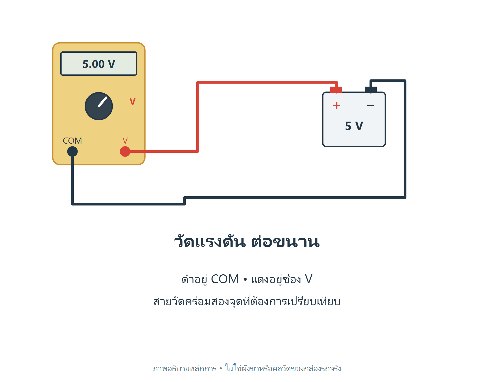

ภาพอธิบายหลักการ ใช้คู่กับวงจรในภาคหนึ่ง

1 ดำอยู่ COM แดงอยู่ช่อง V เลือกโหมด DC ให้ตรงงาน

2 วัดคร่อมสองจุด และจดว่าดำอ้างอิงจุดใด

3 กราวด์สโคปหลายช่องอาจร่วมกัน ต้องตรวจก่อนต่อ

ลองตอบ กราวด์ของสโคปสองช่องหนีบคนละศักย์ได้เสมอหรือไม่

แนวตอบ ไม่ได้ หากกราวด์ร่วมอาจเกิดลัดวงจร

### บท 5 ตรวจไฟเลี้ยงและกราวด์บนรถ

#### อ่านแรงดันที่กล่องได้รับ

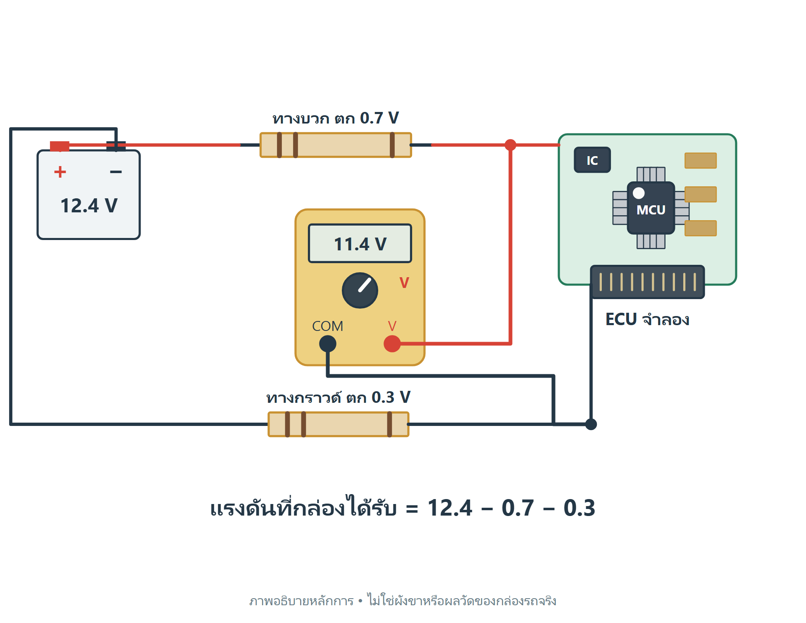

ภาพอธิบายหลักการ ใช้คู่กับวงจรในภาคหนึ่ง

1 ตัวอย่างสมมติ 12.4 − 0.7 − 0.3 = 11.4 V

2 ตรวจด้านบวกและกราวด์ขณะมีโหลด

3 เกณฑ์ผ่านใช้คู่มือของรถรุ่นนั้น

#### แบ่งทางเดินเพื่อหาจุดเสีย

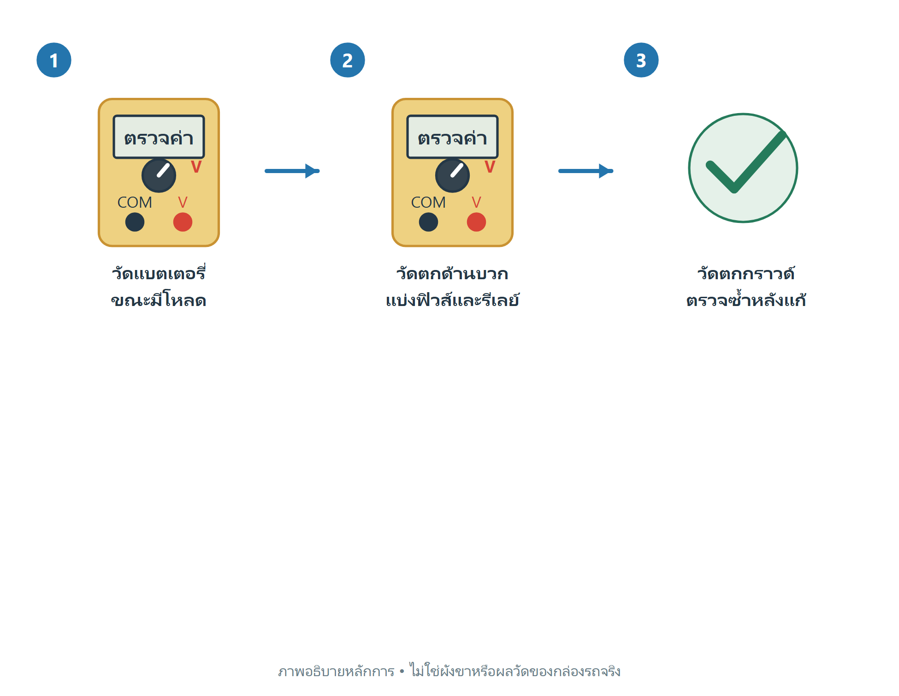

ภาพอธิบายหลักการ ใช้คู่กับวงจรในภาคหนึ่ง

1 มีไฟตอนถอดปลั๊ก ไม่พิสูจน์ว่าจ่ายกระแสใช้งานได้

2 ตรวจขณะเปิดกุญแจหรือหมุนสตาร์ตตามเงื่อนไขอาการ

ลองตอบ ขากราวด์สูงกว่าขั้วลบแบตเตอรี่ บอกอะไร

แนวตอบ มีแรงดันตกในเส้นทางกราวด์ขณะทดสอบ

### บท 6 เซนเซอร์และสัญญาณเข้า

#### เซนเซอร์ตัวต้านทานเปลี่ยนแรงดัน

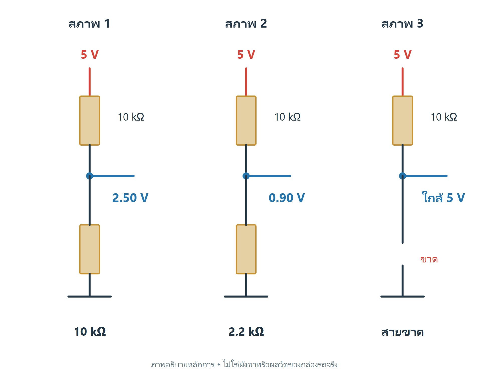

ภาพอธิบายหลักการ ใช้คู่กับวงจรในภาคหนึ่ง

1 วงจรฝึกใช้ Pull up 10 kΩ กับไฟ 5 V

2 ตัวจำลอง 10 kΩ ให้ประมาณ 2.50 V และ 2.2 kΩ ให้ประมาณ 0.90 V

3 ไม่ใช่ตารางอุณหภูมิของรถรุ่นใด

#### ดูสัญญาณและเงื่อนไขพร้อมกัน

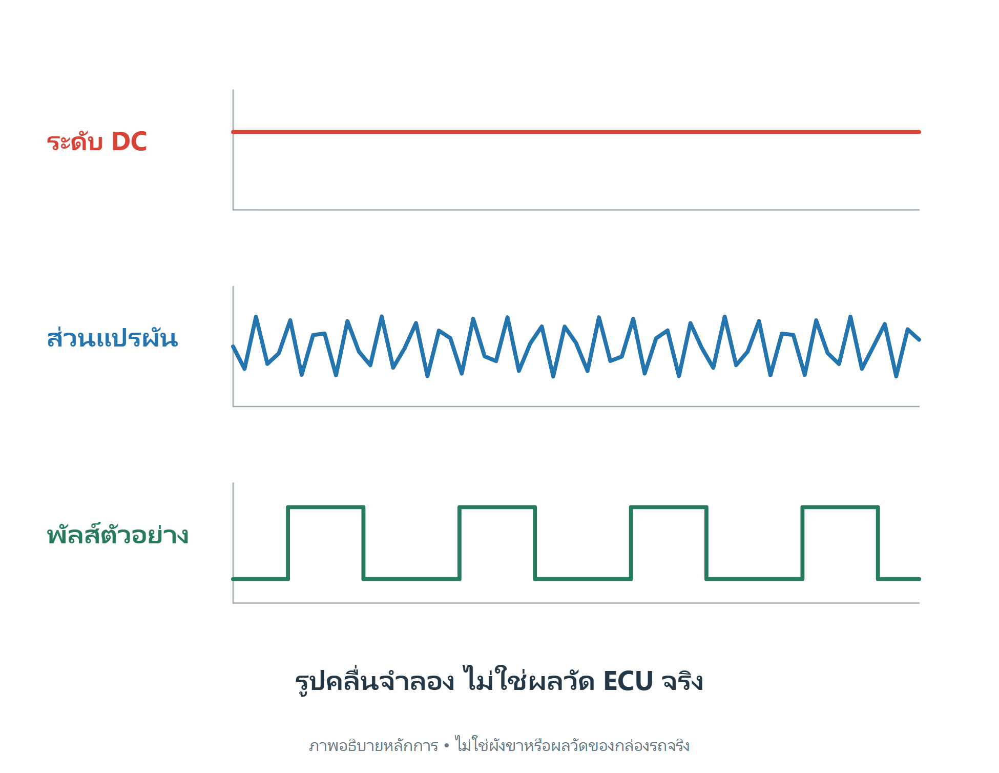

ภาพอธิบายหลักการ ใช้คู่กับวงจรในภาคหนึ่ง

1 ตรวจไฟเลี้ยงและกราวด์เซนเซอร์ก่อนสัญญาณ

2 วัดทั้งที่เซนเซอร์และขา ECU เพื่อแยกสายภายนอก

3 Hall เซนเซอร์เหนี่ยวนำ และเซนเซอร์สื่อสารใช้วิธีต่างกัน

ลองตอบ ปลายเซนเซอร์ดี แต่ปลาย ECU ไม่มีสัญญาณ ตรวจอะไร

แนวตอบ สาย ขั้วต่อ การลัด และภาระอินพุต ECU

### บท 7 ภาคขับหัวฉีด คอยล์ และรีเลย์

#### เห็นสวิตช์ที่ด้านกราวด์

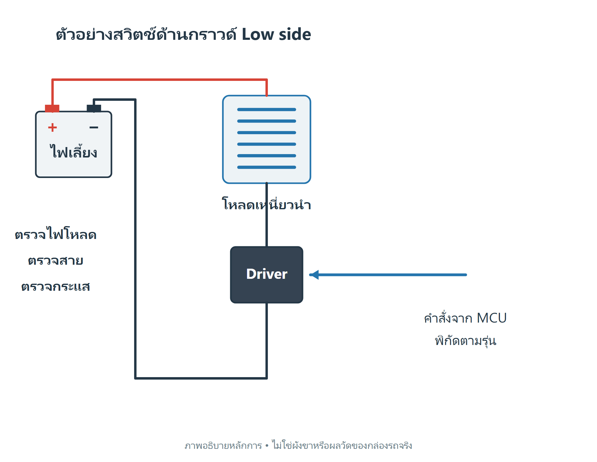

ภาพอธิบายหลักการ ใช้คู่กับวงจรในภาคหนึ่ง

1 Low side และ High side ให้รูปแรงดันต่างกัน

2 โหลดเหนี่ยวนำสร้างแรงดันกระชากเมื่อปิด

3 พิกัดภาคขับ โพรบ และโหลดจำลองต้องตรงระบบ

#### ตรวจต้นเหตุก่อนเปลี่ยน Driver

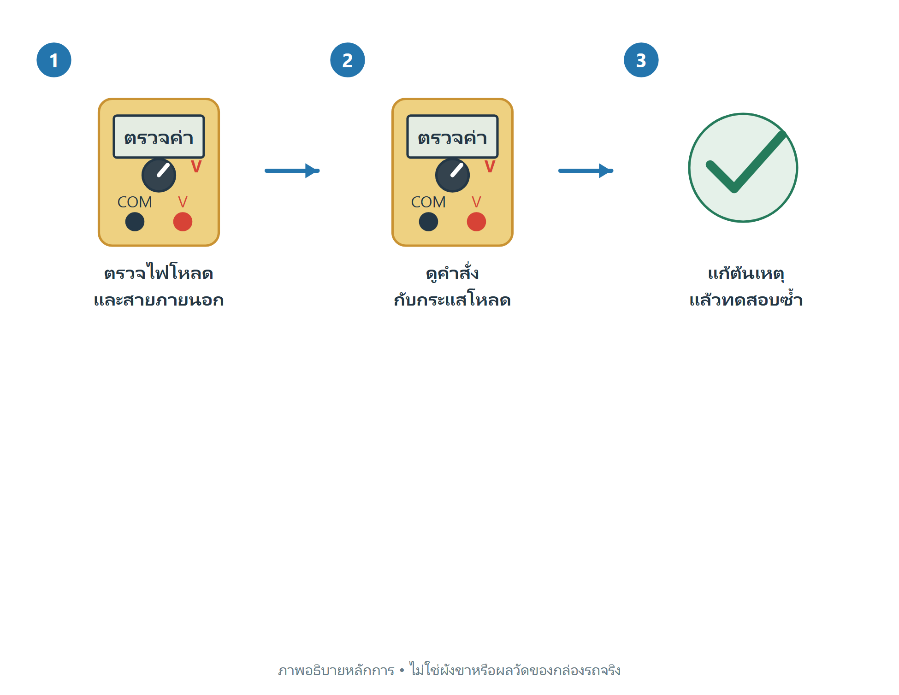

ภาพอธิบายหลักการ ใช้คู่กับวงจรในภาคหนึ่ง

1 คำสั่งไม่มาอาจเกิดจากไม่มีรอบเครื่องหรือเงื่อนไขระบบ

2 หัวฉีดดีเซลและคอยล์บางภาคมีแรงดันสูง ต้องใช้วิธีเฉพาะ

ลองตอบ ชิปขับเสียซ้ำ ควรตรวจอะไร

แนวตอบ โหลดกระแสเกิน สายลัด และวงจรป้องกันกระชาก

### บท 8 ภาคป้องกันและภาคจ่ายไฟ

#### ไล่ไฟจากทางเข้าไปถึงรางภายใน

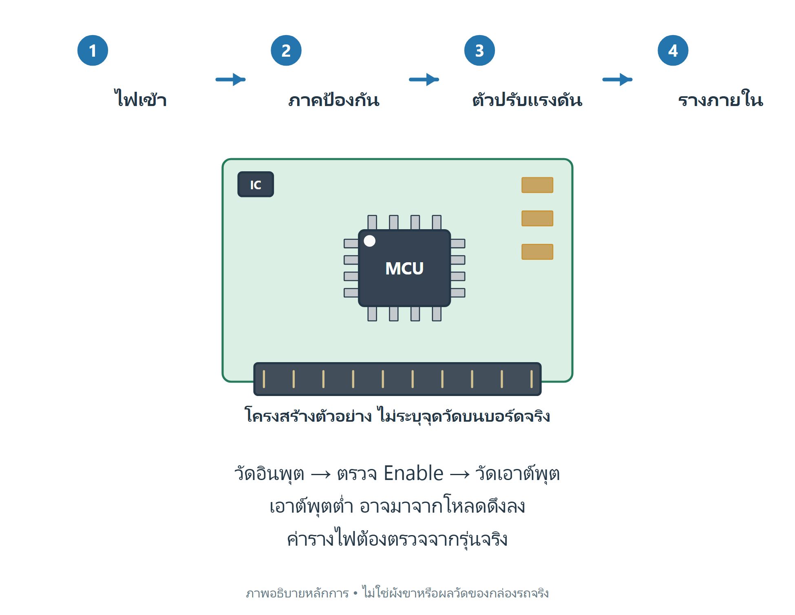

ภาพอธิบายหลักการ ใช้คู่กับวงจรในภาคหนึ่ง

1 ตรวจอินพุต Enable และเอาต์พุตก่อนเปลี่ยน Regulator

2 รางถูกดึงต่ำอาจเกิดจากโหลดเสีย ไม่ใช่ตัวจ่ายเสมอ

3 ไม่ฉีดไฟเข้ารางที่ยังไม่รู้แรงดันและเส้นทางย้อน

#### แยกระดับ DC ออกจาก Ripple

ภาพอธิบายหลักการ ใช้คู่กับวงจรในภาคหนึ่ง

1 DC coupling แสดงระดับรวม AC coupling ซ่อนส่วน DC

2 กราวด์โพรบยาวอาจทำให้เห็น Noise ที่เกิดจากการวัด

3 แหล่งจ่ายเข้า CC อาจทำให้กล่องเริ่มแล้วดับซ้ำ

ลองตอบ เอาต์พุตหาย ทั้งที่อินพุตมีไฟ ตรวจอะไรเพิ่ม

แนวตอบ Enable Wake up และโหลดที่ลัด ก่อนเปลี่ยนอะไหล่

### บท 9 MCU Clock และ Reset

#### ดูว่าไฟตกหรือ Reset เกิดก่อน

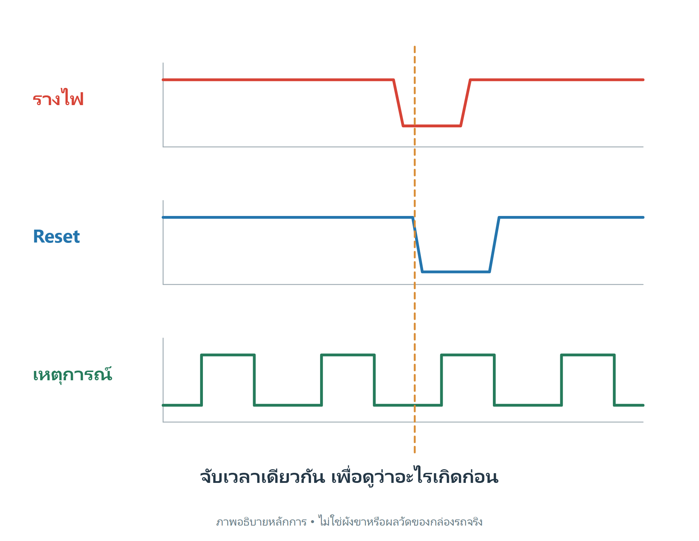

ภาพอธิบายหลักการ ใช้คู่กับวงจรในภาคหนึ่ง

1 จับรางไฟและ Reset บนเวลาเดียวกัน แล้วทำซ้ำ

2 MCU บางรุ่นใช้ Clock ภายใน ไม่จำเป็นต้องมีคริสตัลเสมอ

3 โพรบอาจรบกวนคริสตัล ต้องเลือกจุดและโพรบที่เหมาะ

#### ชิปขารอบตัวของจริง

ภาพถ่ายจริง [P4] IC-package-QFP.jpg

ผู้ถ่าย Sphl at Japanese Wikipedia • CC BY-SA 3.0

ที่มา https://commons.wikimedia.org/wiki/File:IC-package-QFP.jpg

สิทธิ์ http://creativecommons.org/licenses/by-sa/3.0/ • ย่อขนาดภาพ ไม่แก้เนื้อหาภาพ

1 ภาพนี้เป็นตัวอย่างแพ็กเกจ QFP ใช้ดูขาทั้งสี่ด้าน

2 ไม่ระบุว่าเป็น MCU ของ ECU รุ่นใด

3 ชิปร้อนอย่างเดียวไม่ยืนยันว่าเสีย ต้องตรวจไฟและสภาพทำงาน

ลองตอบ วัดคริสตัลแล้วสัญญาณหาย สรุปว่าเสียทันทีได้หรือไม่

แนวตอบ ไม่ได้ โพรบอาจทำให้วงจรหยุดแกว่ง

### บท 10 การสื่อสาร CAN และ K line

#### เห็นเทอร์มิเนชันสองปลาย

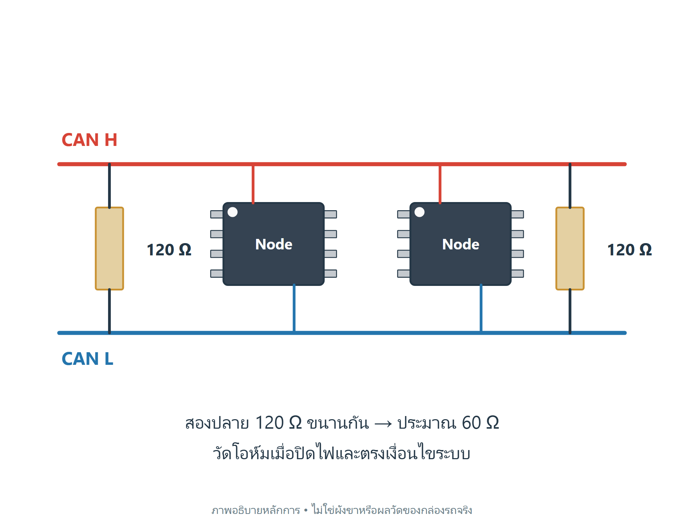

ภาพอธิบายหลักการ ใช้คู่กับวงจรในภาคหนึ่ง

1 ประมาณ 60 Ω ใช้กับโครงข่ายที่มี 120 Ω สองปลายตามภาพ

2 วัดโอห์มเมื่อปิดไฟและตรงเงื่อนไขระบบ

3 Gateway และเทอร์มิเนชันสวิตช์ทำให้ผลต่างได้

#### ตรวจบัสให้ครบทั้งสามส่วน

ภาพอธิบายหลักการ ใช้คู่กับวงจรในภาคหนึ่ง

1 มีสัญญาณบนบัส ยังไม่พิสูจน์ว่าเฟรมจาก ECU ถูกต้อง

2 K line เป็นอินเทอร์เฟซต่างจาก CAN ต้องใช้เครื่องมือที่รองรับ

ลองตอบ อ่านได้ 60 Ω แปลว่าสื่อสารปกติแล้วหรือไม่

แนวตอบ ยังไม่ได้ ต้องตรวจสัญญาณและเงื่อนไขสื่อสาร

### บท 11 เปิดกล่องและซ่อมบอร์ด

#### ดูงานก่อนถอด ระหว่างถอด หลังติดตั้ง

ภาพอธิบายหลักการ ใช้คู่กับวงจรในภาคหนึ่ง

1 ถ่ายภาพรอยเสียและทิศก่อนทำความสะอาด

2 ฝึกกับบอร์ดทิ้งก่อนบอร์ดลูกค้า

3 อุณหภูมิหน้าจอไม่เท่ารอยต่อ ไม่มีค่าเดียวใช้ทุกเครื่อง

#### งานบัดกรีขนาดเล็กของจริง

ภาพถ่ายจริง [P5] Soldering a 0805.jpg

ผู้ถ่าย Aisart • CC BY-SA 3.0

ที่มา https://commons.wikimedia.org/wiki/File:Soldering_a_0805.jpg

สิทธิ์ https://creativecommons.org/licenses/by-sa/3.0 • ย่อขนาดภาพ ไม่แก้เนื้อหาภาพ

1 ภาพงานบนบอร์ดทั่วไป แสดงเครื่องมือให้ความร้อนสองด้าน

2 ไม่ได้แสดงการย้าย EEPROM และไม่ใช่แบบตั้งอุณหภูมิ

3 หลังงานต้องตรวจ Pad สะพานตะกั่ว และความต่อเนื่อง

ลองตอบ ก่อนจ่ายไฟหลังเปลี่ยนชิป ต้องตรวจอะไร

แนวตอบ ทิศขา 1 รอยต่อ การลัด และชิ้นส่วนรอบข้าง

### บท 12 ทดสอบ ECU บนโต๊ะ

#### เห็นอุปกรณ์และทางเชื่อมต่อ

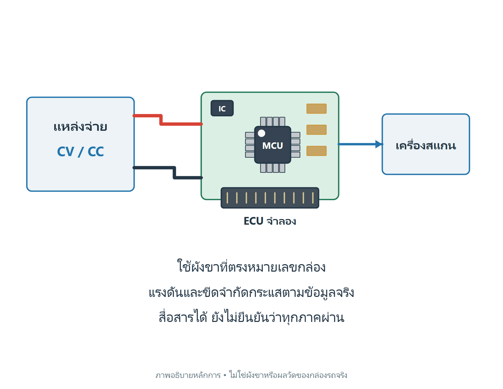

ภาพอธิบายหลักการ ใช้คู่กับวงจรในภาคหนึ่ง

1 ผังขาต้องตรงหมายเลขกล่องและ Revision

2 แรงดัน ฟิวส์ และกระแสจำกัดใช้ข้อมูลจริง

3 บางกล่องต้องมี Wake up หรือโมดูลร่วม

#### ลำดับตรวจบนโต๊ะ

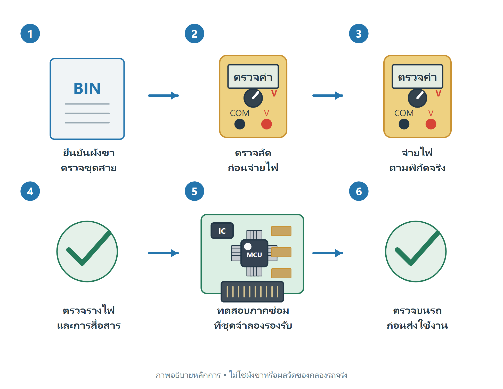

ภาพอธิบายหลักการ ใช้คู่กับวงจรในภาคหนึ่ง

1 Bench pass คือผ่านรายการที่ทดสอบ ไม่ใช่รับรองทุกภาค

ลองตอบ อ่านตัวตนได้ แปลว่าหัวฉีดผ่านแล้วหรือไม่

แนวตอบ ไม่ใช่ ต้องทดสอบภาคนั้นเพิ่มเติม

### บท 13 วิเคราะห์อาการเป็นครั้งคราว

#### จับเหตุการณ์ก่อนและหลังอาการ

ภาพอธิบายหลักการ ใช้คู่กับวงจรในภาคหนึ่ง

1 จดเวลา อุณหภูมิ และเงื่อนไขที่ทำซ้ำได้

2 วัดการตกของไฟกับ Reset ให้สัมพันธ์กัน

3 การเคาะแล้วหายยังไม่ระบุว่าชิ้นส่วนใดเสีย

#### ใช้หลักฐานนำการแก้ไข

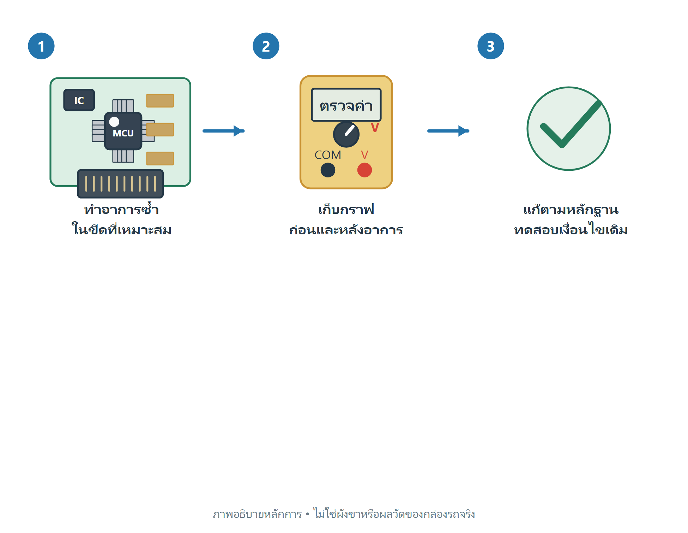

ภาพอธิบายหลักการ ใช้คู่กับวงจรในภาคหนึ่ง

1 หยุดเมื่อพิสูจน์ขอบเขตความเสียหายไม่ได้

2 Advanced คือรู้วิธีแยกสมมติฐานและข้อจำกัด

ลองตอบ ร้อนแล้วดับ ต้องเก็บหลักฐานอะไร

แนวตอบ ไฟ Reset เงื่อนไข Enable อุณหภูมิ และเวลา

### บท 14 กรณีศึกษาและการแปลผล

#### อาการคล้ายกัน แต่ต้องวัดคนละจุด

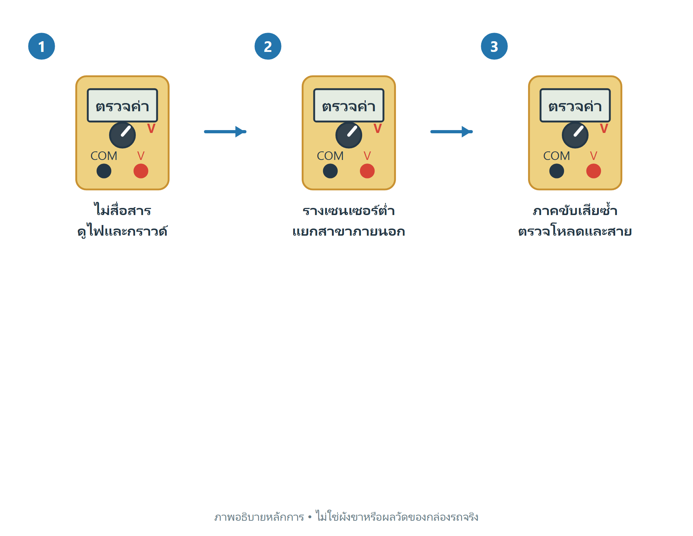

ภาพอธิบายหลักการ ใช้คู่กับวงจรในภาคหนึ่ง

1 ทั้งสามกรณีเป็นโจทย์สมมติ

2 พบจุดเสียหนึ่งจุดแล้ว ยังต้องตรวจความเสียหายร่วม

#### ตัวอย่างคิดแรงดันตกก่อนเปิดกล่อง

ภาพอธิบายหลักการ ใช้คู่กับวงจรในภาคหนึ่ง

1 12.4 V ที่แบตเตอรี่ไม่ใช่แรงดันที่กล่องได้รับเสมอ

2 ค่าวัดต้องมีเงื่อนไขโหลดและจุดอ้างอิง

3 หากสายตกต่ำแต่กล่องโหลดเกิน ให้เปลี่ยนสมมติฐาน

ลองตอบ ทำไมวัดไม่มีโหลดแล้วดูดี แต่รถยังเสีย

แนวตอบ เส้นทางอาจมีความต้านทานที่แสดงผลเมื่อมีกระแส

### บท 15 ส่งมอบงานและประเมินความพร้อม

#### ผ่านเป็นรายการ ไม่ใช่คำว่าซ่อมแล้ว

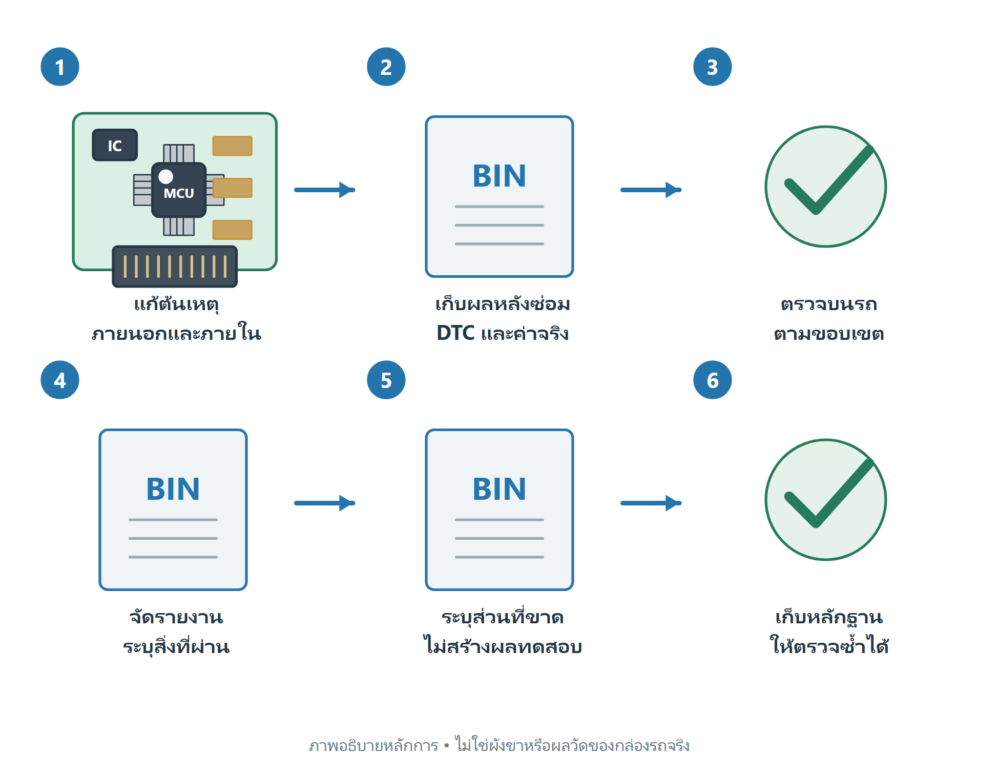

ภาพอธิบายหลักการ ใช้คู่กับวงจรในภาคหนึ่ง

1 แบบประเมินแนะนำต้องไม่มีจ่ายไฟผิดขาหรือลัดจากเครื่องมือ

#### แยกการตรวจข้อมูล ชิป และระบบ

ภาพอธิบายหลักการ ใช้คู่กับวงจรในภาคหนึ่ง

1 การทดสอบแต่ละชั้นตอบคนละคำถาม

2 หลังซ่อมต้องยืนยันภาคที่เกี่ยวข้องและเงื่อนไขเดิม

3 เรียนการวัดให้ถูกก่อนฝึกกับรถลูกค้า

ลองตอบ ผ่านบนโต๊ะ แต่ยังไม่ทดสอบบนรถ รายงานอย่างไร

แนวตอบ ระบุรายการบนโต๊ะที่ผ่าน และส่วนบนรถที่ยังไม่ได้ตรวจ

### ชุดฝึก 1 วงจรแบ่งแรงดัน

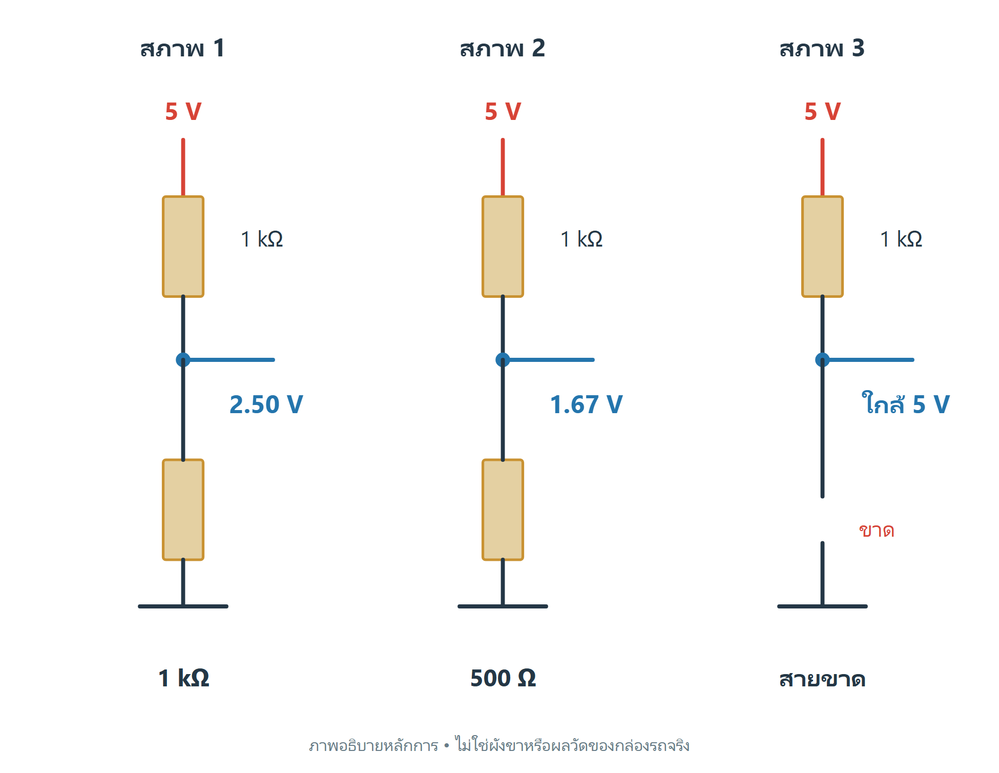

ภาพอธิบายหลักการ ใช้คู่กับวงจรในภาคหนึ่ง

1 ใช้ไฟ 5 V จำกัด 20 mA และ R 1 kΩ สองตัว ไม่ต่อรถ

2 ต่อบวก → R1 → จุดกลาง → R2 → ลบ ควรได้กลางประมาณ 2.5 V

3 ปิดไฟก่อนเพิ่ม 1 kΩ ขนาน R2 จุดกลางควรประมาณ 1.67 V

4 ภาพกลางแทนด้านล่างที่ขนานกันเป็นค่ารวม 500 Ω

### ชุดฝึก 2 แรงดันตกหน้าสัมผัส

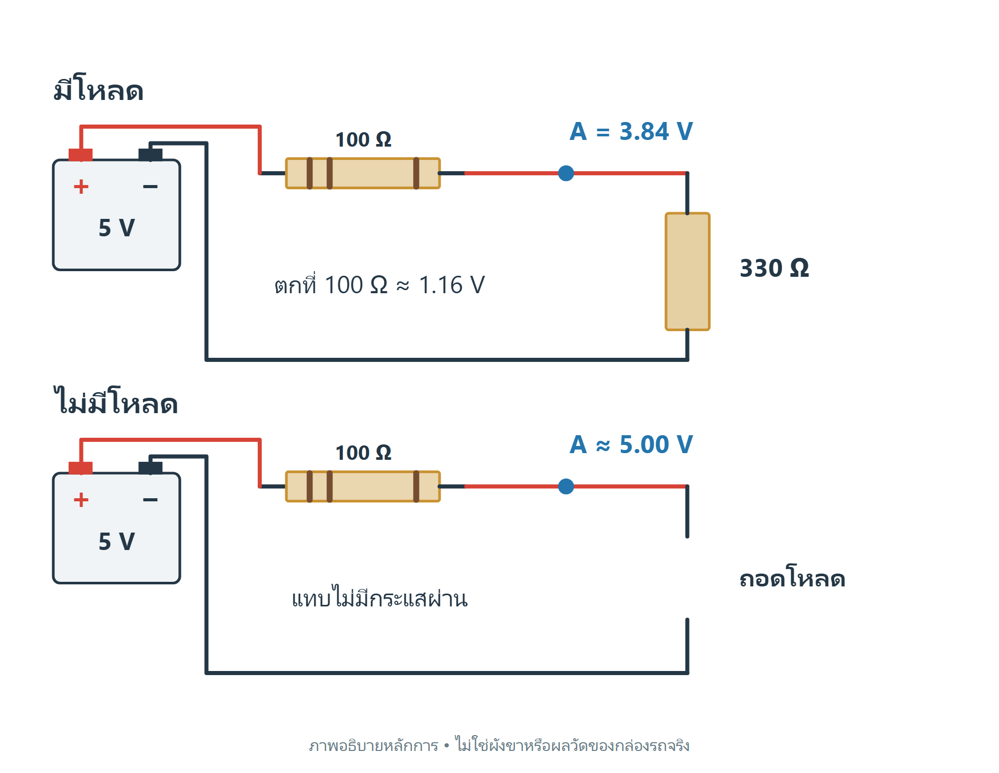

ภาพอธิบายหลักการ ใช้คู่กับวงจรในภาคหนึ่ง

1 วงจรฝึกใช้ 5 V จำกัด 30 mA ต่อ 100 Ω อนุกรมโหลด 330 Ω

2 กระแสประมาณ 11.6 mA ตกที่ 100 Ω ประมาณ 1.16 V

3 ปิดไฟก่อนถอดโหลด วัดใหม่โดยไม่มีโหลดเพื่อดูค่าเปลี่ยน

4 วัด A เทียบขั้วลบด้วยมิเตอร์ช่อง V อิมพีแดนซ์สูง

### ชุดฝึก 3 เซนเซอร์ตัวต้านทาน

ภาพอธิบายหลักการ ใช้คู่กับวงจรในภาคหนึ่ง

1 ใช้ไฟ 5 V จำกัด 20 mA และ Pull up 10 kΩ

2 ต่อ 10 kΩ ลงกราวด์ วัดกลางประมาณ 2.50 V

3 ปิดไฟก่อนเปลี่ยนตัวจำลอง 2.2 kΩ ได้ประมาณ 0.90 V

4 วงจรฝึกแยก ไม่ใช่ค่ามาตรฐานเซนเซอร์รถ

### ชุดฝึก 4 ออสซิลโลสโคป

ภาพอธิบายหลักการ ใช้คู่กับวงจรในภาคหนึ่ง

1 ใช้แหล่งสัญญาณฝึกที่คู่มือกำหนด ไม่เริ่มกับคอยล์

2 ตั้งอัตราขยายโพรบในเครื่องให้ตรงตัวโพรบ

3 ตั้ง Timebase ให้เห็นหลายคาบ และ Trigger ให้จับขอบ

4 คาบ 1 ms ในโจทย์ให้ความถี่ 1 kHz จาก f = 1/T

### ชุดฝึก 5 เทอร์มิเนชัน CAN

ภาพอธิบายหลักการ ใช้คู่กับวงจรในภาคหนึ่ง

1 ต่อ 120 Ω หนึ่งตัวคร่อมสายจำลอง H L วัดประมาณ 120 Ω

2 เพิ่มอีกตัวขนานได้ประมาณ 60 Ω แล้วถอดหนึ่งตัวเพื่อเทียบ

3 ทำทั้งหมดโดยไม่จ่ายไฟ ไม่ใช่การสร้างเฟรม CAN

4 จดผลหนึ่งตัว __________ สองตัว __________ สาขาขาด __________

## ภาคสาม การย้ายชิปและโคลน ECU

เก็บข้อมูลต้นฉบับ ยืนยันรุ่นและความเข้ากันได้ แล้วตรวจผลเป็นชั้นไฟล์ ชิป และระบบ

### บท 1 แยกประเภทงานก่อนเริ่ม

#### เลือกวิธีก่อนเปลี่ยนข้อมูล

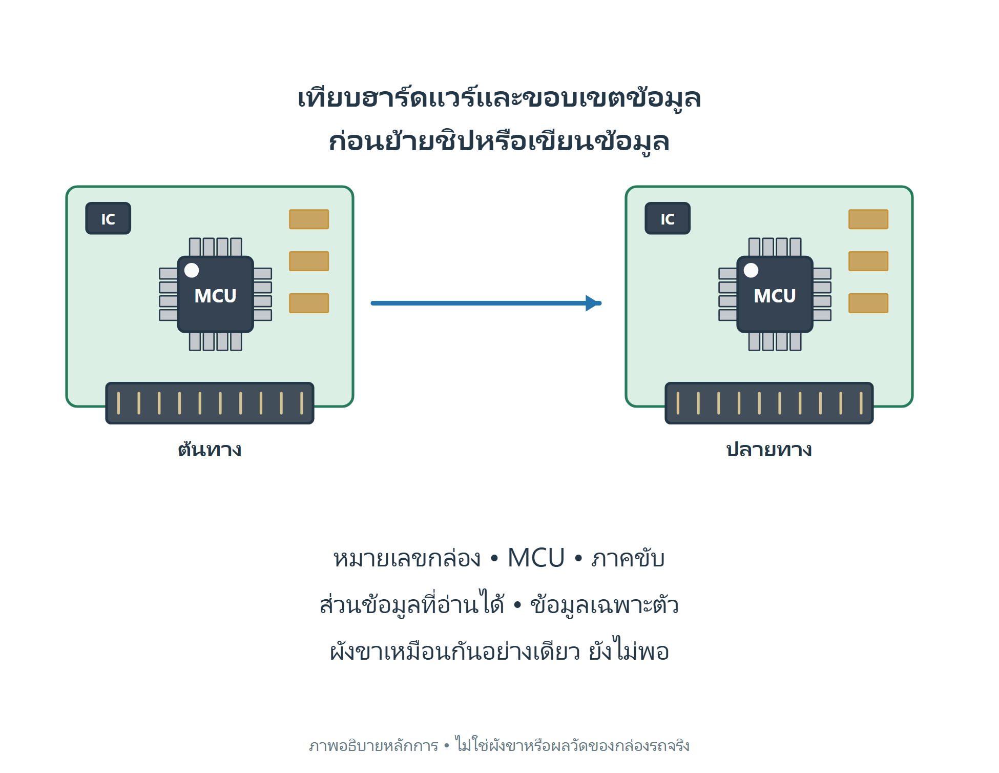

ภาพอธิบายหลักการ ใช้คู่กับวงจรในภาคหนึ่ง

1 เปลี่ยน IC ย้ายชิป เขียนข้อมูล และโคลนเป็นงานต่างกัน

2 ย้าย EEPROM ไม่ได้แปลว่าครบทุกข้อมูลในระบบ

3 กำหนดเป้าหมายและแผนคืนสภาพก่อนเริ่ม

#### กล่องและบอร์ดของจริง

ภาพถ่ายจริง [P1] Inside ECU.JPG

ผู้ถ่าย Snewkirk7953 • CC BY-SA 3.0

ที่มา https://commons.wikimedia.org/wiki/File:Inside_ECU.JPG

สิทธิ์ https://creativecommons.org/licenses/by-sa/3.0/ • ย่อขนาดภาพ ไม่แก้เนื้อหาภาพ

1 เก็บหมายเลขต้นทางและปลายทาง รวมฮาร์ดแวร์และซอฟต์แวร์

2 รูปร่างและขั้วต่อคล้ายกันยังไม่ยืนยันว่าแทนกันได้

3 ภาพนี้ใช้ดูโครงสร้าง ไม่ใช้เดาผังขา

ลองตอบ สื่อสารได้หลังย้าย EEPROM ถือว่าโคลนผ่านหรือไม่

แนวตอบ ยังต้องตรวจข้อมูลส่วนอื่น การจับคู่ และการทำงานบนรถ

### บท 2 EEPROM Flash และ MCU

#### เห็นหน่วยความจำสามแบบ

ภาพอธิบายหลักการ ใช้คู่กับวงจรในภาคหนึ่ง

1 EEPROM และ Flash เก็บข้อมูลเมื่อปิดไฟ MCU อาจรวมหน่วยความจำในตัว

2 บัส แรงดัน และการจัดข้อมูลต้องตรงหมายเลขชิป

3 32 Kbit ในตัวอย่าง = 4096 Byte

#### เห็น EEPROM จริงบนบอร์ด

ภาพถ่ายจริง [P3] Surecom EP-427 - board - National Semiconductor 93C56-7948.jpg

© Raimond Spekking / CC BY-SA 4.0 (via Wikimedia Commons)

ที่มา https://commons.wikimedia.org/wiki/File:Surecom_EP-427_-_board_-_National_Semiconductor_93C56-7948.jpg

สิทธิ์ https://creativecommons.org/licenses/by-sa/4.0 • ย่อขนาดภาพ ไม่แก้เนื้อหาภาพ

1 ตัวอย่าง NM93C56 บนบอร์ดเครือข่าย ไม่ใช่ ECU

2 ใช้ดูแพ็กเกจและรหัสบนตัวชิป

3 ไม่ใช้ผัง SPI ของ M95320 ต่อเข้าชิปนี้

ลองตอบ ขนาดไฟล์ถูกต้อง พิสูจน์ว่าข้อมูลถูกทุกไบต์หรือไม่

แนวตอบ ไม่พิสูจน์ ต้องตรวจรุ่น ขอบเขตอ่าน และเทียบข้อมูล

### บท 3 อ่าน Datasheet และยืนยันขา

#### ผังขาตัวอย่างที่ต้องอ่านทิศให้ถูก

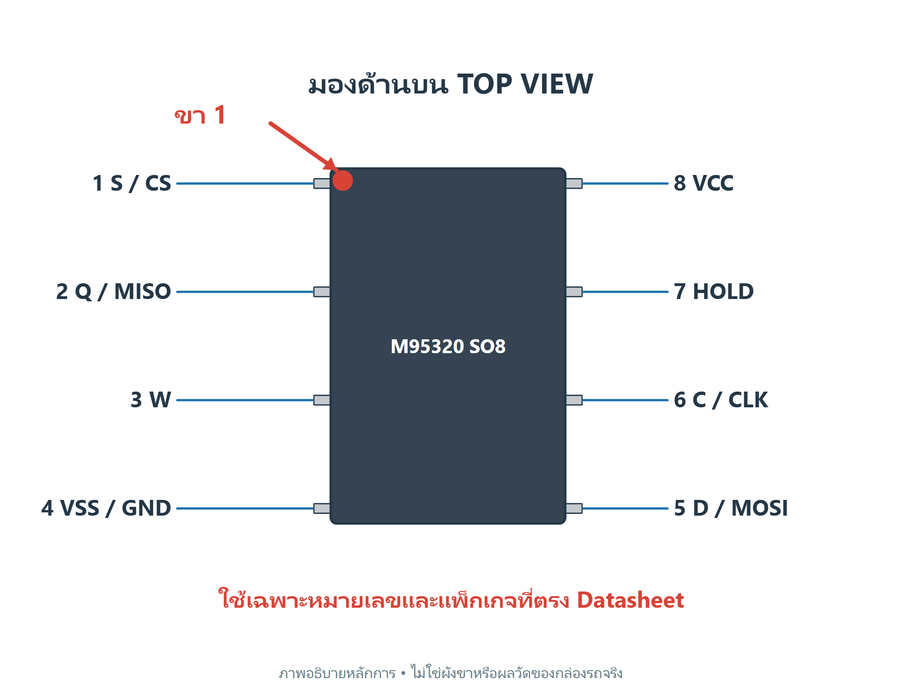

ภาพอธิบายหลักการ ใช้คู่กับวงจรในภาคหนึ่ง

1 ผังนี้สำหรับ M95320 แพ็กเกจ SO8 ที่ตรง Datasheet S1

2 รุ่น W ใช้ช่วง 2.5 ถึง 5.5 V ต้องตรวจอะแดปเตอร์และระดับสัญญาณ

3 จุดแดงใช้ชี้ตำแหน่งขา 1 ในภาพอธิบาย

#### เปรียบเทียบแพ็กเกจจากภาพ

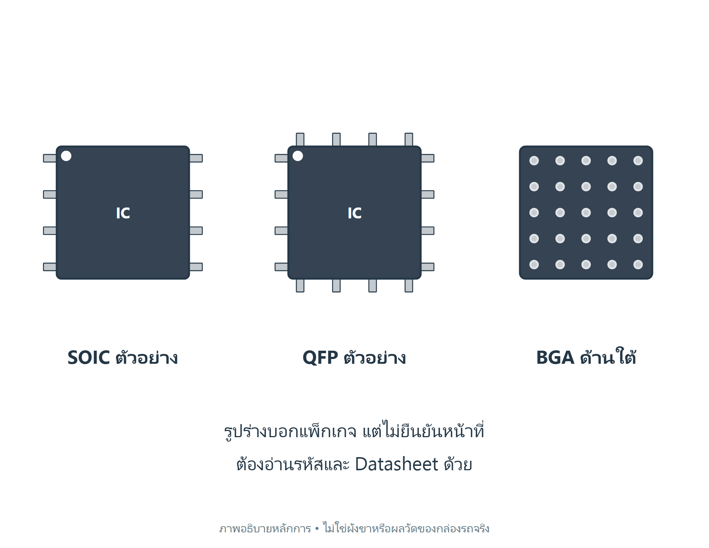

ภาพอธิบายหลักการ ใช้คู่กับวงจรในภาคหนึ่ง

1 Top view และ Bottom view กลับทิศกัน

2 จำนวนขาไม่ใช่หลักฐานหน้าที่ชิป

3 อะแดปเตอร์ต้องตรงขา 1 ทั้งสองด้าน

ลองตอบ ลด VCC แต่สัญญาณยังสูงเกินพิกัด ใช้ได้หรือไม่

แนวตอบ ไม่ได้ ต้องให้แรงดันและระดับสัญญาณตรงกันทั้งหมด

### บท 4 เครื่องมือสำหรับอ่านเขียนและย้ายชิป

#### เครื่องมือวัดจริงที่ต้องใช้ร่วมกัน

ภาพถ่ายจริง [P2] Keysight InfiniiVision DSOX 4024A and digital multimeter and power supply in laboratory use.jpg

ผู้ถ่าย Radarvector; ไฟล์ครอบตัดเผยแพร่โดย Pittigrilli • CC BY-SA 4.0

ที่มา https://commons.wikimedia.org/wiki/File:Keysight_InfiniiVision_DSOX_4024A_and_digital_multimeter_and_power_supply_in_laboratory_use.jpg

สิทธิ์ https://creativecommons.org/licenses/by-sa/4.0/ • ย่อขนาดภาพ ไม่แก้เนื้อหาภาพ

1 ตรวจไฟและสภาพกล่องก่อนอ่านเขียน

2 เลือกเครื่องอ่านตามหมายเลขและวิธีที่รองรับ

3 แรงดันและกราวด์ผิดทำให้ข้อมูลและฮาร์ดแวร์เสียได้

#### เลือกเครื่องอ่านให้ตรงงาน

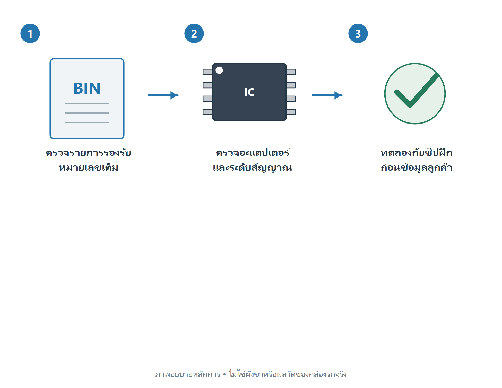

ภาพอธิบายหลักการ ใช้คู่กับวงจรในภาคหนึ่ง

1 รองรับชิปแยก ไม่เท่ากับรองรับอ่าน ECU แบบไม่ถอด

2 Virtual read ต้องตรวจว่ามีข้อมูลเฉพาะกล่องหรือไม่

ลองตอบ เลือกเครื่องจากจำนวนรุ่นในโฆษณาพอหรือไม่

แนวตอบ ไม่พอ ต้องตรวจการรองรับรุ่นและวิธีจริง

### บท 5 สำรองข้อมูลและรักษาต้นฉบับ

#### เทียบการอ่านซ้ำทุกไบต์

ภาพอธิบายหลักการ ใช้คู่กับวงจรในภาคหนึ่ง

1 อ่านอย่างน้อยสองครั้งในเงื่อนไขเดียวกัน

2 เทียบเนื้อหา ขนาด และขอบเขตอ่าน ไม่ดูชื่อไฟล์อย่างเดียว

3 Hash ตรงยังอาจเป็นผลอ่านผิดเหมือนกัน ต้องตรวจหลักฐานอื่น

#### เก็บต้นฉบับให้กลับคืนได้

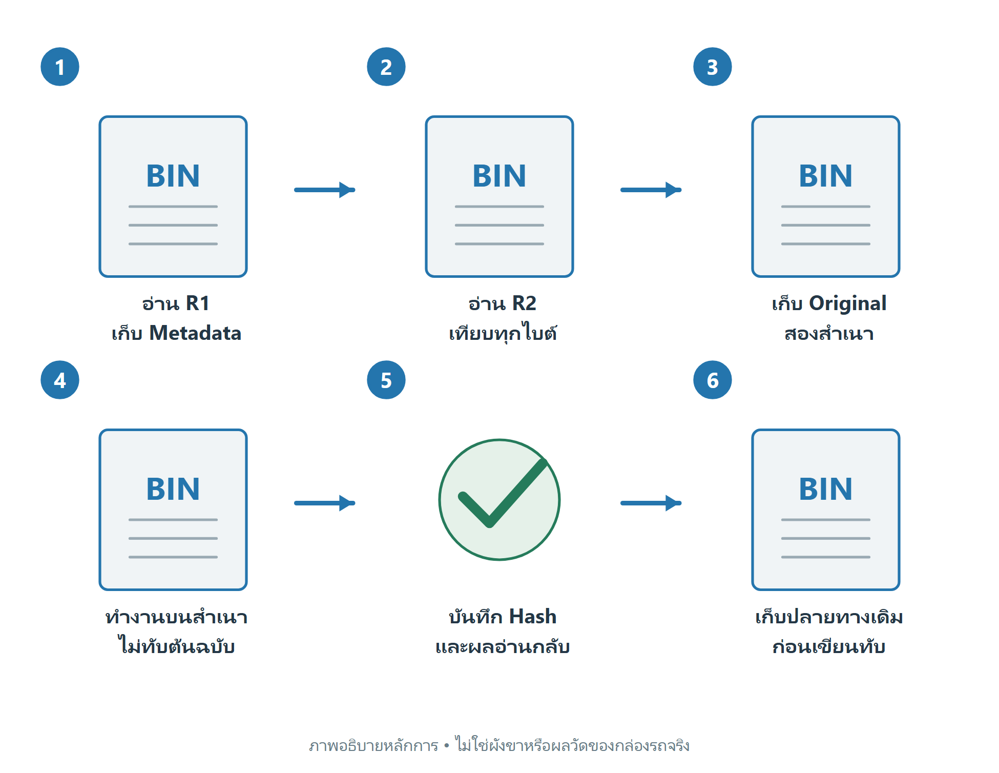

ภาพอธิบายหลักการ ใช้คู่กับวงจรในภาคหนึ่ง

1 ไฟล์สำรองต้องระบุส่วนที่อ่าน ไม่เรียก Full backup หากไม่ครบ

ลองตอบ อ่านซ้ำตรงกันแล้วเขียนปลายทางได้ทันทีหรือไม่

แนวตอบ ยังต้องยืนยันความเข้ากันได้และวิธีถ่ายโอน

### บท 6 อ่านบนบอร์ดหรือถอดชิป

#### คลิปยังต่อกับวงจรอื่น

ภาพอธิบายหลักการ ใช้คู่กับวงจรในภาคหนึ่ง

1 MCU และภาคจ่ายไฟยังมีภาระร่วมกับชิป

2 ต้องระวังไฟย้อนและการขับบัสพร้อมกัน

3 ไม่จ่ายไฟสองแหล่งพร้อมกันโดยเดา

#### ตัดสินใจจากความคงที่ของผลอ่าน

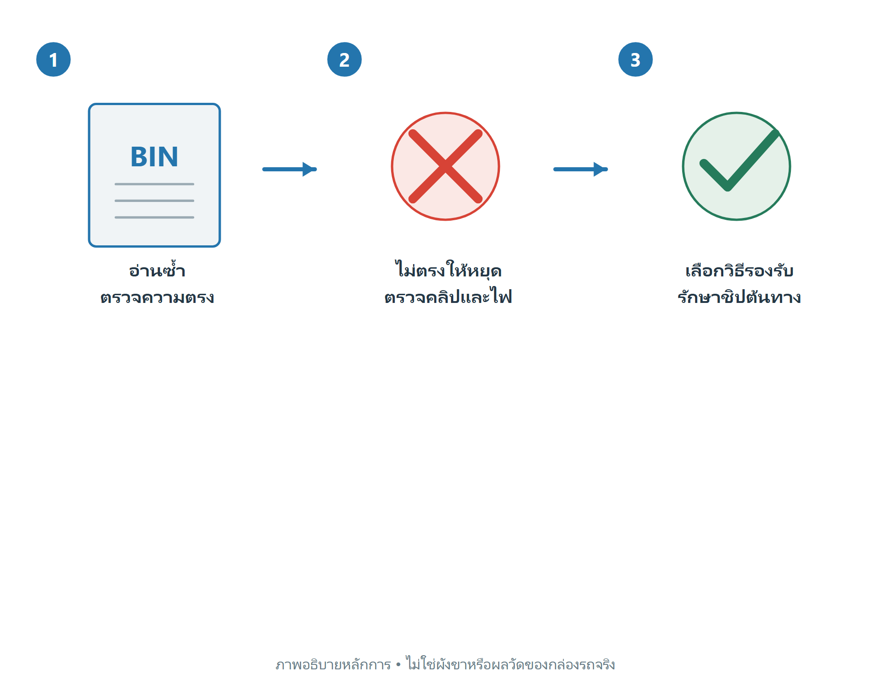

ภาพอธิบายหลักการ ใช้คู่กับวงจรในภาคหนึ่ง

1 ไม่ยกขา 1 ของทุกชิปเป็นกฎ

2 ถอดชิปเพิ่มความเสี่ยงความร้อน ต้องฝึกก่อน

ลองตอบ อ่านต่างหลายตำแหน่ง ควรเลือกไฟล์ที่ดูสมบูรณ์กว่าหรือไม่

แนวตอบ ไม่ควร ต้องหาสาเหตุและยืนยันข้อมูลก่อน

### บท 7 ฝึกอ่านเขียนชิปแยก

#### เห็นผลเมื่อข้อมูลต่างหนึ่งไบต์

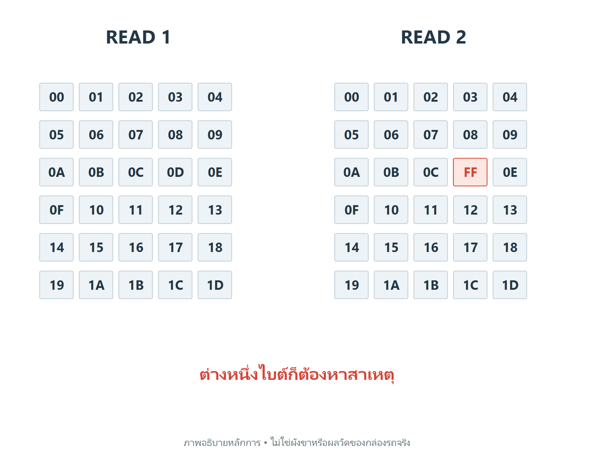

ภาพอธิบายหลักการ ใช้คู่กับวงจรในภาคหนึ่ง

1 ตัวอย่างไฟล์ฝึก 4096 Byte ลำดับ 00 ถึง FF ซ้ำ 16 รอบ

2 เก็บ Original ก่อนเขียนไฟล์ทดสอบ

3 เทียบรายไบต์ช่วยระบุตำแหน่งที่ต่าง

#### อ่าน เขียน อ่านกลับ และคืนข้อมูล

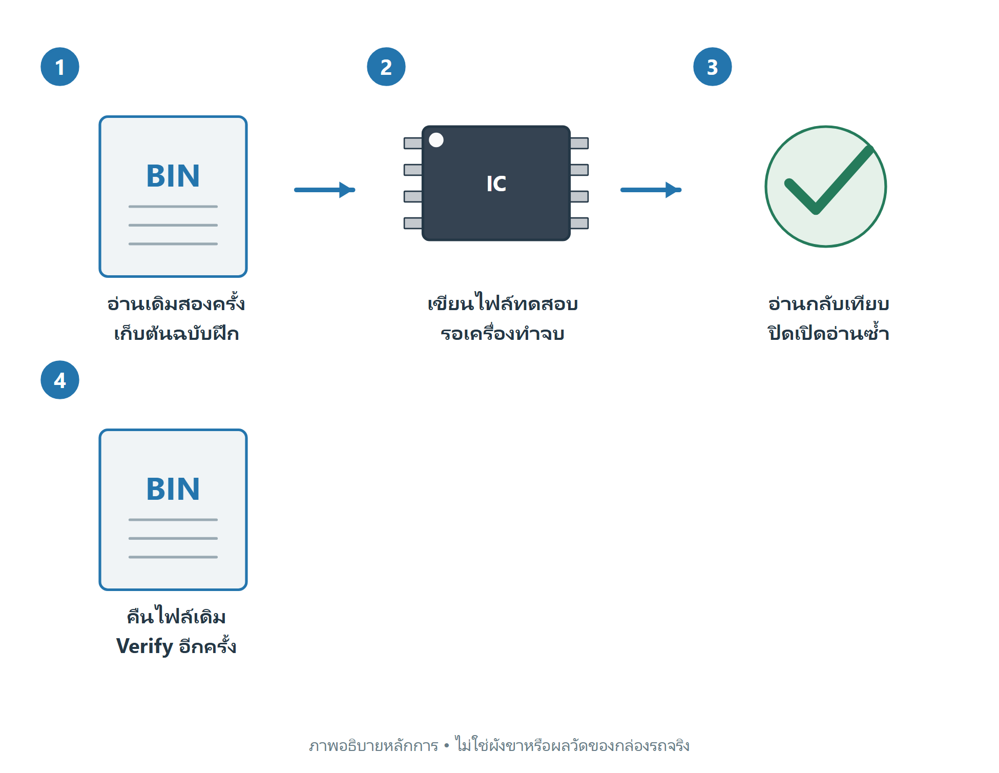

ภาพอธิบายหลักการ ใช้คู่กับวงจรในภาคหนึ่ง

1 Page boundary และการรอพร้อมใช้ข้อกำหนดชิป S2

2 ชุดฝึกนี้ไม่ใช่การโคลนกล่องรถ

ลองตอบ Verify ผ่าน แต่ปิดเปิดแล้วไม่ตรง ถือว่าผ่านหรือไม่

แนวตอบ ยังไม่ผ่าน ต้องตรวจไฟ หน้าสัมผัส และวิธีเขียน

### บท 8 ถอดและติดตั้ง SOIC กับ TSSOP

#### ลำดับงานย้ายชิปที่รักษา Pad

ภาพอธิบายหลักการ ใช้คู่กับวงจรในภาคหนึ่ง

1 บันทึกทิศขา 1 และสำรองข้อมูลก่อนให้ความร้อน

2 ยกเมื่อรอยต่อพร้อม ไม่ใช้แรงดึงหรือบิด

3 หลังติดตั้งตรวจขาลอย การลัด และความต่อเนื่อง

#### เครื่องมือให้ความร้อนในงานจริง

ภาพถ่ายจริง [P5] Soldering a 0805.jpg

ผู้ถ่าย Aisart • CC BY-SA 3.0

ที่มา https://commons.wikimedia.org/wiki/File:Soldering_a_0805.jpg

สิทธิ์ https://creativecommons.org/licenses/by-sa/3.0 • ย่อขนาดภาพ ไม่แก้เนื้อหาภาพ

1 ภาพงานบอร์ดทั่วไป ใช้ดูการเข้าถึงรอยต่อ

2 ไม่ได้แสดงการถอด EEPROM และไม่ใช่คำแนะนำอุณหภูมิ

3 หัวเป่า ระยะ มวลบอร์ด และการสอบเทียบทำให้ค่าตั้งต่างกัน

ลองตอบ ชิปยังไม่ออก ควรเพิ่มแรงดึงหรือไม่

แนวตอบ ไม่ควร ต้องประเมินการถ่ายเทความร้อน

### บท 9 QFP BGA และขอบเขตงานขั้นสูง

#### เห็นตำแหน่งรอยต่อ BGA

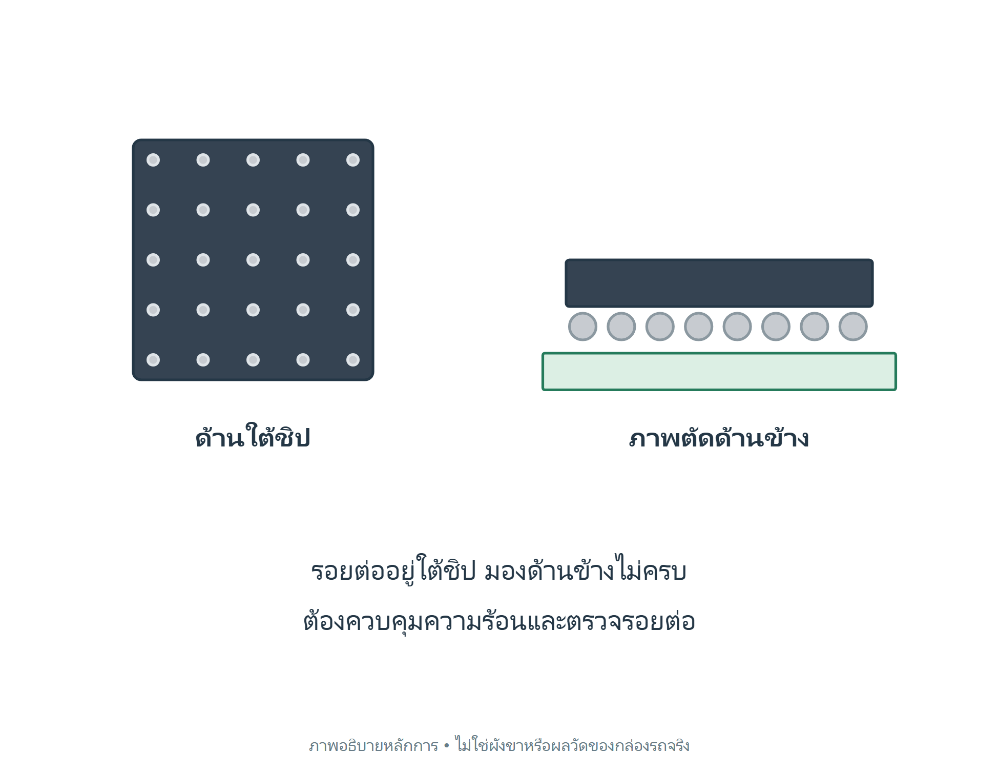

ภาพอธิบายหลักการ ใช้คู่กับวงจรในภาคหนึ่ง

1 ลูกตะกั่วอยู่ใต้แพ็กเกจ จึงตรวจด้วยตาได้ไม่ครบ

2 ต้องควบคุมความร้อน แนววาง และสภาพ Pad

3 Underfill ทำให้วิธีถอดต่างจากชิปที่ไม่มีกาว

#### ด้านใต้ BGA ของจริง

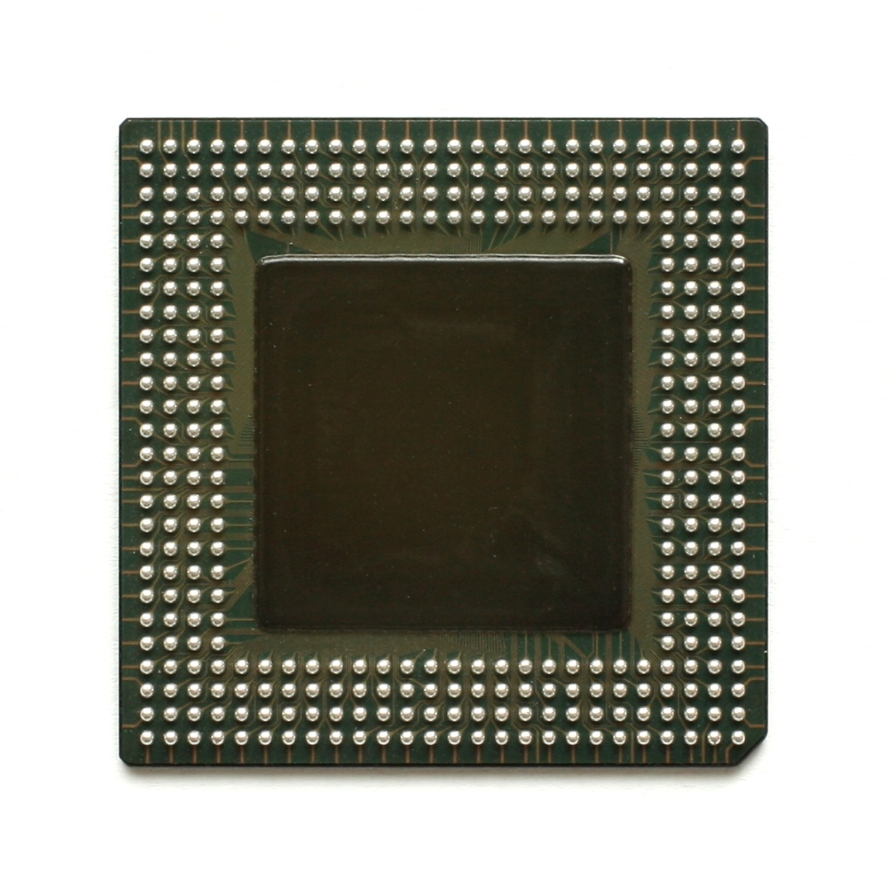

ภาพถ่ายจริง [P6] Kl Intel Pentium MMX embedded BGA Bottom.jpg

ผู้ถ่าย Konstantin Lanzet • CC BY-SA 3.0

ที่มา https://commons.wikimedia.org/wiki/File:Kl_Intel_Pentium_MMX_embedded_BGA_Bottom.jpg

สิทธิ์ https://creativecommons.org/licenses/by-sa/3.0/ • ย่อขนาดภาพ ไม่แก้เนื้อหาภาพ

1 ภาพ Intel Embedded Pentium MMX ใช้เรียนรูปทรงลูกตะกั่ว

2 ไม่ใช่ MCU ECU และไม่ใช้ยืนยันผังลูกของ ECU

3 ย้าย MCU เมื่อสำรองได้ ยืนยันความเข้ากันได้ และมีวิธีตรวจ

ลองตอบ เป่าแล้วเปิดติด ถือว่ารอยต่อทุกลูกผ่านหรือไม่

แนวตอบ ไม่ถือ ต้องมีการตรวจและทดสอบที่เหมาะสม

### บท 10 ประเมินต้นทางและปลายทาง

#### เทียบฮาร์ดแวร์ก่อนคัดลอก

ภาพอธิบายหลักการ ใช้คู่กับวงจรในภาคหนึ่ง

1 ตรวจหมายเลข Revision MCU หน่วยความจำ และภาคขับ

2 ทดสอบและสำรองปลายทางก่อนเปลี่ยนข้อมูล

3 มีขั้วต่อเหมือนกันอย่างเดียวไม่พอ

#### หลักฐานที่ต้องมีครบ

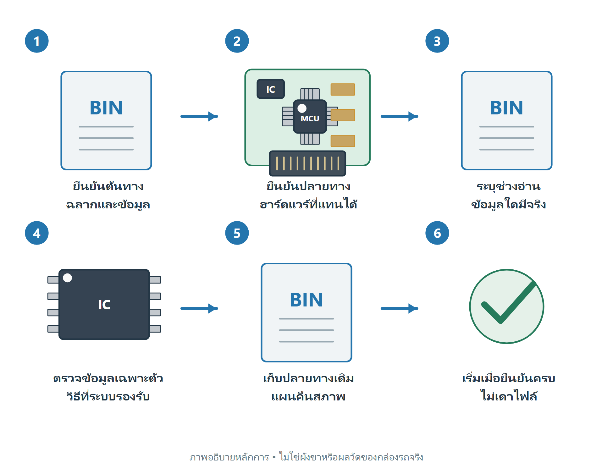

ภาพอธิบายหลักการ ใช้คู่กับวงจรในภาคหนึ่ง

1 อ่านแค่ Calibration ไม่ใช่สำรองครบทุกส่วน

ลองตอบ ทำไมต้องเก็บข้อมูลปลายทางเดิม

แนวตอบ เพื่อคืนสภาพและแยกปัญหาที่มีอยู่ก่อน

### บท 11 Checksum ECC และระบบป้องกัน

#### ตรวจความถูกต้องเป็นสามชั้น

ภาพอธิบายหลักการ ใช้คู่กับวงจรในภาคหนึ่ง

1 Hash ภายนอกไม่ใช่ Checksum ภายใน ECU

2 ECC และพื้นที่ป้องกันขึ้นกับตระกูลชิป S3 ถึง S5

3 ข้อมูลเฉพาะตัวอาจไม่ถูกรวมในไฟล์ที่อ่าน

#### คำสั่งบางชนิดเปลี่ยนข้อมูลถาวร

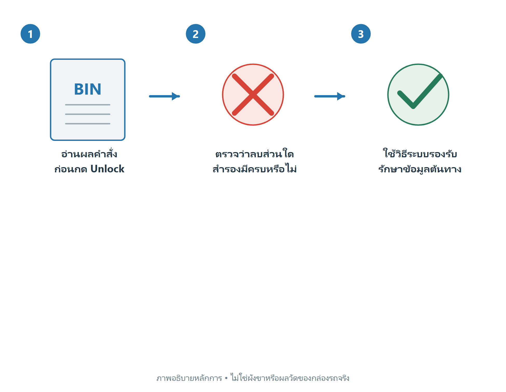

ภาพอธิบายหลักการ ใช้คู่กับวงจรในภาคหนึ่ง

1 ปลดเข้าถึงหลังลบ ไม่ใช่กู้ข้อมูลเดิม

2 ไม่แก้ระบบป้องกันโดยเดาเพื่อให้เริ่มผ่าน

ลองตอบ ไฟล์ตรงแต่กล่องไม่เริ่ม เกิดจากอะไรได้

แนวตอบ ส่วนอื่นไม่ครบ ข้อมูลเฉพาะตัว การจับคู่ หรือฮาร์ดแวร์ไม่ตรง

### บท 12 ขั้นตอนถ่ายโอนที่ตรวจผลได้

#### ลำดับงานตั้งแต่รับจนส่ง

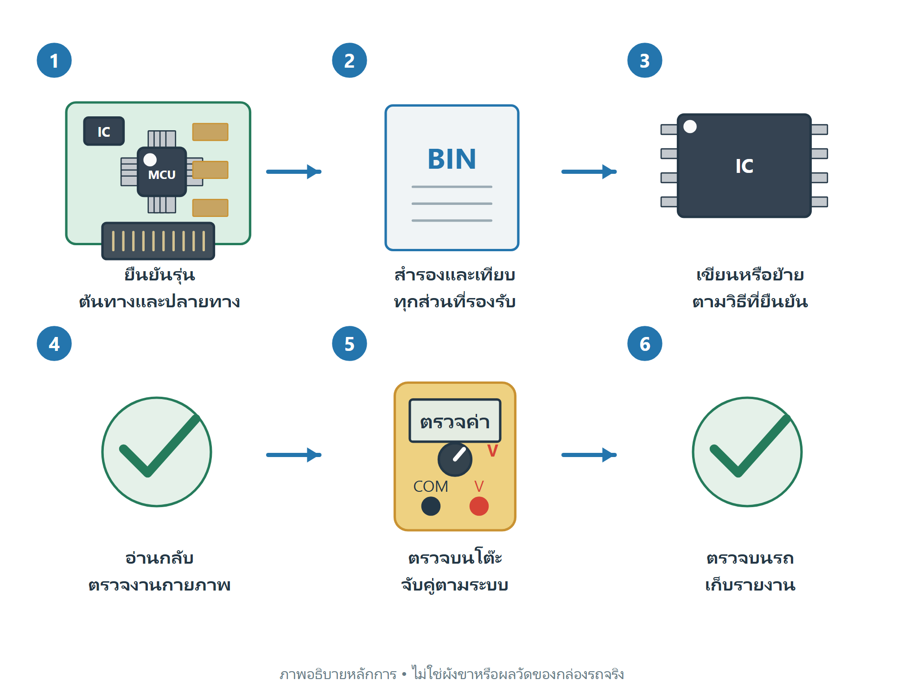

ภาพอธิบายหลักการ ใช้คู่กับวงจรในภาคหนึ่ง

1 ทำเฉพาะงานซ่อมและเปลี่ยนกล่องที่เจ้าของอนุญาต

#### ต่อชุดทดสอบหลังถ่ายโอน

ภาพอธิบายหลักการ ใช้คู่กับวงจรในภาคหนึ่ง

1 ตรวจไฟและงานบัดกรีก่อนต่อรถ

2 หน้าจอ 100 เปอร์เซ็นต์อาจยังมีขั้นตอนตรวจต่อ

3 เก็บ Log และผลแต่ละขั้น ไม่รายงานผ่านรวมคำเดียว

ลองตอบ อ่านกลับตรง หมายถึงพร้อมขับรถหรือไม่

แนวตอบ ยังต้องจับคู่และทดสอบระบบที่เกี่ยวข้อง

### บท 13 วิเคราะห์ปัญหาหลังย้ายหรือเขียน

#### ความเสียหายใต้ชิปของจริง

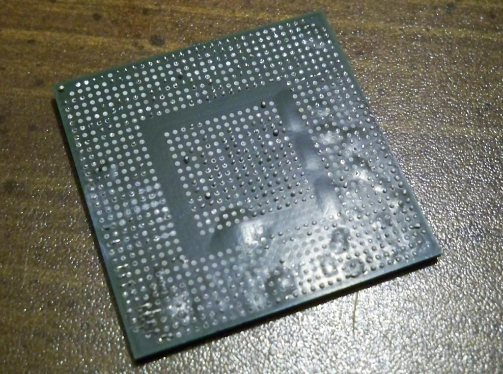

ภาพถ่ายจริง [P8] PopcornBGA.jpg

ผู้ถ่าย Textbook • CC BY-SA 3.0

ที่มา https://commons.wikimedia.org/wiki/File:PopcornBGA.jpg

สิทธิ์ https://creativecommons.org/licenses/by-sa/3.0 • ย่อขนาดภาพ ไม่แก้เนื้อหาภาพ

1 ภาพ BGA จากเครื่องเกม ใช้แสดงความเสียหายทางกายภาพ

2 ไม่ใช่กรณีทดสอบ ECU และไม่ใช้ขั้นตอนจากคำบรรยายภาพเป็นสูตรซ่อม

3 งานความร้อนต้องประเมินวัสดุและข้อกำหนดของชิ้นงาน

#### แยกไฟ งานกายภาพ และข้อมูล

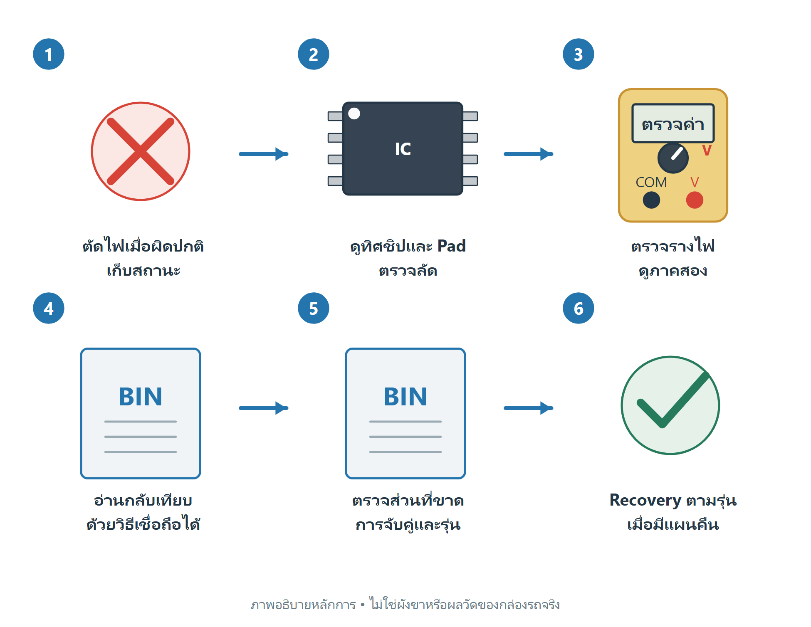

ภาพอธิบายหลักการ ใช้คู่กับวงจรในภาคหนึ่ง

1 ไฟดับระหว่างลบกับระหว่างอ่านมีผลต่างกัน

ลองตอบ ไม่สื่อสารหลังเขียน ควรแก้ Checksum ทันทีหรือไม่

แนวตอบ ไม่ควร เริ่มที่ไฟ งานกายภาพ และเงื่อนไขเริ่มก่อน

### บท 14 กรณีศึกษาและการตัดสินใจ

#### ข้อมูลต่างต้องหยุดก่อนเขียน

ภาพอธิบายหลักการ ใช้คู่กับวงจรในภาคหนึ่ง

1 กรณีสมมติ อ่านบนบอร์ดไม่คงที่ ต้องแก้วิธีอ่านก่อน

2 ห้ามเลือกไฟล์จากความรู้สึกว่าดูดีกว่า

3 รักษาข้อมูลต้นทางซึ่งอาจมีเพียงชุดเดียว

#### เลือกทางแก้ให้ตรงต้นเหตุ

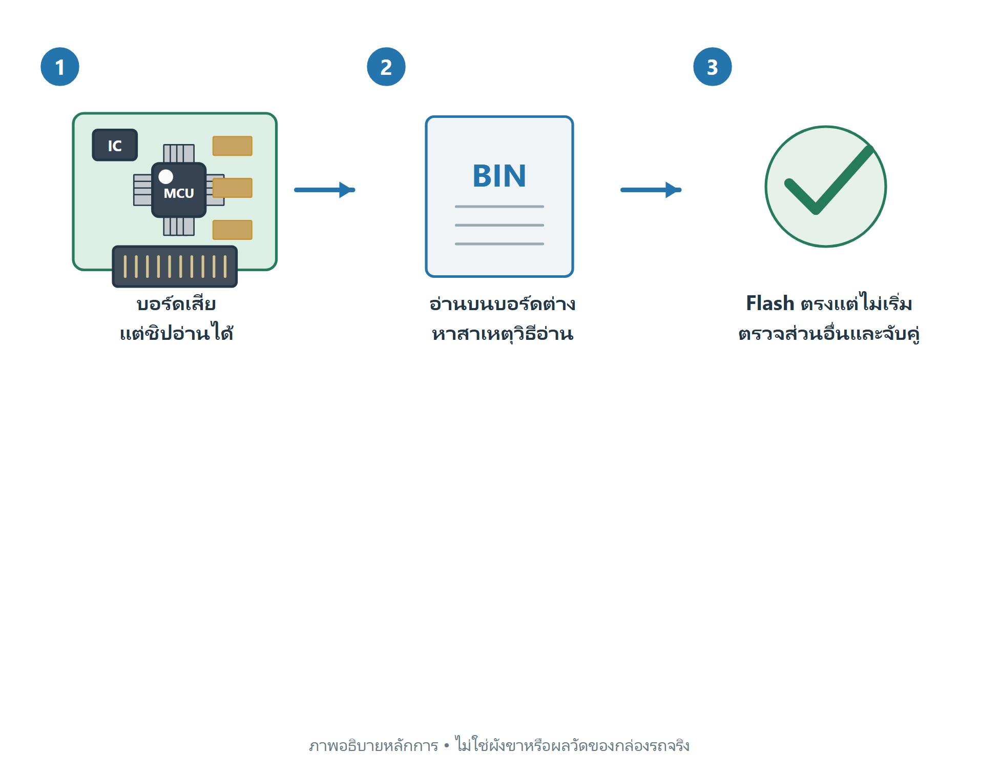

ภาพอธิบายหลักการ ใช้คู่กับวงจรในภาคหนึ่ง

1 สถานการณ์ทั้งหมดเป็นโจทย์เรียน ไม่ใช่ผลทดสอบกล่องจริง

ลองตอบ ถอดชิปได้ไม่มั่นคง ควรทำกับต้นทางหรือไม่

แนวตอบ ไม่ควร เลือกผู้มีเครื่องมือหรือวิธีอื่นที่รองรับ

### บท 15 ฝึกถึงขั้นสูงและส่งมอบ

#### ทักษะที่ต้องผ่านตามลำดับ

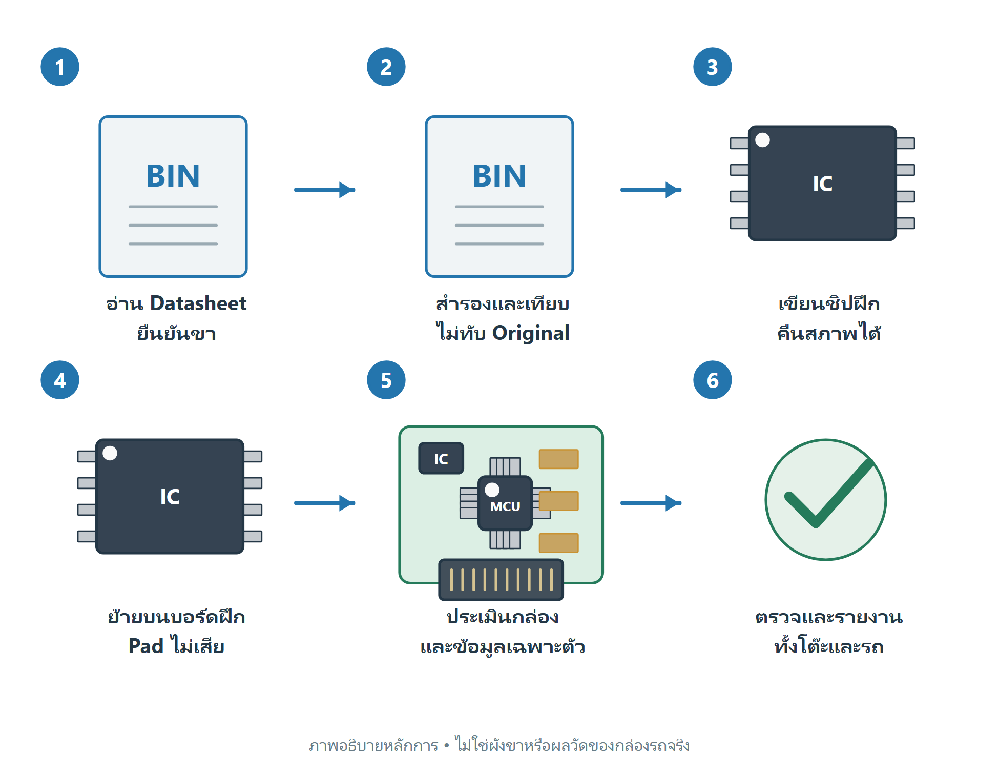

ภาพอธิบายหลักการ ใช้คู่กับวงจรในภาคหนึ่ง

1 ย้าย QFP และ BGA ต้องมีเส้นทางฝึกและเครื่องมือตรวจแยก

#### ภาพเอกซเรย์รอยต่อ BGA

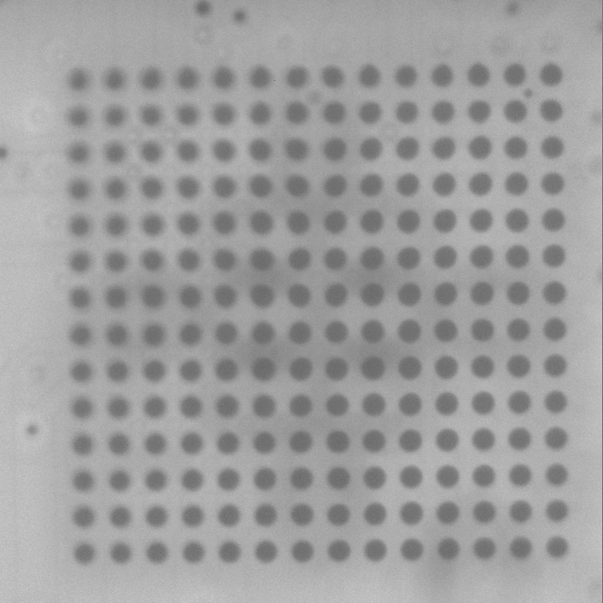

ภาพถ่ายจริง [P7] BGA joint xray.jpg

ผู้ถ่าย No machine-readable author provided. DJGB assumed (based on copyright claims). • Public domain

ที่มา https://commons.wikimedia.org/wiki/File:BGA_joint_xray.jpg

สิทธิ์  • ย่อขนาดภาพ ไม่แก้เนื้อหาภาพ

1 ภาพจริงของรอยต่อใต้ชิปบนบอร์ดทั่วไป

2 ใช้เข้าใจว่ารอยต่อซ่อนอยู่ใต้ตัวชิป

3 ผล X ray ต้องตีความร่วมกับการทดสอบทางไฟฟ้า

ลองตอบ Verify และสื่อสารบนโต๊ะผ่าน แต่ยังไม่จับคู่ รายงานอย่างไร

แนวตอบ ระบุส่วนที่ผ่าน และการจับคู่กับผลบนรถที่ยังขาด

### ชุดฝึก 1 ยืนยันชิปและอะแดปเตอร์

ภาพอธิบายหลักการ ใช้คู่กับวงจรในภาคหนึ่ง

1 อ่านหมายเลขเต็ม แพ็กเกจ และ Top view จาก Datasheet

2 จด VCC GND ระดับสัญญาณ และตำแหน่งขา 1

3 ตรวจอะแดปเตอร์ขณะปิดไฟก่อนเสียบชิปฝึก

4 ภาพใช้เฉพาะ M95320 SO8 ไม่ใช้แทนชิปชนิดอื่น

### ชุดฝึก 2 เปรียบเทียบไฟล์

ภาพอธิบายหลักการ ใช้คู่กับวงจรในภาคหนึ่ง

1 ใช้ไฟล์ฝึก A 4096 Byte เก็บ Original และทำสำเนา B

2 แก้ B หนึ่งไบต์ที่ Offset ที่จดไว้ ไม่แก้ A

3 เทียบข้อมูลและ SHA256 จะต่าง แม้ขนาดเท่าเดิม

4 ตำแหน่งต่าง __________ Hash A __________ Hash B __________

### ชุดฝึก 3 เขียนแล้วคืนสภาพ

ภาพอธิบายหลักการ ใช้คู่กับวงจรในภาคหนึ่ง

1 ใช้ชิปแยกที่ไม่มีข้อมูลลูกค้า และเครื่องรองรับรุ่นจริง

2 เมื่อข้อมูลไม่ตรง หยุดตรวจไฟ หน้าสัมผัส และการตั้ง

### ชุดฝึก 4 ถอดติดตั้งชิป

ภาพอธิบายหลักการ ใช้คู่กับวงจรในภาคหนึ่ง

1 ใช้บอร์ดทิ้งและแพ็กเกจที่ฝึกได้ ไม่ใช้ MCU ต้นทาง

2 ถ่ายภาพขา 1 ยกเมื่อพร้อม และตรวจ Pad หลังถอด

3 ติดตั้งแล้วส่องทุกขา ตรวจความต่อเนื่องและการลัด

4 ถ้าบอร์ดไม่ทราบผังไฟ ไม่จ่ายไฟเพื่อทดลอง

### ชุดฝึก 5 ประเมินกล่องสองใบ

ภาพอธิบายหลักการ ใช้คู่กับวงจรในภาคหนึ่ง

1 โจทย์สมมติ A อ่านซ้ำตรง แต่ B Hardware revision ต่าง

2 เครื่องมือรองรับ A และยังไม่มีหลักฐานว่า B ใช้แทนได้

3 คำตอบคือยังไม่เริ่มโคลน ต้องยืนยันความเข้ากันได้

4 หลักฐานขาด __________ วิธีตรวจ __________ ทางเลือก __________

## คู่มือเบอร์ชิปและภาพจริงหลายยี่ห้อ

ภาพอธิบาย ชิป 8 ขาอาจใช้บัสต่างกัน ต้องอ่านเบอร์เต็ม

เลือกเบอร์จากอะไร การซ่อมเริ่มจากอ่านรหัสบนชิปเดิม ตรวจผู้ผลิต แพ็กเกจ และ Datasheet แล้วเทียบวงจร กล่องรถยี่ห้อเดียวกันอาจใช้ชิปต่างกันตามเครื่องยนต์ ปี และ Revision

ใช้เบอร์ไหนฝึก ฝึกกับชิปแยกที่ทราบแหล่ง เช่น M95320-W สำหรับ SPI หรือ 24LC256 สำหรับ I²C เลือกเครื่องอ่านที่ระบุรองรับเบอร์และแพ็กเกจนั้น ใช้ข้อมูลทดสอบก่อนข้อมูลลูกค้า [X2 X6]

เบอร์ไหนใช้แทน ใช้เบอร์เดิมและรหัสย่อยตรงเป็นจุดเริ่มต้น หากจะเปลี่ยนเบอร์ต้องพิสูจน์ผังขา แรงดัน บัส ความจุ Timing อุณหภูมิ และเงื่อนไขซอฟต์แวร์ครบ ความจุมากกว่าหรือจำนวนขาเท่ากันยังไม่พอ

### รู้จักเบอร์ IC ตามหน้าที่บนบอร์ด

| ภาค | ตัวอย่างผู้ผลิตและเบอร์ | ตรวจอะไรก่อนเปลี่ยน |
| --- | --- | --- |
| หน่วยความจำ | ST M95320   Microchip 24LC256 | บัส ความจุ แรงดัน   ข้อมูลสำรอง [X2 X6] |
| CAN | NXP TJA1050T | ไฟ 5 V กราวด์ TXD   RXD และขา S [X8] |
| K line | ST L9637D | ไฟ VS VCC และสาย K   อย่าสับสนกับ CAN [X9] |
| Low side | Infineon TLE6220GP | โหลดลัด คำสั่งควบคุม   การระบายความร้อน [X10] |
| จ่ายไฟ | Infineon TLE4274 V50 | แรงดันเข้าออก รุ่นย่อย   ภาระและคาปาซิเตอร์ [X11] |
| รวมหลายภาค | ST L9788 | หลายรางไฟและคำสั่ง   ตรวจ Block diagram [X13] |

วิธีใช้ตาราง นี่คือตัวอย่างชิปที่มีเอกสารผู้ผลิต ใช้เรียนรู้หน้าที่ ไม่ได้ระบุว่าต้องพบทุกเบอร์ใน ECU ทุกกล่อง และไม่ใช่รายการให้เปลี่ยนตามอาการโดยไม่วัด

### ขยายความภาคจ่ายไฟและ Reset

ภาพอธิบายเบอร์ตัวอย่าง ไม่ใช่รายการเบอร์ที่ใช้แทนกันได้

TLE4274 V50 ตัวปรับแรงดันเชิงเส้น รุ่น V50 ให้ 5 V ส่วน V85 และ V10 เป็นคนละแรงดัน แพ็กเกจและรหัสย่อยต้องตรงก่อนเทียบขา ไม่ใช้คำว่า TLE4274 อย่างเดียวสั่งอะไหล่ [X11]

TLE42754D เป็นเรกูเลเตอร์ 5 V ที่มีวงจร Reset และการหน่วงด้วยคาปาซิเตอร์ จึงไม่ควรใช้เรกูเลเตอร์ 3 ขาทั่วไปแทนโดยดูเพียงว่าให้ไฟ 5 V เหมือนกัน [X12]

L9788 IC สำหรับระบบจัดการเครื่องยนต์ที่รวมภาคจ่ายไฟและภาคต่อเชื่อมหลายอย่างไว้ด้วยกัน การมีไฟบางรางไม่ยืนยันว่าทุกภาคทำงานครบ ต้องตรวจตาม Block diagram และเงื่อนไขเริ่มระบบ [X13]

ตัวอย่างการคิด เอาต์พุตต่ำอาจเกิดจากโหลดดึงลงหรือคำสั่งยังไม่เปิด ตรวจไฟเข้า เงื่อนไขควบคุม กระแส และรางที่เกี่ยวข้องก่อนสรุปว่าตัวชิปเสีย

### ขยายความภาคขับและสื่อสาร

ภาพอธิบายเบอร์ตัวอย่าง ไม่ใช่รายการเบอร์ที่ใช้แทนกันได้

TLE6220GP สวิตช์ Low side 4 ช่อง มี SPI และขาควบคุมตรงสำหรับงานที่รองรับ ใช้ขับโหลดตามพิกัดผู้ผลิต ต้องตรวจโหลด สาย และวงจรรับแรงดันย้อนก่อนเปลี่ยนชิปที่เสียซ้ำ [X10]

L9637D ชิปต่อเชื่อม ISO 9141 หรือ K line ใช้แปลงระดับระหว่าง MCU กับสายสื่อสาร ไม่ใช่ชิป CAN และไม่ใช่ตัวประมวลผล คำว่า SO8 บอกแพ็กเกจ ไม่ได้บอกว่าผังขาเหมือนชิป 8 ขาตัวอื่น [X9]

TJA1050T CAN transceiver เชื่อมสัญญาณ TXD RXD ของ MCU กับ CANH CANL ใช้ไฟ VCC ตาม Datasheet 4.75 ถึง 5.25 V และขา S เลือกโหมดส่งหรือ Silent [X8]

แยกต้นเหตุ ถ้าไม่มีการสื่อสาร ให้ตรวจไฟ กราวด์ โหมดควบคุม สัญญาณฝั่ง MCU และบัสภายนอกแยกกัน ชิปทรานซีฟเวอร์เปลี่ยนแล้วไม่ทำให้เฟิร์มแวร์ที่ไม่เริ่มทำงานกลับมาปกติเอง

### รู้จัก MCU และเหตุผลที่ไม่ย้ายจากรูปร่าง

ภาพอธิบายเบอร์ตัวอย่าง ไม่ใช่รายการเบอร์ที่ใช้แทนกันได้

ตระกูลตัวอย่าง NXP MC9S12DP256 อยู่ในกลุ่ม S12, MPC5554 เป็น MCU กลุ่ม Power Architecture และ Infineon TC1796 อยู่ในกลุ่ม TriCore ชื่อเหล่านี้ใช้เริ่มค้นเอกสาร ไม่ใช่รายชื่อเบอร์ให้แทนกัน [X14 X15 X16]

ก่อนแตะ MCU เก็บหมายเลขเต็ม รหัส Mask หรือ Revision และข้อมูลกล่องก่อน การมี Flash ในตัวไม่ได้หมายความว่าเครื่องมืออ่านทุกส่วนได้ ต้องระบุส่วนที่อ่านจริงและส่วนที่ยังไม่ได้สำรอง

ทำไมอ่านตรงแต่ไม่เริ่ม MCU อาจเกี่ยวข้องกับค่าปรับเทียบ ข้อมูลเฉพาะตัว การจับคู่และกลไกป้องกันตามรุ่น อ่านกลับตรงเป็นเพียงการตรวจชั้นชิป ยังต้องพิสูจน์การเริ่มระบบและการทำงานร่วมกับรถ

งานขั้นสูง การย้าย MCU ต้องมีแผนควบคุมความร้อน สภาพ Pad การจัดแนว และการตรวจรอยต่อที่เหมาะกับแพ็กเกจ หากยังอ่านเบอร์หรือพิสูจน์สำรองไม่ได้ ให้รักษาต้นทางก่อน

### ภาพจริง Bosch และฉลากกล่อง Volkswagen Jetta

ภาพถ่ายจริง [P14] Jetta ECU.JPG

ผู้ถ่าย Mkamara9540; ไฟล์ครอบตัดโดย Wikisympathisant • CC BY-SA 4.0

ที่มา https://commons.wikimedia.org/wiki/File:Jetta_ECU.JPG

สิทธิ์ https://creativecommons.org/licenses/by-sa/4.0/ • ย่อขนาดภาพ ไม่แก้เนื้อหาภาพ

ดูตรงไหน อ่านชื่อผู้ผลิต หมายเลขชิ้นส่วน และรหัสซอฟต์แวร์จากฉลาก แยกหมายเลขของผู้ผลิตรถออกจากหมายเลขของผู้ผลิตกล่อง เก็บครบทุกบรรทัดก่อนค้นผัง

การนำไปใช้ ภาพนี้ใช้ฝึกอ่านฉลากของกล่องตัวอย่าง ไม่ยืนยันว่ากล่อง Jetta ทุกปีใช้ฮาร์ดแวร์หรือเบอร์ชิปเดียวกัน

ก่อนสั่งอะไหล่ เทียบฉลากกับบอร์ดจริงและ Revision เพราะสภาพตัวถังหรือปลั๊กเหมือนกันไม่เพียงพอ

### ภาพจริง Bosch EDC17CP20 และ Infineon TC1796

ภาพถ่ายจริง [P12] EDC17CP20.jpg

ผู้ถ่าย KaiBorgeest • CC BY-SA 3.0

ที่มา https://commons.wikimedia.org/wiki/File:EDC17CP20.jpg

สิทธิ์ https://creativecommons.org/licenses/by-sa/3.0 • ย่อขนาดภาพ ไม่แก้เนื้อหาภาพ

รุ่นที่แหล่งภาพระบุ ผู้ถ่ายระบุเป็น Bosch EDC17CP20 สำหรับ Audi และใช้ Infineon TriCore TC1796 ตัวอย่างนี้ช่วยเห็นความสัมพันธ์ระหว่างชื่อยี่ห้อกล่องกับผู้ผลิต MCU

อย่าเหมารวม EDC17 เป็นตระกูลกล่อง ไม่ได้บอกเบอร์ MCU หรือวิธีอ่านของทุกรุ่น ต้องเก็บหมายเลขและ Revision ของชิ้นงานจริง

จุดเรียนรู้ เริ่มจากแยกชิปใหญ่ ภาคกำลัง ปลั๊ก และส่วนรอบ MCU แล้วค้นเอกสารจากเบอร์ที่อ่านได้ ไม่จ่ายไฟตามตำแหน่งจากรูป

### ภาพจริงบอร์ดควบคุมเครื่องยนต์ Volkswagen Golf III TDI

ภาพถ่ายจริง [P11] Motorsteuerung VW Golf TDI innen.jpg

ผู้ถ่าย Cschirp at German Wikipedia • CC BY-SA 3.0 de

ที่มา https://commons.wikimedia.org/wiki/File:Motorsteuerung_VW_Golf_TDI_innen.jpg

สิทธิ์ https://creativecommons.org/licenses/by-sa/3.0/de/deed.en • ย่อขนาดภาพ ไม่แก้เนื้อหาภาพ

โครงสร้างที่เห็น ปลั๊กอยู่ด้านซ้ายและมีชิ้นส่วนกำลังใกล้ส่วนระบายความร้อน แหล่งภาพระบุท่อและเซนเซอร์สำหรับวัดแรงดันเทอร์โบของตัวอย่างนี้

เปรียบเทียบยุคของบอร์ด รูปนี้มีทั้งชิปและชิ้นส่วนหลายรูปแบบ เทียบกับ EDC17CP20 เพื่อเห็นว่าการจัดวางเปลี่ยนไปตามการออกแบบ

ขอบเขตภาพ ใช้ดูรูปร่างและการจัดวาง ไม่ใช้ระบุจุดวัด ค่ารางไฟ หรือเบอร์ชิปที่อ่านไม่ชัดจากภาพ

### ภาพจริง JECS สำหรับเครื่องยนต์ Nissan GA16DE

ภาพถ่ายจริง [P15] JECS GA16DE ECU.jpg

ผู้ถ่าย RB30DE at English Wikipedia • Public domain

ที่มา https://commons.wikimedia.org/wiki/File:JECS_GA16DE_ECU.jpg

สิทธิ์  • ย่อขนาดภาพ ไม่แก้เนื้อหาภาพ

ชื่อที่ต้องแยก JECS คือชื่อผู้ผลิตกล่อง ส่วน GA16DE เป็นรหัสเครื่องยนต์ที่แหล่งภาพระบุ จดทั้งสองส่วนและหมายเลขบนฉลากเมื่อตรวจกล่องจริง

การดูบอร์ด เปรียบเทียบปลั๊ก ชิปและภาคกำลังกับ Bosch เพื่อฝึกสังเกตโครงสร้าง ชิปเฉพาะผู้ผลิตอาจไม่มี Datasheet สาธารณะ

เมื่อหาเบอร์ไม่พบ บันทึกรหัสเต็มและวงจรรอบชิป หาเอกสารบริการหรือบอร์ดอ้างอิงที่ตรงรุ่น อย่าแทนด้วยชิปทั่วไปจากจำนวนขา

### ภาพจริง JECS สำหรับเครื่องยนต์ Nissan RB30E

ภาพถ่ายจริง [P16] JECS RB30E ECU.jpg

ผู้ถ่าย RB30DE at English Wikipedia • Public domain

ที่มา https://commons.wikimedia.org/wiki/File:JECS_RB30E_ECU.jpg

สิทธิ์  • ย่อขนาดภาพ ไม่แก้เนื้อหาภาพ

เทียบกับ GA16DE ภาพ RB30E แสดงบอร์ดรุ่นเก่าที่มี IC แบบขาเสียบหลายตัว ส่วนภาพ GA16DE มีการรวมวงจรมากขึ้น จึงไม่เลือกขั้นตอนย้ายชิปจากชื่อยี่ห้อ JECS อย่างเดียว

จุดสังเกต มองหาชิปที่มีซ็อกเก็ต ลักษณะภาคกำลัง และสายภายใน แล้วบันทึกรหัสจากตัวชิปจริงก่อนถอด ซ็อกเก็ตไม่ได้ยืนยันว่าชิปเป็น EEPROM

แยกชนิดหน่วยความจำ ROM, EPROM, EEPROM และ Flash ใช้วิธีอ่านและเขียนต่างกัน ต้องพิสูจน์ชนิด ไม่สั่งลบหรือเขียนจากการคาดเดา

### ภาพจริง ECM ของ Chevrolet Beretta ปี 1996

ภาพถ่ายจริง [P17] An ECM from a 1996 Chevrolet Beretta- 2013-10-24 23-13.jpg

ผู้ถ่าย Mgiardina09 • CC BY-SA 3.0

ที่มา https://commons.wikimedia.org/wiki/File:An_ECM_from_a_1996_Chevrolet_Beretta-_2013-10-24_23-13.jpg

สิทธิ์ https://creativecommons.org/licenses/by-sa/3.0/ • ย่อขนาดภาพ ไม่แก้เนื้อหาภาพ

ตัวอย่าง GM แหล่งภาพระบุ ECM จาก Chevrolet Beretta ปี 1996 ใช้เปรียบเทียบรูปแบบตัวถัง ปลั๊ก และฉลากกับกล่องยุโรปและญี่ปุ่น

ใช้อย่างไร ชื่อ ECM และ ECU อาจใช้เรียกหน้าที่ใกล้กัน แต่ผังสาย พิกัด และขั้นตอนเริ่มระบบต้องยึดเอกสารของรถคันนั้น

ข้อมูลรับงาน บันทึกยี่ห้อรถ รุ่น ปี รหัสเครื่องยนต์ หมายเลขกล่อง และอาการก่อนเปิดซ่อม

### ภาพจริงมัลติมิเตอร์ Fluke 115

ภาพถ่ายจริง [P21] Fluke 115 multimeter.jpg

ผู้ถ่าย J.C. Fields User Typhoon • CC BY-SA 3.0

ที่มา https://commons.wikimedia.org/wiki/File:Fluke_115_multimeter.jpg

สิทธิ์ https://creativecommons.org/licenses/by-sa/3.0/ • ย่อขนาดภาพ ไม่แก้เนื้อหาภาพ

ดูอุปกรณ์จริง ชื่อยี่ห้อและรุ่นช่วยค้นคู่มือช่องเสียบ สัญลักษณ์โหมด และข้อจำกัดของเครื่อง วัดแรงดันกับวัดกระแสใช้วิธีต่อแตกต่างกัน

ใช้กับบทเรียน ก่อนวัดไฟ ECU ตรวจว่าเสียบสายช่องวัดแรงดันและเลือกช่วงเหมาะกับจุดวัด การวัดโอห์มและความต่อเนื่องต้องทำในวงจรที่ตัดไฟและคายประจุแล้ว

เลือกจากงาน ภาพนี้เป็นตัวอย่างเครื่องมือ ไม่ใช่คำรับรองว่ารุ่นนี้เหมาะกับทุกการทดสอบรถยนต์ อ่านคู่มือเครื่องและพิกัดโพรบ

### ตารางเบอร์ SPI EEPROM และขนาดไฟล์

| ST ตระกูล | ความจุ | ข้อมูลหลักเมื่ออ่านครบ |
| --- | --- | --- |
| M95040 | 4 Kbit | 512 Byte |
| M95080 | 8 Kbit | 1,024 Byte |
| M95160 | 16 Kbit | 2,048 Byte |
| M95320 | 32 Kbit | 4,096 Byte |
| M95640 | 64 Kbit | 8,192 Byte |
| M95128 | 128 Kbit | 16,384 Byte |
| M95256 | 256 Kbit | 32,768 Byte |

อ่านอย่างไร ตัวเลข Kbit เป็นบิต ต้องหาร 8 เพื่อหาจำนวนไบต์ ตารางเป็นขนาดพื้นที่หลัก ไม่รวม Metadata หรือพื้นที่ Identification ที่เครื่องมืออาจแยกเก็บ [X1 X2]

ตัวอย่างต่างยี่ห้อ Microchip 25LC256 เป็น SPI EEPROM 256 Kbit เช่นกัน แต่ต้องเทียบคำสั่ง Page size การป้องกัน แรงดัน และแพ็กเกจก่อนใช้แทน ST M95256 [X7]

สิ่งที่ขนาดบอกไม่ได้ ไฟล์ 4,096 Byte ไม่ได้ยืนยันว่าข้อมูลครบกล่อง อาจเป็นเพียง EEPROM ส่วน Flash และข้อมูลใน MCU ต้องประเมินแยก

### ตารางเบอร์ I2C EEPROM และการเลือกเครื่องอ่าน

| ตระกูลตัวอย่าง | ความจุ | พื้นที่หลัก |
| --- | --- | --- |
| M24C02 หรือ 24C02 | 2 Kbit | 256 Byte |
| M24C08 หรือ 24C08 | 8 Kbit | 1,024 Byte |
| M24C16 หรือ 24C16 | 16 Kbit | 2,048 Byte |
| M24C32 หรือ 24C32 | 32 Kbit | 4,096 Byte |
| M24C64 หรือ 24C64 | 64 Kbit | 8,192 Byte |
| 24LC256 | 256 Kbit | 32,768 Byte |

ชื่อคล้ายยังต้องตรวจ M24C เป็นชื่อของ ST ส่วน 24LC เป็นตระกูลของ Microchip เลือกเมนูเครื่องอ่านตามผู้ผลิตและเบอร์เต็ม ไม่เลือก M95320 เพียงเพราะความจุ 32 Kbit เท่ากับ 24C32 [X1 X3 X6]

บัสและขา I²C ใช้ SDA และ SCL พร้อมเงื่อนไข Address และ Write protect ตามเบอร์ บางความจุใช้การจัด Address ต่างกัน ผัง 24C64 จึงไม่ใช่กฎสากลสำหรับ 24C ทุกเบอร์ [X3]

ตัวอย่างผลผิด เลือกชนิด Address ไม่ตรงอาจอ่านวนซ้ำหรือขาดบางช่วง แม้ไฟล์ออกมามีขนาดตามตั้งไว้ ต้องอ่านซ้ำและตรวจรูปแบบข้อมูล

### ตาราง Microwire และโหมด 8 บิตกับ 16 บิต

| ตระกูล | ความจุ | จัดเป็น x8 หรือ x16 |
| --- | --- | --- |
| 93C46 | 1 Kbit | 128 × 8 หรือ 64 × 16 |
| 93C56 | 2 Kbit | 256 × 8 หรือ 128 × 16 |
| 93C66 | 4 Kbit | 512 × 8 หรือ 256 × 16 |
| 93C76 | 8 Kbit | 1,024 × 8 หรือ 512 × 16 |
| 93C86 | 16 Kbit | 2,048 × 8 หรือ 1,024 × 16 |

ตรวจ Datasheet ตารางอ้างอิง ST M93C รุ่นที่เลือกการจัดคำได้ ไม่หมายความว่าทุกเบอร์จากทุกผู้ผลิตสลับโหมดได้ [X4]

ตัวอย่าง A B C Microchip 93LC66A เป็น x8, 93LC66B เป็น x16 และ 93LC66C เลือกด้วยขา ORG ดังนั้นตัวท้าย A B C เป็นข้อมูลสำคัญ [X5]

ไฟล์ดูต่าง เครื่องมืออาจเรียงไบต์ของคำ 16 บิตต่างกัน เก็บค่าที่ตั้งและรูปแบบส่งออก ตรวจเอกสารก่อนแปลง Byte order และอย่าแก้ต้นฉบับ

หลักฐานก่อนเขียน ยืนยันเบอร์ โหมด แรงดัน ขา ORG ถ้ามี และผลอ่านซ้ำครบ ถ้ายังต่างกันต้องแก้สาเหตุก่อนเขียน

### อ่านตัวอักษรท้ายเบอร์ให้ครบ

ภาพอธิบายเบอร์ตัวอย่าง ไม่ใช่รายการเบอร์ที่ใช้แทนกันได้

ตัวอย่าง ST M95320-W, M95320-R และ M95320-DF มีช่วงไฟเลี้ยงและคุณสมบัติบางส่วนต่างกัน ใช้ช่วงแรงดันข้างต้นสำหรับตระกูลใน Datasheet X2 และตรวจรหัสสั่งซื้อจริงซ้ำก่อนต่อ [X2]

รหัสบนตัวถัง โลโก้และ Top marking อาจย่อจาก Order code ส่วนอีกบรรทัดอาจเป็นล็อตหรือวันที่ ถ่ายภาพทุกบรรทัดแล้วเปิดหัวข้อ Marking และ Ordering information ห้ามแปลงจากตัวเลขบรรทัดเดียวโดยเดา

แพ็กเกจมีผล SO8, TSSOP8 และ DFN8 อาจความจุเท่ากันแต่ขนาด ระยะขา และรูปแบบขาต่างกัน ตรวจ Top view กับ Bottom view ให้ตรงทั้งชิปและอะแดปเตอร์

เลือกชิปปลายทาง ใช้รุ่นและรหัสย่อยตรงต้นทางเมื่อเป็นวิธีที่ระบบรองรับ แล้วพิสูจน์ข้อมูลและการทำงาน ข้อมูลเฉพาะตัวหรือพื้นที่ล็อกอาจไม่ย้ายด้วยการคัดลอก Main array

### ภาพจริง Atmel 25040N และการอ่านรหัส SPI

ภาพถ่ายจริง [P19] Iomega Jaz V2000Si JAZ 2 - board - Atmel 25040N-0558.jpg

© Raimond Spekking / CC BY-SA 4.0 (via Wikimedia Commons)

ที่มา https://commons.wikimedia.org/wiki/File:Iomega_Jaz_V2000Si_JAZ_2_-_board_-_Atmel_25040N-0558.jpg

สิทธิ์ https://creativecommons.org/licenses/by-sa/4.0/ • ย่อขนาดภาพ ไม่แก้เนื้อหาภาพ

เบอร์ในภาพ แหล่งภาพระบุ Atmel 25040N บนบอร์ด Iomega Jaz เป็นตัวอย่างรหัสบนแพ็กเกจจริงของหน่วยความจำกลุ่ม 25 ไม่ใช่ตัวอย่างบอร์ด ECU

ฝึกแยกรหัส อ่านชื่อผู้ผลิตและบรรทัดเบอร์ให้ครบ ก่อนค้น Datasheet และเทียบกับเมนูเครื่องอ่าน ห้ามเอาผัง M95320 มาต่อเพราะเป็น 8 ขาเหมือนกัน

ความต่างกับ ECU รูปร่างชิปใช้ฝึกการระบุชนิดได้ ส่วนหน้าที่ของข้อมูลใน ECU ต้องพิสูจน์จากกล่องจริง ไม่มีตำแหน่งข้อมูลรถจากภาพนี้

### ภาพจริง STMicroelectronics 24C16WP

ภาพถ่ายจริง [P18] Dell E2210f - controller board - STMicroelectronics 24C16WP-4697.jpg

© Raimond Spekking / CC BY-SA 4.0 (via Wikimedia Commons)

ที่มา https://commons.wikimedia.org/wiki/File:Dell_E2210f_-_controller_board_-_STMicroelectronics_24C16WP-4697.jpg

สิทธิ์ https://creativecommons.org/licenses/by-sa/4.0/ • ย่อขนาดภาพ ไม่แก้เนื้อหาภาพ

เบอร์ในภาพ ชิปจากบอร์ดจอ Dell E2210f ใช้เห็น Top marking 24C16WP และโลโก้ ST ชัดขึ้น ไม่ใช่ชิปที่ยืนยันว่าอยู่ใน ECU รุ่นใด

เริ่มจากบัส ใช้ตระกูล 24C ค้นเอกสาร I²C แล้วตรวจรหัสเต็ม แรงดัน แพ็กเกจ และการจัด Address ของเบอร์นั้นก่อนเลือกเครื่องอ่าน

แบบฝึก บันทึกข้อความทุกบรรทัดในภาพ แล้วแยกส่วนที่เป็นหมายเลขชิปออกจากส่วนล็อตหรือวันที่ด้วยเอกสารผู้ผลิต

### ภาพจริง Microchip 24LC08BI

ภาพถ่ายจริง [P13] Beurer BC-18 - controller board - Microchip Technology 24LC08BI-0471.jpg

© Raimond Spekking / CC BY-SA 4.0 (via Wikimedia Commons)

ที่มา https://commons.wikimedia.org/wiki/File:Beurer_BC-18_-_controller_board_-_Microchip_Technology_24LC08BI-0471.jpg

สิทธิ์ https://creativecommons.org/licenses/by-sa/4.0 • ย่อขนาดภาพ ไม่แก้เนื้อหาภาพ

เบอร์ในภาพ แหล่งภาพระบุ Microchip 24LC08BI บนบอร์ดเครื่องวัดความดัน Beurer BC-18 ใช้ฝึกดูชิป I²C คนละผู้ผลิตกับ ST

ชื่อคล้ายต้องตรวจ 24LC08 กับ 24C08 อาจมีลักษณะข้อมูลใกล้กัน แต่ต้องเทียบ Datasheet คำสั่ง ขา แรงดัน และการป้องกันก่อนแทนกัน

ก่อนอ่าน ตรวจโลโก้ เบอร์เต็ม และทิศขา 1 บนชิ้นงานจริง จากนั้นใช้ข้อมูลทดสอบและอ่านซ้ำก่อนเริ่มงานลูกค้า

### ภาพจริง Fairchild 93C66 บนบอร์ด

ภาพถ่ายจริง [P20] 3COM Megahertz 3CCE589ET - board - Fairchild 93C66-6666.jpg

© Raimond Spekking / CC BY-SA 4.0 (via Wikimedia Commons)

ที่มา https://commons.wikimedia.org/wiki/File:3COM_Megahertz_3CCE589ET_-_board_-_Fairchild_93C66-6666.jpg

สิทธิ์ https://creativecommons.org/licenses/by-sa/4.0/ • ย่อขนาดภาพ ไม่แก้เนื้อหาภาพ

เบอร์ในภาพ ตัวอย่างบนการ์ดเครือข่าย 3COM ใช้ดูชิปกลุ่ม 93C แบบติดบอร์ด เป็นภาพฝึกจำแนกเบอร์ ไม่ใช่แผนโคลนกล่อง ECU

Microwire ตรวจรุ่นและการจัดคำ x8 หรือ x16 จากเอกสารของผู้ผลิต อย่าเลือกโหมดจากคำว่า 93C66 เพียงส่วนเดียว

ความเสถียร คลิปที่หนีบชิปบนบอร์ดยังต่อกับวงจรอื่นอยู่ จึงต้องตรวจไฟย้อนและผลอ่านซ้ำตามบทอ่านบนบอร์ด

## แบบบันทึกผลวัด

รหัสงาน __________ รุ่นกล่อง __________ เอกสารผังขา __________

บันทึก อาการและเงื่อนไข

________________________________________________________________

________________________________________________________________

บันทึก ไฟแบตเตอรี่ขณะเกิดอาการ

________________________________________________________________

________________________________________________________________

บันทึก ไฟที่ขา ECU เทียบกราวด์กล่อง

________________________________________________________________

________________________________________________________________

บันทึก แรงดันตกด้านบวก

________________________________________________________________

________________________________________________________________

บันทึก แรงดันตกกราวด์

________________________________________________________________

________________________________________________________________

บันทึก สัญญาณที่เกี่ยวข้อง

________________________________________________________________

________________________________________________________________

บันทึก ข้อสรุปและหลักฐาน

________________________________________________________________

________________________________________________________________

บันทึก ผลหลังซ่อมและส่วนที่ยังไม่ได้ตรวจ

________________________________________________________________

________________________________________________________________

## แบบบันทึกข้อมูลและงานย้ายชิป

รหัสงาน __________ ต้นทาง __________ ปลายทาง __________

บันทึก หมายเลขชิป แพ็กเกจ และขา 1

________________________________________________________________

________________________________________________________________

บันทึก วิธีอ่าน แรงดัน และระดับสัญญาณ

________________________________________________________________

________________________________________________________________

บันทึก ไฟล์ Read1 ขนาด และ SHA256

________________________________________________________________

________________________________________________________________

บันทึก ไฟล์ Read2 ขนาด และผลเทียบ

________________________________________________________________

________________________________________________________________

บันทึก ข้อมูลปลายทางก่อนงาน

________________________________________________________________

________________________________________________________________

บันทึก ผลอ่านกลับและงาน Pad

________________________________________________________________

________________________________________________________________

บันทึก ผลบนโต๊ะ การจับคู่ และบนรถ

________________________________________________________________

________________________________________________________________

บันทึก ส่วนที่ยังไม่ได้ตรวจและแผนคืนสภาพ

________________________________________________________________

________________________________________________________________

## อภิธานศัพท์และชื่อเน็ต

สัญลักษณ์และจุดต่อสายสำหรับอ่านวงจร

VIN ไฟเข้าภาคจ่ายไฟ • VOUT ไฟออก • VREF ไฟอ้างอิง • VDD ไฟลอจิก

GND กราวด์ • SGND กราวด์สัญญาณ • PGND กราวด์กำลัง • TP จุดวัด

ADC แปลงสัญญาณแอนะล็อกเป็นข้อมูล • PWM พัลส์ควบคุม • FB ป้อนกลับ

RESETn CSn WPn HOLDn ตัว n หมายถึงสัญญาณทำงานเมื่อระดับต่ำ

G Gate • D Drain • S Source • A Anode • K Cathode

EEPROM หน่วยความจำข้อมูล • Flash หน่วยความจำโปรแกรมและข้อมูล

Readback อ่านกลับ • Verify ตรวจเทียบ • Hash ค่าตรวจเนื้อหาไฟล์

## เอกสารอ้างอิงวงจรไฟฟ้า

รหัส S ในภาคสองใช้รายการอ้างอิงการซ่อม ECU ส่วนรหัส S ในภาคสามใช้รายการอ้างอิงงานหน่วยความจำท้ายเล่มนี้

[C1] TI TIDA 01167 battery protection

https://www.ti.com/tool/TIDA-01167

[C2] NXP MPC5604P hardware design guide

https://www.nxp.com/docs/en/user-guide/MPC5604PQRUG.pdf

[C3] TI LM1815 VR conditioner

https://www.ti.com/lit/ds/symlink/lm1815.pdf

[C4] TI LM1949 injector drive and flyback clamp

https://www.ti.com/lit/ds/symlink/lm1949.pdf

[C5] NXP TJA1050 SO8

https://www.nxp.com/docs/en/data-sheet/TJA1050.pdf

### เอกสารอ้างอิงวงจรไฟฟ้าต่อ

[C6] ST L9637 SO8

https://www.st.com/resource/en/datasheet/l9637.pdf

[C7] ST M95320 W SO8

https://www.st.com/resource/en/datasheet/m95320-w.pdf

[C8] Microchip 24LC256 SOIC

https://ww1.microchip.com/downloads/en/DeviceDoc/21203R.pdf

[C9] ST M93C66 W SO8

https://www.st.com/resource/en/datasheet/m93c46-w.pdf

[C10] Speeduino Hardware v0.4.3d Rev 4d

https://github.com/speeduino/Hardware/blob/main/v0.4/THT/Latest/v0.4.3d.pdf

วงจร 27 ถึง 30 วาดใหม่ ปรับการจัดวาง และคัดเฉพาะบางภาคจาก Speeduino โดย Codex เมื่อ 16 ตุลาคม 2569 ใช้ CERN-OHL-S-2.0 เช่นเดียวกับต้นทาง ผู้พัฒนา Speeduino ไม่ได้รับรองหนังสือเล่มนี้

ต้นทาง https://github.com/speeduino/Hardware • ใบอนุญาต https://opensource.org/license/CERN-OHL-S-2.0 • ต้นฉบับที่แก้ไขแนบใน ECU_Circuit_Drawings.zip

### อ้างอิงเบอร์ชิปและหน้าที่

[X1] ST Serial EEPROM selection guide

https://www.st.com/resource/en/selection_guide/sgeeprom0921_web.pdf

[X2] ST M95320 W R DF datasheet

https://www.st.com/resource/en/datasheet/m95320-w.pdf

[X3] ST M24C64 W R F DF datasheet

https://www.st.com/resource/en/datasheet/m24c64-w.pdf

[X4] ST M93C46 M93C56 M93C66 M93C76 M93C86 datasheet

https://www.st.com/resource/en/datasheet/m93c46-w.pdf

[X5] Microchip 93LC66B and A B C organization

https://www.microchip.com/en-us/product/93LC66B

[X6] Microchip 24LC256

https://www.microchip.com/en-us/product/24LC256

### อ้างอิงเบอร์ชิปและหน้าที่ต่อ

[X7] Microchip 25LC256

https://www.microchip.com/en-us/product/25LC256

[X8] NXP Philips TJA1050 datasheet

https://www.nxp.com/docs/en/data-sheet/TJA1050.pdf

[X9] ST L9637 datasheet

https://www.st.com/resource/en/datasheet/l9637.pdf

[X10] Infineon TLE6220GP datasheet

https://www.infineon.com/assets/row/public/documents/10/49/infineon-tle6220gp-ds-en.pdf

[X11] Infineon TLE4274 datasheet

https://www.infineon.com/assets/row/public/documents/10/49/infineon-tle4274-datasheet-en.pdf

[X12] Infineon TLE42754D

https://www.infineon.com/part/TLE42754D

### อ้างอิงเบอร์ชิปและหน้าที่ต่อ

[X13] ST L9788 datasheet

https://www.st.com/resource/en/datasheet/l9788.pdf

[X14] NXP MPC5554 datasheet

https://www.nxp.com/docs/en/data-sheet/MPC5554.pdf

[X15] NXP MC9S12DP256 datasheet

https://www.nxp.com/docs/en/data-sheet/MC9S12DP256.pdf

[X16] Infineon TC1796 datasheet

https://www.infineon.com/dgdl/Infineon-SAK-TC1796-256F150E%2BBE-DS-v01_00-EN.pdf?fileId=5546d46249a28d

### อ้างอิงการซ่อม ECU

[S1] NXP Hardware Design Guide MPC5604P ครอบคลุมภาคจ่ายไฟและการเชื่อมต่อ CAN https://www.nxp.com/docs/en/user-guide/MPC5604PQRUG.pdf

[S2] Texas Instruments TIDA 01167 Automotive Battery Input Protection ตัวอย่างภาคป้องกันไฟยานยนต์ https://www.ti.com/tool/TIDA-01167

[S3] Pico Automotive CAN and CAN FD bus decoding การจับและถอดรหัสบัส https://www.picoauto.com/library/picoscope-automotive-training/knowledge-base/can-and-can-fd-bus-decoding

[S4] Pico Automotive How to Connect a PicoScope Automotive Oscilloscope หลักการต่อและตรวจสัญญาณ https://www.picoauto.com/library/product-news/how-to-connect-a-picoscope-automotive-oscilloscope

[S5] Pico Automotive A guide to oscilloscope diagnostics https://www.picoauto.com/download/documents/manuals/DO253-11_oscilloscope_guide.pdf

### อ้างอิงงานหน่วยความจำ

[S1] STMicroelectronics M95320 W R DF Datasheet ตัวอย่างชิปฝึกและผังขา https://www.st.com/resource/en/datasheet/m95320-w.pdf

[S2] STMicroelectronics AN2014 How to best use serial EEPROMs หลักการใช้งานและไฟเลี้ยง https://www.st.com/resource/en/application_note/an2014-how-to-best-use-stmicroelectronics-serial-eeproms-stmicroelectronics.pdf

[S3] NXP S32K1xx Reference Manual Security Overview ตัวอย่างการตรวจโปรแกรมและข้อมูลเฉพาะตัว https://community.nxp.com/pwmxy87654/attachments/pwmxy87654/s32sdk/2479/1/S32K1xx_RM_Rev13.pdf

[S4] Infineon AURIX Security Solutions ตัวอย่าง HSM และพื้นที่รักษาความปลอดภัย https://www.infineon.com/product-information/aurix-security-solutions

[S5] Infineon AURIX TC3xx Non Volatile Memory Subsystem ตัวอย่างโครงสร้างหน่วยความจำและ ECC https://documentation.infineon.com/aurixtc3xx/docs/qbu1702561828906

[S6] Microchip Getting Started with Serial EEPROM ภาพรวมบัสและการเลือกหน่วยความจำ https://www.microchip.com/en-us/products/memory/serial-eeprom/getting-started

[S7] STMicroelectronics Automotive Serial EEPROM Documentation เอกสารสำหรับชิปยานยนต์ตามรุ่น https://www.st.com/en/memories/automotive-serial-eeprom/documentation.html

## เครดิตภาพถ่ายจริง

[P1] Inside ECU.JPG

ผู้ถ่าย Snewkirk7953

ใบอนุญาต CC BY-SA 3.0

https://commons.wikimedia.org/wiki/File:Inside_ECU.JPG

https://creativecommons.org/licenses/by-sa/3.0/

ย่อขนาดและแปลงรูปแบบไฟล์เพื่อจัดพิมพ์ ไม่เปลี่ยนเนื้อหาภาพ

[P2] Keysight InfiniiVision DSOX 4024A and digital multimeter and power supply in laboratory use.jpg

ผู้ถ่าย Radarvector; ไฟล์ครอบตัดเผยแพร่โดย Pittigrilli

ใบอนุญาต CC BY-SA 4.0

https://commons.wikimedia.org/wiki/File:Keysight_InfiniiVision_DSOX_4024A_and_digital_multimeter_and_power_supply_in_laboratory_use.jpg

https://creativecommons.org/licenses/by-sa/4.0/

ย่อขนาดและแปลงรูปแบบไฟล์เพื่อจัดพิมพ์ ไม่เปลี่ยนเนื้อหาภาพ

[P3] Surecom EP-427 - board - National Semiconductor 93C56-7948.jpg

ผู้ถ่าย Raimond Spekking

ใบอนุญาต CC BY-SA 4.0

https://commons.wikimedia.org/wiki/File:Surecom_EP-427_-_board_-_National_Semiconductor_93C56-7948.jpg

https://creativecommons.org/licenses/by-sa/4.0

ย่อขนาดและแปลงรูปแบบไฟล์เพื่อจัดพิมพ์ ไม่เปลี่ยนเนื้อหาภาพ

### เครดิตภาพถ่ายจริงต่อ

[P4] IC-package-QFP.jpg

ผู้ถ่าย Sphl at Japanese Wikipedia

ใบอนุญาต CC BY-SA 3.0

https://commons.wikimedia.org/wiki/File:IC-package-QFP.jpg

http://creativecommons.org/licenses/by-sa/3.0/

ย่อขนาดและแปลงรูปแบบไฟล์เพื่อจัดพิมพ์ ไม่เปลี่ยนเนื้อหาภาพ

[P5] Soldering a 0805.jpg

ผู้ถ่าย Aisart

ใบอนุญาต CC BY-SA 3.0

https://commons.wikimedia.org/wiki/File:Soldering_a_0805.jpg

https://creativecommons.org/licenses/by-sa/3.0

ย่อขนาดและแปลงรูปแบบไฟล์เพื่อจัดพิมพ์ ไม่เปลี่ยนเนื้อหาภาพ

[P6] Kl Intel Pentium MMX embedded BGA Bottom.jpg

ผู้ถ่าย Konstantin Lanzet

ใบอนุญาต CC BY-SA 3.0

https://commons.wikimedia.org/wiki/File:Kl_Intel_Pentium_MMX_embedded_BGA_Bottom.jpg

https://creativecommons.org/licenses/by-sa/3.0/

ย่อขนาดและแปลงรูปแบบไฟล์เพื่อจัดพิมพ์ ไม่เปลี่ยนเนื้อหาภาพ

### เครดิตภาพถ่ายจริงต่อ

[P7] BGA joint xray.jpg

ผู้ถ่าย No machine-readable author provided. DJGB assumed (based on copyright claims).

ใบอนุญาต Public domain

https://commons.wikimedia.org/wiki/File:BGA_joint_xray.jpg

ย่อขนาดและแปลงรูปแบบไฟล์เพื่อจัดพิมพ์ ไม่เปลี่ยนเนื้อหาภาพ

[P8] PopcornBGA.jpg

ผู้ถ่าย Textbook

ใบอนุญาต CC BY-SA 3.0

https://commons.wikimedia.org/wiki/File:PopcornBGA.jpg

https://creativecommons.org/licenses/by-sa/3.0

ย่อขนาดและแปลงรูปแบบไฟล์เพื่อจัดพิมพ์ ไม่เปลี่ยนเนื้อหาภาพ

[P11] Motorsteuerung VW Golf TDI innen.jpg

ผู้ถ่าย Cschirp at German Wikipedia

ใบอนุญาต CC BY-SA 3.0 de

https://commons.wikimedia.org/wiki/File:Motorsteuerung_VW_Golf_TDI_innen.jpg

https://creativecommons.org/licenses/by-sa/3.0/de/deed.en

ย่อขนาดและแปลงรูปแบบไฟล์เพื่อจัดพิมพ์ ไม่เปลี่ยนเนื้อหาภาพ

### เครดิตภาพถ่ายจริงต่อ

[P12] EDC17CP20.jpg

ผู้ถ่าย KaiBorgeest

ใบอนุญาต CC BY-SA 3.0

https://commons.wikimedia.org/wiki/File:EDC17CP20.jpg

https://creativecommons.org/licenses/by-sa/3.0

ย่อขนาดและแปลงรูปแบบไฟล์เพื่อจัดพิมพ์ ไม่เปลี่ยนเนื้อหาภาพ

[P13] Beurer BC-18 - controller board - Microchip Technology 24LC08BI-0471.jpg

ผู้ถ่าย Raimond Spekking

ใบอนุญาต CC BY-SA 4.0

https://commons.wikimedia.org/wiki/File:Beurer_BC-18_-_controller_board_-_Microchip_Technology_24LC08BI-0471.jpg

https://creativecommons.org/licenses/by-sa/4.0

ย่อขนาดและแปลงรูปแบบไฟล์เพื่อจัดพิมพ์ ไม่เปลี่ยนเนื้อหาภาพ

[P14] Jetta ECU.JPG

ผู้ถ่าย Mkamara9540; ไฟล์ครอบตัดโดย Wikisympathisant

ใบอนุญาต CC BY-SA 4.0

https://commons.wikimedia.org/wiki/File:Jetta_ECU.JPG

https://creativecommons.org/licenses/by-sa/4.0/

ย่อขนาดและแปลงรูปแบบไฟล์เพื่อจัดพิมพ์ ไม่เปลี่ยนเนื้อหาภาพ

### เครดิตภาพถ่ายจริงต่อ

[P15] JECS GA16DE ECU.jpg

ผู้ถ่าย RB30DE at English Wikipedia

ใบอนุญาต Public domain

https://commons.wikimedia.org/wiki/File:JECS_GA16DE_ECU.jpg

ย่อขนาดและแปลงรูปแบบไฟล์เพื่อจัดพิมพ์ ไม่เปลี่ยนเนื้อหาภาพ

[P16] JECS RB30E ECU.jpg

ผู้ถ่าย RB30DE at English Wikipedia

ใบอนุญาต Public domain

https://commons.wikimedia.org/wiki/File:JECS_RB30E_ECU.jpg

ย่อขนาดและแปลงรูปแบบไฟล์เพื่อจัดพิมพ์ ไม่เปลี่ยนเนื้อหาภาพ

[P17] An ECM from a 1996 Chevrolet Beretta- 2013-10-24 23-13.jpg

ผู้ถ่าย Mgiardina09

ใบอนุญาต CC BY-SA 3.0

https://commons.wikimedia.org/wiki/File:An_ECM_from_a_1996_Chevrolet_Beretta-_2013-10-24_23-13.jpg

https://creativecommons.org/licenses/by-sa/3.0/

ย่อขนาดและแปลงรูปแบบไฟล์เพื่อจัดพิมพ์ ไม่เปลี่ยนเนื้อหาภาพ

### เครดิตภาพถ่ายจริงต่อ

[P18] Dell E2210f - controller board - STMicroelectronics 24C16WP-4697.jpg

ผู้ถ่าย Raimond Spekking

ใบอนุญาต CC BY-SA 4.0

https://commons.wikimedia.org/wiki/File:Dell_E2210f_-_controller_board_-_STMicroelectronics_24C16WP-4697.jpg

https://creativecommons.org/licenses/by-sa/4.0/

ย่อขนาดและแปลงรูปแบบไฟล์เพื่อจัดพิมพ์ ไม่เปลี่ยนเนื้อหาภาพ

[P19] Iomega Jaz V2000Si JAZ 2 - board - Atmel 25040N-0558.jpg

ผู้ถ่าย Raimond Spekking

ใบอนุญาต CC BY-SA 4.0

https://commons.wikimedia.org/wiki/File:Iomega_Jaz_V2000Si_JAZ_2_-_board_-_Atmel_25040N-0558.jpg

https://creativecommons.org/licenses/by-sa/4.0/

ย่อขนาดและแปลงรูปแบบไฟล์เพื่อจัดพิมพ์ ไม่เปลี่ยนเนื้อหาภาพ

[P20] 3COM Megahertz 3CCE589ET - board - Fairchild 93C66-6666.jpg

ผู้ถ่าย Raimond Spekking

ใบอนุญาต CC BY-SA 4.0

https://commons.wikimedia.org/wiki/File:3COM_Megahertz_3CCE589ET_-_board_-_Fairchild_93C66-6666.jpg

https://creativecommons.org/licenses/by-sa/4.0/

ย่อขนาดและแปลงรูปแบบไฟล์เพื่อจัดพิมพ์ ไม่เปลี่ยนเนื้อหาภาพ

### เครดิตภาพถ่ายจริงต่อ

[P21] Fluke 115 multimeter.jpg

ผู้ถ่าย J.C. Fields User Typhoon

ใบอนุญาต CC BY-SA 3.0

https://commons.wikimedia.org/wiki/File:Fluke_115_multimeter.jpg

https://creativecommons.org/licenses/by-sa/3.0/

ย่อขนาดและแปลงรูปแบบไฟล์เพื่อจัดพิมพ์ ไม่เปลี่ยนเนื้อหาภาพ
