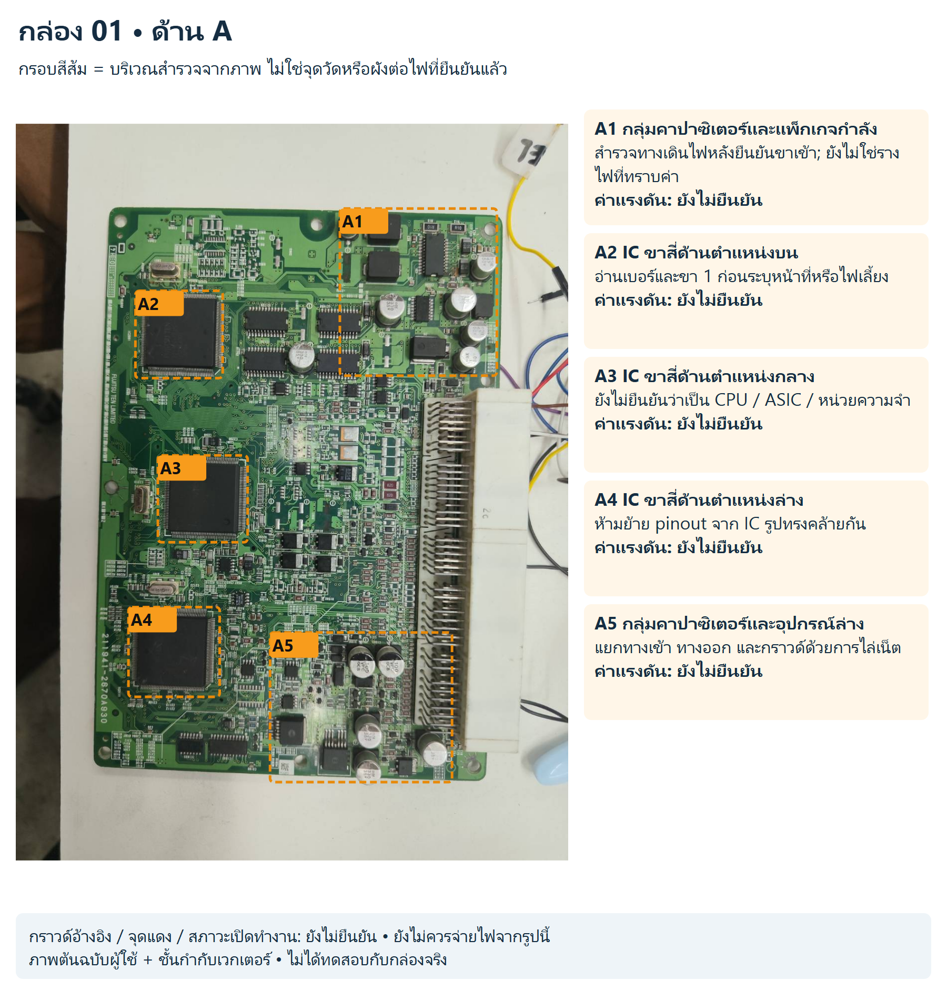
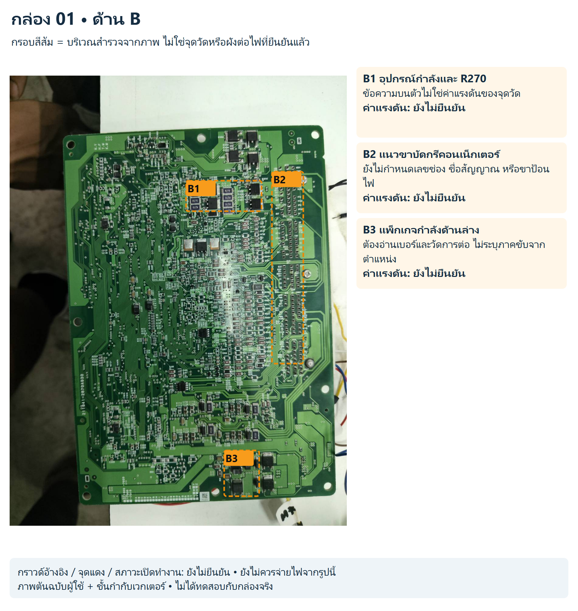
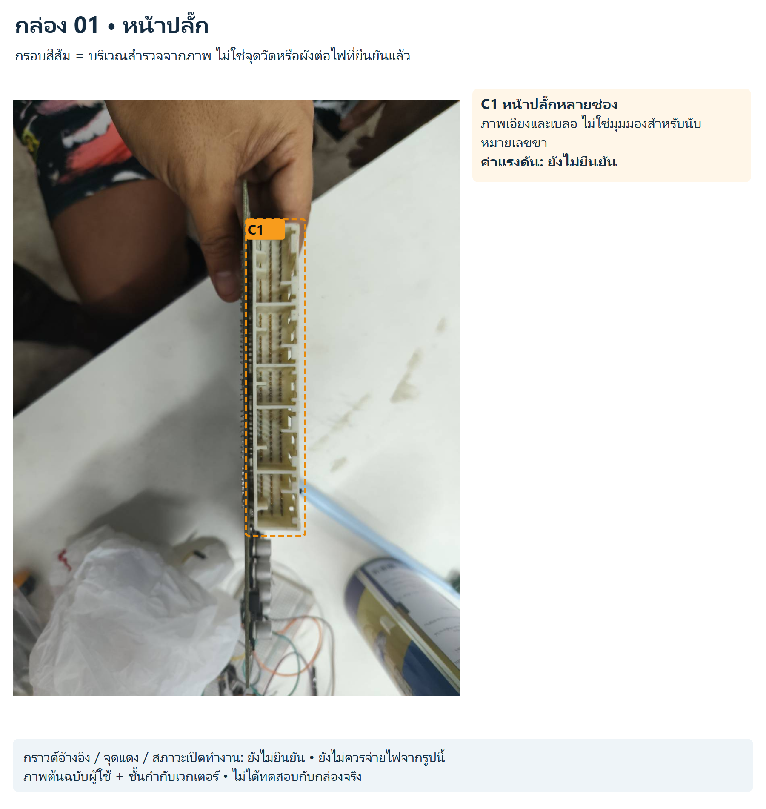

# กล่อง 01

พบข้อความ FUJITSU TEN LIMITED; ยังไม่ทราบหมายเลข ECU

ด้าน A มี IC ขาสี่ด้านใหญ่สามตำแหน่ง ยังอ่านเบอร์ไม่ได้ รหัสบน PCB ไม่ใช้แทนหมายเลข ECU และยังไม่ยืนยันว่าเกี่ยวข้องกับ 1KD/2KD

สถานะ: สังเกตจากภาพ ยังไม่มีขาป้อนไฟ/กราวด์/ค่าแรงดันหรือผังเน็ตจริงที่ยืนยันแล้ว

## ด้าน A

[SVG แก้ไขชั้นกำกับ](../../annotated/ecu-001-1.svg) • [ภาพต้นฉบับ](../../originals/ecu-001-1.png)

- **A1 กลุ่มคาปาซิเตอร์และแพ็กเกจกำลัง:** สำรวจทางเดินไฟหลังยืนยันขาเข้า; ยังไม่ใช่รางไฟที่ทราบค่า ค่าแรงดันยังไม่ยืนยัน
- **A2 IC ขาสี่ด้านตำแหน่งบน:** อ่านเบอร์และขา 1 ก่อนระบุหน้าที่หรือไฟเลี้ยง ค่าแรงดันยังไม่ยืนยัน
- **A3 IC ขาสี่ด้านตำแหน่งกลาง:** ยังไม่ยืนยันว่าเป็น CPU / ASIC / หน่วยความจำ ค่าแรงดันยังไม่ยืนยัน
- **A4 IC ขาสี่ด้านตำแหน่งล่าง:** ห้ามย้าย pinout จาก IC รูปทรงคล้ายกัน ค่าแรงดันยังไม่ยืนยัน
- **A5 กลุ่มคาปาซิเตอร์และอุปกรณ์ล่าง:** แยกทางเข้า ทางออก และกราวด์ด้วยการไล่เน็ต ค่าแรงดันยังไม่ยืนยัน

## ด้าน B

[SVG แก้ไขชั้นกำกับ](../../annotated/ecu-001-2.svg) • [ภาพต้นฉบับ](../../originals/ecu-001-2.png)

- **B1 อุปกรณ์กำลังและ R270:** ข้อความบนตัวไม่ใช่ค่าแรงดันของจุดวัด ค่าแรงดันยังไม่ยืนยัน
- **B2 แนวขาบัดกรีคอนเน็กเตอร์:** ยังไม่กำหนดเลขช่อง ชื่อสัญญาณ หรือขาป้อนไฟ ค่าแรงดันยังไม่ยืนยัน
- **B3 แพ็กเกจกำลังด้านล่าง:** ต้องอ่านเบอร์และวัดการต่อ ไม่ระบุภาคขับจากตำแหน่ง ค่าแรงดันยังไม่ยืนยัน

## หน้าปลั๊ก

[SVG แก้ไขชั้นกำกับ](../../annotated/ecu-001-3.svg) • [ภาพต้นฉบับ](../../originals/ecu-001-3.png)

- **C1 หน้าปลั๊กหลายช่อง:** ภาพเอียงและเบลอ ไม่ใช่มุมมองสำหรับนับหมายเลขขา ค่าแรงดันยังไม่ยืนยัน

[กลับหน้ารวมและวงจรสอน](../../README.md)
