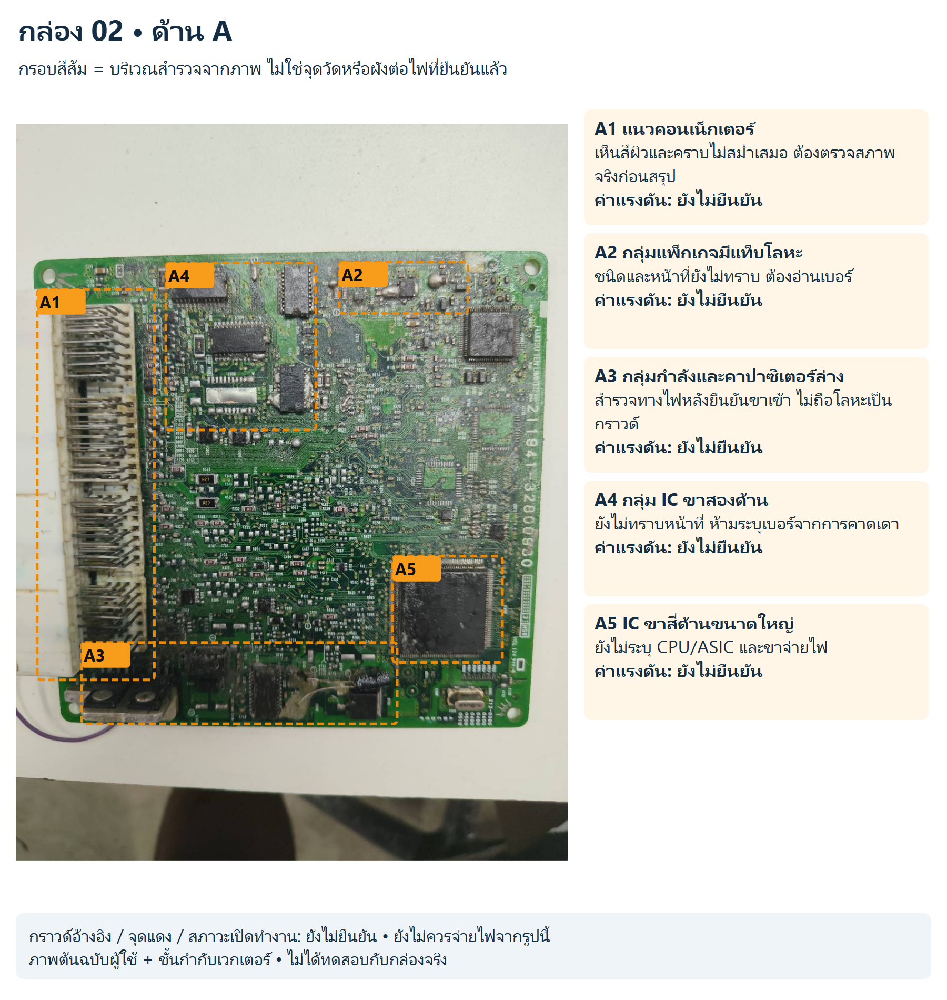
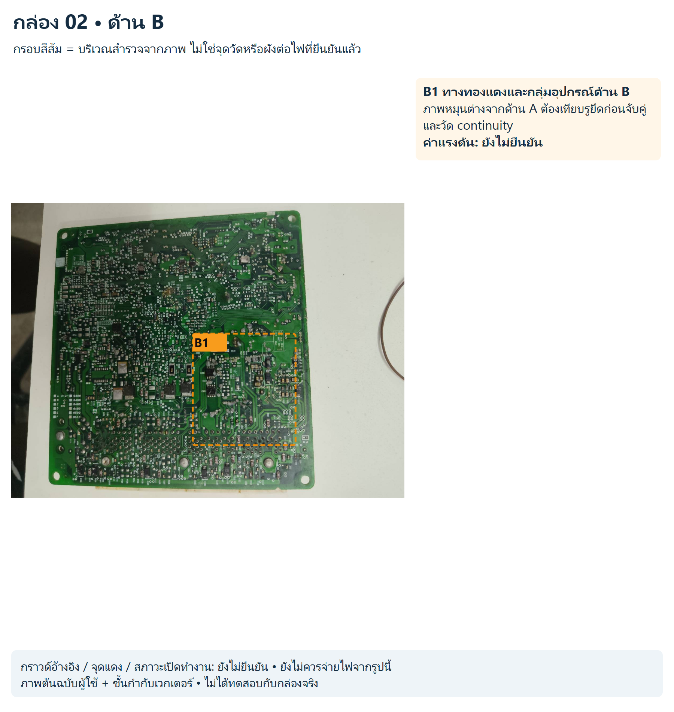
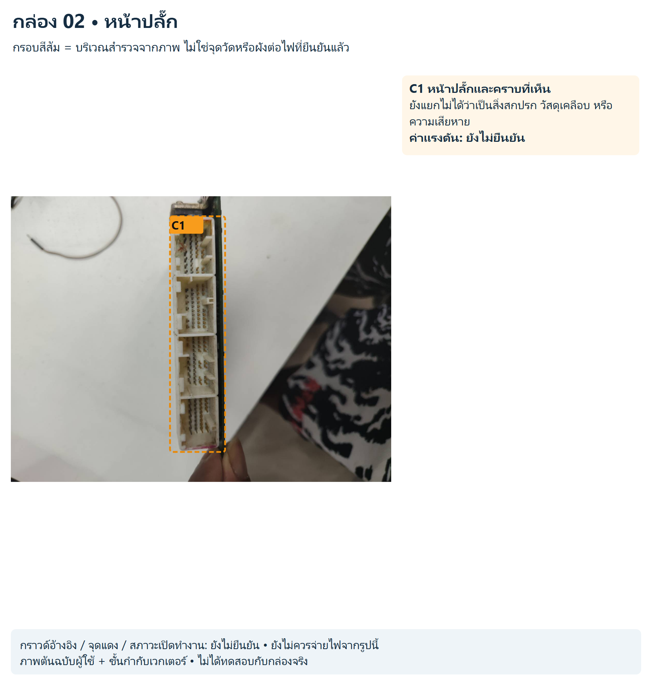

# กล่อง 02

พบข้อความ FUJITSU TEN LIMITED; ยังไม่ทราบหมายเลข ECU

คราบและผิวเคลือบหลายบริเวณบดบังรายละเอียด ไม่สรุปน้ำเข้า ไหม้ หรือกัดกร่อนจากภาพนี้เพียงอย่างเดียว

สถานะ: สังเกตจากภาพ ยังไม่มีขาป้อนไฟ/กราวด์/ค่าแรงดันหรือผังเน็ตจริงที่ยืนยันแล้ว

## ด้าน A

[SVG แก้ไขชั้นกำกับ](../../annotated/ecu-002-1.svg) • [ภาพต้นฉบับ](../../originals/ecu-002-1.png)

- **A1 แนวคอนเน็กเตอร์:** เห็นสีผิวและคราบไม่สม่ำเสมอ ต้องตรวจสภาพจริงก่อนสรุป ค่าแรงดันยังไม่ยืนยัน
- **A2 กลุ่มแพ็กเกจมีแท็บโลหะ:** ชนิดและหน้าที่ยังไม่ทราบ ต้องอ่านเบอร์ ค่าแรงดันยังไม่ยืนยัน
- **A3 กลุ่มกำลังและคาปาซิเตอร์ล่าง:** สำรวจทางไฟหลังยืนยันขาเข้า ไม่ถือโลหะเป็นกราวด์ ค่าแรงดันยังไม่ยืนยัน
- **A4 กลุ่ม IC ขาสองด้าน:** ยังไม่ทราบหน้าที่ ห้ามระบุเบอร์จากการคาดเดา ค่าแรงดันยังไม่ยืนยัน
- **A5 IC ขาสี่ด้านขนาดใหญ่:** ยังไม่ระบุ CPU/ASIC และขาจ่ายไฟ ค่าแรงดันยังไม่ยืนยัน

## ด้าน B

[SVG แก้ไขชั้นกำกับ](../../annotated/ecu-002-2.svg) • [ภาพต้นฉบับ](../../originals/ecu-002-2.png)

- **B1 ทางทองแดงและกลุ่มอุปกรณ์ด้าน B:** ภาพหมุนต่างจากด้าน A ต้องเทียบรูยึดก่อนจับคู่และวัด continuity ค่าแรงดันยังไม่ยืนยัน

## หน้าปลั๊ก

[SVG แก้ไขชั้นกำกับ](../../annotated/ecu-002-3.svg) • [ภาพต้นฉบับ](../../originals/ecu-002-3.png)

- **C1 หน้าปลั๊กและคราบที่เห็น:** ยังแยกไม่ได้ว่าเป็นสิ่งสกปรก วัสดุเคลือบ หรือความเสียหาย ค่าแรงดันยังไม่ยืนยัน

[กลับหน้ารวมและวงจรสอน](../../README.md)
