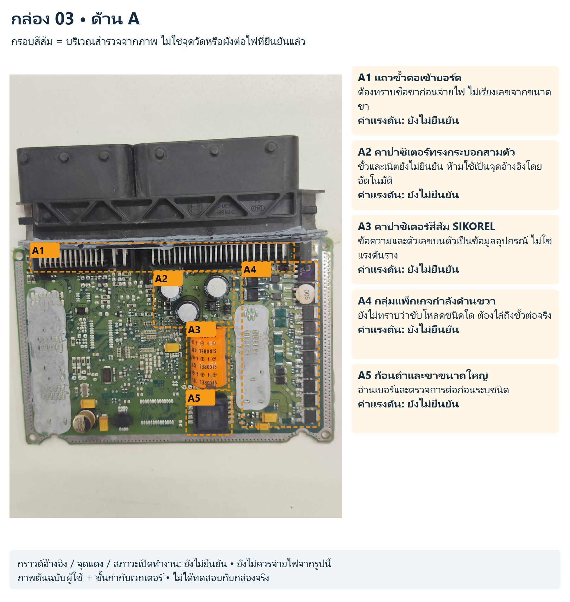
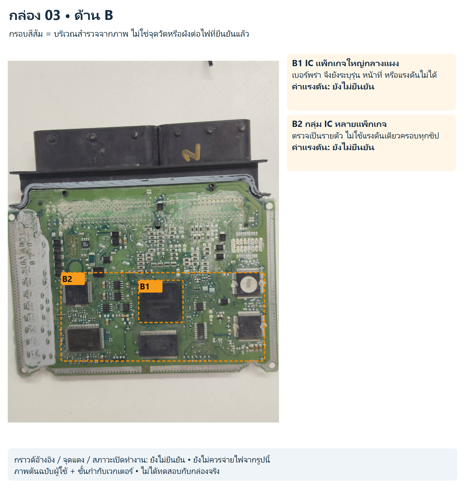
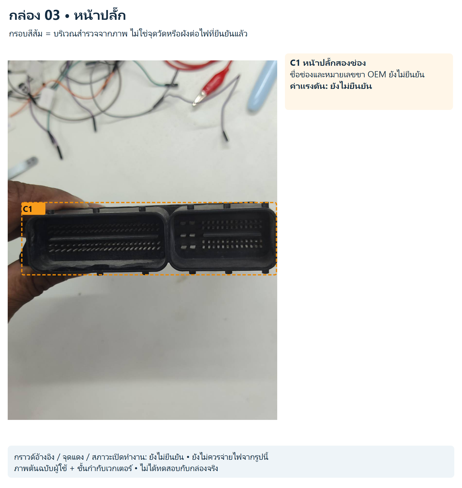

# กล่อง 03

พบเครื่องหมายบนชุดปลั๊ก; ยังไม่ยืนยันผู้ผลิตและหมายเลขทั้งกล่อง

วัสดุสีเงิน/ขาวบนแผงอาจเกี่ยวกับการประกอบหรือถ่ายเทความร้อน ภาพไม่พิสูจน์ว่าไหม้ ห้ามขูดวัสดุเพื่อหาไฟ

สถานะ: สังเกตจากภาพ ยังไม่มีขาป้อนไฟ/กราวด์/ค่าแรงดันหรือผังเน็ตจริงที่ยืนยันแล้ว

## ด้าน A

[SVG แก้ไขชั้นกำกับ](../../annotated/ecu-003-1.svg) • [ภาพต้นฉบับ](../../originals/ecu-003-1.png)

- **A1 แถวขั้วต่อเข้าบอร์ด:** ต้องทราบชื่อขาก่อนจ่ายไฟ ไม่เรียงเลขจากขนาดขา ค่าแรงดันยังไม่ยืนยัน
- **A2 คาปาซิเตอร์ทรงกระบอกสามตัว:** ขั้วและเน็ตยังไม่ยืนยัน ห้ามใช้เป็นจุดอ้างอิงโดยอัตโนมัติ ค่าแรงดันยังไม่ยืนยัน
- **A3 คาปาซิเตอร์สีส้ม SIKOREL:** ข้อความและตัวเลขบนตัวเป็นข้อมูลอุปกรณ์ ไม่ใช่แรงดันราง ค่าแรงดันยังไม่ยืนยัน
- **A4 กลุ่มแพ็กเกจกำลังด้านขวา:** ยังไม่ทราบว่าขับโหลดชนิดใด ต้องไล่ถึงขั้วต่อจริง ค่าแรงดันยังไม่ยืนยัน
- **A5 ก้อนดำและขาขนาดใหญ่:** อ่านเบอร์และตรวจการต่อก่อนระบุชนิด ค่าแรงดันยังไม่ยืนยัน

## ด้าน B

[SVG แก้ไขชั้นกำกับ](../../annotated/ecu-003-2.svg) • [ภาพต้นฉบับ](../../originals/ecu-003-2.png)

- **B1 IC แพ็กเกจใหญ่กลางแผง:** เบอร์พร่า จึงยังระบุรุ่น หน้าที่ หรือแรงดันไม่ได้ ค่าแรงดันยังไม่ยืนยัน
- **B2 กลุ่ม IC หลายแพ็กเกจ:** ตรวจเป็นรายตัว ไม่ใช้แรงดันเดียวครอบทุกชิป ค่าแรงดันยังไม่ยืนยัน

## หน้าปลั๊ก

[SVG แก้ไขชั้นกำกับ](../../annotated/ecu-003-3.svg) • [ภาพต้นฉบับ](../../originals/ecu-003-3.png)

- **C1 หน้าปลั๊กสองช่อง:** ชื่อช่องและหมายเลขขา OEM ยังไม่ยืนยัน ค่าแรงดันยังไม่ยืนยัน

[กลับหน้ารวมและวงจรสอน](../../README.md)
