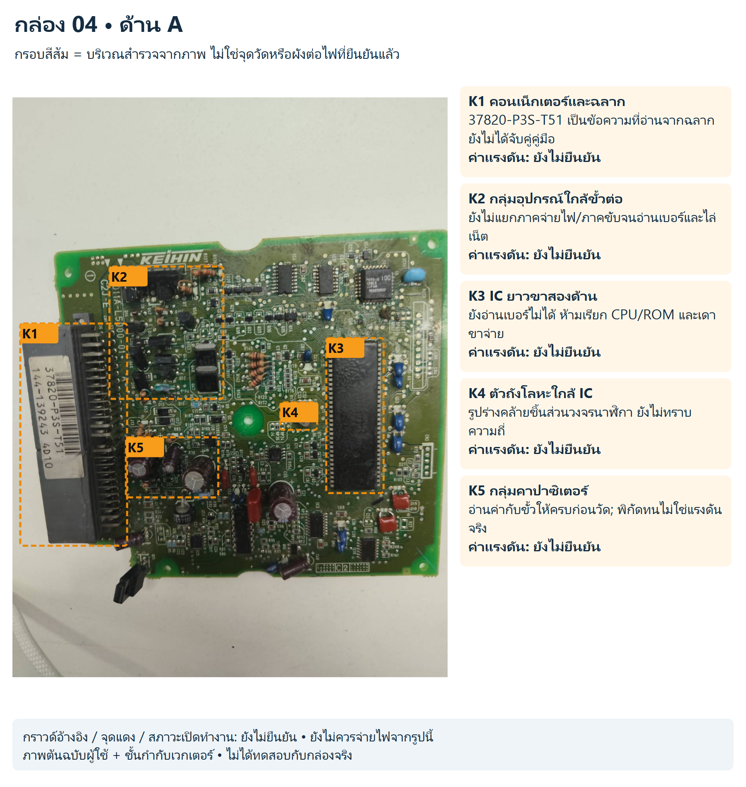
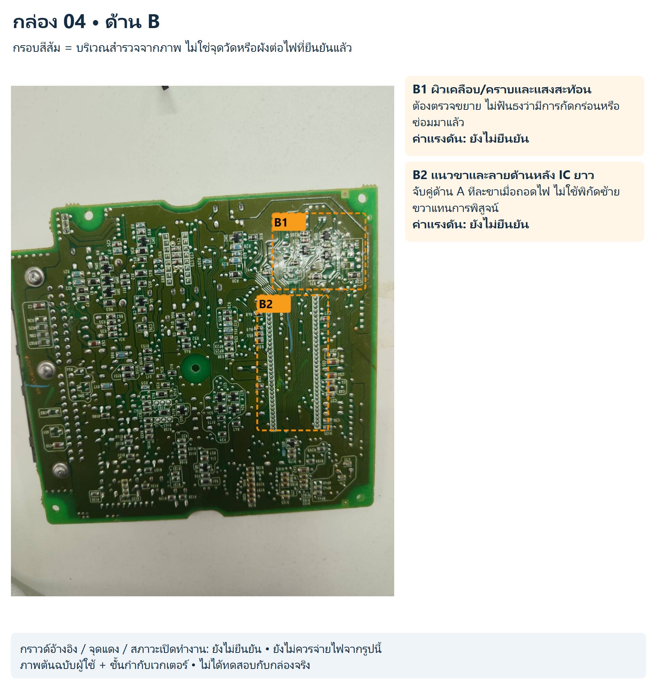
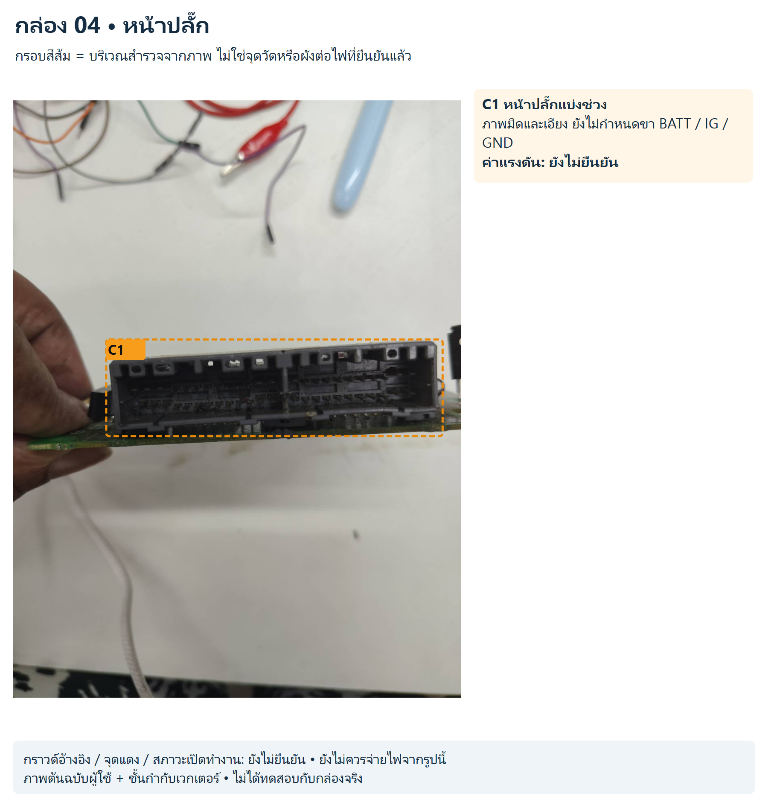

# กล่อง 04

อ่าน KEIHIN และฉลาก 37820-P3S-T51 ได้; รุ่นรถและ pinout ยังไม่ยืนยัน

มีรหัสบนบอร์ด 011A-15000-01 / C21-E ตามภาพ แต่ต้องจับคู่เอกสารกับฉลากจริงก่อนใช้ข้อมูลไฟเลี้ยง

สถานะ: สังเกตจากภาพ ยังไม่มีขาป้อนไฟ/กราวด์/ค่าแรงดันหรือผังเน็ตจริงที่ยืนยันแล้ว

## ด้าน A

[SVG แก้ไขชั้นกำกับ](../../annotated/ecu-004-1.svg) • [ภาพต้นฉบับ](../../originals/ecu-004-1.png)

- **K1 คอนเน็กเตอร์และฉลาก:** 37820-P3S-T51 เป็นข้อความที่อ่านจากฉลาก ยังไม่ได้จับคู่คู่มือ ค่าแรงดันยังไม่ยืนยัน
- **K2 กลุ่มอุปกรณ์ใกล้ขั้วต่อ:** ยังไม่แยกภาคจ่ายไฟ/ภาคขับจนอ่านเบอร์และไล่เน็ต ค่าแรงดันยังไม่ยืนยัน
- **K3 IC ยาวขาสองด้าน:** ยังอ่านเบอร์ไม่ได้ ห้ามเรียก CPU/ROM และเดาขาจ่าย ค่าแรงดันยังไม่ยืนยัน
- **K4 ตัวถังโลหะใกล้ IC:** รูปร่างคล้ายชิ้นส่วนวงจรนาฬิกา ยังไม่ทราบความถี่ ค่าแรงดันยังไม่ยืนยัน
- **K5 กลุ่มคาปาซิเตอร์:** อ่านค่ากับขั้วให้ครบก่อนวัด; พิกัดทนไม่ใช่แรงดันจริง ค่าแรงดันยังไม่ยืนยัน

## ด้าน B

[SVG แก้ไขชั้นกำกับ](../../annotated/ecu-004-2.svg) • [ภาพต้นฉบับ](../../originals/ecu-004-2.png)

- **B1 ผิวเคลือบ/คราบและแสงสะท้อน:** ต้องตรวจขยาย ไม่ฟันธงว่ามีการกัดกร่อนหรือซ่อมมาแล้ว ค่าแรงดันยังไม่ยืนยัน
- **B2 แนวขาและลายด้านหลัง IC ยาว:** จับคู่ด้าน A ทีละขาเมื่อถอดไฟ ไม่ใช้พิกัดซ้ายขวาแทนการพิสูจน์ ค่าแรงดันยังไม่ยืนยัน

## หน้าปลั๊ก

[SVG แก้ไขชั้นกำกับ](../../annotated/ecu-004-3.svg) • [ภาพต้นฉบับ](../../originals/ecu-004-3.png)

- **C1 หน้าปลั๊กแบ่งช่วง:** ภาพมืดและเอียง ยังไม่กำหนดขา BATT / IG / GND ค่าแรงดันยังไม่ยืนยัน

[กลับหน้ารวมและวงจรสอน](../../README.md)
