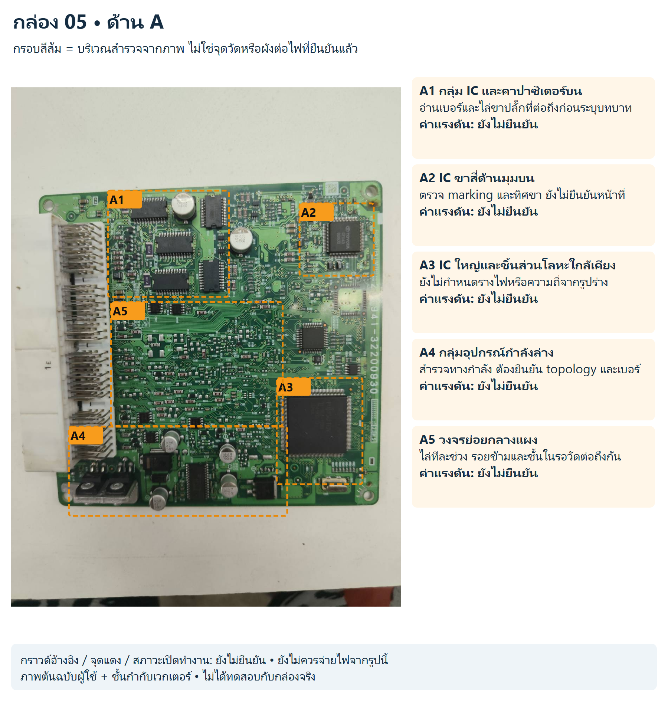
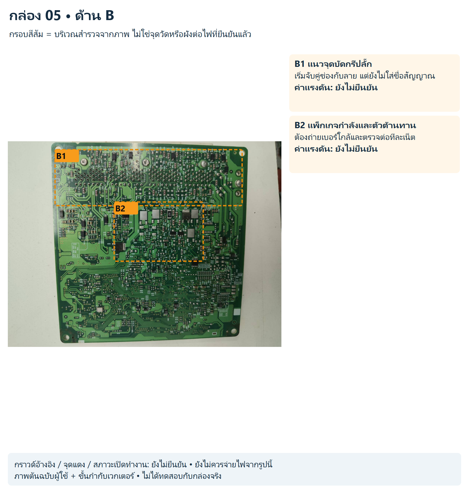
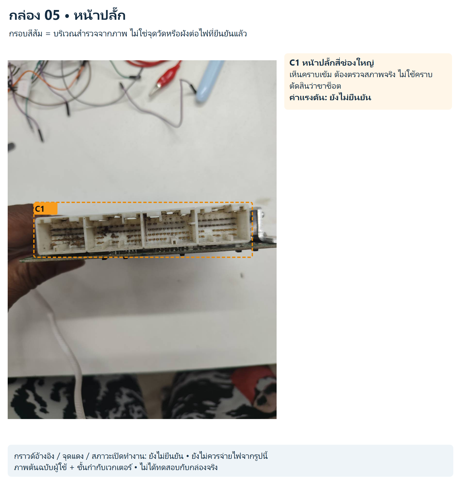

# กล่อง 05

พบข้อความ FUJITSU TEN; ยังไม่ทราบหมายเลข ECU

รูปแบบคล้ายกล่องใบ 2 ไม่ใช่หลักฐานว่าใช้ pinout หรือแรงดันเดียวกัน ภาพ A/B หมุนคนละทิศ

สถานะ: สังเกตจากภาพ ยังไม่มีขาป้อนไฟ/กราวด์/ค่าแรงดันหรือผังเน็ตจริงที่ยืนยันแล้ว

## ด้าน A

[SVG แก้ไขชั้นกำกับ](../../annotated/ecu-005-1.svg) • [ภาพต้นฉบับ](../../originals/ecu-005-1.png)

- **A1 กลุ่ม IC และคาปาซิเตอร์บน:** อ่านเบอร์และไล่ขาปลั๊กที่ต่อถึงก่อนระบุบทบาท ค่าแรงดันยังไม่ยืนยัน
- **A2 IC ขาสี่ด้านมุมบน:** ตรวจ marking และทิศขา ยังไม่ยืนยันหน้าที่ ค่าแรงดันยังไม่ยืนยัน
- **A3 IC ใหญ่และชิ้นส่วนโลหะใกล้เคียง:** ยังไม่กำหนดรางไฟหรือความถี่จากรูปร่าง ค่าแรงดันยังไม่ยืนยัน
- **A4 กลุ่มอุปกรณ์กำลังล่าง:** สำรวจทางกำลัง ต้องยืนยัน topology และเบอร์ ค่าแรงดันยังไม่ยืนยัน
- **A5 วงจรย่อยกลางแผง:** ไล่ทีละช่วง รอยข้ามและชั้นในรอวัดต่อถึงกัน ค่าแรงดันยังไม่ยืนยัน

## ด้าน B

[SVG แก้ไขชั้นกำกับ](../../annotated/ecu-005-2.svg) • [ภาพต้นฉบับ](../../originals/ecu-005-2.png)

- **B1 แนวจุดบัดกรีปลั๊ก:** เริ่มจับคู่ช่องกับลาย แต่ยังไม่ใส่ชื่อสัญญาณ ค่าแรงดันยังไม่ยืนยัน
- **B2 แพ็กเกจกำลังและตัวต้านทาน:** ต้องถ่ายเบอร์ใกล้และตรวจต่อทีละเน็ต ค่าแรงดันยังไม่ยืนยัน

## หน้าปลั๊ก

[SVG แก้ไขชั้นกำกับ](../../annotated/ecu-005-3.svg) • [ภาพต้นฉบับ](../../originals/ecu-005-3.png)

- **C1 หน้าปลั๊กสี่ช่องใหญ่:** เห็นคราบเข้ม ต้องตรวจสภาพจริง ไม่ใช้คราบตัดสินว่าขาช็อต ค่าแรงดันยังไม่ยืนยัน

[กลับหน้ารวมและวงจรสอน](../../README.md)
