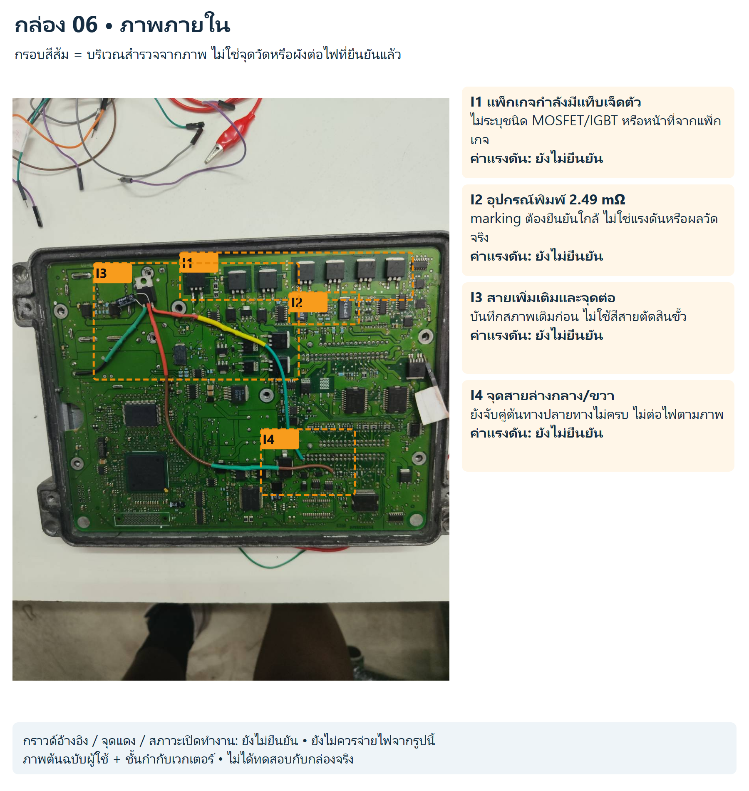
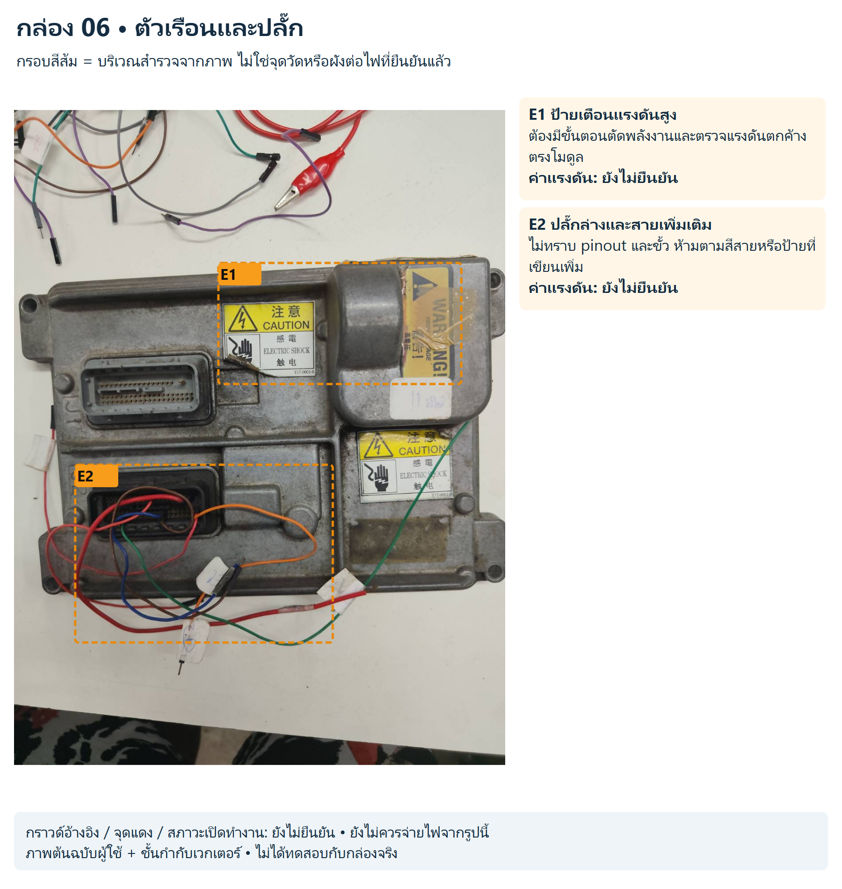

# กล่อง 06

โมดูลไม่ทราบรุ่น มีป้ายเตือน HIGH VOLTAGE / ELECTRIC SHOCK

ภาพที่สองไม่ใช่หลัง PCB ไม่มีค่าแรงดันค้าง ระยะเวลารอ หรือจุดคายประจุที่ยืนยัน หยุดก่อนทดสอบมีไฟจนทราบข้อมูลโมดูล

สถานะ: สังเกตจากภาพ ยังไม่มีขาป้อนไฟ/กราวด์/ค่าแรงดันหรือผังเน็ตจริงที่ยืนยันแล้ว

## ภาพภายใน

[SVG แก้ไขชั้นกำกับ](../../annotated/ecu-006-1.svg) • [ภาพต้นฉบับ](../../originals/ecu-006-1.png)

- **I1 แพ็กเกจกำลังมีแท็บเจ็ดตัว:** ไม่ระบุชนิด MOSFET/IGBT หรือหน้าที่จากแพ็กเกจ ค่าแรงดันยังไม่ยืนยัน
- **I2 อุปกรณ์พิมพ์ 2.49 mΩ:** marking ต้องยืนยันใกล้ ไม่ใช่แรงดันหรือผลวัดจริง ค่าแรงดันยังไม่ยืนยัน
- **I3 สายเพิ่มเติมและจุดต่อ:** บันทึกสภาพเดิมก่อน ไม่ใช้สีสายตัดสินขั้ว ค่าแรงดันยังไม่ยืนยัน
- **I4 จุดสายล่างกลาง/ขวา:** ยังจับคู่ต้นทางปลายทางไม่ครบ ไม่ต่อไฟตามภาพ ค่าแรงดันยังไม่ยืนยัน

## ตัวเรือนและปลั๊ก

[SVG แก้ไขชั้นกำกับ](../../annotated/ecu-006-2.svg) • [ภาพต้นฉบับ](../../originals/ecu-006-2.png)

- **E1 ป้ายเตือนแรงดันสูง:** ต้องมีขั้นตอนตัดพลังงานและตรวจแรงดันตกค้างตรงโมดูล ค่าแรงดันยังไม่ยืนยัน
- **E2 ปลั๊กล่างและสายเพิ่มเติม:** ไม่ทราบ pinout และขั้ว ห้ามตามสีสายหรือป้ายที่เขียนเพิ่ม ค่าแรงดันยังไม่ยืนยัน

[กลับหน้ารวมและวงจรสอน](../../README.md)
