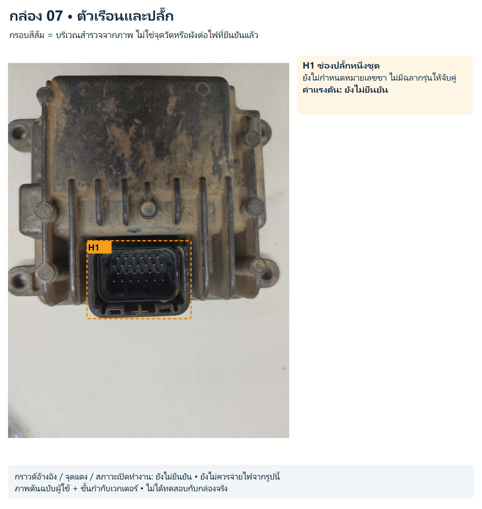
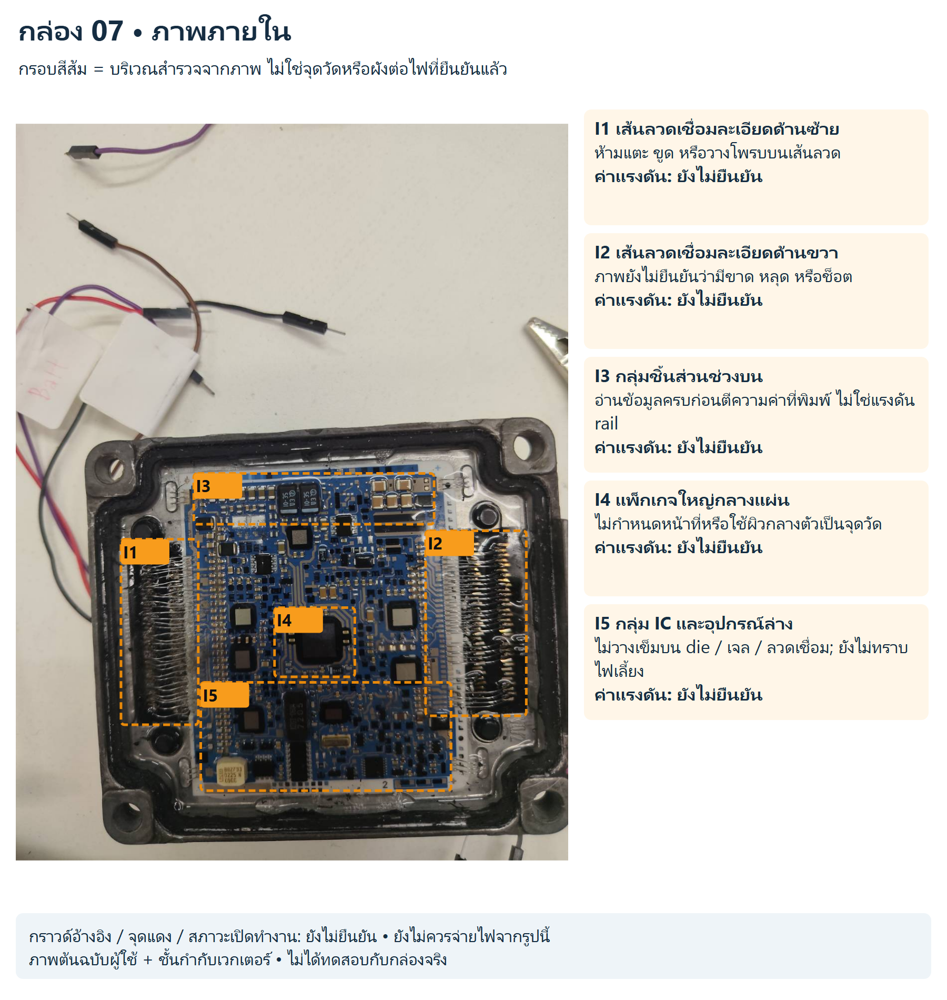

# กล่อง 07

โมดูลไม่ทราบรุ่น เห็นแผงและลวดเชื่อมละเอียดภายใน

ไม่มีภาพหลัง PCB ที่แยกจากภาพภายใน ไม่ถือป้าย BATT บนสายที่อยู่ในฉากเป็นการยืนยันขั้วของกล่องนี้

สถานะ: สังเกตจากภาพ ยังไม่มีขาป้อนไฟ/กราวด์/ค่าแรงดันหรือผังเน็ตจริงที่ยืนยันแล้ว

## ตัวเรือนและปลั๊ก

[SVG แก้ไขชั้นกำกับ](../../annotated/ecu-007-1.svg) • [ภาพต้นฉบับ](../../originals/ecu-007-1.png)

- **H1 ช่องปลั๊กหนึ่งชุด:** ยังไม่กำหนดหมายเลขขา ไม่มีฉลากรุ่นให้จับคู่ ค่าแรงดันยังไม่ยืนยัน

## ภาพภายใน

[SVG แก้ไขชั้นกำกับ](../../annotated/ecu-007-2.svg) • [ภาพต้นฉบับ](../../originals/ecu-007-2.png)

- **I1 เส้นลวดเชื่อมละเอียดด้านซ้าย:** ห้ามแตะ ขูด หรือวางโพรบบนเส้นลวด ค่าแรงดันยังไม่ยืนยัน
- **I2 เส้นลวดเชื่อมละเอียดด้านขวา:** ภาพยังไม่ยืนยันว่ามีขาด หลุด หรือช็อต ค่าแรงดันยังไม่ยืนยัน
- **I3 กลุ่มชิ้นส่วนช่วงบน:** อ่านข้อมูลครบก่อนตีความค่าที่พิมพ์ ไม่ใช่แรงดัน rail ค่าแรงดันยังไม่ยืนยัน
- **I4 แพ็กเกจใหญ่กลางแผ่น:** ไม่กำหนดหน้าที่หรือใช้ผิวกลางตัวเป็นจุดวัด ค่าแรงดันยังไม่ยืนยัน
- **I5 กลุ่ม IC และอุปกรณ์ล่าง:** ไม่วางเข็มบน die / เจล / ลวดเชื่อม; ยังไม่ทราบไฟเลี้ยง ค่าแรงดันยังไม่ยืนยัน

การตรวจ continuity ทำได้เฉพาะขาปลั๊กหรือ test point ที่เอกสารระบุและผ่านเงื่อนไขไม่มีพลังงาน ห้ามแตะลวดเชื่อม die หรือเจลแม้ถอดไฟแล้ว

[กลับหน้ารวมและวงจรสอน](../../README.md)
