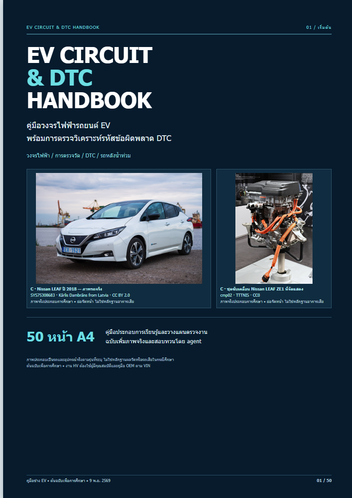

# EV CIRCUIT & DTC HANDBOOK

คู่มือช่างภาษาไทย 50 หน้า A4: วงจร EV, ECU/VCU, BMS, Inverter/Motor, Charging, CAN และ DTC รวมแนวทางคัดกรองรถหลังน้ำท่วม

## เริ่มอ่าน

- [สถานะล่าสุดและงานค้าง](STATUS.md)
- [ข้อกำหนดโครงการ](PROJECT_BRIEF.md)
- [ตัวอย่าง prompt สำหรับทำต่อ](NEXT_PROMPT.md)
- [รายละเอียดชุดส่งมอบ](README-TH.md)
- [ผลสอบทวน](review-report.md) / [ผลตรวจภาพโดย agent](verification-real-images.md)
- [ภาพปกใหม่](EV-HANDBOOK-COVER.png)

## เปิดหนังสือและกู้ PDF

ต้นฉบับจัดหน้า: [EV-CIRCUIT-DTC-HANDBOOK.html](EV-CIRCUIT-DTC-HANDBOOK.html) — ดาวน์โหลดโฟลเดอร์นี้พร้อม assets แล้วเปิดในเบราว์เซอร์ GitHub แสดง HTML เป็น source

PDF เดิมเก็บแบบ lossless 16 ส่วนใน [artifacts/pdf-parts](artifacts/pdf-parts/manifest.json) เพราะการส่ง PDF ขนาดใหญ่ผ่านตัวเชื่อมต่อไม่สำเร็จ รวมคืนด้วย Node.js โดยไม่ต้องติดตั้งไลบรารีเพิ่ม:

~~~powershell
cd projects/ev-circuit-dtc-handbook
node restore-pdf.cjs
~~~

จะได้ EV-CIRCUIT-DTC-HANDBOOK.pdf ขนาด 16,627,650 bytes พร้อมตรวจ SHA-256 ตรงกับต้นฉบับ สคริปต์จะหยุดถ้าข้อมูลส่วนใดเสียหรือมีไฟล์ปลายทางที่เนื้อหาต่างกัน

## ไฟล์หลักสำหรับทำงานต่อ

| ไฟล์ | หน้าที่ |
|---|---|
| build-handbook.cjs | เนื้อหาฐาน 50 หน้าและชุดจัดหน้า |
| apply-editorial-fixes.cjs | การแก้จากผลสอบทวนและตัวอย่าง LV |
| integrate-real-images.cjs | mapping ภาพจริง ปก และเครดิต |
| handbook-content.json | snapshot เนื้อหาที่สร้างแล้ว ไม่ใช่แหล่งแก้หลัก |
| image-placements.json | ภาพถ่าย 100 ตำแหน่งหลัก |
| real-images-final-manifest.json | ภาพใช้จริง 37 ไฟล์ แหล่ง สิทธิ์ และ hash |
| real-image-credits.md | เครดิตภาพฉบับเต็ม |
| sources-and-rights.md | แหล่งอ้างอิงเทคนิคและข้อจำกัดสิทธิ์ |
| assets/ | ภาพที่ใช้จริงและหลักฐานใบอนุญาต |
| render-pdf.cjs | สร้าง PDF ด้วย Chrome และตรวจ layout |
| verification.json | ผลตรวจอัตโนมัติล่าสุด |
| verifier-integration-result.json | ผลสอบทวนภาพอิสระ pass_with_scope |

## สถานะฉบับนี้

9 พฤศจิกายน 2569: ครบ 50 หน้า A4 ทุกหน้ามีภาพจริงต่างกันอย่างน้อย 2 ภาพ รวม 100 ตำแหน่งหลักจาก 37 ไฟล์ มีการใช้ภาพซ้ำข้ามหน้า มีการสอบทวนโดย agent และแก้ข้อพบสำคัญแล้ว ปกใช้ภาพจริง ไม่มีภาพ AI ในเล่ม

ยังเป็นต้นฉบับเพื่อการศึกษา ภาพบางส่วนเป็นบอร์ดพัฒนา/แพลตฟอร์มวิจัย/ชิ้นงานจัดแสดง ไม่ใช่หลักฐานผลวัดหรือรถเสียในกรณีศึกษา ผัง OEM เฉพาะรุ่นยังรอ 7 หน้า ห้ามแต่ง pinout/สีสาย/ค่าผ่านไม่ผ่านขึ้นเอง

## สร้างฉบับใหม่

~~~powershell
node build-handbook.cjs
node render-pdf.cjs
~~~

render-pdf.cjs ใช้ Chrome บน Windows ต้องปรับตำแหน่ง executable และมีฟอนต์ไทยตามเครื่อง สคริปต์สร้าง PDF/preview ในโฟลเดอร์นี้ หลังแก้ต้องทวนว่า 50 หน้า A4, ภาพจริงอย่างน้อย2ภาพต่างต้นทางต่อหน้า, ไม่มีภาพเสีย, caption/source/license ตรงกัน และไม่มีเนื้อหาชนท้ายหน้า

## สิทธิ์และความปลอดภัย

ข้อความเรียบเรียงไม่มีใบอนุญาตรวมสำหรับใช้ซ้ำ เช่นเดียวกับ [นโยบายสิทธิ์ของ repository](../../RIGHTS.md) ภาพใช้ตามใบอนุญาตรายไฟล์: CC BY/CC BY-SA/CC0 ตามทะเบียน ภาพวาดหลักการใหม่ของเล่มนี้กำกับ CC BY4.0 คงเครดิตและข้อจำกัดของแต่ละภาพ ห้ามอ้างว่าผู้ผลิตรับรองหนังสือ

การสอบทวนนี้ไม่ใช่การทดสอบภาคสนามหรือรับรองความปลอดภัยเฉพาะรถ งาน HV ต้องใช้ผู้มีคุณสมบัติและคู่มือ OEM ตาม VIN ไม่มี DTC ตัวเดียวใช้ยืนยันประวัติน้ำท่วมได้
