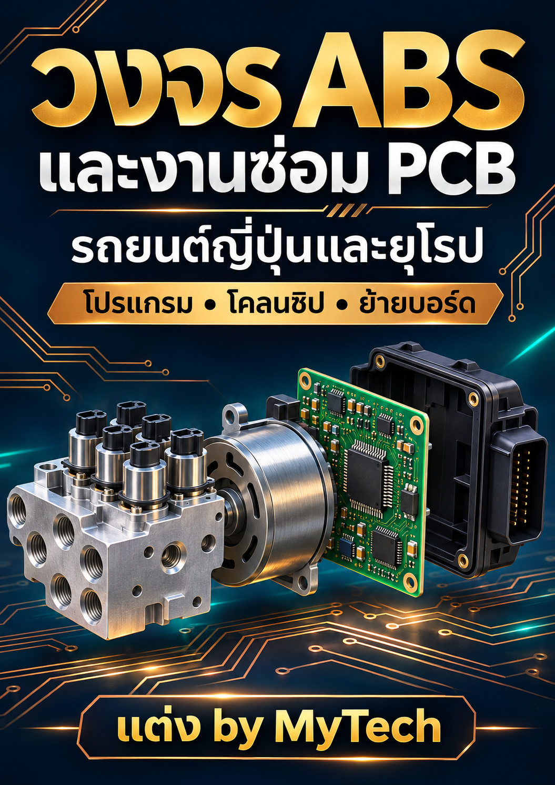

# วงจร ABS และงานซ่อม PCB แต่ง by MyTech

หนังสือภาษาไทยฉบับภาพจริง 3 จำนวน **59 หน้า** เน้นรถญี่ปุ่นและยุโรป ภาพ PCB จริง อุปกรณ์บนบอร์ด หน้าจอโปรแกรม และใบเฉลยงานซ่อม พร้อมภาพจำลองเสริมในช่วงที่ไม่มีภาพถ่าย



## เปิดหนังสือ

- [PDF สำหรับอ่านและพิมพ์ 59 หน้า](books/ABS-MyTech-Real-PCB.pdf)
- [Word สำหรับแก้ไข](books/ABS-MyTech-Real-PCB.docx)
- [ต้นฉบับอ่านบน GitHub](manuscript.md)
- [ไฟล์ภาพปกแยก](assets/cover.png)
- [ทะเบียนแหล่งภาพและขอบเขตการตรวจ](IMAGE_SOURCES.md)

หาก GitHub ไม่แสดง PDF ให้กด Download raw file แล้วเปิดบนเครื่อง ใช้ PDF เป็นฉบับอ้างอิงการจัดหน้า

## เนื้อหาที่เพิ่มในฉบับนี้

- หน้า 3–13 ภาพจริงการแยกบอร์ดญี่ปุ่น การติดกลับ PCB Honda VSA ABS และ Teves MK20 ภาพ MOSFET MCU และ EEPROM
- หน้า 14–15 ภาพจำลองลำดับย้ายชิปขั้น 1–6 แยกป้ายจากภาพจริง
- หน้า 16–18 หน้าจอจากงานกู้ข้อมูลและ ODIS พร้อมอธิบายการอ่านผล ไม่ถือว่าความคืบหน้า 100 เปอร์เซ็นต์เท่ากับผ่าน
- หน้า 19–38 วงจรและเฉลยอาการ จุดวัด เกณฑ์เปลี่ยน และป้องกันเสียซ้ำ
- หน้า 39–51 สำรองข้อมูล เลือกกล่องรับ โปรแกรม อ่านกลับ และกรณีผู้ผลิต
- หน้า 52–55 ตรวจจบ ใบบันทึก แหล่งอ้างอิง และขอบเขตภาพ
- หน้า 56–59 ประวัติผู้เขียนและกิตติกรรมประกาศเดิมครบ 4 หน้า รวมภาพและ QR

ภาพปกเป็นงานออกแบบด้วย imagegen และมีข้อความ **แต่ง by MyTech** ภาพ PCB ภายในที่ระบุว่าภาพจริงเป็นภาพจากแหล่งภายนอก R1–R5 ซึ่งให้เครดิตและลิงก์แยก ภาพปกและภาพจำลองไม่ใช้เป็นหลักฐานว่าบอร์ดรุ่นใดมีวงจรหรือชิปตามภาพนั้น

## เครื่องมือประกอบ

[abs_compare.py](tools/abs_compare.py) เปรียบเทียบไฟล์ไบนารีแบบอ่านอย่างเดียว ไม่เขียนชิป ไม่แก้ input และไม่ซ่อม checksum

```text
python tools/abs_compare.py READ01.bin READ02.bin
python tools/abs_compare.py SOURCE.bin READBACK.bin --expected-size 32768
```

32768 เป็นตัวอย่างความจุของ 25LC256 ไม่ใช่ขนาดทั่วไปของ ABS ผล IDENTICAL ยืนยันความเหมือนของไฟล์ ไม่ยืนยันความเข้ากันได้กับรถหรือความครบของข้อมูลทุกพื้นที่

รัน `python tools/validate.py` จากโฟลเดอร์นี้เพื่อตรวจค่าแฮช ความสมบูรณ์ Word และลิงก์ภายใน หากมี pypdf จะตรวจจำนวนหน้า PDF ด้วย

## การตรวจและสิทธิ์

เนื้อหาฉบับที่ 2 ผ่านการตรวจแยกจาก agent ด้าน PCB ข้อมูล และเครดิต ภาพเพิ่มเติมฉบับที่ 3 ตรวจโดยผู้เรียบเรียง Agent ที่มอบหมายตรวจภาพใหม่ติดขีดจำกัดการใช้งาน จึงไม่อ้างว่าภาพใหม่ผ่าน agent ตรวจซ้ำ ดู [รายงานตรวจ](QA_REPORT.md)

ภาพ R1–R5 ยังคงเป็นสิทธิ์ของเจ้าของต้นทาง ไม่ได้ประกาศเป็นภาพเปิดให้ใช้ซ้ำ การใส่เครดิตไม่แทนใบอนุญาตใช้งานต่อ ดู [สิทธิ์ของ repository](../../RIGHTS.md) และทะเบียนภาพก่อนนำไปเผยแพร่ต่อ หนังสือและงานตรวจไม่ได้เป็นการรับรองจากผู้ผลิตรถหรือผลทดสอบเบรกของรถเฉพาะคัน

ฉบับนี้จัดเก็บแยกจากหนังสือ ECU และ EPS เดิม ไม่แก้ไฟล์หนังสือเล่มอื่น
