# วงจร ABS พร้อมภาพ PCB และโปรแกรมจริง

แต่ง by MyTech

# สารบัญฉบับภาพจริง

เลขหัวข้อของใบเฉลยเดิมคงไว้ ส่วนเลขหน้าปัจจุบันใช้สารบัญนี้

## หน้า 3 ถึง 18 ภาคภาพจริงและภาพจำลอง

3–7 รถญี่ปุ่น แยกบอร์ด ตรวจจุดใกล้แพด และติดกลับ
8 PCB Honda VSA ABS
9–11 PCB Teves MK20 ชิปกำลังและขั้วคอยล์
12–13 PCB VAG MCU และ EEPROM
14–15 ภาพจำลองลำดับย้ายชิปขั้น 1–6
16–18 หน้าจอกู้ข้อมูล และ ODIS ก่อนกับหลังเปลี่ยน

## หน้า 19 ถึง 38 ภาควงจรและเฉลย

หัวข้อ 03–22 ไฟเลี้ยง รีเซ็ต ปั๊ม วาล์ว shunt CAN เซนเซอร์ EEPROM เกณฑ์เปลี่ยนและป้องกันเสียซ้ำ

## หน้า 39 ถึง 51 ภาคโปรแกรมและกรณีผู้ผลิต

หัวข้อ 23–35 งานสำรอง ตั้งค่าเครื่องมือ เทียบไฟล์ เลือก donor เขียนอ่านกลับ ย้ายชิป และกรณีผู้ผลิต

## หน้า 52 ถึง 59 ตรวจจบและภาคผนวก

52 ตรวจจบงาน
53 ใบบันทึก
54 แหล่งอ้างอิงวงจร
55 ขอบเขตตรวจภาพและภาคผนวก
56–59 เอกสารผู้เขียนและกิตติกรรมประกาศเดิม

# ภาพจริง 01 แยก ECU ออกจากชุดคอยล์

ตัวอย่างงานภายนอก R1 รถญี่ปุ่น Titan LKR81 ไม่ใช่ภาพจำลอง

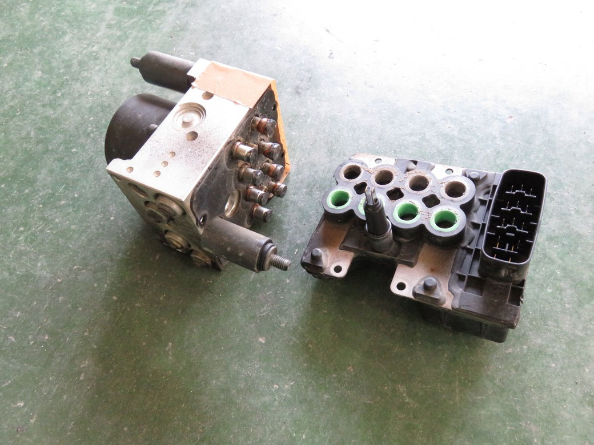

ชิ้นส่วนที่แยกจากกันในลำดับงานต้นทาง

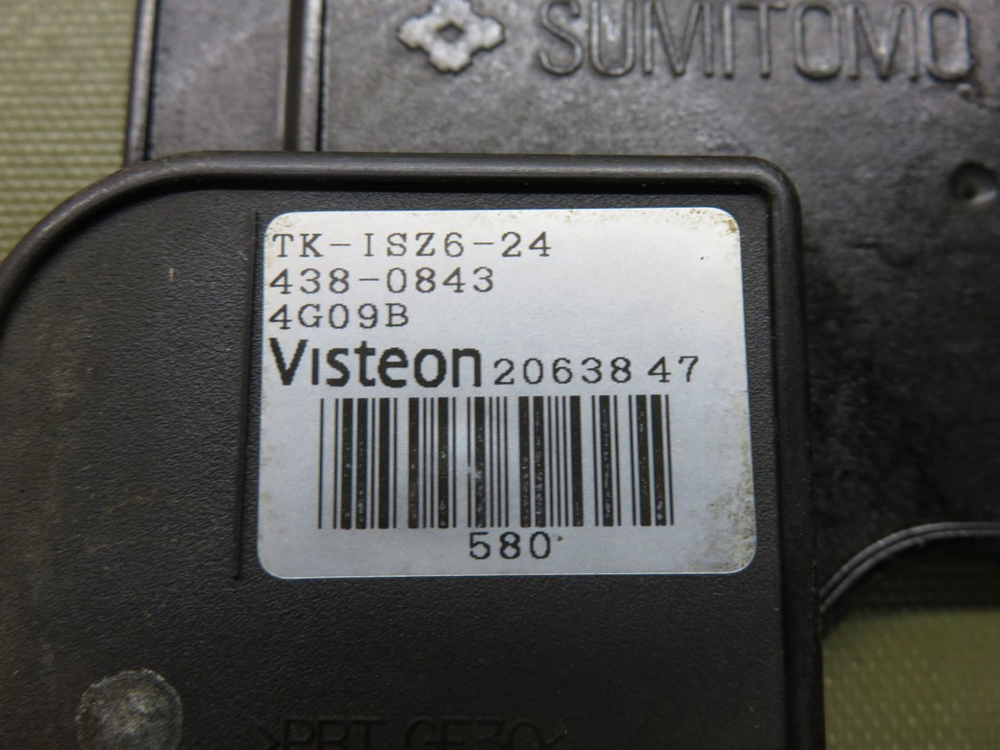

ฉลากจริงอ่านได้ TK ISZ6 24 ต้องคงตัวอักษรตามภาพ

## อ่านภาพ

เริ่มที่ฉลากและแนวประกบก่อนแตะบอร์ด ภาพนี้ยืนยันการแยกชุดอิเล็กทรอนิกส์จากไฮดรอลิกในกรณีนี้ ไม่ใช่วิธีถอดร่วมของ ABS ทุกแบบ

## ก่อนย้ายไปชุดอื่น

บันทึกเลขชิ้นส่วนต้นทางและปลายทางทั้งคู่ ภาพชุดเดียวไม่ได้พิสูจน์ว่าบอร์ดสองชุดใช้แทนกันได้

เครดิตภาพ R1 Muraoka Car Unit Repair ภาพงาน ABS จาก Titan LKR81
[แหล่งภาพต้นทาง](https://www.muraoka-cur.com/2018/05/16/タイタン-エルフ-コンドル-アトラス-r81系-absユニット修理/)

# ภาพจริง 02 PCB ญี่ปุ่นหลังเปิดชุด

ตัวอย่าง R1 บอร์ดเต็ม เห็นตำแหน่งชิ้นส่วนและขั้วต่อจริง

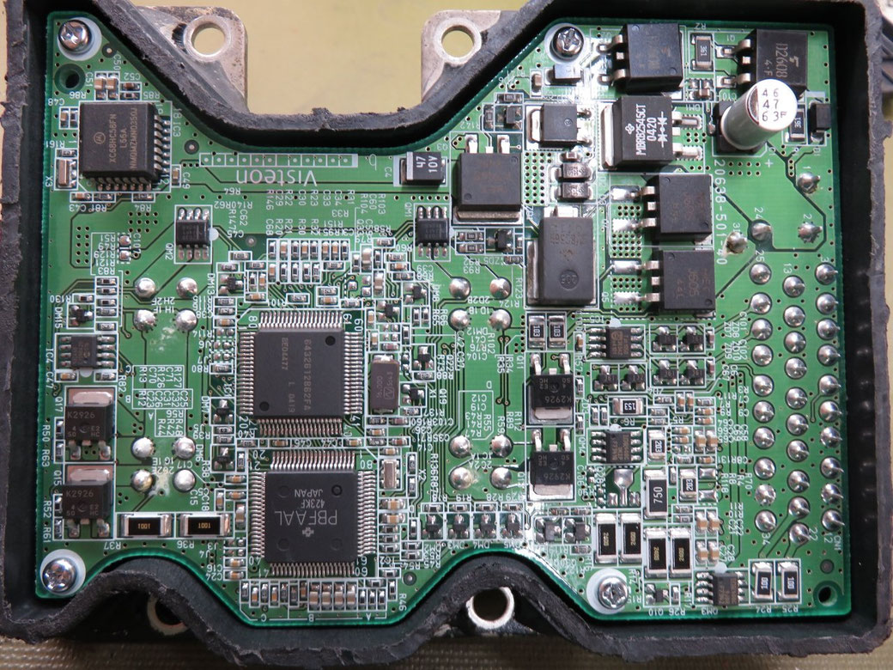

ภาพ PCB ต้นทางก่อนปลดบัดกรีแยกจากส่วนคอยล์

## จุดให้ดู

ด้านขวาเป็นแถวจุดเชื่อมต่อและกลุ่มอุปกรณ์แพ็กเกจใหญ่ ด้านซ้ายและกลางมีไอซีขาหลายด้าน ใช้เทียบรูปร่างกับวงจรฝึกภาคไฟ ภาคขับ และ MCU

## งานที่ต้องพิสูจน์

รูปร่างและขนาดไม่พอจะฟันธงหน้าที่หรือเบอร์ทดแทน ต้องอ่าน marking และไล่วงจรของบอร์ดจริงก่อนเปลี่ยน

เครดิตภาพ R1 Muraoka Car Unit Repair ภาพงาน ABS จาก Titan LKR81
[แหล่งภาพต้นทาง](https://www.muraoka-cur.com/2018/05/16/タイタン-エルフ-コンドル-アトラス-r81系-absユニット修理/)

# ภาพจริง 03 ถอดบอร์ดจากขั้วคอยล์

ตัวอย่างลำดับงาน R1 ภาพจริงหลังจัดการบัดกรีขั้วต่อ

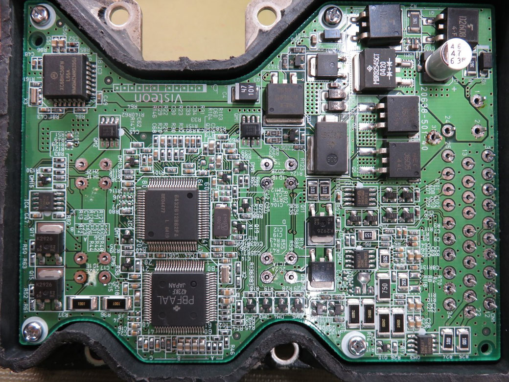

สังเกตแถวจุดเชื่อมด้านขวาที่อยู่ในขั้นตอนแยก PCB

## เฉลยจุดเสี่ยง

ภาพก่อนหน้าและภาพนี้แสดงเหตุที่ต้องจัดการขั้วทุกจุดให้พร้อมก่อนยกบอร์ด การฝืนยกขณะที่ยังยึดอยู่เสี่ยงดึงแพดหรือทำลายขั้ว

## ข้อจำกัด

ภาพนี้เป็นการถอด PCB ออกจากฐานเดิม ไม่ใช่หลักฐานว่ามีการย้ายไปบอร์ด donor และไม่ให้ค่าอุณหภูมิหรือแรงดึงแบบสากล

เครดิตภาพ R1 Muraoka Car Unit Repair ภาพงาน ABS จาก Titan LKR81
[แหล่งภาพต้นทาง](https://www.muraoka-cur.com/2018/05/16/タイタン-エルフ-コンドル-アトラス-r81系-absユニット修理/)

# ภาพจริง 04 ตรวจจุดใกล้แพดกำลัง

ภาพขยายจากงาน R1 ให้ดูพื้นที่ระหว่างแพดกับแนวทองแดง

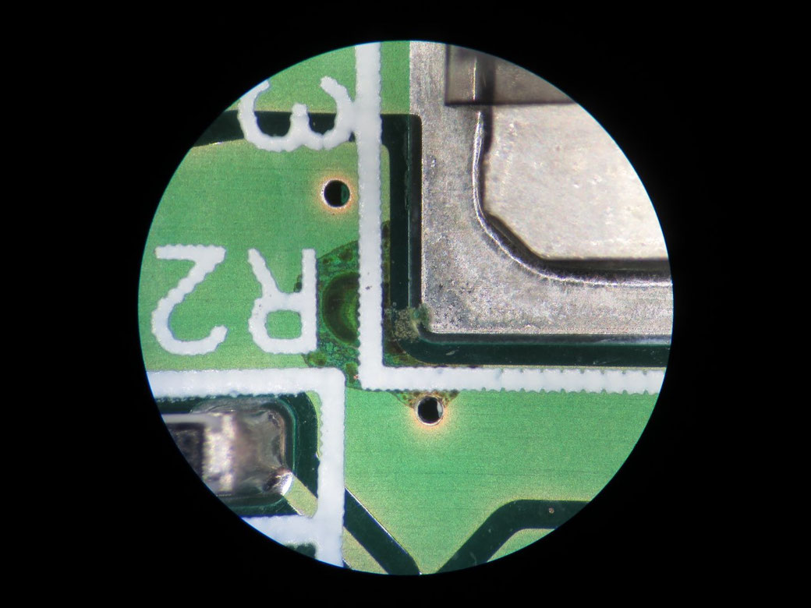

ภาพขยายจุดที่เจ้าของงานตรวจพบความผิดปกติบริเวณแพด

## ใช้ภาพอย่างไร

เทียบกับภาพเต็มเพื่อระบุตำแหน่ง แล้วตรวจด้วยกล้องและการวัด การเห็นคราบหรือร่องรอยอย่างเดียวไม่บอกกระแสรั่วหรือยืนยันว่าเป็นต้นเหตุของทุก DTC

## ก่อนเปลี่ยนอุปกรณ์

แยกความเสียหายของผิวบอร์ด รอยต่อ และตัวชิปออกจากกัน เก็บภาพก่อนทำความสะอาดและผลตรวจหลังคืนสภาพ

เครดิตภาพ R1 Muraoka Car Unit Repair ภาพงาน ABS จาก Titan LKR81
[แหล่งภาพต้นทาง](https://www.muraoka-cur.com/2018/05/16/タイタン-エルフ-コンドル-アトラス-r81系-absユニット修理/)

# ภาพจริง 05 ติดบอร์ดกลับเข้าฐาน

ตัวอย่าง R1 ภาพปลายลำดับการติดกลับของบอร์ดเดิม

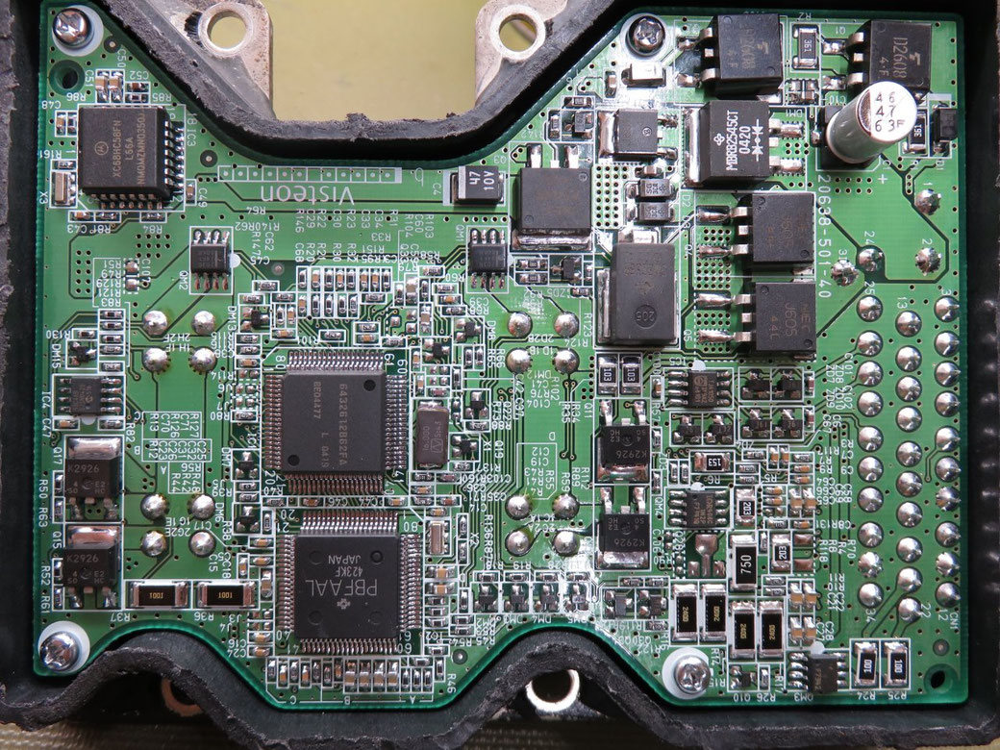

เห็นจุดบัดกรีที่เชื่อมกับแถวขั้วหลังติดตั้งกลับ

## ก่อนปิดฝา

ตรวจภาพก่อนและหลังในตำแหน่งเดียวกัน ตรวจขั้วค้าง บัดกรีสะพาน แพด และชิ้นส่วนเล็กที่อาจเคลื่อน

## หลังติดกลับ

ยังต้องตรวจไฟ การสื่อสารและระบบเบรกตามคู่มือตรงรุ่น ภาพที่ประกอบเสร็จไม่ใช่ผลทดสอบสมรรถนะ

เครดิตภาพ R1 Muraoka Car Unit Repair ภาพงาน ABS จาก Titan LKR81
[แหล่งภาพต้นทาง](https://www.muraoka-cur.com/2018/05/16/タイタン-エルフ-コンドル-アトラス-r81系-absユニット修理/)

# ภาพจริง 06 PCB Honda VSA ABS

R4 ภาพบอร์ดจริงที่ผู้ให้บริการต้นทางระบุว่าเป็น Honda VSA ABS

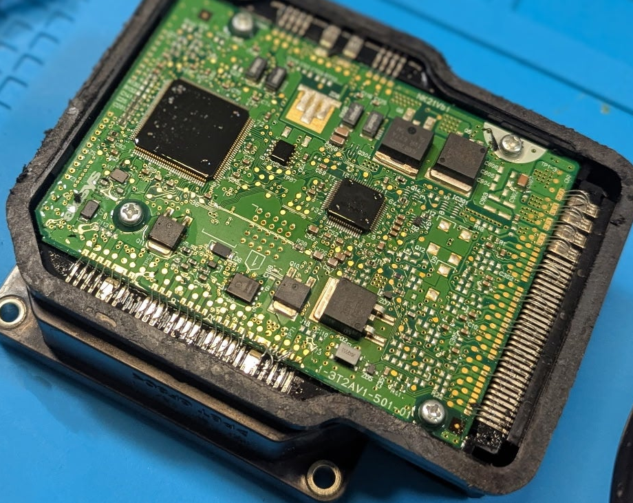

ครอปเฉพาะบอร์ดจากภาพจริง ไม่เติมหรือสร้างชิ้นส่วน

## จุดให้สังเกต

เห็นขั้วเรียงตามขอบ อุปกรณ์แพ็กเกจใหญ่และไอซีขาหลายด้าน จุดยึดกับตัวเรือนมีผลต่อการรับแรงขณะเปิดฝาและบัดกรี

## การระบุชิ้นส่วน

ภาพไม่มีเลขอะไหล่รถที่ยืนยันกับ VIN จึงใช้สอนการอ่านบอร์ด ไม่ระบุว่าชิปตัวใดเสียประจำ Honda และไม่ใช้ภาพนี้แทน pinout

เครดิตภาพ R4 Calibra Calibration ภาพบอร์ดที่ต้นทางระบุ Honda VSA ABS
[แหล่งภาพต้นทาง](https://calibraautobodysupplies.com/products/honda-vsa-abs-module-repair-service)

# ภาพจริง 07 บอร์ด Teves MK20 เต็มแผง

R2 ภาพ PCB จริงในรายงานซ่อม Volkswagen Vento รุ่นปี 1996 ของผู้เขียนต้นทาง

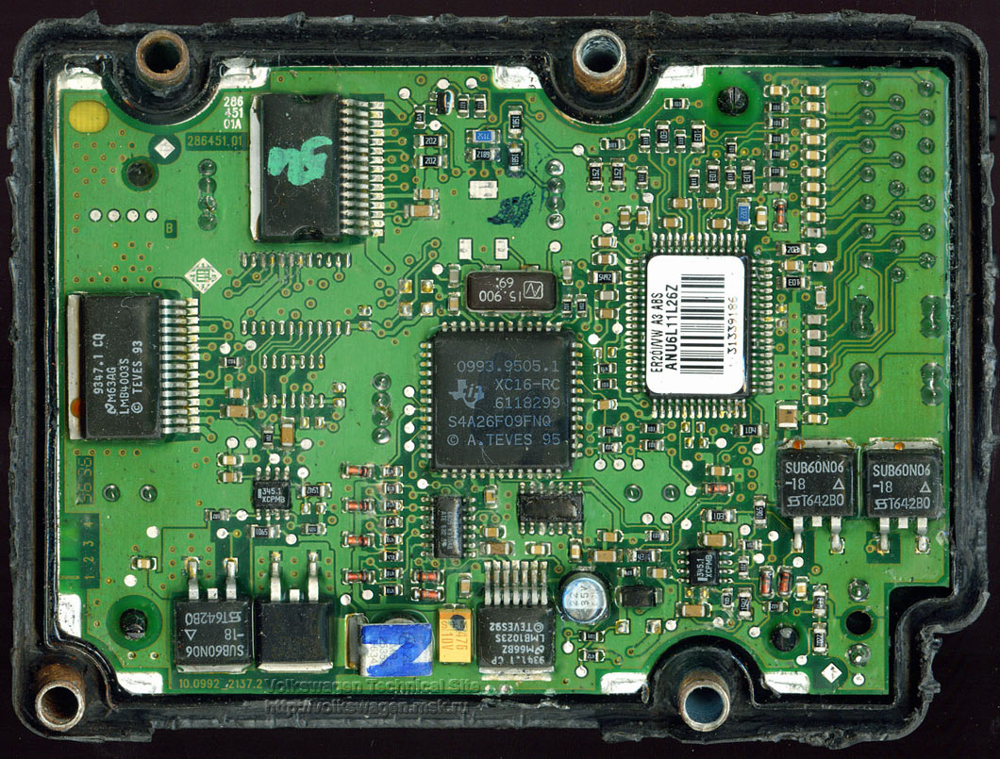

ภาพเต็มบอร์ดจาก Volkswagen Technical Site คงลายน้ำเดิม

## อ่านภาพร่วมวงจร

อุปกรณ์แพ็กเกจกำลังอยู่หลายตำแหน่งบนบอร์ด ไอซีควบคุมไม่ได้อยู่แทนภาคกำลังทั้งหมด ใช้ภาพนี้เป็นแผนที่ก่อนซูมชื่อชิป

## อย่าสรุปแทนการวัด

ตำแหน่งและ marking ในภาพไม่ยืนยันว่าชิ้นส่วนเสีย หากอาการเป็นปั๊มต้องตามไฟ ขั้ว รอยต่อ driver และโหลดตามใบเฉลย

เครดิตภาพ R2 Vladimir Alexandrov และ Volkswagen Technical Site ภาพ Teves MK20
[แหล่งภาพต้นทาง](https://vwts.ru/articles/brake/abs_teves_mark_20.html)

# ภาพจริง 08 อ่านเบอร์ MOSFET บนบอร์ด

ภาพขยาย R2 อุปกรณ์จริงที่อ่าน marking ได้ ไม่ใช้เบอร์สมมติ

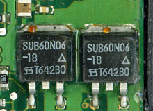

อ่านได้ SUB60N06 และบรรทัด 18 ซึ่งเป็นส่วนของชื่ออุปกรณ์

## ผูกภาพกับเอกสาร

ตระกูล SUP SUB60N06 18 มีเอกสาร Vishay Siliconix ระบุเป็น N channel MOSFET ภาพนี้ใช้ยืนยันการอ่านเบอร์ก่อนค้น datasheet ไม่ใช่การเลือกตัวทดแทนให้ทุก ABS [R6]

## จุดตรวจ

ระบุ D G S จากเอกสารแพ็กเกจ แล้วตรวจ VGS VDS และโหลดตามใบเฉลย ห้ามใช้โลหะ tab หรือขากลางเป็นกราวด์โดยเดา

## เกณฑ์เปลี่ยน

ต้องพิสูจน์ open short หรือทำงานผิด และตรวจเหตุโหลดก่อนเปลี่ยน คง suffix และเงื่อนไขขับที่ใช้เทียบ

## เอกสารอุปกรณ์ R6

Vishay Siliconix SUP SUB60N06 18
https://www.vishay.com/docs/70540/70540.pdf

เครดิตภาพ R2 Vladimir Alexandrov และ Volkswagen Technical Site ภาพ Teves MK20
[แหล่งภาพต้นทาง](https://vwts.ru/articles/brake/abs_teves_mark_20.html)

# ภาพจริง 09 ขั้วกำลังและชุดคอยล์ MK20

R2 ภาพขั้วต่อและด้านคอยล์จริง ใช้เทียบตำแหน่งทางกลกับทางไฟฟ้า

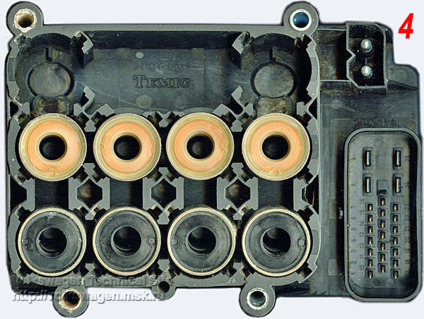

ด้านคอยล์และขั้วเชื่อมของชุด

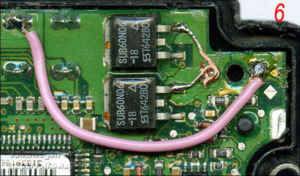

ภาพขยายบริเวณขั้วกำลังจากรายงานเดิม

## สิ่งที่ภาพยืนยัน

การยึดบอร์ด ขั้วกำลัง และคอยล์เป็นคนละส่วน ต้องตรวจรอยต่อร่วมกับวงจร ไม่ถือว่ากระแสผ่านได้เพราะผิวบัดกรีดูเงา

## ขอบเขตวิธีซ่อม

ภาพบัดกรีเป็นบันทึกของเจ้าของงาน ไม่ได้ยกวิธีเสริมขั้วในรายงานให้เป็นมาตรฐาน OEM ของทุกกล่อง

เครดิตภาพ R2 Vladimir Alexandrov และ Volkswagen Technical Site ภาพ Teves MK20
[แหล่งภาพต้นทาง](https://vwts.ru/articles/brake/abs_teves_mark_20.html)

# ภาพจริง 10 MCU และบริเวณ EEPROM ใน VAG

R3 ภาพบอร์ดในรายงานของ ecurep เลขชุดที่ผู้เขียนระบุ 80A907379AF

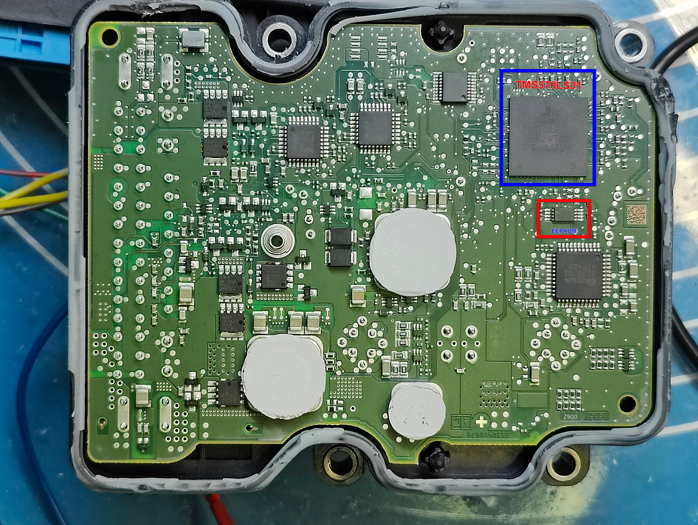

กรอบและข้อความบนภาพเป็นของผู้เขียนต้นทาง

## อ่านภาพ

ผู้เขียนระบุ MCU TMS570LS31 และตำแหน่ง EEPROM ในภาพ กรอบแดงเป็นชิปแปดขาที่ติดบนบอร์ด รายละเอียดขาให้ดูภาพขยายหน้าถัดไป

## เชื่อมกับงานข้อมูล

ต้องทำบัญชีทั้งพื้นที่ MCU และหน่วยความจำภายนอก ภาพนี้ไม่ใช่เหตุให้ย้าย EEPROM ตัวเดียวกับกล่อง VAG ทุกชุด

เครดิตภาพ R3 ecurep บน Habr ภาพ PCB และหน้าจอกรณีกู้ ABS VAG
[แหล่งภาพต้นทาง](https://habr.com/ru/articles/863650/)

# ภาพจริง 11 แยกดู MCU และชิปข้อมูล

ภาพขยายจาก R3 เห็นชิปหลายขาและชิปแปดขาในตำแหน่งจริง

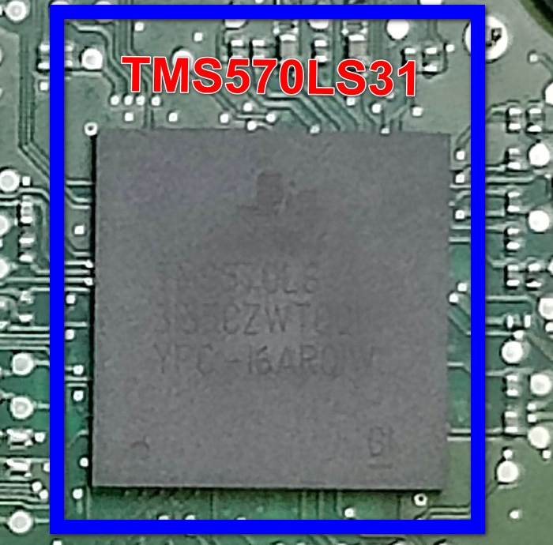

MCU ในกรอบที่ต้นทางระบุ ไม่แต่งตัวอักษรบนชิป

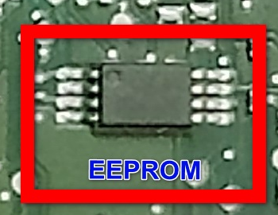

ชิป EEPROM แปดขาที่ติดบนบอร์ดตามกรอบของต้นทาง

## ก่อนย้ายชิป

ต้องมีภาพชิปเดิมเต็มเบอร์ ทิศขาหนึ่ง ภาพหลังถอดและหลังใส่ donor เพื่อยืนยันลำดับ ภาพชิปที่ติดอยู่เพียงภาพเดียวไม่ใช่ชุดหลักฐานการโคลนครบงาน

เครดิตภาพ R3 ecurep บน Habr ภาพ PCB และหน้าจอกรณีกู้ ABS VAG
[แหล่งภาพต้นทาง](https://habr.com/ru/articles/863650/)

# ภาพจำลอง 01 เตรียมและถอดชิป

ส่วนต่อจากภาพจริง การจัดวางนี้เป็นภาพจำลอง ไม่ผูกขากับกล่องรุ่นใด

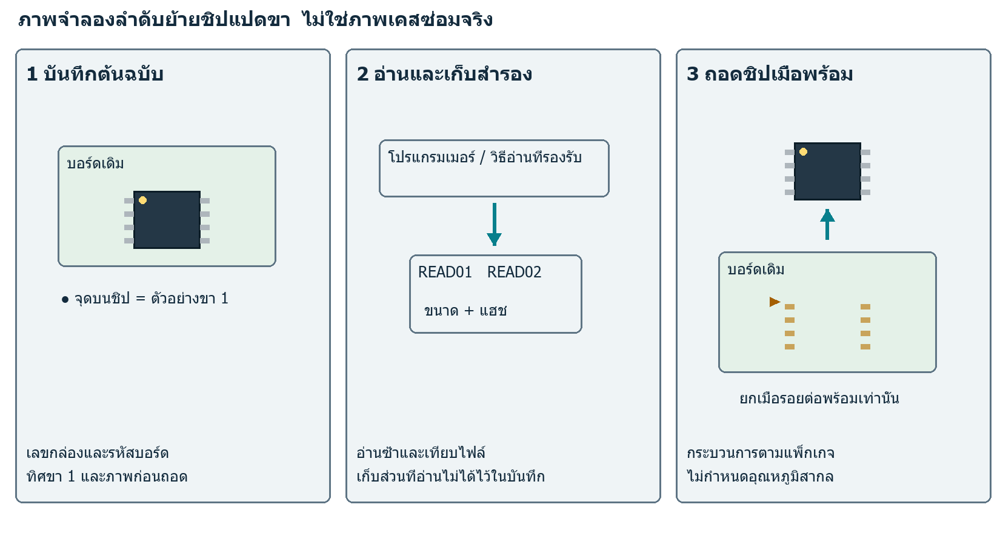

ภาพจำลอง ขั้น 1 ถึง 3 ใช้อธิบายช่วงที่ไม่มีภาพถ่าย

## 1 ระบุชิปและต้นทาง

เก็บเลขชุด รหัส PCB เบอร์ชิปเต็มและทิศขาหนึ่ง ถ่ายภาพบริเวณรอบชิปเพื่อเทียบว่าชิ้นส่วนเล็กยังอยู่ครบหลังงาน

## 2 เก็บข้อมูลก่อน

ถ้าอ่านได้ ให้เก็บไฟล์ซ้ำและผลเปรียบเทียบก่อนถอด บันทึกพื้นที่ที่อ่านไม่ได้ การย้ายชิปกับการเขียนไฟล์เป็นคนละวิธี ไม่ควรทำสลับกันโดยไม่มีแผน

## 3 ถอดตามแพ็กเกจ

ใช้กระบวนการที่ควบคุมได้สำหรับบอร์ดและชิปนั้น ไม่งัดหรือดึงขณะที่รอยต่อยังยึดอยู่ หากแพดหรือชิปเสียต้องประเมินก่อนดำเนินงานต่อ

# ภาพจำลอง 02 ติดชิปและยืนยันผล

บอร์ดรับในภาพเป็นแบบจำลอง ต้องมีหลักฐานความเข้ากันได้ก่อนทำกับกล่องจริง

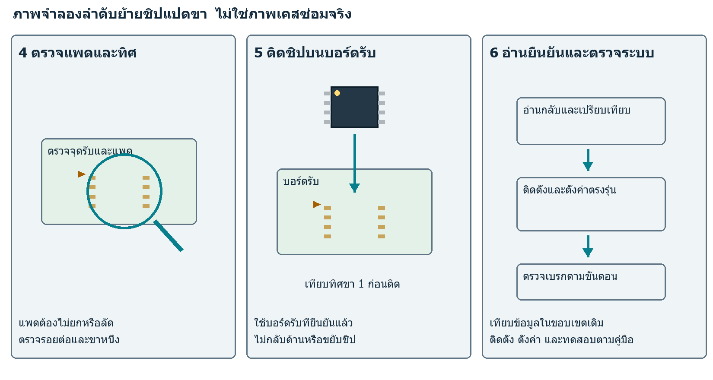

ภาพจำลอง ขั้น 4 ถึง 6 ไม่ใช่ภาพย้ายไป donor ที่ถ่ายจากเคสจริง

## 4 ตรวจจุดรับ

ตรวจแพด รอยต่อ และการลัดวงจรทั้งต้นทางกับปลายทาง รอยชำรุดที่มองเห็นต้องแก้และตรวจได้ ไม่กลบด้วยตะกั่วโดยไม่ทราบเส้นทาง

## 5 ติดตั้งให้ตรงทิศ

เทียบขาหนึ่งจากภาพเดิมและ datasheet ไม่เทียบจากตัวหนังสือบนชิปอย่างเดียว ตรวจตำแหน่งและชิ้นส่วนรอบข้างด้วยกล้องหลังติดตั้ง

## 6 ตรวจให้ครบ

ตรวจไฟและการสื่อสาร อ่านข้อมูลกลับเมื่อวิธีนั้นรองรับ เทียบกับต้นฉบับในช่วงเดียวกัน แล้วติดตั้ง ตั้งค่า สอบเทียบและตรวจเบรกตามคู่มือ ไม่จบงานจากไฟเตือนดับเพียงอย่างเดียว

# ภาพจริง 12 หน้าจอเขียนครบแต่ยังมี Error

R3 หน้าจอจากงานกู้ข้อมูล ไม่ใช่ภาพจำลองโปรแกรม

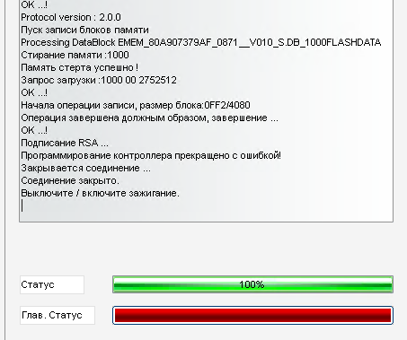

แถบความคืบหน้า 100 เปอร์เซ็นต์ แต่มีข้อความความผิดพลาด

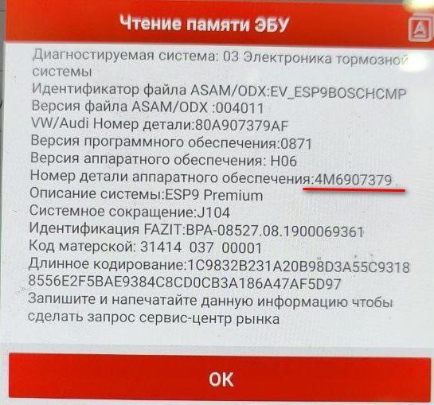

ข้อมูลระบุหน่วยที่มีหมายเลขฮาร์ดแวร์ไม่ตรงกันตามรายงาน

## เฉลยอ่านหน้าจอ

คำว่า 100 เปอร์เซ็นต์ไม่แทนผลสำเร็จ ต้องอ่าน log และหมายเลขระบุหน่วย ไม่คัดลอกค่าหรือไฟล์จากตัวอย่างนี้ไปใช้กับรถอื่น

## ขอบเขต

ภาพแสดงปัญหาที่เจ้าของงานพบ ไม่ใช่หลักฐานผ่านการตั้งค่าและตรวจเบรกบนรถครบ

เครดิตภาพ R3 ecurep บน Habr ภาพ PCB และหน้าจอกรณีกู้ ABS VAG
[แหล่งภาพต้นทาง](https://habr.com/ru/articles/863650/)

# ภาพจริง 13 ODIS บันทึกข้อมูลก่อนเปลี่ยน

R5 ภาพหน้าจอจริงในเอกสาร VW 45F2 หน้า 15 ฉบับมีนาคม 2017

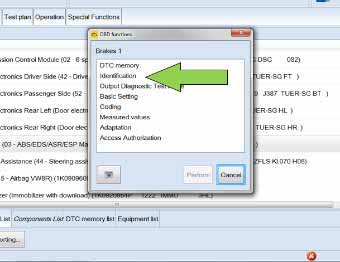

เมนูอ่าน Identification ในตัวอย่าง ODIS

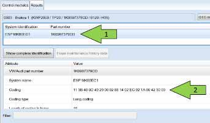

ตัวอย่างหน้าข้อมูลหน่วยและ coding ที่ต้องเก็บก่อนเปลี่ยน

## ใช้เป็นตัวอย่างงานโปรแกรม

บันทึกข้อมูลต้นทางก่อนเปลี่ยนชุด ใช้ขั้นตอนตรงรุ่นและเอกสารปัจจุบัน ภาพเก่าแสดงตำแหน่งเมนู ไม่ใช้ค่าที่แสดงเป็น coding ของรถผู้ใช้

เครดิตภาพ R5 Volkswagen 45F2 March 2017 ภาพหน้าจอ ODIS หน้า 11 15 และ 49
[แหล่งภาพต้นทาง](https://static.nhtsa.gov/odi/rcl/2016/RCRIT-16V913-6522.pdf)

# ภาพจริง 14 ODIS หลังติดตั้งกล่อง

R5 ภาพหน้าจอจริงจากเอกสารหน้า 49 และเมนูอัปเดตจากหน้า 11

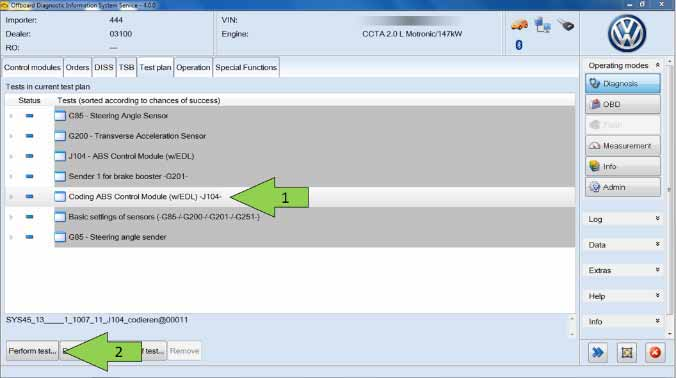

Test plan สำหรับ coding ชุด ABS ในเอกสารเฉพาะแคมเปญ

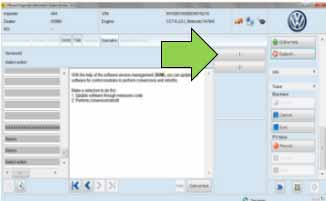

ตัวอย่างเมนูซอฟต์แวร์ ไม่ใช่โปรแกรมเมอร์อ่าน EEPROM

## แยกงานให้ถูก

Coding อัปเดตซอฟต์แวร์ และการคัดลอกชิปเป็นคนละงาน อย่าใช้ภาพหน้านี้อ้างว่าโคลนข้อมูลครบหรือใช้เมนูเดียวกันได้กับทุกกล่อง

เครดิตภาพ R5 Volkswagen 45F2 March 2017 ภาพหน้าจอ ODIS หน้า 11 15 และ 49
[แหล่งภาพต้นทาง](https://static.nhtsa.gov/odi/rcl/2016/RCRIT-16V913-6522.pdf)

# หัวข้อ 03 วิธีใช้เล่มให้ได้คำตอบงานซ่อม

อ่านอาการแล้วเลือกวงจร อย่าเริ่มจากการเปลี่ยนชิปที่อยู่ใกล้รอยร้อน

## ก่อนวัด

เก็บภาพฉลาก เลข HW SW รหัส PCB และรายงานสแกนทั้งรถ บันทึกไฟเลี้ยงกับกราวด์ภายใต้โหลด อ่านคู่มือเพื่อตรวจขั้วจริงก่อนต่อไฟทุกครั้ง

## ความหมายของจุดวัด

TP ในภาพเป็นจุดตามหน้าที่ ต้องไล่ให้พบตำแหน่งจริงบนบอร์ดก่อนใช้งาน VBAT คือไฟรถ VREG คือรางไฟย่อย VGS คือแรงดันระหว่างเกตกับซอร์ส ไม่ใช่เกตเทียบตัวถังเสมอไป

## ป้ายกำกับในเล่ม

วงจรฝึก คือภาพตัวอย่างและวิธีแยกสาเหตุ
ตัวอย่างสมมติ คือใช้ฝึกแปลผล ไม่ใช่ผลซ่อมรถจริง
กรณีผู้ผลิต คืออ้างอิงเอกสารที่ระบุขอบเขตรุ่นและวิธีแก้

## ก่อนรื้อชุดเบรก

ลดแรงดันและตัดการปลุกระบบตามคู่มือเฉพาะรุ่น ชุดที่สะสมแรงดันหรือสร้างแรงดันเองไม่ใช้วิธีเดียวกับ ABS แบบแยกทั่วไป ไม่สั่งปั๊มหรือวาล์วโดยข้ามวงจรอนุญาตทำงาน

## คำว่าเสียบ่อย

เล่มนี้ไม่มีฐานข้อมูลความถี่ของทุกบอร์ด จึงใช้คำว่า จุดตรวจลำดับต้น สำหรับภาพฝึก และระบุความเสียหายเฉพาะระบบเมื่อมีประกาศผู้ผลิต ไม่จัดอันดับ MCU หรือ EEPROM โดยคาดเดา

# หัวข้อ 04 วงจรไฟเข้ากล่องและอุปกรณ์ป้องกัน

วงจรฝึก A ใช้ติดตามไฟจากขั้วเข้าถึงภาคจ่ายไฟ ไม่กำหนดพิกัดแทนกล่องจริง

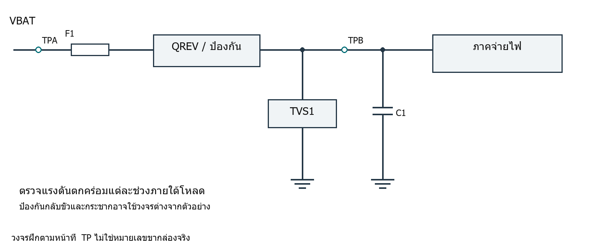

## อ่านภาพ

F1 เป็นทางป้องกันกระแสเกินตามระบบ QREV แทนภาคป้องกันกลับขั้ว TVS1 แทนอุปกรณ์ป้องกันกระชาก C1 เป็นตัวกรอง แต่บอร์ดจริงอาจใช้วิธีอื่นหรือรวมในไอซี

## จุดวัดและแปลผล

TPA มีไฟแต่ TPB หาย ให้ตรวจเส้นทาง F1 ขั้วต่อ และภาคกลับขั้ว หาก TPB ตกเมื่อมีโหลด ให้ตรวจแรงดันตกคร่อมเส้นทางนั้นพร้อมกราวด์ อย่าใช้ผลบี๊บสายแทนผลรับโหลด

## เกณฑ์เปลี่ยน

เปลี่ยนชิ้นส่วนเมื่อแยกได้ว่า open short หรือคุณสมบัติผิดจริง ต้องตรวจเหตุแรงดันผิดและโหลดปลายทางก่อนคืนไฟ หาก TVS ลัด ห้ามส่งกล่องโดยถอด TVS ทิ้ง

# หัวข้อ 05 เฉลยกล่องเงียบและไฟย่อยไม่ขึ้น

ใบเฉลยวงจรฝึก A อาการนี้ยังไม่ใช่หลักฐานว่าโปรแกรมเสีย

## 1 ยืนยันอาการ

ตรวจไฟหลัก กราวด์ และไฟปลุกตามผังรถ ดูว่ากล่องอื่นติดต่อเครือข่ายได้หรือไม่ บันทึกว่าทดสอบบนรถหรือบนโต๊ะ

## 2 วัดตามเส้นทาง

เทียบไฟขั้วเข้ากับ TPA และ TPB ในภาพ 04 ขณะมีโหลด วัดแรงดันระหว่างกราวด์กล่องกับกราวด์แหล่งจ่ายด้วย ไม่ดูเพียงไฟบวก

## 3 เฉลยผลสองทาง

ไฟหายก่อนภาคจ่ายไฟ ให้ตามขั้ว F1 ลาย และภาคป้องกัน หากไฟถึงภาคจ่ายไฟแต่รางย่อยไม่มี ให้ไปตรวจ enable ภาคจ่ายไฟ และโหลดตามหัวข้อ 06–07

## 4 จุดที่อาจต้องเปลี่ยน

ขั้วที่ผุ รอยต่อที่ยืนยันขาด ชิ้นส่วนป้องกันเสีย หรือภาคจ่ายไฟที่พิสูจน์แล้ว ไม่เปลี่ยน MCU เพื่อทดลองก่อนตรวจลำดับเริ่มงาน

## 5 ตรวจหลังซ่อม

ไฟย่อยเริ่มงานได้ตามเงื่อนไข กระแสไม่ผิดปกติ สื่อสารและอ่านเลขกล่องได้ ตรวจ DTC และเงื่อนไขพักตื่นอีกครั้ง

## ป้องกันเสียซ้ำ

แก้แหล่งจ่ายผิด จุดต่อร้อน และทางน้ำเข้าที่พบพร้อมกัน ฟิวส์ที่ขาดไม่ใช่ข้ออนุญาตให้เพิ่มพิกัดฟิวส์

# หัวข้อ 06 วงจรไฟย่อย รีเซ็ต และเฝ้าระวัง

วงจรฝึก B แยกความเสียหายของแหล่งจ่ายออกจากการที่ MCU ยังไม่เริ่มงาน

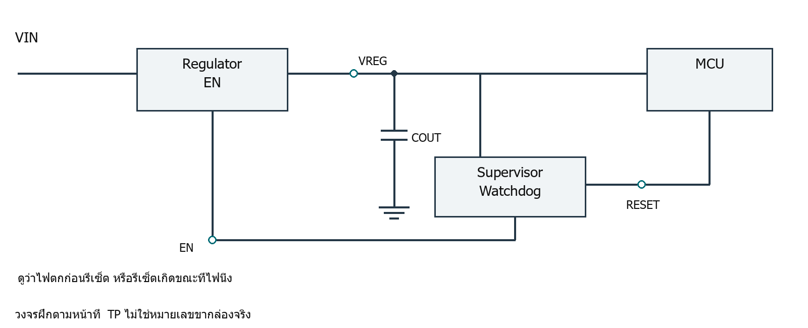

## จุดที่ต้องเห็นตามเวลา

เก็บ VIN ของ regulator, VREG, EN และ RESET ในเงื่อนไขเดียวกัน ค่ามัลติมิเตอร์เฉลี่ยอาจมองไม่เห็นรางที่ขึ้นแล้วตก ใช้ออสซิลโลสโคปเมื่อจำเป็น

## อ่านผล

VIN นิ่งแต่ VREG ตก อาจมาจากภาคจ่ายไฟ โหลด หรือคำสั่งควบคุม ถ้า VREG ตกก่อน RESET เปลี่ยน ให้เริ่มหาสาเหตุที่ไฟก่อน ถ้าไฟนิ่งแต่รีเซ็ตซ้ำ ให้ตรวจวงจรเฝ้าระวังและเงื่อนไขบูตต่อ

## จุดควรเปลี่ยนเมื่อพิสูจน์

COUT ที่ผิดคุณสมบัติ regulator หรือ supervisor ที่เสีย และโหลดที่ทำให้รางตก การพบตัวร้อนไม่ได้พิสูจน์ว่าตัวนั้นเป็นต้นเหตุ

# หัวข้อ 07 เฉลยเปิดติดแล้วดับหรือรีเซ็ตซ้ำ

ใบเฉลยวงจรฝึก B ใช้ลำดับเวลาแยกสาเหตุ

## อาการ

เครื่องสแกนเข้าได้ชั่วครู่ ขาดการสื่อสารซ้ำ หรือไฟย่อยขึ้นเป็นช่วง ให้เก็บรูปคลื่นก่อนแตะงานบัดกรี

## จุดวัด

VREG ที่ตัวเก็บประจุปลายราง ขา EN และ RESET ที่ระบุจาก datasheet ใช้โพรบที่เหมาะสม ขานาฬิกาบางแบบถูกรบกวนจากโพรบได้

## ถ้ารางลัดเมื่อไม่มีไฟ

แยกทางขนานก่อนฟันธง C หรือ MCU ค่าโอห์มต่ำบนรางบางชนิดอาจเป็นพฤติกรรมโหลดปกติ ไม่ใช้เสียงบี๊บเป็นคำตัดสิน และไม่ฉีดไฟรางโดยเดาแรงดัน

## ถ้ารางตกเมื่อเริ่มงาน

ตรวจแหล่งจ่าย การจำกัดกระแส โหลดปลายทาง และตัวกรอง หาก EN ถูกตัด ต้องตามเหตุที่วงจรตัด ไม่ผูกขานั้นให้เปิดตลอด

## เฉลยและเกณฑ์เปลี่ยน

เปลี่ยนเฉพาะชิ้นส่วนที่แยกเหตุได้ หากภาคไฟครบแต่ยังบูตไม่ได้จึงพิจารณาหน่วยความจำและ MCU โดยรักษาต้นฉบับข้อมูลไว้ก่อน

## ตรวจหลังซ่อม

บันทึกรูปคลื่นรางกับรีเซ็ตภายใต้เงื่อนไขเดิม ตรวจการพักตื่น การสื่อสาร และ DTC ใหม่ ไม่ทดสอบด้วยการอบหรือทำให้ร้อนทั้งบอร์ดโดยไม่มีขอบเขต

# หัวข้อ 08 วงจรขับมอเตอร์และจุดวัด MOSFET

วงจรฝึก C เป็นตัวอย่าง N MOSFET แบบ low side เท่านั้น กล่องจริงอาจเป็น high side หรือรวมวงจรขับใน ASIC

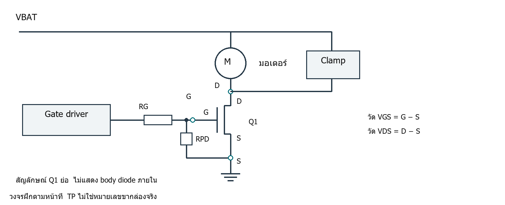

## จุดวัด

ตรวจไฟที่โหลด VGS ระหว่าง G กับ S และ VDS ระหว่าง D กับ S หากขับ PWM ให้ดูช่วง ON เดียวกัน ไม่ฟันธงจากค่าเฉลี่ย ใช้โพรบ differential หรือ isolated ที่พิกัดเหมาะกับจุดลอย ห้ามหนีบกราวด์สโคปข้ามศักย์หรือยกสายดินเครื่องมือ

## แปลผล

มี VGS ตามข้อกำหนดแต่ VDS สูงขณะ ON ให้ตรวจ Q1 และทางต่อ ถ้า VGS ไม่มาให้ตามไดรเวอร์และเงื่อนไขอนุญาต ค่า VGS(th) ไม่ใช่แรงดันเปิดเต็ม ต้องเทียบเงื่อนไข VGS ที่ระบุ RDS(on) ด้วย

## ตัวอย่างคำนวณสมมติ

หากกระแส 8 A และแรงดันตกที่รอยต่อ 0.25 V รอยต่อนั้นสูญเสีย 2 W จึงร้อนได้แม้ยังวัดความต่อเนื่องผ่าน ตัวเลขนี้ไม่ใช่สเปกปั๊ม ABS

# หัวข้อ 09 เฉลยสั่งปั๊มแล้วไม่หมุน

ใบเฉลยวงจรฝึก C ตรวจพลังงาน คำสั่ง และโหลดแยกกัน

## ก่อนสั่งทดสอบ

ยืนยันเงื่อนไข actuator test ของรุ่นรถ การลดแรงดัน และการยึดรถ ใช้วิธีของเครื่องสแกนที่รองรับ ไม่ป้อนเกต MOSFET เพื่อฝืนให้หมุน

## วัดภาคกำลัง

ตรวจไฟเลี้ยงปั๊มขณะสั่งและแรงดันตกคร่อมขั้วกำลัง ไฟที่มีเมื่อไม่รับโหลดอาจยุบเมื่อมอเตอร์เริ่ม

## เฉลยทางที่หนึ่ง

ถ้าไฟโหลดหาย ให้ตามฟิวส์ จุดต่อ และสวิตช์จ่ายกำลัง ถ้าไฟครบแต่ไม่มีทางกลับ ให้ตรวจ Q1 รอยต่อ และตัวตรวจวัดกระแสตามโครงสร้างจริง

## เฉลยทางที่สอง

ถ้าทางกำลังพร้อมแต่ไม่มีคำสั่ง ให้ตรวจสถานะอนุญาต DTC และภาคไดรเวอร์ ถ้าคำสั่งกับแรงดันที่มอเตอร์ถูกต้องแต่ไม่หมุน ต้องตรวจมอเตอร์และกลไกตามวิธีที่รองรับ

## ก่อนเปลี่ยน Q1

ยืนยัน Q1 เสีย แยกผลทางขนาน และตรวจโหลดก่อนเลือกตัวใหม่ ไม่เลือกจากค่าแอมแปร์หน้าขายอย่างเดียว

## ตรวจหลังซ่อม

การตอบสนอง กระแสและแรงดันตามคู่มือ ไม่มีอาการร้อนผิดปกติ และไม่มี DTC กลับภายใต้การทดสอบที่ระบุ โคลนข้อมูลไม่แก้มอเตอร์เสีย

# หัวข้อ 10 เฉลยปั๊มทำงานค้าง

ใบเฉลยวงจรฝึก C ต้องแยกการสั่งค้างออกจากสวิตช์กำลังลัด

## อาการและการเก็บหลักฐาน

บันทึกเงื่อนไขที่ปั๊มทำงานและสถานะคำสั่งจากเครื่องสแกน หากการทำงานผิดปกติให้ยุติการทดสอบตามวิธีตัดระบบ ไม่ปล่อยให้มอเตอร์ร้อนต่อเนื่อง

## ตรวจโดยไม่มีไฟ

เมื่อตัดและจัดการพลังงานค้างแล้ว ตรวจ D S ของ Q1 โดยพิจารณา body diode และทางขนาน ตรวจรีเลย์หรือสวิตช์อื่นหากกล่องใช้แบบนั้น

## แปลผลแบบมีเงื่อนไข

ถ้า Q1 ลัดจริงทาง D S แม้ไม่ได้สั่ง ให้ตรวจวงจรเกตและโหลดร่วมด้วย ถ้า Q1 ไม่ลัดแต่ถูกขับค้าง ให้ตามไดรเวอร์ คำสั่ง MCU หรือเหตุที่ระบบร้องขอ ไม่ใช้เพียงเสียงปั๊มตัดสิน

## จุดที่ควรเปลี่ยน

Q1 รีเลย์ หรือไดรเวอร์ที่พิสูจน์เสีย พร้อมแก้สาเหตุโหลดและทางไฟ หากเสียใน ASIC ที่ไม่สามารถตรวจคืนได้ให้ประเมินเปลี่ยนชุด

## สิ่งที่ไม่ใช่การแก้

ตัดทางปั๊ม ถอดวงจรตรวจ หรือผูกเกตให้ปั๊มหยุด อาจทำให้ไฟเตือนเปลี่ยนแต่ระบบเบรกไม่กลับมาครบ

## ตรวจจบงาน

ยืนยันทั้งสถานะไม่สั่งและสถานะสั่งตามคู่มือ รวมถึงการตัดกำลังเมื่อผิดปกติเท่าที่วิธีตรวจรองรับ

# หัวข้อ 11 วงจรขับวาล์วและการคายพลังงาน

วงจรฝึก D แสดงคอยล์กับสวิตช์ low side และไดโอดคายพลังงานแบบง่าย ไม่ใช้กำหนดวงจร clamp ของ ABS จริง

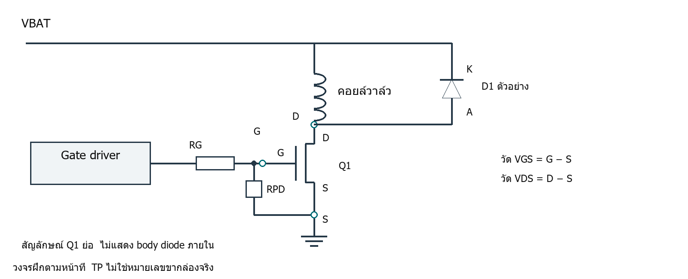

## เหตุที่ต้องดูวงจรคายพลังงาน

เมื่อหยุดกระแสคอยล์จะเกิดแรงดันย้อน วงจรจริงอาจใช้ TVS active clamp หรือวงจรรวมเพื่อควบคุมเวลาปล่อยวาล์ว จึงไม่เติมไดโอดคร่อมคอยล์เองตามภาพฝึก

## จุดวัด

ตรวจไฟคอยล์ จุดสวิตช์ คำสั่งขับ และวงจรตรวจกลับ ถ้าเทียบช่องข้างกันต้องยืนยันว่าเป็นวงจรชนิดเดียวกันและอยู่ในคำสั่งเดียวกัน

## เกณฑ์เปลี่ยน

พิสูจน์คอยล์ ทางเชื่อม และ driver ตามวิธีตรวจของรุ่นนั้น ค่าคอยล์ที่ผ่านยังไม่ยืนยันว่าวาล์วขยับหรือปิดสนิท

# หัวข้อ 12 เฉลย DTC วาล์วขาดหรือลัด

ใบเฉลยวงจรฝึก D แยกรหัสวงจรไฟฟ้าออกจากผลทางไฮดรอลิก

## 1 อ่านรหัสให้ครบ

เก็บรหัสหลัก รหัสย่อย สถานะ และเงื่อนไขตั้งรหัส คำว่า valve fault จากเครื่องทั่วไปอาจไม่บอกว่าระบบตรวจพบ open short หรือการตอบสนองผิด

## 2 ตรวจไม่มีไฟ

ตรวจคอยล์ตามค่าตรงรุ่นและขั้วเชื่อมของชุด ตรวจรอยต่อและการกัดกร่อน จุดเชื่อมระหว่าง ECU กับชุดวาล์วอาจเป็นคนละเทคโนโลยีกับ PCB ปกติ

## 3 ตรวจขณะระบบทำงาน

ใช้การสั่งงานและจุดวัดที่รองรับ ดูไฟคอยล์กับพฤติกรรมขับ หากทุกช่องมีปัญหาให้ดูภาคร่วมก่อน ถ้าเสียหนึ่งช่องให้เทียบช่องที่มีโครงสร้างเดียวกัน

## 4 เฉลยการเปลี่ยน

คอยล์หรือทางต่อเสียให้ซ่อม/เปลี่ยนชุดตามโครงสร้าง หาก driver เสียต้องตรวจโหลดและ clamp ก่อนใส่ตัวใหม่ ถ้าไฟฟ้าผ่านแต่แรงดันตอบสนองผิด ให้ตรวจไฮดรอลิกต่อ

## 5 เกณฑ์จบ

ผลทดสอบไฟฟ้าและผลการทำงานตามคู่มือผ่านทั้งคู่ ไม่มี DTC ปัจจุบันกลับ ไม่สรุปจากค่าความต้านทานเพียงค่าเดียว

## หลีกเลี่ยงเสียซ้ำ

ไม่ reflow ทั้งบอร์ด และไม่ต่อสายแทนลวดบอนด์โดยไม่มีวิธีประเมินโครงสร้างและความทนทาน

# หัวข้อ 13 วงจรชันต์และทางตรวจวัดกระแส

วงจรฝึก E แสดงการแยกทางกำลังออกจากสาย sense สำหรับวิเคราะห์

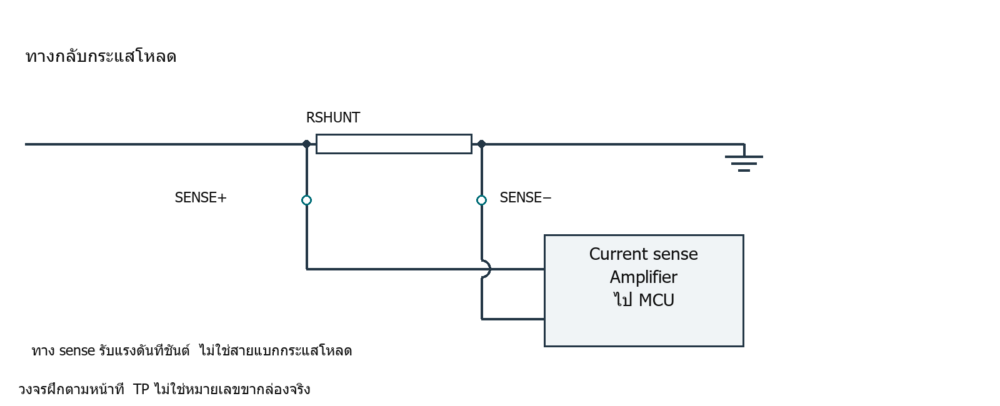

## อ่านภาพ

กระแสโหลดไหลผ่าน RSHUNT ส่วน SENSE+ และ SENSE− ไปยังภาควัด ค่าที่อ่านจึงขึ้นกับตัวต้านทาน รอยต่อ สาย sense และแอมป์รับสัญญาณ

## ตัวอย่างสมมติ

ถ้า RSHUNT 0.010 Ω และกระแส 5 A จะตกคร่อม 50 mV คำนวณด้วย I = V/R ตัวเลขนี้เพื่อฝึกคำนวณ ไม่ใช่ค่าชันต์ประจำกล่อง ABS

## จุดเสี่ยงในการซ่อม

การพอกตะกั่วคร่อมชันต์อาจเปลี่ยนค่าและตำแหน่งรับสัญญาณ ทำให้กล่องตีความกระแสผิด การวัดชันต์ค่าต่ำด้วยสองสายอาจรวมความต้านทานสายวัด

# หัวข้อ 14 เฉลยระบบรายงานกระแสผิด

ใบเฉลยวงจรฝึก E อย่าแก้รหัสกระแสด้วยการเปลี่ยนค่าชันต์

## อาการ

ระบบรายงานโหลดเกินทั้งที่ยังไม่ได้พิสูจน์โหลด หรือสั่งแล้วตัดเร็ว ให้บันทึกคำสั่ง กระแส และแรงดันตกคร่อมตามวิธีที่รองรับ

## ตรวจทางกำลัง

มอเตอร์หรือคอยล์กินกระแสผิดจริงหรือไม่ ตรวจจุดต่อและภาคขับ การลัดใน Q หรือโหลดเป็นคนละเหตุจากการวัดผิด

## ตรวจทาง sense

ไล่จากสองขั้วชันต์ถึงตัวรับสัญญาณ ดูรอยต่อแตก ตัวต้านทานทางเข้า ตัวกรอง และแหล่งอ้างอิง หากจุด sense ขาด ภาควัดอาจผิดแม้โหลดทำงานได้

## เฉลย

เมื่อกระแสจริงผิด ให้แก้โหลดหรือภาคกำลัง เมื่อกระแสจริงถูกแต่ข้อมูลตรวจกลับผิด ให้แก้เส้นทางวัดที่พิสูจน์แล้ว ไม่ลดค่าชันต์เพื่อให้ระบบหยุดตัด

## ก่อนเปลี่ยน

ค่าตัวใหม่ต้องตรงทั้งความต้านทาน ความคลาดเคลื่อน อุณหภูมิ กำลัง และวิธีต่อ sense ไม่ถือว่าตัวขนาดเท่ากันใช้แทนกันได้

## ตรวจหลังซ่อม

เทียบผลวัดกับข้อมูลที่เครื่องสแกนให้ได้ตามข้อกำหนด ยืนยันพฤติกรรมภายใต้คำสั่งที่อนุญาต ไม่เปลี่ยนจุดตัดระบบโดยไม่มีการประเมิน

# หัวข้อ 15 วงจร CAN จากขั้วปลั๊กถึง MCU

วงจรฝึก F ใช้แยกอุปกรณ์ป้องกัน transceiver และคำสั่งตรรกะ

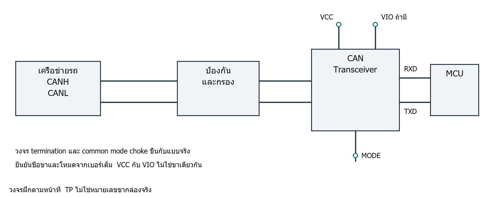

## ตรวจเป็นสองฝั่ง

ฝั่งรถคือ CANH CANL และกราวด์ ฝั่ง MCU คือ TXD RXD และขาควบคุมโหมด ต้องตรวจไฟเลี้ยงและโหมดของ transceiver ก่อนตีความว่าไม่มีข้อมูล

## ตัวอย่างชิปที่มีเอกสาร

TJA1051 มีขา 5 ต่างตาม suffix และมีโหมด Silent แต่ไม่มีโหมด standby ที่ปลุกผ่านบัสในตัว จึงห้ามแทนจากชื่อหลักอย่างเดียว เงื่อนไขปลุกกล่องอาจอยู่ในวงจรอื่น ไม่ยืนยันว่ารถใดใช้ชิปนี้ [S3]

## จุดควรเปลี่ยนเมื่อพิสูจน์

อุปกรณ์ป้องกันที่ลัด transceiver ที่เสีย หรือขั้วต่อที่ผิดปกติ ต้องแยกจากปัญหา MCU ไม่ตื่นและปัญหาเครือข่ายภายนอก

# หัวข้อ 16 เฉลยไม่มีการสื่อสารแต่ไฟย่อยครบ

ใบเฉลยวงจรฝึก F การมีไฟไม่เท่ากับโปรแกรมเริ่มงาน

## เริ่มจากทั้งรถ

เก็บ DTC เครือข่ายจากกล่องอื่น ดูว่า ABS หายตัวเดียวหรือทั้งบัส หากบัสกลับมาหลังแยกกล่อง ต้องตรวจทั้งกล่องและสายช่วงที่แยก ไม่สรุปชิปทันที

## ที่ขั้วบัส

ตรวจรูปคลื่นและสภาพสายตามโครงข่ายจริง การวัดความต้านทานต้องอยู่ในสภาพไม่มีไฟที่เหมาะสม ค่าหนึ่งค่าไม่ใช้ตัดสินทุกเครือข่ายหรือทุกเกตเวย์

## ที่ transceiver

ตรวจ VCC หรือ VIO ถ้ามี โหมดควบคุม TXD RXD และอุปกรณ์ป้องกัน ถ้ารับได้แต่ส่งไม่ได้ ให้ตรวจโหมด Silent และเงื่อนไขควบคุมตามเบอร์เต็ม

## ที่ MCU

ถ้าไม่มี TXD ยังต้องยืนยันไฟ รีเซ็ต และ wake up การไม่สื่อสารบนโต๊ะอาจเกิดจากเงื่อนไขปลุกไม่ครบ ไม่ใช่ข้อพิสูจน์ว่า Flash เสีย

## เฉลยจุดเปลี่ยน

เปลี่ยนส่วนที่แยกสาเหตุได้ ไม่เริ่มจาก EEPROM หรือเขียนไฟล์สุ่ม หากบูตและสื่อสารกลับมา ให้เก็บเลขกล่องกับข้อมูลเดิมก่อนทำงานต่อ

## ตรวจหลังซ่อม

สแกนทั้งรถ ตรวจบัสในโหมดทำงานและพักตามคู่มือ ไม่มีการรบกวนกล่องอื่นและไม่มี DTC กลับ

# หัวข้อ 17 วงจรรับเซนเซอร์สองสาย

วงจรฝึก G เป็นแบบแอ็กทีฟสองสาย มีภาคจ่ายและรับกระแส ไม่ใช่เซนเซอร์เหนี่ยวนำทุกแบบ

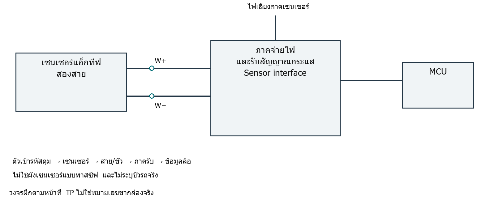

## อ่านวงจรให้ถูกชนิด

เซนเซอร์สองสายอาจเป็นแอ็กทีฟหรือพาสซีฟ ต้องระบุชนิดจากเอกสาร หมายเลขชิ้นส่วน และรูปแบบสัญญาณ ห้ามวัดโอห์มแล้วใช้เกณฑ์เดียวกับทุกชนิด

## จุดวัด

ตรวจตามวิธีของ current interface ที่รองรับ ไม่สอดแอมมิเตอร์หรือเพิ่มชันต์โดยเดา เปรียบเทียบความครบและจังหวะข้อมูลตามวิธีตรวจ ไม่กำหนดว่าแรงดันสองปลายต้องมีแอมพลิจูดเท่ากัน หากสัญญาณถึงกล่องแล้วจึงตามภาครับ

## ก่อนเปิดบอร์ด

ตรวจตัวเข้ารหัสดุม ลูกปืน ทิศติดตั้ง ระยะ และสายเสียดสีด้วย การเปลี่ยนลูกปืนอาจเปลี่ยนต้นกำเนิดสัญญาณโดยไม่เกี่ยวกับ EEPROM

# หัวข้อ 18 เฉลยล้อหนึ่งล้ออ่านหายหรืออ่านกระโดด

ใบเฉลยวงจรฝึก G ใช้ข้อมูลสดร่วมกับรูปคลื่น

## อาการ

อ่านความเร็วล้อหนึ่งไม่ตรงกับล้ออื่น ให้บันทึกความเร็วและเงื่อนไข รวมถึงประวัติเปลี่ยนดุมหรือลูกปืน อย่าทดลองบนถนนก่อนยืนยันระบบเบรกพร้อม

## จุดวัดแรก

ตรวจสาย ขั้ว และตัวเข้ารหัสก่อน วัดตามชนิดเซนเซอร์ด้วยเครื่องมือและการต่อที่เหมาะสม เครื่องสแกนอาจกรองสัญญาณจนมองไม่เห็นพัลส์ขาดบางช่วง

## แปลผลเส้นทาง

สัญญาณผิดตั้งแต่ล้อ ให้ตรวจเซนเซอร์และเป้าสัญญาณ สัญญาณดีที่ล้อแต่ผิดที่กล่อง ให้ตามสาย สัญญาณถึงกล่องแต่ข้อมูลผิด จึงไล่ภาครับและไฟเลี้ยงของช่องนั้น

## จุดที่อาจต้องเปลี่ยน

ตัวเข้ารหัสดุม เซนเซอร์ สาย หรืออุปกรณ์ภาครับที่พิสูจน์เสีย หากหลายช่องหายพร้อมกัน ตรวจภาคไฟและส่วนร่วมก่อนเปลี่ยนหลายเซนเซอร์

## ตรวจหลังซ่อม

ข้อมูลล้อสอดคล้องตามการทดสอบที่คู่มือกำหนด ไม่มี dropout หรือ DTC กลับ ตรวจว่ามีการสอบเทียบหรือเรียนรู้ที่ต้องทำหรือไม่

## เฉลยเรื่องโคลน

อาการสัญญาณล้อเสียไม่ใช่เหตุให้คัดลอก EEPROM การโคลนอาจเปลี่ยนข้อมูลโดยไม่แตะต้นเหตุที่ดุมหรือสาย

# หัวข้อ 19 วงจร EEPROM และตัวอย่าง 25LC256

วงจรฝึก H ใช้ชิปที่มี datasheet สาธารณะ ไม่ยืนยันว่าชิปนี้อยู่ใน ABS รุ่นใด

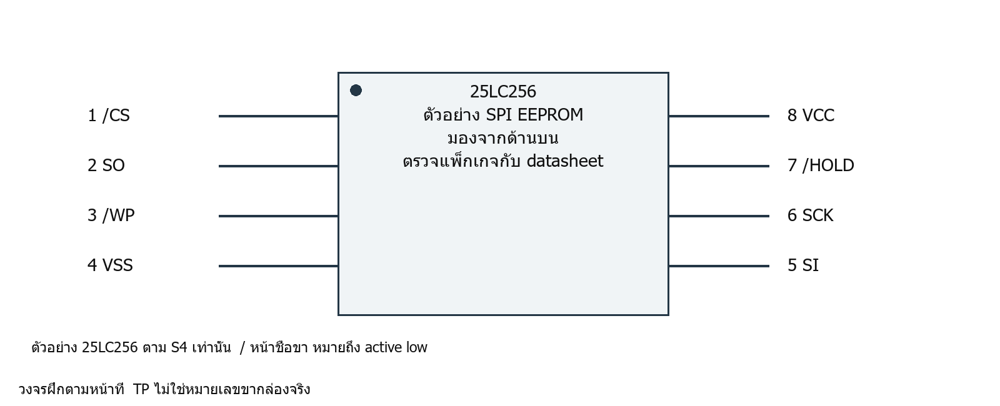

## ข้อมูลตัวอย่างที่ยืนยัน

25LC256 ใช้ SPI มีข้อมูล 32,768 ไบต์ หน้าเขียน 64 ไบต์ และขา VCC VSS CS SO SI SCK WP HOLD ต้องอ่านแพ็กเกจและรูปมุมมองจาก datasheet ก่อนต่อจริง [S4]

## เมื่อต่ออ่าน

SI รับข้อมูลเข้าชิป SO ส่งออก การต่อกับโปรแกรมเมอร์ให้เทียบหน้าที่ ไม่เดาจากชื่อสาย MOSI MISO ของอะแดปเตอร์ ชิปบนบอร์ดอาจแชร์บัสกับ MCU

## จุดเสี่ยง

ไฟโปรแกรมเมอร์อาจย้อนเลี้ยงวงจรอื่น ถ้าอ่านไม่นิ่งต้องแก้วิธีต่อและสภาวะบัสก่อน ไม่ให้กล่องรถและโปรแกรมเมอร์จ่ายไฟซ้อนโดยไม่ทราบทางเดินไฟ

# หัวข้อ 20 เฉลยอ่านชิปได้แต่ข้อมูลไม่นิ่ง

ใบเฉลยวงจรฝึก H ยังไม่ตัดสินว่าหน่วยความจำเสียจากการอ่านครั้งเดียว

## อาการ

อ่านซ้ำแล้วต่างกัน ไฟล์เป็น FF หรือ 00 ทั้งหมด หรือขนาดไฟล์ไม่ตรงความจุ คำว่า Read OK ในเครื่องมือยังไม่พอ

## ตรวจการตั้งค่า

เบอร์เต็ม suffix แพ็กเกจ โปรโตคอล แรงดัน ขนาด และโหมดคำข้อมูล ต้องตรงกับอุปกรณ์ที่อ่านจริง ไม่เลือกชื่อใกล้เคียงเพื่อให้กดอ่านได้

## ตรวจบนบอร์ด

หน้าสัมผัส ทิศขาหนึ่ง กราวด์ และแรงดันที่ขาชิปขณะอ่าน ตรวจ MCU ขับบัสหรือรับไฟย้อนหรือไม่ ถ้าต้องอ่านนอกวงจรให้ประเมินวิธีถอดที่ไม่ทำลายข้อมูลเดิม

## เฉลย

ไฟล์ว่างอาจว่างจริง อ่านผิด หรือเข้าถึงไม่ได้ ถ้าอ่านไม่ตรงห้ามเลือกไฟล์ที่ดูสวยไปเขียนปลายทาง ต้องอธิบายความต่างและขอบเขตที่อ่านได้ก่อน

## เปลี่ยนเมื่อใด

เปลี่ยนชิปเมื่อแยกได้ว่าชิปผิดจริงจากวิธีทดสอบที่รองรับ หากต้นฉบับข้อมูลเสียไปแล้ว การใส่ชิปเปล่าไม่ได้สร้างข้อมูลตรงรถกลับมา

## เกณฑ์จบ

เก็บผลอ่านซ้ำ ขนาด แฮช และ log พร้อมรายการพื้นที่ที่ไม่ได้สำรอง ค่าแฮชเหมือนกันต้องใช้ร่วมกับความถูกต้องของวิธีอ่าน

# หัวข้อ 21 จุดควรเปลี่ยนและการเลือกตัวทดแทน

เปลี่ยนตามหลักฐานของชิ้นส่วน พร้อมตรวจต้นเหตุและภาคที่เกี่ยวข้อง

| ชิ้นส่วน | หลักฐานให้เปลี่ยน | คุณสมบัติที่ต้องเทียบ |
| --- | --- | --- |
| C ภาคไฟ | ลัด รั่ว หรือคุณสมบัติผิดหลังแยกทางขนาน | ค่า แรงดัน ESR ripple อุณหภูมิ ขนาด |
| MOSFET | ยืนยัน short open หรือทำงานผิดภายใต้เงื่อนไขขับ | VDS VGS RDS(on) SOA gate charge ความร้อน ขา |
| TVS | ยืนยันอุปกรณ์ป้องกันเสีย | VRWM breakdown clamp pulse energy ทิศ |
| Diode | ยืนยันหน้าที่และเสียจริง | VR IF VF recovery ความร้อนและทิศ |
| Shunt | ค่าหรือรอยต่อผิดจากข้อกำหนด | ค่า tolerance กำลัง tempco และ sense |
| Transceiver | แยกจากไฟ โหมด และบัสภายนอกแล้ว | รุ่นย่อย pinout VIO โหมด และบัส |
| EEPROM | ผลทดสอบแยกชิปเสียได้และมีข้อมูลคืน | โปรโตคอล แรงดัน ความจุ organization แพ็กเกจ |

## สิ่งที่พิกัดสูงกว่าไม่ได้รับประกัน

MOSFET แอมแปร์สูงกว่าอาจขับไม่เหมาะ ตัวเก็บประจุค่ามากกว่าอาจเปลี่ยนการเริ่มงานและเสถียรภาพ ไอซี suffix ต่างอาจเปลี่ยนหน้าที่ขา

## ข้อควรบันทึก

เบอร์เดิม เบอร์ใหม่ แหล่งข้อมูล เหตุให้เปลี่ยน ผลตรวจโหลด และผลหลังเปลี่ยน ไม่เรียกว่า upgrade จนมีการประเมินครบ

# หัวข้อ 22 จุดตรวจบน PCB และการป้องกันเสียซ้ำ

รายการนี้เป็นลำดับตรวจตามอาการ ไม่ใช่อันดับความถี่เสียของกล่องทุกยี่ห้อ

| บริเวณ | เหตุให้ตรวจ | งานคืนสภาพที่ควรพิจารณา |
| --- | --- | --- |
| ขั้วไฟและกำลัง | ร้อน ตกคร่อมสูง หรืออาการเป็นพัก | แก้ขั้วและรอยต่อที่พิสูจน์ ตรวจสายต้นทาง |
| ภาคไฟย่อย | บูตไม่ขึ้นหรือรีเซ็ต | ตรวจโหลด regulator และ C ก่อนเปลี่ยน |
| ปั๊มและวาล์ว | DTC โหลดขาด ลัด หรือตัดเร็ว | ตรวจโหลด ภาคขับ clamp และตรวจกลับ |
| กราวด์และ sense | กระแสอ่านผิด หรือกราวด์ตกคร่อมสูง | ตรวจทางกำลังและทาง sense แยกกัน |
| ฝาและซีล | คราบ น้ำ หรือสารปนเปื้อน | หาทางเข้าและดูว่าซ่อมคืนโครงสร้างได้หรือไม่ |
| วงจรชิปข้อมูล | อ่านไม่เสถียรหรือหลังงานข้อมูลผิดปกติ | ตรวจวิธีต่อและข้อมูลก่อนสรุปชิปเสีย |

## งานที่ควรปรับปรุง

แก้ทางน้ำเข้า สายเสียดสี ขั้วหลวม แหล่งจ่ายผิด และใช้รุ่นอะไหล่ทดแทนที่มีหลักฐานรองรับ ตรวจยึดและระบายความร้อนตามโครงสร้าง

## งานที่ต้องไม่ใช้แทนการซ่อม

เพิ่มฟิวส์ พอกชันต์ ยกเลิก watchdog ปิด DTC หรือ reflow ทั้งบอร์ดเพื่อให้ติด การกระทำเหล่านี้ไม่ได้พิสูจน์ว่าต้นเหตุหาย

# หัวข้อ 23 เลือกงานวงจร โปรแกรม ตั้งค่า หรือโคลน

เลือกเส้นทางให้ตรงอาการก่อนเปิดซอฟต์แวร์

| สถานการณ์ | งานแรก | ทางไปต่อ |
| --- | --- | --- |
| ไม่สื่อสาร | ตรวจไฟ กราวด์ wake up บัสและรีเซ็ต | ซ่อมวงจรที่พบ ไม่เดา Flash เสีย |
| รหัสปั๊มหรือวาล์ว | ตรวจไฟกำลัง โหลด driver และ feedback | แก้ภาคกำลัง/โหลดก่อนทำข้อมูล |
| อาการตรง TSB | ตรวจ VIN อาการและเวอร์ชันที่กำหนด | อัปเดตตามเอกสาร ไม่เปลี่ยนชิปเอง |
| กล่องทดแทนมี coding fault | ตรวจหมายเลขใช้แทนและข้อมูลรถ | ตั้งค่าและสอบเทียบที่รองรับ |
| บอร์ดเดิมเสีย ข้อมูลยังอ่านได้ | สำรองและพิสูจน์ขอบเขตข้อมูล | ประเมินโอนข้อมูลเมื่อปลายทางรองรับ |

## คำสั่งแต่ละชนิดทำคนละงาน

Read คืออ่าน Save คือเก็บไฟล์ Program คือเขียน Verify คือตรวจในขอบเขตเครื่องมือ Coding คือกำหนดรูปแบบรถ Calibration คือเรียนรู้ค่าอ้างอิง

## คำว่า full clone

ต้องแจกแจงว่าครอบคลุมชิปและพื้นที่ใด มีพื้นที่ภายใน MCU หรือส่วนป้องกันที่อ่านไม่ได้หรือไม่ หากไม่ทราบให้ระบุขอบเขต ไม่เรียกว่าครบทั้งกล่อง

# หัวข้อ 24 สำรองอะไรบ้างก่อนแตะข้อมูล

ทำบัญชีข้อมูลและรักษาต้นฉบับก่อนสั่งลบหรือเขียน

| กลุ่มข้อมูล | หลักฐานที่ต้องเก็บ | ช่องว่างที่ต้องระบุ |
| --- | --- | --- |
| ข้อมูลระบุกล่อง | เลข HW SW calibration ID และรายงานสแกน | อ่านค่าใดไม่ได้บ้าง |
| หน่วยความจำภายนอก | เบอร์ชิป ขนาด ไฟล์อ่านซ้ำ และแฮช | พื้นที่ status หรือ config ที่ไม่ได้อยู่ในไฟล์ |
| หน่วยความจำ MCU | พื้นที่ Flash data และ config ตามเครื่องมือ | read protection OTP หรือพื้นที่อ่านไม่ได้ |
| ค่ากำหนดรถ | coding parameter และขั้นตอนคืนค่าที่รองรับ | ส่วนที่ต้อง online หรือใช้วิธีผู้ผลิต |
| หลักฐานโต๊ะ | ภาพทิศขา วิธีต่อ แรงดัน เครื่องมือและ log | เงื่อนไขที่ยังไม่ได้ทดสอบ |

## การจัดแฟ้ม

แยก ORIGINAL DONOR WORKING และ LOG ใช้รหัสงานแทนการกระจายข้อมูลรถโดยไม่จำเป็น เก็บสำเนาต้นฉบับอีกที่หนึ่งก่อนทำงานเสี่ยง

## ตัวอย่างชื่อ

JOB001_ORIG_EXTMEM_READ01.bin
JOB001_ORIG_EXTMEM_READ02.bin
JOB001_DONOR_EXTMEM_BEFORE.bin
JOB001_TARGET_READBACK.bin

## คำตอบที่ต้องได้

รู้ว่ามีข้อมูลอะไรอยู่ในมือ ข้อมูลใดขาด และขาดแล้วมีขั้นตอนทดแทนที่รองรับหรือไม่

# หัวข้อ 25 ตั้งค่าโปรแกรมเมอร์ก่อนกด Read

ตรวจจุดตั้งค่านี้กับเบอร์ชิปเต็มและคู่มือเครื่องมือ ไม่ใช้ค่าจากคลิปคนละบอร์ด

| รายการ | สิ่งที่ต้องยืนยัน |
| --- | --- |
| Device | manufacturer เบอร์เต็ม suffix และ package |
| Protocol | I2C SPI Microwire หรืออินเทอร์เฟซของ MCU |
| VCC และระดับ I/O | ช่วงที่ชิปและบอร์ดรับได้ รวมถึงระดับจากอะแดปเตอร์ |
| Organization | ความจุ address และ x8 หรือ x16 ถ้ามีตัวเลือก |
| Connection | ทิศขาหนึ่ง socket clip สายกราวด์ และวงจรร่วม |
| Operation | เลือก Read ก่อน ไม่เลือก auto erase หรือ auto program |
| Coverage | อ่านข้อมูล status config และพื้นที่อื่นใดได้จริง |

## ตัวอย่างเฉพาะชิป

25LC256 ใน datasheet S4 ระบุช่วง VCC 2.5–5.5 V ค่านี้ไม่ใช้กับ 25xx ทุกตัว และไม่แปลว่าบอร์ดซึ่งมีชิปนี้รับไฟย้อน 5 V ได้ ห้ามนำไฟรถเข้าขาหน่วยความจำ

## เมนู Auto

อ่านรายละเอียดว่ารวม Erase Blank check Program หรือ Verify หรือไม่ อย่าใช้ชุดคำสั่งอัตโนมัติกับต้นฉบับโดยยังไม่สำรอง

# หัวข้อ 26 อ่านซ้ำและตีความไฟล์ให้ถูก

ผลอ่านที่เชื่อถือได้ต้องรู้วิธีอ่าน ขนาด และความต่าง ไม่ใช่ดูว่ามีตัวอักษรใน hex editor

## ลำดับทำงาน

อ่านครั้งที่ 1 แล้ว Save As ชื่อใหม่ อ่านครั้งที่ 2 แยกไฟล์ ตรวจขนาดและเทียบ byte ต่อ byte เก็บ log และภาพการตั้งค่า ถ้ามีความต่างให้หยุดการเขียนปลายทาง

## กรณีไฟล์เหมือน

SHA256 ตรงและขนาดตรงบอกว่าไฟล์สองชุดเหมือนกัน แต่ยังต้องยืนยันว่าเลือกชิปถูกและอ่านพื้นที่ถูก ไฟล์ว่างที่อ่านผิดซ้ำก็เหมือนกันได้

## กรณีไฟล์ต่าง

ความต่างสุ่มหลายจุดให้ตรวจการต่อและไฟ หากมีข้อมูลเปลี่ยนตามการทำงานต้องอ้างเอกสารอธิบาย ไม่เลือก mask ปิดส่วนต่างเองเพื่อให้ผ่าน

## กรณีขนาดไม่ตรง

ตรวจ bit กับ byte โหมดคำข้อมูล และช่วง address ตัวอย่าง 256 Kbit เท่ากับ 32,768 byte ไม่ใช่ 256 KB การเติม FF ให้ขนาดครบไม่ได้แก้การอ่านผิด

## สถานะการป้องกัน

ก่อนสั่งปลดล็อก MCU ให้ทราบผลว่าลบข้อมูลหรือเปลี่ยนกลับได้หรือไม่ เล่มนี้ไม่ใช้คำสั่งปลดล็อกแบบเดา ไม่เขียน OTP หรือ config พิเศษเพื่อทดลอง

## เกณฑ์รับเป็นต้นฉบับ

ระบุชิปกับพื้นที่ได้ การอ่านเสถียรหรืออธิบายการเปลี่ยนได้ ขนาดถูกต้อง และมีสำเนาพร้อมข้อมูลวิธีอ่านครบ

# หัวข้อ 27 เครื่องมือเทียบไฟล์แบบอ่านอย่างเดียว

ไฟล์ประกอบ abs_compare.py ใช้อ่านไฟล์สองชุดและรายงาน ไม่เขียนชิป ไม่แก้ไฟล์ และไม่ซ่อม checksum

## วิธีเรียก

python abs_compare.py READ01.bin READ02.bin
python abs_compare.py SOURCE.bin READBACK.bin --expected-size 32768
32768 เป็นตัวอย่างเฉพาะความจุ 25LC256 ไม่ใช่ขนาดกลางของ ABS

## รายงานที่ได้

ขนาดไฟล์ SHA256 ผลเหมือนหรือไม่เหมือน จำนวนตำแหน่งที่ต่าง และ offset ตัวอย่างสูงสุด 32 จุด กรณีความยาวต่างนับส่วนเกินแยก ไม่พิมพ์ข้อมูลรถทั้งไฟล์

## อ่านผล

IDENTICAL ยืนยันความเหมือนของไฟล์ที่เปรียบเทียบ
DIFFERENT ให้ตรวจวิธีอ่าน/เขียนและขอบเขต
SIZE_MISMATCH ให้ตรวจขนาดหรือช่วง
EMPTY_INPUT คือมีไฟล์ว่าง ไม่ผ่านการตรวจสำรอง

## ตัวอย่างสมมติ

READ01 และ READ02 ขนาดเท่ากัน ถ้าต่างที่ offset 0x0120 หนึ่งจุด ยังไม่สรุปว่าจุดนั้นเป็น coding หรือ VIN ต้องรู้รูปแบบข้อมูลก่อน ไม่แก้ค่าให้เหมือนด้วยมือโดยไม่มีหลักฐาน

## ใช้กับอ่านกลับ

เทียบพื้นที่เดียวกันและรูปแบบเดียวกัน เช่น binary ดิบกับ binary ดิบ ไฟล์ container ที่มี header ต้องแยกตามเอกสาร ห้ามตัดหัวไฟล์ด้วยการเดา

## ข้อจำกัด

เครื่องมือนี้ไม่ยืนยันความเข้ากันได้ของรถ ไม่ตรวจลายเซ็นเฟิร์มแวร์ และไม่ยืนยันว่าข้อมูลสำคัญของ MCU ถูกเก็บครบ

# หัวข้อ 28 ตรวจกล่องรับก่อนโคลน

ความเหมือนของปลั๊กและรูปบอร์ดไม่ยืนยันว่ารับข้อมูลชุดเดียวกันได้

| ต้องเทียบ | หลักฐานที่ใช้ |
| --- | --- |
| หมายเลขชุดและรุ่นทดแทน | ข้อมูลอะไหล่ตรง VIN หรือเอกสารใช้แทน |
| HW และ PCB | ฉลาก รหัสบอร์ด รุ่นวงจรขับและเซนเซอร์ |
| SW และรูปแบบข้อมูล | เวอร์ชัน ขอบเขตเครื่องมือและขั้นตอนรองรับ |
| ชุดไฮดรอลิก | หมายเลขชุด ชนิดมอเตอร์และจำนวน/แบบวาล์วตามข้อมูล |
| ข้อมูลที่จับคู่หลายส่วน | คู่มือและรายงานพื้นที่ที่ต้องโอน ไม่เดาว่า EEPROM ตัวเดียวพอ |
| ขั้นตอนหลังเปลี่ยน | programming coding parameter calibration และ bleed ที่จำเป็น |

## ก่อนเขียนปลายทาง

สำรอง DONOR BEFORE และเก็บผลอ่านซ้ำ ตรวจว่ากล่องรับมีปัญหาเดิมหรือไม่ ต้องมีจุดย้อนกลับของข้อมูลก่อนเปลี่ยน

## เมื่อข้อมูลไม่ครบ

ถ้าความเข้ากันได้ยังไม่ยืนยัน ให้ใช้ขั้นตอนติดตั้งชุดทดแทนที่รองรับหรือหาข้อมูลเพิ่ม ไม่เขียนไฟล์แล้วใช้การลองติดรถเป็นการพิสูจน์

## เขียนขอบเขตงาน

โอน EEPROM ภายนอก หรือโอน Flash บางช่วง เป็นคำอธิบายที่ตรวจได้กว่าคำว่า full clone เมื่อยังไม่ทราบทุกพื้นที่

# หัวข้อ 29 เขียนและอ่านกลับอย่างมีหลักฐาน

ทำกับปลายทางที่ยืนยันแล้ว ต้นฉบับต้องเก็บแยกและไม่ถูกเขียนทับ

## 1 เตรียม

เลือกไฟล์ WORKING ที่มีที่มาจากต้นฉบับตรวจแล้ว ยืนยันชิป ช่วง address และวิธีแปลงรูปแบบที่เอกสารรองรับ สำรองปลายทางก่อน

## 2 ตรวจสิทธิ์เขียน

ตรวจขาและสถานะ write protect ตาม datasheet ระวังคำสั่งที่ลบหรือเขียน config ถาวร ไม่ปิดการป้องกันทุกอย่างพร้อมกันโดยไม่ทราบผล

## 3 Program

ใช้ลำดับที่เครื่องมือรองรับ เก็บ log หลีกเลี่ยงไฟตกและหน้าสัมผัสขยับ ตัวอย่าง 25LC256 มีเงื่อนไข page write และสถานะงานเขียน เครื่องมือที่รองรับต้องจัดการให้ถูก [S4]

## 4 Verify และ Readback

หลังเครื่องมือแจ้งผ่าน ให้อ่านกลับแยกไฟล์แล้วเทียบช่วงที่ตั้งใจเขียน ตรวจว่า Verify ของเครื่องมือครอบคลุมอะไร ไม่ถือว่าตรวจทุกพื้นที่เสมอไป

## 5 ถ้าไม่ผ่าน

เก็บผลต่างกับ log ตรวจการตั้งค่า ไฟ หน้าสัมผัส ป้องกันเขียน และชิปก่อนเขียนซ้ำ ไม่ปิด Verify เพื่อทำให้มีคำว่า PASS

## 6 จบงานข้อมูล

ติดตั้งตามขั้นตอนตรงรุ่น แล้วทำ programming coding calibration และตรวจระบบบนรถตามที่กำหนด หากข้อมูลเปลี่ยนหลังกล่องเริ่มงานต้องมีเหตุผลที่รองรับก่อนตัดสินผลต่าง

# หัวข้อ 30 เฉลยปัญหาหลังโคลนและโปรแกรม

ตารางนี้ช่วยเลือกจุดตรวจ ไม่ใช้แทนคู่มือกู้คืนของรุ่นนั้น

| อาการ | เฉลยเส้นทางตรวจ |
| --- | --- |
| Read OK แต่ FF/00 ทั้งไฟล์ | ตรวจ device ขนาด ไฟ ทิศขา บัสร่วมและการป้องกัน ไม่เขียนต่อทันที |
| อ่านซ้ำต่างแบบสุ่ม | ตรวจสัมผัส ไฟและสภาวะบัสก่อนกล่าวว่าข้อมูลเสีย |
| เขียนไม่ผ่านตำแหน่งเดิม | ตรวจป้องกันเขียน ขอบเขต page โหมดและสภาพชิป เก็บ log |
| Verify ผ่านแต่ไม่บูต | ตรวจพื้นที่ที่ไม่ได้โอน ความเข้ากันได้และการประกอบ ไม่เชื่อ PASS อย่างเดียว |
| สื่อสารได้แต่ coding fault | ตรวจหมายเลขใช้แทนและขั้นตอนตั้งค่าตรงรถ |
| สื่อสารได้แต่ปั๊ม/วาล์วผิด | ย้อนตรวจ HW ภาคกำลัง โหลดและเงื่อนไขระบบ |
| กล่องหายหลัง flash update | เก็บ log ตรวจแหล่งจ่ายและ recovery ที่รองรับ ไม่สุ่มไฟล์หรือปลดล็อก MCU |

## เกณฑ์หยุดงานข้อมูล

ต้นฉบับไม่เสถียร พื้นที่สำคัญอ่านไม่ได้ ปลายทางไม่ยืนยัน หรือเครื่องมือไม่รองรับ ต้องหาสาเหตุและทางเลือกก่อนดำเนินงานเขียน

## ห้ามใช้เป็นเฉลย

ตัด DTC แก้ checksum แบบไม่ทราบรูปแบบ หรือเขียนไฟล์จากอินเทอร์เน็ตที่ไม่ทราบที่มาเพื่อให้ไฟเตือนดับ

# หัวข้อ 31 ย้ายชิปเมื่อใดและตรวจอะไรหลังย้าย

ย้ายอุปกรณ์จริงต่างจากคัดลอกข้อมูล และไม่ทำให้ชิปที่เสียกลับมาดี

## ตัดสินใจก่อนถอด

รู้สาเหตุเสียของบอร์ดเดิม ชิปที่จะย้ายยังใช้ได้ และบอร์ดรับเข้ากันได้ หาก MCU เสียเอง การย้าย MCU เดิมไม่แก้ปัญหา หากข้อมูลอยู่หลายที่ การย้ายบางตัวอาจไม่ครบ

## รักษาต้นฉบับ

สำรองส่วนที่อ่านได้ เก็บภาพขาหนึ่ง รหัสและตำแหน่งชิป แยกถาดต้นทางปลายทาง ระบุชิปที่ย้ายทุกตัว

## งานบัดกรี

เลือกกระบวนการตามแพ็กเกจและเทคโนโลยีบอร์ด ไม่ใช้ค่าอุณหภูมิเดียวทุกกล่อง ไม่งัดขณะที่บัดกรียังไม่พร้อม ตรวจความทนร้อนและการรองรับงาน

## หลังติดตั้ง

ตรวจทิศ ขาลัด แพดและทางต่อด้วยกล้อง ตรวจรางไฟก่อนเริ่มงาน แล้วตรวจเลขกล่องและข้อมูลที่อ่านกลับได้ เปรียบเทียบกับต้นฉบับในขอบเขตเดียวกัน

## เฉลยเมื่อยังไม่ทำงาน

ถ้าไฟย่อยหายหลังย้ายให้ย้อนตรวจลัดและแพด ถ้าไฟครบแต่ข้อมูลผิดให้ตรวจตำแหน่ง/รุ่นชิปและความเข้ากันได้ ไม่ย้ายเพิ่มทีละตัวเพื่อเดาคำตอบ

## เกณฑ์จบ

ผ่านทั้งวงจร ข้อมูล การตั้งค่าและการตรวจเบรกตามขั้นตอน ไม่ใช้คำว่า ย้ายแล้วไฟดับ เท่ากับผ่านการซ่อม

# หัวข้อ 32 เฉลยจากผู้ผลิต VW กราวด์ภายใน PCU

กรณีผู้ผลิต S5 Volkswagen 45F2 รถบางคันปีรุ่น 2009–2010 ในขอบเขตแคมเปญที่ระบุ

## อาการและต้นเหตุที่เอกสารกล่าวถึง

ชุด ABS บางหน่วยอาจมีการเชื่อมกราวด์ของ PCU ไม่เพียงพอ ปัญหานี้อยู่ภายในชุด ไม่ใช่หลักฐานว่ารถ VW ทุกคันมีรอยบัดกรีแบบเดียวกัน

## เฉลยของผู้ผลิต

อัปเดตซอฟต์แวร์เพื่อให้ตรวจพบความผิดปกติได้ดีขึ้น แล้วดำเนินการเปลี่ยนชุดที่ตรวจพบตามเงื่อนไขแคมเปญ

## สิ่งที่ช่างเรียนรู้

ซอฟต์แวร์ช่วยตรวจปัญหาฮาร์ดแวร์ได้ แต่ไม่ได้ทำให้การเชื่อมกราวด์ที่เสียกลับมาดี เอกสารนี้ไม่มีผังให้ลากสายจัมป์หรือพอกตะกั่วที่จุดใดบน PCB

## ก่อนใช้กับรถที่รับงาน

ตรวจ VIN หมายเลขชุด สถานะแคมเปญ และวิธีซ่อมฉบับปัจจุบันกับผู้ผลิต ข้อมูลปีรุ่นอย่างเดียวไม่ยืนยันว่ารถไทยหรือรถทุกตลาดเข้าข่าย

## ผลต่อการโคลน

การคัดลอกข้อมูลไม่ใช่วิธีซ่อมการเชื่อมกราวด์ที่บกพร่อง หากเปลี่ยนกล่องยังต้องทำขั้นตอนทดแทนที่รองรับ

# หัวข้อ 33 เฉลยจากผู้ผลิต Nissan น้ำมันถึง PCB

กรณีผู้ผลิต S6 Nissan R1916 และ R1920 เอกสาร Revision 6 วันที่ 22 เมษายน 2022

## ขอบเขตที่ระบุ

รถบางคัน Maxima ปีรุ่น 2016–2018 Murano 2015–2018 และ Pathfinder 2017–2019 ในขอบเขตแคมเปญ ต้องตรวจ VIN

## ทางเสียที่เอกสารกล่าวถึง

ซีลปั๊มของชุดที่ได้รับผลอาจเสื่อมก่อนเวลา ทำให้น้ำมันเบรกเข้าส่วนวงจรอิเล็กทรอนิกส์และเกิดลัดวงจรได้

## เฉลยของผู้ผลิต

เปลี่ยน ABS actuator ด้วยชิ้นส่วนแก้ไขตามรุ่นและขั้นตอนแคมเปญ ไม่ใช่เพียงล้าง PCB หรือเปลี่ยนชิป

## สิ่งที่ต้องตรวจเพิ่ม

บันทึกคราบก่อนล้าง หาต้นทางสารปนเปื้อน ตรวจหมายเลขชุดและอุปกรณ์ที่เกี่ยวข้อง การมองว่าบอร์ดสะอาดแล้วไม่ได้พิสูจน์ว่าทางรั่วหรือความเสียหายภายในหาย

## ผลต่อการโคลน

การคัดลอกข้อมูลไม่แก้ซีลปั๊มรั่ว การเลือกชุดรับต้องดูชิ้นส่วนที่ใช้แทนและการแก้ไขของผู้ผลิตพร้อมกัน ไม่เลือกจากหน้าตาปลั๊ก

# หัวข้อ 34 เฉลยจากผู้ผลิต Toyota แก้ด้วยโปรแกรม

กรณีผู้ผลิต S7 T SB 0033 20 ใช้กับ Camry HV ปี 2018 ตลาด USA ตามเงื่อนไขเอกสาร

## อาการที่ระบุ

เบรกไวขณะใช้ความเร็วต่ำ หลังเครื่องยนต์หยุดอย่างน้อยสองนาที อาจรู้สึกขณะถอยหรือเข้าที่จอด

## เงื่อนไขก่อนใช้เฉลย

ยืนยันอาการ ตรวจ DTC ที่อาจเป็นเหตุ และตรวจ calibration ID ถ้ามี DTC ที่เกี่ยวข้องหรือเวอร์ชันเป็นรายการใหม่แล้ว ให้กลับไปวิเคราะห์ตามคู่มือ

## เฉลยของผู้ผลิต

อัปเดต calibration ของ VSC ABS ECB ด้วยขั้นตอนและเครื่องมือที่รองรับ ใช้แหล่งจ่ายรักษาแรงดันตามเอกสาร แล้วตรวจอาการหลังดำเนินงาน

## สิ่งที่ช่างเรียนรู้

กล่องที่มีอาการเบรกผิดความรู้สึกไม่ได้แปลว่าภาคขับหรือ EEPROM เสียเสมอ การเปลี่ยนชิปหรือโคลนโปรแกรมเดิมอาจคงพฤติกรรมเดิม

## ก่อนใช้งานวันนี้

เอกสารเป็นตัวอย่างในอดีต ไม่ใช่รายการซอฟต์แวร์ล่าสุดของรถทุกคัน ตรวจข้อมูลตรง VIN และ revision ล่าสุดก่อนรับงานจริง

# หัวข้อ 35 เฉลยจากผู้ผลิต BMW รหัสภายในกล่อง

กรณีผู้ผลิต S8 SI B34 05 19 ฉบับเดือนพฤษภาคม 2019

## ขอบเขตและอาการ

เอกสารกล่าวถึง G05 G07 G15 G20 และ G29 บางเงื่อนไข หลังเริ่มเครื่องมีไฟเบรกแดงและไม่มีการช่วยแรงเบรก รหัส 480705 หรือ 480706 อาจมีข้อความกล่าวถึงความผิดปกติภายในหรือ ASIC

## จุดตัดสินของเอกสาร

ทำ vehicle test และอ่าน I level หากต่ำกว่าเกณฑ์ที่เอกสารกำหนด ให้โปรแกรมและเข้ารหัสตามแนวทาง ถ้าอยู่ที่เกณฑ์หรือใหม่กว่า ให้ทำ test plan ต่อ

## เฉลยที่ช่างควรจำ

คำว่า HW fault หรือ ASIC ในข้อความรหัสไม่พอจะสั่งเปลี่ยนชิป เอกสารนี้ระบุซอฟต์แวร์เป็นเหตุและมีทางแก้โดยไม่เปลี่ยนอะไหล่ในเงื่อนไขนั้น

## งานที่ต้องเก็บ

รายงานก่อนทำ I level ก่อนและหลัง log การโปรแกรม และผลทดสอบระบบ ใช้เครื่องมือและแหล่งจ่ายตามข้อกำหนดตรงรถ

## ขอบเขตการใช้

ตัวอย่างนี้ไม่ทำให้รหัสภายในของ BMW ทุกตัวกลายเป็นปัญหาซอฟต์แวร์ และไม่ใช้เวอร์ชันในปี 2019 แทนข้อมูลล่าสุด

# หัวข้อ 36 ตรวจจบงานให้ครบวงจรและข้อมูล

เกณฑ์นี้เป็นโครงรับงาน ให้เติมวิธีและค่าตามคู่มือตรงรุ่น

| ระดับ | หลักฐานผ่าน |
| --- | --- |
| 1 ประกอบและไฟ | ขั้ว รอยต่อ ซีลและการยึดสมบูรณ์ รางไฟและกราวด์ผ่าน |
| 2 ข้อมูล | ไฟล์อ่านกลับเทียบผ่านในพื้นที่ที่เขียน และระบุพื้นที่ที่ไม่ได้ตรวจ |
| 3 ระบุกล่อง | HW SW หมายเลขชุดและข้อมูลรถตรงกับการติดตั้งที่รองรับ |
| 4 ตั้งค่า | programming coding parameter และ calibration ที่กำหนดครบ |
| 5 ไฮดรอลิก | ลด/คืนแรงดัน ไล่อากาศ ตรวจรั่วและแป้นตามคู่มือ |
| 6 การทำงาน | ข้อมูลสด การสั่งงานและตรวจสมรรถนะตามวิธีรุ่นรถผ่าน |

## เกณฑ์ไม่ผ่าน

ยังมีการรั่ว แป้นผิดปกติ DTC ปัจจุบันเกี่ยวกับเบรก ข้อมูลไม่ตรง หรือยังขาดขั้นตอนบังคับ ต้องคงสถานะงานว่ายังไม่ผ่าน

## สถานที่ทดสอบ

ใช้ผู้มีความสามารถและพื้นที่ควบคุมตามวิธีทดสอบที่เหมาะสม ไม่สร้างการเบรกฉุกเฉินบนถนนสาธารณะเพื่อพิสูจน์งาน

## สิ่งที่ต้องส่งต่อ

รายการอะไหล่ ไฟล์และแฮช ขอบเขต Verify รายงานสแกนก่อนหลัง ขั้นตอนตั้งค่าที่ทำ และข้อจำกัดที่ยังเหลือ

# หัวข้อ 37 ใบบันทึกงานซ่อมและงานข้อมูล

ใช้หนึ่งชุดต่อรถและกล่องหนึ่งหมายเลข เก็บร่วมกับภาพและ log

## ระบุตัวงาน

รหัสงาน __________________ วันที่ __________________
รถ รุ่น ปี ตลาด __________________ VIN __________________
เลขชุด HW SW __________________ รหัส PCB __________________

## หลักฐานก่อนเปลี่ยน

อาการ __________________ เงื่อนไขเกิด __________________
DTC และสถานะ __________________ จุดวัด/กราวด์ __________________
ผลที่ได้ __________________ เกณฑ์อ้างอิง/หน้า __________________

## สิ่งที่ทำกับ PCB

ชิ้นส่วนเดิม __________________ ชิ้นส่วนใหม่ __________________
เหตุผลเปลี่ยน __________________ ตรวจโหลดแล้ว __________________
ต้นเหตุเสียซ้ำที่แก้ __________________ ผลวัดหลัง __________________

## งานโปรแกรมและโคลน

ชิป/พื้นที่ __________________ เครื่องมือ/เวอร์ชัน __________________
ไฟล์ READ01/02 __________________ ขนาด/แฮช __________________
สำรองปลายทาง __________________ ผลอ่านกลับ __________________
พื้นที่ไม่ได้อ่าน __________________ ขั้นตอนตั้งค่าที่ทำ __________________

## ตรวจจบ

ผลตรวจไฟฟ้า __________________ ไฮดรอลิก __________________
รายงานสแกนหลัง __________________ ผลทดสอบ __________________
ผ่าน/ยังไม่ผ่าน __________________ ผู้ตรวจ __________________

# หัวข้อ 38 แหล่งข้อมูลสำหรับเปิดตรวจต่อ

ตรวจแหล่งข้อมูลวันที่ 15 พฤศจิกายน 2569 กรณีรถเฉพาะรุ่นใช้เอกสารตามรหัส S5–S8 ภาพวงจรฝึก A–H วาดใหม่เพื่อการวิเคราะห์ ไม่ใช่ผัง OEM

## S1 NXP Braking and Stability Control

https://www.nxp.com/applications/BRAKING-STABILITY-CONTROL

## S2 HELLA ABS and ESP control units

https://www.hella.com/techworld/en/technical/car-electronics-and-electrics/abs-esp-control-units-for-braking-and-driving-dynamics/

## S3 NXP TJA1051 Data Sheet Rev 9

https://www.nxp.com/docs/en/data-sheet/TJA1051.pdf

## S4 Microchip 25LC256 DS20005715A

https://ww1.microchip.com/downloads/en/DeviceDoc/20005715A.pdf

## S5 Volkswagen Safety Recall 45F2

https://static.nhtsa.gov/odi/rcl/2016/RCRIT-16V913-6522.pdf

## S6 Nissan R1916 R1920 Revision 6

https://static.nhtsa.gov/odi/rcl/2019/RCMN-19V807-3239.pdf

## S7 Toyota T SB 0033 20

https://static.nhtsa.gov/odi/tsbs/2020/MC-10174895-9999.pdf

## S8 BMW SI B34 05 19

https://static.nhtsa.gov/odi/tsbs/2019/MC-10161561-9999.pdf

## S9 Bosch Wheel speed sensor

https://www.bosch-mobility.com/en/solutions/sensors/wheel-speed-sensor/

## S10 Infineon Automotive MOSFET Datasheet Explanation

https://www.infineon.com/assets/row/public/documents/24/42/infineon-ds-explanation-update-applicationnotes-en.pdf

## S11 Tektronix Floating Measurement Solutions

https://www.tek.com/en/documents/application-note/three-facets-floating-measurement-solutions

# ขอบเขตตรวจภาพและภาคผนวกเดิม

เนื้อหาเดิมผ่านการตรวจจาก agent ในฉบับที่ 2 ภาพเพิ่มเติมฉบับที่ 3 ตรวจเทียบแหล่งต้นทางโดยผู้เรียบเรียง ส่วนภาพใหม่นี้ยังไม่ได้ผ่าน agent ตรวจซ้ำ

## สิ่งที่ตรวจในภาพ

ตรวจว่าเป็นภาพถ่ายหรือหน้าจอจริง ตรวจชื่อชุดตามที่ต้นทางระบุ และไม่ใช้ภาพ EPS แทน ABS ไม่เติมชิ้นส่วนหรือเบอร์ชิปด้วย AI ภาพครอปเป็นส่วนหนึ่งของภาพเดิม

## ภาพจริงและภาพจำลอง

มีภาพลำดับแยก PCB และติดกลับจริง ช่วงย้ายชิปที่ไม่มีภาพถ่ายเติมด้วยภาพจำลองขั้น 1–6 และติดป้ายชัดเจน ไม่อ้างว่าภาพจำลองเป็นเคสที่ถ่ายจากการซ่อมจริง

## เกี่ยวกับผู้เขียนและกิตติกรรมประกาศ

คงเอกสารเดิมของ Mytech ครบ 4 หน้า รวมภาพ ข้อความและ QR ไม่มีการเพิ่มประวัติหรือการรับรอง ภาพงาน ABS ภายนอกในภาคนี้มีเครดิตแยก ไม่อ้างเป็นผลงานของผู้เขียน Mytech

## แหล่งภาพและสิทธิ์

R1 Muraoka Car Unit Repair
R2 Vladimir Alexandrov และ Volkswagen Technical Site
R3 ecurep บน Habr
R4 Calibra Calibration
R5 Volkswagen Group เอกสาร 45F2
เป็นภาพตัดตอนเพื่ออธิบาย พร้อมที่มา ยังไม่ยืนยันใบอนุญาตให้นำภาพไปเผยแพร่ซ้ำแบบเปิด

## เครดิต AI เดิม

ข้อความขอบคุณ ChatGPT และ Claude ในภาคผนวกเป็นข้อความเดิม ไม่ถือว่า Claude หรือ agent ได้ตรวจภาพใหม่ฉบับนี้

# ประวัติผู้เขียนและกิตติกรรมประกาศเดิม

[ต้นฉบับ 4 หน้า](source-documents/Author_and_Acknowledgements.pdf)
