# BCM ภาคขยายฉบับที่ 2: วงจรย่อยและงานย้ายข้อมูล

แต่ง by Mytech | Supunya Pharaphong

ภาพอ้างอิงและขั้นตอนวิเคราะห์สำหรับงานบอร์ด BCM พร้อมตัวอย่างหน้าจอจริงของเครื่องมือ ขอบเขตของแต่ละภาพระบุไว้ใกล้ภาพ วงจรอ้างอิงไม่ใช่ schematic เฉพาะรถทุกยี่ห้อ

# ภาควงจร BCM ฉบับขยาย: schematic และการวัดแยกสาเหตุ

ตรวจเอกสารผู้ผลิต 17 พฤศจิกายน 2569 รายการโจทย์มีเก้าวงจร จึงแยกให้ครบเก้าหัวข้อ รวม reset แยกจาก buck ทุกวงจรเป็นวงจรอ้างอิงที่ใช้เรียนรู้ภาคย่อย ไม่ได้ยืนยันว่าติดตั้งใน BCM รถรุ่นใด ค่าตัวอย่างไม่ใช่เกณฑ์ตัดสินกล่องทุกแบบ เลขหน้าในเอกสารนี้เป็นเลขหน้าพิมพ์ ไม่ใช่ตำแหน่งภาพหลังรวมหนังสือ

## วิธีใช้ค่ามาตรฐานและสร้างหลักฐานการวัด

วงจรต่อไปนี้เป็นภาพอ้างอิงจากเอกสารชิ้นส่วนสำหรับใช้ติดตามสัญญาณและวางแผนตรวจภาคย่อย ต้องตรวจ package และรหัสเต็มบนชิ้นงานก่อนใช้เลขขา จุดวัดที่ผู้เรียบเรียงอธิบายเป็นชื่อช่วยติดตามวงจร ไม่ใช่เลข test point ของ BCM รถรุ่นใด

ก่อนจ่ายไฟ ตรวจรหัสเต็มและขาหนึ่ง ถ่ายภาพ ตรวจเส้นทางกราวด์และการต่อแหล่งจ่าย บันทึกแรงดันที่ขาชิปจริง สภาวะ enable/wake โหลด อุณหภูมิโดยประมาณ และจุดอ้างอิงของโพรบ จากนั้นวัด DC ก่อนเก็บรูปคลื่น การวัดความต้านทานต้องไม่มีไฟและคายประจุแล้ว การตรวจวงจร switching/ขา gate ใช้การวัดต่างศักย์ที่พิกัดเหมาะสม ห้ามให้กราวด์เครื่องมือไปลัดโหนดที่ลอยอยู่

ผลวัดแบ่งเป็น “ตรงช่วงเอกสารในสภาวะเดียวกัน” “ผิดช่วงและต้องแยกโหลด” และ “ยังสรุปไม่ได้เพราะเงื่อนไขไม่ครบ” ตัวเลข typical เป็นค่าตัวอย่าง ไม่ใช่เส้นผ่าน/ตก ส่วน absolute maximum เป็นพิกัดความเค้น ไม่ใช่แรงดันที่ควรป้อนเพื่อทดสอบ การอ่านค่าผิดช่วงเพียงจุดเดียวไม่ระบุชิปเสียจนกว่าจะตรวจทางไฟและอุปกรณ์ที่โหลดโหนดนั้น

## 1. Protection: ideal diode และ MOSFET กลับขั้ว LM74700-Q1

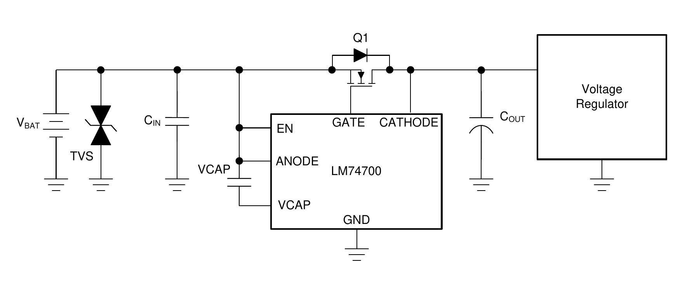

วงจรอ้างอิงการป้องกันไฟเข้าและ ideal diode LM74700-Q1 ภาพใช้ประกอบการอ่านวงจรย่อย ไม่ยืนยันการติดตั้งใน BCM ของรถรุ่นใด

**หลักฐาน:** [TI LM74700-Q1, SNOSD17G Rev G](https://www.ti.com/lit/ds/symlink/lm74700-q1.pdf), หน้า 3–4 pin configuration, หน้า 6–7 electrical characteristics, หน้า 13–15 การทำงาน และหน้า 16 Figure 10-1 วงจรใช้งานจริงใน datasheet

วงจรใช้ N-channel MOSFET ภายนอก โดย ANODE ตรวจฝั่ง source/ไฟเข้า CATHODE ตรวจฝั่ง drain/ไฟออก GATE ควบคุมเกต และคาปาซิเตอร์ charge pump ต่อ **VCAP ถึง ANODE** ไม่ใช่ VCAP ลงกราวด์ ค่า 0.1 µF เป็นเงื่อนไขทดสอบในตาราง หน้า 6 แหล่งตัวอย่างทำงานที่ ANODE 12 V และ EN 3.3 V ช่วง forward regulation มีค่า ANODE−CATHODE typical 20 mV; เมื่อโหลดทำให้ต้องขับเต็ม ความต่างนี้ไม่จำเป็นต้องค้างที่ 20 mV

**ลำดับตรวจ:**

1. ตัดไฟ ตรวจ MOSFET ว่ามี D–S ลัดหรือไม่ พร้อมตรวจ TVS และคาปาซิเตอร์ข้างไฟเข้า แยกผลจาก body diode กับชอร์ตสองทิศโดยไม่เหมารวมผลที่วัดผ่านโหลดทั้งบอร์ด
2. จ่ายไฟในขั้วปกติตามแผนทดสอบ วัด TP-P1 ANODE และ TP-P2 CATHODE เทียบ GND พร้อมกระแสโหลด ถ้าต่างกันมากให้วัดคร่อม MOSFET โดยตรงเพื่อไม่รวมแรงดันตกของลายและขั้วต่อ
3. วัด EN และ **VCAP−ANODE** จากนั้น **GATE−ANODE** หากไม่มี gate drive ให้ตรวจ enable และ charge pump ก่อนกล่าวว่า MOSFET เสีย หาก charge pump มีแต่เกตไม่ขึ้น ให้ตรวจการรั่วของ gate และทางต่อเกต
4. ถ้าไฟออกยังผ่านขณะ disable อย่าใช้ผลนี้สรุปว่าชิปเสีย เพราะ body diode ยังนำกระแสไปข้างหน้าได้ วงจร ideal diode แบบนี้ไม่ได้เท่ากับสวิตช์ตัดไฟสองทิศ

## 2. Buck: LM53603-Q1 fixed-output

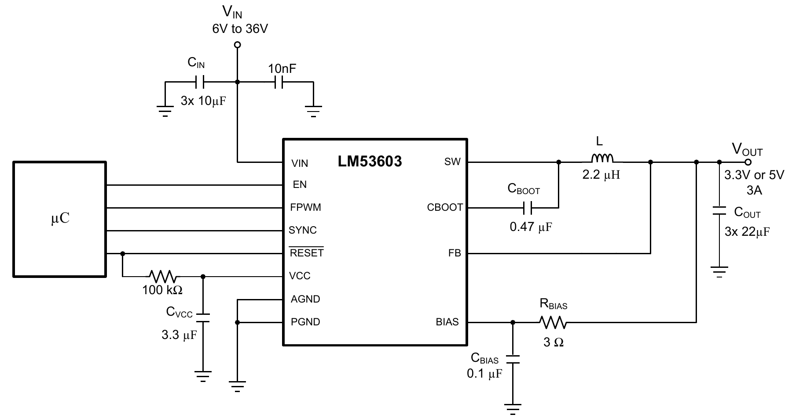

วงจรอ้างอิง buck LM53603-Q1 ภาพใช้ประกอบการอ่านวงจรย่อย ไม่ยืนยันการติดตั้งใน BCM ของรถรุ่นใด

**หลักฐาน:** [TI LM53603-Q1, SNVSA42B Rev B](https://www.ti.com/lit/ds/symlink/lm53603-q1.pdf), หน้า 3 pin functions, หน้า 18 Figure 15, หน้า 19 Figure 16 และหน้า 25–27 ตัวอย่างรูปคลื่น

จุดที่ยืนยันได้คือ SW ขา 1 และ 2 ต่อร่วมกันไปตัวเหนี่ยวนำ CBOOT ขา 3 ใช้คาปาซิเตอร์ 470 nF ไป SW และ VCC ขา 4 เป็นไฟภายในประมาณ 3.15 V ไม่ใช่รางให้ต่อโหลด MCU เพิ่ม รุ่น fixed-output ใช้ FB ตรวจเอาต์พุตโดยตรง ตัวอย่าง Figure 16 ใช้ L 2.2 µH, CIN 3×10 µF และ COUT 3×22 µF ต้องคงวงจร bypass และส่วน BIAS ตามต้นฉบับเมื่อวาด ไม่เอาค่าจากรูปนี้ไปแทนบอร์ดจริงโดยอัตโนมัติ

**ลำดับตรวจ:**

1. ไม่มีไฟ: ตรวจราง OUT−GND และตัวเหนี่ยวนำว่าขาดหรือไม่ ค่าความต้านทานรางต่ำอย่างเดียวไม่แยกชิป buck ชอร์ตออกจากโหลดปลายทางได้
2. มีไฟและ enable ถูกต้อง: วัด VIN ที่ชิป ไม่ใช้ค่าหน้าจอแหล่งจ่ายแทน จากนั้น VCC, OUT และ FB ตรวจ FB เทียบ OUT เพื่อพบลาย feedback ขาดหรือมีอุปกรณ์รั่ว
3. วัด SW กับ OUT พร้อมกัน หาก SW มีพัลส์แต่ OUT ไม่ขึ้น ตรวจ L รอยต่อ COUT และกระแสโหลด หากพัลส์มาเป็นชุดแล้วหยุด ตรวจ VIN ตก enable และการป้องกันจากโหลด
4. ถ้าไม่มี switching ให้ตรวจว่ากำลังวัดโหมดโหลดเบาหรือช่วงเริ่มต้นหรือไม่ อย่าใช้การไม่เห็น 2.1 MHz ตลอดเวลาเป็นข้อสรุปเสียในโหมด AUTO
5. หลังซ่อมเปลี่ยนโหลดแบบควบคุมและดู OUT พร้อม reset บันทึกการยุบและเวลาฟื้น การเทียบกราฟ datasheet ต้องใช้สภาวะเดียวกับกราฟ ไม่ยกยอด ripple จากกราฟเป็นเกณฑ์ทุก PCB

## 3. LDO: TPS7B6950-Q1 และผลของคาปาซิเตอร์เอาต์พุต

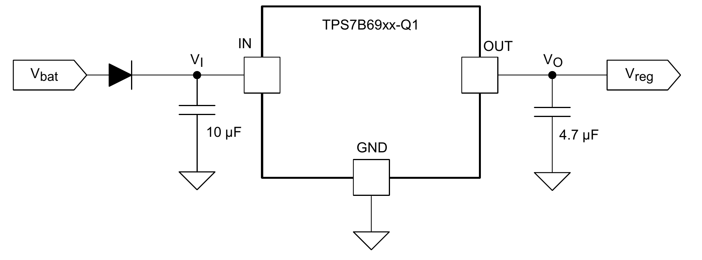

วงจรอ้างอิง LDO TPS7B69xx-Q1 ภาพใช้ประกอบการอ่านวงจรย่อย ไม่ยืนยันการติดตั้งใน BCM ของรถรุ่นใด

**หลักฐาน:** [TI TPS7B69xx-Q1, SLVSCJ8B Rev B](https://www.ti.com/lit/ds/slvscj8b/slvscj8b.pdf), หน้า 3 pin functions, หน้า 12 Figure 25 และหน้า 13 ข้อกำหนดคาปาซิเตอร์ ภาพบอร์ดทดลองดู [TPS7B6950EVM](https://www.ti.com/tool/TPS7B6950EVM)

สำหรับ SOT-223/DCY: IN=1, GND=2/4, OUT=3; ส่วน SOT-23/DBV: IN=1, NC=2, GND=3/4, OUT=5 จึงต้องระบุตัวถังก่อนใช้เลขขา รูปหน้าแรกแสดง CIN 10 µF และ COUT 4.7 µF ข้อกำหนด COUT คือ 2.2–100 µF และ ESR 1 mΩ–2 Ω ค่า nominal บนตัวคาปาซิเตอร์อาจต่างจาก effective capacitance ขณะมี DC bias

**ลำดับตรวจ:**

1. วัด IN และ OUT ที่ขาชิปในสภาวะโหลดเดียวกัน ตรวจกราวด์ขาชิปเทียบกราวด์ทางเข้าเพื่อพบรอยต่อหลุด รุ่น 5 V ไม่สามารถรักษา 5 V ได้เมื่ออินพุตต่ำจน headroom ไม่พอ
2. OUT ต่ำแต่ IN ปกติ: วัดกระแสโหลดและความร้อน ตรวจ COUT รั่วหรือชอร์ต ห้ามตัดสินจากอุณหภูมิตัวชิปอย่างเดียวเพราะ LDO ต้องคายกำลังประมาณ (VIN−VOUT)×IOUT
3. OUT แกว่ง: ใช้โพรบกราวด์สั้น วัดที่ COUT ตรวจคาปาซิเตอร์ ค่า ESR และรอยต่อกราวด์ก่อนเปลี่ยน IC
4. หากแยกโหลดได้โดยไม่ทำลายหลักฐาน ให้ทดสอบส่วนจ่ายและโหลดแยกกันตามแผน ห้ามป้อนไฟย้อน OUT โดยไม่ตรวจ reverse-current path ของอุปกรณ์ทั้งหมด

## 4. Reset: TPS3808-Q1 และการตรวจ SENSE/MR/CT

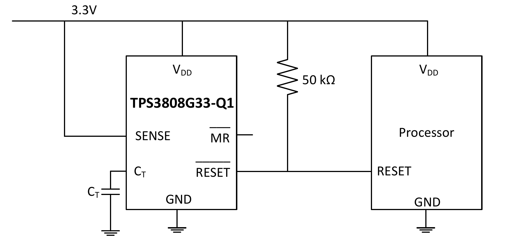

ภาพอ้างอิง TPS3808G33 จากเอกสาร TPS3808-Q1 หมายเลข SBVS085J Figure 14 หน้า 12 ใช้ตัวต้านทาน pull-up 50 kΩ ตามภาพ RESET เป็นเอาต์พุต open-drain ภาพนี้ไม่ใช่วงจร RESET ภายใน LM53603-Q1 และไม่ใช้ข้อมูล threshold หรือเวลาหน่วงของ LM53603 มาแปลผล

**หลักฐาน:** [TI TPS3808-Q1, SBVS085J](https://www.ti.com/lit/ds/symlink/tps3808-q1.pdf), Figure 14 หน้า 12 ตัวอย่าง TPS3808G33 ต้องตรวจรหัสเต็มและ revision ให้ตรงก่อนใช้ค่าตาราง

SENSE เป็นขาตรวจแรงดันที่เฝ้าระวัง MR เป็นอินพุต manual reset และ CT เกี่ยวข้องกับการกำหนดเวลาหน่วงปล่อย RESET การเห็น RESET ต่ำอาจเกิดจากแรงดันที่ SENSE เงื่อนไข MR ภาคจ่ายไฟ ตัว pull-up หรือผู้ขับร่วมเน็ต จึงไม่ใช่หลักฐานว่า MCU เสียโดยตรง ภาพนี้ไม่กำหนด threshold และเวลาหน่วงเป็นเกณฑ์ผ่าน/ตก เพราะยังไม่ได้คัดค่าตารางตรงรหัสและเงื่อนไขมาทวนสอบ

**ลำดับตรวจ:**

1. ตัดไฟและคายประจุ ตรวจเส้น RESET จาก supervisor ถึง MCU และตรวจว่ามีอุปกรณ์ร่วมเน็ตหรือไม่ ระบุตำแหน่งตัว pull-up และราง logic ที่ต่ออยู่ ตัวอย่าง 50 kΩ ในภาพไม่ใช่คำแนะนำเปลี่ยนทุกบอร์ดเป็นค่าเดียวกัน
2. จ่ายไฟตามแผนทดสอบ เก็บแรงดันเลี้ยง supervisor, SENSE, MR และ RESET ในช่วงเปิดไฟเดียวกัน เพื่อแยกเหตุที่ทำให้ reset ถูกดึงต่ำออกจากผลหลังเหตุการณ์
3. ถ้า RESET ต่ำพร้อม SENSE ยุบ ให้ย้อนตรวจรางที่ถูกเฝ้าระวังและโหลด ถ้า SENSE นิ่ง ให้ตรวจระดับ MR, แรงดันเลี้ยงตัว supervisor, ตัว pull-up และผู้ขับร่วมเน็ตก่อนสรุปชิปเสีย
4. ตรวจอุปกรณ์ที่ CT และรอยต่อ หากสงสัยเวลาปล่อย RESET ต้องเทียบกับ datasheet และค่าที่ติดตั้งจริง ไม่ใส่เวลาโดยเดาจากรูปคลื่นหรือใช้ข้อมูลของ supervisor อีกเบอร์
5. หาก RESET สูงไม่ถึงระดับ logic ให้ตรวจราง pull-up การรั่วและการโหลดของเน็ต ห้ามเพิ่มแรงดัน pull-up เพื่อบังคับผ่านโดยไม่ทราบพิกัดขา MCU เก็บผลทั้งระดับแรงดันและลำดับเวลาไว้ในใบงาน

## 5. High-side: TPS1H100-Q1 version B กับ current sense

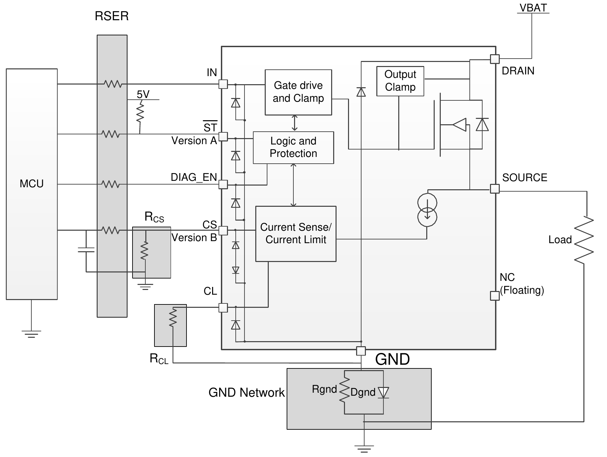

วงจรอ้างอิงภาคขับ high-side TPS1H100-Q1 ภาพ Figure 45 รวมการอธิบายตัวเลือก version A และ B ต้องอ่านแยก: ขา 14 ของ A คือ ST ส่วน B คือ CS ไม่ใช่มี ST และ CS เป็นสองขาพร้อมกันในชิปตัวเดียว ภาพใช้ประกอบการอ่านวงจรย่อย ไม่ยืนยันการติดตั้งใน BCM ของรถรุ่นใด

**หลักฐาน:** [TI TPS1H100-Q1, SLVSCM2D Rev D](https://www.ti.com/lit/ds/symlink/tps1h100-q1.pdf), หน้า 3 pin functions, หน้า 32 Figure 45, หน้า 33 การคำนวณ และหน้า 34 Figures 46–47 แยก fault

ตัวถัง PWP14 ใช้ OUT ขา 5–7, VS ขา 8–10, IN ขา 3, GND ขา 2, DIAG_EN ขา 12 และ CL ขา 13; ขา 14 ของ version B คือ CS ขณะที่ version A เป็น ST ห้ามเรียกเหมือนกัน ตัวอย่างหน้า 33 กำหนดโหลด 2 A และ current limit เป้าหมาย 5 A ได้ RCS 750 Ω และ RCL 493.2 Ω ตามสมการตัวอย่าง ค่าหลังเป็นผลคำนวณ ไม่ใช่คำแนะนำให้เลือกค่ามาตรฐานใกล้เคียงโดยไม่คำนวณใหม่

**ลำดับตรวจ:**

1. ไม่มีไฟ ตรวจโหลดและสายออก ตรวจ VS−OUT ว่าลัดหรือไม่ ตรวจการต่อ GND network และการเชื่อมขากำลังหลายขา
2. มีไฟ: วัด VS, IN, DIAG_EN, OUT และ CS ในสถานะปิด แล้วสั่งเปิดด้วยเงื่อนไขที่ถูกต้อง วัดแรงดันคร่อม VS−OUT พร้อมกระแสโหลด
3. OUT ต่ำขณะ IN ถูกต้อง: ตรวจว่ากำลัง current-limit/thermal cycling หรือไม่มีทางกลับโหลด เก็บ OUT และ CS พร้อมกัน อย่าตัดวงจรป้องกันเพื่อให้จ่ายค้าง
4. CS ต่ำใน on-state อาจเกิดจากไม่มีโหลดหรือ short-to-battery จึงต้องใช้ off-state test และวงจร pulldown ตามเอกสารแยก ไม่ตัดสินจาก CS จุดเดียว
5. ตรวจการอิ่มตัวและพิกัด ADC ก่อนแปลค่า current sense ถ้า CS ถึงเพดาน fault ห้ามนำสมการกระแสเชิงเส้นมาคำนวณต่อ

## 6. Low-side: TPL7407L ขับคอยล์และทางคายพลังงาน

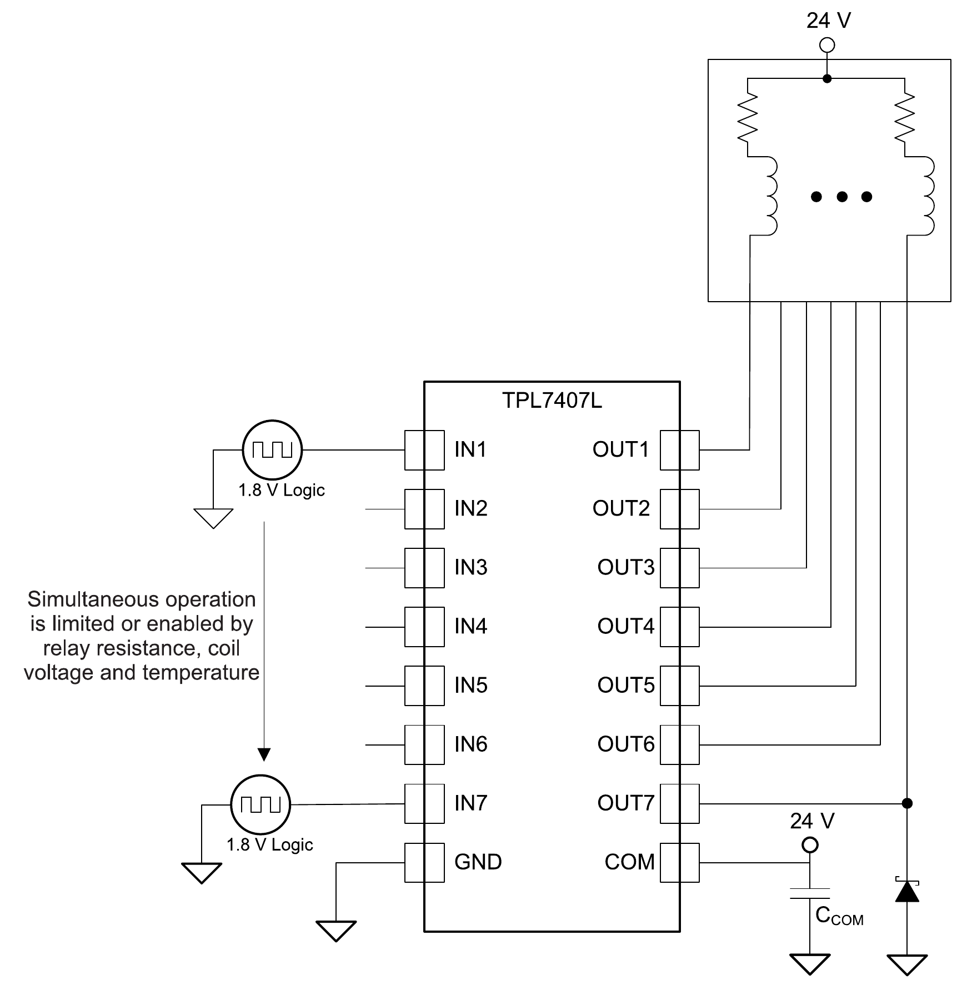

วงจรอ้างอิงภาคขับ low-side ภาพใช้ประกอบการอ่านวงจรย่อย ไม่ยืนยันการติดตั้งใน BCM ของรถรุ่นใด

**หลักฐาน:** [TI TPL7407L, SLRS066D Rev D](https://www.ti.com/lit/ds/symlink/tpl7407l.pdf), หน้า 3 pin functions, หน้า 8 Figure 9 และหน้า 9 Table 1/design procedure

อินพุต 1–7 อยู่ขา 1–7, GND ขา 8, COM ขา 9 และ OUT7 ถึง OUT1 อยู่ขา 10 ถึง 16 ตามลำดับ ตัวอย่าง inductive driver ใช้ CCOM 0.1 µF และโหลดตัวอย่าง 20–300 mA ต่อช่อง COM ไม่ใช่ขากราวด์ แต่เกี่ยวข้องกับทาง clamp และไฟเลี้ยงภายใน เอกสารระบุข้อควรระวัง negative transient ที่ OUT7 พร้อม Schottky ภายนอกตาม Figure 9

**ลำดับตรวจ:**

1. ไม่มีไฟ ตรวจคอยล์และเส้นทางกลับจาก OUTx ถึงชิป ตรวจ clamp diode/COM ไม่ให้สับสนกับทางเอาต์พุต ตรวจว่าขาออกไม่ได้ถูก short ไปไฟแบตเตอรี่
2. จ่ายไฟให้วงจรตัวอย่างที่ระบุ COM และโหลดถูกต้อง วัดปลายบวกของคอยล์ OUTx และ INx พร้อมกัน IN สูงควรทำให้ OUT ต่ำในวงจรที่ทำงานปกติ ส่วนแรงดันจริงคร่อมคอยล์คือ VSUP−VOL
3. OUT ต่ำแต่คอยล์ไม่ทำงาน ให้ตรวจไฟบวกและคอยล์ขาด OUT ไม่ลงทั้งที่ IN เปลี่ยน ให้ตรวจ COM กราวด์และภาค driver
4. เมื่อปล่อยคอยล์ เก็บ transient ที่ OUT ด้วยโพรบพิกัดพอและกราวด์สั้น ตรวจว่ามีทางคายพลังงานครบ ไม่ถอด clamp เพื่อให้เห็น spike ชัดขึ้น
5. อย่าเอาพิกัดต่อช่องคูณเจ็ดเป็นกระแสที่ใช้งานพร้อมกันได้ทันที ต้องตรวจการคายความร้อนของ package และ duty ของทุกช่อง

## 7. CAN: TCAN1042V-Q1 สองทิศทางและโหมด standby

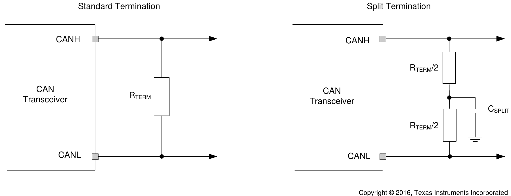

วงจร CAN และ termination ตามตำแหน่งปลายบัส ภาพใช้ประกอบการอ่านวงจรย่อย ไม่ยืนยันการติดตั้งใน BCM ของรถรุ่นใด

**หลักฐาน:** [TI TCAN1042-Q1, SLLSES9D Rev D](https://www.ti.com/lit/ds/symlink/tcan1042-q1.pdf), หน้า 5 pin configuration, หน้า 10 driver electrical characteristics, Figures 8-1/8-2 วงจรทดสอบ และ Figure 9-2/9-3 สถานะบัส

รุ่น V: 1 TXD, 2 GND, 3 VCC, 4 RXD, 5 VIO, 6 CANL, 7 CANH, 8 STB; VIO ต้องต่อไฟ logic ที่รองรับ ไม่ใช่เอาต์พุตจ่ายไฟ ตัวอย่างเกณฑ์ dominant differential 1.5–3 V ใช้เฉพาะเงื่อนไข TXD=0, STB=0 และ RL 50–65 Ω ตามตาราง ไม่ใช้แรงดันเฉลี่ยมิเตอร์แทนรูปคลื่น

**ลำดับตรวจ:**

1. ไม่มีไฟ ตรวจการต่อคู่สายและ termination ตาม topology จริง ตรวจทั้งกล่องและเครือข่ายแยกสภาวะ ห้ามเติม 120 Ω ทุกกล่องเพื่อให้ค่ารวมดูคุ้นเคย
2. มีไฟ ตรวจ VCC/VIO/STB ก่อนส่งข้อมูล ตั้งออสซิลโลสโคปดู TXD, RXD และ CANH−CANL ในช่วงเดียวกัน
3. TXD มีแต่บัสเงียบ: ตรวจ standby, UVLO, บัสถูกโหลด และระยะ dominant timeout หากป้อน TXD ต่ำค้าง การตัด dominant อาจเป็นการป้องกันตามปกติ
4. บัสมีข้อมูลแต่ RXD ไม่มี: ตรวจสถานะชิปและระดับ logic หาก RXD ถึง MCU แล้วแต่ไม่มีคำตอบ ให้ตรวจ reset และโปรแกรมในระดับถัดไป
5. หากบัสค้าง ให้แยกสาขาตามผังและบันทึกระบบที่เปลี่ยนก่อนตีความ ไม่ยกการถอดโมดูลแล้วหายเป็นหลักฐานชิปตัวนั้นเสียโดยไม่มีการตรวจสาย

## 8. LIN: TJA1021 SO8 และ commander pull-up

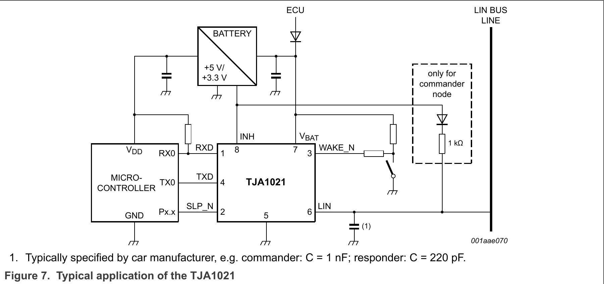

วงจรอ้างอิง LIN TJA1021 และเครือข่าย commander ภาพใช้ประกอบการอ่านวงจรย่อย ไม่ยืนยันการติดตั้งใน BCM ของรถรุ่นใด

**หลักฐาน:** [NXP TJA1021 Rev 9](https://www.nxp.com/docs/en/data-sheet/TJA1021.pdf), หน้า 4 Figure 2/Table 3, หน้า 15 Figure 5 วงจรทดสอบ, หน้า 16 Figure 7 typical application

SO8: 1 RXD open-drain, 2 SLP_N, 3 WAKE_N, 4 TXD, 5 GND, 6 LIN, 7 VBAT, 8 INH วงจร commander ใน Figure 7 มี resistor 1 kΩ และ diode ส่วน responder ไม่ใส่เครือข่าย commander ซ้ำโดยอัตโนมัติ C ที่บัสเป็นค่ากำหนดตามผู้ผลิตรถ ตัวอย่างที่เอกสารยกคือ commander 1 nF/responder 220 pF จึงไม่ใช้เป็นค่าบังคับทุกบอร์ด

**ลำดับตรวจ:**

1. ตรวจ VBAT, GND และระดับ SLP_N พร้อมดู INH ว่ามีผลต่อ regulator ภายนอกหรือไม่ ถ้าราง MCU หาย ให้พิจารณาเส้นทาง INH ก่อนเปลี่ยน regulator
2. RXD ต้องมี pull-up ไป logic rail ที่ถูกต้อง การเห็น RXD ค้างไม่แยกชิปเสียจาก pull-up ขาดได้
3. ทดสอบในสถานะตื่นด้วย commander ที่ส่ง header ถูกต้อง จับ TXD/LIN/RXD พร้อมกัน ถ้าไม่มี header responder เงียบอาจปกติ
4. TXD เปลี่ยนแต่ LIN ไม่ตาม: ตรวจ sleep, dominant timeout และโหลดบัส LIN มีแต่ RXD ไม่ตอบ: ตรวจ pull-up และสถานะชิป
5. การทดสอบ local wake ต้องตรวจขอบและเครือข่าย WAKE_N ตามต้นฉบับ ไม่แตะไฟเข้าขา MCU โดยคาดว่าใช้แรงดันเดียวกับ VBAT

## 9. SPI EEPROM: M95640-A125/A145 กับการอ่านที่ตรวจสอบได้

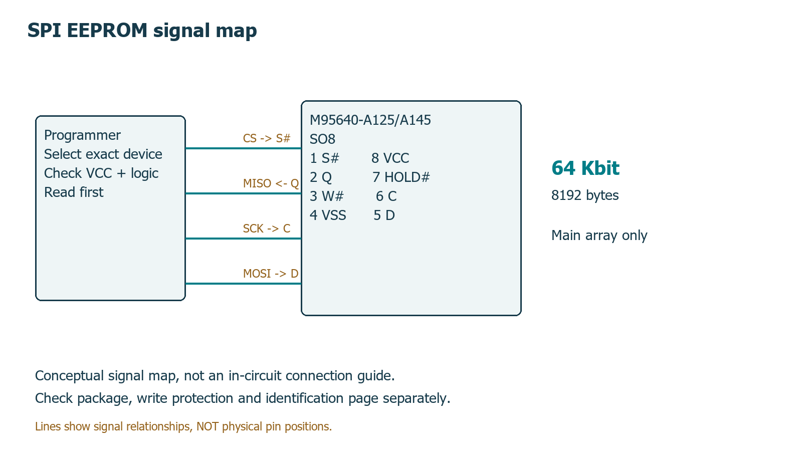

แผนที่สัญญาณ SPI EEPROM: เป็น signal map ไม่ใช่ schematic เต็ม ภาพใช้ประกอบการอ่านวงจรย่อย ไม่ยืนยันการติดตั้งใน BCM ของรถรุ่นใด

**หลักฐาน:** [ST M95640-A125/A145 DS8799 Rev 10](https://www.st.com/resource/en/datasheet/m95640-a125.pdf), หน้า 7 Figure 2 pinout, หน้า 10 Figure 3 SPI modes, หน้า 16 Figures 5–6 write enable/disable, หน้า 17 Figure 7 status และหน้า 19 Figure 9 READ

SO8: 1 S#, 2 Q/MISO, 3 W#, 4 VSS, 5 D/MOSI, 6 C/SCK, 7 HOLD#, 8 VCC Main array 8192 ไบต์และมี identification page แยก ขาสัญญาณควบคุมต้องมีระดับกำหนด ไม่ปล่อยลอย การอ่าน main array ครบไม่ยืนยันว่าโปรแกรมอ่านพื้นที่อื่นครบหรือสำรองข้อมูลทั้ง BCM สำเร็จ

**ลำดับตรวจ:**

1. ตัดไฟ ระบุรหัสท้ายและ package ตรวจว่าบัสร่วม MCU หรือชิปอื่นหรือไม่ กำหนดผู้จ่ายไฟเพียงรายเดียวตามแผนและตรวจทางย้อนเลี้ยงก่อนต่อ programmer
2. วัด VCC ที่ตัวชิปขณะอ่าน ดู S#, SCK, MOSI และ MISO หากไม่มี clock ให้ตรวจเมนู/การต่อ หากมี clock แต่ MISO ค้าง ตรวจ chip select, HOLD#, contact และ bus contention ก่อนกล่าวว่าข้อมูลว่าง
3. อ่านซ้ำอย่างน้อยสองรอบด้วยสภาวะบันทึกได้ เปรียบเทียบทั้งขนาดและเนื้อหา ถ้าไม่ตรงให้แก้สภาพการอ่านก่อนเขียน ชื่อไฟล์ success ไม่ยืนยันว่าระบุอุปกรณ์ถูก
4. ข้อมูล 00 หรือ FF ทั้งก้อนอาจเป็นข้อมูลจริงหรืออ่านผิด ต้องแยกด้วยการตรวจสัญญาณและสถานะไฟ ไม่ใช้สีหน้าจอ hex เป็นข้อยืนยันเพียงอย่างเดียว
5. ก่อนเขียน เก็บต้นฉบับ อ่าน status/ข้อป้องกันตามเครื่องมือและ datasheet ไม่ล้าง protection หรือ identification page เป็นการลอง การ verify ต้องระบุพื้นที่ที่อ่านกลับจริง

# ภาคขยาย: CG และโปรแกรมย้ายข้อมูล BCM

ตรวจเว็บต้นทางวันที่ 17 พฤศจิกายน 2569 สำหรับหนังสือ Mytech ฉบับที่ 2

เนื้อหานี้แยกข้อเท็จจริงจากคู่มือออกจากลำดับตรวจงานที่ผู้เรียบเรียงเสนอ ภาพหน้าจอในภาคนี้ตรวจชื่อเมนูที่มองเห็นแล้ว โดยอธิบายเฉพาะสิ่งที่ภาพรองรับ รายการรองรับการอ่านเขียนไม่ใช่ผลทดสอบ full clone และไม่มีการแต่งผลซ่อมรถสำเร็จ

## 1 เลือก CG ให้ถูกงาน

| เครื่องมือ | หลักฐานที่ตรวจได้ | ใช้ในหนังสือนี้อย่างไร | ข้อจำกัด |
|---|---|---|---|
| CG100X | เว็บไซต์ผู้ผลิตแยก Body repair, Read/Write, Dashboard และ Airbag [P1] | เน้นรายการ BCM และการอ่านเขียนชิปที่ตรงรหัส | หมวดที่มีคำว่า repair ไม่ได้ยืนยันความสามารถเดียวกันทุกรายการ |
| CG-PRO | คู่มือ V1.6.0 เดือน 12/2019 อธิบายการเลือกโมเดลและการเลือกพื้นที่ MCU [P2] | ใช้สอนความต่าง EEPROM/DFLASH/PFLASH และการเก็บไฟล์ | เป็นคู่มือเก่า ต้องตรวจเมนูจริงในซอฟต์แวร์ที่ใช้อยู่ |
| CG70 | เว็บไซต์ผู้ผลิตจัดเป็นเครื่องมือกลุ่มถุงลมนิรภัย [P3] | ไม่นำมาเป็นขั้นตอน BCM | การมีชื่อ CG เหมือนกันไม่ใช่หลักฐานว่ารองรับ BCM |
| ACDP-2 Module08 | ผู้ผลิตระบุ BMW FRM 0L15Y และ 3M25J พร้อม interface board และ pin detection [P4] | ตัวอย่างอ่านในวงจรและกู้ข้อมูลกล่องเดิม | FRM เป็นโมดูลเฉพาะหน้าที่ ไม่ครอบคลุม BCM ของทุกยี่ห้อ |

ก่อนเลือกเครื่องมือให้เขียนเป้าหมายงานหนึ่งประโยค เช่น “สำรอง EEPROM ของกล่องเดิม” “ย้ายข้อมูลไปกล่องทดแทนที่ตรวจเลขอะไหล่แล้ว” หรือ “กู้ข้อมูลใน FRM เดิม” เป้าหมายเหล่านี้ใช้เกณฑ์ผ่านต่างกัน การใช้เครื่องมือที่มีรายชื่อรถมากไม่ได้ช่วยหากเมนูที่เลือกทำคนละหน้าที่กับงาน

สำหรับ CG100X ต้องแยกรายการ BCM ออกจากรายการมาตรวัดและ airbag แม้รายการอัปเดตจะอยู่หน้าเดียวกัน ห้ามหยิบชิปจากหมายเลขโมดูลถุงลมมาใช้เป็นตัวอย่าง BCM เพียงเพราะชื่อรถและรุ่นปีตรงกัน ส่วนกล่องที่ทำหน้าที่เกี่ยวข้องกับระบบตัวถัง เช่น FRM หรือ RFA ให้ระบุชื่อโมดูลเดิมก่อนอธิบาย ไม่เปลี่ยนชื่อทั้งหมดเป็น BCM

## 2 ตัวอย่างรุ่นที่มีหลักฐาน CGDI

ตารางต่อไปนี้ถอดเฉพาะรายการสั้นจากเอกสาร CG100X Support BCM List [P5] ไม่ใช่ตารางความเข้ากันได้ของกล่องทดแทน

| ภูมิภาค | ชื่อรายการในเอกสาร | MCU หรือรหัสที่ระบุ | ข้อมูลที่ยังไม่มีในรายการ |
|---|---|---|---|
| ญี่ปุ่น | Nissan BCM X-TRAIL | MPC5606BK, read-write | เลขอะไหล่ PCB และรุ่นปีครบทุกตลาด |
| ยุโรป | Audi BCM A4/A5/Q5 | D70F3380 หรือ D70F3634, read-write | ความเข้ากันได้และขอบเขตข้อมูลของกล่องแต่ละเลข |
| ยุโรป | BMW FRM E series | 9S12XEQ384, read-write | ผลกู้ข้อมูลและการตั้งค่าบนรถแต่ละคัน |
| อเมริกา | GM BCM Chevrolet | D70F3385 หรือ D70F3558, read-write | EEPROM ภายนอกและขั้นตอนรถตรงเลขกล่อง |
| อเมริกา | GM BCM Cruze 2015- | 1M12S | ภาพ PCB และผลย้ายข้อมูลที่ยืนยันแล้ว |

ตารางไม่ได้ระบุ EEPROM ภายนอกครบทุกตัว จึงไม่เติมชนิด EEPROM จากบอร์ดหน้าตาคล้ายกัน รหัส MCU ที่ระบุไว้เป็นจุดเริ่มเลือกคู่มือ ไม่ใช่คำสั่งให้เขียนข้อมูลจากกล่องหนึ่งไปยังอีกกล่องทันที

## 3 ขั้นตอน CG-PRO ที่มีหลักฐานระดับคู่มือ

คู่มือ CG-PRO หน้า PDF 24 อธิบายส่วน CPU→MCU ที่มีตัวเลือกพื้นที่ เช่น EEPROM, DFLASH และ PFLASH พร้อมผังขาชิป ส่วนหน้า PDF 27 อธิบาย Hex Editor สำหรับเปรียบเทียบไฟล์ หน้า PDF 4 อธิบาย Partition ของ 9S12XE และเตือนผ่านนิยามว่า decryption ของชิปบางแบบลบข้อมูล flash ได้ [P2]

นี่เป็นข้อมูลที่ใช้กำหนดจุดหยุดงาน: ถ้ายังไม่มีไฟล์เดิมครบ อย่ากดฟังก์ชันที่เปลี่ยนการจัดสรรพื้นที่หรือลบข้อมูลเพื่อทดลองเชื่อมต่อ อย่าสับสนว่าตัวเลือก Partition คือการตรวจชิป หรือว่าคำว่า decryption หมายถึงอ่านข้อมูลเดิมโดยไม่มีผลข้างเคียงเสมอไป ให้ตรวจคำอธิบายของรหัสชิปและเวอร์ชันโปรแกรมจริงก่อนทุกครั้ง

ลำดับต่อไปนี้เป็นวิธีจัดงานของผู้เรียบเรียง ไม่อ้างว่าเป็นชุดปุ่มอัตโนมัติของ CG ทุกเวอร์ชัน:

1. ถ่ายฉลากและรหัส MCU ตรวจกล่องและชิปให้ตรงกับรายการรองรับที่เลือก บันทึกหมายเลขเครื่องและเวอร์ชันซอฟต์แวร์
2. เปิดผังการต่อจากเมนูที่ตรงรหัสเต็ม ตรวจชนิดอะแดปเตอร์และพื้นที่ข้อมูล หากไม่มีผังตรงรุ่นให้หยุด ไม่เทียบสีสายจากภาพรุ่นอื่น
3. ตรวจการต่อขณะยังไม่จ่ายไฟ ตรวจทิศปลั๊กและกราวด์ จากนั้นจ่ายไฟตามคู่มือของตัวเครื่องและอุปกรณ์เป้าหมาย ค่าแรงดันเข้าตัวเครื่องไม่ใช่ค่า VCC ของ MCU
4. อ่านพื้นที่ที่คู่มือและเมนูรองรับ เก็บเป็นไฟล์แยกตามชนิดพื้นที่ อย่าเขียนทับไฟล์เดิมด้วยพื้นที่ใหม่ที่มีนามสกุลเหมือนกัน
5. อ่านซ้ำและเทียบไฟล์ ถ้าแตกต่างให้ตรวจการสัมผัส แหล่งจ่าย และสภาวะวงจรก่อนทำคำสั่งอื่น การอ่านสองรอบตรงกันเป็นเพียงเกณฑ์ความสม่ำเสมอ ไม่ยืนยันเลือกพื้นที่ถูก
6. หากเป้าหมายเป็นกล่องทดแทน ให้สำรองข้อมูลทดแทนก่อน แล้วตรวจหลักฐานความเข้ากันได้ ทั้งรุ่นฮาร์ดแวร์และรูปแบบข้อมูล
7. เขียนเฉพาะพื้นที่ที่แผนงานระบุ ตรวจผล write และวิธี verify ที่เครื่องมีจริง บันทึกข้อความเต็ม หากไม่มี verify ที่ยืนยันได้ให้ใช้การอ่านกลับตามวิธีที่รองรับและเทียบไฟล์ โดยระบุว่าเป็นการตรวจที่ผู้ปฏิบัติงานทำ
8. ตรวจการสื่อสารและการตั้งค่าตามคู่มือรถ เก็บผลทดสอบจริงแยกจากผลโปรแกรมชิป

ภาพตัวอย่างไม่แสดงปุ่ม Full Clone หรือ Auto Verify จึงใช้ผลอ่านกลับและรายงานที่เครื่องรองรับจริงในการบันทึกผล ไม่ถือว่าคำว่า success เป็นผลทดสอบรถครบระบบ

### อ่านปุ่ม CG-PRO จากภาพจริง

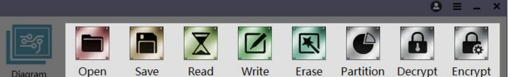

ภาพแถบเครื่องมือในคู่มือแสดง **Open, Save, Read, Write, Erase, Partition, Decrypt, Encrypt** ไม่มีปุ่ม Full Clone หรือ Verify ในภาพนี้ ขั้นตอนอ่านสำรองคือเลือกอุปกรณ์และพื้นที่ตามผังที่ตรงรหัส แล้วใช้ **Read** จากนั้น **Save** เก็บชื่อเลขงานและพื้นที่ข้อมูล อ่านซ้ำและ Save เป็นอีกไฟล์ก่อนเปรียบเทียบ สำหรับงานเขียนให้ตรวจไฟล์และความเข้ากันได้ก่อนใช้ **Open** โหลดไฟล์ที่ต้องการและ **Write** ตามพื้นที่ที่เลือก ไม่สลับไป Erase, Partition หรือ Decrypt เพื่อทดลองอ่าน เพราะอาจเปลี่ยนหรือลบข้อมูลตามชนิดชิป

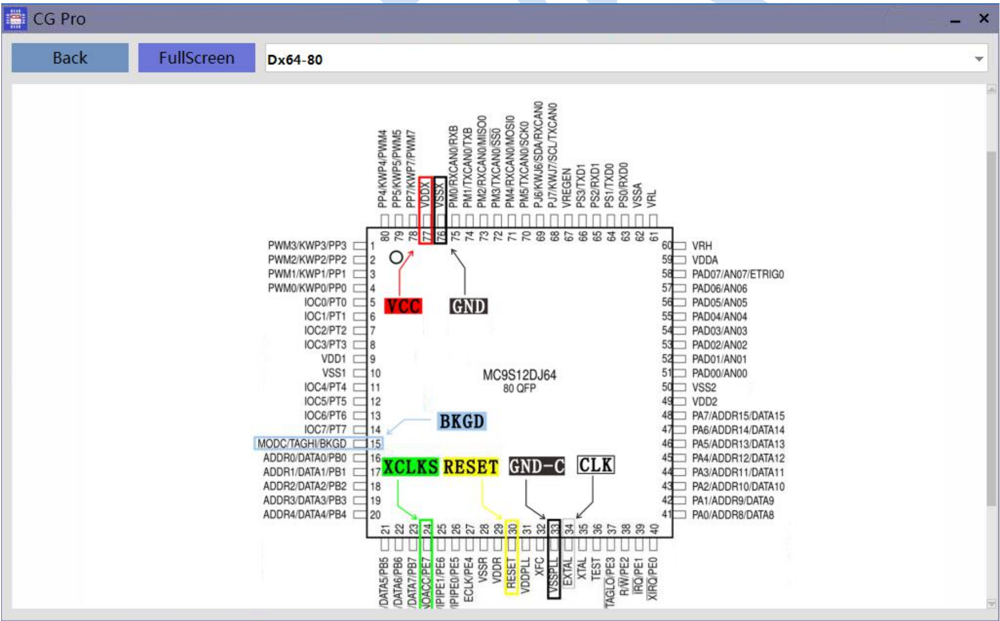

ภาพนี้เป็นตัวอย่าง **MC9S12DG64 80 QFP** จากคู่มือ ไม่ใช่ผัง FRM MC9S12XEQ384 หรือ BCM ทุกตัว แสดงหลักการที่ต้องเทียบรหัสชิป package ขาหนึ่ง และจุดสัญญาณกับผังของรายการที่เลือกจริง จึงไม่คัดลอกเลขขาจากภาพนี้ไปใช้กับกล่องในกรณีอื่น

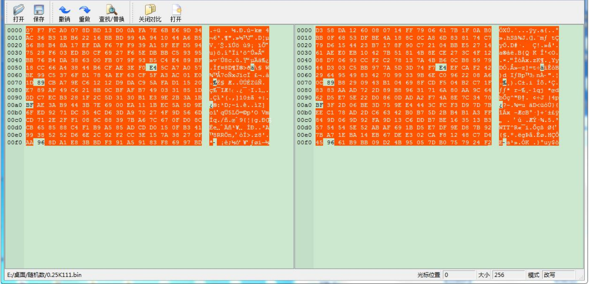

ภาพ Hex Editor แสดงพื้นที่ข้อมูลสองด้านและไบต์ที่แตกต่าง เป็นภาพตัวอย่างจากคู่มือ ไม่ใช่ไฟล์ BCM ที่ผ่านการซ่อม การเปรียบเทียบต้องใช้ไฟล์พื้นที่เดียวกันและขนาดเดียวกัน สีที่ต่างกันไม่ระบุว่าไบต์ใดเสีย ให้ย้อนตรวจที่มา เวอร์ชัน สภาวะการอ่าน และชนิดข้อมูล หลัง Write หากเมนูจริงมี verify ให้บันทึกผลและขอบเขต หากไม่มีให้ใช้การอ่านกลับตามวิธีรองรับและเปรียบเทียบ โดยไม่เรียกการเทียบไฟล์นี้ว่า verify อัตโนมัติของโปรแกรม

## 4 ACDP-2 FRM: กู้ข้อมูลกล่องเดิม MC9S12XEQ384 mask 3M25J

ตัวอย่างนี้จำกัดเฉพาะเส้นทางเมนูที่ปรากฏในภาพผู้ผลิตสำหรับ FRM ชิป MC9S12XEQ384 mask 3M25J เป็นการกู้ข้อมูลในกล่องเดิม ไม่ใช่ขั้นตอน full clone ไปยัง FRM หรือ BCM ทุกเลขอะไหล่ ความสามารถ EEPROM/D-FLASH/P-FLASH ที่ผู้ผลิตระบุไม่ได้รับรองความเข้ากันได้ของกล่องทดแทน [P4]

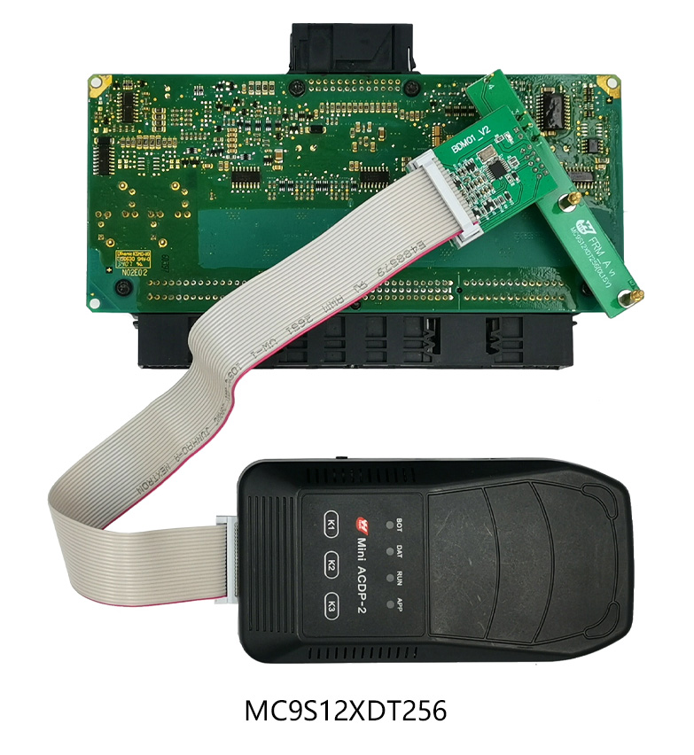

ภาพการเชื่อมต่อจริงจากผู้ผลิตนี้ระบุ MC9S12XDT256 เป็นอีกฮาร์ดแวร์หนึ่ง ไม่ใช่จุดต่อของ MC9S12XEQ384 mask 3M25J และห้ามใช้ตำแหน่งในภาพนี้ต่อ XEQ384 ภาพใช้แสดงลักษณะชุดและการยึดอะแดปเตอร์เท่านั้น การทำงาน XEQ384 ต้องใช้ผังและ interface board ที่ตรงรหัสในคู่มือแอป รุ่นเครื่องและสิทธิ์ Module08 ต้องตรงกับอุปกรณ์ที่ใช้

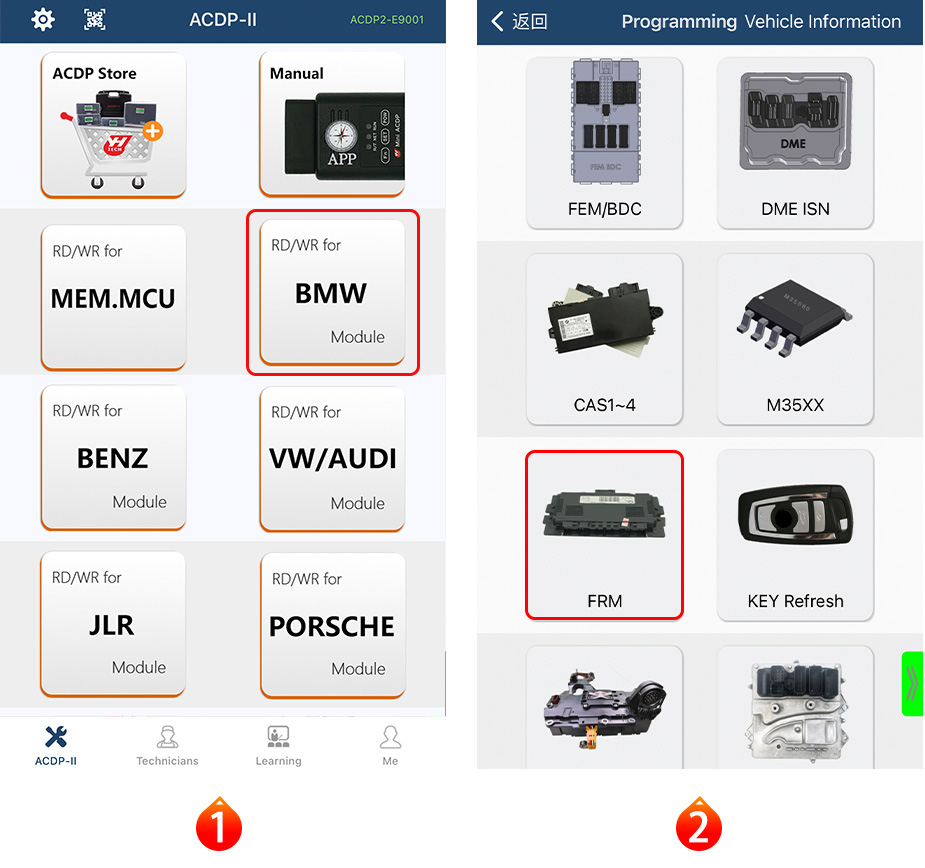

1. ที่หน้าหลักเลือก **BMW Module** แล้วเลือก **FRM** ตามกรอบในภาพ ชื่อเมนูอาจต่างเมื่อเปลี่ยนเวอร์ชัน จึงควรเก็บภาพเวอร์ชันที่ใช้จริงไว้กับเลขงาน
2. ตรวจรหัสบน MCU ให้ตรง **MC9S12XEQ384 (MASK: 3M25J)** แล้วเลือก **ICP MC9S12XEQ384 (MASK: 3M25J)** ไม่เลือก 0L15Y เพียงเพราะอยู่หน้าจอเดียวกัน

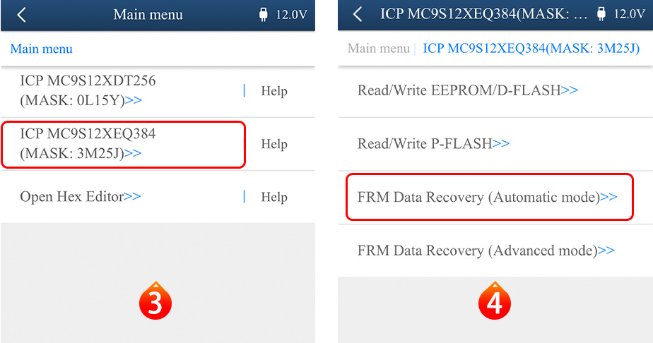

3. หน้าถัดไปมี **Read/Write EEPROM/D-FLASH**, **Read/Write P-FLASH**, **FRM Data Recovery (Automatic mode)** และ **FRM Data Recovery (Advanced mode)** แยกเป็นคนละรายการ ก่อน recovery ให้สำรองพื้นที่ที่เมนูอ่านได้ เก็บไฟล์เดิมแยกและอ่านซ้ำเพื่อเทียบความสม่ำเสมอ ภาพนี้ยังไม่แสดงหน้าปุ่มบันทึกและเขียนย่อย จึงไม่เพิ่มชื่อปุ่มเหล่านั้นเอง
4. สำหรับตัวอย่างที่ตรงชิปและผ่านการตรวจการต่อแล้ว เลือก **FRM Data Recovery (Automatic mode)** ตามกรอบภาพ การมี Advanced mode ไม่ใช่เหตุให้ลองเมื่อ automatic ไม่ผ่าน ต้องหาสาเหตุและตรวจคู่มือเฉพาะก่อน

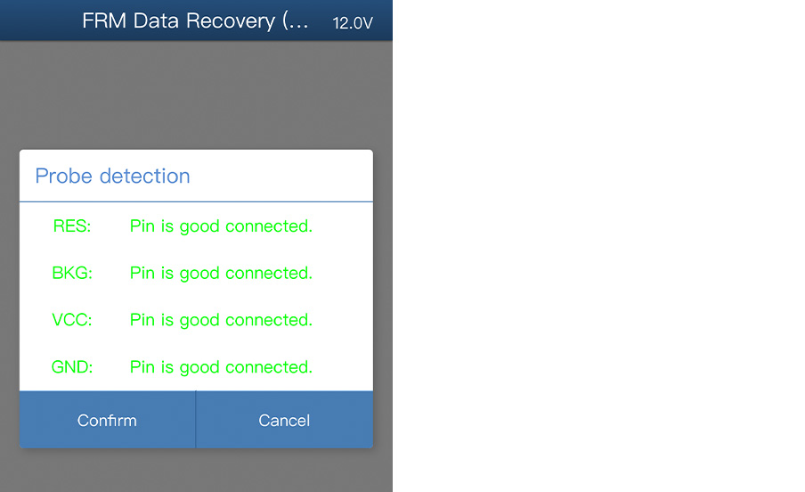

5. หน้าตรวจ **Probe detection** ในภาพแสดง RES, BKG, VCC และ GND เป็น **Pin is good connected.** และมี **Confirm/Cancel** ถ้าสภาพงานจริงไม่ผ่านต้องแก้การต่อก่อน ไม่กด Confirm เพื่อข้ามความผิดปกติ เมื่อผลการต่อถูกต้องจึงดำเนินตามข้อความในแอป ภาพตัวอย่างไม่แสดงผล recovery สุดท้าย จึงไม่อ้างว่ากระบวนการจบหรือสำเร็จจากภาพนี้
6. เก็บรายงานผลและไฟล์ที่แอปสร้าง หากมีการอ่านกลับให้ระบุพื้นที่และเปรียบเทียบกับไฟล์ที่ตั้งใจใช้ จากนั้นทดสอบการสื่อสารและโหลดที่ FRM ควบคุมบนรถเดิม การผ่าน pin detection ยืนยันเพียงเกณฑ์ตรวจการต่อของเครื่อง ไม่ยืนยันว่าข้อมูลหรือภาคขับโหลดสมบูรณ์

ค่าที่หน้าจอแสดง 12.0V เป็นสถานะในภาพ ไม่ใช่คำสั่งให้ป้อนไฟ 12V เข้าขา logic ของ MCU สำหรับการย้ายไปกล่องทดแทนยังต้องมีหลักฐานฮาร์ดแวร์และขั้นตอนตั้งค่าตรงรุ่นเพิ่มเติม คำว่า repair without coding ในหน้าสินค้าไม่ขยายเป็นการรับรองกล่องมือสองทุกตัว

## 5 เลือกวิธี: ข้อดี ข้อเสีย และเกณฑ์ตัดสิน

ตารางนี้เป็นการวิเคราะห์งานของผู้เรียบเรียง ไม่ใช่คำรับรองเครื่องมือ:

| วิธี | จุดแข็ง | ข้อจำกัดและความเสี่ยง | เหมาะเมื่อ | เกณฑ์ตรวจขั้นต่ำ |
|---|---|---|---|---|
| อ่านในวงจรด้วยคลิป/อะแดปเตอร์ | ลดรอบถอดบัดกรี เก็บชิปเดิมบน PCB | วงจรข้างเคียงรบกวน การสัมผัสไม่แน่น ไฟย้อนหลายราง | มีผังและอะแดปเตอร์ตรงชิปและบอร์ด | อ่านซ้ำตรงกัน ขนาดถูก แหล่งจ่ายและสภาวะวงจรถูก |
| ถอดชิปแล้วอ่านบนฐาน | ลดอิทธิพลอุปกรณ์บนบัส เข้าถึงขาง่ายขึ้น | ความร้อน แพดยก ทิศชิปผิด ขาเสียหาย | อ่านในวงจรไม่เสถียรและมีวิธี rework รองรับ | ตรวจชิป/ฐาน ขาแรก ไฟล์ซ้ำ และงานบัดกรีหลังติดกลับ |
| ย้ายชิปเดิม | รักษาข้อมูลที่อยู่ในตัวชิปนั้นโดยไม่แปลงไฟล์ | อาจไม่ย้ายข้อมูลส่วน MCU; ชิปเดิมเสียก็ย้ายอาการเสีย | ยืนยันข้อมูลครบและกล่องทดแทนเข้ากันได้ | รหัสชิป แพด ทิศทาง การสื่อสาร และผลรถ |
| อ่านแล้วเขียนกล่องทดแทน | เก็บสำเนาก่อนแก้และย้อนตรวจไฟล์ได้ | ข้อมูลผูกฮาร์ดแวร์ พื้นที่อ่านไม่ครบ checksum/ตั้งค่าต่าง | มีหลักฐานความเข้ากันได้และขั้นตอนรถ | สำรองทั้งสองกล่อง verify/อ่านกลับ และตั้งค่ารถ |
| กู้ข้อมูลกล่องเดิม | ไม่เปลี่ยนฮาร์ดแวร์และลดปัญหาความเข้ากันได้ | ไม่แก้ภาคจ่ายไฟหรือภาคขับที่เสียจริง | พิสูจน์ฮาร์ดแวร์และมีฟังก์ชันกู้ตรงรุ่น | เก็บข้อมูลเดิม ตรวจผลข้อมูล และทดสอบโหลดจริง |

ตัวอย่างการตัดสินที่ใช้สอน: ถ้าภาคจ่ายไฟลัดวงจรและอ่านข้อมูลไม่ได้ ให้พิสูจน์วงจรก่อนสรุปว่าไฟล์เสีย ถ้าไฟและการสื่อสารถูกแต่ไฟล์อ่านสองครั้งไม่ตรง ให้ตรวจวิธีอ่านก่อนลองกู้ข้อมูล ถ้าไฟล์ตรงแต่กล่องทดแทนไม่ทำงาน ให้ย้อนตรวจความเข้ากันได้และการตั้งค่า ไม่กล่าวหาว่าเครื่องอ่านเสียทันที

## 6 วิเคราะห์ดี–เสียตามระดับหลักฐาน

| ผลที่พบ | ยืนยันได้ | ยังสรุปไม่ได้ | งานถัดไป |
|---|---|---|---|
| pin detection ผ่าน | ขาสัญญาณที่เครื่องตรวจอยู่ในเกณฑ์ของฟังก์ชันนั้น | ข้อมูลดีหรือ MCU สมบูรณ์ | อ่านสำรอง ตรวจซ้ำและขนาด |
| อ่านซ้ำไฟล์ตรงกัน | การอ่านให้ข้อมูลสม่ำเสมอ | เลือกชิปถูกหรือไฟล์ใช้กับ donor ได้ | เทียบชนิดชิป พื้นที่ และความเข้ากันได้ |
| write และ verify ผ่าน | พื้นที่ที่ตรวจผ่านเกณฑ์เครื่องมือ | ฟังก์ชันรถทุกอย่างทำงาน | ตรวจรถและตั้งค่าตามรุ่น |
| กล่องสื่อสารได้ | เส้นทางสื่อสารและการทำงานส่วนหนึ่งมีอยู่ | ภาคขับโหลดทุกช่องดี | ตรวจคำสั่งเข้า สัญญาณขับ และโหลด |
| รถใช้งานอาการเดิมหาย | ผ่านรายการที่ทดสอบในสภาวะนั้น | ทุกฟังก์ชันและกระแสพักผ่าน | ปิดรายการทดสอบที่เหลือตามใบงาน |

ไม่ใช้ค่า checksum ผ่านเป็นเกณฑ์ความสมบูรณ์ทุกแบบ เพราะบางข้อมูลอาจมีรูปแบบและการตรวจต่างกัน และไม่วินิจฉัยหน่วยความจำเสียจากการพบ FF/00 เพียงอย่างเดียว ให้บันทึกตำแหน่ง สัดส่วน ขนาดไฟล์ และชนิดพื้นที่ที่อ่าน ถ้าข้อมูลจำเป็นบางส่วนหายไป อย่าสร้างไฟล์สมมติแล้วเรียกว่าไฟล์ต้นฉบับ

## แหล่งอ้างอิงหลัก

- P1 CGDI official, CG100X: https://www.cgditools.com/en/c579.html
- P2 CG-PRO Users manual V1.6.0 2019.12: https://www.cg100iii.com/guide/CG_Pro_User_Manual_EN.pdf
- P3 CGDI official software list ระบุ CG70 กลุ่ม airbag: https://www.cgditools.com/?c=list&cs=update
- P4 Yanhua official ACDP-2 Module08: https://www.acdpmaster.com/module/module8en.html
- P5 CG100X Support BCM List: https://www.cgdiprog.com/uploads/item/168561125648168784.pdf
- P6 Yanhua official video index: https://acdpmaster.com/EN/video.html ; วิดีโอ FRM ที่ลิงก์จากหน้านี้: https://acdpmaster.com/img/video/ecu-en/230511en.mp4

