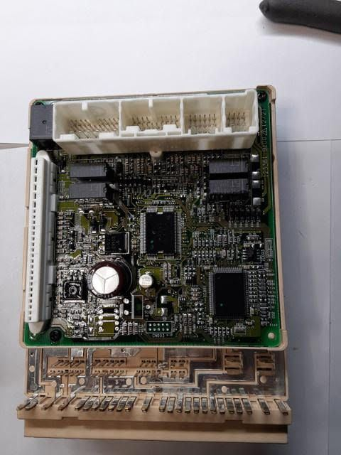
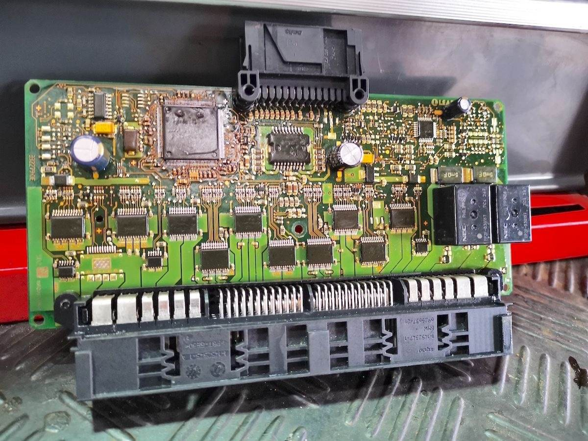
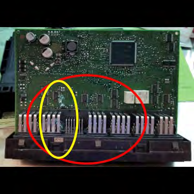

# ภาพจริงประกอบการอ่านบอร์ด

ภาพสามภาพนี้ใช้ประกอบการวิเคราะห์ลักษณะที่เห็นและข้อจำกัดของหลักฐาน เป็นภาพของเจ้าของต้นทาง ไม่ใช่ภาพงานซ่อมของ MyTech ไม่พบใบอนุญาตแบบเปิด จึงไม่รวมอยู่ในสิทธิ์การใช้ข้อความและภาพวาดของผู้เรียบเรียง การแจกหนังสือฟรีไม่ทำให้สิทธิ์ภาพเปลี่ยนไป ผู้ประสงค์นำภาพไปใช้ต่อควรติดต่อเจ้าของภาพ

## ญี่ปุ่น Lexus RX Body ECU

ต้นทาง: Margate330, Body ECU thread with pics, ClubLexus, 9 กุมภาพันธ์ 2021 https://www.clublexus.com/forums/rx-2nd-gen-2004-2009/961343-body-ecu-thread-with-pics.html

ภาพแสดง PCB ในกรอบพลาสติก มีขั้วต่อสีขาว รีเลย์ และ IC หลายตัว ส่วนล่างที่เปิดออกเป็น junction การแยกชิ้นส่วนนี้ช่วยสอนว่าแนวโลหะใน junction ไม่ใช่ copper layer ของ PCB และการมีปลั๊กหลายกลุ่มไม่ได้ระบุเส้นทางควบคุมภายในด้วยตัวมันเอง

ใช้ภาพนี้ฝึกแบ่งพื้นที่และวางแผนถ่ายภาพขยาย ก่อนกำหนดว่า IC ใดเป็นหน่วยความจำต้องอ่าน marking และตรวจ datasheet ภาพนี้ไม่ยืนยันเบอร์ EEPROM หรือ part number ของกล่อง จึงไม่ใช้เป็นจุดต่ออ่านเขียน และไม่ขยายเป็น RX330/RX350/RX400h แบบเจาะจง ผู้โพสต์แสดงการแกะกล่องสำรอง ไม่ใช่รายงานโคลนสำเร็จ

## ยุโรป BMW FRM3 ตามคำบรรยายต้นทาง

ต้นทางภาพและชื่อโมดูล: DashTech Services https://www.dashtechservices.co.uk/frm3-repair.html ภาพ https://www.dashtechservices.co.uk/images/bmw-frm3-footwell-module-board-repair.jpg

ภาพเห็น IC ขารอบตัวขนาดใหญ่ด้านบนซ้าย อุปกรณ์หลายตัวใกล้แถวขั้วต่อ และรีเลย์ด้านขวา รูปแบบนี้เหมาะสำหรับฝึกแยกเขตควบคุมกับเขตขับโหลด แต่ไม่ควรตั้งชื่อหน้าที่ให้ทุก IC จากรูปร่าง ต้องอ่านรหัสและไล่เน็ตต่อไป

ภาพไม่มีฉลากกล่องสัมพันธ์กันและอ่าน mask MCU ไม่ครบ จึงยังไม่ยืนยันว่าใช้กับขั้นตอน FRM ในรายการเครื่องมือรายการใด ห้ามจับคู่ขาต่อจากภาพอื่นเพียงเพราะชื่อ FRM3 เหมือนกัน

## อเมริกา GM BCM ใน Bulletin 21-NA-183

ต้นทาง: General Motors LLC, Bulletin 21-NA-183, มิถุนายน 2022 หน้า 4 ภาพ 5883904 https://static.nhtsa.gov/odi/tsbs/2022/MC-10213703-0001.pdf ลิขสิทธิ์ General Motors LLC สงวนสิทธิ์ ภาพดึงจากองค์ประกอบภาพเดิมใน PDF โดยไม่วาดความเสียหายเพิ่ม

ผู้ผลิตใช้วงเหลืองชี้ corrosion และวงแดงชี้พื้นที่ตรวจ ภาพทำให้เห็นว่าควรตรวจแนวขั้วต่อและใต้บริเวณคราบร่วมกับอาการระบบ ตามเอกสารให้ตรวจต้นเหตุน้ำจากระบบระบายน้ำ HVAC ด้วย การจัดการเฉพาะบอร์ดโดยไม่แก้ต้นเหตุน้ำอาจทำให้งานเสียซ้ำ

ต้องอ่านตารางรุ่นรถ รุ่นปี และ VIN breakpoint ในเอกสารเดิมก่อนใช้กับรถจริง ภาพตัวอย่างนี้ไม่ยืนยันว่าเป็น part number ของรถรุ่นใดในตาราง และไม่ใช่คำแนะนำให้ซ่อมชิปแทนขั้นตอนเปลี่ยนที่ผู้ผลิตกำหนด

## ภาพจริงสัญญาอนุญาตเปิดจาก Wikimedia Commons

เพิ่ม 20 พฤศจิกายน 2569 จำนวน 11 ภาพ ใส่ไว้ในบท 2, 3, 5, 7, 8, 11 และ 13 ชื่อผู้ถ่าย สัญญาอนุญาต และลิงก์ต้นทางของทุกภาพอยู่ใน assets/real-photos/commons/CREDITS.md

## ภาพวาดวงจร

power-map.png เป็นผังหน้าที่วาดใหม่จาก TI TIDA-00745 https://www.ti.com/tool/TIDA-00745 ไม่ใช่ schematic รถจริงและไม่ระบุค่าอุปกรณ์

can-map.png เป็นแผนที่สัญญาณ TCAN1042V-Q1 ตาม SLLSES9D หน้า 5 https://www.ti.com/lit/ds/symlink/tcan1042-q1.pdf แสดงรุ่น V เท่านั้น ส่วน protection, decoupling และ termination ไม่ได้แสดง

lin-map.png เป็นแผนที่สัญญาณ TJA1021 SO8 ตาม Rev 9 หน้า 4 https://www.nxp.com/docs/en/data-sheet/TJA1021.pdf RXD เป็น open-drain และต้องพิจารณา pull-up ตามวงจรจริง

spi-map.png เป็นแผนที่สัญญาณ M95640 SO8 ตาม DS8799 https://www.st.com/resource/en/datasheet/m95640-a125.pdf แยก main array ออกจาก identification page ไม่ใช่แผนผังต่อในวงจร

transfer-map.png เป็นภาพลำดับงานของผู้เรียบเรียง

cover.png เป็นภาพปกสร้างด้วยเครื่องมือสร้างภาพในแชต แสดงโมดูลประกอบแนวคิด ไม่มีการยืนยันหมายเลขรุ่นรถ Prompt สรุป: ปก BCM แนวตั้ง สีน้ำเงินเข้มทอง ภาพโมดูลหลายรูปแบบ ข้อความ วงจรบอร์ดและการย้ายข้อมูล รถญี่ปุ่น ยุโรป อเมริกา แจกฟรี แต่งโดย MyTech และ ภาพประกอบปก
