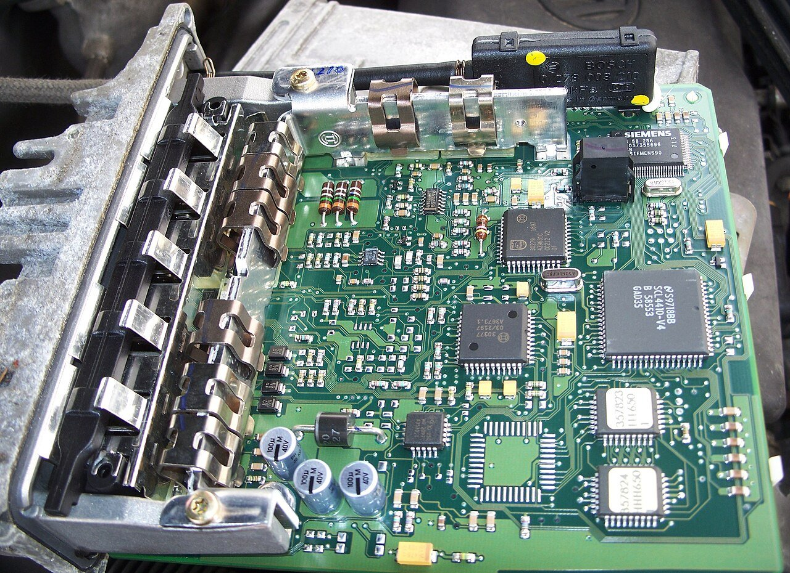
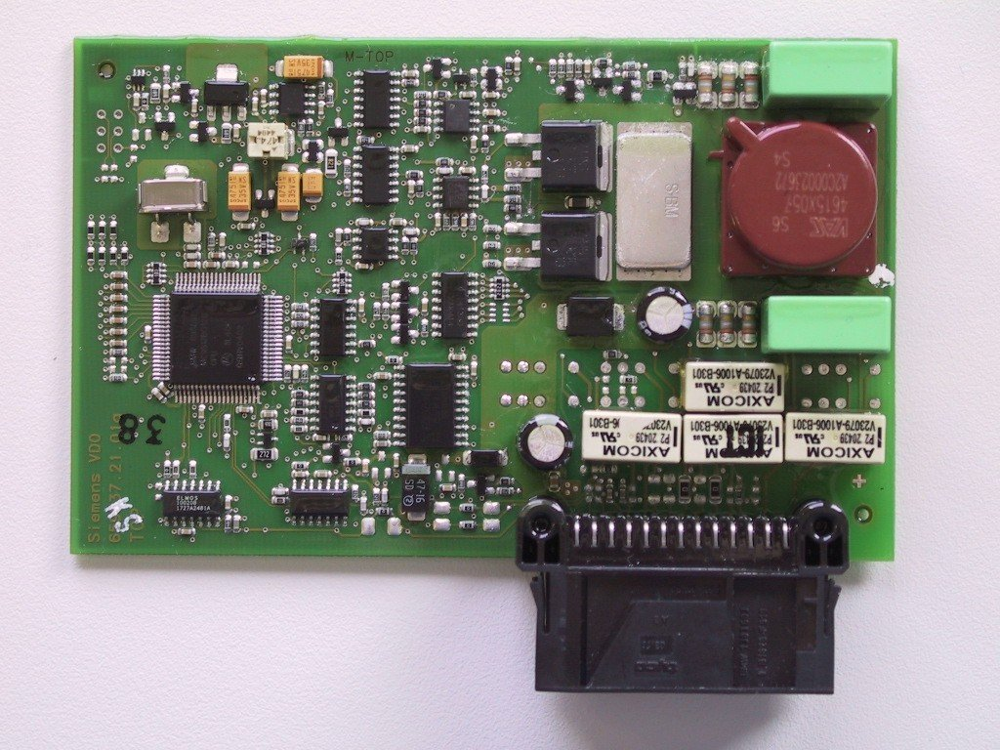
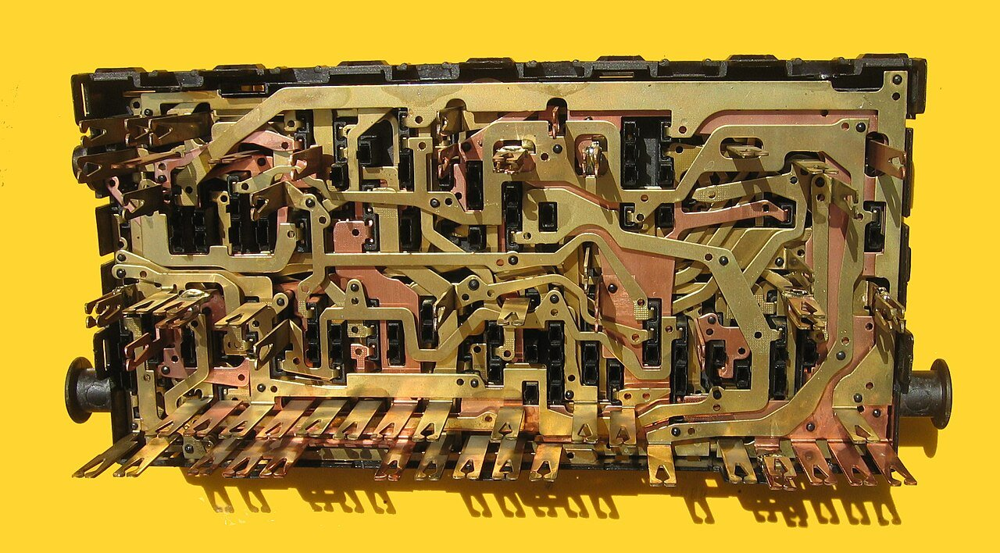
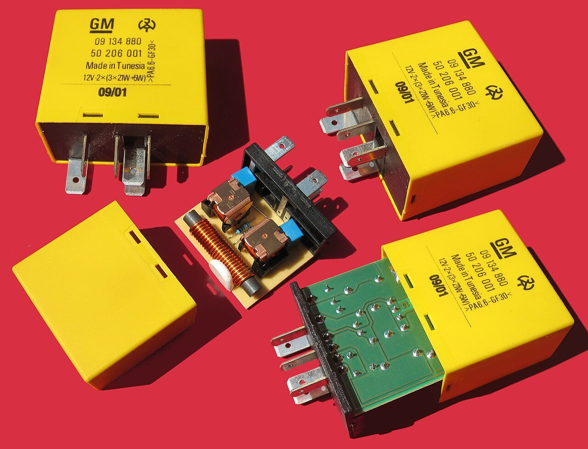
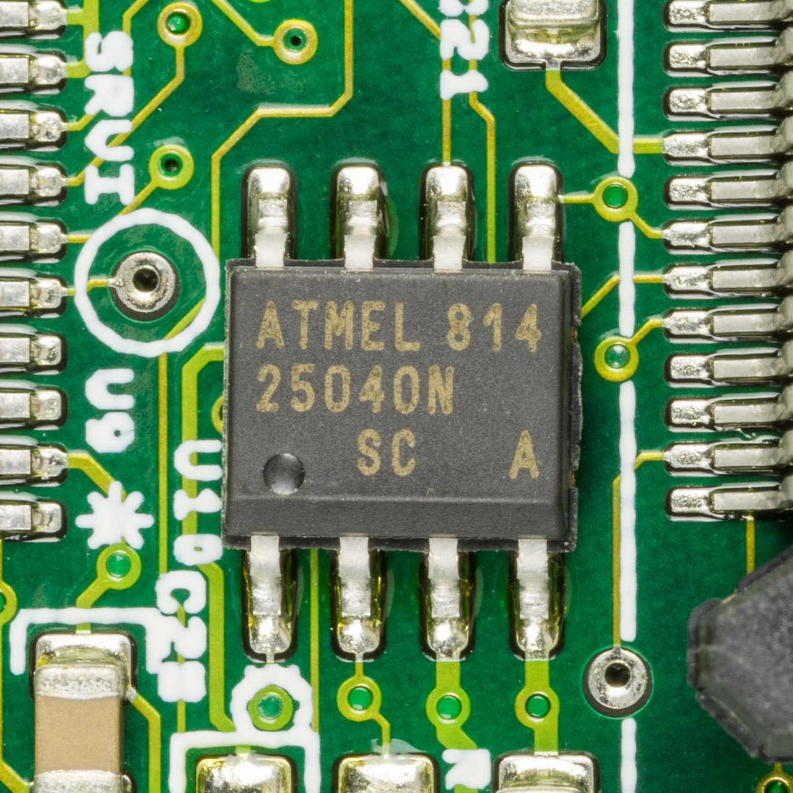
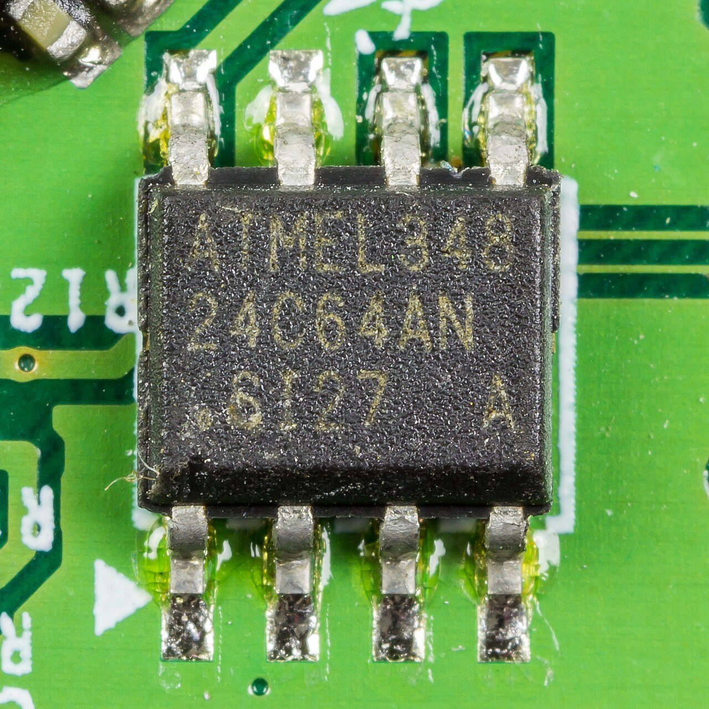
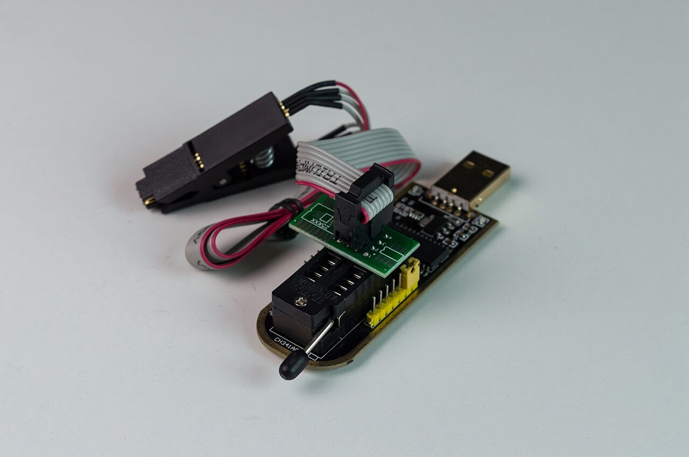
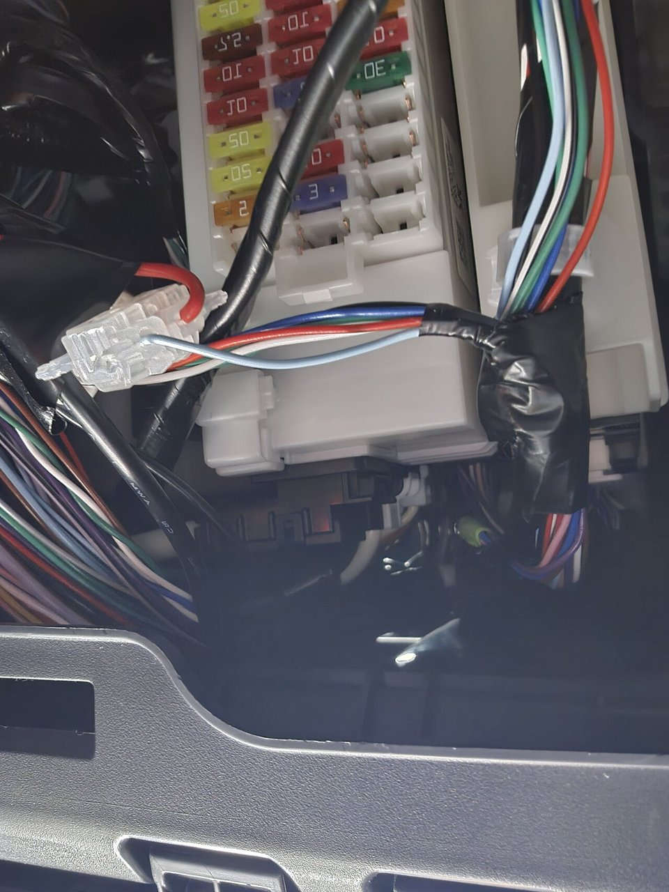
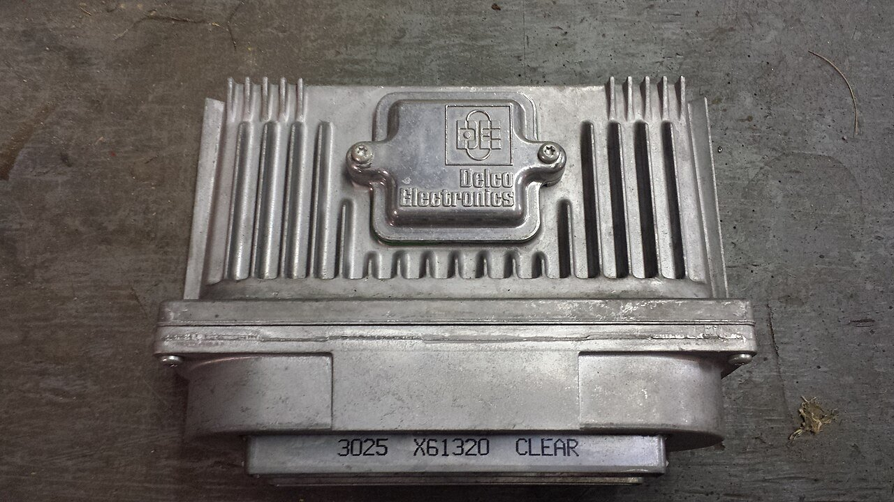
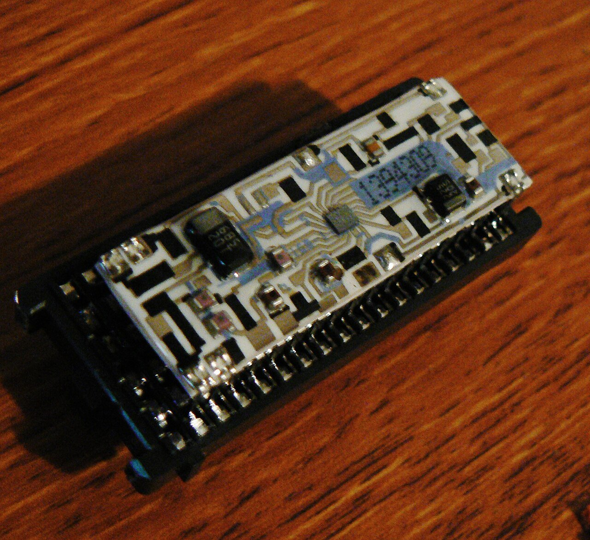

# BCM วงจรบอร์ด การย้ายชิป และการย้ายข้อมูล

แต่งโดย MyTech

## บทที่ 1 รับงานให้รู้ว่ากำลังซ่อมกล่องใด

BCM เป็นชื่อเรียกตามหน้าที่ แต่โครงสร้างภายในและเงื่อนไขการทำงานแตกต่างกันได้มาก งานรับกล่องจึงเริ่มจากการระบุตัวตน ไม่เริ่มด้วยการเลือกไฟล์จากชื่อรถเพียงอย่างเดียว ถ่ายฉลากทุกด้าน บันทึกหมายเลขอะไหล่ หมายเลขฮาร์ดแวร์ รุ่นซอฟต์แวร์ที่อ่านได้ หมายเลข PCB และรหัสประกอบย่อยแยกช่องกัน ตัวเลขที่พิมพ์บนฝาอาจเป็นรหัสพลาสติกหรือรหัสผู้ผลิตชิ้นส่วน ไม่ใช่หมายเลขกล่องสำหรับสั่งทดแทน

ถามอาการให้สัมพันธ์กับเหตุการณ์ เช่น เปิดไฟหน้าแล้วรีเซ็ต หลังฝนตกกระจกทำงานเอง หรือสื่อสารได้ช่วงแรกแล้วหายเมื่อเครื่องร้อน บันทึกว่าอาการเกิดกับรถครบระบบหรือทดสอบกล่องแยกโต๊ะแล้ว พร้อมแยกสิ่งที่ลูกค้ารายงานออกจากสิ่งที่ช่างตรวจพบ ประวัติพ่วงแบตเตอรี่ น้ำเข้า การเชื่อมตัวถัง การเปลี่ยนแบตเตอรี่ และการเขียนข้อมูลก่อนหน้า ช่วยกำหนดลำดับตรวจ แต่ยังไม่ใช่ข้อยืนยันสาเหตุ

ก่อนเปิดกล่อง อ่านรายงานสแกนและเก็บข้อมูลประจำกล่องเท่าที่รถอนุญาต บันทึกโมดูลที่ติดต่อไม่ได้และรหัสขัดข้องที่สัมพันธ์กัน หากหลายโมดูลหายจากเครือข่ายเดียวกัน ให้ตรวจไฟเลี้ยง กราวด์ และสายเครือข่ายร่วมก่อนสรุปว่า BCM เสีย รายงานว่า “ติดต่อไม่ได้” บอกผลของระบบสื่อสาร ไม่ได้ระบุตำแหน่งชิ้นส่วนที่เสียบนบอร์ด

ภาพรับงานควรมีฉลาก ภาพปลั๊กตรงแนว ภาพซีลและรอยเปิดเดิม ภาพหน้าหลัง PCB และภาพขยายบริเวณเสียหาย วางหมายเลขงานเดียวกันในทุกภาพ เมื่อแกะชิ้นส่วนออก ให้ถ่ายก่อนและหลังเพื่อไม่ให้ตำแหน่งเดิมสูญหาย รอยบัดกรีใหม่หรือชิ้นส่วนหายต้องบันทึกตามจริง ไม่เติมหมายเลขจากบอร์ดที่หน้าตาคล้ายกัน

การเปิดไฟบนโต๊ะต้องมีขาปลั๊กที่ยืนยันแล้วและข้อมูลเงื่อนไขปลุก แหล่งจ่ายจำกัดกระแสช่วยจำกัดความเสียหาย แต่ไม่ได้ทำให้การต่อขาผิดปลอดภัย ห้ามเดาขาไฟจากขนาดลายทองแดงเพียงอย่างเดียว ตรวจเส้นทางจากปลั๊กถึงวงจรป้องกันและกราวด์หลายจุด โดยตัดไฟและคายประจุก่อนใช้โหมดความต่อเนื่อง ระบุจุดอ้างอิงกราวด์ไว้บนภาพเสมอ

ใบรับงานควรลงผลพื้นฐาน ได้แก่ สภาพภายนอก ความต้านทานระหว่างทางไฟที่ยืนยันกับกราวด์ สภาวะที่วัด และผลการสื่อสารก่อนซ่อม หากยังไม่มีเอกสารขาปลั๊ก ให้หยุดเฉพาะการจ่ายไฟและทำงานระบุชิปต่อได้ การรักษาหลักฐานต้นทางทำให้ตัดสินใจภายหลังได้ว่าควรซ่อมภาควงจร ย้ายชิป หรือเตรียมกล่องทดแทน

แหล่งอ้างอิงเพื่อจำแนกหน้าที่ภายใน: [TI Body control module design resources](https://www.ti.com/solution/body-control-module-bcm?subsystemid=17095&variantid=14323) แหล่งนี้เป็นภาพรวมระบบ ไม่ยืนยันขาปลั๊กหรือหมายเลขอะไหล่ของรถใด

## บทที่ 2 อ่านบอร์ดจากภาพจริงและสร้างแผนที่วงจร

จัดภาพหน้าหลังให้สัมพันธ์กันโดยอ้างตำแหน่งปลั๊ก รูยึด และชิ้นส่วนเด่น อย่ากลับภาพโดยไม่ใส่คำอธิบาย เพราะภาพด้านล่างที่สะท้อนผิดทำให้การชี้ขาชิปคลาดเคลื่อน ภาพหลักต้องเห็นขอบบอร์ดครบ ส่วนภาพขยายใช้แสดงรหัสบนตัวชิปและทางเดินลายที่ต้องการตรวจ การอ่านรหัสไม่ชัดให้ถ่ายใหม่ด้วยแสงเฉียงก่อนค้นหารุ่นจากตัวอักษรบางส่วน

แบ่งบอร์ดตามหน้าที่ ได้แก่ ทางไฟเข้าและป้องกัน ภาคแปลงแรงดัน MCU หน่วยความจำ ภาคสื่อสาร อินพุต และภาคขับโหลด ใช้เส้นกรอบสีล้อมบริเวณโดยไม่ทับรหัสอุปกรณ์ ชิ้นส่วนตัวใหญ่ใกล้ปลั๊กไม่ได้เป็นภาคจ่ายไฟเสมอไป อาจเป็นตัวขับมอเตอร์หรือวงจรปราบสัญญาณรบกวน จึงต้องอ่านรหัสและเทียบหน้าที่กับ datasheet ก่อนตั้งชื่อภาค

สร้างรายการชิปโดยเก็บรหัสบนตัว รหัสเต็มที่ค้นพบ รูปแบบตัวถัง ตำแหน่งเครื่องหมายขาหนึ่ง และลิงก์เอกสาร หากรหัสบนตัวเป็น marking ย่อ ให้คงสถานะ “ยังไม่ยืนยัน” จนสัมพันธ์กับผู้ผลิต ตัวถัง และจำนวนขาได้ ห้ามนำ pinout ของชิปชื่อใกล้กันมาวัดแทน โดยเฉพาะ IC หลายหน้าที่ที่มีทั้งไฟเลี้ยงและเครือข่ายอยู่ในตัวเดียว

การถอดวงจรจากบอร์ดใช้การตรวจความต่อเนื่องขณะไม่มีไฟ เริ่มจากโหนดที่เข้าถึงได้ เช่น ขาคาปาซิเตอร์กรองไฟ ตัวต้านทานอนุกรม และ via ที่เห็นชัด บันทึกสองปลายที่ตรวจจริงพร้อมโหมดมิเตอร์ เสียงเตือนอย่างเดียวไม่เพียงพอที่จะสรุปว่าเป็นเน็ตเดียวกัน เพราะเส้นทางผ่านตัวเหนี่ยวนำ ตัวต้านทานค่าต่ำ หรือวงจรภายในชิปอาจทำให้มิเตอร์ร้องได้ ควรบันทึกค่าหรือการตอบสนองเมื่อกลับขั้วร่วมด้วย

บนบอร์ดหลายชั้น เส้นที่หายเข้ารู via ไม่ได้แปลว่าช่างสามารถลากเส้นปลายทางได้ทันที ใช้เส้นทึบเฉพาะส่วนที่ตรวจยืนยัน ส่วนที่คาดตามวงจร application ให้ใช้เส้นประและคำอธิบาย “ยังไม่ตรวจ continuity” แผนผังที่แยกหลักฐานเช่นนี้ช่วยป้องกันการนำข้อสันนิษฐานไปใช้เป็นจุดต่อเครื่องอ่านเขียนในงานถัดไป

ภาพประกอบบทนี้ควรจับคู่ภาพถ่ายกับผังหน้าที่ โดยแสดงเพียงตำแหน่งและหน้าที่ที่ยืนยันแล้ว ตัวอย่างการจัดภาคสามารถศึกษาจาก [TI TIDA-00296](https://www.ti.com/tool/TIDA-00296) และ [TI TIDA-00745](https://www.ti.com/tool/TIDA-00745) ทั้งสองเป็นบอร์ดอ้างอิงผู้ผลิต ไม่ใช่ภาพ BCM จากรถญี่ปุ่น ยุโรป หรืออเมริการุ่นใด

## บทที่ 3 ภาคจ่ายไฟ: ไล่จากไฟเข้าถึงการปล่อยรีเซ็ต

อาการกล่องเงียบ รีเซ็ตซ้ำ หรือทำงานเมื่ออุ่น อาจสัมพันธ์กับไฟเลี้ยง แต่ต้องแยกเหตุภายนอกออกจากความเสียหายบน PCB ก่อน การวัดแรงดันที่ปลั๊กโดยไม่มีโหลดอาจไม่เปิดเผยขั้วต่อที่มีความต้านทานสูง ตรวจแรงดันตกตามทางไฟและกราวด์ในสภาวะที่กล่องพยายามทำงาน โดยใช้ข้อมูลการต่อที่ยืนยันแล้วและแหล่งจ่ายที่เหมาะกับงาน

เริ่มเมื่อไม่มีไฟด้วยการมองหารอยแตก รอยไหม้ สนิม และคาปาซิเตอร์เสียรูป จากนั้นวัดทางไฟแต่ละรางเทียบกราวด์ โดยรอให้ผลจากการชาร์จคาปาซิเตอร์นิ่ง ความต้านทานต่ำไม่เท่ากับชอร์ตเสมอไป โดยเฉพาะรางแกน MCU และมิเตอร์ต่างรุ่นให้ผลต่างกันได้ ใช้ข้อมูลบอร์ดปกติที่ตรงฮาร์ดแวร์หรือหลักฐานจากวงจรประกอบการตัดสิน ไม่ใช้ตัวเลขเดียวเป็นเกณฑ์ทุกกล่อง

เมื่อจ่ายไฟ จุดวัดแรกคือไฟก่อนและหลังวงจรกลับขั้วหรือวงจรป้องกัน ถ้าไฟเข้ามีแต่ไฟหลังวงจรไม่มี ให้ตรวจเงื่อนไขควบคุมและเส้นทางกระแสก่อนเปลี่ยน MOSFET บางวงจรมีการตัดเมื่อแรงดันผิดช่วงหรือมีปัญหาที่โหลด การลัดข้ามอุปกรณ์ป้องกันเพื่อให้กล่องติดอาจทำให้ผลทดสอบไม่ตรงสภาพใช้งานและซ่อนสาเหตุเดิม

จากนั้นตรวจขาเข้า ขา enable และเอาต์พุตของตัวแปลงทีละราง ระบุค่าที่คาดจากวงจรจริงหรือ datasheet ชิปและวงจร feedback ของบอร์ดนั้น ห้ามสรุปว่าต้องได้แรงดันยอดนิยมเพราะเห็นเป็นภาค MCU ถ้ามีไฟเข้าแต่ไม่มีเอาต์พุต ให้ตรวจ enable การชอร์ตด้านโหลด และสถานะ fault หากเอาต์พุตขึ้นแล้วตก ให้ใช้ออสซิลโลสโคปดูความสัมพันธ์กับกระแสเข้าและ reset เพื่อแยกการป้องกันแบบพยายามเริ่มใหม่ออกจาก MCU ที่สั่งปิดระบบ

วัด ripple ด้วยวิธีต่อโพรบที่มีพื้นที่ลูปสั้นและจุดกราวด์ใกล้โหนด การใช้สายกราวด์ยาวอาจสร้างสัญญาณรบกวนที่ไม่ได้เกิดบนรางจริง บันทึกย่านความถี่ อัตราขยาย การต่อ AC/DC และสภาวะโหลดไว้กับภาพ waveform จุด switching ต้องใช้โพรบและพิกัดที่เหมาะสม ไม่ต่อกราวด์เครื่องมือเข้ากับจุดที่ยังไม่ยืนยันศักย์

ไฟเลี้ยงครบไม่ได้แปลว่า MCU พร้อมทำงาน ตรวจ reset และ supervisor ตามรหัสชิป บางระบบต้องรอหลายรางนิ่งก่อนปล่อยรีเซ็ต และ watchdog อาจดึงกลับเป็นช่วง ๆ หาก reset สลับพร้อมไฟตกให้ย้อนภาคจ่ายไฟ หากไฟนิ่งแต่ reset ถูกดึง ให้ตรวจเหตุจาก supervisor/watchdog และคำสั่งควบคุมต่อ การเปลี่ยน MCU ก่อนรู้เหตุ reset ทำให้เสียหลักฐานเดิมโดยไม่แก้ต้นเหตุ

ตัวอย่างเพื่อศึกษาโครงสร้างใช้ [TI TIDA-00745](https://www.ti.com/tool/TIDA-00745) ซึ่งมี EMI filter, preboost, buck และ LDO พร้อม schematic และผลทดสอบ ค่าหรือรูปคลื่นในคู่มือใช้กับ reference design นั้น ไม่ใช่เกณฑ์ผ่านของ BCM รถทุกคัน

### ฝึกแปลผลภาคจ่ายไฟ

สถานการณ์ฝึกต่อไปนี้เป็นโจทย์วิเคราะห์ ไม่ใช่ผลวัดรถจริง ถ้าไฟเข้าปกติขณะไม่มีโหลดแต่ยุบเมื่อสั่งโหลด ให้บันทึกแรงดันพร้อมกันทั้งที่แหล่งจ่ายและที่บอร์ด ถ้าแหล่งจ่ายคงที่แต่บอร์ดยุบ ให้ตรวจแรงดันตกคร่อมสาย ขั้วต่อ และทางกราวด์ก่อนเปลี่ยน regulator หากแหล่งจ่ายยุบด้วย ให้ตรวจการจำกัดกระแสและโหลดรวมก่อนสรุปสาเหตุบนบอร์ด

หากรางไฟย่อยขึ้นแล้วลงเป็นจังหวะ ให้จับสัญญาณ enable ร่วมกับเอาต์พุต ถ้า enable คงเดิมแต่เอาต์พุตสะดุด ให้ตรวจ fault และโหลดปลายทางตาม datasheet ถ้า enable ถูกสั่งปิด ให้หาว่าเป็นคำสั่งของระบบหรือผลจากวงจร supervisor การเปลี่ยน IC โดยไม่แยกสองกรณีนี้อาจไม่แก้ต้นเหตุ

คำถามก่อนสรุปงาน: วัดขณะกล่องตื่นหรือหลับ ใช้กราวด์อ้างอิงเดียวกันหรือไม่ มีโหลดอะไรต่ออยู่ แรงดันตกเริ่มที่โหนดใด และ reset เกิดก่อนหรือหลังรางไฟผิดปกติ เก็บภาพรูปคลื่นพร้อมตำแหน่งโพรบแทนการจดเพียงค่ามิเตอร์หนึ่งค่า

## บทที่ 4 อินพุต การปลุก และกระแสพัก

กล่องที่ไม่ตอบบนโต๊ะอาจยังอยู่ในสถานะหลับ การเปิดไฟเลี้ยงหลักจึงไม่ใช่เงื่อนไขเริ่มทำงานที่เพียงพอเสมอไป ต้องรู้ว่าใช้สวิตช์ ขา ignition สัญญาณเครือข่าย หรือลำดับคำสั่งใดปลุก และมีโมดูลอื่นเป็นผู้เริ่มสื่อสารหรือไม่ การลองแตะไฟเข้าขาที่คาดว่าเป็น wake โดยไม่มีวงจรยืนยันอาจทำลายอินพุตแรงดันต่ำ

เส้นทางสวิตช์อาจผ่านตัวต้านทาน ตัวกรอง ตัวหนีบแรงดัน comparator หรือ IC ตรวจสวิตช์หลายช่อง ให้ระบุว่าจุดวัดอยู่ฝั่งปลั๊กหรือฝั่ง logic จากนั้นวัดสภาวะสวิตช์เปิดและปิดเทียบจุดกราวด์เดียวกัน ถ้าฝั่งปลั๊กเปลี่ยนแต่ฝั่ง logic คงเดิม ให้ตรวจวงจรคั่น หากทั้งสองเปลี่ยนแต่สถานะในเครื่องสแกนไม่เปลี่ยน ให้ตรวจเงื่อนไขซอฟต์แวร์และขารับของ MCU ต่อ ยังไม่ควรสรุปว่าโปรแกรมเสีย

อินพุตแบบเครือข่ายตัวต้านทานต้องเทียบระดับตามตารางของระบบจริง การมีแรงดันกลางไม่ได้ยืนยันว่าลัดวงจร และแรงดันจากมิเตอร์อิมพีแดนซ์สูงอาจเกิดจากการรั่วผ่านวงจรภายใน ควรเปรียบเทียบกับแหล่งสัญญาณและโหลดที่ตรงวงจร โดยไม่ใส่ตัวต้านทานสุ่มเพื่อลองทุกค่า หากอาการเป็นครั้งคราว ใช้การบันทึกรูปคลื่นเพื่อดูขอบสัญญาณและการเด้งของหน้าสัมผัส

การวัดกระแสพักต้องบันทึกเวลาและเงื่อนไขทั้งหมด ได้แก่ สถานะกุญแจ ประตู ฝากระโปรง การล็อก อุปกรณ์สแกนที่ยังเสียบ และการสื่อสารบนบัส การเปิดประตูหรือส่งคำสั่งสแกนอาจปลุกระบบใหม่ ให้แยกกระแสระหว่างช่วงเริ่มทำงาน ช่วงรอ และช่วงหลับ พร้อมระบุเกณฑ์และเวลารอจากผู้ผลิตรถ ไม่สร้างค่ากระแสพักเดียวสำหรับทุกยี่ห้อ

ถ้ากระแสไม่ลด ให้ตรวจว่ามี wake request ค้างหรือมีกิจกรรมเครือข่ายต่อเนื่องก่อนตัดสินว่าภาคจ่ายไฟรั่ว การถอดปลั๊กโมดูลบางตัวเปลี่ยนทั้ง topology และเงื่อนไขหลับ จึงต้องเขียนว่าผลนั้นได้จากระบบที่เปลี่ยนอย่างไร ในงานโต๊ะควรใช้คำว่า “กระแสในเงื่อนไขทดสอบนี้” จนพิสูจน์ว่ากล่องเข้าสู่ sleep จริง

ศึกษา wake และ sleep ของอุปกรณ์เครือข่ายได้จาก [NXP TJA1021 datasheet](https://www.nxp.com/docs/en/data-sheet/TJA1021.pdf) และ [TI TCAN1042-Q1](https://www.ti.com/product/TCAN1042-Q1) ทั้งสองอธิบายการทำงานระดับชิป ไม่กำหนดเวลาหลับหรือกระแสพักทั้งคัน

## บทที่ 5 ภาคขับโหลด: แยกคำสั่ง การจ่ายกำลัง และโหลด

เมื่อไฟหรือมอเตอร์ไม่ทำงาน ให้แบ่งคำถามเป็นสามข้อ: มีคำสั่งหรือยัง ภาคกำลังจ่ายได้หรือไม่ และโหลดกับสายภายนอกสมบูรณ์หรือไม่ การตรวจเพียงขาออก BCM อาจทำให้สับสนระหว่างไดรเวอร์เสียกับวงจรที่ปิดตัวเองเพราะตรวจพบชอร์ต ต้องรู้ก่อนว่าเป็น relay, high-side, low-side หรือ H-bridge แล้วเลือกจุดอ้างอิงให้ตรง

high-side จ่ายด้านบวกให้โหลด ส่วน low-side ต่อด้านกลับของโหลดลงทางกราวด์ ดังนั้นแรงดันที่ขาออกในสถานะปิดอาจขึ้นกับโหลดและวงจรวินิจฉัย การเห็นแรงดันแต่หลอดไม่ติดอาจเป็นกระแสตรวจโหลดขนาดเล็ก ไม่ได้ยืนยันว่าภาคกำลังจ่ายกระแสได้ ทดสอบด้วยโหลดที่ทราบคุณสมบัติและได้รับการยืนยันว่าเหมาะกับช่องนั้น พร้อมจำกัดระยะเวลาหากสงสัยความร้อน

สำหรับรีเลย์ ตรวจไฟเลี้ยงคอยล์ คำสั่งขับคอยล์ และแรงดันตกหน้าสัมผัสแยกกัน เสียงคลิกยืนยันเพียงการเคลื่อนบางส่วน ไม่ยืนยันความต้านทานหน้าสัมผัสขณะจ่ายโหลด วงจรไดโอดหรือ clamp ขนานคอยล์ต้องตรวจทิศทางตามจริง การเปลี่ยนรีเลย์สเปกไม่ตรงอาจกระทบวงจรขับและการดับกระแสคอยล์แม้ขาจะเสียบได้

ช่อง smart driver ต้องตรวจขาไฟเลี้ยง กราวด์ enable คำสั่ง และ feedback/fault ตาม datasheet บางรุ่นมีสถานะกลับผ่าน SPI หรือ I2C การวัดขาออกค้างโดยไม่มีคำสั่งจึงยังไม่พิสูจน์ว่าชิปเสีย เมื่อเครื่องสแกนสั่ง active test ให้บันทึกเงื่อนไขอนุญาต เช่น แรงดันระบบและสถานะประตูตามคู่มือรถ การไม่ผ่านเงื่อนไขอาจทำให้ไม่มีคำสั่งถึงไดรเวอร์

มอเตอร์แบบกลับทิศต้องวัดสองขั้วร่วมกัน ค่าเทียบกราวด์ทีละขั้วอาจไม่สะท้อนแรงดันที่มอเตอร์ได้รับจริง ขณะ PWM ให้ดูแรงดันต่างศักย์ กระแส และทิศทางคำสั่งด้วยเครื่องมือที่เหมาะสม หลีกเลี่ยงการใช้กราวด์ของออสซิลโลสโคปทำให้ขั้วมอเตอร์ลัดลงกราวด์ ทดสอบโหลดไม่ติดขัดก่อน เพราะกระแสเกินอาจเป็นผลจากกลไกติด ไม่ใช่ความเสียหายใน driver

หลังเปลี่ยนชิ้นส่วน ให้ตรวจชอร์ต รอยต่อ และอุปกรณ์ป้องกันรอบข้างก่อนจ่ายไฟ จากนั้นทดสอบเปิดปิดซ้ำ การตอบสนองเมื่อมีโหลด และสถานะ fault บันทึกว่าได้จำลองความขัดข้องใดจริงบ้าง การที่ช่องขับกลับมาทำงานครั้งเดียวไม่เพียงพอยืนยันความทนต่อกระแสและความร้อนในรถ

แหล่งศึกษาวงจรคือ [TI TIDA-00296](https://www.ti.com/tool/TIDA-00296) ซึ่งมีตัวอย่างขับ relay, motor และโหลด พร้อมไฟล์ออกแบบ ใช้ภาพจริงของ reference board ประกอบได้หลังตรวจสิทธิ์การใช้ภาพ และต้องใส่คำกำกับว่าไม่ใช่บอร์ดจากรถรุ่นใด

## บทที่ 6 CAN/LIN: แยกภาคสื่อสารออกจากเหตุอื่น

การสแกน BCM ไม่พบอาจเกิดจากไฟเลี้ยง ขาปลุก สายบัส transceiver MCU หรือเงื่อนไขของ gateway จึงต้องเริ่มด้วยการรู้ว่าขาที่กำลังวัดเป็นเครือข่ายใดและเชื่อมถึงส่วนใดของรถ การใช้ตำแหน่งขามาตรฐานของปลั๊กวินิจฉัยไปเดาที่ปลั๊ก BCM เป็นคนละเรื่องและใช้แทนกันไม่ได้

สำหรับ CAN ตรวจความต้านทานบัสเมื่อระบบไม่มีไฟตามกระบวนการผู้ผลิตรถและมีสภาพการต่อที่บันทึกแล้ว ค่าที่พบขึ้นกับ termination และ topology การวัดกล่องเดี่ยวจึงไม่จำเป็นต้องเหมือนการวัดทั้งเครือข่าย ห้ามใส่ termination เพิ่มเพียงเพื่อให้ตัวเลขตรงกับค่าที่คุ้นเคย เพราะอาจเปลี่ยนโหลดของระบบและทำให้สัญญาณผิด

เมื่อมีไฟ ตรวจไฟเลี้ยง transceiver และระดับขาควบคุมสถานะก่อนดู TXD/RXD วัด CANH และ CANL ด้วยวิธีที่เหมาะสมและดูผลต่างของคู่สาย พร้อมบันทึกช่วงเวลาที่มีการส่งคำสั่ง หาก TXD มีการเปลี่ยนแต่บัสไม่ตอบ ให้ตรวจสถานะ standby ไฟเลี้ยง และการโหลดบัส หากบัสมีข้อมูลแต่ RXD ไม่ตอบ ให้ตรวจโหมดชิปและทางรับ ถ้า RXD ตอบถึง MCU แต่กล่องไม่สื่อสารต่อ ปัญหาอาจเลยชั้นกายภาพไปแล้ว

การไม่มี TXD ไม่ยืนยัน MCU เสีย เพราะ MCU อาจอยู่ reset หลับ หรือรอคำสั่งเครือข่ายอื่น ต้องสัมพันธ์กับภาคไฟและการปลุกจากบทก่อน ส่วนบัสที่ถูกดึงค้างอาจมาจากโมดูลอื่นหรือสายภายนอก การแยกสาขาเพื่อทดสอบต้องทำตาม topology จริงและบันทึกว่าถอดอะไรออก ไม่ใช้ผลจากเครือข่ายที่ไม่ครบมาตีความเป็นผลทั้งคัน

LIN ใช้สายสื่อสารหลักเส้นเดียว แต่ยังต้องตรวจกราวด์และไฟเลี้ยงร่วม ตรวจว่ากล่องเป็น commander หรือ responder และมีการส่ง header ในเงื่อนไขทดสอบหรือไม่ responder ที่ยังไม่ถูกเรียกอาจเงียบเป็นปกติ วงจร pull-up ของ commander แตกต่างจาก responder จึงไม่ควรใส่อุปกรณ์ภายนอกเพิ่มตามวงจรตัวอย่างโดยไม่รู้บทบาทของกล่อง

เมื่อวัด LIN ให้เก็บรูปคลื่นทั้งฝั่ง bus และ TXD/RXD ถ้า bus มีสัญญาณแต่ไม่มีคำตอบ ให้ตรวจว่าเป็นเฟรมที่เกี่ยวข้องกับอุปกรณ์นั้นและขาปลุกถูกต้อง การมีรูปคลื่นสวยไม่ได้ยืนยันข้อมูลหรือ checksum ถูกต้อง ต้องใช้การถอดรหัสร่วมกับข้อมูลเครือข่ายที่ยืนยันได้

อ้างอิงระดับชิป: [TI TCAN1042-Q1](https://www.ti.com/product/TCAN1042-Q1) และ [NXP TJA1021 datasheet](https://www.nxp.com/docs/en/data-sheet/TJA1021.pdf) ต้องเลือกรหัสย่อยและ package ให้ตรงก่อนใช้ pinout หรือตารางสถานะ

## บทที่ 7 หน่วยความจำ: รู้ว่าอ่านอะไร ก่อนตัดสินใจย้าย

ข้อมูล BCM อาจอยู่ใน EEPROM ภายนอก flash ภายนอก หรือหน่วยความจำภายใน MCU บอร์ดที่ไม่มีชิป EEPROM แยกไม่ได้หมายความว่าไม่มีข้อมูลถาวร และการพบ EEPROM หนึ่งตัวไม่ได้ยืนยันว่าข้อมูลประจำรถทั้งหมดอยู่ในนั้น ต้องเริ่มจากรายการชิปและสถาปัตยกรรมหน่วยความจำที่ตรงรุ่น

SPI EEPROM และ I2C EEPROM ใช้สัญญาณคนละแบบ การมีแปดขาไม่ได้ทำให้เลือกอะแดปเตอร์หรือแรงดันเดียวกันได้ อ่านรหัสเต็มรวมส่วนท้ายและตัวถัง ตรวจขาหนึ่งจากทั้งภาพและ package drawing แล้วระบุ VCC กราวด์ ขาสื่อสาร และขาควบคุมตาม datasheet ก่อนต่อเครื่องอ่าน ขา write protect หรือ hold ที่ลอยหรือถูกวงจรอื่นดึงอาจทำให้การอ่านเขียนผิดเงื่อนไข

ก่อนอ่านในวงจร ตรวจว่าตัวโปรแกรมจะจ่ายไฟกลับไปเลี้ยงส่วนอื่นของบอร์ดหรือไม่ เส้นสัญญาณอาจถูก MCU หรืออุปกรณ์ร่วมบัสขับอยู่ ความสำเร็จบนหน้าจอจึงยังไม่ยืนยันว่าไฟล์ถูกต้อง วัดแรงดันจริงที่ชิปขณะอ่าน และหากอ่านซ้ำแล้วไม่ตรง ให้ตรวจหน้าสัมผัส ความเร็ว การแยกวงจร และเงื่อนไขจ่ายไฟก่อนเลือกถอดชิป ไม่มีวิธีหนีบในวงจรวิธีเดียวที่ใช้ได้กับทุก BCM

ตัวอย่าง [ST M95640-A125/A145](https://www.st.com/resource/en/datasheet/m95640-a125.pdf) แสดงว่าต้องพิจารณาพื้นที่ข้อมูลและหน้าระบุข้อมูลเพิ่มเติม รวมถึงสถานะป้องกันการเขียนด้วย สำหรับชิปนี้ main array มี 8 KB แต่การรู้ขนาดไฟล์หลักยังไม่บอกว่าเครื่องมือจัดการพื้นที่อื่นอย่างไร บันทึกชนิดไฟล์และขอบเขตที่อ่านจริง ไม่สรุปจากชื่อไฟล์ที่โปรแกรมตั้งให้

กรณี MCU ใช้ EEPROM emulation การอ่าน flash ดิบกับการอ่านข้อมูลเชิงตรรกะอาจได้โครงสร้างต่างกัน [NXP AN11983](https://www.nxp.com/docs/en/application-note/AN11983.pdf) อธิบายการทำงานร่วมกันของ FlexRAM/FlexNVM สำหรับ S32K1xx ส่วน [NXP AN4868](https://www.nxp.com/docs/en/application-note/AN4868.pdf) อธิบายหลักการ emulation ของ MPC55xx/56xx/57xx เอกสารเหล่านี้ไม่ใช่คำสั่ง clone BCM และใช้ข้ามตระกูล MCU โดยตรงไม่ได้

เก็บไฟล์ต้นฉบับแบบอ่านอย่างเดียวและทำสำเนาทำงาน บันทึกเครื่องมือ เวอร์ชัน โหมดอ่าน ชิป อะแดปเตอร์ วันที่ และผลเปรียบเทียบการอ่านซ้ำ ตรวจขนาดและ hash เพื่อระบุว่าไฟล์เดียวกันจริง แต่ hash ตรงกันยืนยันเพียงความเหมือนของไฟล์ ไม่ยืนยันว่าอ่านพื้นที่ถูกหรือข้อมูลเหมาะกับกล่องทดแทน ไฟล์ที่เป็นค่าเดียวทั้งก้อนต้องตรวจความเป็นไปได้ของบัสลอยหรือเลือกชิปผิดก่อนใช้งาน

ก่อนย้ายชิปหรือข้อมูล ให้รวบรวมความเข้ากันได้ของฮาร์ดแวร์ ซอฟต์แวร์ และกระบวนการตั้งค่าของผู้ผลิตรถ ข้อมูลบางส่วนอาจอยู่หลายตำแหน่งหรือมีการจับคู่กับระบบอื่น การอ่านสำเร็จและ verify ผ่านเป็นเพียงขั้นตอนหนึ่ง ผลสุดท้ายต้องตรวจการสื่อสาร ฟังก์ชันที่เกี่ยวข้อง และสถานะขัดข้องหลังติดตั้งตามเงื่อนไขจริง บทถัดไปจึงจะลงรายละเอียดการอ่าน ย้าย และตรวจหลังบัดกรีโดยใช้กรณีที่ระบุบอร์ดได้

### แยกพื้นที่ข้อมูลในใบงาน

ทำรายการแยก main EEPROM, identification page, program flash, data flash และพื้นที่ emulation ตามที่ชิปและเครื่องมือมีจริง ไม่สร้างช่องว่าผ่านสำหรับพื้นที่ที่ไม่ได้อ่าน เครื่องมือบางตัวสร้างไฟล์ที่มี header หรือข้อมูลหลายพื้นที่รวมกัน จึงเปรียบเทียบขนาดกับความจุชิปอย่างเดียวไม่ได้ ต้องดูคำอธิบายรูปแบบไฟล์ด้วย

แบบฝึกคิด: อ่านสองครั้งแล้ว hash ตรงกัน แต่เลือกอุปกรณ์ผิดรุ่น ไฟล์ที่เหมือนกันยังไม่ผ่านเกณฑ์ความถูกต้องของงาน ให้ตรวจรหัสชิป พื้นที่อ่าน และการตอบสนองของอุปกรณ์ใหม่ ความสม่ำเสมอของข้อมูลเป็นหลักฐานหนึ่งชั้น ส่วนการเลือกสิ่งที่จะอ่านให้ถูกเป็นอีกชั้นหนึ่ง

เมื่อย้ายชิปภายนอกแล้วกล่องยังไม่ทำงาน อย่าตัดสินว่าไฟล์ EEPROM เสียทันที ตรวจงานบัดกรี ไฟเลี้ยง ความเข้ากันได้ของฮาร์ดแวร์ และข้อมูลส่วนอื่นที่อาจอยู่ใน MCU ก่อน ทุกการแก้ไฟล์ต้องทำบนสำเนาพร้อมบันทึกเหตุผลให้ย้อนกลับได้

## บท 8 อ่านข้อมูลให้ได้ไฟล์ที่เชื่อถือได้

ไฟล์ที่เปิดดูได้อาจไม่ใช่ไฟล์ที่อ่านถูกต้อง การเริ่มงานจึงต้องเริ่มจากการระบุตัวอุปกรณ์ ไม่ใช่เลือกเมนูที่ชื่อคล้ายกันบนโปรแกรม ถ่ายภาพรหัสชิปให้เห็นทุกบรรทัด รวมโลโก้ผู้ผลิต รหัสท้าย และเครื่องหมายขาแรก แล้วเทียบเอกสารของผู้ผลิตชิปให้ตรงชนิดแพ็กเกจ หากตัวอักษรเลือนให้ใช้แสงเฉียงและถ่ายหลายมุมก่อนทำความสะอาด หลีกเลี่ยงการขูดหน้าชิปเพียงเพื่อให้เห็นตัวหนังสือ เพราะอาจทำลายหลักฐานและตัวอุปกรณ์

แยกให้ออกว่ากำลังทำงานกับหน่วยความจำภายนอกหรือพื้นที่ภายใน MCU ชิปแปดขาไม่ได้หมายถึง EEPROM เสมอไป และ EEPROM ที่ขนาดไฟล์เท่ากันก็ไม่ได้มีวิธีสื่อสารเหมือนกันทั้งหมด หน่วยความจำตระกูล I2C, SPI และ Microwire ใช้การเลือกชนิดอุปกรณ์และการต่อสัญญาณต่างกัน ส่วน EEPROM emulation เป็นวิธีจัดเก็บข้อมูลในพื้นที่ flash ที่ซอฟต์แวร์จัดการ ไม่ใช่ชิป EEPROM ที่สามารถถอดย้ายออกจากบอร์ดได้โดยตรง

ก่อนต่อเครื่องอ่านให้บันทึกรหัสเครื่องมือ รุ่นซอฟต์แวร์ อะแดปเตอร์ โหมดอ่าน และรายการพื้นที่ที่โปรแกรมอนุญาตให้อ่าน ค่ากำลังไฟสำหรับตัวเครื่องอ่านกับแรงดันที่จ่ายเข้าชิปเป็นคนละเรื่อง ห้ามนำค่าแรงดันเข้าของเครื่องมือไปใช้เป็นแรงดัน VCC ของหน่วยความจำ บนบอร์ดที่มีหลายรางไฟต้องทราบด้วยว่าจ่ายไฟแล้วส่วนอื่นจะได้รับไฟย้อนผ่านขาสัญญาณหรือไม่

การอ่านบนบอร์ดเหมาะเมื่อมีคู่มือการเชื่อมต่อที่ตรงรุ่นและยืนยันสภาวะของวงจรได้ แต่คลิปที่หนีบได้ไม่ได้รับประกันว่าวงจรข้างเคียงจะไม่รบกวนบัส อาการอ่านได้ครั้งแรกและอ่านไม่เหมือนเดิมครั้งที่สองอาจเกิดจากหน้าสัมผัส แหล่งจ่าย การเลือกชิปผิด หรืออุปกรณ์อื่นบนบอร์ดทำงานร่วมบัส อย่าแก้ด้วยการเพิ่มแรงดันแบบลองผิดลองถูก ให้ตรวจการสัมผัสและวิธีอ่านตามเอกสารก่อนพิจารณาถอดชิป

อ่านข้อมูลอย่างน้อยสองรอบโดยใช้ชื่อไฟล์แยกกัน เปรียบเทียบขนาดและเนื้อหาแบบไบต์ต่อไบต์ หรือบันทึกค่าแฮชเพื่อยืนยันว่าไฟล์ตรงกัน ค่าแฮชที่ตรงกันยืนยันเพียงว่าไฟล์ทั้งสองเหมือนกัน ไม่ได้ยืนยันว่าเลือกชิปหรือพื้นที่ถูกต้อง จึงยังต้องเทียบขนาดที่คาดหมายจากชนิดอุปกรณ์และบันทึกข้อความแจ้งเตือนของโปรแกรมด้วย ไฟล์ที่เต็มด้วย FF หรือ 00 อาจเป็นพื้นที่ว่างจริงหรือเป็นผลอ่านผิด ต้องมีหลักฐานประกอบก่อนสรุป

จัดแฟ้มต้นฉบับให้อยู่ในโฟลเดอร์อ่านอย่างเดียว และทำสำเนาทำงานต่างหาก ชื่อแฟ้มควรเชื่อมกับเลขงานและรหัสกล่อง เช่น JOB-001_ORIGINAL_EEPROM_READ1.bin และ JOB-001_ORIGINAL_FLASH_READ1.bin ตัวอย่างชื่อเหล่านี้ใช้สอนการจัดแฟ้มเท่านั้น ไม่ใช่ไฟล์ที่อ่านจาก BCM จริง ห้ามตั้งชื่อไฟล์ที่ยังไม่ตรวจว่า GOOD หรือ FINAL เพราะอาจทำให้ผู้รับช่วงงานเข้าใจสถานะผิด

เมื่ออ่านไม่สำเร็จ ให้บันทึกว่าไม่สำเร็จในขั้นใด เช่น เครื่องมือไม่รู้จักอุปกรณ์ อ่านได้แต่ข้อมูลเปลี่ยนทุกครั้ง หรือบางพื้นที่ถูกจำกัด อย่าถือว่าการใช้เครื่องมืออีกตัวหนึ่งจะทำให้ข้อมูลที่ขาดหายกลับมาได้เสมอ ควรแยกปัญหาทางไฟฟ้าออกจากการจำกัดการเข้าถึง และไม่ใช้คำสั่ง erase, unlock หรือ partition เป็นการทดลองเมื่อยังไม่เข้าใจผลต่อข้อมูลเดิม

## บท 9 ย้ายชิปโดยรักษาทั้งตัวชิปและบอร์ด

การย้ายชิปเป็นการย้ายอุปกรณ์ทางกายภาพ ซึ่งต่างจากการอ่านไฟล์แล้วเขียนลงชิปอีกตัว ก่อนเลือกวิธีนี้ต้องทราบว่าข้อมูลที่ต้องใช้ทั้งหมดอยู่ในชิปนั้นจริงหรือไม่ หากข้อมูลส่วนหนึ่งอยู่ใน MCU และอีกส่วนอยู่ในหน่วยความจำภายนอก การย้ายเพียงชิปเดียวอาจทำให้กล่องไม่สอดคล้องกัน แม้การบัดกรีจะสมบูรณ์ทุกขาก็ตาม การตัดสินใจจึงอาศัยหลักฐานสถาปัตยกรรมของกล่องและความเข้ากันได้ของกล่องทดแทน

ถ่ายภาพตำแหน่งชิปก่อนถอดให้เห็นขาแรก รหัสตำแหน่งบน PCB และอุปกรณ์รอบข้าง บันทึกด้วยว่าบอร์ดเคยซ่อมหรือมีสารเคลือบมาก่อนหรือไม่ เครื่องหมายบนตัวชิปกับสกรีนบอร์ดควรตรวจร่วมกัน เพราะบางบอร์ดพิมพ์สกรีนไม่ครบ และชิปที่เคยเปลี่ยนมาอาจติดตั้งผิดทิศอยู่ก่อนแล้ว ภาพมุมกว้างและภาพขยายจึงมีประโยชน์ต่างกันและควรเก็บทั้งคู่

ไม่มีอุณหภูมิถอดชิปค่าเดียวที่เหมาะกับทุก BCM อุณหภูมิที่เครื่องแสดงไม่ใช่อุณหภูมิจริงทุกจุดบนชิ้นงาน ปัจจัยสำคัญประกอบด้วยชนิดตะกั่ว ขนาดกราวด์เพลน หัวลม ระยะทำงาน การอุ่นบอร์ด และข้อกำหนดตัวชิป การเขียนหนังสือจึงไม่ควรแจกค่าลมและเวลาเป็นสูตรประจำยี่ห้อ หากไม่มีการทดสอบกับบอร์ดที่ระบุรหัสชัดเจน ให้ผู้ปฏิบัติงานใช้กระบวนการ rework ที่ควบคุมได้ตามอุปกรณ์และแพ็กเกจจริง

ป้องกันอุปกรณ์รอบข้างที่ไวต่อความร้อนและจัดบอร์ดให้มั่นคง เมื่อเนื้อตะกั่วยังไม่หลอมครบ อย่าใช้แรงงัดตัวชิป เพราะแรงจะไปที่แพดและทางเดินทองแดง ความเสียหายแบบแพดยกอาจซ่อมได้ยากกว่าปัญหาต้นทาง หากพบกาวหรือสารเติมใต้ชิปต้องระบุชนิดและวิธีจัดการก่อนถอด ไม่ควรตีความว่าติดแน่นเพราะตะกั่วยังไม่ร้อนพอเสมอไป

หลังถอด ตรวจแพดด้วยกล้องขยาย เก็บภาพก่อนเก็บตะกั่วและหลังเก็บตะกั่ว ตรวจหารอยเชื่อมระหว่างแพด รอยทองแดงฉีก และชิ้นส่วนเล็กที่เลื่อน การตรวจ continuity ต้องใช้จุดอ้างอิงจากเอกสารหรือทางเดินที่ติดตามได้จริง หลีกเลี่ยงการสรุปว่าทุกขาที่ไม่ดังเป็นขาขาด เพราะอาจเป็นขาที่ไม่ได้ใช้งานหรือผ่านวงจรที่ทำให้เครื่องวัดอ่านต่างกัน

ขณะติดตั้งให้เทียบทิศทางกับภาพก่อนถอดและเอกสาร package อีกครั้ง หลังบัดกรีตรวจแนวขา ความเปียกของตะกั่ว และการเชื่อมลัดวงจร อย่าตรวจด้วยสายตาอย่างเดียวกับขาที่ชิดกันมาก หากเป็นแพ็กเกจขาใต้ตัวถัง ขอบเขตการตรวจด้วยกล้องภายนอกจะจำกัด ต้องระบุข้อจำกัดนั้นในใบงาน และเลือกวิธีตรวจที่เหมาะสมกับกระบวนการของสถานประกอบการ

ก่อนจ่ายไฟให้ตรวจรางจ่ายไฟกับกราวด์ เปรียบเทียบกับค่าก่อนถอดหรือบอร์ดอ้างอิงที่ตรงรุ่น โดยใช้สภาวะวัดเดียวกัน การเห็นความต้านทานต่ำเพียงค่าเดียวไม่ใช่ข้อสรุปว่าลัดวงจรเสมอไป จากนั้นจึงตรวจการทำงานตามวิธีจ่ายไฟของกล่องรุ่นนั้น พร้อมจำกัดกระแสตามแผนทดสอบที่รองรับ ไม่ใช้ขาปลั๊กจากกล่องหน้าตาคล้ายกัน

ผลที่ต้องบันทึกหลังย้ายชิปคือผ่านการตรวจทางกายภาพหรือไม่ อ่านข้อมูลได้หรือไม่ กล่องสื่อสารได้หรือไม่ และฟังก์ชันรถที่เกี่ยวข้องทำงานหรือไม่ ทั้งสี่รายการเป็นคนละระดับของผลตรวจ การบอกว่า “ย้ายเรียบร้อย” ต้องระบุว่าผ่านถึงระดับใด ไม่ใช้การเปิดโปรแกรมพบเลขชิปเป็นหลักฐานว่ารถพร้อมส่งมอบ

## บท 10 ย้ายข้อมูลไปกล่องทดแทน

กล่องทดแทนต้องตรวจมากกว่ารูปทรงและจำนวนปลั๊ก เริ่มจากเลขอะไหล่ รุ่นฮาร์ดแวร์ รุ่นซอฟต์แวร์ ผู้ผลิตกล่อง รหัส PCB และชนิด MCU แล้วตรวจความเข้ากันได้จากข้อมูลเฉพาะรุ่น หากผู้ผลิตรถระบุเลขอะไหล่ทดแทนหรือการปรับปรุงเลขอะไหล่ ให้เก็บหลักฐานนั้นไว้ด้วย การใช้กล่องมือสองที่อ่านข้อมูลได้ไม่ได้แปลว่ากล่องนั้นสามารถติดตั้งแทนกันได้

แยกข้อมูลอย่างน้อยเป็นโปรแกรมหลัก ข้อมูลการตั้งค่ารถ ข้อมูลเรียนรู้ และข้อมูลที่เกี่ยวข้องกับการจับคู่ระบบ การจัดหมวดนี้ใช้ช่วยวางแผน ไม่ได้หมายความว่าแต่ละหมวดอยู่ในไฟล์แยกเสมอไป MCU หนึ่งตัวอาจมีหลายพื้นที่อ่านและบางพื้นที่เข้าถึงไม่ได้ ข้อมูลความปลอดภัยหรือการผูกกับฮาร์ดแวร์อาจต้องดำเนินการผ่านขั้นตอนที่ผู้ผลิตรถรองรับ การย้าย EEPROM ทั้งไฟล์จึงไม่ใช่คำตอบสากล

ก่อนเขียนให้สำรองข้อมูลกล่องทดแทนเช่นเดียวกับกล่องต้นทาง ระบุไฟล์ว่ามาจากกล่องใดให้ชัด ไม่ใช้ชื่อ OLD และ NEW อย่างเดียวเมื่อมีหลายกล่องบนโต๊ะ เปรียบเทียบชนิดชิป ขนาดพื้นที่ และตัวเลือกโปรแกรม หากโปรแกรมแสดงว่าขนาดไฟล์ไม่ตรง ให้หยุดหาสาเหตุ การตัดต่อ เติมไบต์ หรือสลับตำแหน่งข้อมูลโดยไม่มีเอกสารเฉพาะรุ่นอาจเปลี่ยนความหมายของข้อมูล

การเขียนสำเร็จและ verify ผ่านแสดงว่าข้อมูลที่ตรวจในพื้นที่นั้นตรงตามเกณฑ์ของเครื่องมือ แต่ยังไม่ครอบคลุมความเข้ากันได้ของซอฟต์แวร์ การตั้งค่ารถ หรือการจับคู่กับระบบอื่น ควรบันทึกด้วยว่า verify อ่านกลับทั้งพื้นที่หรือทำเฉพาะส่วน และโปรแกรมมีการเปลี่ยน checksum อัตโนมัติหรือไม่ หากไม่ทราบอย่าเขียนคำยืนยันว่าตรงทุกไบต์

หลังติดตั้งบนรถให้ทำขั้นตอนตั้งค่า การกำหนดรุ่นอุปกรณ์ การเรียนรู้ หรือการจับคู่ตามคู่มือผู้ผลิตรถที่ตรง VIN และเลขกล่อง เก็บรายงานก่อนและหลังดำเนินการ ไม่คัดลอกค่าตั้งค่าของรถคันอื่นมาเพียงเพราะเป็นรุ่นเดียวกัน ความต่างของอุปกรณ์ เช่น รูปแบบไฟ ระบบปัดน้ำฝน ตลาดจำหน่าย และตัวเลือกความสะดวก อาจทำให้การสั่งโหลดต่างกัน

การทดสอบควรใช้รายการฟังก์ชันที่กล่องนั้นควบคุมจริง ตรวจรหัสขัดข้องและสถานะการสื่อสารร่วมกับการสั่งงาน โหลดบางชนิดต้องมีเงื่อนไขเปิดใช้งาน จึงควรบันทึกสถานะสวิตช์ กุญแจ ประตู และเครือข่ายขณะทดสอบ หากทดสอบบนโต๊ะได้เพียงการสื่อสาร ให้ระบุว่าเป็นผล bench test และยังไม่ใช่ผลทดสอบครบระบบรถ

คำว่า clone ในใบงานต้องมีนิยาม ใช้ “สำรองข้อมูล” เมื่ออ่านเก็บไว้ ใช้ “เขียนข้อมูลกล่องทดแทน” เมื่อเขียนและตรวจกลับแล้ว และใช้ “ผ่านการทดสอบบนรถ” เมื่อมีรายการทดสอบที่บันทึกจริง ไม่มีหลักฐานจากบทนี้ที่รับรองว่าการคัดลอกข้อมูลเพียงชุดเดียวทำให้ BCM ทุกแบบทำงานแทนกันได้

### แผนตัดสินใจเมื่อการย้ายยังไม่สมบูรณ์

หากเขียนข้อมูลแล้ว verify ไม่ผ่าน ให้คงไฟล์ต้นฉบับและตรวจการเชื่อมต่อ แรงดันที่ชิป โหมดป้องกันการเขียน และพื้นที่ที่เครื่องมือกำลังตรวจ ก่อนลองไฟล์อื่น หาก read-back ตรงแต่กล่องไม่สื่อสาร ให้กลับไปตรวจไฟเลี้ยง reset และภาคสื่อสาร ไม่ใช้ความสำเร็จของการเขียนเป็นหลักฐานว่าฮาร์ดแวร์สมบูรณ์

หากกล่องสื่อสารได้แต่ฟังก์ชันบางส่วนไม่ทำงาน ให้เปรียบเทียบรุ่นฮาร์ดแวร์ โหลดที่ติดตั้ง และสถานะการตั้งค่าตามคู่มือรถ บันทึกรหัสขัดข้องก่อนลบเพื่อรักษาหลักฐาน การที่ฟังก์ชันหนึ่งกลับมาทำงานไม่ยืนยันว่าการตั้งค่าทั้งกล่องเสร็จแล้ว

ก่อนส่งมอบ ระบุขอบเขตที่ผ่านจริง เช่น ตรวจเฉพาะไฟเลี้ยงและการอ่านข้อมูล หรือทดสอบบนรถครบรายการใดแล้ว แยกสิ่งที่ยังไม่ทดสอบออกจากสิ่งที่ทดสอบแล้วไม่ผ่าน เพื่อให้ผู้รับช่วงตัดสินใจทำงานต่อได้ถูกลำดับ

## บท 11 กรณีญี่ปุ่น: ใช้หลักฐานระบุงานก่อนกำหนดวิธี

ตัวอย่างญี่ปุ่นในต้นฉบับนี้เริ่มจาก Nissan เพราะพบรายการ BCM ที่ระบุชัดในเอกสารผู้ผลิตเครื่องมือ Autel XP400 Pro มีชื่อ BCM-XDT384 ในส่วน IMMO ECU Coverage เลขหน้าพิมพ์ 69 ขณะที่รายการ CG100X ระบุ Nissan X-TRAIL BCM กับ MPC5606BK ข้อมูลสองรายการนี้แสดงให้เห็นว่าคำว่า Nissan BCM ครอบคลุมฮาร์ดแวร์ต่างชนิด และไม่ควรเลือกวิธีอ่านจากชื่อยี่ห้อเพียงอย่างเดียว [S1][S2]

ขอบเขตที่ยืนยันได้คือมีรายการสนับสนุนตามเอกสารที่อ้าง ไม่ใช่การยืนยันรุ่นปี เลขอะไหล่ หรือบอร์ดของรถทุกคัน รายการยังไม่เชื่อมภาพหน้าหลัง PCB กับฉลากกล่องอย่างครบถ้วน จึงยังไม่ลงหมายเลขจุดบัดกรี แรงดันจ่าย หรือขาปลั๊กให้ใช้ปฏิบัติจริง ในเล่มต้องคงคำว่า “ตัวอย่างจากรายการเครื่องมือ” ไว้ใกล้ข้อมูล ไม่ปล่อยให้หัวข้อกรณีศึกษาทำให้เข้าใจว่าเป็นรถที่ซ่อมและทดลองแล้ว

เมื่อได้รับกล่องจริง ให้ถ่ายฉลากและ PCB ทั้งสองด้าน จากนั้นตรวจว่า MCU ตรงกับรายการที่โปรแกรมมีหรือไม่ อย่ารวมชิปรหัสใกล้กันเข้าด้วยกัน และไม่ใช้ภาพจากกล่องอีกเลขอะไหล่มาแทนโดยไม่บอก หากภาพรหัส MCU อ่านไม่ออก ให้สถานะยังไม่ยืนยันก่อน แม้ตัวเรือนจะเหมือนตัวอย่างในเว็บไซต์ก็ตาม

แนวทางทดสอบกรณีนี้เริ่มจากข้อมูลรับรถและอาการเดิม ต่อด้วยการตรวจไฟและกราวด์ตามคู่มือรถ การสื่อสารกับเครื่องวิเคราะห์ และการตรวจบอร์ด จึงค่อยวางแผนอ่านข้อมูล การอ่าน MCU เป็นขั้นตอนหนึ่งของกระบวนการ ไม่ควรใช้แทนการพิสูจน์ว่าปัญหาเกิดจากหน่วยความจำ หากไฟเลี้ยงหรือวงจรปลุกผิดปกติ การรีบย้ายข้อมูลอาจไม่แก้อาการเดิม

สำหรับ Toyota และ Honda ยังไม่มีภาพบอร์ดตรงเลขอะไหล่พร้อมหลักฐานการอ่านและทดสอบหลังย้ายที่ตรวจครบในชุดต้นฉบับนี้ จึงไม่แต่งตัวอย่างความสำเร็จขึ้นมา และไม่ยกชิปจากโมดูลพวงมาลัยหรือกล่อง smart key มาเรียกว่า BCM โดยอัตโนมัติ การเพิ่มกรณีในภายหลังต้องเริ่มจากชื่อโมดูลและหน้าที่ตามคู่มือรถ เพื่อให้ภาพและวิธีอ่านสัมพันธ์กับหัวข้อหนังสือจริง

## บท 12 กรณียุโรป: แยกชื่อกล่องและหน้าที่

รถยุโรปมีชื่อโมดูลหลายแบบ การเขียน BCM, BSI, UCH, SAM และ FRM รวมกันโดยไม่แยกหน้าที่ทำให้ผู้อ่านเลือกวิธีผิดได้ ให้ใช้ชื่อที่ปรากฏบนฉลากและเอกสารเฉพาะรุ่นก่อน แล้วอธิบายว่าครอบคลุมหน้าที่ส่วนใดของระบบตัวถัง ชื่อที่ใช้เรียกทั่วไปในร้านซ่อมอาจช่วยค้นข้อมูล แต่ไม่ควรเป็นหลักฐานว่าฮาร์ดแวร์เทียบกันได้

รายการ CG100X ระบุ Audi BCM A4/A5/Q5 กับ D70F3380 และ D70F3634 เป็นรายการอ่านเขียน และระบุ BMW FRM ตระกูล E กับ 9S12XEQ384 รวมทั้ง FRM บางตระกูลกับ 9S12XET512 ข้อมูลนี้เหมาะใช้สอนให้ดูรหัส MCU และชื่อรุ่นย่อยก่อนเลือกเมนู ไม่เหมาะใช้สรุปว่า FRM ทุกแบบกู้ข้อมูลด้วยไฟล์หรือขั้นตอนเดียวกัน [S2]

สำหรับ Audi BCM2 ตาราง XP400 Pro ยืนยันชื่อโมดูลในรายการสนับสนุน แต่ไม่ได้ให้หลักฐานว่าการอ่านครอบคลุมข้อมูลที่ใช้แทนกล่องทุกกรณี การจับคู่ระบบหรือข้อจำกัดของกล่องแต่ละเวอร์ชันต้องตรวจเพิ่มจากขั้นตอนรถและคู่มือเครื่องมือปัจจุบัน ห้ามเปลี่ยนคำว่า support เป็นคำว่า full clone โดยไม่มีหลักฐานทดสอบเฉพาะรุ่น [S1]

พบหน้าคู่มือ MDflasher “OPEL BCM ALL” ที่แยกตัวอย่าง Delphi, Bosch และ Continental ตามรหัส MCU และหน่วยความจำ บางรายการระบุ 70F3385 ร่วมกับ 24C16 และมีลิงก์ภาพประกอบ นี่เป็นแหล่งต้นทางของผู้ผลิตเครื่องมือที่ใช้ศึกษาความหลากหลายของวงจรได้ แต่ต้นฉบับนี้ยังไม่ได้ตรวจภาพทุกไฟล์และการจับคู่ฉลาก PCB ครบ จึงไม่ยกภาพเหล่านั้นเป็นผังตรงกล่องรถคันใด [S3]

การพบภาพจริงจากเว็บไซต์ไม่ได้ให้สิทธิ์นำมาจำหน่ายในหนังสือโดยอัตโนมัติ กรณี Opel จึงบันทึกลิงก์ต้นทางไว้ก่อน หากนำภาพมาใช้ต้องตรวจคุณภาพและสิทธิ์แยกกัน ส่วนภาพวาดที่ทำขึ้นใหม่ต้องบอกว่าแสดงความสัมพันธ์ทางหน้าที่หรือถอดจากหลักฐานใด ไม่วาดทางเดินทองแดงและใส่จุดวัดเหมือนตรวจ continuity มาแล้วทั้งที่ยังไม่ได้ตรวจ

ผลตรวจกรณียุโรปที่จะลงเป็นงานซ่อมจริงต้องมีอย่างน้อยฉลาก ภาพ PCB รหัสชิป อาการก่อนซ่อม ขอบเขตไฟล์ที่อ่าน การเปลี่ยนแปลงที่ทำ และผลทดสอบหลังซ่อม ถ้าขาดผลทดสอบให้จัดเป็นกรณีวิเคราะห์หรือการสำรวจบอร์ด ไม่ใช้ข้อความว่าแก้หายแล้วเพื่อทำให้บทดูสมบูรณ์

## บท 13 กรณีอเมริกา: ตรวจรุ่นฮาร์ดแวร์และการตั้งค่ารถ

GM และ Chevrolet เป็นตัวอย่างที่พบรายการเครื่องมือหลายรหัสชิป ใน CG100X มี Chevrolet BCM ทั้ง D70F3385 และ D70F3558 และมีรายการ Cruze 2015- กับ 1M12S ส่วน XP400 Pro มี Chevrolet BCM D70F3385 และ GM BCM3 รายการเหล่านี้เป็นคนละชื่อในเอกสาร ห้ามรวมว่าเป็นบอร์ดเดียวกันเพราะอยู่ในกลุ่ม GM เหมือนกัน [S1][S2]

ก่อนเตรียมกล่องทดแทน ให้เทียบเลขอะไหล่และฮาร์ดแวร์กับแหล่งข้อมูลรถโดยตรง ต่อให้รูปปลั๊กและตำแหน่งรีเลย์ดูเหมือนกัน ก็ยังต้องตรวจชนิด MCU และหน่วยความจำ ถ้าพบชิปต่างตระกูลให้ย้อนตรวจแผนงาน ไม่พยายามบังคับไฟล์ให้พอดีกับกล่องทดแทนด้วยการเติมหรือตัดข้อมูลเพียงเพื่อให้โปรแกรมยอมรับ

กรณีที่พบ EEPROM ภายนอกควรสำรวจด้วยว่ามีข้อมูลใน MCU ที่เกี่ยวข้องหรือไม่ การย้ายชิป EEPROM อาจรักษาข้อมูลบางส่วน แต่ไม่ใช่หลักฐานว่าซอฟต์แวร์และตัวตนของกล่องครบถ้วน การอ่านไฟล์จากสองกล่องได้เท่ากันในด้านขนาดยิ่งไม่พอจะสรุปว่าใช้แทนกันได้ ต้องมีความเข้ากันได้และขั้นตอนตั้งค่าตรงรุ่นรองรับ

การติดตั้งกล่องทดแทนให้ดำเนินการตั้งค่าและเรียนรู้ตามคู่มือรถ อย่าถือว่าการเขียนไฟล์จบทำให้การตั้งค่าผ่านทั้งหมด หากเครื่องวิเคราะห์แจ้งว่าต้องตั้งค่าระบบอื่น ให้บันทึกข้อความและค้นขั้นตอนที่ตรงเงื่อนไข ไม่ลบรหัสขัดข้องซ้ำเพื่อทำให้รายงานดูสะอาด ก่อนส่งรถควรตรวจอาการเดิมและฟังก์ชันที่เกี่ยวข้องทั้งในสภาวะทำงานและพักระบบตามแผนทดสอบ

สำหรับ Ford, Chrysler และ Jeep พบชื่อบางโมดูลในรายการเครื่องมือ แต่ยังไม่มีชุดภาพฉลากและ PCB ตรงรุ่นพร้อมผลทดสอบหลังย้ายที่ตรวจครบสำหรับหนังสือนี้ จึงยังไม่สร้างใบเฉลยขาบัดกรีหรือกรณี clone สำเร็จ ชุดเนื้อหาปัจจุบันเป็นจุดเริ่มค้นกรณีจริง ไม่ใช่ฐานข้อมูลความเข้ากันได้ของกล่องทุกเลขอะไหล่

## บท 14 โปรแกรมและเครื่องมือ: อ่านตารางสนับสนุนอย่างไร

| เครื่องมือหรือเอกสาร | สิ่งที่หลักฐานรองรับ | สิ่งที่ยังต้องตรวจหน้างาน |
|---|---|---|
| Autel XP400 Pro [S1] | อ่านเขียน EEPROM และ MCU ตามรายการ; มี BCM ญี่ปุ่น ยุโรป และอเมริกา | รุ่นชิปจริง อะแดปเตอร์ เวอร์ชันซอฟต์แวร์ พื้นที่อ่าน และขั้นตอนตั้งค่ารถ |
| CG100X Support BCM List [S2] | ระบุชื่อโมดูลและ MCU หลายตระกูล รวม Nissan, Audi, BMW และ GM | รายการปัจจุบัน รูปเชื่อมต่อตรงรุ่น และความหมายของคำว่า read-write ในเมนูนั้น |
| MDflasher OPEL BCM ALL [S3] | แยกฮาร์ดแวร์ตามผู้ผลิตและคู่ MCU/หน่วยความจำ พร้อมภาพประกอบต้นทาง | เลขกล่อง การตรงกันของภาพ โหมดใช้งาน สิทธิ์ภาพ และผลทดสอบรถ |
| Orange-5 Base [S4] | เป็นเครื่องโปรแกรม MCU และ EEPROM อเนกประสงค์; บางฟังก์ชันต้องมีสิทธิ์เพิ่ม | อะแดปเตอร์และแพ็กเกจที่มีจริง รวมใบอนุญาตของฟังก์ชันที่ต้องการ |

ตารางนี้เป็นการจัดแหล่งหลักฐาน ไม่ใช่การจัดอันดับเครื่องมือหรือคำแนะนำซื้อ เครื่องมือที่อ่านชิปได้ไม่ได้รับประกันว่าจะตรวจความเข้ากันได้ของกล่องให้ผู้ใช้ เครื่องวิเคราะห์รถและเครื่องโปรแกรมชิปมีบทบาทต่างกัน งานหนึ่งอาจต้องใช้ทั้งสองอย่าง พร้อมแหล่งจ่ายและอุปกรณ์ตรวจบอร์ด แต่รายการที่ต้องใช้จริงต้องสอดคล้องกับวิธีของกล่องนั้น

เมื่อตรวจ coverage ให้บันทึกวันที่และเวอร์ชันที่เห็น เอกสาร PDF เก่าใช้ยืนยันได้ว่าเอกสารนั้นเคยระบุอะไร แต่ไม่แทนเมนูและข้อจำกัดของซอฟต์แวร์ปัจจุบัน หากความสามารถต่างกันระหว่างรุ่นเครื่องหรือแพ็กเกจซอฟต์แวร์ ให้เขียนแยก ไม่ใช้ชื่อยี่ห้อเพียงชื่อเดียวครอบคลุมทั้งหมด และไม่ใช้ภาพหน้าจอของเครื่องคนละรุ่นเป็นหลักฐานการรองรับ

คำว่า read, write, repair, recovery, replacement และ clone มีความหมายต่างกัน การอ่านเขียนชิปเป็นความสามารถระดับข้อมูล ส่วน replacement อาจเป็นกระบวนการตั้งค่าบนรถ และ recovery อาจมุ่งซ่อมข้อมูลในกล่องเดิม การอธิบายทุกคำเป็นการโคลนจะทำให้ผู้อ่านคาดหวังเกินความสามารถที่ผู้ผลิตเครื่องมือระบุ ให้คัดคำตามเอกสารแล้วอธิบายขอบเขตเป็นภาษาไทย

ก่อนอัปเดตโปรแกรมระหว่างงาน ให้เก็บบันทึกเวอร์ชันเดิมและสถานะไฟล์ หากการอัปเดตเปลี่ยนตัวเลือกหรืออัลกอริทึม ให้ตรวจคู่มือใหม่ก่อนใช้กับชิ้นงานเดิม การทำงานซ้ำด้วยเวอร์ชันต่างกันควรมีบันทึกเพื่อให้ย้อนหาสาเหตุได้ ไม่เปลี่ยนเครื่องมือหลายตัวในระหว่างแก้ปัญหาโดยไม่มีลำดับเหตุผล

## บท 15 ใบงานก่อนและหลังซ่อม

ใบงานที่ดีทำให้คนอื่นรับช่วงงานได้โดยไม่ต้องเดาว่าชิปและไฟล์มาจากไหน ข้อมูลขั้นต่ำต่อไปนี้ควรแนบกับภาพและไฟล์ของเลขงานเดียวกัน ช่องที่ยังไม่ทราบให้เขียนว่าไม่ทราบหรือยังไม่ตรวจ ไม่ใส่ขีดจนดูเหมือนผ่านการตรวจแล้ว

| หัวข้อ | รายการบันทึก |
|---|---|
| รับงาน | เลขงาน วันที่ รุ่นรถ รุ่นปี VIN ตามขอบเขตที่จำเป็น อาการและประวัติซ่อม |
| ระบุกล่อง | เลขอะไหล่ HW/SW ผู้ผลิต รหัส PCB ภาพฉลาก ภาพ PCB สองด้าน |
| ระบุชิป | รหัสเต็ม package ทิศขาแรก ตำแหน่งบนบอร์ด เอกสารอ้างอิง |
| ก่อนอ่าน | เครื่องมือ เวอร์ชัน อะแดปเตอร์ โหมดอ่าน แหล่งจ่าย และพื้นที่ข้อมูล |
| สำรอง | ชื่อไฟล์ ขนาด ค่าแฮช ผลอ่านซ้ำ ตำแหน่งเก็บต้นฉบับ |
| กล่องทดแทน | รหัสครบชุด หลักฐานความเข้ากันได้ และไฟล์ก่อนแก้ของกล่องทดแทน |
| งานที่ทำ | ย้ายชิปหรือเขียนข้อมูล ส่วนที่เปลี่ยน ผู้ปฏิบัติงาน และข้อจำกัด |
| ตรวจกลับ | ผลกล้องขยาย continuity ตามจุดอ้างอิง อ่านกลับ และผล verify |
| ทดสอบรถ | รหัสขัดข้องก่อนหลัง การตั้งค่า รายการโหลด เงื่อนไขการทดสอบ และอาการเดิม |
| สรุป | ผ่านถึงขั้นใด สิ่งที่ยังไม่ทดสอบ และงานที่ต้องดำเนินการต่อ |

ตัวอย่างข้อความบันทึกที่ถูกต้อง: “อ่าน EEPROM สองครั้ง ขนาดตรงกับชนิดชิปและไฟล์ตรงกัน เก็บต้นฉบับแล้ว ยังไม่ได้เขียนกล่องทดแทน” เป็นข้อความตัวอย่างการบันทึก ไม่ใช่ผลจากงานซ่อมในหนังสือ ตัวอย่างอีกแบบคือ “เขียนและ verify ผ่านเฉพาะพื้นที่ EEPROM ที่เลือก ยังไม่ทดสอบบนรถ” ซึ่งทำให้ขอบเขตงานชัดกว่าคำว่า clone ผ่าน

หากทดสอบบนรถแล้วแต่ยังมีฟังก์ชันที่ไม่สามารถทดสอบ ให้ระบุเหตุผลและรายการนั้นอย่างตรงไปตรงมา ผลไม่ผ่านควรบันทึกอาการและเงื่อนไข ไม่เปลี่ยนเป็นผ่านเพราะเครื่องมือไม่แสดงข้อผิดพลาด การเก็บหลักฐานนี้ช่วยวิเคราะห์ได้ว่าปัญหาอยู่ที่งานบัดกรี ข้อมูล การตั้งค่า โหลดภายนอก หรือข้อจำกัดของกล่องทดแทน

## แหล่งข้อมูลและสถานะภาพ

- [S1] Autel, XP400 Pro User Manual, บท Introduction และ Support ECU Coverage: https://autel.com/u/cms/www/202205/09210038wyjo.pdf — ยืนยันรายการเครื่องมือและโมดูล ไม่ใช่รายงานผลซ่อม; คู่มือระบุข้อจำกัดการทำซ้ำ จึงยังไม่คัดภาพลงเล่ม
- [S2] CGDI, CG100X Support BCM List: https://www.cgdiprog.com/uploads/item/168561125648168784.pdf — ยืนยันคู่ชื่อโมดูล/MCU ในรายการ ไม่ใช่หลักฐาน full clone
- [S3] MDflasher, OPEL BCM ALL: https://mdflasher.info/opel-bcm-all.html — พบลิงก์ภาพจริงประกอบกลุ่มฮาร์ดแวร์ แต่ยังไม่ตรวจภาพทุกไฟล์และยังไม่ยืนยันสิทธิ์ตีพิมพ์ จึงใช้เป็นทะเบียนค้นภาพ ไม่อ้างเป็นภาพตรงเลขกล่องในเล่ม
- [S4] Scorpio-LK, Orange-5 Base: https://scorpio-lk.com/orange5-base.html — อธิบายขอบเขตตัวเครื่องและส่วนเพิ่ม ไม่ยืนยัน BCM ทุกชนิด

ภาพที่ต้องเพิ่มก่อนเรียกบท 11–13 ว่ากรณีบอร์ดจริงครบถ้วน ได้แก่ ฉลากกล่อง ภาพหน้าและหลัง PCB ภาพรหัสชิปที่อ่านได้ และหลักฐานเชื่อมโยงว่าเป็นกล่องเดียวกัน ฉบับนี้มีภาพจริงเพิ่มเติมในภาคท้าย แต่ยังไม่พบชุดหลักฐานที่ตรวจครบทั้งสามภูมิภาคถึงระดับจุดต่อเฉพาะกล่อง ภาพวาดสามารถใช้สอนลำดับสำรองไฟล์ การตรวจทิศขา และการตรวจหลังบัดกรีได้ โดยต้องติดคำว่า “ภาพวาดอธิบายกระบวนการ” และไม่ใส่จุดต่อหรือค่าแรงดันเฉพาะรุ่นที่ยังไม่มีหลักฐาน
