# P0093 Toyota 1KD และ 2KD

## วงจรการทำงาน การแยกสาเหตุ และวิธีแก้ตามหลักฐาน

ฉบับศึกษาและฝึกวินิจฉัย • 21 ตุลาคม 2569

คู่มือนี้แยกการทำงานของระบบออกจากขั้นตอนตรวจรถจริง ค่าและขั้วที่อ้างเอกสารเฉพาะใช้ได้เมื่อยืนยันรุ่น ตลาด ชุดอุปกรณ์ และรุ่นคู่มือก่อนเท่านั้น ไม่อนุมานความใช้ได้จากชื่อเครื่องยนต์เพียงอย่างเดียว

P0093 เป็นผลการตรวจของระบบ ไม่ใช่คำตัดสินว่าชิ้นส่วนใดเสีย หนังสือพาผู้อ่านแยกคำสั่ง ผลวัด และการทำงานจริง ก่อนเลือกซ่อมและยืนยันผล รหัสอ้างอิง เช่น T01 และ D01 ใช้ค้นเอกสารในภาคผนวก แหล่งคู่มือ OEM ที่โฮสต์ภายนอกระบุเป็นสำเนา ไม่ใช่เว็บไซต์ Toyota ทางการ

## ภาคหนึ่ง อ่านวงจรจากทางน้ำมันสู่การควบคุม

ภาพหลักการใช้แยกหน้าที่และจุดวัด ส่วนภาพเฉพาะเอกสารให้ถือ applicability ที่กำกับภาพเป็นเงื่อนไขสำคัญ ภาพกราฟจำลองไม่ใช่เกณฑ์ตั้งรหัสจากโรงงาน

### ภาพ 01 เส้นทางน้ำมันครบวงจร

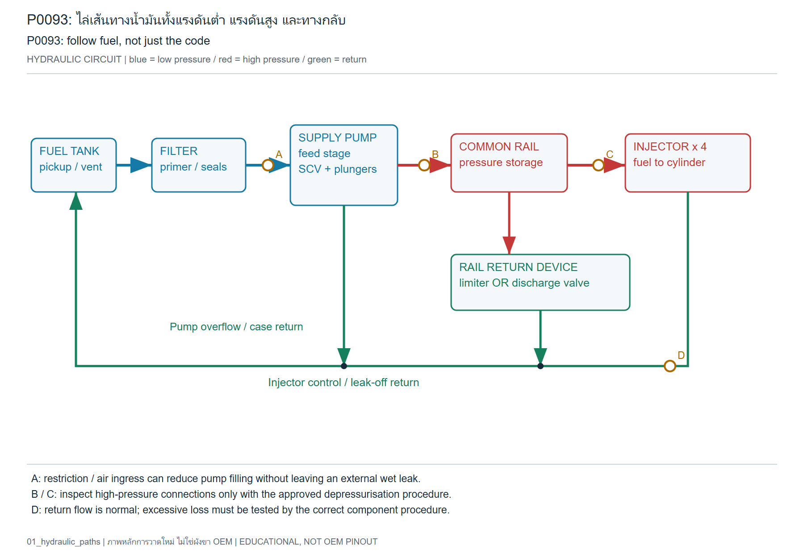

ภาพวาดใหม่แยกด้านดูดแรงดันต่ำ ท่อแรงดันสูง และน้ำมันไหลกลับ ไม่ใช่ผังติดตั้งรถเฉพาะคัน จุด A–D เป็นจุดอ้างอิงในภาพ ไม่ใช่ชื่อพอร์ต OEM

ก่อนกล่าวหาว่าปั๊มเสีย ต้องรู้ว่าปั๊มได้รับน้ำมันพอหรือไม่ การรั่วด้านดูดอาจดูดอากาศเข้าโดยไม่เห็นน้ำมันเปียกด้านนอก ส่วน return เป็นทางเดินปกติ แต่ปริมาณมากเกินต้องพิสูจน์ตามขั้นตอนและสเปกรุ่นนั้น

ขอบเขต: original educational concept; not universal OEM wiring; no inferred pinout

แหล่งอ้างอิงภาพ: [แหล่ง 1](https://www.denso-am.eu/products/diesel-components/common-rail-pump) • [แหล่ง 2](https://www.denso-am.eu/products/diesel-components) • [แหล่ง 3](https://www.pumbaoverland.com/files/TOYOTA_Injection_manual_1KD_2KD.pdf)

### ภาพ 02 วงป้อนกลับควบคุมแรงดัน

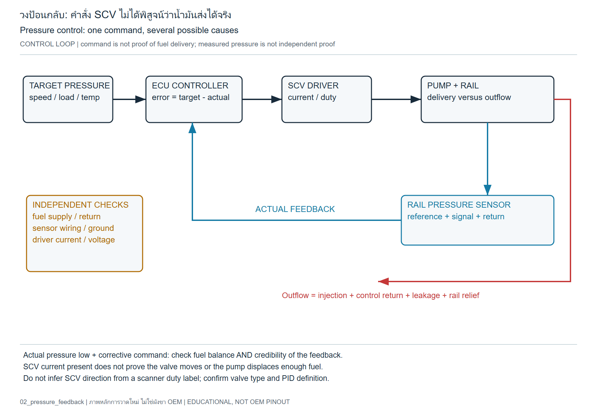

ECU เทียบแรงดันเป้าหมายกับค่าที่เซ็นเซอร์รายงาน แล้วปรับการเติมรางผ่าน SCV ภาพนี้เป็นวงควบคุมเชิงหน้าที่ ไม่ใช่อัลกอริทึมหรือ calibration ภายใน ECU Toyota

คำสั่งเพิ่มแล้วแรงดันไม่ขึ้นไม่ได้พิสูจน์ว่าปั๊มเสียโดยลำพัง อาจเป็นการเติมไม่พอ การสูญเสียภายใน หรือข้อมูลป้อนกลับคลาดเคลื่อน ควรเก็บ target / actual / current พร้อมเงื่อนไขเดียวกัน

ขอบเขต: original educational concept; not universal OEM wiring; no inferred pinout

แหล่งอ้างอิงภาพ: [แหล่ง 1](https://www.denso-am.eu/products/diesel-components/common-rail-suction-control-valve-scv) • [แหล่ง 2](https://www.denso-am.eu/products/diesel-components/common-rail-pump) • [แหล่ง 3](https://toyotamanuals.gitlab.io/PZ471-Z00W0-CA/htmlweb/rm/rm1151e/m_05_0501.pdf)

### ภาพ 03 วงจรเซ็นเซอร์รางสามเส้น

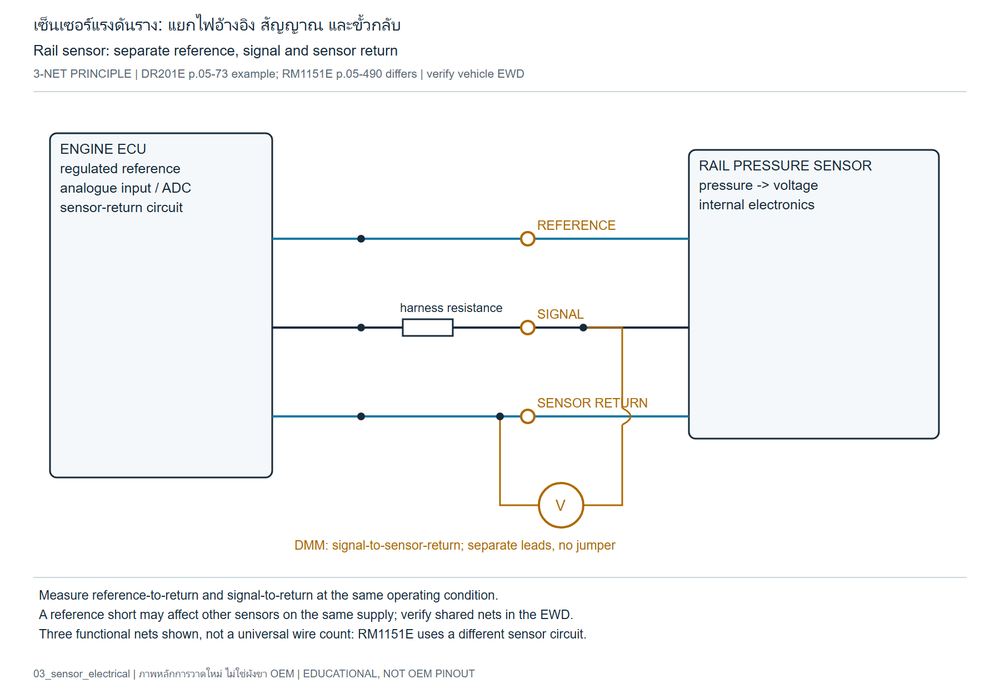

ผังหลักการสามหน้าที่ reference / signal / sensor return พร้อมตำแหน่งเปรียบเทียบแรงดัน อิงตัวอย่างสามสาย DR201E และระบุความต่างจาก RM1151E หลายสาย ไม่กำหนดว่าเป็นปลั๊กสามขาทุก variant และไม่ให้หมายเลข cavity

วัด reference เทียบ sensor return, signal เทียบ sensor return และตรวจ return เทียบขั้วกลับ ECU แยกกัน หาก reference ร่วมตกต้องตาม EWD ว่าอุปกรณ์ใดใช้ supply เดียวกัน ไม่ตัดสินเซ็นเซอร์จากแรงดันเทียบตัวถังอย่างเดียว

ขอบเขต: original educational concept; not universal OEM wiring; no inferred pinout

แหล่งอ้างอิงภาพ: [แหล่ง 1](https://toyotamanuals.gitlab.io/hiluxoct2010/rm/dr201e/m_05_0070.pdf) • [แหล่ง 2](https://toyotamanuals.gitlab.io/PZ471-Z00W0-CA/htmlweb/rm/rm1151e/m_05_0486.pdf)

### ภาพ 04 ตรวจวงขดลวด SCV ให้ครบสองขั้ว

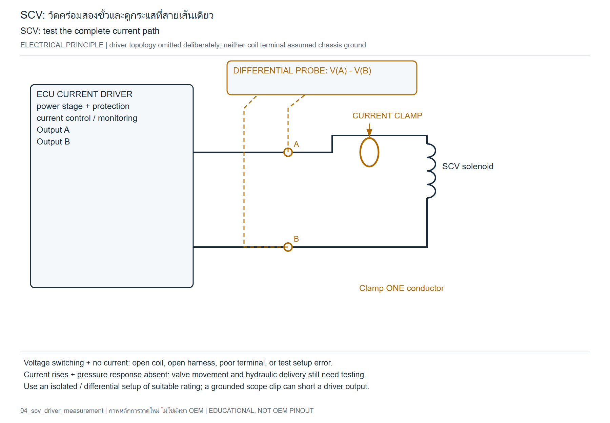

ผังหลักการขดลวดและภาคขับ แสดง differential probe คร่อมสองขั้วกับ current clamp ที่สายเส้นเดียว ไม่สมมติว่าขั้วใดลงกราวด์ และไม่เปิดเผย topology OEM ที่ยังยืนยันไม่ได้

มีแรงดันสวิตช์แต่ไม่มีกระแสควรตรวจขดลวด สาย ขั้วต่อ และการตั้งเครื่องมือก่อน มี current ไม่ได้แปลว่าวาล์วขยับได้ครบหรือปั๊มสร้างปริมาณน้ำมันได้พอ ขา scope แบบต่อ earth อาจลัดวงจรภาคขับ ต้องใช้การวัดที่เหมาะสม

ขอบเขต: original educational concept; not universal OEM wiring; no inferred pinout

แหล่งอ้างอิงภาพ: [แหล่ง 1](https://www.denso-am.eu/products/diesel-components/common-rail-suction-control-valve-scv) • [แหล่ง 2](https://www.denso-am.eu/news/fourth-generation-common-rail-diesel-diagnosis-suction-control-valve)

### ภาพ 05 เปรียบเทียบ SCV NC / NO

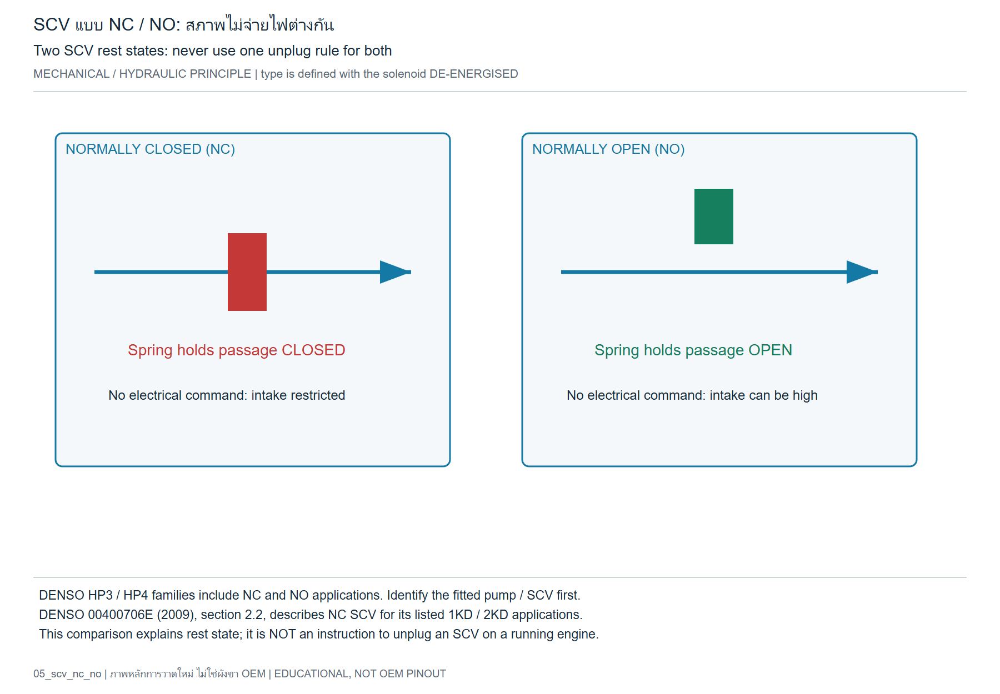

NC และ NO อ้างถึงสภาพเมื่อไม่จ่ายไฟ ภาพเปิด/ปิดเป็นภาพสอนหน้าที่ ไม่ใช่ภาพตัดขวางรูปร่างวาล์วจริง

ห้ามใช้กฎถอดปลั๊กแล้วแรงดันขึ้นหรือลงแบบเดียวกับรถทุกคัน ต้องตรวจ pump / SCV part number และคู่มือของคันจริง ขนาด SV1 / SV2 เป็นอีกคุณลักษณะหนึ่ง ไม่ใช่คำแปลของ NC / NO

ขอบเขต: original educational concept; not universal OEM wiring; no inferred pinout

แหล่งอ้างอิงภาพ: [แหล่ง 1](https://www.denso-am.eu/products/diesel-components/common-rail-suction-control-valve-scv) • [แหล่ง 2](https://www.denso-am.eu/news/fourth-generation-common-rail-diesel-diagnosis-suction-control-valve) • [แหล่ง 3](https://www.service-engine.com.ua/webroot/pdf/TOYOTA%201KD%202KD%20ENGINE.pdf)

### ภาพ 06 แยก limiter กับ discharge valve

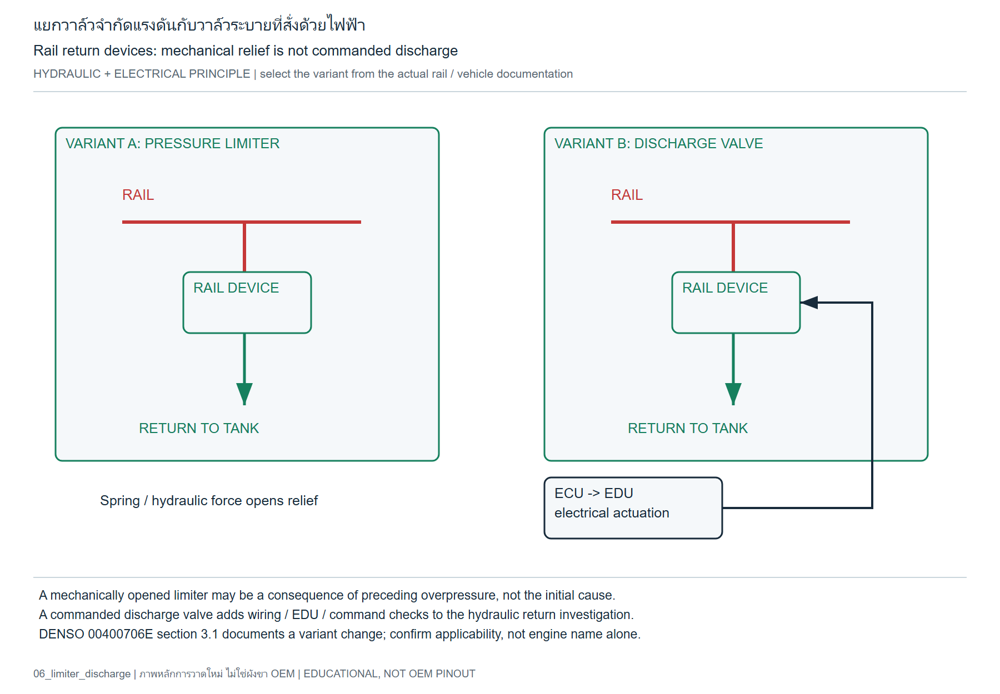

เปรียบเทียบทางกลับที่ทำงานด้วยแรงไฮดรอลิกกับวาล์วระบายที่มีการสั่งไฟฟ้า ภาพแสดงสอง variant แยกกัน ไม่ได้ติดตั้งทั้งสองอย่างใน rail เดียวเสมอ

limiter เปิดอาจเป็นผลจาก overpressure ก่อนหน้า จึงต้องดูเหตุการณ์ก่อนแรงดันตก ไม่เปลี่ยน limiter ทันทีทุกกรณี ส่วน discharge valve ต้องเพิ่มการตรวจคำสั่ง สายไฟ และ EDU ตามคู่มือรุ่นจริง

ขอบเขต: original educational concept; not universal OEM wiring; no inferred pinout

แหล่งอ้างอิงภาพ: [แหล่ง 1](https://www.service-engine.com.ua/webroot/pdf/TOYOTA%201KD%202KD%20ENGINE.pdf) • [แหล่ง 2](https://toyotamanuals.gitlab.io/PZ471-Z00W0-CA/htmlweb/rm/rm1151e/m_05_0501.pdf)

### ภาพ 07 การสั่งหัวฉีดและทาง return

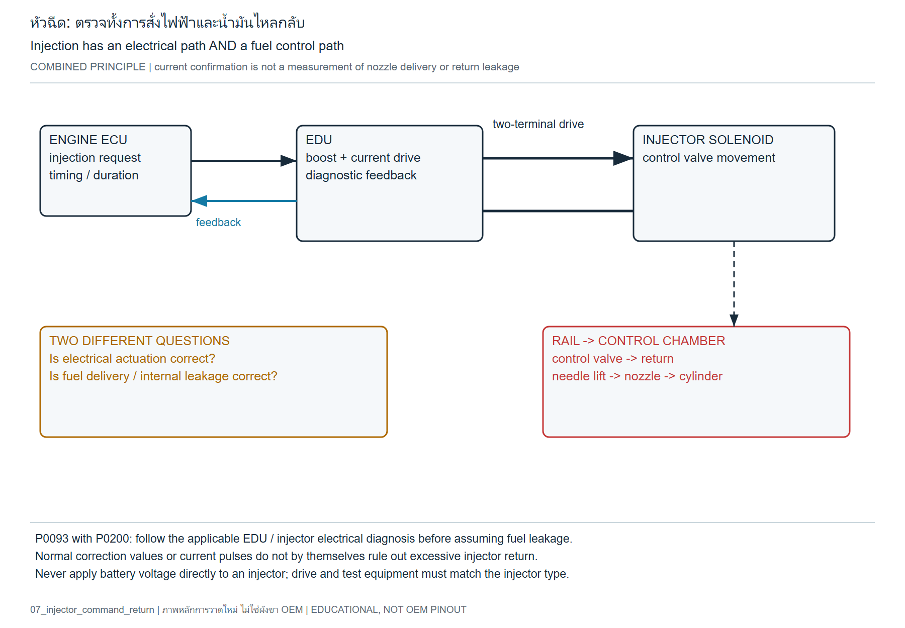

แยกคำสั่ง ECU → EDU → ขดลวด ออกจากการเคลื่อนวาล์วควบคุม น้ำมันกลับ และเชื้อเพลิงออกหัวฉีด เป็นผังหน้าที่ ไม่ใช่วงจรภายใน EDU หรือสเปก pulse

เมื่อพบ P0200 ร่วม ต้องเข้าทางตรวจวงจร EDU / injector ของรุ่นนั้น feedback ทางไฟฟ้าไม่ใช่มาตรวัดปริมาณฉีดหรือปริมาณรั่วกลับ และค่าชดเชยหัวฉีดปกติไม่ได้ตัดปัญหา leak-off ออกทั้งหมด

ขอบเขต: original educational concept; not universal OEM wiring; no inferred pinout

แหล่งอ้างอิงภาพ: [แหล่ง 1](https://www.denso-am.eu/products/diesel-components) • [แหล่ง 2](https://www.service-engine.com.ua/webroot/pdf/TOYOTA%201KD%202KD%20ENGINE.pdf) • [แหล่ง 3](https://toyotamanuals.gitlab.io/PZ471-Z00W0-CA/htmlweb/rm/rm1151e/m_05_0501.pdf)

### ภาพ 08 ความคลาดเคลื่อนจาก sensor return

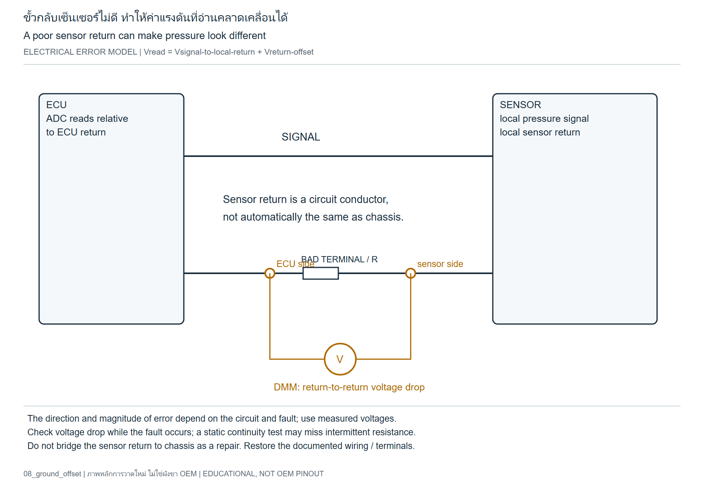

แบบจำลองขั้วต่อมีความต้านทาน ทำให้ศักย์ไฟฟ้าของ return คนละจุดไม่เท่ากัน จึงต้องวัด voltage drop ขณะเกิดอาการ

การวัดความต่อเนื่องตอนจอดอาจผ่านแต่ขณะสั่น/ร้อนไม่ผ่าน อย่าซ่อมด้วยการพ่วง sensor return ลงตัวถัง ต้องคืนสภาพขั้ว/สายตามผังจริง ทิศของ error ต้องพิจารณาจากวงจรและค่าที่วัด ไม่เหมาว่า ground เสียแล้วแรงดันอ่านสูงทุกกรณี

ขอบเขต: original educational concept; not universal OEM wiring; no inferred pinout

ภาพแบบจำลองทางไฟฟ้าที่ผู้เขียนวาดขึ้น เพื่ออธิบายหลักการ ไม่ใช่วงจรภายใน OEM

### ภาพ 09 ลำดับก่อนเข้าสู่ fail-safe

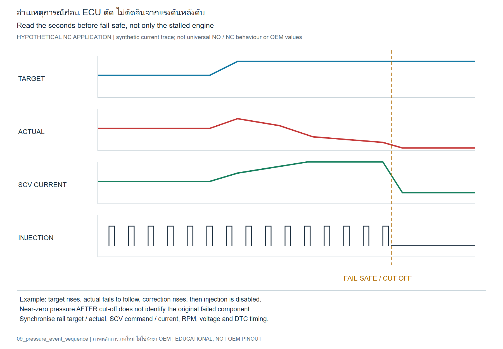

ตัวอย่างกราฟสังเคราะห์ของ hypothetical NC application แสดง target / actual / SCV current / injection เพื่อฝึกอ่านลำดับเหตุการณ์ ไม่มีค่าจริง แกนเวลาไม่ใช่เวลาทริกเกอร์ของ ECU รูปร่างกระแสไม่ใช่สเปกผ่าน/ไม่ผ่านและไม่แทนการตอบสนองของ NO

แรงดันต่ำหลัง ECU ตัดการฉีดไม่บอกต้นเหตุ ดูวินาทีก่อนโค้ดขึ้นและแยกเหตุออกจากผล การตอบสนอง current ในภาพไม่ควรคัดลอกใช้กับ NO application โดยไม่มีการแปลงทิศการควบคุม

ขอบเขต: original educational concept; not universal OEM wiring; no inferred pinout

แหล่งอ้างอิงภาพ: [แหล่ง 1](https://toyotamanuals.gitlab.io/PZ471-Z00W0-CA/htmlweb/rm/rm1151e/m_05_0501.pdf)

### ภาพ 10 สมดุลปริมาณเข้าออก rail

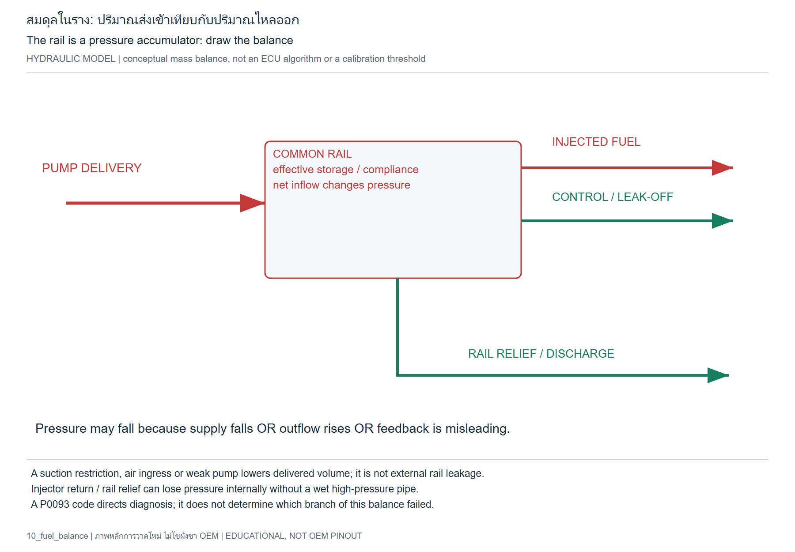

ภาพโมเดลอธิบายรางเป็นตัวสะสมแรงดัน: ปั๊มส่งเข้า, หัวฉีดจ่ายออก, return ภายใน และวาล์วระบาย ละการบีบอัด/อุณหภูมิ/คลื่นแรงดันเพื่ออ่านง่าย ไม่ใช่สมการวินิจฉัย ECU

แรงดันตกมีได้จาก supply ลด outflow เพิ่ม หรือสัญญาณวัดผิด ชื่อโค้ดไม่ได้ระบุว่าต้องมีรูรั่วภายนอกขนาดใหญ่

ขอบเขต: original educational concept; not universal OEM wiring; no inferred pinout

แหล่งอ้างอิงภาพ: [แหล่ง 1](https://www.denso-am.eu/products/diesel-components/common-rail-pump) • [แหล่ง 2](https://www.denso-am.eu/products/diesel-components)

### ภาพ 11 ตัวอย่างการต่อเซ็นเซอร์ราง DR201E

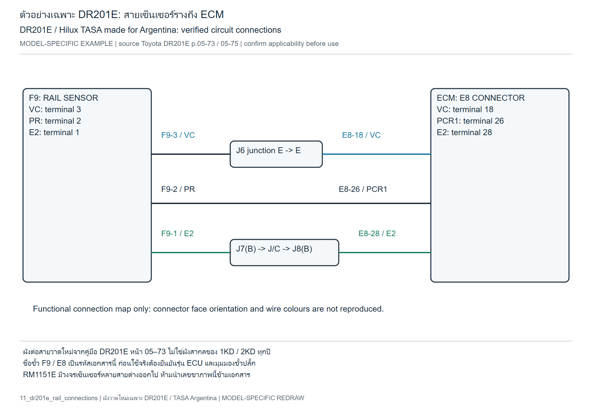

ผังต่อสายวาดใหม่จากเอกสาร Hilux 1KD/2KD TASA made for Argentina เท่านั้น: F9–3 VC ถึง E8–18 VC ผ่าน J6; F9–2 PR ถึง E8–26 PCR1; F9–1 E2 ถึง E8–28 E2 ผ่าน junction J7/J8 ไม่ใช่หมายเลขขารุ่นไทยทุกคัน

วงจรนี้เป็นตัวอย่างที่ยืนยัน connector ID แล้ว แต่ยังต้องเทียบ application และมุมมองขั้วปลั๊กก่อนใช้จริง ไม่กำหนดซ้าย/ขวาหรือด้านสายจากภาพแผนผัง RM1151E มีตัวอย่างเซ็นเซอร์หลายสายต่างกันจึงไม่ย้ายเลขขาข้ามเอกสาร

ขอบเขต: verified connection redraw: Toyota DR201E Hilux TASA Argentina only; not universal pinout

แหล่งอ้างอิงภาพ: [แหล่ง 1](https://toyotamanuals.gitlab.io/hiluxoct2010/rm/dr201e/m_05_0070.pdf)

### ภาพ 12 ตัวอย่างวงขดลวด SCV DR201E

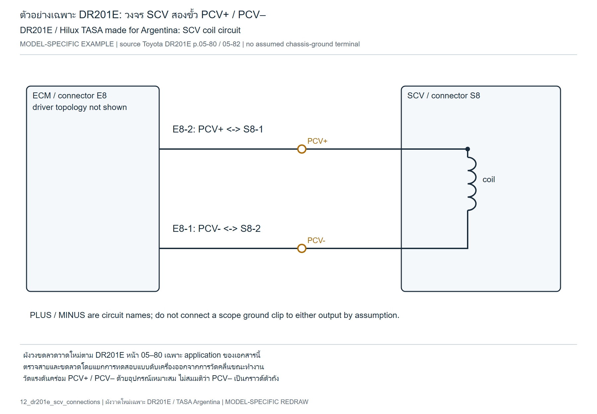

ผังขดลวด SCV วาดใหม่จาก DR201E Hilux TASA Argentina: S8–1 ถึง E8–2 PCV+ และ S8–2 ถึง E8–1 PCV– เป็นข้อมูลเฉพาะชุดเอกสาร ไม่วาดภาคขับภายใน ECU ที่คู่มือไม่ได้ให้รายละเอียด

PCV– เป็นชื่อวงจรไม่ใช่หลักฐานว่าเป็นกราวด์ตัวถัง การวัดคลื่นต้องใช้การวัดคร่อมที่เหมาะสมและ current clamp เส้นเดียว การทดสอบโอห์มหรือสายแบบดับเครื่องต้องแยกจากการวัดขณะระบบทำงานและใช้สเปกตรงรุ่น

ขอบเขต: verified connection redraw: Toyota DR201E Hilux TASA Argentina only; not universal pinout

แหล่งอ้างอิงภาพ: [แหล่ง 1](https://toyotamanuals.gitlab.io/hiluxoct2010/rm/dr201e/m_05_0078.pdf)

### ภาพ 13 แรงดันสูงก่อนแรงดันตก

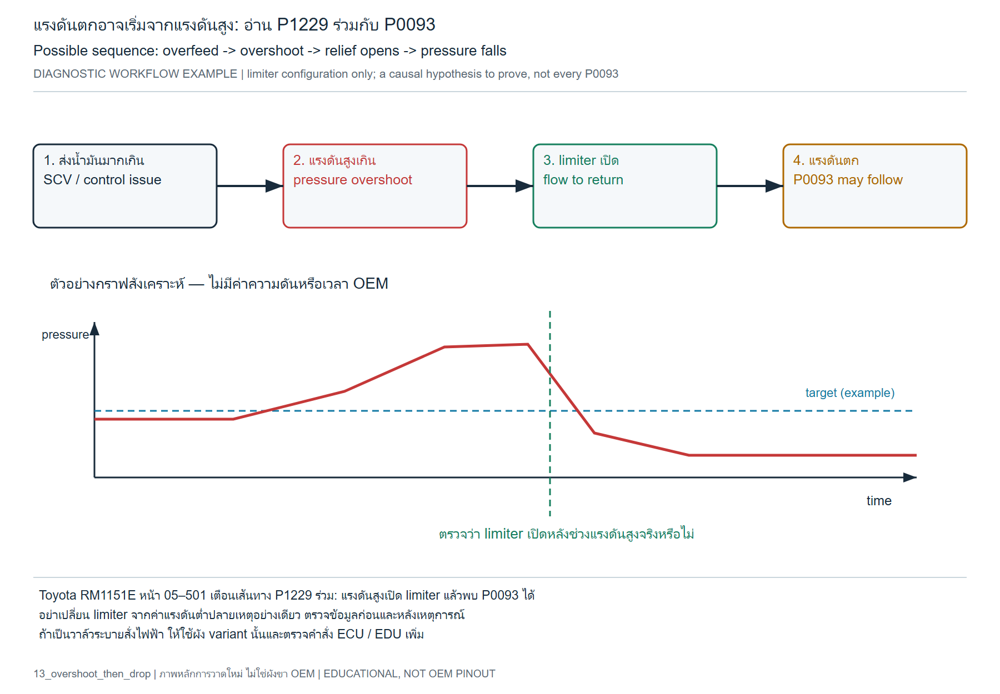

เส้นทางหนึ่งที่ควรตรวจเมื่อ P1229 ร่วมกับ P0093 ในระบบที่มี mechanical limiter: ส่งน้ำมันมากเกิน แรงดันสูง เปิดทางระบาย แล้วแรงดันตก กราฟเป็นเส้นสังเคราะห์ไม่มีค่า OEM และไม่ใช่หลักฐานว่า limiter เปิดจริงในรถที่กำลังตรวจ

ให้ผู้เรียนหาหลักฐานก่อนเวลาตัด ไม่สรุปจากแรงดันต่ำตอนจบ หากรถเป็น discharge valve สั่งไฟฟ้าต้องเปลี่ยนทางตรวจตามระบบ ไม่ใช้ภาพ limiter แทนทุก variant

ขอบเขต: original educational concept; not universal OEM wiring; no inferred pinout

แหล่งอ้างอิงภาพ: [แหล่ง 1](https://www.denso-am.eu/news/fourth-generation-common-rail-diesel-diagnosis-suction-control-valve) • [แหล่ง 2](https://toyotamanuals.gitlab.io/PZ471-Z00W0-CA/htmlweb/rm/rm1151e/m_05_0501.pdf)

### ภาพ 14 จุดวัดแรงดันด้านดูด

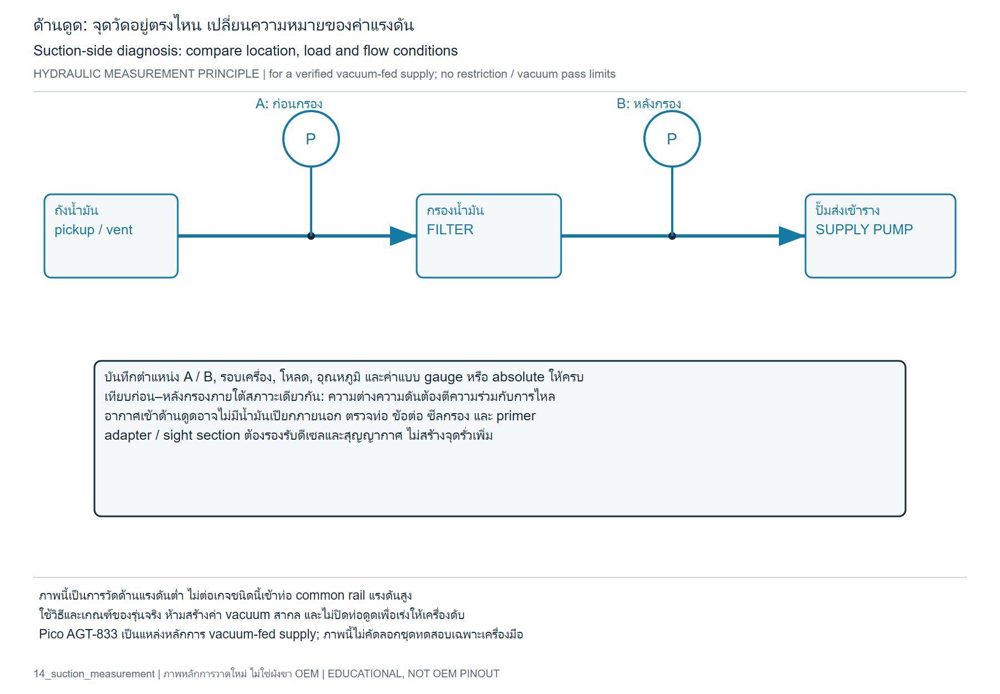

แผนวัดก่อนและหลังกรองในระบบดูดน้ำมันที่ยืนยัน configuration แล้ว เป็นผังหลักการตำแหน่งวัด ไม่ใช่ชุด sight-block / stop-tap ของ Pico และไม่ให้เกณฑ์ vacuum ผ่านหรือไม่ผ่าน

บันทึกตำแหน่งจริง ชนิดเกจ รอบ โหลด อุณหภูมิ และสภาวะเดียวกันก่อนเปรียบเทียบ ความดันต่างก่อน–หลังต้องตีความร่วมการไหล และการรั่วด้านดูดอาจนำอากาศเข้าโดยไม่เห็นน้ำมันภายนอก ภาพไม่สอนปิดท่อเพื่อทำให้เครื่องดับและไม่อนุญาตเกจแรงดันต่ำต่อเข้ารางแรงดันสูง

ขอบเขต: original educational concept; not universal OEM wiring; no inferred pinout

แหล่งอ้างอิงภาพ: [แหล่ง 1](https://www.picoauto.com/library/automotive-guided-tests/pressure-transducers/wps500x-pressure-transducer/AGT-833-negative-priming-fuel-pressure-diesel/)

### ภาพ 15 เงื่อนไขของการทดสอบน้ำมันกลับ

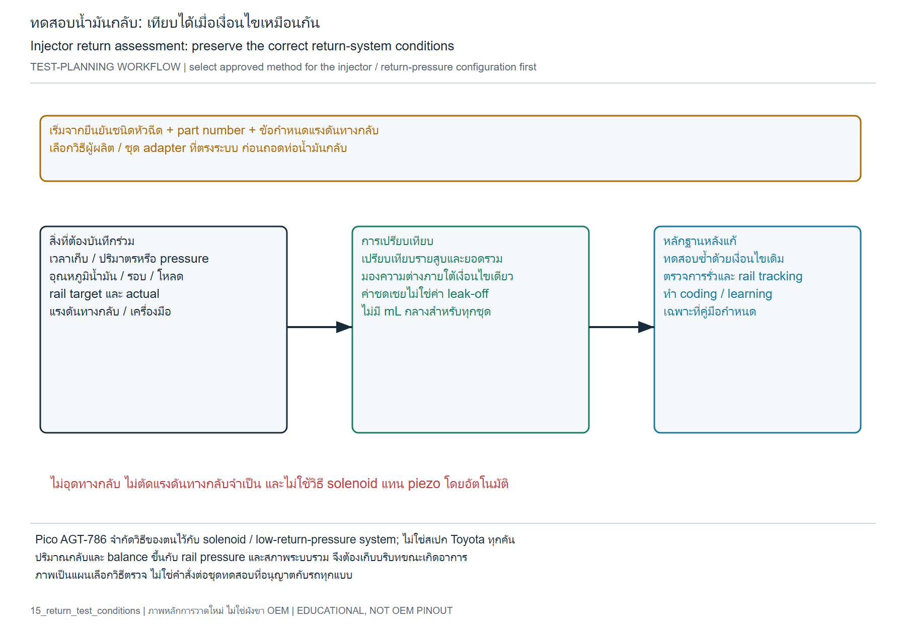

ผังเลือกวิธีทดสอบและเก็บเงื่อนไขน้ำมันกลับก่อนแปลผล ข้อจำกัด solenoid / low-return-pressure เป็นขอบเขตวิธี AGT-786 ไม่ใช่การประกาศว่า injector return ทุกแบบถอดลงภาชนะเปิดได้

ไม่สร้างค่า mL กลางสำหรับทุกชุดหัวฉีด การเปรียบเทียบต้องเก็บ rail target / actual, รอบ, โหลด, อุณหภูมิ, เวลา และแรงดันทางกลับ การทดลองที่ทำให้แรงดันทางกลับซึ่งระบบต้องการหายไปอาจผิดวิธี ต้องเลือก manual / adapter ของ application จริง

ขอบเขต: original educational concept; not universal OEM wiring; no inferred pinout

แหล่งอ้างอิงภาพ: [แหล่ง 1](https://www.picoauto.com/library/automotive-guided-tests/pres/wps500x-pressure-transducer/AGT-786-crd-injector-back-leakage/)

### ภาพ 16 ผังวินิจฉัยด้วยหลักฐาน

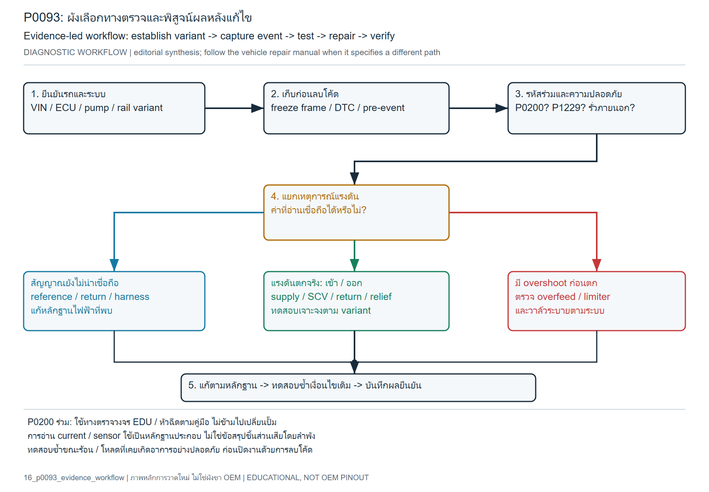

ผังภาพสรุปของผู้เขียนตั้งแต่ยืนยันระบบ เก็บ freeze frame / รหัสร่วม แยกความน่าเชื่อถือสัญญาณ แยกปริมาณเข้าออก และตรวจผลหลังซ่อม ไม่ใช่ผังขั้นตอน Toyota ที่ใช้แทน repair manual ทุกข้อ

นำกรณีศึกษาให้ผู้เรียนเลือกหลักฐานก่อนเลือกอะไหล่ หากมี P0200 ต้องใช้ทาง EDU / injector ที่เกี่ยวข้อง และถ้ามี overshoot ก่อนตกให้พิสูจน์เหตุการระบาย หลังแก้ต้องทดสอบเงื่อนไขเดิมอย่างปลอดภัย ไม่จบที่ลบโค้ด

ขอบเขต: original educational concept; not universal OEM wiring; no inferred pinout

แหล่งอ้างอิงภาพ: [แหล่ง 1](https://www.denso-am.eu/products/diesel-components/common-rail-suction-control-valve-scv) • [แหล่ง 2](https://toyotamanuals.gitlab.io/PZ471-Z00W0-CA/htmlweb/rm/rm1151e/m_05_0501.pdf) • [แหล่ง 3](https://toyotamanuals.gitlab.io/hiluxoct2010/rm/dr201e/m_05_0070.pdf) • [แหล่ง 4](https://toyotamanuals.gitlab.io/hiluxoct2010/rm/dr201e/m_05_0078.pdf) • [แหล่ง 5](https://www.picoauto.com/library/automotive-guided-tests/pres/wps500x-pressure-transducer/AGT-786-crd-injector-back-leakage/)

## บทเรียนวงจรและลำดับการทำงาน

บทนี้เชื่อมวงจรไฟฟ้ากับทางเดินน้ำมัน เพื่อให้ผู้อ่านบอกได้ว่า “เราวัดอะไรอยู่” และ “หลักฐานนั้นตัดสินอะไรได้บ้าง” ตัวอย่างเลขขาใช้เฉพาะ Toyota DR201E ที่ระบุ Hilux 1KD/2KD TASA made for Argentina ส่วนภาพหลักการไม่ใช่วงจรติดตั้งสำหรับรถทุกคัน ต้องยืนยันรุ่น ECU ปั๊ม ราง หัวฉีด และคู่มือของรถที่จะตรวจอีกครั้ง

คำว่า **ข้อมูลเอกสาร** ในบทนี้หมายถึงสิ่งที่คู่มือหรือผู้ผลิตที่อ้างระบุไว้ คำว่า **วิธีคิดวินิจฉัย** หมายถึงการนำหลักวิศวกรรมมาเรียงคำถามของผู้เขียน ไม่ใช่ประกาศว่า Toyota กำหนดขั้นตอนนั้นกับรถทุก variant

### บทเรียน 1 — แยกสายไฟ ทางน้ำมัน และเส้นคำสั่งก่อนอ่านค่า

**ดูภาพ 01, 02 และ 10**

เริ่มที่น้ำมันหนึ่งส่วนซึ่งออกจากถัง ผ่านทางส่งและกรอง เข้าปั๊ม แล้วถูกส่งสู่รางแรงดันสูง จากรางจึงไปหัวฉีด เส้นทางกลับเป็นอีกทางหนึ่ง มีทั้งส่วนที่ระบบใช้ทำงานตามปกติและส่วนที่มากผิดปกติได้ ภาพ 01 จึงแยกสีด้านแรงดันต่ำ ด้านแรงดันสูง และด้านกลับ เพื่อไม่ให้คำว่า “รั่ว” ทำให้เรามองเฉพาะน้ำมันเปียกบนเครื่องยนต์

**ข้อมูลเอกสาร:** DR201E อธิบายให้รางสะสมเชื้อเพลิงแรงดันสูง ปั๊มส่งเชื้อเพลิงเข้าราง ECM ติดตามแรงดันจากเซ็นเซอร์และควบคุมการจ่าย ส่วน EDU จ่ายกระแสให้หัวฉีดตามคำสั่ง ECM [T04 หน้า 05–11 ถึง 05–15] DENSO อธิบายบทบาทปั๊มและการควบคุมเชื้อเพลิงด้วยไฟฟ้าในระบบ common rail สอดคล้องกัน [DENSO Common Rail Pump](https://www.denso-am.eu/products/diesel-components/common-rail-pump) และ [DENSO Diesel Components](https://www.denso-am.eu/products/diesel-components)

เส้นคำสั่งในภาพ 02 ไม่ใช่ท่อน้ำมันและไม่ใช่สายไฟที่ระบุขาปลั๊ก เส้น ECU → SCV driver หมายถึงหน้าที่ควบคุม ส่วนเส้นกลับจาก rail sensor หมายถึงข้อมูลป้อนกลับ หากนำภาพหน้าที่ไปหาตำแหน่งสายจริง จะตรวจผิดตั้งแต่ต้น ต้องเปิดภาพ 11 หรือ 12 และคู่มือ application ที่ตรงกันก่อน

**วิธีคิดวินิจฉัย:** รางมีความดันเปลี่ยนตามผลรวมของเชื้อเพลิงเข้าและออก โมเดลในภาพ 10 ให้ถามสี่ข้อเรียงกัน: ปั๊มได้รับน้ำมันหรือไม่ ปั๊มส่งเข้ารางได้เท่าไร มีส่วนออกทางหัวฉีด/return/วาล์วระบายอย่างไร และแรงดันที่เห็นเป็นข้อมูลน่าเชื่อถือหรือไม่ โมเดลนี้ไม่ให้ค่าสูตรตรวจ P0093 ของ ECU และไม่แทนเกณฑ์แรงดันตกตาม calibration

ตัวอย่างเช่น รถมีแรงดันตามไม่ทันเมื่อเพิ่มโหลด แต่ไม่มีท่อแรงดันสูงเปียก ภาพ 01 ยังชี้ทางตรวจได้ทั้งด้านดูดอากาศเข้า ด้านปั๊มส่งไม่พอ และการสูญเสียภายในด้านกลับ การไม่มีคราบภายนอกจึงลดความเป็นไปได้เพียงบางทาง ไม่ได้พิสูจน์ว่าหัวฉีดหรือปั๊มดี

**จุดฝึก:** ให้ผู้เรียนลากนิ้วตามเส้นจากถังถึงหัวฉีด แล้วลากทางกลับแยกต่างหาก จากนั้นชี้ว่าเครื่องมือแต่ละตัวตรวจ “ความดัน” “กระแส” “แรงดันไฟฟ้า” หรือ “ปริมาตร” ห้ามใช้ชื่อปนกัน

### บทเรียน 2 — มองระบบตามช่วงทำงาน ไม่ตั้งกฎสากลจากอาการเดียว

**ดูภาพ 02 และ 09 — ภาพ 09 เป็นกราฟจำลองของระบบ NC สมมติ ไม่ใช่ผลวัดรถจริง**

#### เปิดกุญแจ แต่เครื่องยังไม่หมุน

**ข้อมูลเอกสาร:** ผัง DR201E แสดงสัญญาณ ignition switch, starter, แหล่งไฟ ECM/EDU และ crank/cam เป็นคนละหน้าที่ ปั๊มในคำอธิบายระบบขับด้วยการหมุนเครื่องยนต์ [T04 หน้า 05–5 ถึง 05–14]

**วิธีคิดวินิจฉัย:** ช่วงเปิดกุญแจเหมาะกับการบันทึกรหัสก่อนลบ ดูการสื่อสาร และตรวจวงจรจ่ายไฟ/อ้างอิงตามขั้นตอนของรุ่นนั้น ไม่ถือว่าเพียงเปิดกุญแจแล้วปั๊มแรงดันสูงต้องสร้างแรงดันเหมือนตอนเครื่องหมุน และไม่ตั้งว่าค่า rail ต้องเป็นศูนย์ทันที เพราะอาจมีแรงดันคงค้างหรือวิธีแสดงผลของระบบต่างกัน คู่มือที่ใช้ในบทนี้ยังไม่ให้ลำดับมิลลิวินาทีของ relay หรือ pulse เริ่มต้น SCV จึงไม่กำหนดขึ้นเอง

#### ขณะสตาร์ต

การหมุนของเครื่องยนต์ทำให้ปั๊มมีการเคลื่อนที่ทางกล ขณะเดียวกันระบบต้องมีไฟเลี้ยงและสัญญาณที่ใช้คำนวณจังหวะฉีด ประโยคว่า “มีรอบแล้ว” จึงยังไม่เท่ากับ “มีการเติมรางพอ” และ “มีแรงดันตามค่าที่อ่าน” ยังไม่เท่ากับ “หัวฉีดถูกสั่งครบ” นี่เป็นการแบ่งคำถามตรวจ ไม่ใช่การระบุ threshold อนุญาตฉีดของ Toyota

ถ้าเกิดอาการสตาร์ตยาว ให้เก็บ RPM, แรงดันไฟเลี้ยง, target/actual rail และรหัสร่วมภายใต้ช่วงเวลาเดียวกันก่อน แต่ไม่ใช้บทนี้ตั้งค่ารอบต่ำสุด แรงดันรางเริ่มฉีด หรือกระแส SCV ที่ต้องได้ การวินิจฉัยสตาร์ตไม่ติดกับเงื่อนไขที่ ECU เปิด monitor P0093 เป็นคนละเรื่องกัน [แนวทางผู้เขียน; ดูเงื่อนไข monitor ของรุ่นจริงใน T05]

#### เดินเบาหลังติดเครื่อง

**วิธีคิดวินิจฉัย:** เมื่อสภาพค่อนข้างคงที่ จึงเริ่มเปรียบเทียบความสัมพันธ์ของ target/actual กับการแก้คำสั่งได้ง่าย แต่คำว่า “นิ่ง” ไม่หมายถึงเส้นแบนไร้การเปลี่ยนแปลงเสมอ และการเดินเบาปกติไม่ได้พิสูจน์กำลังส่งน้ำมันสำรองขณะโหลดสูง

อย่าหาค่าเดินเบาเดียวครอบทุก 1KD/2KD ให้เปิดตารางรุ่นของหนังสือและอ้างคู่มือที่ตรงรถ โดยเก็บอุณหภูมิและสภาพโหลดประกอบ ไม่ใช้ค่า 3,000 rpm แบบไม่มีโหลดแทนการเร่งบนถนน

#### เพิ่มโหลดหรือเร่งเครื่อง

ปริมาณเชื้อเพลิงที่ใช้และเป้าหมายระบบอาจเปลี่ยน ผู้เขียนจึงเสนอให้ดูการติดตามเป้าหมายเป็นเหตุการณ์ ไม่ดูตัวเลขตัดขาดครั้งเดียว หาก actual ตามไม่ทัน ให้เริ่มแยก supply/flow/return และความน่าเชื่อถือของสัญญาณตามบทเรียนถัดไป โดยไม่สั่งว่า SCV current ต้องเพิ่มกับรถทุกแบบ เพราะ NC กับ NO มีพฤติกรรมพื้นฐานต่างกัน [D06; D01]

#### ผ่อนคันเร่ง ลดโหลด และดับเครื่อง

**วิธีคิดวินิจฉัย:** ช่วงลดโหลดใช้ดูว่าระบบกลับไปสู่เงื่อนไขใหม่ได้หรือไม่ แต่ไม่ถือว่าการผ่อนคันเร่งทุกครั้งต้องตัดหัวฉีดทั้งหมด ไม่กำหนด target ให้เป็นศูนย์ และไม่ถือว่าวาล์วระบายทุก variant ต้องเปิดในเวลาเดียวกัน เอกสารในชุดนี้ยังไม่ยืนยันกลยุทธ์ decel ของทุก calibration

แยกการผ่อนคันเร่งปกติออกจาก fail-safe หลังตรวจพบความผิดปกติ ภาพ 09 ใช้ฝึกสังเกตก่อนการตัดคำสั่ง ไม่ได้ให้เวลาหน่วงจริงหรือรูปคลื่นผ่าน/ไม่ผ่าน สิ่งที่เห็นหลังเครื่องดับอาจเป็นผลของการตัด ไม่ใช่ต้นเหตุของ P0093 [T05 สำหรับตัวอย่าง monitor/fail-safe เฉพาะ RM1151E]

### บทเรียน 3 — จากคำสั่งไฟฟ้าไปถึงปริมาณปั๊ม: สี่ขั้นที่ห้ามกระโดดข้าม

**ดูภาพ 04, 05 และ 12 — ภาพ 12 ใช้เฉพาะ configuration ของเอกสาร DR201E ที่ระบุ**

**ข้อมูลเอกสาร:** DENSO ระบุ SCV ควบคุมปริมาณเชื้อเพลิงเข้าปั๊ม มีทั้งชนิด NC และ NO ตาม application ส่วนเอกสาร 00400706E อธิบายชนิด NC ของ configuration ที่ระบุในเอกสารนั้น [D06; D01; D05 หน้า 1–6 ถึง 1–7]

**วิธีคิดวินิจฉัย:** แบ่งสายเหตุให้ชัดเป็น **คำสั่ง → กระแสขดลวด → การเคลื่อนวาล์ว → ปริมาณเติม/ส่งของปั๊ม**

ขั้นแรก “คำสั่ง” อาจเป็น PID บนเครื่องสแกน แต่ชื่อ duty, target current และ actual current ไม่ใช่คำเดียวกัน ต้องทราบว่า PID แสดงค่าคำนวณ ค่าที่ร้องขอ หรือค่าที่ระบบวัด ห้ามเปลี่ยนชื่อให้เหมือนกันเพราะหน่วยใกล้เคียงกัน

ขั้นที่สอง กระแสเกิดจากวงจรขดลวด สาย ขั้วต่อ และภาคขับรวมกัน สำหรับโหลดเหนี่ยวนำ หลักทั่วไปคือแรงดันคร่อมขดลวดสัมพันธ์ทั้งกับความต้านทานและการเปลี่ยนกระแส ไม่ใช่เพียงค่าเฉลี่ยแบตเตอรี่ การเห็นแรงดันสวิตช์จึงไม่พิสูจน์ว่ามีกระแสไหลครบ ส่วนการเห็นกระแสไหลก็ยังไม่พิสูจน์ว่าวาล์วไม่ติดขัด

ขั้นที่สาม วาล์วต้องเปลี่ยนพื้นที่ทางผ่านได้ตามการออกแบบ ในระดับหลักการ กระแสขดลวดสร้างแรงแม่เหล็กที่ทำงานร่วมกับแรงสปริงและแรงในกลไก แต่การแปลงกระแสเป็นระยะเคลื่อนจริงขึ้นกับแบบของวาล์ว จึงไม่เขียนว่าเพิ่มกระแสแล้ววาล์วทุกชนิดต้องเคลื่อนไปทิศเดียวกัน การสึก การปนเปื้อน หรือความฝืดเป็นสมมติฐานทางกลที่ต้องตรวจด้วยวิธีซึ่งผู้ผลิตอนุญาต ไม่ใช้การต่อแบตเตอรี่ตรงเข้าขดลวดแล้วฟังเสียงแทนหลักฐานทั้งระบบ

ขั้นที่สี่ ปริมาณเชื้อเพลิงที่ปั๊มส่งจริงยังขึ้นกับเชื้อเพลิงที่มีให้เติมและสภาพทางกลของปั๊ม การเปิด SCV ไม่ได้สร้างเชื้อเพลิงขึ้นมาเอง หากทางดูดส่งไม่พอหรือมีอากาศเข้า กำลังส่งที่ได้อาจไม่สัมพันธ์กับคำสั่งตามที่คาด

ภาพ 04 แสดงการวัดคร่อมสองขั้วและ current clamp เส้นเดียว การหนีบสายไป–กลับพร้อมกันอาจทำให้ผลรวมสนามลดลงจนอ่านผิด การใช้ scope ที่มีกราวด์ร่วมต้องเข้าใจวงจรและพิกัดอุปกรณ์ ไม่จับคลิปกราวด์ลงขา output โดยเดาว่าขาลบคือ chassis ground

**ข้อมูลวงจรเฉพาะเอกสาร:** ภาพ 12 ยืนยัน S8–1 ถึง E8–2 PCV+ และ S8–2 ถึง E8–1 PCV– ใน DR201E เท่านั้น ชื่อ PCV– ไม่เปิดเผย topology ภาคขับภายในและไม่ใช่คำสั่งให้ต่อกับตัวถัง [T03 หน้า 05–80/82]

**จุดฝึก:** ให้ผู้เรียนเขียนผลตรวจสามบรรทัดแยกกัน: คำสั่งที่อ่านคืออะไร กระแสที่วัดเป็นอย่างไร และแรงดันรางตอบสนองอย่างไร หากมีเพียงหนึ่งบรรทัด ให้ระบุสิ่งที่ยังพิสูจน์ไม่ได้แทนการเลือกอะไหล่ทันที

### บทเรียน 4 — ปั๊มทำงานเป็นจังหวะ แต่รางช่วยแยกจังหวะปั๊มออกจากจังหวะฉีด

**ดูภาพ 01, 10 และ 14 ตามลำดับ**

**ข้อมูลเอกสาร:** DR201E แสดง feed pump, SCV, plunger และ check valve เป็นส่วนทำงานร่วมกัน การจำกัดช่องดูดทำให้ปริมาตรเติมต่างกันแม้ระยะชักทางกลมีอยู่ การส่งเข้ารางเริ่มได้เมื่อด้านอัดมีแรงดันเอาชนะแรงดันราง ส่วนรางสะสมเชื้อเพลิงสำหรับการฉีด [T04 หน้า 05–11 ถึง 05–15] และ [DENSO Common Rail Pump](https://www.denso-am.eu/products/diesel-components/common-rail-pump)

**วิธีคิดวินิจฉัย:** นึกถึงสองคำถามแยกกัน: “ลูกสูบปั๊มเคลื่อนหรือไม่” กับ “ระหว่างที่เคลื่อนมีน้ำมันให้เติมและอัดมากพอหรือไม่” กลไกหมุนอยู่ไม่ได้ยืนยันว่าปริมาณส่งเท่าเดิมทุกสภาวะ การตรวจเฉพาะสัญญาณ SCV จึงขาดข้อมูลทางเติมและทางอัด

ภาพ 10 ไม่ได้ถือว่ารางเป็นภาชนะที่ความดันคงที่ตลอดเวลา การเก็บแรงดันเกี่ยวข้องกับความสามารถบีบอัดของเชื้อเพลิง ปริมาตรและความยืดหยุ่นทางเดิน รวมทั้งการเข้าออกเป็นจังหวะ เพื่อให้ผู้เริ่มเรียนอ่านง่าย ภาพจึงแสดงยอดรวมเข้า–ออกโดยไม่ให้ค่าความจุเชิงผลหรือสูตร calibration

เมื่อเพิ่มความต้องการเชื้อเพลิง ความผิดปกติที่ซ่อนในเดินเบาอาจปรากฏขึ้นได้ เช่น การจำกัดการไหลหรือกำลังส่งลดลง วิธีคิดที่เหมาะคือเปรียบเทียบสภาพเดียวกันก่อน/หลังแก้ ไม่ตั้งว่าปั๊มที่ทำให้เครื่องเดินเบาได้ย่อมดีทุกช่วง

**การวัดด้านดูด:** ภาพ 14 วาง A ก่อนกรองและ B หลังกรองเพื่อฝึกอธิบายตำแหน่ง ไม่ให้ค่า vacuum สากล ก่อนเทียบต้องบันทึกว่าค่าเป็น gauge หรือ absolute ติดที่ใด เครื่องอยู่รอบ/โหลดใด และเครื่องมือเข้ากับดีเซลและสุญญากาศหรือไม่ [Pico AGT-833: หลักการตรวจ vacuum-fed supply](https://www.picoauto.com/library/automotive-guided-tests/pressure-transducers/wps500x-pressure-transducer/AGT-833-negative-priming-fuel-pressure-diesel/)

ความดันต่างสองจุดสัมพันธ์กับทางผ่านและอัตราการไหล หากเอาค่าสองช่วงที่โหลดต่างกันมาเทียบ อาจสร้างข้อสรุปว่าไส้กรองตันทั้งที่กำลังดูคนละเงื่อนไข ส่วนฟองหรือการสูญเสียการไล่อากาศต้องตรวจว่ามาจากรถหรือ adapter ที่เพิ่งต่อเพิ่ม ไม่ให้ชุดทดสอบกลายเป็นจุดรั่วใหม่

ภาพ 14 ไม่อนุญาตให้ต่อเกจแรงดันต่ำเข้าราง และไม่สอนปิดทางดูดเพื่อทำให้เครื่องดับ การใช้ขั้นตอนเครื่องมือเฉพาะต้องอ่านวิธีเต็มและขอบเขตร่วมกับคู่มือรถ ไม่คัดเฉพาะรูปร่างการต่อแล้วตัดคำเตือนออก

### บทเรียน 5 — วงจรเซ็นเซอร์เป็นส่วนหนึ่งของการควบคุม ไม่ใช่หน้าปัดแยกอิสระ

**ดูภาพ 03 → ภาพ 08 → ภาพ 11**

**ข้อมูลเอกสาร:** DR201E ระบุ ECM ใช้เซ็นเซอร์แรงดันเพื่อควบคุม SCV และแสดงวงจร VC, PR/PCR1, E2 ส่วน RM1151E มีการจัดวงจรเซ็นเซอร์ต่างออกไป จึงใช้ภาพสามหน้าที่เป็นหลักการ ไม่ประกาศว่าทุก 1KD/2KD มีปลั๊กสามสาย [T02 หน้า 05–70/73; T06 หน้า 05–490]

**วิธีคิดวินิจฉัย:** ภาพ 03 แยกสามหน้าที่คือไฟอ้างอิง สัญญาณ และขั้วกลับเซ็นเซอร์ มิเตอร์ในภาพต่อสัญญาณเทียบกับขั้วกลับจริง เส้นที่กระโดดข้ามกันไม่มีการต่อร่วม ไม่ใช่สาย jumper การวัดสัญญาณเทียบตัวถังอย่างเดียวอาจรวมความคลาดเคลื่อนของทางกลับเข้าไปด้วย

**การอนุมานจากหลักวงจรทั่วไป (derivation ไม่ใช่ข้อกำหนด Toyota):** ภาพ 08 ขยายกรณีขั้วต่อทางกลับมีความต้านทาน: ศักย์ที่เซ็นเซอร์ใช้เป็นจุดอ้างอิงอาจต่างจากฝั่ง ECU ดังนั้นสิ่งที่ ECU เห็นอาจรวมผลของความต่างศักย์นั้น ทิศและขนาด error ต้องหาโดยวัดและดูโครงสร้างจริง ไม่มีกฎว่า ground มีปัญหาแล้วค่า rail สูงเสมอ

การตรวจต่อเนื่องแบบดับเครื่องช่วยหาวงเปิดบางชนิด แต่ผลผ่านไม่ตัดความต้านทานที่เกิดเมื่อร้อน สั่น หรือรับกระแสจริงออกทั้งหมด การตรวจ voltage drop ต้องวางจุดวัดสองฝั่งของส่วนที่สงสัยและบันทึกขณะอาการเกิด ไม่พ่วง E2 ลงตัวถังเพื่อทำให้อาการหายแล้วเรียกว่าซ่อมสำเร็จ

**ข้อมูลวงจรเฉพาะเอกสาร:** ภาพ 11 เชื่อม F9–3 VC กับ E8–18 VC, F9–2 PR กับ E8–26 PCR1 และ F9–1 E2 กับ E8–28 E2 พร้อม junction ที่ DR201E แสดง เลขเหล่านี้เป็นชื่อขั้ว ไม่ใช่ซ้าย/ขวาของปลั๊กโดยไม่มีภาพ connector view [T02 หน้า 05–73/75]

**ข้อจำกัดของหลักฐาน:** การที่ signal voltage กับ scan rail เปลี่ยนไปทิศเดียวกันอาจแสดงว่าการอ่านสอดคล้องกัน แต่ทั้งคู่ยังอาจอาศัยเซ็นเซอร์ตัวเดียว จึงไม่ใช่หลักฐานอิสระสองชุดสำหรับพิสูจน์แรงดันเชื้อเพลิงจริง หากต้องตรวจแรงดันอิสระต้องใช้อุปกรณ์และวิธีที่ได้รับอนุญาตสำหรับ common rail ของระบบนั้น ไม่ดัดแปลงเกจทั่วไป

**จุดฝึก:** ให้ผู้เรียนระบุจุดอ้างอิงทุกครั้งที่พูดคำว่า “วัดได้กี่โวลต์” และแยก “สัญญาณอยู่ในช่วงไฟฟ้าที่คาด” ออกจาก “เซ็นเซอร์อ่านความดันได้ถูกต้องทุกสภาวะ”

### บทเรียน 6 — การสั่งหัวฉีดสำเร็จ ไม่ได้แปลว่าปริมาณฉีดและน้ำมันกลับถูกต้อง

**ดูภาพ 07 และภาพ 15**

**ข้อมูลเอกสาร:** ใน DR201E ECM ควบคุมจังหวะ/ช่วงสั่ง EDU เพื่อขับหัวฉีด ส่วนทางเชื้อเพลิงภายในหัวฉีดมีวาล์วควบคุมและห้องควบคุม การทำงานไฟฟ้ากับการเปลี่ยนทางน้ำมันจึงเชื่อมโยงกันแต่ไม่ใช่การวัดชนิดเดียวกัน [T04 หน้า 05–11/13]

**วิธีคิดวินิจฉัย:** แบ่งการตรวจเป็นสามชั้น ชั้นแรกคำสั่งถึง EDU หรือไม่ ชั้นที่สองกระแสไปขดลวดและ feedback ทางไฟฟ้าสอดคล้องหรือไม่ ชั้นที่สามการเคลื่อนวาล์วและทางไฮดรอลิกทำให้ปริมาณฉีด/น้ำมันกลับเป็นอย่างไร การผ่านชั้นแรกหรือชั้นสองไม่ใช่ใบรับรองชั้นสาม

แม้มี pulse และเครื่องยังเดินได้ หัวฉีดอาจมีพฤติกรรมไฮดรอลิกผิดปกติภายใต้บางสภาวะ ส่วนการเห็นค่าชดเชยรายสูบใกล้กันเป็นเพียงข้อมูลควบคุมที่ต้องอ่านตามเงื่อนไข ไม่ใช้แทนการทดสอบ return ทุกกรณี และไม่สรุปว่าค่าชดเชยบวกหรือลบหมายถึงปริมาตรรั่วแน่นอน

**ข้อมูลเอกสาร:** Toyota RM1151E แยกกรณี P0093 ที่มี P0200 ร่วมไปทางวินิจฉัยที่เกี่ยวข้องกับวงจร EDU/หัวฉีด [T05 หน้า 05–503] นี่จึงเป็นเหตุผลที่ภาพ 07 วางทางตรวจไฟฟ้าคู่กับทางเชื้อเพลิง ไม่กระโดดไปเปลี่ยนปั๊มเพียงเพราะชื่อรหัสกล่าวถึงระบบเชื้อเพลิง

ภาพ 15 เป็นแผนเลือกวิธีเก็บ return ไม่ใช่ภาพสอนถอดท่อทุกแบบลงภาชนะเปิด ก่อนตรวจต้องทราบชนิดหัวฉีดและแรงดันทางกลับที่ระบบต้องการ วิธี Pico AGT-786 ที่อ้างเป็นตัวอย่างจำกัดไว้กับ solenoid และระบบ return pressure ต่ำ ไม่ขยายไปยัง piezo หรือระบบที่ต้องคงแรงดันทางกลับ [P01]

**วิธีคิดวินิจฉัย:** บันทึกเวลา อุณหภูมิ รอบ โหลด actual/target rail วิธีวัด และแรงดันทางกลับให้ครบ การเทียบยอดกลับเมื่อความดันรางต่างกันมากอาจทำให้ตีความต่างจากเมื่อทดสอบเงื่อนไขเดียวกัน ไม่มีค่า mL กลางในบทนี้สำหรับตัดสินหัวฉีดทุกหมายเลข

หลังเปลี่ยนหัวฉีด การลงรหัสชดเชยหรือ learning ต้องทำเฉพาะที่เอกสารของระบบกำหนด การทำ routine ไม่ใช่การแก้รอยรั่วทางกล และการลบรหัสไม่ใช่ผลทดสอบซ่อมสำเร็จ [D05 สำหรับการลงรหัสใน application ที่เอกสารระบุ; ขั้นตอนจริงใช้คู่มือรถ]

### บทเรียน 7 — เมื่อเห็นแรงดันต่ำ ต้องย้อนดูว่ามีแรงดันสูงมาก่อนหรือไม่

**ดูภาพ 06 และ 13**

**ข้อมูลเอกสาร:** Toyota RM1151E เตือนความเป็นไปได้ของ P1229 ร่วมกับ P0093 จากภาวะแรงดันสูงจน limiter เปิด ขณะที่ DENSO 00400706E อธิบาย configuration ที่เปลี่ยนเป็น pressure discharge valve ซึ่งมีการควบคุมทางไฟฟ้า [T05 หน้า 05–501; D05 หน้า 1–8]

**วิธีคิดวินิจฉัย:** จัดแรงดันตกออกเป็นอย่างน้อยสองเรื่อง: ตกเพราะส่งเข้าไม่พอหรือสูญเสียผิดปกติอยู่แล้ว กับตกหลังอุปกรณ์ระบายทำงานตามเหตุการณ์ก่อนหน้า แม้ปลายกราฟเหมือนกัน ลำดับเหตุที่ต้องแก้ต่างกัน

ภาพ 13 แสดงสมมติฐานส่งมากเกิน → overshoot → limiter เปิด → แรงดันตก กราฟไม่มีค่าแรงดันจริง เวลาเปิดจริง หรือค่าเปิด limiter ของรถใด ให้ผู้เรียนพิสูจน์จากข้อมูลก่อนเหตุการณ์ ไม่ใช่ถือว่ากราฟนี้เกิดกับทุก P0093 และไม่สรุปว่า limiter เสียเพราะมันเปิด

ภาพ 06 แยก mechanical limiter ออกจาก commanded discharge valve การตรวจระบบแรกต้องพิจารณาสาเหตุแรงดันและพฤติกรรมทางกลับตามคู่มือ ส่วนระบบหลังมีคำถามไฟฟ้าเพิ่ม เช่น วงจรและคำสั่งที่เกี่ยวข้อง การมีขั้วไฟหรือปีรถอย่างเดียวไม่พอจะใช้ขั้นตอนของอีก configuration ต้องตรวจ rail assembly และเอกสาร application

อย่ารวมทางระบายของรางกับ return หัวฉีดเป็นตัวเดียวแล้วแปลผลจากยอดรวมเพียงค่าเดียว หากรวมท่ออยู่ในรถจริง ต้องทราบจุดแยกและวิธีทดสอบที่คู่มืออนุญาต มิฉะนั้นจะชี้ตำแหน่งการสูญเสียผิด

**จุดฝึก:** ให้ผู้เรียนวาง marker สามจุดบนเหตุการณ์: เริ่มคลาดเป้าหมาย เริ่มลดแรงดัน และเริ่มตัดคำสั่ง จากนั้นเขียนว่าอะไรเป็นข้อมูลวัด อะไรเป็นคำสั่ง และอะไรยังเป็นเพียงสมมติฐาน ห้ามใส่คำว่า limiter เปิดลงในบันทึกถ้ายังไม่ได้มีหลักฐานรองรับ

### บทเรียน 8 — แปลงผลวัดเป็นวิธีแก้ที่ตรวจซ้ำได้

**ดูภาพ 16 ประกอบตารางสิ่งที่วัดด้านล่าง**

**วิธีคิดวินิจฉัย:** เริ่มที่ยืนยันระบบและเก็บหลักฐานก่อนลบ ตรวจรหัสร่วมและความปลอดภัย จากนั้นเลือกทางพิสูจน์สัญญาณ หรือทางปริมาณเชื้อเพลิงตามเหตุการณ์ที่พบ การตรวจแต่ละจุดต้องมีคำถามก่อนต่อเครื่องมือ เพื่อไม่ให้การวัดจำนวนมากกลายเป็นข้อมูลที่ตอบอะไรไม่ได้

| สิ่งที่วัด/อ่าน | ตำแหน่งหรือบริบท | บอกอะไรได้ | ยังบอกอะไรไม่ได้ |
|---|---|---|---|
| Target rail PID | พร้อม RPM/โหลด/อุณหภูมิ | เป้าหมายที่ PID นั้นรายงาน | ปั๊มส่งถึงจริงหรือไม่ |
| Actual rail PID | เวลาเดียวกับ target | ความดันที่ระบบรายงานจากช่องข้อมูลนั้น | ความถูกต้องอิสระจากเซ็นเซอร์ต้นทาง |
| SCV target current/duty | ตรวจความหมาย PID ก่อน | ความต้องการควบคุมที่รายงาน | กระแสจริง วาล์วเคลื่อนจริง หรือปริมาณส่งจริง |
| SCV current clamp | สายขดลวดเส้นเดียว | กระแสที่ไหลในวงที่วัด | ปั๊มและวาล์วผ่านทดสอบทางกลครบ |
| SCV differential voltage | คร่อม output ตามวงจรที่ตรงรุ่น | แรงดันคร่อมโหลดและพฤติกรรมสวิตช์ที่เครื่องมือจับได้ | วาล์วเปิดกี่เปอร์เซ็นต์ หากยังไม่มีแบบเทียบที่ยืนยัน |
| Sensor reference/signal/return | ระบุจุดอ้างอิงและตำแหน่งให้ชัด | ความสัมพันธ์ไฟฟ้าที่จุดวัด | calibration ถูกต้องทุกความดัน |
| Low-side pressure/vacuum | ระบุก่อน/หลังอุปกรณ์และโหลด | เงื่อนไขจ่ายเชื้อเพลิง ณ จุดนั้น | สภาพรางแรงดันสูงด้วยเครื่องมือชนิดเดียวกัน |
| Return volume/pressure | วิธีตรงชนิดหัวฉีดและเงื่อนไขเดียวกัน | ผลการไหลกลับตามวิธีตรวจ | เกณฑ์ผ่านทุก part number หรือแยกทุกแหล่งด้วยยอดรวมเดียว |
| Injector electrical feedback | อ้างผัง EDU/ECM และรหัสร่วม | สถานะทางไฟฟ้าที่วงจรนั้นยืนยัน | ปริมาณฉีดออกปลายหัวฉีดหรือการรั่วกลับทั้งหมด |

#### วิธีแก้ต้องติดกับสิ่งที่พิสูจน์แล้ว

ถ้าพบขั้วต่อมีความต้านทานขณะอาการเกิด ให้คืนสภาพสายและขั้วตามวิธีซ่อมที่เหมาะสม แล้ววัดจุดเดิมซ้ำ หากพบข้อจำกัด supply ให้แก้ส่วนที่พบและตรวจการไล่อากาศ/ความสะอาดตามคู่มือ หากพบผล return ผิดเกณฑ์ตรงชุดหัวฉีด ให้ดำเนินการกับส่วนที่ยืนยันและตรวจผลรวมหลังแก้ ถ้าข้อมูลยังไม่แยกปั๊มออกจากการสูญเสียด้านกลับ อย่าเรียกการเปลี่ยนปั๊มว่าเป็นการพิสูจน์ต้นเหตุ

ไม่ใช้การอุด limiter พ่วง sensor return หลอกสัญญาณ หรือเปลี่ยน calibration เพื่อลบอาการเป็นวิธีซ่อมในบทนี้ การแก้ต้องรักษาหน้าที่ความปลอดภัยและการควบคุมเดิม ไม่ทำให้เครื่องมือสแกนมองไม่เห็นปัญหาแทนการแก้ปัญหาจริง

#### ผลยืนยันหลังซ่อม

บันทึกสิ่งที่แก้ รายการทดสอบตามคู่มือ routine ที่จำเป็น และเปรียบเทียบเหตุการณ์เดิมอย่างปลอดภัย ถ้าเดิมเกิดเมื่อร้อนหรือมีโหลด ผลเดินเบาตอนเย็นอย่างเดียวไม่พอ ตรวจการรั่ว สถานะรหัส และความสัมพันธ์ target/actual ก่อนปิดงาน โดยไม่ตั้งว่าต้องใช้การทดสอบบนถนนเสมอเมื่อสภาพรถยังไม่ปลอดภัย

#### คำถามปิดบทสำหรับผู้เข้าเรียน

เลือกภาพหนึ่งแล้วตอบให้ครบ: ระบบ variant ใด เส้นไหนเป็นเชื้อเพลิง เส้นไหนเป็นไฟ/ข้อมูล จุดที่วัดอยู่ก่อนหรือหลังอุปกรณ์ เครื่องมือใช้จุดอ้างอิงอะไร ผลที่ได้ตัดสาเหตุใดออกได้ และยังต้องพิสูจน์อะไร เมื่อคำตอบครบจึงเลือกวิธีแก้และวิธียืนยัน ไม่เริ่มจากชื่ออะไหล่ที่เคยเปลี่ยนแล้วหายกับรถอีกคัน

### ทะเบียนแหล่งอ้างอิง

รหัสอ้างอิงในวงเล็บระบุเอกสารต้นทางในตารางนี้ เลขหน้าที่ตามรหัสใช้ตรวจข้อความและขอบเขตของข้อมูลก่อนนำไปใช้กับรถจริง

| Source ID | ต้นทางและขอบเขต |
|---|---|
| D06 | [DENSO Common Rail SCV — English](https://www.denso-am.eu/products/diesel-components/common-rail-suction-control-valve-scv) — ทางการ; หน้าที่/ชนิดทั่วไป; D02 เป็นหน้า Italian ที่เกี่ยวข้อง แต่ URL ไม่เหมือนกัน |
| D01 | [DENSO Fourth generation common rail diesel diagnosis – suction control valve](https://www.denso-am.eu/news/fourth-generation-common-rail-diesel-diagnosis-suction-control-valve) — 11 May 2023; เว็บไซต์ทางการ |
| D05 | [DENSO 00400706E, Toyota 1KD/2KD Engine](https://www.service-engine.com.ua/webroot/pdf/TOYOTA%201KD%202KD%20ENGINE.pdf) — เอกสารผู้ผลิตโฮสต์ภายนอก; ออก September 2009; applicability August 2009 ตามตาราง ไม่ใช่ทุกปีทุกตลาด |
| T05 | [Toyota RM1151E หน้า 05–501 ถึง 05–504](https://toyotamanuals.gitlab.io/PZ471-Z00W0-CA/htmlweb/rm/rm1151e/m_05_0501.pdf) — 1KD-FTV From August 2004; OEM document โฮสต์ภายนอก ไม่อ้างว่าเป็นคู่มือไทย |
| T02 | [Toyota DR201E หน้า 05–70 ถึง 05–77](https://toyotamanuals.gitlab.io/hiluxoct2010/rm/dr201e/m_05_0070.pdf) — Hilux TASA Argentina; วงจรเซ็นเซอร์ |
| T03 | [Toyota DR201E หน้า 05–78 ถึง 05–83](https://toyotamanuals.gitlab.io/hiluxoct2010/rm/dr201e/m_05_0078.pdf) — Hilux TASA Argentina; SCV / P0088 / P1229 |
| P01 | [Pico AGT-786 CRD injector back-leakage](https://www.picoauto.com/library/automotive-guided-tests/pres/wps500x-pressure-transducer/AGT-786-crd-injector-back-leakage/) — solenoid / low-return-pressure method; ไม่ใช่ return specification ทุกรุ่น |
| T06 | [Toyota RM1151E หน้า 05–486 ถึง 05–492](https://toyotamanuals.gitlab.io/PZ471-Z00W0-CA/htmlweb/rm/rm1151e/m_05_0486.pdf) — ตัวอย่างโครงสร้างเซ็นเซอร์ต่างจาก DR201E |
| T04 | [Toyota DR201E หน้า 05–5 ถึง 05–15](https://toyotamanuals.gitlab.io/hiluxoct2010/rm/dr201e/m_05_0005.pdf) — ระบบควบคุม ปั๊ม และ SCV ของ application ในหัวเอกสาร |

แหล่งข้อมูลประกอบเพิ่มเติม: [DENSO Common Rail Pump](https://www.denso-am.eu/products/diesel-components/common-rail-pump), [DENSO Diesel Components](https://www.denso-am.eu/products/diesel-components), [Pico AGT-833 Negative priming fuel pressure](https://www.picoauto.com/library/automotive-guided-tests/pressure-transducers/wps500x-pressure-transducer/AGT-833-negative-priming-fuel-pressure-diesel/)

## ภาคสอง วินิจฉัยจากหลักฐานไปถึงวิธีแก้

### ขอบเขตและวิธีอ่าน

เล่มนี้เจาะเฉพาะ P0093 ชื่อรหัส Fuel System Leak Detected — Large Leak ในเครื่องยนต์ 1KD/2KD แต่ไม่ได้ถือว่าเครื่องยนต์ชื่อเดียวกันใช้ปั๊ม ราง วาล์วระบาย ปลั๊ก และซอฟต์แวร์เดียวกันทั้งหมด ทุกงานเริ่มด้วย VIN รุ่นรถ ปีผลิต ตลาดจำหน่าย หมายเลขปั๊ม/หัวฉีด และ calibration ID ของ ECM ถ้าระบุรถไม่ได้ ยังไม่อนุญาตให้นำตัวเลขทดสอบจากรถอีกคันมาตัดสินเสีย

**ข้อเท็จจริงที่มีแหล่งรองรับ:** Toyota อธิบายการตรวจจับจากแรงดันรางตกมากระหว่างการฉีด และระบุความเป็นไปได้ของการรั่วภายในด้วย กรณีมี P1229 ร่วม แรงดันสูงผิดปกติจนวาล์วจำกัดแรงดันเปิดอาจนำไปสู่ P0093 [T01,T05] ชื่อรหัสจึงไม่ใช่หลักฐานยืนยันว่าต้องเห็นน้ำมันหยดนอกเครื่อง

**ส่วนที่เป็นการสังเคราะห์ของกองบรรณาธิการ:** ลำดับเก็บหลักฐาน กิ่งแยกสมมติฐาน วิธีเปรียบเทียบก่อน–หลัง และกรณีจำลองต่อไปนี้ เป็นกรอบคิดทางวิศวกรรมสำหรับจัดงาน ไม่ใช่คำสั่งทดแทนคู่มือซ่อมเฉพาะ VIN รายการทดสอบที่ต้องต่อเข้าระบบน้ำมันหรือวงจรจริงต้องใช้วิธี อะแดปเตอร์ และเกณฑ์ของรถนั้น

### 1. ตั้งแผนที่วงจรให้ถูกก่อนหาจุดเสีย

แผนภาพประกอบควรมีสามชั้นและลูกศรคนละสี:

1. **ทางน้ำมัน:** ถัง → ท่อดูด/กรอง → ปั๊มจ่ายแรงดันสูง → ราง → หัวฉีด → กระบอกสูบ พร้อมเส้นน้ำมันไหลกลับจากชิ้นส่วนที่รถนั้นมีจริง
2. **ทางข้อมูล:** เซนเซอร์แรงดันราง → ECM เทียบกับแรงดันเป้าหมายและสภาวะเครื่องยนต์
3. **ทางควบคุม:** ECM → วงจรขับ SCV → ปริมาณน้ำมันเข้าปั๊ม และ ECM/EDU → หัวฉีดตามแบบรถ

DENSO อธิบายว่า SCV ควบคุมปริมาณน้ำมันที่ป้อนให้ระบบสร้างแรงดัน [D06] การวัดแรงดันอย่างเดียวจึงเห็นผลรวมของหลายสิ่ง: ป้อนเข้าไม่พอ จ่ายออกมากเกิน ระบายกลับผิดปกติ หรืออ่านแรงดันผิด การพบค่า Actual ต่ำกว่า Target ยังบอกไม่ได้ว่าปั๊มเสีย

กรอบอธิบายเพื่อการเรียน ไม่ใช่สูตรคำนวณของ Toyota:

`การเปลี่ยนแรงดันราง ∝ อัตราป้อนจากปั๊ม − อัตราฉีด − อัตราไหลกลับ/ระบาย`

ความสัมพันธ์นี้ขึ้นกับการอัดตัวของน้ำมัน ปริมาตรระบบ อุณหภูมิ และเหตุการณ์ฉีด ไม่ควรนำกราฟรูปคลื่นที่วาดขึ้นไปอ้างว่าเป็นเกณฑ์ P0093 จากโรงงาน

### 2. รับรถและรักษาหลักฐานก่อนลบรหัส

บันทึกวันเวลา เลขไมล์ ระดับน้ำมัน การเติมครั้งล่าสุด ประวัติกรอง งานหัวฉีด/ปั๊ม/SCV การจูนและอุปกรณ์ดัดแปลง ถามว่าเกิดตอนเย็นหรือร้อน แซง ขึ้นเนิน บรรทุก หลังจอดนาน หรือหลังเปลี่ยนกรอง และหลังดับแล้วสตาร์ตใหม่ได้ทันทีหรือไม่

อ่านรหัสทุกระบบที่เกี่ยวข้อง พร้อมสถานะ current/pending/history ตามที่เครื่องมือแสดง เก็บ freeze frame และ export ไฟล์ดิบก่อน clear อย่าถ่ายเฉพาะหน้าจอ P0093 แล้วลบทั้งหมด เพราะจะสูญเสียความสัมพันธ์เวลา

แบบบันทึกเริ่มต้น:

| ช่องบันทึก | สิ่งที่ต้องมี | ใช้แยกอะไร |
|---|---|---|
| เอกลักษณ์รถ | VIN / ปี / ตลาด / ECM ID / หมายเลขอุปกรณ์ | ป้องกันเลือกคู่มือและอะไหล่ผิดรุ่น |
| สภาพเกิดเหตุ | รอบ โหลด อุณหภูมิ ความเร็ว ระดับเชื้อเพลิง | สร้างเงื่อนไขทดสอบที่ตรงอาการ |
| รหัสร่วม | รหัสเต็ม สถานะ ลำดับที่ทราบ | แยกวงจรขับ/เซนเซอร์และแรงดันสูงก่อนตก |
| ประวัติซ่อม | วันที่ เลขอะไหล่ วิธี learning ที่ทำจริง | ตรวจงานประกอบหรืออะไหล่ไม่ตรง |
| หลักฐานเดิม | ภาพคราบ แฟ้มข้อมูล ตัวอย่างน้ำมันที่เก็บตามวิธี | เปรียบเทียบหลังแก้ |

อย่าสมมติว่าลำดับรายการ DTC ในหน้าจอเท่ากับลำดับการเกิด ต้องใช้เวลาในบันทึกหรือกราฟที่มี timestamp ถ้าข้อมูลไม่มีให้เขียนว่าไม่ทราบ

### 3. ประตูความปลอดภัยก่อนสตาร์ตหรือทดสอบโหลด

หากพบกลิ่นน้ำมันแรง คราบเปียกบริเวณแรงดันสูง น้ำมันเครื่องมีระดับเพิ่มผิดปกติ หรือมีความเสี่ยงดับระหว่างขับ ให้หยุดการทดสอบโหลดและหาสาเหตุก่อน ตรวจคราบด้วยตาและวิธีที่คู่มืออนุญาต ห้ามใช้มือคลำหารอยรั่ว ห้ามคลายข้อต่อ common rail ขณะเครื่องทำงาน และห้ามใช้การคลายท่อเป็นวิธีไล่อากาศ

ก่อนเปิดระบบให้ดับเครื่อง ปฏิบัติตามขั้นตอนลด/ตรวจยืนยันแรงดันตกค้างของรุ่นนั้น รักษาความสะอาด ใช้อุปกรณ์ปิดปลายท่อที่เหมาะ และตรวจข้อกำหนดท่อ/ซีลใช้ครั้งเดียว การดับเครื่องเพียงอย่างเดียวไม่ใช่การยืนยันว่าปลอดแรงดันแล้ว

งานตรวจวงจรขับ EDU/หัวฉีดต้องระบุพิกัดแรงดันและวิธีวัดของรถ ห้ามต่อกราวด์ออสซิลโลสโคปลงขาขับโดยเดา และห้ามจ่ายไฟตรงเข้าหัวฉีดหรือ SCV เพื่อทดลองเปิดเอง

### 4. ตัดสินกิ่งแรกจากรหัสร่วม

- **มี P0200 หรือรหัสวงจรหัวฉีด/EDU ร่วม:** แยกวินิจฉัยวงจรนั้นตามคู่มือก่อนลงข้อสรุปน้ำมันรั่ว Toyota แยกเส้นทางนี้ไว้ในขั้นตรวจ P0093 [T01]
- **มีรหัสเซนเซอร์แรงดัน/ไฟอ้างอิง/SCV:** ทำให้สัญญาณและวงจรเชื่อถือได้ก่อนใช้ PID เป็นหลักฐานตัดสินปั๊มหรือหัวฉีด การกำหนดลำดับละเอียดให้ยึดคู่มือที่ตรงรถ
- **มี P1229 หรือกราฟแรงดันสูงก่อนดิ่ง:** ตรวจสมมติฐานการควบคุมเกินและการเปิดวาล์วระบาย อย่าตีความแรงดันต่ำช่วงท้ายเพียงอย่างเดียว
- **มี P0093 เดี่ยวและไม่มีรอยรั่วภายนอก:** ไปตรวจความน่าเชื่อถือข้อมูล ป้อนเชื้อเพลิง การควบคุม และการไหลกลับ ไม่เปลี่ยน SCV โดยอัตโนมัติ

รหัสร่วมเป็นตัวจัดลำดับ ไม่ใช่หลักฐานว่าชิ้นส่วนที่ถูกตั้งชื่อใน DTC เสียเสมอ สายไฟและแหล่งจ่ายร่วมอาจทำให้หลายวงจรผิดพร้อมกัน

### 5. ทำกราฟที่ตอบคำถามได้

เลือกช่องสำคัญเท่าที่เครื่องมือบันทึกได้เร็วพอ: เวลา รอบเครื่อง แรงดันเป้าหมาย แรงดันจริง โหลด/คำสั่งฉีดตามที่รุ่นมี SCV command หรือ current ที่เครื่องมือรองรับ อุณหภูมิน้ำ/เชื้อเพลิง และแรงดันระบบไฟฟ้า เก็บชื่อ PID และหน่วยตามหน้าจอจริง ถ้าไม่มี Target หรือ SCV current ให้ระบุไม่มี ห้ามสร้างค่านั้นเติม

เริ่มจาก KOEO และสภาวะปลอดภัยตามคู่มือ จากนั้น idle และขั้นทดสอบที่อนุญาต ก่อนทำโหลดให้ตรวจว่าไม่มีการรั่วอันตราย คนขับไม่ควรเป็นคนกดเครื่องมือและอ่านกราฟไปพร้อมกัน ใช้ผู้ช่วยหรืออุปกรณ์บันทึก หรือใช้ไดนาโมโดยผู้รับผิดชอบ

#### อ่านกราฟเป็นลำดับเหตุการณ์

| ลักษณะกราฟสมมติ | คำถามถัดไป | สิ่งที่ยังสรุปไม่ได้ |
|---|---|---|
| Target สูงขึ้นแต่ Actual ตามไม่ทัน | ป้อนต่ำพอหรือไม่ / การระบายมากหรือไม่ / SCV ได้คำสั่งและกระแสหรือไม่ | ยังฟันธงปั๊มหรือหัวฉีดไม่ได้ |
| Actual สูงเกินก่อนร่วง | วาล์วระบายเปิดหลัง overshoot หรือไม่ / การควบคุมติดขัดหรือไม่ | แรงดันต่ำท้ายเหตุการณ์ไม่ยืนยันปั๊มอ่อน |
| PID กระโดดพร้อมไฟอ้างอิงหรือกราวด์ผิดปกติ | ตรวจสาย ปลั๊ก แหล่งจ่ายร่วม และวิธีวัด | ยังไม่ยืนยันแรงดันน้ำมันเปลี่ยนจริง |
| idle ดูปกติแต่เกิดเมื่อโหลดสูง | ตรวจข้อจำกัดการไหลและกำลังป้อนภายใต้เงื่อนไขเดียวกัน | idle ปกติไม่รับรองความสามารถเต็มโหลด |
| SCV command เปลี่ยนแต่ไม่มีข้อมูล current | วัดวงจรอย่างถูกวิธีหรือทดสอบตามคู่มือ | command ไม่เท่ากับกระแสจริงหรือการเคลื่อนวาล์ว |

สแกนเนอร์อาจอ่านแต่ละ PID ไม่พร้อมกัน และอัตรา refresh ต่ำกว่าความเร็วเหตุการณ์ ต้องตรวจความละเอียดเวลา ก่อนอ้างว่าเส้น A เกิดก่อน B ไม่ใช้กราฟ 1 จุดต่อวินาทีอธิบายทรานเชียนต์ระดับมิลลิวินาที

### 6. กิ่งป้อนน้ำมัน: กรอง ท่อดูด และอากาศเข้า

**เหตุให้เข้ากิ่งนี้:** เริ่มเป็นหลังเปลี่ยนกรอง จอดนานแล้วติดยาก อาการสัมพันธ์ระดับน้ำมันหรือโหลด หรือมีหลักฐานข้อจำกัดการไหลด้านป้อน ยังไม่ใช่ข้อสรุปว่าอากาศเข้าต้องตั้ง P0093 ทุกครั้ง

1. ตรวจเลขกรอง ทิศทาง ซีลที่เปลี่ยนจริง ฝาปิดจุดระบายน้ำ ปลั๊ก water sensor ถ้ามี และข้อต่อที่เพิ่งรื้อ มองหารอยเสียดสี ท่อพับ ยุบ บวม และแคลมป์ไม่ถูกชนิด
2. ตรวจความแน่นและความสมบูรณ์ของทางดูดตามวิธีที่ผู้ผลิตอนุญาต ทางดูดอาจอากาศเข้าโดยไม่เห็นน้ำมันไหลออก จึงไม่ใช้แค่คำว่าแห้งเป็นเกณฑ์ผ่าน
3. หากคู่มือกำหนดการวัดแรงดูด/ความดันก่อนปั๊มหรือแรงดันต่างคร่อมกรอง ให้ต่ออะแดปเตอร์เฉพาะและทดสอบที่เงื่อนไขนั้น ไม่ติดท่อใสทั่วไปเข้าเส้นแรงดันสูง และไม่ถอดกรองออกแล้วขับทดสอบ
4. แยกการอุดตันที่ไส้กรองออกจากถัง ตะแกรง ท่อ หรือชุดกรองด้วยจุดวัดและวิธีเฉพาะ ไม่ใช้ผลหลังเปลี่ยนกรองอย่างเดียวสรุปถังสะอาด
5. ถ้าพบซีลเสียให้แก้จุดนั้น ประกอบและ prime ตามรุ่น เก็บกราฟก่อน–หลัง หากอาการหายแต่ไม่ได้พิสูจน์จุดเสียให้บันทึกว่าเป็นผลตอบสนองต่อการซ่อม ไม่ใช่การพิสูจน์ชิ้นส่วนเดี่ยว

**เกณฑ์ส่งต่อ:** ไม่มีวิธีวัดหรือค่าอ้างอิงเฉพาะรถ / พบเศษโลหะหรือน้ำปน / ต้องเปิดวงจรแรงดันสูง ให้หยุดการเดาและส่งงานผู้เชี่ยวชาญพร้อมข้อมูล

### 7. กิ่ง SCV และปั๊ม: แยกคำสั่ง ไฟฟ้า และไฮดรอลิก

DENSO ระบุ SCV แบบ normally open และ normally closed ซึ่งตอบสนองตรงข้ามกัน [D06,D01] การถอดปลั๊กเพื่อดูอาการ หรือการใช้เปอร์เซ็นต์ duty เพียงค่าเดียวจากรถอีกคัน จึงไม่ใช่วิธีสากล

#### ชั้น A — ตรวจให้ตรงตัว

ถ่ายหมายเลขปั๊มและ SCV ตรวจ application ของอะไหล่และขั้นตอน learning ตามเอกสารเฉพาะเลข ห้ามอาศัยรูปร่าง สีปลั๊ก หรือความยาวตัววาล์วอย่างเดียว ยืนยันว่า PID ที่อ่านเป็น duty เปิด คำสั่งควบคุม หรือกระแสเป้าหมาย เพราะความหมายไม่เหมือนกัน

#### ชั้น B — ตรวจวงจรไฟฟ้า

ตาม EWD รถนั้น ตรวจปลั๊ก corrosion ขาหลวม สายเสียดสี แหล่งจ่าย และวงจรกลับไป driver วิธีวัดความต้านทานต้องปิดระบบและแยกวงจรตามคู่มือ ส่วน voltage/current waveform ต้องใช้อุปกรณ์และพิกัดเหมาะสม ตรวจความผิดปกติเมื่อร้อนหรือขยับสายโดยไม่เข้าใกล้สายพาน/ชิ้นส่วนร้อน ไม่มีค่าความต้านทาน SCV สากลในบทนี้

การพบ PWM ไม่ยืนยันว่า driver จ่ายกระแสได้ครบ; การพบ current ไม่ยืนยัน spool เคลื่อนครบ; การพบ coil resistance ปกติไม่ยืนยันการควบคุมน้ำมันปกติ ทั้งสามอย่างเป็นคำถามคนละชั้น

#### ชั้น C — ตรวจผลด้านน้ำมัน

ใช้ active test ที่มีจริงและอนุญาตในคู่มือ ดู Target/Actual พร้อมผลการตรวจป้อนต่ำและการไหลกลับ หากคำสั่ง/กระแสถูกต้องแต่แรงดันยังไม่พอ ต้องแยกปั๊มสูญเสียกำลังจากน้ำมันที่หายไปทางอื่นก่อนเปลี่ยนปั๊ม การทดสอบปั๊มบนแท่นต้องใช้ test plan ที่ตรงรุ่น ไม่ใช้เกณฑ์ปั๊มตระกูลอื่น

**วิธีแก้ตามหลักฐาน:** ซ่อมสายหรือขั้วที่พิสูจน์แล้ว, เปลี่ยน SCV ตาม application เมื่อยืนยันปัญหาวาล์ว, หรือส่งทดสอบ/ซ่อมปั๊มในขอบเขตผู้ผลิตอนุญาต เมื่อเปลี่ยนปั๊มหรืออุปกรณ์ให้ตรวจว่ารุ่นนั้นต้อง reset/learning อะไร DENSO มีคำเตือนให้ตรวจความจำเป็นของ pump learning และการลงรหัสหัวฉีดด้วยเครื่องมือที่เหมาะ [D07]

### 8. กิ่งหัวฉีดไหลกลับ: ปริมาณชดเชยไม่ใช่มาตรวัดการรั่ว

Injection feedback เป็นผลการชดเชยการทำงานของกระบอกสูบ ไม่ใช่หลอดตวงน้ำมันไหลกลับ ตัวเลขชดเชยสูงอาจต้องแยกสาเหตุด้านกระบอกสูบด้วย และค่าชดเชยดูดีไม่ใช่ใบรับรองว่าหัวฉีดไม่สูญเสียแรงดันภายใต้โหลด

ใช้การทดสอบ return/leak-off เฉพาะที่คู่มือรถหรือ test plan หัวฉีดอนุญาต ต่อด้าน return เท่านั้นด้วยอะแดปเตอร์ที่ตรงรุ่น เก็บเวลา อุณหภูมิ รอบ แรงดัน และหน่วยครบ เปรียบเทียบทั้งความต่างระหว่างหัวฉีดกับเกณฑ์ปริมาณรวมของวิธีนั้น ห้ามนำตัวเลข mL จากคลิปหรือหัวฉีดคนละรุ่นมาเป็นเกณฑ์ผ่าน

| ผลตรวจ | ตีความอย่างมีขอบเขต | ขั้นถัดไป |
|---|---|---|
| หัวหนึ่งกลับมากกว่ากลุ่ม | มีเหตุสงสัยหัวนั้นภายใต้สภาวะทดสอบ | เทียบ test plan และทดสอบยืนยัน/แท่น |
| ทั้งสี่กลับมากใกล้กัน | ความสมดุลไม่เท่ากับปริมาณรวมถูกต้อง | ตรวจเกณฑ์รวม อุณหภูมิ แรงดัน วิธีต่อ และประวัติการสึก |
| กลับน้อยผิดคาด | ไม่แปลว่าดีเสมอ | ตรวจการต่อ return อุดตัน วิธีทดสอบ และการทำงานอื่น |
| ผล idle ผ่าน แต่อาการยังอยู่เมื่อร้อน/โหลด | การทดสอบยังไม่ครอบคลุมเหตุการณ์ | ใช้แผนทดสอบเพิ่มที่ผู้ผลิตอนุญาตหรือแท่นเฉพาะ |

งานแก้ไม่ใช่เปลี่ยนทั้งชุดโดยไม่อธิบายผล หากผลพิสูจน์หัวใดผิดให้เลือกซ่อมหรือเปลี่ยนตามขอบเขตผู้ผลิต ตรวจซีล ท่อ และรหัสชดเชยตามรุ่น บันทึกหมายเลขหัวฉีดกับตำแหน่งสูบจริง การทดสอบภายหลังต้องยืนยันแรงดันและอาการเดิมด้วย ไม่จบแค่ idle เรียบ

### 9. กิ่งเซนเซอร์แรงดันและสายไฟ

เซนเซอร์คือทางป้อนกลับของวงควบคุม หากข้อมูลผิด การตัดสินปั๊มจาก PID อย่างเดียวอาจผิดตามไปด้วย เริ่มจากผังขั้วของ EWD ที่ตรง VIN ระบุไฟอ้างอิง สัญญาณ และ sensor ground จากเอกสาร ห้ามใช้หมายเลขขาที่เดาจากตำแหน่งตัวเรือน

ตรวจปลั๊กและขั้วให้ไม่ทำลายหน้าสัมผัส วัดแหล่งจ่ายและ ground drop ภายใต้สภาพทำงานด้วยวิธีที่คู่มือกำหนด เปรียบเทียบสัญญาณที่เซนเซอร์กับด้าน ECM เมื่อมีเหตุสงสัยสาย ไม่ใช้ค่าต่อเนื่องด้วยมิเตอร์เพียงอย่างเดียวตัดสินสายปกติ เพราะขั้วอาจผิดเฉพาะเมื่อมีกระแส ความร้อน หรือสั่น

ห้ามใช้ความเชื่อว่าเซนเซอร์ทุกตัวต้อง 0.5–4.5 V และแปลงเป็น MPa ด้วยสเกลเดียว หากไม่มี transfer function ของชิ้นส่วนนั้นให้ระบุยังยืนยันไม่ได้ การเปรียบเทียบ PID กับแรงดันไฟฟ้าช่วยตรวจความสอดคล้อง แต่ทั้งสองอาจมาจากเซนเซอร์ตัวเดียว จึงไม่ใช่การวัดแรงดันจริงอย่างอิสระ

เมื่อพบ ground drop หรือไฟอ้างอิงผิด ให้แยกวงจรร่วมตาม EWD ก่อนตัดสิน ECM หากต้องตรวจภายใน ECM ควรส่งผู้เชี่ยวชาญที่มีวิธีทดสอบและหลักฐานทางวงจร การเปลี่ยน ECM เป็นขั้นท้ายหลังพิสูจน์วงจรภายนอกและระบบน้ำมัน

### 10. กิ่งวาล์วจำกัด/ระบายแรงดัน

ให้ตรวจว่ารางที่ติดรถใช้ pressure limiter แบบกลไก หรือวาล์วควบคุมระบายพร้อมวงจรไฟฟ้า หรือรูปแบบอื่นตามคู่มือ อย่าวาดขดลวดให้ pressure limiter กลไก และอย่าเรียกทุกตัวเป็น SCV ตำแหน่งและหน้าที่ต่างกัน

แยกสองสมมติฐาน: (ก) วาล์วเปิดเพราะแรงดันสูงผิดปกติ จึงต้องแก้เหตุควบคุมเกินด้วย; (ข) วาล์ว/ที่นั่งมีความผิดปกติจึงสูญเสียแรงดันในภาวะที่ไม่ควรระบาย ต้องใช้วิธีตรวจของระบบนั้น การพบไหลกลับจากท่อรวมยังบอกไม่ได้ว่าส่วนใดเป็นต้นทาง

ไม่อุดท่อกลับ ไม่ใส่จุกตันแทนวาล์วนิรภัย และไม่เพิ่มแรงดันตั้งต้นเพื่อซ่อน P0093 ถ้าคู่มือกำหนดเปลี่ยนทั้งรางแทนถอดวาล์ว ต้องทำตามนั้น ไม่แนะนำการเจียร/เสริมแหวนโดยไม่มีเอกสารรองรับ

### 11. คุณภาพน้ำมันและการปนเปื้อน

เก็บตัวอย่างด้วยภาชนะและวิธีที่เหมาะ ระบุจุดเก็บ เวลาที่เก็บ ก่อนหรือหลังเติม และผู้รับตัวอย่าง ภาพสีของน้ำมันอย่างเดียวไม่ใช่ผลวิเคราะห์คุณภาพ หากมีน้ำ เศษโลหะ หรือสิ่งผิดปกติ ให้จัดการต้นเหตุและขอบเขตการปนเปื้อนก่อนใส่ชิ้นส่วนใหม่ การเปลี่ยนกรองอาจหยุดเศษบางส่วน แต่ไม่พิสูจน์ว่าปั๊ม ราง และหัวฉีดสะอาดแล้ว

ให้ผู้เชี่ยวชาญกำหนดสิ่งที่ตรวจ ล้าง หรือเปลี่ยนตามคู่มือ/ผลวิเคราะห์ ไม่ใช้สารเติมแต่งหรือน้ำยาล้างเป็นการทดสอบยืนยันว่าหัวฉีดหรือ SCV หายเสีย และไม่ให้การหายชั่วคราวแทนผลทดสอบก่อน–หลัง

### 12. ยืนยันผลซ่อม: ต้องทดสอบสภาวะที่เคยเสีย

1. บันทึกสิ่งที่แก้ หมายเลขอะไหล่ ผลตรวจเก่า และสาเหตุที่เลือกแก้ พร้อมงาน learning/coding ที่คู่มือกำหนดและทำจริง
2. ตรวจรั่วและความเรียบร้อยตามวิธีของรุ่น ก่อนสตาร์ต/โหลด ตรวจว่าไม่มีรหัสที่เกิดจากปลั๊กถอดระหว่างซ่อมตกค้างโดยไม่อธิบาย
3. เก็บกราฟหลังซ่อมด้วยช่องและเงื่อนไขเทียบเดิมให้ใกล้เคียงที่สุด ระบุความต่างของอุณหภูมิ น้ำหนักบรรทุกและระดับน้ำมัน
4. ทำ confirmation pattern ของคู่มือเฉพาะรุ่น และครอบคลุมเงื่อนไขที่ลูกค้าแจ้งอย่างปลอดภัย รหัสไม่ขึ้นขณะ idle ไม่รับรองว่าผ่านอาการแซงหรือขึ้นเขา
5. ตรวจรหัส current/pending และผล monitor ที่เครื่องมือมีหลังการทดสอบ แยก “ยังไม่เกิดซ้ำในการทดสอบครั้งนี้” จาก “พิสูจน์สาเหตุและแก้แล้ว”
6. ส่งรายงานพร้อมข้อจำกัด เช่น ยังไม่ได้ทดสอบโหลดเท่าเดิม หรือไม่มีค่าอ้างอิงเฉพาะรุ่น ห้ามเปลี่ยนข้อความเป็นผ่านทั้งหมดเพื่อปิดงาน

#### แบ่งขอบเขตทักษะ

**ช่างทั่วไปที่มีเครื่องมือเหมาะ:** รับประวัติ ตรวจภาพภายนอก เก็บ DTC/freeze frame ตรวจ application อะไหล่ ตรวจทางป้อน/ไฟฟ้าภายนอกตามคู่มือ บันทึกกราฟและยืนยันผลที่ทำได้อย่างปลอดภัย

**ช่าง common rail / ห้องแท่นทดสอบ:** การทดสอบปริมาณที่ต้องใช้ test plan เฉพาะ ตรวจปั๊ม/หัวฉีดบนแท่น งานเปิดระบบแรงดันสูง งานสะอาดและการวิเคราะห์ปนเปื้อน การตรวจวาล์ว/รางที่มีข้อกำหนดเฉพาะ

**ผู้เชี่ยวชาญอิเล็กทรอนิกส์ยานยนต์:** วิเคราะห์ driver EDU/ECM และรูปคลื่นที่มีแรงดันสูงด้วยเครื่องมือแยกวงจรถูกต้อง พิสูจน์ไฟเลี้ยง สัญญาณและภาระก่อนเปิดกล่อง ไม่ใช้รหัส P0093 เป็นเหตุเปลี่ยน IC โดยตรง

### แหล่งข้อมูลและสถานะตรวจสอบ

- **T01:** Toyota Hilux Repair Manual (Argentina), DR201E, ECD SYSTEM HILUX/1KD-FTV, 2KD-FTV (TASA MADE FOR ARGENTINA), P0093/78 หน้า 05-84–05-88. [สำเนาเอกสาร Toyota บน mirror](https://toyotamanuals.gitlab.io/hiluxoct2010/rm/dr201e/m_05_0084.pdf) อ่านเนื้อหาแล้ว; host ไม่ใช่เว็บไซต์ Toyota และชื่อโฟลเดอร์ URL ไม่ใช้ยืนยันปี applicability
- **T05:** Toyota RM1151E, ECD SYSTEM (1KD-FTV)(From August, 2004), หน้า 05-501–05-504. [สำเนาเอกสาร Toyota บน mirror](https://toyotamanuals.gitlab.io/PZ471-Z00W0-CA/htmlweb/rm/rm1151e/m_05_0501.pdf) อ่านเนื้อหาแล้ว; ไม่ใช่เอกสารสำหรับทุก 1KD หรือทุกตลาด
- **D06:** [DENSO — Common Rail Suction Control Valve](https://www.denso-am.eu/products/diesel-components/common-rail-suction-control-valve-scv) เว็บไซต์ผู้ผลิต อ่านคำอธิบายประเภทและหน้าที่แล้ว; ไม่ใช้แรงบิดติดตั้งทั่วไปในหน้านี้แทนคู่มือรถ
- **D01:** [DENSO — Fourth generation common rail diesel diagnosis: suction control valve](https://www.denso-am.eu/news/fourth-generation-common-rail-diesel-diagnosis-suction-control-valve), 11 May 2023. ใช้เฉพาะหลักความแตกต่าง SCV และความสำคัญ calibration; ข้อจำกัดการซ่อมระบบ generation 4 ไม่ย้ายมาใช้กับ KD ทุกรุ่น
- **D07:** [DENSO — Diesel injector replacement warning bulletin](https://assets.denso-am.eu/production/attachments/Diesel-Injector-replacement-warning-Bulletin-English.pdf) อ่านฉบับเต็มหนึ่งหน้าแล้ว: หัวฉีดที่มี compensation code ต้องลงทะเบียนรหัส และเมื่อเปลี่ยนปั๊มต้องตรวจด้วยเครื่องมือ OEM/DENSO ว่าจำเป็นต้อง reset fuel pump learning หรือไม่; เอกสารนี้ไม่ได้ระบุขั้นตอนเมนูของรถแต่ละ VIN
- **D03:** [DENSO — Common Rail Injector](https://www.denso-am.eu/products/diesel-components/common-rail-injector) ใช้อ้างอิงหน้าที่พื้นฐานหัวฉีดและชนิด actuator ไม่ใช่เกณฑ์ leak-off สำหรับ KD

**ยังไม่ยืนยัน:** VIN/ปี/ตลาดเป้าหมายของผู้ใช้, EWD ขั้วจริง, leak-off limits, SCV coil/current limits, suction restriction limits, แรงบิดและชิ้นส่วนใช้ครั้งเดียว, learning และ confirmation pattern ของรถเป้าหมาย จึงยังไม่ใส่เลขเหล่านี้เป็นคำสั่งสากล

## ภาคสาม ตารางแก้ปัญหาและการยืนยันผล

อ่านคู่กับ [ขั้นตอนวินิจฉัย](DIAGNOSTIC_WORKFLOW.md) ตารางนี้เป็นการสังเคราะห์เพื่อจัดงาน ไม่ใช่ตารางเปลี่ยนอะไหล่ของ Toyota ช่อง “วิธีแก้” ใช้ได้ต่อเมื่อมีหลักฐานรองรับสาเหตุนั้นแล้ว ค่าทดสอบและขั้นตอนเปิดระบบต้องอิงคู่มือเฉพาะ VIN/หมายเลขอุปกรณ์

### ตารางหลัก: อาการ → สมมติฐาน → หลักฐาน → วิธีแก้ → ตรวจยืนยัน

| กลุ่มอาการ/เหตุการณ์ | สมมติฐานที่ต้องแยก | การทดสอบที่เหมาะ | หลักฐานที่ต้องเห็นก่อนตัดสิน | วิธีแก้เมื่อพิสูจน์สาเหตุ | ยืนยันหลังแก้ |
|---|---|---|---|---|---|
| เริ่มเกิดหลังเปลี่ยนกรอง | ซีลผิด/ซ้อน ข้อต่อไม่สนิท กรองผิดรุ่น อากาศค้าง หรือสาเหตุเดิมที่บังเอิญเกิดร่วม | ตรวจเลขกรอง ประวัติประกอบ ซีลและท่อ; prime และตรวจความสมบูรณ์ตามรุ่น | ระบุตำแหน่งหรือผลทดสอบที่เปลี่ยนหลังแก้ ไม่ใช้ความรู้สึกว่าปั๊มมือแข็งอย่างเดียว | แก้ซีล/ข้อต่อหรือกรองที่ผิดตามคู่มือ แล้ว prime ถูกวิธี | หลังจอด สตาร์ต และทำโหลดเดิม บันทึก Target/Actual ก่อน–หลัง |
| idle ปกติ แต่เร่ง/บรรทุกเกิด | กรอง/ท่อดูดจำกัดการไหล เทียบกับปั๊มไม่พอหรือ return มาก | ตรวจข้อจำกัดการไหลด้านป้อนด้วยจุดวัดและวิธีที่รุ่นกำหนด พร้อมกราฟเวลา | การป้อนผิดเกณฑ์ภายใต้โหลดและสัมพันธ์เวลาที่แรงดันรางตามเป้าไม่ได้ | แก้จุดอุดตัน/ท่อ/กรองตามหลักฐาน ไม่ถอดกรองออกทดสอบวิ่ง | การป้อนกลับสู่เกณฑ์ และแรงดันตามเป้าเมื่อโหลดเดิม |
| จอดนานแล้วติดยาก/อาการขึ้นกับระดับถัง | อากาศเข้าทางดูด น้ำมันไหลกลับผิดปกติ pickup/ท่อในถัง หรือเหตุอื่น | ตรวจ tightness/prime/ทางดูดตามคู่มือและเงื่อนไขระดับถัง บันทึกเงื่อนไขก่อนทดสอบ | จุดบกพร่องที่ตรวจซ้ำได้ หรือผลวิธีวัดตรงเกณฑ์เฉพาะ | แก้ทางดูดหรืออุปกรณ์ที่ยืนยันผิด ห้ามใส่ปั๊มเสริมกลบอาการโดยไม่ประเมินระบบ | ทดสอบหลังพักและระดับถังที่เคยเกิด ไม่จบที่สตาร์ตทันทีหลัง prime |
| ร้อนแล้ววูบ พร้อม rail oscillation | SCV ติดขัด วงจรขาดเมื่อร้อน การป้อนเปลี่ยน หรือ return เพิ่มเมื่อร้อน | เปรียบเทียบอุณหภูมิเดียวกัน ตรวจ command/current และวงจรไฟฟ้า พร้อมหลักฐานป้อน/return | ต้องระบุได้ว่าคำสั่ง กระแส หรือผลไฮดรอลิกชั้นใดผิด | ซ่อมสาย/ขั้ว หรือ SCV/ปั๊มตามผลแยกจริง ตรวจ application และ learning | heat-soak และทดสอบสภาพร้อนเดิมพร้อมกราฟ ไม่ใช้แค่ cold idle |
| command SCV เปลี่ยน แต่แรงดันไม่ตอบตามคาด | PID ตีความกลับด้าน / driver ไม่จ่ายกระแส / valve ไม่ขยับ / ปั๊มหรือreturnผิด | ตรวจชนิด NO/NC และนิยาม PID จากแหล่งเฉพาะ วัด current/voltage ตาม EWD | คำสั่งไม่เท่ากับผลจริง; ต้องมีหลักฐานแยกชั้น | ซ่อมชั้นที่ผิด ไม่ใช้เปอร์เซ็นต์ duty เดี่ยวเลือก SCV | การตอบสนองตาม test plan และไม่มีรหัสซ้ำในสภาวะเดิม |
| แรงดันสูงก่อนดิ่ง และ/หรือ P1229 ร่วม | ควบคุมเกินจน relief เปิด เทียบกับ sensor รายงานผิด | เก็บกราฟก่อนเกิด ไม่ดูเฉพาะ freeze frame หลังแรงดันตก ตรวจ feedback/SCV/valve ตามรุ่น | ลำดับ overshoot → การระบาย/แรงดันตกที่ตรวจยืนยันได้; PID เพียงอย่างเดียวยังอาจผิดจาก sensor | แก้เหตุควบคุมเกิน; ตรวจสภาพวาล์วตามคู่มือ ไม่อุดหรือเสริมแรงวาล์วนิรภัย | ไม่มี overshoot ผิดปกติและไม่สูญเสียแรงดันภายใต้เงื่อนไขเดิม |
| สงสัยหัวฉีดไหลกลับ | หัวใดหัวหนึ่งรั่วภายใน หลายหัวสึก หรือทดสอบต่อผิด/มี return แหล่งอื่น | leak-off เฉพาะที่อนุญาต พร้อมเวลา อุณหภูมิ รอบ แรงดัน และ test plan; ส่งแท่นเมื่อจำเป็น | ประเมินปริมาณรายหัวและปริมาณรวมเทียบเกณฑ์เฉพาะ test plan; หากรายการใดไม่ผ่านให้วินิจฉัยตามข้อกำหนดนั้น ความต่างระหว่างหัวอย่างเดียวไม่พอ | ซ่อม/เปลี่ยนตามขอบเขตผู้ผลิต ตรวจระบบสะอาด coding ซีลและท่อที่ต้องเปลี่ยน | แท่นผ่านถ้ากำหนด และกราฟบนรถ/อาการจริงผ่านด้วย |
| feedback บางสูบสูง | หัวฉีดเผาไหม้ผิด เทียบกับปัญหากระบอกสูบ/compression หรือเงื่อนไขวัด | ยืนยันเงื่อนไข data list และตรวจขั้นแยกตามคู่มือ ไม่ใช้feedbackแทนleak-off | หลักฐานระบุว่าการชดเชยมาจากหัวฉีดหรือส่วนอื่น | แก้สาเหตุสูบ/หัวฉีดที่ยืนยัน ไม่เปลี่ยนหัวจากเลขเดียว | ผลชดเชยและการทำงานดีในเงื่อนไขเดิม พร้อมทดสอบP0093ซ้ำ |
| แรงดันดูผิดฉับพลัน/หลาย sensor ผิดพร้อมกัน | ไฟอ้างอิงร่วม ground drop สายสัญญาณ เซนเซอร์ หรือ ECM | ตรวจ EWD ขั้วจริง แหล่งจ่าย/กราวด์ภายใต้ภาระ เปรียบเทียบสัญญาณสองปลายสายตามวิธี | ความผิดปกติวัดได้และทำซ้ำได้; ระบุความสัมพันธ์กับ PID | ซ่อมขั้ว/สายหรือ sensor ที่พิสูจน์แล้ว ECMเป็นขั้นท้าย | สัญญาณคงที่เมื่อร้อน/สั่น/โหลด และแรงดันควบคุมได้จริง |
| มี P0200 หรือวงจร EDU/หัวฉีดร่วม | สายไฟ/driver/หัวฉีดทางไฟฟ้า ไม่ใช่เรื่องรั่วอย่างเดียว | ตาม diagnostic tree รหัสร่วม ใช้เครื่องมือพิกัดเหมาะกับวงจรขับ | ผลทดสอบ pin/circuit ตามเอกสาร ไม่ใช้หลอดทดลองไฟทั่วไปกับขาขับ | ซ่อมวงจรหรืออุปกรณ์ที่ยืนยัน ไม่ยิงไฟตรงเข้าหัวฉีด | รหัสร่วมและP0093ไม่กลับใน confirmation pattern ที่ตรงรุ่น |
| พบคราบเปียกบริเวณราง/ท่อแรงดันสูง | รั่วภายนอก ข้อต่อ/ท่อ/ซีลเสีย | หยุดโหลด ตรวจด้วยวิธีคู่มือ ลดและยืนยันแรงดันตกค้างก่อนเปิด | ระบุตำแหน่งรั่วจริงอย่างปลอดภัย ไม่ใช้มือคลำ | เปลี่ยน/ซ่อมส่วนที่คู่มืออนุญาต ใช้แรงบิดและชิ้นส่วนใหม่ตามกำหนด | ตรวจรั่วตามขั้นตอน แล้วจึงทดสอบการควบคุมและโหลด |
| พบการระบายจากชุดราง | limiter/discharge valve เปิดตามเหตุอื่น หรือวาล์วผิดสภาพ | ยืนยันแบบรางและเส้นทางกลับ ตรวจตาม test plan ไม่อุดท่อ | แยกต้นทาง return และเงื่อนไขเปิดได้จริง | ถ้าพิสูจน์ว่ามีแรงดันสูงก่อนระบาย ให้แก้เหตุควบคุมเกิน; ถ้าพิสูจน์ว่าวาล์วผิดสภาพ ให้แก้หรือเปลี่ยนตามคู่มือ ไม่สรุปว่าวาล์วเสียเพียงเพราะพบการระบาย; บางรุ่นอาจต้องเปลี่ยนรางทั้งชุด ต้องตรวจ | ไม่มีการระบายผิดสภาวะ และแรงดันตอบสนองตามกำหนด |
| น้ำ/เศษโลหะ/สิ่งผิดปกติในน้ำมัน | เชื้อเพลิงปนเปื้อน การสึกปั๊มหรือแหล่งปนเปื้อนอื่น | เก็บตัวอย่างมีฉลาก ตรวจขอบเขตตามคู่มือ/ผู้เชี่ยวชาญ ไม่สรุปด้วยสีอย่างเดียว | ตัวอย่างและผลตรวจที่ยืนยันชนิดและจุดพบ | จัดการถัง ทางป้อน ปั๊ม ราง หัวฉีดตามขอบเขตความเสียหาย ไม่เปลี่ยนชิ้นเดียวให้เศษกลับทำลาย | ตรวจความสะอาดและสมรรถนะตาม test plan พร้อมยืนยันบนรถ |
| เปลี่ยน SCV/ปั๊มมาแล้วแต่ยังเป็น | อะไหล่ผิด/ประกอบผิด/learningขาด หรือสาเหตุไม่ใช่ชิ้นนั้น | ตรวจเลขจริง งานติดตั้ง ประวัติreset/coding และทดสอบใหม่แบบเป็นระบบ | ข้อบกพร่องที่ตรวจได้ ไม่ถือว่าของใหม่ต้องดีหรือของเก่าต้องเสีย | แก้งานติดตั้ง/application/learningเฉพาะที่คู่มือกำหนด หรือกลับไปหาสาเหตุอื่น | เก็บผลก่อน–หลังและเงื่อนไขเดิม ไม่เปลี่ยนอะไหล่อีกโดยไม่มีข้อมูล |
| รถมีการจูน/หัวฉีด/ระบบน้ำมันดัดแปลง | demand/monitor/calibrationไม่สอดคล้อง เทียบกับความเสียหายฮาร์ดแวร์จริง | บันทึก calibration และฮาร์ดแวร์เทียบสภาพมาตรฐานที่ยืนยันได้ ทำโดยผู้รับผิดชอบระบบ | แยกผลของการเปลี่ยนcalibrationจากปัญหาจริงอย่างควบคุมตัวแปร | คืน/แก้ความเข้ากันได้ตามข้อมูลผู้ผลิต ไม่ปิด monitor หรือขยายlimitเพื่อซ่อนอาการ | ยืนยันการป้องกันและความปลอดภัยยังทำงาน พร้อมทดสอบสมรรถนะตามเกณฑ์ |

### จุดหยุดที่ต้องเขียนชัดในใบงาน

- ไม่มีคู่มือที่ตรงรถ: หยุดใช้ตัวเลขตัดสินเสีย เก็บข้อมูลและระบุสิ่งขาด
- มีรั่วแรงดันสูงหรือเสี่ยงไฟไหม้: หยุดโหลดและแก้ความปลอดภัยก่อน
- พบเศษโลหะ/น้ำปน: หยุดเปลี่ยนอะไหล่เดี่ยวโดยไม่ประเมินขอบเขต
- ต้องแยกแหล่ง return แต่ไม่ทราบ plumbing: หยุดต่อหลอดตวงแบบเดา
- ไม่มีอุปกรณ์พิกัดเหมาะกับ EDU/หัวฉีด: ส่งผู้เชี่ยวชาญ ห้ามต่อกราวด์สโคปผิดจุด
- ไม่สามารถสร้างโหลดเดิมอย่างปลอดภัย: ใช้สถานที่/แท่นเหมาะสมและบันทึกข้อจำกัด

### ดัชนีกรณีฝึกวิเคราะห์

ทุกกรณีเป็นสถานการณ์จำลอง ไม่มีตัวเลขที่สมมติเป็นสเปกโรงงาน อ่านโจทย์ บัตรหลักฐาน และช่องตอบใน [สมุดฝึกวิเคราะห์](CASE_WORKBOOK.md) แล้วตรวจแนวคำตอบในส่วนผู้สอน

| กรณี | ประเด็นฝึก | ดูในสมุดฝึก |
|---|---|---|
| A | หลังเปลี่ยนกรองแล้วเกิดขณะขึ้นเนิน | กรณี A และแนวคำตอบ A |
| B | return ใกล้กันไม่รับรองปริมาณรวม | กรณี B และแนวคำตอบ B |
| C | แรงดันสูงก่อนตก | กรณี C และแนวคำตอบ C |
| D | เปลี่ยน SCV แล้วอาการกลับเมื่อร้อน | กรณี D และแนวคำตอบ D |
| E | P0093 ร่วม P0200 และขอบเขตเครื่องมือ | กรณี E และแนวคำตอบ E |
| F | การทดสอบไม่มีโหลดไม่แทนอาการบรรทุก | กรณี F และแนวคำตอบ F |
| G | ปัญหาทางข้อมูลและวงจรร่วม | กรณี G และแนวคำตอบ G |
| H | สิ่งปนเปื้อนและความเสียหายซ้ำ | กรณี H และแนวคำตอบ H |

งานรถจริงใช้ [ชุดใบงานภาคสนาม 6 แบบ](FIELD_WORKSHEETS.md) เพื่อเก็บเอกลักษณ์รถ หลักฐาน ผลวัด การตัดสินใจ ผลก่อน–หลัง และรายงานส่งมอบ

### หลักฐานอ้างอิงและข้อจำกัด

หลักชื่อรหัส การแยกP0200 การรั่วภายใน และกรณีP1229อ้างจาก Toyota DR201E [T01] หน้า05-84–88 และ RM1151E [T05] หน้า05-501–504; ขอบเขตSCV NO/NCและหน้าที่ใช้DENSO [D06,D01,D03] ส่วนคำเตือนลงรหัส/ตรวจความจำเป็นlearningใช้ [D07] ดู [รายการแหล่งข้อมูล](DIAGNOSTIC_WORKFLOW.md#แหล่งข้อมูลและสถานะตรวจสอบ) ตาราง/กรณีจำลองเป็นการสังเคราะห์และไม่อ้างว่าเป็นสถิติโรคประจำรุ่น

ยังไม่มีค่า suction restriction, leak-off mL/time, SCV resistance/current หรือแรงบิดที่ยืนยันตรงVINของผู้ใช้ จึงไม่แทรกค่าเหล่านี้ลงช่องแก้ไขหรือกรณีจำลอง

## ภาคสี่ แบบฝึกกรณีจำลอง

**ทุกกรณีในสมุดนี้เป็นสถานการณ์จำลองเพื่อการเรียน ไม่ใช่รายงานซ่อมรถจริง** อาการ ข้อค้นพบ และผลหลังซ่อมเป็นโจทย์ที่ผู้เขียนสร้างขึ้น ไม่มีตัวเลขแรงดัน กระแส โอห์ม หรือปริมาตรไหลกลับที่สมมติว่าเป็นสเปก OEM ผู้อ่านต้องเติมเกณฑ์จากคู่มือที่ตรง VIN และเลขอุปกรณ์จริงก่อนปฏิบัติงาน

ใช้กรณี A–H เดียวกับตารางวิธีแก้ แต่แยกส่วนโจทย์กับแนวคำตอบเพื่อให้ผู้สอนปิดคำตอบไว้ก่อน คำตอบที่ดีต้องมีเหตุผลสนับสนุนและสิ่งที่ยังพิสูจน์ไม่ได้ ไม่ให้คะแนนจากการทายชื่ออะไหล่ถูกอย่างเดียว

### วิธีทำแบบฝึก

1. อ่านเฉพาะโจทย์และลำดับเหตุการณ์ เขียนสมมติฐานอย่างน้อยสองทาง
2. เลือกข้อมูลที่ต้องขอเพิ่มก่อนเลือกการทดสอบ
3. อธิบายว่าผลแบบใดจะช่วยแยกสองสมมติฐาน และผลแบบใดยังแยกไม่ได้
4. ผู้สอนเปิด “บัตรหลักฐานเพิ่มเติม” แล้วให้แก้แผนตามข้อมูลใหม่
5. เขียนวิธีแก้แบบมีเงื่อนไขและแผนตรวจยืนยันก่อนเปิดแนวคำตอบ

#### กติกาที่ใช้ทุกกรณี

ถ้าไม่รู้รุ่น/ปี/ตลาด/VIN/ECM calibration/เบอร์ปั๊มและหัวฉีด ให้ระบุว่ายังเลือกสเปกไม่ได้ ไม่ถอดปลั๊ก SCV เพื่อทดสอบโดยเดาชนิด NO/NC ไม่อุดทางระบาย ไม่คลายท่อ common rail ขณะเครื่องทำงาน ไม่ใช้มือคลำรั่ว ไม่ต่อกราวด์สโคปลงขาขับ EDU/หัวฉีดโดยเดา

กรณีใดต้องเปิดระบบ ให้ปฏิบัติตามขั้นตอนลดและยืนยันแรงดันตกค้าง รักษาความสะอาด และข้อกำหนดชิ้นส่วนใช้ครั้งเดียวของรถนั้น ถ้ามีรั่วอันตรายหรือเสี่ยงดับขณะขับ ให้หยุดโหลดก่อน

---

### ส่วนที่ 1 — โจทย์และใบตอบผู้เรียน

<!-- pagebreak -->

#### กรณี A — หลังเปลี่ยนกรอง พอขึ้นเนินจึงเกิด P0093

**โจทย์จำลอง:** รถเครื่อง 2KD เพิ่งเข้ารับบริการกรองเชื้อเพลิง ลูกค้าแจ้งว่าวันถัดมาเดินเบาเรียบ แต่ขึ้นเนินพร้อมบรรทุกแล้วสะดุดและมี P0093 หลังดับพักสตาร์ตได้ ไม่มีข้อมูลยืนยันหมายเลขกรองในใบงานเดิม

**ลำดับเหตุการณ์ที่ทราบ:** ก่อนงานกรองไม่มีอาการที่ลูกค้ารายงาน → เปลี่ยนกรอง → ทดสอบจอดเดินเบา → ส่งรถ → วันถัดมาอาการขณะโหลดสูง ข้อความ “ก่อนหน้านี้ไม่เป็น” เป็นประวัติที่ต้องตรวจสอบ ไม่ใช่ผลทดสอบระบบก่อนซ่อม

**หลักฐานที่ต้องขอ:** ใบงานและเลขกรองจริง ภาพ/สภาพซีลที่พบ ประวัติการ prime รหัสร่วมและ freeze frame ก่อนลบ log Target/Actual ที่มีเวลา สภาพท่อและชุดกรอง รวมถึงเอกสารขั้นตรวจทางป้อนของรถคันนั้น

**คำถามเลือกการทดสอบ:** จะทดสอบความสมบูรณ์ทางดูดและข้อจำกัดการไหลอย่างไรตามคู่มือ? ผลใดแยกอากาศเข้าจากปั๊มไม่พอ? มีหลักฐานพอจะเปิดระบบแรงดันสูงหรือยัง?

**บัตรหลักฐานเพิ่มเติม — ผู้สอนเปิดภายหลัง:** ตรวจพบซีลบริเวณชุดกรองประกอบไม่ถูกต้อง การตรวจทางป้อนตามวิธีรถให้ผลไม่ผ่าน หลังแก้ซีลและประกอบถูก ผลทดสอบเดิมผ่าน ยังไม่ได้ทดสอบโหลดเดิม

**ใบตอบ:**

- สมมติฐานก่อนเปิดบัตร

________________________________________________________________
- สิ่งที่บัตรยืนยันได้

________________________________________________________________
- สิ่งที่บัตรยังไม่ยืนยัน

________________________________________________________________
- วิธีแก้ที่เลือกและเงื่อนไข

________________________________________________________________
- แผนยืนยันหลังจอดและขณะโหลด

________________________________________________________________
- เหตุผลที่ยังไม่เปลี่ยนปั๊มหรือ SCV

________________________________________________________________

<!-- pagebreak -->

#### กรณี B — return ทั้งสี่ใกล้กัน แล้วทำไม P0093 ยังมา?

**โจทย์จำลอง:** รถเครื่อง 1KD เกิดอาการเมื่อร้อน ช่างก่อนหน้าใช้หลอดตวงแล้วบอกว่า “ทั้งสี่เท่ากัน หัวฉีดดี” ไม่มีบันทึกอุณหภูมิ เวลา แรงดันราง และ test plan เฉพาะหัวฉีด

**ลำดับเหตุการณ์:** P0093 ขณะร้อน/โหลด → จอดพัก → ทำ return test ที่ idle → เห็นระดับใกล้กัน → สรุปผ่าน → ลูกค้ากลับมาอาการเดิม

**หลักฐานที่ต้องขอ:** เบอร์หัวฉีดจริง วิธีต่อด้าน return จุดรวมทางกลับที่อาจมีแหล่งอื่นปน วิธีวัดปริมาณรวมและแยกรายหัว เกณฑ์เฉพาะสภาวะ log อาการร้อน และผลตรวจป้อนน้ำมัน

**คำถามเลือกการทดสอบ:** การกระจายใกล้กันบอกอะไร? จะพิสูจน์ว่าสูงเท่ากันทุกหัวหรือต่อเครื่องมือไม่ถูกอย่างไร? หากวิธีบนรถไม่ครอบคลุมอาการ จะส่งแท่นพร้อมข้อมูลใด?

**บัตรหลักฐานเพิ่มเติม:** พบว่าการทดสอบเดิมไม่มีเกณฑ์อ้างอิงตรงเลขหัวฉีดและไม่มีเงื่อนไขอุณหภูมิ ผลเดิมจึงยังให้สถานะผ่านไม่ได้ ยังไม่มีหลักฐานว่าหัวใดเสีย

**ใบตอบ:**

- ข้อสรุปเดิมเกินหลักฐานตรงไหน

________________________________________________________________
- การทดสอบที่จะทำใหม่และเกณฑ์ที่จะค้น

________________________________________________________________
- เงื่อนไขส่งแท่น

________________________________________________________________
- วิธีแก้ถ้าผลเฉพาะหัวหนึ่งไม่ผ่าน

________________________________________________________________
- วิธีแก้ถ้าทั้งชุดผ่านแต่ยังเกิดอาการ

________________________________________________________________
- เหตุผลที่ยังไม่เปลี่ยนทั้งชุด

________________________________________________________________

<!-- pagebreak -->

#### กรณี C — อย่าดูแค่แรงดันต่ำช่วงท้าย

**โจทย์จำลอง:** รถเครื่อง KD มี P0093 ร่วมกับรหัสควบคุมแรงดันอีกตัว ผู้รับรถเห็น freeze frame ช่วงแรงดันต่ำและเสนอเปลี่ยนปั๊ม แต่แฟ้ม log ก่อนเกิดยังไม่ถูกอ่าน

**ลำดับเหตุการณ์:** เริ่มเพิ่มโหลด → กราฟ Actual ขึ้นเหนือ Target → Actual ดิ่ง → เกิดอาการลดกำลัง/รหัส → จอด เครื่องมืออ่านค่าต่ำช่วงท้าย ผู้เรียนยังต้องตรวจว่าเวลาและอัตราอ่าน PID ละเอียดพอจะยืนยันลำดับจริงหรือไม่

**หลักฐานที่ต้องขอ:** รหัสร่วมเต็ม เวลาและ sampling ของ log ชนิดราง/วาล์วจริง EWD feedback และ SCV การตรวจเซนเซอร์/ไฟอ้างอิง พร้อมวิธีทดสอบการระบายของรุ่นนั้น

**คำถามเลือกการทดสอบ:** สองสมมติฐานระหว่างการควบคุมเกินจริงกับเซนเซอร์รายงานผิดต้องใช้หลักฐานใดแยก? ถ้าแรงดันสูงก่อนตก วาล์วอาจเป็นผลตามมาหรือเป็นต้นเหตุได้อย่างไร?

**บัตรหลักฐานเพิ่มเติม:** หลังตรวจความน่าเชื่อถือ log และวงจร feedback พบหลักฐานยืนยันความผิดปกติในวงจรควบคุมตามวิธีคู่มือ ยังต้องตรวจวาล์วตามขั้นตอนเฉพาะ ห้ามถือว่ามีกราฟแล้ววาล์วเสียแน่นอน

**ใบตอบ:**

- เหตุใด “แรงดันต่ำ = ปั๊มอ่อน” จึงยังใช้ไม่ได้

________________________________________________________________
- ข้อมูลที่แยก feedback ผิดจากแรงดันจริงผิด

________________________________________________________________
- วิธีแก้แบบมีเงื่อนไข

________________________________________________________________
- เหตุใดห้ามอุดทางระบายเพื่อทดสอบ

________________________________________________________________
- สิ่งที่ต้องเห็นใน log หลังซ่อม

________________________________________________________________

บันทึกเพิ่มเติม

________________________________________________________________

<!-- pagebreak -->

#### กรณี D — เปลี่ยน SCV แล้ว ทำไมร้อนจึงกลับมาเป็น?

**โจทย์จำลอง:** รถเครื่อง 2KD เปลี่ยน SCV มาแล้ว เดินเบาเย็นปกติ แต่หลัง heat-soak มีอาการเดิม บันทึกการซ่อมระบุเพียง “วาล์วใหม่” ไม่มีเลขอะไหล่และไม่มีผล current

**ลำดับเหตุการณ์:** เปลี่ยนวาล์ว → cold idle ผ่าน → ใช้งานจนร้อน → มี P0093 → วัดสายด้วย continuity ตอนเย็นผ่าน → เสนอเปลี่ยนปั๊ม

**หลักฐานที่ต้องขอ:** เลขปั๊ม/SCVจริง ชนิดNO/NC นิยามPID ผังขั้ว แหล่งจ่ายและcurrentในสภาวะร้อน รวมผลตรวจทางป้อนและreturn ประวัติงานlearningที่รุ่นต้องการและทำจริง

**คำถามเลือกการทดสอบ:** continuity ตอนเย็นตัดปัญหาขั้วหลวมหรือไม่? command แสดงบนจอเท่ากับกระแสจริงหรือไม่? กระแสจริงเท่ากับ spool เคลื่อนถูกหรือไม่?

**บัตรหลักฐานเพิ่มเติม:** ตรวจขั้วในสภาวะทำงานตามคู่มือพบความผิดปกติที่สัมพันธ์อาการ ขั้วไม่สมบูรณ์ ไม่ใช่หลักฐานว่าวาล์วใหม่เสีย

**ใบตอบ:**

- แยก command / electrical current / hydraulic response

________________________________________________________________
- ผลทดสอบใดจะพิสูจน์ขั้วมีปัญหา

________________________________________________________________
- วิธีซ่อมที่คงความแน่นและการซีล

________________________________________________________________
- จะทดสอบซ้ำเมื่อร้อนอย่างไร

________________________________________________________________
- เหตุใดยังไม่เปลี่ยนปั๊ม

________________________________________________________________

บันทึกเพิ่มเติม

________________________________________________________________

<!-- pagebreak -->

#### กรณี E — P0093 มาพร้อม P0200

**โจทย์จำลอง:** รถเครื่อง 1KD เดินไม่เรียบ มี P0093 และ P0200 ในรายการเดียวกัน ยังไม่มีข้อมูลยืนยันลำดับการเกิด ช่างเสนอทดสอบหัวฉีดด้วยการจ่ายไฟจากแบตเตอรี่

**ลำดับเหตุการณ์:** อาการเกิด → อ่านสองรหัส → มีการเสนอวิธีไฟตรงก่อนตรวจผังวงจร เครื่องมือที่ร้านมีอาจไม่รองรับวงจรขับแรงดันสูง

**หลักฐานที่ต้องขอ:** คู่มือรหัสร่วมตามรถ EWD EDU/ECM/หัวฉีด แหล่งจ่ายและกราวด์ รายงานขั้ว/สาย ภาระวงจร และพิกัดอุปกรณ์ทดสอบ

**คำถามเลือกการทดสอบ:** คู่มือกำหนดให้เริ่มกิ่งใด? เครื่องมือใดห้ามใช้เพราะพิกัดไม่เหมาะ? ผลใดแยกสายไฟ ภาระ และdriverโดยไม่ทำให้กล่องเสียเพิ่ม?

**บัตรหลักฐานเพิ่มเติม:** ร้านยังไม่มีวิธีวัดวงจรขับที่พิกัดเหมาะ แต่สามารถตรวจงานภายนอกตามคู่มือและส่งงานผู้เชี่ยวชาญพร้อมข้อมูลได้ ยังไม่มีหลักฐานชี้ว่าปั๊มเสีย

**ใบตอบ:**

- การกระทำที่ต้องหยุดและเหตุผล

________________________________________________________________
- งานที่ตรวจต่อได้อย่างปลอดภัย

________________________________________________________________
- ข้อมูลที่ส่งผู้เชี่ยวชาญ

________________________________________________________________
- วิธีแก้ต้องผูกกับหลักฐานใด

________________________________________________________________
- ตรวจยืนยันทั้งสองรหัสและอาการอย่างไร

________________________________________________________________

บันทึกเพิ่มเติม

________________________________________________________________

<!-- pagebreak -->

#### กรณี F — จอดเร่งผ่าน แต่บรรทุกขึ้นชันแล้วดับ

**โจทย์จำลอง:** รถเครื่อง 2KD ใช้งานบรรทุก ทดสอบในอู่ด้วยการเร่งไม่มีโหลดหลายครั้งไม่เป็น แต่ลูกค้าแจ้งเกิดเมื่อเครื่องร้อนขณะขึ้นทางชัน ร้านกำลังจะส่งรถคืนโดยระบุ “ไม่พบปัญหา”

**ลำดับเหตุการณ์:** โหลดสูง/ร้อนบนถนน → อาการ → กลับอู่โหลดต่ำ → ไม่เกิดซ้ำ → ไม่มีlogที่ตรงเหตุการณ์เดิม

**หลักฐานที่ต้องขอ:** freeze frame เงื่อนไขน้ำหนัก/อุณหภูมิ/ระดับน้ำมัน logอย่างปลอดภัยและค่าแรงดัน/ป้อนตามวิธีรุ่นนั้น แผนทดสอบที่ไม่เสี่ยงดับในจุดอันตราย

**คำถามเลือกการทดสอบ:** การเร่งไม่มีโหลดแทน demand ภายใต้โหลดได้หรือไม่? จะออกแบบการทดสอบร่วมกับผู้ช่วยหรือไดนาโมอย่างไร? ควรเก็บ PID เท่าใดจึงยังได้ความละเอียดเวลาพอ?

**บัตรหลักฐานเพิ่มเติม:** ยังไม่มีข้อมูลในช่วงอาการจริง จึงยังไม่มีหลักฐานตัดกรอง ปั๊ม SCV หรือ returnออก การทดสอบเดิมยืนยันได้เพียงไม่เกิดในสภาพที่ทำ

**ใบตอบ:**

- ขอบเขตผลผ่านเดิม

________________________________________________________________
- แผนทดสอบปลอดภัยและstop condition

________________________________________________________________
- รายการข้อมูลสำคัญที่สุด

________________________________________________________________
- จะเลือกการทดสอบแยกสาเหตุต่อจากกราฟอย่างไร

________________________________________________________________
- ถ้ายังสร้างเงื่อนไขเดิมไม่ได้จะรายงานอย่างไร

________________________________________________________________

บันทึกเพิ่มเติม

________________________________________________________________

<!-- pagebreak -->

#### กรณี G — pressure กระโดดพร้อมสัญญาณไฟอ้างอิงร่วม

**โจทย์จำลอง:** รถเครื่อง KD มี PIDแรงดันกระโดดผิดคาดและสัญญาณเซนเซอร์อีกตัวเปลี่ยนในช่วงเดียวกัน ช่างเสนอเปลี่ยนrail sensorจากกราฟโดยยังไม่อ่าน EWD

**ลำดับเหตุการณ์:** กราฟpressureผิดปกติ → สังเกตPIDอื่นผิดพร้อม → ยังไม่ทราบว่าทั้งสองใช้ไฟ/กราวด์ร่วมจริงหรือไม่ → เสนออะไหล่

**หลักฐานที่ต้องขอ:** EWDตรงVIN connector-view แหล่งจ่ายและsensor returnจริง ผลวัดที่อุปกรณ์และECMตามวิธี พร้อมเวลาและหน่วย ไม่ถือว่าsensorทุกชุดเป็น3สายหรือมีสเกลเดียวกัน

**คำถามเลือกการทดสอบ:** จะยืนยันว่าไฟร่วมจริงจากผังอย่างไร? PIDกับแรงดันไฟจากsensorเดียวกันเป็นหลักฐานอิสระสองชุดหรือไม่? จะวัดground dropโดยไม่ทำทางลัดกราวด์ถาวรอย่างไร?

**บัตรหลักฐานเพิ่มเติม:** มีหลักฐานปัญหาวงจรร่วมจากการวัดภายใต้สภาวะทำงาน แต่ยังต้องแยกจุดเสียตามผัง ไม่อนุญาตสรุปว่าECMเสียหรือsensorเสียทันที

**ใบตอบ:**

- จุดตรวจที่ต้องดูจากEWDก่อน

________________________________________________________________
- หลักฐานที่ยืนยันปัญหาวงจรร่วม

________________________________________________________________
- วิธีแยกขั้ว/สาย/ภาระโดยไม่เดา

________________________________________________________________
- วิธีแก้และตรวจใหม่หลังแก้

________________________________________________________________
- เหตุใดห้ามต่อE2ลงchassisเป็นคำตอบสากล

________________________________________________________________

บันทึกเพิ่มเติม

________________________________________________________________

<!-- pagebreak -->

#### กรณี H — ปั๊มใหม่ไม่นาน พบสิ่งปนเปื้อนอีก

**โจทย์จำลอง:** รถเครื่อง 1KD เปลี่ยนปั๊มมาไม่นานแล้วมีP0093อีก มีภาพน้ำมันผิดสีและคำบอกว่า “มีเศษ” แต่ไม่มีฉลากตัวอย่างหรือจุดเก็บ

**ลำดับเหตุการณ์:** เปลี่ยนปั๊ม → ใช้งาน → อาการกลับ → พบสิ่งผิดปกติ → เสนอเคลมปั๊มทันที ยังไม่ทราบสภาพถัง/ท่อ/ราง/หัวฉีดและขั้นทำความสะอาดครั้งก่อน

**หลักฐานที่ต้องขอ:** ตัวอย่างระบุจุด/วัน/เวลาก่อนหรือหลังเติม ประวัติทำความสะอาด ผลตรวจเศษและน้ำ หลักฐานจากกรอง/ปั๊ม/รางตามวิธีผู้เชี่ยวชาญ และเอกสารขอบเขตจัดการปนเปื้อน

**คำถามเลือกการทดสอบ:** ภาพสีอย่างเดียวชี้ชนิดสิ่งปนเปื้อนได้หรือไม่? จะรักษาหลักฐานอย่างไรไม่ให้ล้างทิ้งก่อนตรวจ? การเปลี่ยนปั๊มอีกตัวจะเสี่ยงเสียซ้ำจากอะไร?

**บัตรหลักฐานเพิ่มเติม:** หลักฐานปัจจุบันยังไม่พิสูจน์ต้นทาง แต่มีเหตุให้ประเมินระบบปนเปื้อนก่อนใช้งานต่อ ต้องส่งตรวจตามแผนและเก็บบันทึกอย่างเป็นระบบ

**ใบตอบ:**

- ข้อสรุปใดที่ยังห้ามเขียน

________________________________________________________________
- หลักฐานที่ต้องรักษา/เก็บเพิ่ม

________________________________________________________________
- เงื่อนไขหยุดใช้และส่งผู้เชี่ยวชาญ

________________________________________________________________
- วิธีแก้ต้องครอบคลุมส่วนใดเมื่อพิสูจน์ขอบเขตแล้ว

________________________________________________________________
- ผลยืนยันความสะอาดและสมรรถนะที่จะขอ

________________________________________________________________

บันทึกเพิ่มเติม

________________________________________________________________

---

<!-- pagebreak -->

### ส่วนที่ 2 — แนวคำตอบผู้สอน

#### A: ข้อบกพร่องงานกรองมีหลักฐาน แต่ยังต้องยืนยันอาการโหลด

บัตรหลักฐานสนับสนุนปัญหาบริเวณซีล/ทางป้อน เพราะระบุตำแหน่งบกพร่องและผลทดสอบก่อน–หลัง แต่ยังไม่พิสูจน์ว่ามีเพียงสาเหตุเดียว วิธีแก้คือแก้การประกอบด้วยชิ้นส่วนตรงรุ่นและprimeตามคู่มือ ตรวจรั่วแล้วทดสอบหลังพักและโหลดใกล้เดิม

**เหตุผลที่ไม่เลือกสาเหตุอื่นทันที:** ไม่มีผลทดสอบปั๊มหรือSCVว่าเสีย และมีหลักฐานใกล้เหตุการณ์งานกรองที่ตรวจซ้ำได้ หากหลังแก้ยังเกิดให้เปิดกิ่งอื่นต่อ ไม่อ้างว่างานกรองเป็นสาเหตุเดียวเพราะเกิดตามหลังกัน

#### B: ยังไม่มีผลผ่านหัวฉีดที่ใช้ตัดสินได้

ความต่างน้อยช่วยบอกการกระจายภายใต้วิธีวัดนั้น แต่ไม่บอกว่าปริมาณรวมเหมาะสมหรือสภาวะครอบคลุมอาการ ต้องยืนยันวิธีต่อ เกณฑ์ และเงื่อนไขก่อนทำใหม่/ส่งแท่น หากผลเฉพาะหัวไม่ผ่านจึงเลือกซ่อมหรือเปลี่ยนตามขอบเขตผู้ผลิต พร้อมcoding/ซีล/ท่อที่กำหนด หากทุกหัวผ่านให้กลับไปกิ่งป้อน การควบคุมและการระบายโดยรักษาขอบเขตของผลผ่าน

**เหตุผลไม่เลือกสาเหตุอื่น:** ข้อมูลยังไม่พอทั้งยืนยันและตัดหัวฉีด ไม่ให้สลับจาก “หัวฉีดผ่าน” ไป “ปั๊มต้องเสีย” โดยไม่มีการพิสูจน์ปั๊ม

#### C: ต้องแก้ต้นเหตุควบคุมเกินและตรวจวาล์วตามรุ่น

หลักฐานชี้กิ่งควบคุม แต่ต้องระบุให้ได้ว่าผิดตรงใดและใช้วิธีวัดอะไร แรงดันต่ำหลังเหตุการณ์อาจเป็นผลจากการระบายตามแรงดันสูงก่อนหน้า ไม่ใช่หลักฐานปั๊มอ่อนโดยตัวมันเอง แก้จุดควบคุมที่พิสูจน์แล้ว จากนั้นตรวจวาล์วตามคู่มือ ห้ามอุดวาล์วนิรภัยเพื่อให้แรงดันไม่ตก

**ตรวจยืนยัน:** logหลังแก้ต้องไม่มีการควบคุมเกินผิดปกติและไม่มีการสูญเสียแรงดัน/รหัสซ้ำในเงื่อนไขเดิม ตามconfirmation patternที่ตรงรถ

**เหตุผลไม่เลือกสาเหตุอื่น:** ยังไม่มีผลปั๊มไม่พอ ส่วนวาล์วอาจเปิดเพราะทำหน้าที่ตามเหตุไม่ปกติ upstream จึงไม่เปลี่ยนวาล์วอย่างเดียวแล้วถือจบ

#### D: ความปกติตอนเย็นไม่ยืนยันขั้วภายใต้ความร้อนและภาระ

ทดสอบวงจรเมื่อร้อนอย่างถูกวิธีและสัมพันธ์เวลากับอาการ หลักฐานขั้วผิดต้องแยกจากแค่การขยับสายแล้วดีชั่วคราว ซ่อมด้วยterminal/connectorที่เหมาะตามมาตรฐาน ไม่บีบขาเสียรูปหรือทำสายข้ามถาวร แล้วทดสอบheat-soakซ้ำ

**เหตุผลไม่เลือกสาเหตุอื่น:** commandเป็นข้อมูลจากECMไม่ยืนยันกระแส; กระแสไม่ยืนยันผลน้ำมัน; continuityตอนเย็นไม่ครอบคลุมอาการ พบหลักฐานที่ขั้วก่อนจึงแก้และยืนยันชั้นนั้น แต่ถ้ายังเกิดต้องแยกป้อน/return/ปั๊มต่อ

#### E: หยุดไฟตรงและจัดลำดับรหัสร่วมตามคู่มือ

ไม่จ่ายแบตเตอรี่ตรงเข้าหัวฉีดและไม่ใช้เครื่องมือเกินพิกัด ตรวจเอกลักษณ์รถ ผังรหัสร่วม แหล่งจ่าย/กราวด์และสายภายนอกในขอบเขตที่ทำได้ ส่งงานวงจรขับผู้เชี่ยวชาญพร้อมDTC/freeze frame/EWDและผลที่ตรวจจริง

**วิธีแก้แบบมีเงื่อนไข:** หากพิสูจน์สายเสียให้ซ่อมสาย; หากผลแผนทดสอบยืนยันภาระหรือdriverผิดให้ซ่อม/เปลี่ยนตามข้อกำหนด ไม่ใช้ชื่อรหัสแทนผลทดสอบ หลังแก้ตรวจทั้งP0200และP0093 รวมอาการเดิม

**เหตุผลไม่เลือกสาเหตุอื่น:** Toyotaมีทางแยกรหัสวงจรร่วม ไม่ควรกระโดดไปเปลี่ยนปั๊มโดยยังไม่ทำให้การฉีดทำงานเชื่อถือได้

#### F: เปลี่ยนรูปแบบการทดสอบ ไม่ใช่เปลี่ยนชิ้นส่วนเพิ่ม

ผลเดิมกล่าวได้เพียงไม่เกิดในเงื่อนไขไม่มีโหลด จัดการบันทึกที่ปลอดภัยด้วยผู้ช่วยหรือแท่นตามความเหมาะสม เก็บช่องสำคัญโดยไม่ทำrefreshช้าจนอ่านลำดับผิด ใช้logเพื่อเลือกการทดสอบแยกป้อน/การควบคุม/returnต่อ

**วิธีแก้แบบมีเงื่อนไข:** ยังไม่มีวิธีแก้อะไหล่ใดที่อนุมัติจากข้อมูลโจทย์ เมื่อผลตรวจระบุสาเหตุแล้วจึงแก้ตามmatrix หากยังสร้างเงื่อนไขเดิมไม่ได้รายงานข้อจำกัดและแผนตรวจต่อ ไม่เขียนผ่านทั้งหมด

**เหตุผลไม่เลือกสาเหตุอื่น:** ทุกสมมติฐานหลักยังเปิดอยู่ การไม่เกิดในอู่ไม่ใช่หลักฐานตัดปัญหาที่ต้องการอัตราการไหลสูงหรือความร้อน

#### G: ซ่อมทางข้อมูลจากผลวัด ไม่ชดเชยด้วยการบายพาส

อ่านEWDก่อนสรุปวงจรร่วม ยืนยันไฟอ้างอิงและsensor returnด้วยวิธีของรถ เปรียบเทียบจุดวัดเพื่อจำกัดขอบเขตสาย/ขั้ว/ภาระตามคู่มือ ห้ามถือว่าPIDกับแรงดันไฟจากsensorเดียวกันเป็นการวัดแรงดันน้ำมันอย่างอิสระสองระบบ

**วิธีแก้แบบมีเงื่อนไข:** แก้จุดวงจรร่วมที่พิสูจน์แล้ว ตรวจfeedbackและการควบคุมแรงดันใหม่ หากไม่มีหลักฐานว่าตัวsensorเสียไม่เปลี่ยนเพราะกราฟอย่างเดียว ECMเป็นขั้นท้ายหลังวงจรภายนอก

**เหตุผลไม่เลือกสาเหตุอื่น:** ความผิดทางข้อมูลอาจทำให้ผลคำนวณpressureผิด และทำให้วงควบคุมทำงานผิดตามได้ ต้องตรวจความน่าเชื่อถือก่อนตัดสินไฮดรอลิก การต่อsensor returnลงchassisโดยเดาอาจทำให้ค่าอ้างอิงผิดและซ่อนปัญหาเดิม

#### H: เก็บหลักฐานและประเมินขอบเขตก่อนเปลี่ยนอะไหล่อีก

ภาพสีและคำว่าเศษยังไม่พิสูจน์ชนิด ต้นทาง หรือความรับผิดชอบ ต้องเก็บตัวอย่างมีที่มาและตรวจตามแผนผู้เชี่ยวชาญ หากปนเปื้อนจริงให้แก้ต้นเหตุและส่วนได้รับผลตามคู่มือ ไม่ใส่อะไหล่ใหม่เข้าไปในระบบที่ยังปนเปื้อน

**ตรวจยืนยัน:** ขอผลตรวจความสะอาดและผลปั๊ม/หัวฉีดตามtest planเมื่อกำหนด พร้อมผลบนรถ ไม่ใช้การเดินเบาสั้นแทนการรับรองทั้งระบบ

**เหตุผลไม่เลือกสาเหตุอื่น:** ยังไม่มีหลักฐานตัดสินว่าปั๊มใหม่เสียเองหรือเศษมาจากจุดใด ห้ามเขียนคำกล่าวหา/รับรองผลเกินข้อมูล การเคลมอะไหล่กับการวินิจฉัยต้นเหตุเป็นคนละคำถาม

### เกณฑ์ตรวจคำตอบสำหรับผู้สอน

ให้ระดับ “ครบ / ต้องเพิ่ม / ยังไม่ทำ” ในแต่ละข้อ โดยไม่สร้างเกณฑ์ตัวเลขทางช่างขึ้นใหม่:

| ประเด็น | ครบเมื่อผู้เรียนทำได้ | สถานะ |
|---|---|---|
| เอกลักษณ์และapplicability | ระบุข้อมูลที่ต้องมีและไม่ใช้สเปกข้ามรุ่น | ______ |
| หลักฐานก่อนลบ | ขอDTCร่วม freeze frame และlogที่จำเป็น | ______ |
| สมมติฐานแข่งกัน | เสนอมากกว่าหนึ่งทางและไม่ตั้งชื่ออะไหล่เท่ากับสาเหตุ | ______ |
| การทดสอบแยก | บอกผลสองแบบที่ทำให้เลือกคนละกิ่ง และข้อจำกัด | ______ |
| ความปลอดภัย | ระบุจุดหยุด เครื่องมือและขอบเขตส่งต่อถูกต้อง | ______ |
| วิธีแก้ | ผูกกับสาเหตุที่พิสูจน์และข้อกำหนดรถ | ______ |
| ยืนยันผล | ทดสอบใกล้อาการเดิมและรายงานสิ่งที่ยังไม่ยืนยัน | ______ |
| ความซื่อตรงของรายงาน | แยก “ยังไม่เกิดซ้ำ” จาก “พิสูจน์แก้แล้ว” | ______ |

### แหล่งอ้างอิงหลักการ

กรณีทั้งหมดเป็นงานสังเคราะห์ของผู้เขียน ใช้หลักการใน [workflowและรายการแหล่งข้อมูล](DIAGNOSTIC_WORKFLOW.md#แหล่งข้อมูลและสถานะตรวจสอบ) การแยกรหัสP0200และเส้นทางแรงดันสูงร่วมP1229อ้างเอกสารToyota [T01,T05] ภายในขอบเขตที่ระบุ; หน้าที่และความต่างSCV NO/NCใช้DENSO [D06,D01] คำเตือนcoding/learningใช้ [D07] และหน้าที่พื้นฐานหัวฉีดใช้ [D03] ไม่อ้างว่าโจทย์จำลองคือผลการทดลองหรือสถิติรถจริง

## ภาคห้า แบบบันทึกผลวัดและส่งมอบ

ฉบับเปล่าสำหรับงานจริง • 21 ตุลาคม 2026 • ใช้ร่วมกับคู่มือเฉพาะรถ

**วิธีใช้:** แบบ01เปิดงาน → แบบ02รักษาหลักฐาน → แบบ03วัดโดยมีแหล่งกำกับ → แบบ04เลือกกิ่ง → แบบ05ซ่อมและเทียบผล → แบบ06ส่งมอบ ใช้หมายเลขงานเดียวกันทุกแผ่น แนบไฟล์ดิบแทนคัดข้อมูลซ้ำ

ไม่มีค่าเกณฑ์สากลในแบบฟอร์มนี้ ช่องใดไม่มีข้อมูลให้เขียน “ไม่มี/ยังไม่ยืนยัน” ไม่ปล่อยว่างจนถูกเข้าใจว่าผ่าน ก่อนเปิดระบบแรงดันสูงต้องทำขั้นตอนลดและยืนยันแรงดันตกค้างตามคู่มือ ห้ามคลายท่อขณะเครื่องทำงานหรือใช้มือคลำรั่ว

---

### แบบ01 — ยืนยันรถ ชุดอุปกรณ์ และแหล่งข้อมูล

เลขงาน ______ วันที่/เวลา ______ ผู้ตรวจ ______

| รายการ | บันทึกจริง |
|---|---|
| รุ่นรถ / ปีผลิต / ตลาด | ______ |
| VIN / engine model | ______ |
| ECM calibration ID / softwareที่อ่านได้ | ______ |
| หมายเลขปั๊ม / SCV / หัวฉีด / รางที่ตรวจได้ | ______ |
| ระบบเดิมหรือดัดแปลง: hardware/calibration | ______ |
| เครื่องมือวินิจฉัย / รุ่นซอฟต์แวร์ | ______ |
| คู่มือ / edition / section / หน้า / sourceID | ______ |
| หลักฐานว่าเอกสารตรงรถและอุปกรณ์ | ______ |
| ส่วนที่ยังไม่ตรงหรือยังไม่ยืนยัน | ______ |

ตรวจความพร้อม: ☐ เอกสารตรงสำหรับขั้นที่จะทำ ☐ เก็บข้อมูลเพิ่ม ☐ ส่งผู้เชี่ยวชาญ

เหตุผล/เงื่อนไขก่อนเริ่ม ______

---

### แบบ02 — รักษา DTC, freeze frame และลำดับเหตุการณ์

เลขงาน ______ วันที่/เวลาอ่าน ______ ผู้บันทึก ______

อาการตามลูกค้า ______ เกิดตอนเย็น/ร้อน/โหลด/หลังจอด/หลังซ่อม ______

| รหัสเต็ม | current/pending/historyตามเครื่องมือ | freeze frame/ไฟล์แนบ | เวลาเกิดทราบจริงหรือไม่ |
|---|---|---|---|
| ______ | ______ | ______ | ______ |
| ______ | ______ | ______ | ______ |
| ______ | ______ | ______ | ______ |

☐ เก็บข้อมูลก่อนclearแล้ว ☐ ยังไม่clear ☐ ข้อมูลเดิมถูกclearก่อนรับงาน: ระบุข้อจำกัด ______

| ลำดับเหตุการณ์ | เวลา/เงื่อนไข | หลักฐานจริงหรือคำบอก |
|---|---|---|
| ก่อนเริ่มอาการ | ______ | ______ |
| ช่วงเริ่มผิดปกติ | ______ | ______ |
| ช่วงcode/fail-safe/เครื่องหยุด | ______ | ______ |
| หลังพัก/สตาร์ตใหม่ | ______ | ______ |

log: ชื่อไฟล์ ______ PID/หน่วย ______ sampling/ข้อจำกัดเวลา ______

ระดับน้ำมัน/น้ำหนักบรรทุก/อุณหภูมิที่มีข้อมูล ______

จุดหยุดเพื่อความปลอดภัยที่พบ ______ การจัดการ ______

---

### แบบ03 — ผลวัดที่มีเกณฑ์และเงื่อนไขกำกับ

เลขงาน ______ ผู้วัด ______ วันที่/เวลา ______

ใช้หนึ่งช่องบันทึกต่อหนึ่งการทดสอบ แผ่นนี้มีสองช่อง หากมีผลวัดเพิ่มให้ถ่ายสำเนาแผ่นเพิ่มโดยใช้เลขงานเดียวกัน แนบภาพจุดวัด/connector-viewถ้าจำเป็น อย่าตีความscope settingเป็นfrequencyหรือdutyจริง

| สิ่งที่วัด/จุดวัดจริง | เครื่องมือ/พิกัด/การต่อ | สภาวะ/เวลา/อุณหภูมิ | ผลพร้อมหน่วย | ค่าอ้างอิง+เงื่อนไข+เอกสาร/หน้า | สถานะ |
|---|---|---|---|---|---|
| ______ | ______ | ______ | ______ | ______ | ผ่าน/ไม่ผ่าน/ยังสรุปไม่ได้ |
| ______ | ______ | ______ | ______ | ______ | ผ่าน/ไม่ผ่าน/ยังสรุปไม่ได้ |

ภาพ/ไฟล์ดิบ ______ การสอบเทียบหรือข้อจำกัดเครื่องมือที่เกี่ยวข้อง ______

ถ้าเป็นreturn test: หมายเลขหัวฉีด ______ วิธีต่อ/แยกแหล่งreturn ______ เวลา/รอบ/แรงดัน/อุณหภูมิ ______ เกณฑ์เฉพาะtest plan ______

ถ้าเป็นSCV: application ______ NO/NCยืนยันจาก ______ นิยามPID ______ command/current/hydraulicที่วัดได้จริง ______

สิ่งที่ผลนี้ยังพิสูจน์ไม่ได้ ______

---

### แบบ04 — บัตรเลือกการทดสอบแยกสาเหตุ

เลขงาน ______ ประเด็นที่จะตัดสิน ______

| สมมติฐาน A | สมมติฐาน B | เหตุใดทั้งสองยังเป็นไปได้ |
|---|---|---|
| ______ | ______ | ______ |

การทดสอบที่เลือก ______ อ้างคู่มือ/หน้า ______

| ผลที่อาจพบ | จะสนับสนุน/ลดน้ำหนักสมมติฐานใด | ขั้นถัดไป |
|---|---|---|
| ผลแบบหนึ่ง ______ | ______ | ______ |
| ผลอีกแบบ ______ | ______ | ______ |
| ผลไม่ชัด/ทดสอบไม่ครบ ______ | ______ | ______ |

ความเสี่ยง/จุดหยุด ______ เครื่องมือและผู้รับผิดชอบ ______

ผลจริง ______ หลักฐานแนบ ______

ข้อสรุปที่ทำได้ ______ สาเหตุอื่นที่ยังไม่ตัด ______

☐ ตรวจต่อ ☐ แก้สาเหตุที่พิสูจน์ ☐ ส่งแท่น/ผู้เชี่ยวชาญ เพราะ ______

---

### แบบ05 — วิธีแก้และเปรียบเทียบก่อน–หลัง

เลขงาน ______ ผู้ดำเนินการ ______ วันที่ ______

สาเหตุที่พิสูจน์ ______ หลักฐานอ้างแบบ03/04 ______

| งานที่ทำจริง | เลขอะไหล่/ตำแหน่ง | ข้อกำหนดคู่มือ/หน้า | ผลตรวจหลังทำ |
|---|---|---|---|
| ______ | ______ | ______ | ______ |
| ______ | ______ | ______ | ______ |

งานcoding/learning/reset: ☐ จำเป็นตามเอกสารและทำแล้ว ☐ เอกสารระบุไม่ต้องในเงื่อนไขนี้ ☐ ยังไม่ยืนยัน

อ้างอิงเงื่อนไขและผลจริง ______ ไม่ใช้ข้อความ “resetแล้ว” แทนการระบุroutineที่ทำ

ตรวจรั่ว/ความสะอาด/การประกอบก่อนโหลด ______

| หัวข้อเปรียบเทียบ | ก่อนซ่อม | หลังซ่อม | เงื่อนไขเทียบได้หรือข้อแตกต่าง |
|---|---|---|---|
| อาการและรหัส | ______ | ______ | ______ |
| Target/Actualหรือผลหลักที่ใช้ตัดสิน | ______ | ______ | ______ |
| อุณหภูมิ/โหลด/ระดับเชื้อเพลิง | ______ | ______ | ______ |
| ผลเฉพาะสาเหตุที่แก้ | ______ | ______ | ______ |

ไฟล์ก่อน ______ ไฟล์หลัง ______ confirmation pattern/หน้าเอกสาร ______

ขอบเขตที่ยังไม่ได้ทดสอบ ______ แผนต่อ ______

---

### แบบ06 — ส่งมอบและอธิบายสถานะอย่างตรงหลักฐาน

เลขงาน ______ วันที่ส่งมอบ ______ ผู้รับผิดชอบ ______

**ปัญหาที่ลูกค้าแจ้ง:** ______

**สาเหตุที่ยืนยันและหลักฐานสั้น:** ______

**งานแก้ที่ทำจริง:** ______

**ทดสอบหลังแก้:** สภาวะ ______ ระยะ/เวลาตามที่ทำจริง ______ ผลDTC/monitorตามเครื่องมือ ______

เลือกสถานะให้ตรง:

- ☐ พิสูจน์สาเหตุ แก้แล้ว และยืนยันในขอบเขตทดสอบที่ระบุ
- ☐ ยังไม่เกิดซ้ำในการทดสอบครั้งนี้ แต่ยังไม่พิสูจน์สาเหตุครบ
- ☐ ต้องตรวจเพิ่ม/ส่งผู้เชี่ยวชาญ

สิ่งที่ยังไม่ยืนยันหรือเงื่อนไขเดิมที่ยังทดสอบไม่ได้ ______

หากเกิดอาการซ้ำ ให้เก็บ/แจ้งข้อมูลใด: ______

ถ้ามีกลิ่นน้ำมันแรง คราบรั่ว หรือดับ/วูบขณะขับ ให้หยุดใช้งานในจุดปลอดภัยและติดต่อผู้รับผิดชอบ ไม่ให้ลูกค้าคลายท่อหรือทดลองปลั๊กด้วยตนเอง

เอกสาร/กราฟที่ส่งให้ ______ ผู้ส่ง ______ ผู้รับ ______

## ภาคผนวก แหล่งข้อมูลและขอบเขตที่ต้องยืนยัน

หนังสือใช้เอกสารผู้ผลิตเพื่ออธิบายการทำงานและตัวอย่างวิธีตรวจ โดยแยกเอกสาร Toyota/DENSO ที่มีผู้เผยแพร่สำเนาออกจากหน้าเว็บไซต์ทางการ **ชื่อเครื่องยนต์ 1KD หรือ 2KD เพียงอย่างเดียวไม่ยืนยันว่ารถใช้วงจร อุปกรณ์ หรือค่าทดสอบชุดเดียวกัน** ก่อนใช้กับรถจริงต้องตรวจ VIN รุ่นรถ ตลาด เดือนผลิต ECU/calibration และหมายเลขอุปกรณ์ให้ตรงกัน

### เอกสาร Toyota

#### T01 — P0093/78: Hilux TASA Argentina

**Toyota Hilux Repair Manual (Argentina), DR201E — ECD SYSTEM, 1KD-FTV / 2KD-FTV (TASA made for Argentina).** หน้า05–84ถึง05–88 ให้คำอธิบายP0093/78 เงื่อนไขmonitor ค่าแรงดันอ้างอิง การแยกรหัสร่วมและแนวตรวจยืนยัน ใช้เฉพาะขอบเขตเอกสารนี้ ไม่อนุมานปีรถจากชื่อโฟลเดอร์เว็บไซต์ และไม่ถือว่าเป็นคู่มือHiluxไทยทุกปี

[อ่าน T01: P0093/78 หน้า05–84–88](https://toyotamanuals.gitlab.io/hiluxoct2010/rm/dr201e/m_05_0084.pdf) — สำเนาเอกสารToyotaบนเว็บไซต์อิสระ ไม่ใช่Toyota official hosting

#### T02 — วงจรเซนเซอร์แรงดันราง DR201E

**DR201E, Hilux TASA Argentina, 1KD-FTV / 2KD-FTV.** หน้า05–70ถึง05–77 ครอบคลุมP0087/P0190/P0192/P0193 วงจรตัวอย่างF9–E8 และวิธีตรวจสาย หน้า05–73/75เป็นแหล่งของภาพต่อสายเซนเซอร์ในหนังสือ ต้องตรวจมุมมองขั้วปลั๊กก่อนนำเลขขาไปใช้จริง

[อ่าน T02: วงจรและการตรวจเซนเซอร์ หน้า05–70–77](https://toyotamanuals.gitlab.io/hiluxoct2010/rm/dr201e/m_05_0070.pdf) — สำเนาเอกสารToyotaบนเว็บไซต์อิสระ

#### T03 — วงจร SCV และรหัสแรงดันสูง DR201E

**DR201E, Hilux TASA Argentina, 1KD-FTV / 2KD-FTV.** หน้า05–78ถึง05–83 อธิบายP0088/P1229 และตัวอย่างSCVปลั๊กS8ถึงECM E8 ภาพต่อสายอ้างหน้า05–80/82 ส่วนค่าขดลวดและการตั้งสโคปเป็นข้อกำหนดเฉพาะชุดเอกสาร ไม่ใช่ค่าของSCVทุกเบอร์

[อ่าน T03: SCV และ P0088/P1229 หน้า05–78–83](https://toyotamanuals.gitlab.io/hiluxoct2010/rm/dr201e/m_05_0078.pdf) — สำเนาเอกสารToyotaบนเว็บไซต์อิสระ

#### T04 — การทำงานของระบบ common rail DR201E

**DR201E, Hilux TASA Argentina, 1KD-FTV / 2KD-FTV.** หน้า05–5ถึง05–15 แสดงความสัมพันธ์ECM–EDU–หัวฉีด ทางเดินน้ำมัน ปั๊ม พลันเจอร์ และSCV ใช้รองรับคำอธิบายการทำงานและภาพหลักการ โดยไม่เติมวงจรภายในECUที่เอกสารไม่ได้ให้

[อ่าน T04: System description หน้า05–5–15](https://toyotamanuals.gitlab.io/hiluxoct2010/rm/dr201e/m_05_0005.pdf) — สำเนาเอกสารToyotaบนเว็บไซต์อิสระ

#### T05 — P0093/78: ตัวอย่าง RM1151E 1KD-FTV

**Toyota RM1151E — ECD SYSTEM (1KD-FTV), From August, 2004.** หน้า05–501ถึง05–504 มีค่าอ้างอิงและเงื่อนไขmonitorที่ต่างจากDR201Eบางรายการ หนังสือจึงแยกตารางไว้ ไม่เฉลี่ยหรือรวมช่วง รุ่นรถและตลาดของเอกสารชุดนี้ยังไม่ยืนยันจากปกที่ตรวจ จึงไม่ติดป้ายว่าใช้กับรถไทยทุกคัน และไม่ย้ายค่าของ1KDไปใช้2KD

[อ่าน T05: P0093/78 หน้า05–501–504](https://toyotamanuals.gitlab.io/PZ471-Z00W0-CA/htmlweb/rm/rm1151e/m_05_0501.pdf) — สำเนาเอกสารToyotaบนเว็บไซต์อิสระ

#### T06 — เซนเซอร์แรงดันรางแบบต่างจาก DR201E

**Toyota RM1151E — ECD SYSTEM (1KD-FTV), From August, 2004.** หน้า05–486ถึง05–492; ภาพวงจรหน้า05–490มีสัญญาณและขั้วหลายสายต่างจากตัวอย่างDR201E จึงใช้ย้ำว่าห้ามนำเลขขาของเซนเซอร์สามสายไปเสียบวัดอีกแบบโดยตรง รุ่นรถ/ตลาดยังมีข้อจำกัดเดียวกับT05

[อ่าน T06: วงจรเซนเซอร์ หน้า05–486–492](https://toyotamanuals.gitlab.io/PZ471-Z00W0-CA/htmlweb/rm/rm1151e/m_05_0486.pdf) — สำเนาเอกสารToyotaบนเว็บไซต์อิสระ

#### T07 — Initialization ที่มีเงื่อนไข DR201E

**DR201E, Hilux TASA Argentina, 1KD-FTV / 2KD-FTV.** หน้า05–38/39 อธิบายการพิจารณาinitializationหลังเปลี่ยนsupply pump/ECM พร้อมเงื่อนไขและข้อยกเว้น ใช้อ้างอิงขั้นตอนในขอบเขตนั้น ไม่ใช่คำสั่งresetทุกSCVหรือทุกรุ่น

[อ่าน T07: Initialization หน้า05–38/39](https://toyotamanuals.gitlab.io/hiluxoct2010/rm/dr201e/m_05_0038.pdf) — สำเนาเอกสารToyotaบนเว็บไซต์อิสระ

### เอกสารและคำอธิบาย DENSO

#### D01 — หลักการ SCV และข้อควรปฏิบัติระหว่างตรวจ

**DENSO, Fourth generation common rail diesel diagnosis – suction control valve, 11 May 2023.** หัวข้อFuel pump–SCVอธิบายความต่างnormally open/closed; หัวข้อSafety firstอธิบายความเสี่ยงของการสัมผัสจุดแรงดันสูง ใช้หลักการทั่วไปที่เกี่ยวข้อง โดยไม่ย้ายข้อจำกัดการซ่อมระบบgeneration4ไปครอบKDทุกแบบ

[อ่าน D01: บทความ SCV ของ DENSO](https://www.denso-am.eu/news/fourth-generation-common-rail-diesel-diagnosis-suction-control-valve) — เว็บไซต์ทางการผู้ผลิต

#### D02 / D06 — Common Rail SCV

**DENSO Common Rail SCV.** หัวข้อHow common rail SCVs workและTypes and characteristics อธิบายหน้าที่ควบคุมปริมาณเชื้อเพลิงและชนิดวาล์วตามapplication D02เป็นหน้าภาษาอิตาลี ส่วนD06เป็นหน้าภาษาอังกฤษ จึงใช้คนละIDตามURL ค่าแนะนำติดตั้งทั่วไปไม่ใช้แทนแรงบิดหรือขั้นตอนของรถเฉพาะรุ่น

[อ่าน D06: Common Rail SCV ภาษาอังกฤษ](https://www.denso-am.eu/products/diesel-components/common-rail-suction-control-valve-scv) · [อ่าน D02: ฉบับภาษาอิตาลี](https://www.denso-am.eu/it/home-prodotti/componenti-diesel/valvole-common-rail-scv) — เว็บไซต์ทางการผู้ผลิต

#### D03 — หน้าที่ของหัวฉีด common rail

**DENSO Common Rail Injector.** หัวข้อHow common rail injectors workและTypesอธิบายระบบสะสมแรงดันและชนิดactuator ใช้รองรับหน้าที่พื้นฐาน ไม่ใช่เกณฑ์ปริมาตรน้ำมันไหลกลับของหัวฉีดKDทุกหมายเลข

[อ่าน D03: Common Rail Injector](https://www.denso-am.eu/products/diesel-components/common-rail-injector) — เว็บไซต์ทางการผู้ผลิต

#### D04 — เอกสารระบบ Hilux / Innova ปี2004

**DENSO Service Manual: Common Rail System for Toyota Hilux / Kijyang Innova / Innova 1KD/2KD, July 2004.** เอกสาร68หน้าPDF ใช้เป็นเอกสารประกอบของระบบยุคที่ระบุ บางส่วนของข้อความที่แสดงบนเว็บอ่านผิดรูปแบบ จึงไม่ใช้ข้อความส่วนนั้นตัดสินหมายเลขอะไหล่หรือสเปกในหนังสือ; รายการที่ยังไม่ยืนยันไม่ถูกยกระดับเป็นค่าทดสอบ

[อ่าน D04: เอกสาร DENSO ปี2004](https://www.pumbaoverland.com/files/TOYOTA_Injection_manual_1KD_2KD.pdf) — สำเนาเอกสารผู้ผลิตบนเว็บไซต์อิสระ

#### D05 — การเปลี่ยน configuration ของระบบ KD

**DENSO 00400706E, Common Rail System (CRS), Toyota 1KD/2KD Engine.** ออกSeptember2009; ตารางapplicabilityหน้า1–1กล่าวถึงAugust2009และรถที่ระบุ หน้า1–6/7อธิบายSCVของconfigurationนั้น หน้า1–8อธิบายการเปลี่ยนเป็นpressure discharge valve เอกสารกล่าวถึงการเปลี่ยนเพียงบางส่วนของระบบ จึงไม่ใช้ปี2009แบ่งรถทุกคันเป็นแบบเดียวกัน

[อ่าน D05: DENSO 00400706E](https://www.service-engine.com.ua/webroot/pdf/TOYOTA%201KD%202KD%20ENGINE.pdf) — สำเนาเอกสารผู้ผลิตบนเว็บไซต์อิสระ

#### D07 — คำเตือนเมื่อเปลี่ยนหัวฉีดหรือปั๊ม

**DENSO Diesel Injector Replacement Warning Bulletin, หน้า1.** หัวฉีดที่มีcompensation codeต้องลงทะเบียนIDด้วยเครื่องมือที่ผู้ผลิตระบุ ส่วนการเปลี่ยนfuel pumpให้ตรวจว่าจำเป็นต้องreset learningหรือไม่ เอกสารไม่ได้ให้เมนูเฉพาะVINหรือสั่งresetทุกกรณี ไม่พบวันที่/เลขฉบับในหน้าที่อ่าน

[อ่าน D07: Replacement warning bulletin](https://assets.denso-am.eu/production/attachments/Diesel-Injector-replacement-warning-Bulletin-English.pdf) — PDFจากเว็บไซต์ทางการผู้ผลิต

### แหล่งวิธีตรวจด้วยเครื่องมือ

#### P01 — การประเมิน injector back-leakage

**Pico Technology, Automotive Guided Test AGT-786: CRD injector back-leakage.** หัวข้อFurther guidanceอธิบายการไหลกลับและปัจจัยที่เกี่ยวข้อง วิธีในหน้านี้จำกัดไว้กับหัวฉีดsolenoidและระบบreturn pressureต่ำ ไม่ขยายไปใช้กับpiezoหรือระบบที่ต้องรักษาแรงดันทางกลับ และไม่ใช่เกณฑ์ผ่านToyotaรายรุ่น

[อ่าน P01: Pico AGT-786](https://www.picoauto.com/library/automotive-guided-tests/pres/wps500x-pressure-transducer/AGT-786-crd-injector-back-leakage/) — เว็บไซต์ทางการผู้ผลิตเครื่องมือ

#### O01 — ช่องทางข้อมูลอ้างอิง Toyota

**Toyota-Tech Diagnostic Snapshot Library.** เป็นช่องทางมาตรฐานwaveformและfreeze-frameที่ต้องมีGTSและสิทธิ์เข้าถึง หนังสือไม่ได้อ้างตัวเลขจากรายการที่ยังไม่ได้เปิดตรวจ

[เปิด O01: Toyota Diagnostic Snapshot Library](https://www.toyota-tech.eu/DiagnosticTools/dsl.aspx) — เว็บไซต์Toyotaทางการ

#### แหล่งหลักการที่บทเรียนอ้างด้วย URL โดยตรง

บทเรียนวงจรอ้าง [DENSO Common Rail Pump](https://www.denso-am.eu/products/diesel-components/common-rail-pump) และ [DENSO Diesel Components](https://www.denso-am.eu/products/diesel-components) สำหรับหน้าที่ภาพรวม และอ้าง [Pico AGT-833: Negative priming fuel pressure](https://www.picoauto.com/library/automotive-guided-tests/pressure-transducers/wps500x-pressure-transducer/AGT-833-negative-priming-fuel-pressure-diesel/) สำหรับขอบเขตการตรวจทางป้อนแบบvacuum-fed แหล่งเหล่านี้ไม่แทนคู่มือซ่อมหรือเกณฑ์ผ่านเฉพาะรถ

### ขอบเขตที่ยังต้องยืนยันก่อนลงมือกับรถจริง

1. **รถใช้ระบบชุดใด:** ตรวจVIN เดือนผลิต ตลาด ECU/calibration และเลขปั๊ม/ราง/หัวฉีด ไม่เลือกค่าจากชื่อ1KD/2KDอย่างเดียว
2. **เลขขาและหน้าปลั๊ก:** ตัวอย่างDR201Eเป็นขอบเขตArgentina ต้องมีผังและมุมมองconnectorที่ตรงรถก่อนเสียบวัด ห้ามพ่วงsensor returnลงตัวถังเป็นคำตอบสากล
3. **เกณฑ์ตรวจจับP0093:** หนังสือไม่ให้MPadropสากล เงื่อนไขmonitorและdurationไม่ใช่เกณฑ์ปริมาตรรั่ว และไม่ย้ายค่าระหว่างเอกสาร
4. **ค่าทดสอบSCV:** ต้องทราบชนิดNO/NC หมายเลขอะไหล่และนิยามPIDก่อนแปลduty/current ไม่มีfrequencyหรือcurrentเดียวครอบทุกแบบ
5. **การไหลกลับหัวฉีด:** ต้องใช้test planตรงหมายเลขอุปกรณ์ พร้อมเวลา อุณหภูมิ รอบ แรงดันและวิธีต่อ ไม่มีค่าmLเดียวตัดสินทุกหัวฉีด
6. **การเปิดระบบและประกอบกลับ:** ตรวจข้อกำหนดลดแรงดันตกค้าง เครื่องมือ แรงบิด ท่อและซีลที่ใช้ครั้งเดียวจากคู่มือรถ ห้ามเดาค่าแทนเอกสาร
7. **Coding/learningและการยืนยันผล:** ทำเฉพาะroutineที่รุ่นกำหนด ตรวจเงื่อนไขเดิมอย่างปลอดภัย การไม่มีรหัสซ้ำช่วงเดินเบาไม่รับรองการใช้งานครบทุกโหลด
8. **ภาพและตัวอย่างในหนังสือ:** ภาพหลักการและกราฟสังเคราะห์ช่วยอธิบาย ไม่ใช่ผลวัดรถจริงหรือวงจรภายในECUที่ยืนยันแล้ว ภาพวาดต่อสายเฉพาะเอกสารต้องคงป้ายapplicationและแหล่งอ้างอิงไว้

ตรวจแหล่งที่อ้างและขอบเขตข้างต้น ณ **21 ตุลาคม 2026** เอกสารผู้ผลิตอาจมีฉบับปรับปรุงเพิ่มเติม จึงต้องยืนยันฉบับที่ตรงรถก่อนใช้งาน

## ตารางอ้างอิงที่แยกตามเอกสาร

ตรวจหลักฐานวันที่ **21 ตุลาคม 2026** • อ่านคู่กับแหล่งอ้างอิงและขอบเขตการนำไปใช้

**ตารางนี้เป็นตัวอย่างจากเอกสารที่ระบุชื่อ ไม่ใช่สเปกรถไทยทุกคัน** ต้องยืนยัน VIN, model/chassis, เดือนผลิต, ตลาด, ECU/calibration ID และหมายเลขอุปกรณ์ก่อนนำไปตัดสินรถจริง

### ความหมายและความเชื่อมั่น

- **REFERENCE:** ค่าอ้างอิงแรงดันตามสภาพเครื่อง ไม่ใช่เกณฑ์ชี้ว่าอะไหล่ใดเสีย และไม่ใช่ขีดจำกัด P0093
- **MONITOR ENABLE / STRATEGY:** เงื่อนไขที่ระบบเริ่มตรวจและวิธีติดตาม ไม่ใช่ค่ารั่วไหล และไม่ใช่รอบเดินเบามาตรฐาน
- **TEST STANDARD:** เกณฑ์การวัดเฉพาะวงจร/อุปกรณ์ในคู่มือนั้น ต้องรักษาวิธีถอดปลั๊กและอุณหภูมิ ไม่เท่ากับพิสูจน์การทำงานไฮดรอลิกครบ
- **H/U:** มั่นใจสูงว่าอยู่ในเอกสารที่อ่าน; applicability ของรถเป้าหมายยังไม่ยืนยัน

**วันที่เอกสาร:** DR201E ยังไม่ยืนยันเดือน/ปีพิมพ์จากหน้าที่ตรวจ ชื่อ folder URL ไม่ใช่ปีรถ; RM1151E มีหัวข้อ applicability “From August, 2004” แต่ยังไม่ยืนยันรุ่นรถ/ตลาดจากปก เอกสาร Toyota ทั้งสองอ่านจาก mirror อิสระ ไม่ใช่ official Toyota hosting

### 1. REFERENCE — แรงดันรางตามสภาพเครื่อง

ทุกค่าเป็น **ประมาณ** ตามคู่มือ ไม่ใช้เดินเบาบนรถคันหนึ่งแทนเงื่อนไขโหลดบนถนน

| เอกสาร / ขอบเขต | เครื่องยนต์ | สภาพเครื่อง | ค่า | หน่วย | หน้า / แหล่ง | Ledger | ตรวจวันที่ / ความเชื่อมั่น |
|---|---|---|---:|---|---|---|---|
| DR201E Hilux TASA Argentina | 1KD-FTV | เดินเบา; ตารางไม่ได้กำหนดอุณหภูมิไว้ในช่องนี้ | 30–40 | MPa | [T01 หน้า05–84](https://toyotamanuals.gitlab.io/hiluxoct2010/rm/dr201e/m_05_0084.pdf) | C004 | 2026-10-21 / H/U |
| DR201E Hilux TASA Argentina | 1KD-FTV | 3,000 rpm **ไม่มีโหลดเครื่องยนต์** | 50–70 | MPa | [T01 หน้า05–84](https://toyotamanuals.gitlab.io/hiluxoct2010/rm/dr201e/m_05_0084.pdf) | C004 | 2026-10-21 / H/U |
| DR201E Hilux TASA Argentina | 2KD-FTV | เดินเบา; ตารางไม่ได้กำหนดอุณหภูมิไว้ในช่องนี้ | 25–35 | MPa | [T01 หน้า05–84](https://toyotamanuals.gitlab.io/hiluxoct2010/rm/dr201e/m_05_0084.pdf) | C005 | 2026-10-21 / H/U |
| DR201E Hilux TASA Argentina | 2KD-FTV | 3,000 rpm **ไม่มีโหลดเครื่องยนต์** | 35–55 | MPa | [T01 หน้า05–84](https://toyotamanuals.gitlab.io/hiluxoct2010/rm/dr201e/m_05_0084.pdf) | C005 | 2026-10-21 / H/U |
| RM1151E ECD FromAug2004; รุ่นรถ/ตลาดยังไม่ยืนยัน | 1KD-FTV | เดินเบา; ตารางไม่ได้กำหนดอุณหภูมิไว้ในช่องนี้ | 30,000–40,000 | kPa | [T05 หน้า05–501](https://toyotamanuals.gitlab.io/PZ471-Z00W0-CA/htmlweb/rm/rm1151e/m_05_0501.pdf) | C012 | 2026-10-21 / H/U |
| RM1151E ECD FromAug2004; รุ่นรถ/ตลาดยังไม่ยืนยัน | 1KD-FTV | 3,000 rpm **ไม่มีโหลดเครื่องยนต์** | 50,000–80,000 | kPa | [T05 หน้า05–501](https://toyotamanuals.gitlab.io/PZ471-Z00W0-CA/htmlweb/rm/rm1151e/m_05_0501.pdf) | C012 | 2026-10-21 / H/U |

RM1151E พิมพ์หน่วย kPa: เมื่อแสดงเป็น MPa ใน model matrix จึงเป็น 30–40 และ 50–80 ตามลำดับ ต้องแสดงว่าเป็นการแปลงหน่วย ไม่ใช่ตัวเลขคนละสเปก ห้ามนำช่วง 50–80 ของ RM1151E ไปแทน 50–70 ของ DR201E และห้ามย้ายค่า 1KD ไปใช้ 2KD

### 2. MONITOR ENABLE / STRATEGY — P0093

| เอกสาร / เครื่องยนต์ | รายการ | เงื่อนไข / ค่า | หน่วยหรือชนิด | หน้า / แหล่ง | Ledger | ตรวจวันที่ / ความเชื่อมั่น |
|---|---|---|---|---|---|---|
| DR201E / 1KD-FTV | รอบขั้นต่ำที่เปิดให้ monitor ทำงาน | 750 | rpm | [T01 หน้า05–85](https://toyotamanuals.gitlab.io/hiluxoct2010/rm/dr201e/m_05_0084.pdf) | C003 | 2026-10-21 / H/U |
| DR201E / 2KD-FTV | รอบขั้นต่ำที่เปิดให้ monitor ทำงาน | 600 | rpm | [T01 หน้า05–85](https://toyotamanuals.gitlab.io/hiluxoct2010/rm/dr201e/m_05_0084.pdf) | C003 | 2026-10-21 / H/U |
| RM1151E / 1KD-FTV | รอบขั้นต่ำที่เปิดให้ monitor ทำงาน | 500 | rpm | [T05 หน้า05–502](https://toyotamanuals.gitlab.io/PZ471-Z00W0-CA/htmlweb/rm/rm1151e/m_05_0501.pdf) | C013 | 2026-10-21 / H/U |
| DR201E / 1KDและ2KD | Required sensor / frequency / duration | Fuel pressure sensor / continuous / 1 | s สำหรับ duration | [T01 หน้า05–85](https://toyotamanuals.gitlab.io/hiluxoct2010/rm/dr201e/m_05_0084.pdf) | C002 | 2026-10-21 / H/U |
| RM1151E / 1KD | Required sensor / frequency / duration | Fuel pressure sensor / continuous / 1 | s สำหรับ duration | [T05 หน้า05–502](https://toyotamanuals.gitlab.io/PZ471-Z00W0-CA/htmlweb/rm/rm1151e/m_05_0501.pdf) | C035 | 2026-10-21 / H/U |
| DR201E / 1KDและ2KD | เงื่อนไขไม่เปิด monitor | วงจร fuel-pressure sensor หรือ SCV มีความขัดข้อง | ข้อกำหนดเชิงสถานะ | [T01 หน้า05–85](https://toyotamanuals.gitlab.io/hiluxoct2010/rm/dr201e/m_05_0084.pdf) | C003 | 2026-10-21 / H/U |
| RM1151E / 1KD | เงื่อนไขไม่เปิด monitor | วงจร fuel-pressure sensor หรือ SCV มีความขัดข้อง | ข้อกำหนดเชิงสถานะ | [T05 หน้า05–502](https://toyotamanuals.gitlab.io/PZ471-Z00W0-CA/htmlweb/rm/rm1151e/m_05_0501.pdf) | C035 | 2026-10-21 / H/U |
| DR201E / 1KDและ2KD | MIL / detection logic | 1 driving cycle / 1-trip | รอบการตรวจตามเอกสาร | [T01 หน้า05–84/85](https://toyotamanuals.gitlab.io/hiluxoct2010/rm/dr201e/m_05_0084.pdf) | C001/C002 | 2026-10-21 / H/U |
| RM1151E / 1KD | MIL | 1 driving cycle | รอบการตรวจตามเอกสาร | [T05 หน้า05–502](https://toyotamanuals.gitlab.io/PZ471-Z00W0-CA/htmlweb/rm/rm1151e/m_05_0501.pdf) | C035 | 2026-10-21 / H/U |

**Leak threshold ที่ยืนยันได้เป็นคำอธิบาย:** ทั้งสองเอกสารกล่าวถึงแรงดันภายในรางลดลงมากขณะฉีด ไม่ได้ให้ค่า MPa drop สากลในหน้าที่อ้าง ระยะ monitor 1s จึงไม่ใช่เกณฑ์รั่ว mL/s หรือคำสั่งให้สร้างค่าความต่างแรงดันเอง

### 3. TEST STANDARD — ตัวอย่างวงจร DR201E เท่านั้น

| ขอบเขต | สิ่งที่ตรวจ | สภาพและวิธี | ค่า / หน่วย | หน้า / แหล่ง | Ledger | ตรวจวันที่ / ความเชื่อมั่น |
|---|---|---|---|---|---|---|
| DR201E Hilux TASA Argentina; SCVในชุดเอกสาร | ขดลวด SCV | ถอดปลั๊ก SCV; อุณหภูมิ20°C; ชดเชยความต้านทานสายมิเตอร์เมื่อวัดค่าต่ำ | 1.9–2.3 Ω | [T03 หน้า05–81 step3](https://toyotamanuals.gitlab.io/hiluxoct2010/rm/dr201e/m_05_0078.pdf) | C016 | 2026-10-21 / H/U |
| DR201E; harness rail sensor | ความต่อเนื่องสาย | ถอด ECM E8 และ sensor F9 ทั้งสองปลายตามคู่มือ; ไม่วัดโอห์มขณะมีไฟ | ต่ำกว่า1 Ω | [T02 หน้า05–75 step3](https://toyotamanuals.gitlab.io/hiluxoct2010/rm/dr201e/m_05_0070.pdf) | C018 | 2026-10-21 / H/U |
| DR201E; harness rail sensor | การแยกจาก body ground | ถอดทั้งสองปลายเหมือนแถวก่อน; ตามคู่ขั้วที่ตารางคู่มือระบุ | ตั้งแต่10 kΩ | [T02 หน้า05–75 step3](https://toyotamanuals.gitlab.io/hiluxoct2010/rm/dr201e/m_05_0070.pdf) | C018 | 2026-10-21 / H/U |
| DR201E; harness SCV | ความต่อเนื่องสาย | ถอด ECM E8 และ SCV S8 ทั้งสองปลายตามคู่มือ | ต่ำกว่า1 Ω | [T03 หน้า05–82 step5](https://toyotamanuals.gitlab.io/hiluxoct2010/rm/dr201e/m_05_0078.pdf) | C019 | 2026-10-21 / H/U |
| DR201E; harness SCV | การแยกจาก body ground | ถอดทั้งสองปลาย; ตามคู่ขั้วในคู่มือ | ตั้งแต่10 kΩ | [T03 หน้า05–82 step5](https://toyotamanuals.gitlab.io/hiluxoct2010/rm/dr201e/m_05_0078.pdf) | C019 | 2026-10-21 / H/U |
| DR201E; SCV differential measurement | การตั้งสโคปคร่อม PCV+ / PCV– | เครื่องอุ่น ขณะเดินเบาหรือหมุนสตาร์ตตามคู่มือ; ใช้เครื่องมือคร่อมที่พิกัดเหมาะ | 10 V/div;5 ms/div | [T03 หน้า05–82 step6](https://toyotamanuals.gitlab.io/hiluxoct2010/rm/dr201e/m_05_0078.pdf) | C017 | 2026-10-21 / H/U |

**ข้อจำกัด:** ค่าโอห์มขดลวดผ่านไม่พิสูจน์วาล์วขยับหรือปั๊มมีปริมาณพอ; continuity ผ่านไม่ตัดขั้วขาดเมื่อร้อน/สั่น; 10V/divและ5ms/divเป็น **การตั้งเครื่องมือ** ไม่ใช่ amplitude, PWMfrequency, duty หรือ current specification อย่าต่อคลิปกราวด์สโคปลง PCV– เพียงเพราะชื่อมีเครื่องหมายลบ

### 4. การตรวจยืนยัน P0093 กับ REFERENCE เป็นคนละรายการ

DR201E หน้า05–87 ให้ตรวจหลังลบรหัสโดยเดินเบา1นาที แล้ว2,500rpm30s และติดตามความนิ่งของแรงดัน (C010/T01) ขณะเดียวกันตารางแรงดันอ้างอิงในหน้าเดียวกันยังระบุ **3,000rpmไม่มีโหลด** จึงห้ามพิมพ์สลับว่า50–70/35–55MPaเป็นเกณฑ์ที่2,500rpm ทดสอบรูปแบบนี้ได้เมื่อระบบปลอดภัยและตรง applicability แล้ว ไม่ทดแทนสภาวะโหลดที่เกิดอาการจริง

### 5. Reset / learning — รักษาเงื่อนไข ไม่สั่งเหมารวม

| แหล่ง | ข้อความที่ใช้ได้ | สภาพ/หน่วยที่เกี่ยวข้อง | Ledger / ความเชื่อมั่น |
|---|---|---|---|
| [T07 DR201E หน้า05–38](https://toyotamanuals.gitlab.io/hiluxoct2010/rm/dr201e/m_05_0038.pdf) | หลังเปลี่ยน supply pump/ECM พิจารณา initialization ตามอาการ คู่มือมีข้อยกเว้นเมื่อเครื่องเริ่มทำงานได้ปกติว่าไม่ต้อง initialization แต่ยังทำ idle steps i/j | ตามขั้นตอนเฉพาะเอกสาร | C025 / ตรวจ2026-10-21 H/U |
| [T07 DR201E หน้า05–38 stepsi/j](https://toyotamanuals.gitlab.io/hiluxoct2010/rm/dr201e/m_05_0038.pdf) | ขั้นเดินเบาของกระบวนการที่ระบุ | อย่างน้อย1นาที; coolant≥60°C;fuel temp≥20°C | C026 / ตรวจ2026-10-21 H/U |
| [D07 DENSO warning หน้า1](https://assets.denso-am.eu/production/attachments/Diesel-Injector-replacement-warning-Bulletin-English.pdf) | เมื่อเปลี่ยนfuelpump ให้ consult genuineOEM/DENSO diagnostictool ว่าจำเป็นreset fuelpumplearningvalueหรือไม่ | ไม่ให้เลขเวลา/อุณหภูมิ/เมนูเฉพาะVIN; ไม่ย้ายมาสั่งSCVทุกตัว | C034 / ตรวจ2026-10-21 สูงในข้อคำเตือนทั่วไป |
| [D07 DENSO warning หน้า1](https://assets.denso-am.eu/production/attachments/Diesel-Injector-replacement-warning-Bulletin-English.pdf) | หัวฉีดที่มีcompensationcodeต้องregisterIDด้วยเครื่องมือที่ระบุ | ตรวจรูปแบบcode/ตำแหน่งสูบ/วิธีลงตามรุ่น;ไม่กำหนดจำนวนหลักสากล | C033 / ตรวจ2026-10-21 สูงในข้อคำเตือนทั่วไป |

### 6. สิ่งที่ห้ามย้ายใช้หรือเติมจากการเดา

1. ไม่ใช้ DR201E Argentina เป็นคำสั่งเฉพาะ Hiluxไทยเพียงเพราะเครื่อง1KD/2KDเหมือนกัน และไม่ใช้ RM1151E1KD กับ2KDโดยไม่มีหลักฐาน
2. ไม่รวมช่วงแรงดันต่างเอกสาร ไม่ใช้ no-load reference เป็นขีดจำกัดขณะบรรทุก และไม่เปลี่ยน monitorenable เป็นรอบเดินเบาหรือ leakthreshold
3. ไม่ใช้ pinout3สายของDR201EกับsensorหลายสายของRM1151E ไม่วาดตำแหน่งซ้าย/ขวาหน้าปลั๊กจากแผนผังต่อสาย
4. ไม่สมมติว่าSCVทุกตัวเป็นNCหรือNO ไม่ใช้เปอร์เซ็นต์dutyหรือผลถอดปลั๊กในapplicationหนึ่งกับอีกแบบ
5. ไม่เติมเกณฑ์injectorleak-back mL/time/temperature,SCVcurrent/duty/frequency,suctionrestriction,torque หรือMPadropที่ยังไม่ยืนยันตรงอุปกรณ์
6. ไม่ resetlearning แบบเหมารวมและไม่ลบรหัสก่อนเก็บfreeze-frame การไม่มีรหัสซ้ำขณะidleไม่เท่ากับยืนยันงานเต็มสภาวะ

